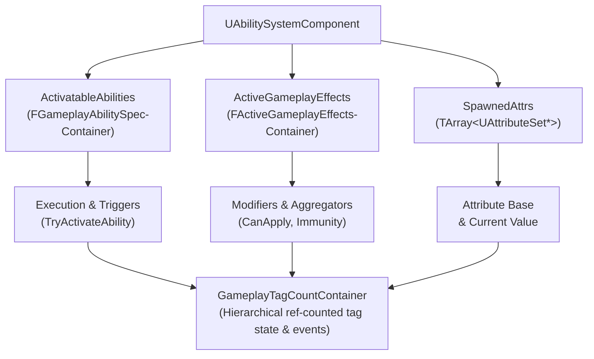
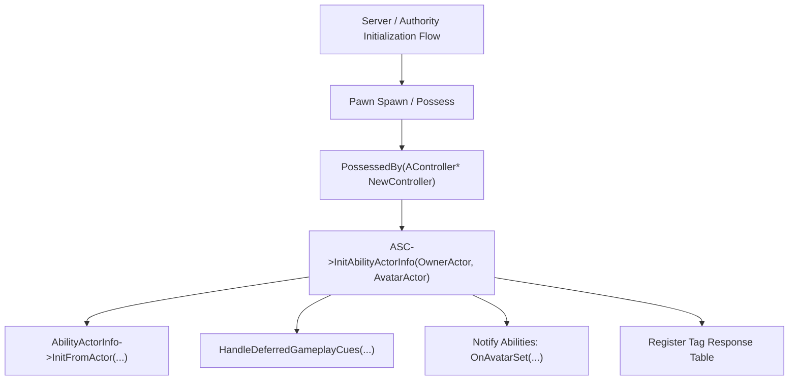
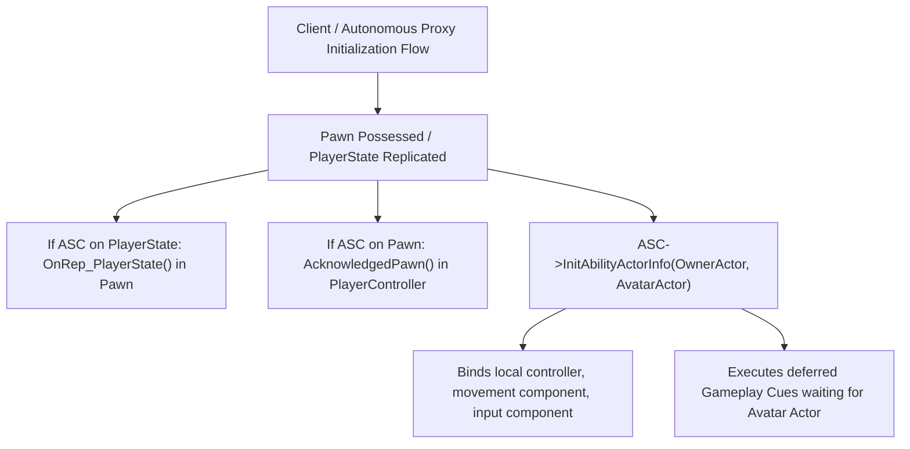

# Gameplay Ability System (GAS) Core Architecture (Unreal Engine 5.8)

## 1. Overview & Core Philosophy

The **Gameplay Ability System (GAS)** is an extensible, data-driven framework built into Unreal Engine to handle abilities, attributes, status effects, and networking prediction. At the epicenter of this architecture is the **Ability System Component (`UAbilitySystemComponent`)**, which acts as the central coordinator, state repository, and network replication endpoint for all gameplay ability mechanics.

GAS is organized around three primary functional pillars:
1. **Gameplay Abilities (`UGameplayAbility`)**: Executable actions, skills, or behaviors. The ASC manages ability specifications (`FGameplayAbilitySpec`), grants/revokes them, tracks instances, and routes input and RPC replication.
2. **Gameplay Effects (`UGameplayEffect`)**: Data assets representing instant, duration-based, or periodic modifications to attributes and gameplay tags. The ASC manages active effect containers (`FActiveGameplayEffectsContainer`), evaluates modifiers, and applies gameplay logic.
3. **Gameplay Attributes (`UAttributeSet`)**: Numerical properties (e.g., Health, Mana, Stamina) grouped in subobjects. The ASC coordinates base and current values via aggregators and handles network replication.

GAS in Unreal Engine 5.8 continues the modern design shift toward `UGameplayAbilitiesDeveloperSettings` for project configuration, deprecates legacy non-instanced ability patterns in favor of instanced models, integrates deeply with Iris and standard NetDeltaSerialize replication pipelines, and exposes comprehensive cheat/debugging hooks via `UAbilitySystemCheatManagerExtension`.

---

## 2. Core Source Dependency Summary

The following table summarizes the core architecture files located in the GameplayAbilities runtime plugin (`Engine/Plugins/Runtime/GameplayAbilities/Source/GameplayAbilities/`).

| Source File | Module Layer | Key Classes / Structs | Primary Responsibility |
| :--- | :--- | :--- | :--- |
| `Public/AbilitySystemComponent.h`<br>`Private/AbilitySystemComponent.cpp`<br>`Private/AbilitySystemComponent_Abilities.cpp` | Public / Private | `UAbilitySystemComponent`, `FGameplayAbilitySpecContainer`, `EConsiderPending`, `EGameplayEffectReplicationMode` | Core Actor Component managing ability specs, active effects, tag counts, attribute sets, input binding, and RPC replication. |
| `Public/AbilitySystemGlobals.h`<br>`Private/AbilitySystemGlobals.cpp` | Public / Private | `UAbilitySystemGlobals`, `FNetSerializeScriptStructCache` | Runtime singleton holding global configurations, default tags, allocation factories (`AllocAbilityActorInfo`, `AllocGameplayEffectContext`), and manager accessors. |
| `Public/GameplayAbilitiesDeveloperSettings.h`<br>`Private/GameplayAbilitiesDeveloperSettings.cpp` | Public / Private | `UGameplayAbilitiesDeveloperSettings` | Project Settings interface (`DeveloperSettingsBackedByCVars`) exposing global classes, cue paths, tag response tables, and evaluation channels. |
| `Public/AbilitySystemInterface.h`<br>`Private/AbilitySystemInterface.cpp` | Public / Private | `UAbilitySystemInterface`, `IAbilitySystemInterface` | Native interface exposing `GetAbilitySystemComponent()` for decoupled actor-to-ASC retrieval across pawns and player states. |
| `Public/AbilitySystemReplicationProxyInterface.h`<br>`Private/AbilitySystemReplicationProxyInterface.cpp` | Public / Private | `UAbilitySystemReplicationProxyInterface`, `IAbilitySystemReplicationProxyInterface` | Interface allowing actors to intercept and route GameplayCue net multicasts and replication events. |
| `Public/AbilitySystemLog.h`<br>`Private/AbilitySystemLog.cpp` | Public / Private | `LogAbilitySystem`, `VLogAbilitySystem`, `LogGameplayEffects`, `ABILITY_LOG` | Logging categories and macros for console, desktop, and Visual Logger outputs. |
| `Public/AbilitySystemStats.h` | Public | `STATGROUP_AbilitySystem`, Cycle Stats, Accumulators | Performance profiling cycle stats tracking effect ticks, aggregator updates, tag searches, and ability activations. |
| `Private/AbilitySystemCheatManagerExtension.h`<br>`Private/AbilitySystemCheatManagerExtension.cpp` | Private | `UAbilitySystemCheatManagerExtension` | In-game cheat extension commands (`AbilityGrant`, `AbilityActivate`, `EffectApply`, etc.) subclassed from `UCheatManagerExtension`. |
| `Public/GameplayAbilitiesModule.h`<br>`Private/GameplayAbilitiesModule.cpp` | Public / Private | `IGameplayAbilitiesModule` | Module interface facilitating singleton module lifecycle, loading checks, and globals initialization delegates. |
| `Public/GameplayAbilitySpec.h`<br>`Public/GameplayAbilitySpecHandle.h` | Public | `FGameplayAbilitySpec`, `FGameplayAbilitySpecContainer`, `FGameplayAbilitySpecHandle`, `FGameplayAbilitySpecDef` | Data structures defining granted ability specifications, networked fast array serializers, and persistent handles. |
| `Public/GameplayEffectTypes.h` | Public | `FGameplayTagCountContainer`, `FActiveGameplayEffect`, `FActiveGameplayEffectsContainer`, `FActiveGameplayEffectHandle` | Core effect structures, count-tracked tag containers, active effect handles, and delegate declarations. |
| `Public/GameplayAbilitySet.h` | Public | `UGameplayAbilitySet` | Data asset defining lists of abilities, input IDs, and startup gameplay effects for batch-granting. |
| `Public/GameplayTagResponseTable.h` | Public | `UGameplayTagReponseTable` | Data asset configuring tag-driven effect responses (e.g., adding tag X automatically applies or removes effect Y). |

---

## 3. AbilitySystemComponent (`UAbilitySystemComponent`) Architecture

### 3.1 Class Inheritance & Core Interfaces
Source: `Engine/Plugins/Runtime/GameplayAbilities/Source/GameplayAbilities/Public/AbilitySystemComponent.h`

```cpp
class UAbilitySystemComponent : public UGameplayTasksComponent, 
                                public IGameplayTagAssetInterface, 
                                public IAbilitySystemReplicationProxyInterface
```
- **`UGameplayTasksComponent`**: ASC inherits gameplay task management, enabling asynchronous node execution such as `UAbilityTask` (wait for target data, wait for input, play montage and wait, etc.).
- **`IGameplayTagAssetInterface`**: Implements standard tag queries (`HasMatchingGameplayTag`, `HasAllMatchingGameplayTags`, `HasAnyMatchingGameplayTags`, `GetOwnedGameplayTags`).
- **`IAbilitySystemReplicationProxyInterface`**: Provides multicast replication proxies and `ForceReplication()` hooks to broadcast Gameplay Cues across the network.

### 3.2 Actor Ownership Models: OwnerActor vs AvatarActor
The ASC separates the concept of identity/ownership from physical representation via `FGameplayAbilityActorInfo`:
- **`OwnerActor`**: The actor that logically owns the ability system (commonly `APlayerState` for player characters, or `APawn`/`ACharacter` for simple AI).
- **`AvatarActor`**: The physical in-world actor executing the actions and receiving animations (e.g., `ACharacter`, `APawn`, or vehicular actor).

#### Why Separate Owner and Avatar?
In multiplayer titles where players respawn or possess different pawns:
1. If the ASC is placed on the **`APlayerState`**, attributes, active buffs/debuffs, cooldowns, and granted ability specs persist across pawn death and respawn. When a new pawn is spawned, `InitAbilityActorInfo` updates the `AvatarActor` pointer, rebinding montage playback and movement component references without losing gameplay state.
2. If the ASC is placed directly on the **`APawn`** (standard for non-respawning AI or single-player pawns), `OwnerActor` and `AvatarActor` are the same actor. When the pawn is destroyed, all abilities, attributes, and effects are destroyed with it.

---

## 4. Core Internal Data Structures

### 4.1 `FGameplayAbilitySpec` & `FGameplayAbilitySpecContainer`
Source: `Engine/Plugins/Runtime/GameplayAbilities/Source/GameplayAbilities/Public/GameplayAbilitySpec.h`

`FGameplayAbilitySpec` is the server-authoritative record of a granted ability on the ASC:
- **`Handle` (`FGameplayAbilitySpecHandle`)**: A unique 32-bit handle generated on the server identifying this specific grant.
- **`Ability` (`TObjectPtr<UGameplayAbility>`)**: Pointer to the Default Object (CDO) of the granted ability class.
- **`Level` (`int32`)**: Current level of the ability (used for scaling calculations).
- **`InputID` (`int32`)**: Integer index associating input triggers (e.g., `1` for Primary Attack, `2` for Secondary).
- **`SourceObject` (`TWeakObjectPtr<UObject>`)**: The weapon, item, or buff object that granted the ability.
- **`ActiveCount` (`uint8`)**: Non-replicated counter of currently active executions.
- **`InputPressed` (`uint8:1`)**: Local and server tracking flag of whether the bound input key is currently held down.
- **`RemoveAfterActivation` (`uint8:1`)**: When set, the spec will be automatically removed once all active instances terminate.
- **`ReplicatedInstances` / `NonReplicatedInstances`**: Arrays of `UGameplayAbility*` instantiated instances.
- **`GetDynamicSpecSourceTags()` (`FGameplayTagContainer`)**: Dynamic runtime tags passed along to any Gameplay Effect created by this spec.

`FGameplayAbilitySpecContainer` derives from `FFastArraySerializer`. It replicates the list of `FGameplayAbilitySpec` items from Server to Owner/Client using NetDeltaSerialize:
- `PreReplicatedRemove`: Cleans up ungranted abilities and unbinds inputs.
- `PostReplicatedAdd`: Sets up local ability triggers, delegates, and instanced objects.
- `PostReplicatedChange`: Syncs level changes and dynamic tags.

### 4.2 `FActiveGameplayEffectsContainer`
Source: `Engine/Plugins/Runtime/GameplayAbilities/Source/GameplayAbilities/Public/GameplayEffect.h` & `Public/GameplayEffectTypes.h`

`FActiveGameplayEffectsContainer` manages all active duration and infinite Gameplay Effects on the ASC:
- Also inherits from `FFastArraySerializer`, replicating active effects down to clients.
- Maintains `GameplayEffects_PendingRemove` and handles scope locking via `FScopedActiveGameplayEffectLock`.
- Manages modifier aggregators for attributes, ensuring stacking, scaling, and periodic tickers are evaluated deterministically.
- Driven by `EGameplayEffectReplicationMode`:
  - `Full`: Replicates all active effects to all clients (standard for single-player or debugging).
  - `Mixed`: Replicates full gameplay effect specs and active effects only to autonomous proxies (the owning player), while simulated proxies receive only minimal tag/cue replications.
  - `Minimal`: Active effects are not replicated; gameplay cues and minimal tag maps replicate via proxy containers. Ideal for large-scale AI.

### 4.3 Tag Storage: `FGameplayTagCountContainer` vs Loose Tags
Source: `Engine/Plugins/Runtime/GameplayAbilities/Source/GameplayAbilities/Public/GameplayEffectTypes.h`

The ASC tracks tags using reference-counted containers rather than flat tag sets:
- **`GameplayTagCountContainer` (`FGameplayTagCountContainer`)**: Stores an explicit tag map (`TMap<FGameplayTag, int32>`) and an expanded hierarchical map (`GameplayTagCountMap`). When a tag `Status.Debuff.Burning` is added with count 1:
  - `Status.Debuff.Burning` count = 1
  - `Status.Debuff` count = 1
  - `Status` count = 1
- **Explicit vs Hierarchical**: Checks such as `HasMatchingGameplayTag(FGameplayTag)` check whether the resolved hierarchical tag count is `> 0`.
- **Loose Tags**: Added directly via `AddLooseGameplayTags(Container)` or `RemoveLooseGameplayTags(Container)`. Loose tags do not originate from a Gameplay Effect and must be managed manually by project systems.
- **Blocked Ability Tags (`BlockedAbilityTags`)**: A secondary `FGameplayTagCountContainer` holding tags that prevent abilities with matching triggers/tags from activating.

---

## 5. Main Subsystems and Interactions



### 5.1 Ability Lifecycle: Granting, Activation, and Termination
Source: `Engine/Plugins/Runtime/GameplayAbilities/Source/GameplayAbilities/Private/AbilitySystemComponent_Abilities.cpp`

1. **Granting (`GiveAbility`)**:
   - Server-only call: `ASC->GiveAbility(FGameplayAbilitySpec(AbilityClass, Level, InputID, SourceObject))`.
   - The spec is added to `ActivatableAbilities.Items`.
   - `OnGiveAbility(Spec)` initializes dynamic triggers (`DynamicAbilityTriggers`) and binds to input maps.
   - Replicated to the owning client via `FGameplayAbilitySpecContainer::NetDeltaSerialize`.
2. **Attempting Activation (`TryActivateAbility`)**:
   - Can be triggered locally by client (predictive) or by server.
   - ASC queries `InternalTryActivateAbility(Handle, PredictionKey, ...)`.
   - Checks:
     - Is the spec valid and not pending remove?
     - Are tags blocked via `AreAbilityTagsBlocked(Spec.Ability->AbilityTags)`?
     - Does the target satisfy tag requirements (`DoesAbilitySatisfyTagRequirements`)?
     - Can the ability afford costs and cooldowns (`CheckCost`, `CheckCooldown`)?
   - If client-predicted: Client generates an `FPredictionKey` and calls `ServerTryActivateAbility(Handle, InputPressed, PredictionKey)`.
3. **Execution & Instancing**:
   - **`InstancedPerActor`**: One instance created on grant and reused across activations.
   - **`InstancedPerExecution`**: A new instance is spawned per activation and destroyed on completion.
   - **`NonInstanced`** *(Deprecated in UE 5.5+)*: Executed directly on the CDO without state tracking.
4. **Ending (`CancelAbility` / `EndAbility`)**:
   - `NotifyAbilityEnded` notifies the ASC.
   - Active instances are destroyed or returned to idle.
   - If `RemoveAfterActivation` was flagged, the spec is removed from `ActivatableAbilities`.

### 5.2 Effect Application & Aggregation
1. The caller constructs an `FGameplayEffectSpec` (using `MakeOutgoingSpec`).
2. Calls `ApplyGameplayEffectSpecToSelf` or `ApplyGameplayEffectSpecToTarget`.
3. Server evaluates application queries (`GameplayEffectApplicationQueries`) and checks immunity (`OnImmunityBlockGameplayEffectDelegate`).
4. If accepted:
   - Instant effects immediately execute attribute modifiers via `AttributeSet->PostGameplayEffectExecute`.
   - Duration/Infinite effects are added to `ActiveGameplayEffects`.
   - Granted tags are pushed into `GameplayTagCountContainer`.
   - Attribute aggregators recalculate current values.

---

## 6. Initialization Lifecycle

Proper initialization timing is critical to avoiding null-pointer crashes or failed replication setups.




### 6.1 `InitializeComponent` & `PostInitializeComponents`
In `UAbilitySystemComponent::InitializeComponent()`:
- Calls `Super::InitializeComponent()`.
- Executes default fallback initialization: `InitAbilityActorInfo(GetOwner(), GetOwner())`.
- Automatically searches for `UAttributeSet` subobjects registered as child objects of the owner actor and registers them in `SpawnedAttributes`.

### 6.2 `InitAbilityActorInfo(InOwnerActor, InAvatarActor)`
Source: `Engine/Plugins/Runtime/GameplayAbilities/Source/GameplayAbilities/Private/AbilitySystemComponent_Abilities.cpp` line 161.
This is the core binding method of GAS:
1. `AbilityActorInfo->InitFromActor(InOwnerActor, InAvatarActor, this)`: Gathers pointers to the Player Controller, Player State, Anim Instance, Skeletal Mesh, and Movement Component.
2. Checks if `AvatarActor` was previously null: if so, triggers `HandleDeferredGameplayCues(&ActiveGameplayEffects)` to execute cues that arrived before the physical actor spawned.
3. Loops over all `ActivatableAbilities.Items` and invokes `OnAvatarSet(AbilityActorInfo.Get(), Spec)` on instanced abilities.
4. Registers with the global `UGameplayTagReponseTable` via `UAbilitySystemGlobals::Get().GetGameplayTagResponseTable()`.
5. Resets and initializes animation montage replication trackers (`LocalAnimMontageInfo`, `RepAnimMontageInfo`).

### 6.3 Where to Call `InitAbilityActorInfo` in Game Code

#### Case A: ASC Lives on PlayerState (Recommended for Respawning Characters)
- **On Server**:
  ```cpp
  void AMyCharacter::PossessedBy(AController* NewController)
  {
      Super::PossessedBy(NewController);
      AMyPlayerState* PS = GetPlayerState<AMyPlayerState>();
      if (PS && PS->GetAbilitySystemComponent())
      {
          PS->GetAbilitySystemComponent()->InitAbilityActorInfo(PS, this);
      }
  }
  ```
- **On Client**:
  ```cpp
  void AMyCharacter::OnRep_PlayerState()
  {
      Super::OnRep_PlayerState();
      AMyPlayerState* PS = GetPlayerState<AMyPlayerState>();
      if (PS && PS->GetAbilitySystemComponent())
      {
          PS->GetAbilitySystemComponent()->InitAbilityActorInfo(PS, this);
      }
  }
  ```

#### Case B: ASC Lives on Pawn (Standard for AI / Non-Respawning Pawns)
- **On Server**:
  ```cpp
  void AMyAICharacter::BeginPlay()
  {
      Super::BeginPlay();
      if (AbilitySystemComponent)
      {
          AbilitySystemComponent->InitAbilityActorInfo(this, this);
      }
  }
  ```
- **On Client**:
  ```cpp
  void AMyCharacter::PossessedBy(AController* NewController)
  {
      Super::PossessedBy(NewController);
      if (AbilitySystemComponent)
      {
          AbilitySystemComponent->InitAbilityActorInfo(this, this);
      }
  }
  ```

---

## 7. Delegate and Event Surface

The ASC exposes extensive multicast delegates for game logic and UI integration:

### 7.1 Ability Activation & Lifecycle Delegates
Source: `Public/AbilitySystemComponent.h`
- `FAbilityFailedDelegate AbilityFailedCallbacks`: Broadcast when an ability fails to activate, passing the ability pointer and an `FGameplayTagContainer` failure reason tag.
- `FAbilityEnded AbilityEndedCallbacks`: Broadcast when any ability ends.
- `FGameplayAbilityEndedDelegate OnAbilityEnded`: Extended delegate providing spec handle, ability pointer, and cancellation boolean.
- `FAbilitySpecDirtied AbilitySpecDirtiedCallbacks`: Broadcast when a spec is modified (level changed, tags modified).

### 7.2 Gameplay Effect Delegates
- `FOnGameplayEffectAppliedDelegate OnGameplayEffectAppliedDelegateToSelf`: Server-only delegate fired whenever an instant or duration effect is applied to self.
- `FOnGameplayEffectAppliedDelegate OnGameplayEffectAppliedDelegateToTarget`: Server-only delegate fired whenever an effect is applied to an external target.
- `FOnGameplayEffectAppliedDelegate OnActiveGameplayEffectAddedDelegateToSelf`: Fired on **both client and server** whenever a duration or infinite effect is added.
- `FOnGameplayEffectAppliedDelegate OnPeriodicGameplayEffectExecuteDelegateOnSelf`: Server-only execution for periodic tickers.
- `FImmunityBlockGE OnImmunityBlockGameplayEffectDelegate`: Broadcast when a GE is blocked by an active immunity tag or query.

### 7.3 Tag and Attribute Dynamic Callbacks
- **Attribute Changes**:
  ```cpp
  ASC->GetGameplayAttributeValueChangeDelegate(UHealthAttributeSet::GetHealthAttribute())
     .AddUObject(this, &AMyCharacter::OnHealthChanged);
  ```
- **Tag Changes**:
  ```cpp
  ASC->RegisterGameplayTagEvent(FGameplayTag::RequestGameplayTag("State.Stunned"), EGameplayTagEventType::NewOrRemoved)
     .AddUObject(this, &AMyCharacter::OnStunTagChanged);
  ```

---

## 8. Ability System Globals & Project Configuration

### 8.1 `UAbilitySystemGlobals`
Source: `Engine/Plugins/Runtime/GameplayAbilities/Source/GameplayAbilities/Public/AbilitySystemGlobals.h`

`UAbilitySystemGlobals` is a singleton created and managed by `IGameplayAbilitiesModule`:
- **Initialization**: Must be initialized early in engine startup via `UAbilitySystemGlobals::Get().InitGlobalData()`. Typically invoked in the project's `AssetManager` subclass or module startup.
- **Factory Allocators**:
  - `AllocAbilityActorInfo()`: Virtual factory allocating the `FGameplayAbilityActorInfo` struct. Projects can override this to return custom sub-structs containing game-specific references.
  - `AllocGameplayEffectContext()`: Virtual factory allocating `FGameplayEffectContext`. Projects override this to capture custom hit result data, instigators, or damage types.
- **Global Helper Methods**:
  - `GetAbilitySystemComponentFromActor(const AActor* Actor, bool LookForComponent)`: Resolves an ASC by querying `IAbilitySystemInterface` first, and falling back to a component lookup if configured.

### 8.2 Modern Configuration via `UGameplayAbilitiesDeveloperSettings`
Source: `Engine/Plugins/Runtime/GameplayAbilities/Source/GameplayAbilities/Public/GameplayAbilitiesDeveloperSettings.h`

In Unreal Engine 5.8, global configuration variables have migrated to `UGameplayAbilitiesDeveloperSettings` (exposed under **Project Settings -> Project -> Gameplay Abilities Settings**).

In `DefaultGame.ini`:
```ini
[/Script/GameplayAbilities.GameplayAbilitiesDeveloperSettings]
; Custom Globals class override
AbilitySystemGlobalsClassName=/Script/MyProject.MyAbilitySystemGlobals

; Prediction settings
PredictTargetGameplayEffects=True
ReplicateActivationOwnedTags=True

; Gameplay Cue Notify asset paths for early indexing
+GameplayCueNotifyPaths=/Game/Abilities/GameplayCues

; Global Tag Response Table
GameplayTagResponseTableName=/Game/Abilities/DefaultTagResponseTable.DefaultTagResponseTable

; Global Attribute Defaults Curve Tables
+GlobalAttributeSetDefaultsTableNames=/Game/Abilities/Attributes/DefaultAttributeCurveTable.DefaultAttributeCurveTable

; Failure Tag Definitions
ActivateFailCooldownTag=Ability.ActivateFail.Cooldown
ActivateFailCostTag=Ability.ActivateFail.Cost
ActivateFailTagsBlockedTag=Ability.ActivateFail.TagsBlocked
ActivateFailTagsMissingTag=Ability.ActivateFail.TagsMissing
ActivateFailNetworkingTag=Ability.ActivateFail.Networking
ActivateFailCanActivateAbilityTag=Ability.ActivateFail.CanActivate

; Mod Evaluation Channels
bAllowGameplayModEvaluationChannels=False
DefaultGameplayModEvaluationChannel=Channel0
```

---

## 9. Native Interface Implementation: `IAbilitySystemInterface`

Source: `Engine/Plugins/Runtime/GameplayAbilities/Source/GameplayAbilities/Public/AbilitySystemInterface.h`

To allow blueprints, ability tasks, and external callers to discover the ASC without tight coupling to specific pawn classes, actors implement `IAbilitySystemInterface`.

### 9.1 Native Header Implementation
```cpp
// MyPlayerState.h
#pragma once

#include "CoreMinimal.h"
#include "GameFramework/PlayerState.h"
#include "AbilitySystemInterface.h"
#include "AbilitySystemComponent.h"
#include "MyPlayerState.generated.h"

UCLASS()
class MYPROJECT_API AMyPlayerState : public APlayerState, public IAbilitySystemInterface
{
    GENERATED_BODY()

public:
    AMyPlayerState();

    // IAbilitySystemInterface implementation
    virtual UAbilitySystemComponent* GetAbilitySystemComponent() const override
    {
        return AbilitySystemComponent;
    }

protected:
    UPROPERTY(VisibleAnywhere, BlueprintReadOnly, Category = "Abilities")
    TObjectPtr<UAbilitySystemComponent> AbilitySystemComponent;
};
```

### 9.2 Actor Forwarding via Interface
When the ASC lives on the `APlayerState`, the pawn should also implement `IAbilitySystemInterface` and forward the call:
```cpp
// MyCharacter.h
#pragma once

#include "CoreMinimal.h"
#include "GameFramework/Character.h"
#include "AbilitySystemInterface.h"
#include "MyPlayerState.h"
#include "MyCharacter.generated.h"

UCLASS()
class MYPROJECT_API AMyCharacter : public ACharacter, public IAbilitySystemInterface
{
    GENERATED_BODY()

public:
    virtual UAbilitySystemComponent* GetAbilitySystemComponent() const override
    {
        AMyPlayerState* PS = GetPlayerState<AMyPlayerState>();
        return PS ? PS->GetAbilitySystemComponent() : nullptr;
    }
};
```

---

## 10. Practical Project Usage Patterns & C++ Example

### 10.1 Complete Minimal Setup: Owning Pawn with ASC and AttributeSet
The following snippet demonstrates setting up an ASC and AttributeSet directly on a Pawn (or Character) where the ASC is owned by the pawn.

```cpp
// Source: Project Native Character Setup
#pragma once

#include "CoreMinimal.h"
#include "GameFramework/Character.h"
#include "AbilitySystemInterface.h"
#include "AbilitySystemComponent.h"
#include "AttributeSet.h"
#include "MyCombatCharacter.generated.h"

// Forward declaration of custom attribute set
class UMyHealthAttributeSet;

UCLASS()
class MYPROJECT_API AMyCombatCharacter : public ACharacter, public IAbilitySystemInterface
{
    GENERATED_BODY()

public:
    AMyCombatCharacter()
    {
        // 1. Create the Ability System Component
        AbilitySystemComponent = CreateDefaultSubobject<UAbilitySystemComponent>(TEXT("AbilitySystemComponent"));
        AbilitySystemComponent->SetIsReplicated(true);
        
        // Mixed replication mode is ideal for player-controlled characters
        AbilitySystemComponent->SetReplicationMode(EGameplayEffectReplicationMode::Mixed);

        // 2. Create the default AttributeSet subobject
        HealthAttributeSet = CreateDefaultSubobject<UMyHealthAttributeSet>(TEXT("HealthAttributeSet"));
    }

    virtual UAbilitySystemComponent* GetAbilitySystemComponent() const override
    {
        return AbilitySystemComponent;
    }

    virtual void PossessedBy(AController* NewController) override
    {
        Super::PossessedBy(NewController);

        // Server initialization of Actor Info
        if (AbilitySystemComponent)
        {
            AbilitySystemComponent->InitAbilityActorInfo(this, this);
            GrantStartupAbilities();
        }
    }

    virtual void OnRep_PlayerState() override
    {
        Super::OnRep_PlayerState();

        // Client initialization of Actor Info (if using PlayerState owner, call here)
        if (AbilitySystemComponent)
        {
            AbilitySystemComponent->InitAbilityActorInfo(this, this);
        }
    }

protected:
    UPROPERTY(VisibleAnywhere, BlueprintReadOnly, Category = "GAS")
    TObjectPtr<UAbilitySystemComponent> AbilitySystemComponent;

    UPROPERTY(VisibleAnywhere, BlueprintReadOnly, Category = "GAS")
    TObjectPtr<UMyHealthAttributeSet> HealthAttributeSet;

    UPROPERTY(EditDefaultsOnly, Category = "GAS")
    TArray<TSubclassOf<UGameplayAbility>> StartupAbilities;

    void GrantStartupAbilities()
    {
        if (!HasAuthority() || !AbilitySystemComponent)
        {
            return;
        }

        for (TSubclassOf<UGameplayAbility>& AbilityClass : StartupAbilities)
        {
            if (AbilityClass)
            {
                FGameplayAbilitySpec Spec(AbilityClass, 1, INDEX_NONE, this);
                AbilitySystemComponent->GiveAbility(Spec);
            }
        }
    }
};
```

---

## 11. Debugging, Cheats, and Diagnostics

### 11.1 Built-in Console Commands & Cheats
The private class `UAbilitySystemCheatManagerExtension` registers several cheats when running in non-shipping builds:
- `AbilityListGranted`: Prints all ability specs granted to the local player.
- `AbilityGrant <AssetSearchString>`: Searches for a GameplayAbility asset matching the string and grants it to the player.
- `AbilityActivate <PartialName>`: Activates an ability matching the specified name.
- `AbilityCancel <PartialName>`: Cancels an active ability.
- `EffectListActive`: Prints all active Gameplay Effects currently on the player's ASC.
- `EffectApply <PartialName> <Level>`: Applies a matching Gameplay Effect.
- `EffectRemove <NameOrHandle>`: Removes active effects by name or handle string.

### 11.2 Visual Logging & Performance Stats
Source: `Engine/Plugins/Runtime/GameplayAbilities/Source/GameplayAbilities/Public/AbilitySystemStats.h`
- Profile with `stat AbilitySystem`:
  - `STAT_ApplyGameplayEffectSpec`: Measures time spent applying GE specs and evaluating modifiers.
  - `STAT_AggregatorEvaluate`: Tracks CPU time spent calculating attribute aggregator stacks.
  - `STAT_HasMatchingGameplayTag`: Profiles tag search overhead across effect and count containers.
  - `STAT_GameplayEffectsTick`: Tracks periodic effect updates.
- Logging:
  - Enable verbose logging via console: `Log LogAbilitySystem VeryVerbose` or `Log LogGameplayEffects VeryVerbose`.
  - Macro usage: `ABILITY_LOG(Log, TEXT("Ability %s Activated"), *GetName());`.

---

## 12. Architectural Pitfalls and Best Practices

1. **Failure to Call `InitGlobalData()` Early**:
   - If `UAbilitySystemGlobals::Get().InitGlobalData()` is not invoked before gameplay effects or tag tables are loaded, attributes and cues may fail to resolve or crash on missing tag references. Invoke it in your `UAssetManager::StartInitialLoading()` override.
2. **Missing `InitAbilityActorInfo` on Autonomous Clients**:
   - Calling `InitAbilityActorInfo` exclusively on the server leaves the autonomous proxy client with a null `AvatarActor` and uninitialized player controller references. Local prediction will fail or crash montage tasks.
3. **Mismatched Replication Modes**:
   - Never set an owned client ASC to `EGameplayEffectReplicationMode::Minimal`. Minimal mode skips active gameplay effect replication entirely, breaking UI attribute bars and buff trackers on player clients. Use `Mixed` for players and `Minimal` for large AI populations.
4. **Modifying Attributes Outside Gameplay Effects**:
   - While `ApplyModToAttribute` and `SetNumericAttributeBase` exist on the ASC, modifying attributes directly bypasses prediction, execution tags, and `PostGameplayEffectExecute` rollback logic. Use `Instant` Gameplay Effects for standard attribute mutations.
5. **Holding Raw Pointers to Ability Instances**:
   - Instanced abilities can end and be marked pending kill at any frame. Never cache a raw `UGameplayAbility*` pointer; instead, refer to abilities by `FGameplayAbilitySpecHandle`.
