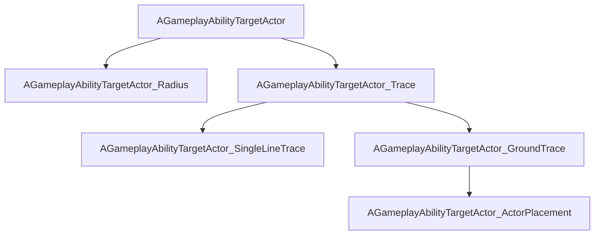

# Gameplay Ability System (GAS): Gameplay Abilities Architecture & Usage (Unreal Engine 5.8)

## 1. Overview & Core Philosophy

In Unreal Engine 5.8's Gameplay Ability System (GAS), a `UGameplayAbility` defines discrete, instanced or non-instanced gameplay actions, skills, spells, or interactions. Abilities encapsulate input binding, execution authorization, client prediction, cost/cooldown application, targeting logic, latent task management, and replicated animation montage synchronization.

### Source File Footprint
All APIs and data structures cited below are grounded in the UE 5.8 source tree:
- `Engine/Plugins/Runtime/GameplayAbilities/Source/GameplayAbilities/Public/Abilities/GameplayAbility.h`
- `Engine/Plugins/Runtime/GameplayAbilities/Source/GameplayAbilities/Private/Abilities/GameplayAbility.cpp`
- `Engine/Plugins/Runtime/GameplayAbilities/Source/GameplayAbilities/Public/GameplayAbilitySpec.h`
- `Engine/Plugins/Runtime/GameplayAbilities/Source/GameplayAbilities/Public/GameplayAbilitySpecHandle.h`
- `Engine/Plugins/Runtime/GameplayAbilities/Source/GameplayAbilities/Public/GameplayAbilitySet.h`
- `Engine/Plugins/Runtime/GameplayAbilities/Source/GameplayAbilities/Private/Abilities/GameplayAbilitySet.cpp`
- `Engine/Plugins/Runtime/GameplayAbilities/Source/GameplayAbilities/Public/GameplayAbilityBlueprint.h`
- `Engine/Plugins/Runtime/GameplayAbilities/Source/GameplayAbilities/Public/Abilities/GameplayAbilityRepAnimMontage.h`
- `Engine/Plugins/Runtime/GameplayAbilities/Source/GameplayAbilities/Public/Abilities/GameplayAbilityTypes.h`
- `Engine/Plugins/Runtime/GameplayAbilities/Source/GameplayAbilities/Public/Abilities/GameplayAbilityTargetTypes.h`
- `Engine/Plugins/Runtime/GameplayAbilities/Source/GameplayAbilities/Public/Abilities/GameplayAbilityTargetActor.h`
- `Engine/Plugins/Runtime/GameplayAbilities/Source/GameplayAbilities/Public/Abilities/GameplayAbilityTargetActor_Trace.h`
- `Engine/Plugins/Runtime/GameplayAbilities/Source/GameplayAbilities/Public/Abilities/GameplayAbilityTargetActor_SingleLineTrace.h`
- `Engine/Plugins/Runtime/GameplayAbilities/Source/GameplayAbilities/Public/Abilities/GameplayAbilityTargetActor_Radius.h`
- `Engine/Plugins/Runtime/GameplayAbilities/Source/GameplayAbilities/Public/Abilities/GameplayAbilityTargetActor_GroundTrace.h`
- `Engine/Plugins/Runtime/GameplayAbilities/Source/GameplayAbilities/Public/Abilities/GameplayAbilityTargetActor_ActorPlacement.h`
- `Engine/Plugins/Runtime/GameplayAbilities/Source/GameplayAbilities/Public/Abilities/GameplayAbilityTargetDataFilter.h`
- `Engine/Plugins/Runtime/GameplayAbilities/Source/GameplayAbilities/Public/Abilities/GameplayAbilityWorldReticle.h`
- `Engine/Plugins/Runtime/GameplayAbilities/Source/GameplayAbilities/Public/Abilities/GameplayAbilityWorldReticle_ActorVisualization.h`
- `Engine/Plugins/Runtime/GameplayAbilities/Source/GameplayAbilities/Public/Abilities/GameplayAbility_Montage.h`
- `Engine/Plugins/Runtime/GameplayAbilities/Source/GameplayAbilities/Public/Abilities/GameplayAbility_CharacterJump.h`
- `Engine/Plugins/Runtime/GameplayAbilities/Source/GameplayAbilitiesEditor/Public/K2Node_LatentAbilityCall.h`
- `Engine/Plugins/Runtime/GameplayAbilities/Source/GameplayAbilitiesEditor/Private/K2Node_LatentAbilityCall.cpp`

---

## 2. Architecture & Type Model

### 2.1 The Spec, Handle, and Instance Model

GAS decouples ability definition (class CDO), possession/registration state (spec), reference handles, and running execution instances:

1. **`FGameplayAbilitySpecHandle`** (`Public/GameplayAbilitySpecHandle.h`):
   - A lightweight, 16-bit integer handle wrapped in `FGameplayAbilitySpecHandle` (`int32 Handle = INDEX_NONE`).
   - Acts as an opaque primary key for an granted ability inside a specific `UAbilitySystemComponent` (ASC). It is generated using an internal monotonic counter (`UAbilitySystemComponent::HandlePool`).
   - Replicated to the owning client via `FGameplayAbilitySpecContainer`.

2. **`FGameplayAbilitySpec`** (`Public/GameplayAbilitySpec.h`):
   - Derives from `FFastArraySerializerItem` and lives within `FGameplayAbilitySpecContainer` on `UAbilitySystemComponent::ActivatableAbilities`.
   - Represents the *grant* of an ability on an actor.
   - Core members:
     - `TObjectPtr<UGameplayAbility> Ability`: Points to the Class Default Object (CDO) of the granted ability.
     - `FGameplayAbilitySpecHandle Handle`: Unique identifier for this spec.
     - `int32 Level`: Current progression level of the ability.
     - `int32 InputID`: Numerical ID for legacy or discrete input binding (defaults to `INDEX_NONE`).
     - `TWeakObjectPtr<UObject> SourceObject`: The item, weapon, or source object that granted the ability.
     - `uint8 ActiveCount`: Counter tracking active executions (`ActiveCount = activations - ends`).
     - `uint8 InputPressed : 1`: Whether the bound input is currently depressed.
     - `uint8 RemoveAfterActivation : 1`: Auto-removes the spec from the ASC once the ability ends.
     - `uint8 PendingRemove : 1` / `bActivateOnce : 1`: Flow flags for scoped ability locks.
     - `TArray<TObjectPtr<UGameplayAbility>> ReplicatedInstances`: Instanced objects replicating to the client.
     - `TArray<TObjectPtr<UGameplayAbility>> NonReplicatedInstances`: Local or un-replicated instanced objects.
     - `FGameplayTagContainer DynamicAbilityTags` (accessed via `GetDynamicSpecSourceTags()`): Tags granted dynamically to this spec, passed to outgoing effect specs as source tags.
     - `TArray<FAbilityTriggerData> DynamicAbilityTriggers`: Dynamic event/tag triggers added per spec.

3. **`UGameplayAbility`** (`Public/Abilities/GameplayAbility.h`):
   - The `UObject` executing ability logic. Depending on `InstancingPolicy`, this is either the CDO or a dynamically allocated UObject subobject of the ASC.
   - Implements `IGameplayTaskOwnerInterface` to own, tick, and clean up latent tasks (`ActiveTasks`).

4. **Instancing Policies (`EGameplayAbilityInstancingPolicy::Type`, `Public/Abilities/GameplayAbilityTypes.h`)**:
   - `NonInstanced` (*Deprecated in 5.5/5.8 for game use*): Runs directly on the CDO. Cannot hold mutable member state or replicated properties. Cannot execute ability tasks safely.
   - `InstancedPerActor` (*Recommended Default*): Allocates exactly one `UGameplayAbility` instance when granted or first activated. Re-uses the instance across activations. Supports replicated properties, RPCs, and maintains state across activations. Accessible via `Spec.GetPrimaryInstance()`.
   - `InstancedPerExecution`: Instantiates a fresh `UGameplayAbility` UObject every time `TryActivateAbility()` runs. Destroyed upon `EndAbility()`. Useful for multi-casting overlapping executions, but does not support property replication or RPCs.

5. **Networking Policies**:
   - `EGameplayAbilityNetExecutionPolicy`:
     - `LocalPredicted`: Initiates locally on predicting client; tells server via `ServerTryActivateAbility`.
     - `LocalOnly`: Runs exclusively on the client/local controller without network notification.
     - `ServerInitiated`: Server initiates execution; spawns/runs on client via replication/RPC.
     - `ServerOnly`: Only executes on the authoritative server.
   - `EGameplayAbilityNetSecurityPolicy`:
     - `ClientOrServer`: Client or server can request activation and termination freely.
     - `ServerOnlyExecution`: Client activation RPCs are ignored by the server.
     - `ServerOnlyTermination`: Client cancellation RPCs are ignored by the server.
     - `ServerOnly`: Server controls both execution and termination.
   - `EGameplayAbilityReplicationPolicy`:
     - `ReplicateNo`: Does not replicate the ability UObject instance.
     - `ReplicateYes`: Replicates the ability UObject instance to the owning client (used with `InstancedPerActor`).

---

### 2.2 Actor Info & Activation Info Structures

#### `FGameplayAbilityActorInfo` (`Public/Abilities/GameplayAbilityTypes.h`)
A polymorphic, cached reference collection describing the context owning and executing the ability:
```cpp
struct FGameplayAbilityActorInfo
{
    TWeakObjectPtr<AActor> OwnerActor;                        // Logical owner (e.g., PlayerState)
    TWeakObjectPtr<AActor> AvatarActor;                       // Physical representation (e.g., Character)
    TWeakObjectPtr<APlayerController> PlayerController;       // Associated PC (if player-controlled)
    TWeakObjectPtr<UAbilitySystemComponent> AbilitySystemComponent; // The owning ASC
    TWeakObjectPtr<USkeletalMeshComponent> SkeletalMeshComponent;   // Avatar's main mesh
    TWeakObjectPtr<UAnimInstance> AnimInstance;               // Avatar's anim instance
    TWeakObjectPtr<UMovementComponent> MovementComponent;     // Avatar's movement component
    // ...
};
```
- Passed as `const FGameplayAbilityActorInfo* ActorInfo` to virtuals.
- Allows decoupled separation between logical persistence (`OwnerActor` = `APlayerState`) and physical representation (`AvatarActor` = `ACharacter`), handling respawns via `OnAvatarSet()` and `NotifyAvatarDestroyed()`.
- Initialized on ASC via `UAbilitySystemComponent::InitAbilityActorInfo(AActor* InOwnerActor, AActor* InAvatarActor)`.

#### `FGameplayAbilityActivationInfo` (`Public/GameplayAbilitySpec.h`)
Lightweight value type representing a specific activation run:
- `EGameplayAbilityActivationMode::Type ActivationMode`:
  - `Authority`: Running on server as authoritative execution.
  - `NonAuthority`: Running on simulated or non-predictive client.
  - `Predicting`: Running on local client waiting for server confirmation.
  - `Confirming`: Running on server, confirming client prediction.
  - `Rejected`: Client activation was rejected by server.
- `FPredictionKey PredictionKeyWhenActivated`: Network prediction key bound at activation.
- `bCanBeEndedByOtherInstance`: Flag for multi-instance cancellation synchronization.

---

### 2.3 GameplayAbilitySet Data Asset

Located in `Public/GameplayAbilitySet.h` and `Private/Abilities/GameplayAbilitySet.cpp`:
- `UGameplayAbilitySet` inherits from `UDataAsset`.
- Encapsulates `TArray<FGameplayAbilityBindInfo> Abilities`.
- `FGameplayAbilityBindInfo`:
  - `TEnumAsByte<EGameplayAbilityInputBinds::Type> Command`: Enum mapping to legacy commands (`Ability1` through `Ability9`).
  - `TSubclassOf<UGameplayAbility> GameplayAbilityClass`: Class to grant.
- `GiveAbilities(UAbilitySystemComponent* AbilitySystemComponent) const`: Iterates through entries and calls `AbilitySystemComponent->GiveAbility(FGameplayAbilitySpec(BindInfo.GameplayAbilityClass, 1, (int32)BindInfo.Command))`.

---

### 2.4 Animation Montage Synchronization (`FGameplayAbilityRepAnimMontage`)

Defined in `Public/Abilities/GameplayAbilityRepAnimMontage.h`:
Replicates montage playback state from server/predictive client to simulated proxies via `UAbilitySystemComponent::RepAnimMontageInfo`:
- `TObjectPtr<UAnimSequenceBase> Animation`: Underlying animation asset.
- `FName SlotName`: Montage slot for dynamic montages.
- `float PlayRate`: Replicated playback rate (can be omitted via `bSkipPlayRate`).
- `float Position`: Quantized playback position.
- `float BlendTime`, `float BlendOutTime`, `float PlayCount`.
- `uint8 NextSectionID`: Current/pending montage section.
- `uint8 PlayInstanceId`: Monotonically incremented wrapping counter distinguishing rapid re-plays of the same montage.
- `uint8 bRepPosition : 1`, `uint8 IsStopped : 1`, `uint8 SkipPositionCorrection : 1`.
- Enum `ERepAnimPositionMethod`:
  - `Position`: Quantized floating-point playback offset.
  - `CurrentSectionId`: Section identifier (bandwidth-efficient alternative).

---

## 3. Ability Lifecycle State Machine

The complete lifecycle transitions across 5 defined phases: **Granted → Prepared → Activated → Committed → Ended**.

```mermaid
stateDiagram-v2
    [*] --> UNREGISTERED: ASC->GiveAbility(FGameplayAbilitySpec)
    UNREGISTERED --> GRANTED: ASC->GiveAbility(FGameplayAbilitySpec)
    GRANTED --> PREPARED: TryActivateAbility() -> CanActivateAbility() -> ShouldActivateAbility()
    PREPARED --> ACTIVATED: CallActivateAbility() -> ActivateAbility() / K2_ActivateAbility()
    ACTIVATED --> COMMITTED: CommitAbility() [CommitCheck -> CommitCost -> CommitCooldown -> CommitExecute]
    COMMITTED --> ENDED: EndAbility() / K2_EndAbility() / CancelAbility()
    state UNREGISTERED {
        [*] --> UnregisteredClass
        UnregisteredClass: Unregistered Class
    }
    state GRANTED {
        [*] --> GrantedState
        GrantedState: GRANTED<br/>Spec stored in ASC ActivatableAbilities; OnGiveAbility() called.
    }
    state PREPARED {
        [*] --> PreparedState
        PreparedState: PREPARED<br/>Instancing determined; PreActivate() called; tags &amp; blocks applied.
    }
    state ACTIVATED {
        [*] --> ActivatedState
        ActivatedState: ACTIVATED<br/>Ability Tasks spawned; TargetActors active; Prediction Key running.
    }
    state COMMITTED {
        [*] --> CommittedState
        CommittedState: COMMITTED<br/>Resources deducted; Cooldown GameplayEffect applied.
    }
    state ENDED {
        [*] --> EndedState
        EndedState: ENDED<br/>ActiveTasks destroyed; Loose tags removed; ReplicatedData cleared.
    }
```



### Detailed Sequence of Activation

1. **Spec Grant (`OnGiveAbility`)**:
   - `UAbilitySystemComponent::GiveAbility(const FGameplayAbilitySpec& Spec)` instantiates the `FGameplayAbilitySpec`.
   - If `InstancedPerActor`, the ASC creates the primary instance (`CreateNewInstanceOfAbility`).
   - `UGameplayAbility::OnGiveAbility(const FGameplayAbilityActorInfo* ActorInfo, const FGameplayAbilitySpec& Spec)` virtual fires on the instance or CDO.

2. **Trigger / Activation Check (`CanActivateAbility`)**:
   - External code, input binding, or a gameplay event (`AbilityTriggers`) calls `UAbilitySystemComponent::TryActivateAbility(SpecHandle)`.
   - Virtual `CanActivateAbility(Handle, ActorInfo, SourceTags, TargetTags, OptionalRelevantTags)` checks:
     - Avatar and ActorInfo validity (`ActorInfo->OwnerActor != nullptr`).
     - Spec presence in `ActivatableAbilities`.
     - Tag verification via `DoesAbilitySatisfyTagRequirements()`:
       - No blocking tags on ASC (`ActivationBlockedTags`, `SourceBlockedTags`).
       - All required tags present on ASC (`ActivationRequiredTags`, `SourceRequiredTags`).
       - Tag-level ability blocking (`IsAbilityBlocked()`).
     - Cooldown verification (`CheckCooldown()`): Evaluates whether any tag in `GetCooldownTags()` exists on the owner ASC.
     - Cost verification (`CheckCost()`): Evaluates if the owner has sufficient attribute resources to cover `CostGameplayEffectClass`.
     - Blueprint hook: `K2_CanActivateAbility(...)`.

3. **Pre-Activation (`PreActivate`)**:
   - Internal non-virtual `CallActivateAbility()` runs:
     - Sets up `CurrentActorInfo`, `CurrentSpecHandle`, and `CurrentActivationInfo`.
     - Stores `CurrentEventData` if triggered via event.
     - Invokes `Comp->HandleChangeAbilityCanBeCanceled(GetAssetTags(), this, true)`.
     - Adds `ActivationOwnedTags` as loose gameplay tags onto the ASC (replicated via `EGameplayTagReplicationState::CountToOwner` if enabled in `AbilitySystemGlobals`).
     - Applies ability block and cancel tags:
       - `CancelAbilitiesWithTag`: Cancels matching running abilities on the ASC.
       - `BlockAbilitiesWithTag`: Prevents new matching abilities from activating.
     - Increments `Spec->ActiveCount`.
     - Signals ASC via `Comp->NotifyAbilityActivated(Handle, this)`.

4. **Execution (`ActivateAbility`)**:
   - Native `ActivateAbility(Handle, ActorInfo, ActivationInfo, TriggerEventData)` executes.
   - If a Blueprint-authored ability, it dispatches `K2_ActivateAbility()` or `K2_ActivateAbilityFromEvent(TriggerEventData)`.
   - Latent actions and `UAbilityTask` instances (e.g. `WaitTargetData`, `PlayMontageAndWait`) are initialized and activated.

5. **Commitment (`CommitAbility`)**:
   - Abilities perform resource/cooldown checks as late as possible (often right when a projectile spawns or montage impacts) via `CommitAbility()`.
   - Sequence within `CommitAbility(...)`:
     1. `CommitCheck(...)`: Final validation check (`CheckCooldown()` + `CheckCost()`).
     2. `CommitAbilityCost(...)` -> `ApplyCost(...)`: Applies `CostGameplayEffectClass` to owner ASC.
     3. `CommitAbilityCooldown(...)` -> `ApplyCooldown(...)`: Applies `CooldownGameplayEffectClass` to owner ASC, attaching duration and cooldown tags.
     4. `CommitExecute(...)`: Broadcasts `K2_CommitExecute()`.

6. **Termination (`EndAbility` / `CancelAbility`)**:
   - `EndAbility(Handle, ActorInfo, ActivationInfo, bReplicateEndAbility, bWasCancelled)`:
     - Validates via `IsEndAbilityValid()`.
     - If `ScopeLockCount > 0`, defers execution onto `WaitingToExecute` delegate list.
     - Fires `K2_OnEndAbility(bWasCancelled)`.
     - Clears world latent actions (`GetLatentActionManager().RemoveActionsForObject(this)`) and timers (`ClearAllTimersForObject`).
     - Broadcasts `OnGameplayAbilityEnded` and `OnGameplayAbilityEndedWithData`.
     - Ends all registered tasks in `ActiveTasks`: calls `Task->TaskOwnerEnded()` in reverse order.
     - Replicates ending to remote instance if `bReplicateEndAbility` is true (`ReplicateEndOrCancelAbility`).
     - Removes `ActivationOwnedTags` from owner ASC.
     - Clears tracked `GameplayCues` added during ability lifetime.
     - Clears block and cancel tag locks.
     - Calls `AbilitySystemComponent->ClearAbilityReplicatedDataCache(Handle, CurrentActivationInfo)`.
     - Decrements `Spec->ActiveCount`. If `RemoveAfterActivation` was set, deletes the spec from ASC.
     - If `InstancedPerExecution`, the ability instance is dereferenced and garbage collected.

---

## 4. Target Data Flow & Reticles

### 4.1 Target Data Types & Handle Polymorphism

GAS decouples targeting geometry from ability logic through polymorphic structs serialized by value (`Public/Abilities/GameplayAbilityTargetTypes.h`):

1. **`FGameplayAbilityTargetData`**:
   - Abstract root struct.
   - Virtual interface:
     - `ApplyGameplayEffect(...)` / `ApplyGameplayEffectSpec(...)`: Applies effects to all entities contained in this target slice.
     - `AddTargetDataToContext(...)`: Packages targeted actors into `FGameplayEffectContextHandle`.
     - `GetActors()` / `SetActors()`: Accesses targeted actor pointers (`TArray<TWeakObjectPtr<AActor>>`).
     - `HasHitResult()` / `GetHitResult()`: Accesses `FHitResult` if trace-derived.
     - `HasOrigin()` / `GetOrigin()`: Retrieves spawn/origin transform.
     - `HasEndPoint()` / `GetEndPoint()` / `GetEndPointTransform()`: Retrieves hit/impact endpoint.

2. **Core Concrete Target Data Structs**:
   - `FGameplayAbilityTargetData_SingleTargetHit`: Contains a single `FHitResult`. Efficient serialization for raycasts, hitscans, and bullet impacts.
   - `FGameplayAbilityTargetData_ActorArray`: Contains `FGameplayAbilityTargetingLocationInfo SourceLocation` and `TArray<TWeakObjectPtr<AActor>> TargetActorArray`. Standard for spherical/cone AOE targeting.
   - `FGameplayAbilityTargetData_LocationInfo`: Contains `SourceLocation` and `TargetLocation` transforms. Used for teleports, ground markers, and destination coordinates without actor hits.

3. **`FGameplayAbilityTargetDataHandle`**:
   - Container wrapping `TArray<TSharedPtr<FGameplayAbilityTargetData>, TInlineAllocator<1>> Data`.
   - Uses `TStructOpsTypeTraits` with `WithNetSerializer = true` and `WithCopy = true`.
   - `NetSerialize(FArchive& Ar, UPackageMap* Map, bool& bOutSuccess)`: Polymorphically serializes individual structs across the network by writing each struct's `UScriptStruct` index/path followed by struct net-serialization.

4. **`FGameplayAbilityTargetingLocationInfo`**:
   - Represents a targeting origin or end location.
   - `EGameplayAbilityTargetingLocationType::Type`:
     - `LiteralTransform`: Explicit world transform.
     - `ActorTransform`: Dynamically fetched from `SourceActor`.
     - `SocketTransform`: Extracted from socket on `SourceComponent` (e.g. muzzle or hand bone).

---

### 4.2 Target Filtering (`FGameplayTargetDataFilter`)

Defined in `Public/Abilities/GameplayAbilityTargetDataFilter.h`:
- `FGameplayTargetDataFilter`:
  - `TObjectPtr<AActor> SelfActor`: Context actor to compare against.
  - `TSubclassOf<AActor> RequiredActorClass`: Restricts targeted actors to subclasses of this class.
  - `ETargetDataFilterSelf::Type SelfFilter`:
    - `TDFS_Any`: Allows self or external actors.
    - `TDFS_NoSelf`: Filters out the activating avatar.
    - `TDFS_NoOthers`: Excludes everything except the activating avatar.
  - `bool bReverseFilter`: Inverts boolean filter result when true.
  - Virtual `FilterPassesForActor(const AActor* ActorToBeFiltered) const`.
- `FGameplayTargetDataFilterHandle`:
  - Polymorphic shared pointer handle (`TSharedPtr<FGameplayTargetDataFilter> Filter`) enabling Blueprint assignment and custom native filter subclassing.

---

### 4.3 Target Actors (`AGameplayAbilityTargetActor`)

Target actors are spawned actors managing interactive targeting, tracing, visual aids, and player confirmation:



1. **`AGameplayAbilityTargetActor`** (`Public/Abilities/GameplayAbilityTargetActor.h`):
   - Base actor. Contains delegates `TargetDataReadyDelegate` and `CanceledDelegate`.
   - Controlled via `StartTargeting(UGameplayAbility* Ability)`, `ConfirmTargeting()`, `ConfirmTargetingAndContinue()`, `CancelTargeting()`.
   - `ShouldProduceTargetDataOnServer`: If false, client generates targeting data and replicates it to server via `ServerSetReplicatedTargetData`. If true, server calculates data independently.
   - `OnReplicatedTargetDataReceived(FGameplayAbilityTargetDataHandle& Data)`: Authority-side validation hook for client-sent data.

2. **`AGameplayAbilityTargetActor_Trace`** (`Public/Abilities/GameplayAbilityTargetActor_Trace.h`):
   - Abstract raycast base.
   - Exposes `float MaxRange`, `FCollisionProfileName TraceProfile`, `bool bTraceAffectsAimPitch`.
   - Static utilities: `LineTraceWithFilter()`, `SweepWithFilter()`, `AimWithPlayerController()`, `ClipCameraRayToAbilityRange()`.
   - Pure virtual `PerformTrace(AActor* InSourceActor)` must be implemented by subclasses.

3. **`AGameplayAbilityTargetActor_SingleLineTrace`**:
   - Performs a camera/socket forward line trace using `TraceProfile`. Packages the hit into `FGameplayAbilityTargetData_SingleTargetHit`.

4. **`AGameplayAbilityTargetActor_Radius`**:
   - Overlaps actors within `Radius` using `PerformOverlap(Origin)`. Filters hits and returns `FGameplayAbilityTargetData_ActorArray`.

5. **`AGameplayAbilityTargetActor_GroundTrace`**:
   - Performs collision sweeps (sphere or capsule via `CollisionRadius` and `CollisionHeight`) down onto walkable ground. Adjusts results with `AdjustCollisionResultForShape()` to prevent geometry interpenetration.

6. **`AGameplayAbilityTargetActor_ActorPlacement`**:
   - Inherits from `GroundTrace`. Spawns a visualization representation (`PlacedActorClass` with `PlacedActorMaterial`) projected onto the floor using `AGameplayAbilityWorldReticle_ActorVisualization`.

---

### 4.4 World Reticles (`AGameplayAbilityWorldReticle`)

Defined in `Public/Abilities/GameplayAbilityWorldReticle.h`:
- Reticles are non-replicated or client-visualized actors tracking targeting positioning.
- Initialized via `InitializeReticle(TargetActor, PlayerController, ReticleParams)`.
- Updates dynamic feedback via `OnValidTargetChanged(bool bNewValue)` and `OnTargetingAnActor(bool bNewValue)`.
- Orientates to user viewpoint via `FaceTowardSource(bool bFaceIn2D)`.
- `AGameplayAbilityWorldReticle_ActorVisualization`:
  - Contains dummy `UCapsuleComponent CollisionComponent` and duplicate `VisualizationComponents` extracted from `PlacedActorClass` to preview complex meshes in world space before confirming deployment.

---

### 4.5 Target Data Flow Sequence

1. `UGameplayAbility::ActivateAbility()` executes.
2. Ability spawns an `AbilityTask_WaitTargetData` (or `WaitTargetDataUsingActor`).
3. Task binds to `TargetActor->TargetDataReadyDelegate`.
4. Player aims in client viewport; TargetActor ticks and traces every frame, repositioning `AGameplayAbilityWorldReticle`.
5. Player clicks input confirm (`GenericConfirm` or input action):
   - `TargetActor->ConfirmTargetingAndContinue()` fires.
   - TargetActor builds `FGameplayAbilityTargetDataHandle`.
   - Client sends RPC `AbilitySystemComponent->ServerSetReplicatedTargetData(...)`.
6. On client and server, `TargetDataReadyDelegate` broadcasts the handle to `UAbilityTask_WaitTargetData`.
7. Task routes execution pin to ability logic (Blueprint or C++ delegate callback).
8. Ability calls `BP_ApplyGameplayEffectToTarget(TargetDataHandle, EffectClass)` or iterates `TargetDataHandle.Get(i)->GetActors()` to apply effects, spawn projectiles, or commit costs.

---

## 5. Blueprint Authoring & Editor Workflow

### 5.1 `UGameplayAbilityBlueprint` (`Public/GameplayAbilityBlueprint.h`)
- Specialized `UBlueprint` class representing Gameplay Abilities.
- Handled by editor factory `UGameplayAbilityBlueprintFactory`.
- Guarantees root graph inheritance from `UGameplayAbility`.

### 5.2 Latent Nodes (`UK2Node_LatentAbilityCall`)
Latent ability operations (e.g. `WaitTargetData`, `PlayMontageAndWait`, `WaitDelay`, `WaitGameplayTagAdd`) require specialized node synthesis in the editor:
- Class `UK2Node_LatentAbilityCall` (`Source/GameplayAbilitiesEditor/Public/K2Node_LatentAbilityCall.h`) inherits from `UK2Node_LatentGameplayTaskCall`.
- **Graph Compatibility (`IsCompatibleWithGraph`)**:
  - Validates that the graph belongs to a `UBlueprint` whose generated class derives from `UGameplayAbility`.
  - Disallows placement inside pure functions, restricting usage to the EventGraph (`GT_Ubergraph`) or Macros (`GT_Macro`).
- **Dynamic Task Spawning (`GetMenuActions`)**:
  - Registers actions for all factory functions returning subclasses of `UAbilityTask`.
  - Configures the node's proxy function name and proxy class dynamically.
- **Compiler Validation (`ValidateNodeDuringCompilation`)**:
  - Inspects all multicast delegate pins on the `UAbilityTask` (e.g. `OnCompleted`, `OnBlendOut`, `OnInterrupted`, `OnCancelled`).
  - Enforces required execution pin links if delegate properties possess the `FK2Node_LatentAbilityCallHelper_RequiresConnection` metadata tag.

---

## 6. Built-in Abilities in UE 5.8

GAS provides two foundational reference implementations:

### 6.1 `UGameplayAbility_Montage` (`Public/Abilities/GameplayAbility_Montage.h`)
- Demonstrates playing an animation montage directly via `UAnimInstance::Montage_Play`:
  - `NetExecutionPolicy` defaults to `EGameplayAbilityNetExecutionPolicy::ServerInitiated`.
  - Calls `CommitAbility()` inside `ActivateAbility()`.
  - Applies ongoing effects from `GameplayEffectClassesWhileAnimating` using `ApplyGameplayEffectToSelf()`.
  - Hooks `FOnMontageEnded` delegate to `OnMontageEnded()`.
  - Automatically strips applied gameplay effects via `RemoveActiveGameplayEffect(Handle)` when the montage completes or gets interrupted.

### 6.2 `UGameplayAbility_CharacterJump` (`Public/Abilities/GameplayAbility_CharacterJump.h`)
- Demonstrates prediction and input release binding:
  - `NetExecutionPolicy` defaults to `LocalPredicted`.
  - `InstancingPolicy` set to `NonInstanced`.
  - Overrides `CanActivateAbility()`: verifies `ACharacter::CanJump()` on the avatar.
  - Overrides `ActivateAbility()`: checks `HasAuthorityOrPredictionKey(ActorInfo, &ActivationInfo)`, commits ability, casts `AvatarActor` to `ACharacter`, and calls `Character->Jump()`.
  - Overrides `InputReleased()`: calls `CancelAbility(Handle, ActorInfo, ActivationInfo, true)` which calls `Character->StopJumping()`.
  - Implements `ScopeLockCount` deferral safety in `CancelAbility()`.

---

## 7. C++ Implementation Pattern: Complete Concrete Ability

Below is an authoritative, UE 5.8-compliant C++ implementation of an offensive targeted fireball ability (`USHA_FireballAbility`), exercising tag requirements, cooldown/cost validation, target actor spawning, and ability lifecycle management.

### Header: `SHA_FireballAbility.h`

```cpp
#pragma once

#include "CoreMinimal.h"
#include "Abilities/GameplayAbility.h"
#include "SHA_FireballAbility.generated.h"

class AGameplayAbilityTargetActor_SingleLineTrace;

/**
 * USHA_FireballAbility
 * Production-ready C++ Gameplay Ability demonstrating targeting, commit, and effect application in UE 5.8.
 */
UCLASS()
class SKYHUNTERS_API USHA_FireballAbility : public UGameplayAbility
{
	GENERATED_BODY()

public:
	USHA_FireballAbility(const FObjectInitializer& ObjectInitializer);

	// ~Begin UGameplayAbility Interface
	virtual bool CanActivateAbility(const FGameplayAbilitySpecHandle Handle, const FGameplayAbilityActorInfo* ActorInfo, const FGameplayTagContainer* SourceTags = nullptr, const FGameplayTagContainer* TargetTags = nullptr, OUT FGameplayTagContainer* OptionalRelevantTags = nullptr) const override;
	virtual void ActivateAbility(const FGameplayAbilitySpecHandle Handle, const FGameplayAbilityActorInfo* ActorInfo, const FGameplayAbilityActivationInfo ActivationInfo, const FGameplayEventData* TriggerEventData) override;
	virtual void EndAbility(const FGameplayAbilitySpecHandle Handle, const FGameplayAbilityActorInfo* ActorInfo, const FGameplayAbilityActivationInfo ActivationInfo, bool bReplicateEndAbility, bool bWasCancelled) override;
	// ~End UGameplayAbility Interface

protected:
	UFUNCTION()
	void OnTargetDataCallback(const FGameplayAbilityTargetDataHandle& TargetDataHandle);

	UFUNCTION()
	void OnTargetCancelledCallback(const FGameplayAbilityTargetDataHandle& TargetDataHandle);

	/** Gameplay Effect applied to targets on hit */
	UPROPERTY(EditDefaultsOnly, Category = "Fireball|Damage")
	TSubclassOf<UGameplayEffect> DamageEffectClass;

	/** Target actor class used for targeting queries */
	UPROPERTY(EditDefaultsOnly, Category = "Fireball|Targeting")
	TSubclassOf<AGameplayAbilityTargetActor_SingleLineTrace> TargetActorClass;

	/** Maximum targeting distance */
	UPROPERTY(EditDefaultsOnly, Category = "Fireball|Targeting")
	float TraceRange = 4000.f;

private:
	UPROPERTY()
	TObjectPtr<AGameplayAbilityTargetActor_SingleLineTrace> SpawnedTargetActor;
};
```

### Source: `SHA_FireballAbility.cpp`

```cpp
#include "SHA_FireballAbility.h"
#include "AbilitySystemComponent.h"
#include "Abilities/GameplayAbilityTargetActor_SingleLineTrace.h"
#include "Abilities/GameplayAbilityTargetTypes.h"
#include "GameFramework/Character.h"

USHA_FireballAbility::USHA_FireballAbility(const FObjectInitializer& ObjectInitializer)
	: Super(ObjectInitializer)
{
	InstancingPolicy = EGameplayAbilityInstancingPolicy::InstancedPerActor;
	NetExecutionPolicy = EGameplayAbilityNetExecutionPolicy::LocalPredicted;
	NetSecurityPolicy = EGameplayAbilityNetSecurityPolicy::ClientOrServer;
	ReplicationPolicy = EGameplayAbilityReplicationPolicy::ReplicateNo;

	// Tag Configuration (Configured in constructor via SetAssetTags in UE 5.5+)
	FGameplayTagContainer DefaultTags;
	DefaultTags.AddTag(FGameplayTag::RequestGameplayTag(TEXT("Ability.Skill.Fireball")));
	SetAssetTags(DefaultTags);

	ActivationOwnedTags.AddTag(FGameplayTag::RequestGameplayTag(TEXT("State.Casting")));
	ActivationBlockedTags.AddTag(FGameplayTag::RequestGameplayTag(TEXT("State.Dead")));
	ActivationBlockedTags.AddTag(FGameplayTag::RequestGameplayTag(TEXT("State.Stunned")));
	CancelAbilitiesWithTag.AddTag(FGameplayTag::RequestGameplayTag(TEXT("Ability.Skill.Channelled")));
}

bool USHA_FireballAbility::CanActivateAbility(
	const FGameplayAbilitySpecHandle Handle,
	const FGameplayAbilityActorInfo* ActorInfo,
	const FGameplayTagContainer* SourceTags,
	const FGameplayTagContainer* TargetTags,
	OUT FGameplayTagContainer* OptionalRelevantTags) const
{
	if (!Super::CanActivateAbility(Handle, ActorInfo, SourceTags, TargetTags, OptionalRelevantTags))
	{
		return false;
	}

	// Verify avatar character exists and is valid
	const ACharacter* Character = Cast<ACharacter>(ActorInfo ? ActorInfo->AvatarActor.Get() : nullptr);
	if (!Character)
	{
		return false;
	}

	return true;
}

void USHA_FireballAbility::ActivateAbility(
	const FGameplayAbilitySpecHandle Handle,
	const FGameplayAbilityActorInfo* ActorInfo,
	const FGameplayAbilityActivationInfo ActivationInfo,
	const FGameplayEventData* TriggerEventData)
{
	Super::ActivateAbility(Handle, ActorInfo, ActivationInfo, TriggerEventData);

	UWorld* World = GetWorld();
	if (!World || !ActorInfo || !ActorInfo->AbilitySystemComponent.IsValid())
	{
		EndAbility(Handle, ActorInfo, ActivationInfo, true, true);
		return;
	}

	// Only spawn interactive target actor on client or locally controlled host
	if (IsLocallyControlled())
	{
		FActorSpawnParameters SpawnParams;
		SpawnParams.Owner = ActorInfo->OwnerActor.Get();
		SpawnParams.Instigator = Cast<APawn>(ActorInfo->AvatarActor.Get());
		SpawnParams.SpawnCollisionHandlingOverride = ESpawnActorCollisionHandlingMethod::AlwaysSpawn;

		TSubclassOf<AGameplayAbilityTargetActor_SingleLineTrace> ClassToSpawn = TargetActorClass ? TargetActorClass : AGameplayAbilityTargetActor_SingleLineTrace::StaticClass();
		SpawnedTargetActor = World->SpawnActor<AGameplayAbilityTargetActor_SingleLineTrace>(ClassToSpawn, SpawnParams);

		if (SpawnedTargetActor)
		{
			SpawnedTargetActor->PrimaryPC = ActorInfo->PlayerController.Get();
			SpawnedTargetActor->StartLocation = MakeTargetLocationInfoFromOwnerActor();
			SpawnedTargetActor->MaxRange = TraceRange;
			SpawnedTargetActor->bDestroyOnConfirmation = true;

			// Bind delegates
			SpawnedTargetActor->TargetDataReadyDelegate.AddUObject(this, &USHA_FireballAbility::OnTargetDataCallback);
			SpawnedTargetActor->CanceledDelegate.AddUObject(this, &USHA_FireballAbility::OnTargetCancelledCallback);

			SpawnedTargetActor->StartTargeting(this);
			SpawnedTargetActor->BindToConfirmCancelInputs();
		}
	}
}

void USHA_FireballAbility::OnTargetDataCallback(const FGameplayAbilityTargetDataHandle& TargetDataHandle)
{
	UAbilitySystemComponent* ASC = GetAbilitySystemComponentFromActorInfo();
	if (!ASC)
	{
		EndAbility(CurrentSpecHandle, CurrentActorInfo, CurrentActivationInfo, true, true);
		return;
	}

	// Commit resources and cooldown right when target data is confirmed
	if (!CommitAbility(CurrentSpecHandle, CurrentActorInfo, CurrentActivationInfo))
	{
		EndAbility(CurrentSpecHandle, CurrentActorInfo, CurrentActivationInfo, true, true);
		return;
	}

	// Apply damage effect to hit targets
	if (DamageEffectClass && TargetDataHandle.Num() > 0)
	{
		FGameplayEffectSpecHandle SpecHandle = MakeOutgoingGameplayEffectSpec(DamageEffectClass, GetAbilityLevel());
		if (SpecHandle.IsValid())
		{
			ApplyGameplayEffectSpecToTarget(CurrentSpecHandle, CurrentActorInfo, CurrentActivationInfo, SpecHandle, TargetDataHandle);
		}
	}

	// Successfully finish ability execution
	EndAbility(CurrentSpecHandle, CurrentActorInfo, CurrentActivationInfo, true, false);
}

void USHA_FireballAbility::OnTargetCancelledCallback(const FGameplayAbilityTargetDataHandle& TargetDataHandle)
{
	EndAbility(CurrentSpecHandle, CurrentActorInfo, CurrentActivationInfo, true, true);
}

void USHA_FireballAbility::EndAbility(
	const FGameplayAbilitySpecHandle Handle,
	const FGameplayAbilityActorInfo* ActorInfo,
	const FGameplayAbilityActivationInfo ActivationInfo,
	bool bReplicateEndAbility,
	bool bWasCancelled)
{
	// Clean up targeting actor if still alive
	if (SpawnedTargetActor && !SpawnedTargetActor->IsActorBeingDestroyed())
	{
		SpawnedTargetActor->TargetDataReadyDelegate.RemoveAll(this);
		SpawnedTargetActor->CanceledDelegate.RemoveAll(this);
		SpawnedTargetActor->Destroy();
		SpawnedTargetActor = nullptr;
	}

	Super::EndAbility(Handle, ActorInfo, ActivationInfo, bReplicateEndAbility, bWasCancelled);
}
```

---

## 8. Common Pitfalls & Best Practices

1. **Forgetting to Call `EndAbility()`**:
   - Abilities that run latent tasks or wait for input will remain active indefinitely if `EndAbility()` is omitted. Active counts will leak, block tags will remain permanently affixed to the actor, and subsequent activation attempts will fail.
   - *Fix*: Ensure every path (cancellation, failure, timeout, target loss, completion) terminates in `EndAbility()`.

2. **Calling `CommitAbility()` Before Necessary**:
   - Committing resources in `ActivateAbility()` before aiming or target confirmation consumes mana and applies cooldown even if the user cancels targeting or misses.
   - *Fix*: Call `CommitAbility()` immediately prior to spawning the projectile or applying target effects.

3. **Using `NonInstanced` Abilities with Member State or Tasks**:
   - Non-instanced abilities run on the CDO (`InstancingPolicy = NonInstanced`). Any member variable modification contaminates the CDO across all players and pawns.
   - *Fix*: Standardize on `InstancedPerActor` for all interactive abilities, saving `NonInstanced` strictly for instantaneous, stateless actions (such as native jumping).

4. **Modifying `AbilityTags` Directly in UE 5.5 / 5.8**:
   - Direct mutation of `AbilityTags` is deprecated in UE 5.5+.
   - *Fix*: Use `SetAssetTags()` during the C++ constructor or override asset tags in the Blueprint Class Defaults tab. Dynamic tags added at runtime must be added to the `FGameplayAbilitySpec` via `GetDynamicSpecSourceTags()`.

5. **Directly Calling `ActivateAbility()`**:
   - Bypassing `TryActivateAbility()` skips `CanActivateAbility()`, network prediction keys, tag requirements, and `PreActivate()` setup.
   - *Fix*: Always invoke abilities through `UAbilitySystemComponent::TryActivateAbility()`.

6. **Target Data Memory Leaks & Serialization Errors**:
   - Allocating raw `new FGameplayAbilityTargetData_X()` pointers without registering them in `FGameplayAbilityTargetDataHandle` causes memory leaks. Furthermore, custom target data structs must implement `NetSerialize` and register `TStructOpsTypeTraits<FMyTargetData>::WithNetSerializer = true`.
   - *Fix*: Wrap target data immediately in `FGameplayAbilityTargetDataHandle(MyTargetDataPtr)` and supply custom struct net serialization.
