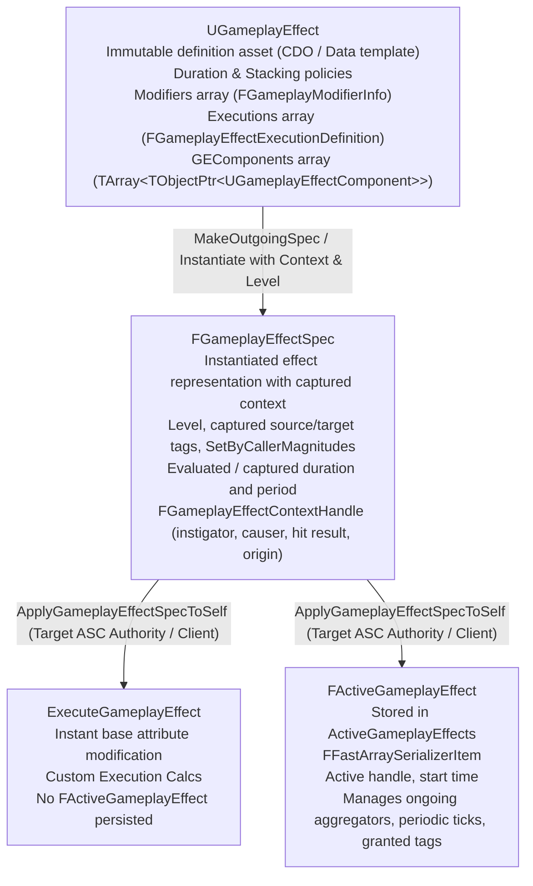
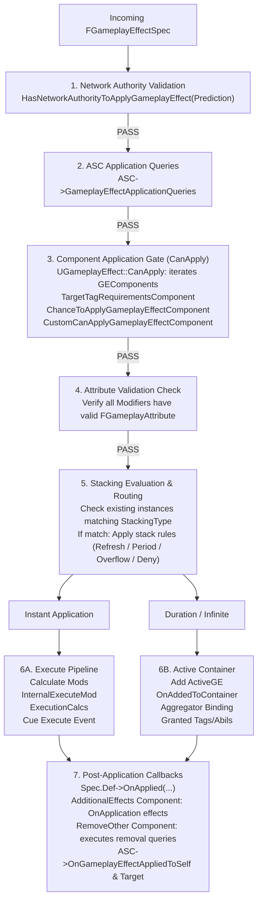

# Gameplay Ability System (GAS) Architecture & Usage Guide: Gameplay Effects

**Engine Version:** Unreal Engine 5.8 (`UE_5.8`)  
**Module Target:** `GameplayAbilities` / `GameplayAbilitiesEditor`  
**Primary Source Citations:**
- `Engine/Plugins/Runtime/GameplayAbilities/Source/GameplayAbilities/Public/GameplayEffect.h`
- `Engine/Plugins/Runtime/GameplayAbilities/Source/GameplayAbilities/Private/GameplayEffect.cpp`
- `Engine/Plugins/Runtime/GameplayAbilities/Source/GameplayAbilities/Public/GameplayEffectTypes.h`
- `Engine/Plugins/Runtime/GameplayAbilities/Source/GameplayAbilities/Private/GameplayEffectTypes.cpp`
- `Engine/Plugins/Runtime/GameplayAbilities/Source/GameplayAbilities/Public/ActiveGameplayEffectHandle.h`
- `Engine/Plugins/Runtime/GameplayAbilities/Source/GameplayAbilities/Public/ActiveGameplayEffectIterator.h`
- `Engine/Plugins/Runtime/GameplayAbilities/Source/GameplayAbilities/Public/GameplayEffectExtension.h`
- `Engine/Plugins/Runtime/GameplayAbilities/Source/GameplayAbilities/Public/GameplayEffectComponent.h`
- `Engine/Plugins/Runtime/GameplayAbilities/Source/GameplayAbilities/Private/GameplayEffectComponent.cpp`
- `Engine/Plugins/Runtime/GameplayAbilities/Source/GameplayAbilities/Public/GameplayEffectComponents/` (all 11 component headers)
- `Engine/Plugins/Runtime/GameplayAbilities/Source/GameplayAbilities/Private/GameplayEffectComponents/` (all 11 component implementations)
- `Engine/Plugins/Runtime/GameplayAbilities/Source/GameplayAbilities/Public/GameplayEffectAggregator.h`
- `Engine/Plugins/Runtime/GameplayAbilities/Source/GameplayAbilities/Private/GameplayEffectAggregator.cpp`
- `Engine/Plugins/Runtime/GameplayAbilities/Source/GameplayAbilities/Public/GameplayEffectAggregatorLibrary.h`
- `Engine/Plugins/Runtime/GameplayAbilities/Source/GameplayAbilities/Public/GameplayModMagnitudeCalculation.h`
- `Engine/Plugins/Runtime/GameplayAbilities/Source/GameplayAbilities/Private/GameplayModMagnitudeCalculation.cpp`
- `Engine/Plugins/Runtime/GameplayAbilities/Source/GameplayAbilities/Public/GameplayEffectCalculation.h`
- `Engine/Plugins/Runtime/GameplayAbilities/Source/GameplayAbilities/Public/GameplayEffectExecutionCalculation.h`
- `Engine/Plugins/Runtime/GameplayAbilities/Source/GameplayAbilities/Private/GameplayEffectExecutionCalculation.cpp`
- `Engine/Plugins/Runtime/GameplayAbilities/Source/GameplayAbilities/Public/GameplayEffectCustomApplicationRequirement.h`
- `Engine/Plugins/Runtime/GameplayAbilities/Source/GameplayAbilities/Private/GameplayEffectCustomApplicationRequirement.cpp`
- `Engine/Plugins/Runtime/GameplayAbilities/Source/GameplayAbilities/Public/GameplayEffectUIData.h`
- `Engine/Plugins/Runtime/GameplayAbilities/Source/GameplayAbilities/Public/GameplayEffectUIData_TextOnly.h`
- `Engine/Plugins/Runtime/GameplayAbilities/Source/GameplayAbilities/Public/ScalableFloat.h`
- `Engine/Plugins/Runtime/GameplayAbilities/Source/GameplayAbilities/Public/AbilitySystemComponent.h`
- `Engine/Plugins/Runtime/GameplayAbilities/Source/GameplayAbilities/Private/AbilitySystemComponent.cpp`

---

## 1. Architectural Overview & Core Data Types

In the Gameplay Ability System, `UGameplayEffect` (GE) represents the immutable definition and ruleset for modifying attributes, gameplay tags, active abilities, and gameplay cues on an `UAbilitySystemComponent` (ASC). Rather than executing mutating logic directly as arbitrary code, GAS formalizes effect behavior into data definitions, stateful instantiated specifications, and active container entries.



### 1.1 Core Type Responsibilities

| Type | Source Header | Responsibility |
|---|---|---|
| `UGameplayEffect` | `Public/GameplayEffect.h` | Blueprintable `UObject` representing the immutable data template (class default object). Configures duration type, period, stacking policies, static modifiers, execution calculations, and modular components (`GEComponents`). |
| `FGameplayEffectSpec` | `Public/GameplayEffect.h` | Concrete runtime specification generated from a `UGameplayEffect` CDO. Captures instigator/source actor tags, holds caller-assigned floats (`SetByCallerTagMagnitudes`), calculates modifier magnitudes, and holds the `FGameplayEffectContextHandle`. |
| `FGameplayEffectSpecHandle` | `Public/GameplayEffectTypes.h` | Safe wrapper around `TSharedPtr<FGameplayEffectSpec>`, exposed to Blueprints for passing effect specs between abilities, tasks, and target actors. |
| `FActiveGameplayEffect` | `Public/GameplayEffect.h` | Struct representing an instantiated, non-instant effect actively running on an ASC. Inherits from `FFastArraySerializerItem` for optimized network replication. Tracks start time, period timer, stack count, and registered attribute aggregator handles. |
| `FActiveGameplayEffectsContainer` | `Public/GameplayEffect.h` | Replication container (`FFastArraySerializer`) owned by `UAbilitySystemComponent`. Manages all active effects, scopes locks during iteration, hosts attribute aggregators (`FAggregator`), and evaluates periodic executions. |
| `FActiveGameplayEffectHandle` | `Public/ActiveGameplayEffectHandle.h` | Globally unique identifier (combining an integer handle index and the target ASC) that references an active effect without storing unsafe raw pointers. |
| `FActiveGameplayEffectIterator` | `Public/ActiveGameplayEffectIterator.h` | Scope-locked RAII iterator iterating over active effects in an `FActiveGameplayEffectsContainer`, automatically skipping pending-removed items and preventing container invalidation. |
| `FGameplayEffectContext` | `Public/GameplayEffectTypes.h` | Polymorphic context struct passed via `FGameplayEffectContextHandle`. Encapsulates instigator, source ability, damage causer, target actors, and `FHitResult`. Extensible via sub-classing. |
| `FGameplayEffectModCallbackData` | `Public/GameplayEffectExtension.h` | Struct delivered to `UAttributeSet::PreGameplayEffectExecute` and `PostGameplayEffectExecute`, packaging the source `FGameplayEffectSpec`, target ASC, and the evaluated attribute delta (`FGameplayModifierEvaluatedData`). |
| `FScalableFloat` | `Public/ScalableFloat.h` | Curve-table-backed float evaluation struct combining a raw float scalar with an optional `UCurveTable` evaluation curve driven by the GE level. |

---

## 2. The GameplayEffect Lifecycle: Definition -> Spec -> Active Effect

### 2.1 Stage 1: Definition (`UGameplayEffect`)
Effects are configured as Data-Only Blueprints or native C++ classes deriving from `UGameplayEffect`. 
Under UE 5.3+ modular architecture (`EGameplayEffectVersion::Modular53`), monolithic properties (such as granted abilities, target tags, immunity, application requirements) are separated into specialized subobjects implementing `UGameplayEffectComponent`.

### 2.2 Stage 2: Instantiation & Specification (`FGameplayEffectSpec`)
An effect cannot be applied directly from its class; it must first be instantiated into a specification via:
```cpp
// Created by Ability or ASC:
FGameplayEffectSpecHandle SpecHandle = ASC->MakeOutgoingSpec(GameplayEffectClass, Level, ContextHandle);
```
During initialization (`FGameplayEffectSpec::Initialize`):
1. The CDO of `UGameplayEffect` is assigned to `Spec.Def`.
2. Attribute captures defined on the GE definition are evaluated against the source ASC (`CaptureAttributeDataFromSource`).
3. Source actor tags are snapshotted (`CapturedSourceTags`).
4. Duration and period are evaluated using the Spec level and any SetByCaller parameters.

### 2.3 Stage 3: Active Application (`FActiveGameplayEffect`)
When `UAbilitySystemComponent::ApplyGameplayEffectSpecToSelf` is called:
- **Instant Effects (`DurationPolicy == EGameplayEffectDurationType::Instant`):**
  The spec does not persist. It routes directly to `UAbilitySystemComponent::ExecuteGameplayEffect`, which invokes `FActiveGameplayEffectsContainer::ExecuteActiveEffectsFrom`. Attributes are modified instantly, execution calculations run, gameplay cues fire with `EGameplayCueEvent::Executed`, and the function returns an instant handle (`FActiveGameplayEffectHandle::GetInstantExecutedHandle()`).
- **Duration / Infinite Effects (`HasDuration` or `Infinite`):**
  The spec is added to `FActiveGameplayEffectsContainer` as an `FActiveGameplayEffect`. The container creates/updates attribute aggregators (`FAggregator`), registers timer delegates for duration and periodic ticking, grants tags to the owner ASC, triggers `EGameplayCueEvent::OnActive` and `WhileActive`, and returns a valid `FActiveGameplayEffectHandle`.

---

## 3. The GameplayEffect Application Pipeline

When `ASC->ApplyGameplayEffectSpecToSelf(Spec, PredictionKey)` is invoked, the execution flow strictly adheres to the following sequence in `AbilitySystemComponent.cpp` and `GameplayEffect.cpp`:



### Detailed Application Steps:
1. **Network Authority Check:** Server verifies authority. Clients can only predict non-periodic effects with a valid client prediction key. Periodic effects on non-authoritative clients fail immediately.
2. **Container Application Queries:** Evaluates registered `FGameplayEffectApplicationQuery` delegates.
3. **Component Gate (`UGameplayEffect::CanApply`):** Iterates over all registered `GEComponents` calling `CanGameplayEffectApply(ActiveGEContainer, GESpec)`.
   - `TargetTagRequirementsGameplayEffectComponent`: Ensures target owns `ApplicationTagRequirements` and lacks `RemovalTagRequirements`.
   - `ChanceToApplyGameplayEffectComponent`: Evaluates `ChanceToApplyToTarget.GetValueAtLevel(Level) >= FMath::FRand()`.
   - `CustomCanApplyGameplayEffectComponent`: Executes all assigned `UGameplayEffectCustomApplicationRequirement` classes.
4. **Attribute Set Validation:** Validates that every modifier attribute exists in the target's registered `UAttributeSet` subobjects.
5. **Stacking / Active Insertion:** If non-instant, searches `ActiveGameplayEffects` for an existing stackable effect using `GetStackingType()`.
6. **Execution (`ExecuteActiveEffectsFrom`):**
   - Evaluates modifier magnitudes via `SpecToUse.CalculateModifierMagnitudes()`.
   - Executes static modifiers against the target AttributeSet via `InternalExecuteMod`.
   - Fires `AttributeSet->PreGameplayEffectExecute(ExecuteData)`.
   - Modifies the base attribute numeric value via `ApplyModToAttribute`.
   - Fires `AttributeSet->PostGameplayEffectExecute(ExecuteData)`.
   - Executes custom execution calculations (`UGameplayEffectExecutionCalculation::Execute`).
   - Invokes gameplay cues (`InvokeGameplayCueExecuted_FromSpec`).
   - Triggers conditional gameplay effects.
7. **Component OnApplied Hook:** Calls `UGameplayEffect::OnApplied`, prompting components like `UAdditionalEffectsGameplayEffectComponent` to apply companion effects and `URemoveOtherGameplayEffectComponent` to purge targeted active effects.

---

## 4. Policy Enums & Stacking Specifications

All duration, stacking, period, and expiration policies are declared in `Public/GameplayEffect.h` and `Public/GameplayEffectTypes.h`.

### 4.1 Duration & Period Policies

| Enum | Value | Source Location | Description |
|---|---|---|---|
| `EGameplayEffectDurationType` | `Instant` | `GameplayEffect.h:686` | Effect executes once immediately upon application and never creates an `FActiveGameplayEffect`. Modifies base attribute values directly. |
| `EGameplayEffectDurationType` | `Infinite` | `GameplayEffect.h:686` | Effect remains active indefinitely until explicitly removed by tag, handle, query, or another effect. |
| `EGameplayEffectDurationType` | `HasDuration` | `GameplayEffect.h:686` | Effect remains active for a specific duration determined by `FScalableFloat` or modifier magnitude calculation. |
| `EGameplayEffectPeriodInhibitionRemovedPolicy` | `NeverReset` | `GameplayEffect.h:737` | When inhibition (ongoing tag requirement failure) ends, the period timing resumes where it left off. |
| `EGameplayEffectPeriodInhibitionRemovedPolicy` | `ResetPeriod` | `GameplayEffect.h:737` | When inhibition ends, the timer restarts; the next execution occurs one full period later. |
| `EGameplayEffectPeriodInhibitionRemovedPolicy` | `ExecuteAndResetPeriod` | `GameplayEffect.h:737` | When inhibition ends, the effect executes immediately and restarts the period timer. |

### 4.2 Stacking Policies

| Enum | Value | Source Location | Description |
|---|---|---|---|
| `EGameplayEffectStackingType` | `None` | `GameplayEffectTypes.h:177` | No stacking. Each application creates an entirely independent active effect instance. |
| `EGameplayEffectStackingType` | `AggregateBySource` | `GameplayEffectTypes.h:177` | Stacks instances applied by the same instigator source actor. Different sources maintain separate active effect stacks. |
| `EGameplayEffectStackingType` | `AggregateByTarget` | `GameplayEffectTypes.h:177` | Stacks all instances applied to the target actor into a single shared stack, regardless of who applied them. |
| `EGameplayEffectStackingDurationPolicy` | `RefreshOnSuccessfulApplication` | `GameplayEffect.h:698` | Resets the active effect's remaining duration back to the full duration on every new stack application. |
| `EGameplayEffectStackingDurationPolicy` | `NeverRefresh` | `GameplayEffect.h:698` | The effect duration continues counting down uninterrupted; adding stacks does not grant additional duration. |
| `EGameplayEffectStackingDurationPolicy` | `ExtendDuration` | `GameplayEffect.h:698` | Adds the new spec's full duration onto the currently remaining time (e.g. 3s remaining + 5s = 8s). |
| `EGameplayEffectStackingPeriodPolicy` | `ResetOnSuccessfulApplication` | `GameplayEffect.h:712` | Discards current progress towards the next periodic tick upon each new stack application. |
| `EGameplayEffectStackingPeriodPolicy` | `NeverReset` | `GameplayEffect.h:712` | Maintains periodic ticking cadence; new stacks do not alter the next tick timestamp. |
| `EGameplayEffectStackingExpirationPolicy` | `ClearEntireStack` | `GameplayEffect.h:723` | When the effect duration expires, all stacks are discarded and the effect is removed. |
| `EGameplayEffectStackingExpirationPolicy` | `RemoveSingleStackAndRefreshDuration` | `GameplayEffect.h:723` | When duration expires, decrements stack count by 1 and refreshes duration. Effect persists until stack count hits 0. |
| `EGameplayEffectStackingExpirationPolicy` | `RefreshDuration` | `GameplayEffect.h:723` | Duration resets without removing stacks, effectively preventing automatic expiration (used for manual stack control via delegates). |

### 4.3 Stacking Overflow Rules
Configured directly on `UGameplayEffect`:
- `StackLimitCount`: Maximum allowable stack count ($>0$). Set to `0` or `-1` for unlimited stacks.
- `bDenyOverflowApplication`: If `true`, application attempts made while already at `StackLimitCount` are denied, preventing duration refresh.
- `bClearStackOnOverflow`: If `true` and overflow is denied, the existing effect stack is cleared immediately upon overflow attempt.
- `OverflowEffects`: Array of `TSubclassOf<UGameplayEffect>` applied to the target whenever an application attempt exceeds the stack limit.

---

## 5. Gameplay Effect Component Catalog

Under Unreal Engine 5.3+ modular architecture, effects are composed of modular components derived from `UGameplayEffectComponent` (`Public/GameplayEffectComponent.h`). Each component encapsulates a single responsibility, implementing hooks into the effect lifecycle:
- `CanGameplayEffectApply`: Application gate.
- `OnActiveGameplayEffectAdded`: Active container registration (duration/infinite).
- `OnGameplayEffectExecuted`: Instant or periodic execution logic.
- `OnGameplayEffectApplied`: General application hook (both instant and active).
- `OnGameplayEffectChanged`: Editor serialization & property sync hook.

| Component Class | Source Header | Editor Display Name | Lifecycle Hooks Used | Detailed Purpose & Configuration |
|---|---|---|---|---|
| `UAbilitiesGameplayEffectComponent` | `GameplayEffectComponents/AbilitiesGameplayEffectComponent.h` | Grant Gameplay Abilities | `OnActiveGameplayEffectAdded` | Grants one or more `UGameplayAbility` specifications to the target ASC while this effect remains active. Configured via `FGameplayAbilitySpecConfig` (Ability class, Level ScalableFloat, InputID, and `EGameplayEffectGrantedAbilityRemovePolicy`). Automatically revokes granted abilities when the effect expires or is inhibited. |
| `UAdditionalEffectsGameplayEffectComponent` | `GameplayEffectComponents/AdditionalEffectsGameplayEffectComponent.h` | Apply Additional Effects | `OnActiveGameplayEffectAdded`, `OnGameplayEffectApplied` | Triggers companion gameplay effects based on lifecycle events. Supports `OnApplicationGameplayEffects` (with optional `bOnApplicationCopyDataFromOriginalSpec`), `OnCompleteAlways`, `OnCompleteNormal` (natural duration expiration), and `OnCompletePrematurely` (early removal/cleanse). |
| `UAssetTagsGameplayEffectComponent` | `GameplayEffectComponents/AssetTagsGameplayEffectComponent.h` | Tags This Effect Has (Asset Tags) | `OnGameplayEffectChanged` | Configures tags that belong to the Gameplay Effect Asset itself (`InheritableAssetTags`). These tags **do not** transfer to the target actor. Used for effect queries, immunity filtering, and cue triggering. |
| `UBlockAbilityTagsGameplayEffectComponent` | `GameplayEffectComponents/BlockAbilityTagsGameplayEffectComponent.h` | Block Abilities with Tags | `OnGameplayEffectChanged` | Grants tags to the target ASC that block the activation of any abilities possessing matching tags (`InheritableBlockedAbilityTagsContainer`). Active only while the effect is non-inhibited. |
| `UCancelAbilityTagsGameplayEffectComponent` | `GameplayEffectComponents/CancelAbilityTagsGameplayEffectComponent.h` | Cancel Abilities with Tags | `OnGameplayEffectExecuted`, `OnGameplayEffectApplied` | Cancels currently active abilities matching configured tag requirements. Mode selectable via `ECancelAbilityTagsGameplayEffectComponentMode`: `OnApplication` (cancels once upon GE application) or `OnExecution` (cancels on every periodic execution tick). |
| `UChanceToApplyGameplayEffectComponent` | `GameplayEffectComponents/ChanceToApplyGameplayEffectComponent.h` | Chance To Apply This Effect | `CanGameplayEffectApply` | Probabilistic gate on effect application. Evaluates `ChanceToApplyToTarget` (`FScalableFloat`) against a random float $[0.0, 1.0)$. If random check fails, application aborts without executing modifiers or cues. |
| `UCustomCanApplyGameplayEffectComponent` | `GameplayEffectComponents/CustomCanApplyGameplayEffectComponent.h` | Custom Can Apply This Effect | `CanGameplayEffectApply` | Delegates application checks to one or more custom classes deriving from `UGameplayEffectCustomApplicationRequirement`. All requirements must return `true` for application to succeed. |
| `UImmunityGameplayEffectComponent` | `GameplayEffectComponents/ImmunityGameplayEffectComponent.h` | Immunity to Other Effects | `OnActiveGameplayEffectAdded` | Registers an ongoing immunity check on the target ASC via `TArray<FGameplayEffectQuery> ImmunityQueries`. Any incoming gameplay effect matching one of these queries is blocked from applying to the target while this effect is active. |
| `URemoveOtherGameplayEffectComponent` | `GameplayEffectComponents/RemoveOtherGameplayEffectComponent.h` | Remove Other Effects | `OnGameplayEffectApplied` | Runs queries (`TArray<FGameplayEffectQuery> RemoveGameplayEffectQueries`) against the target's `ActiveGameplayEffects` container upon application, purging any active effects that match. Ideal for cleansing spells or dispels. |
| `UTargetTagRequirementsGameplayEffectComponent` | `GameplayEffectComponents/TargetTagRequirementsGameplayEffectComponent.h` | Require Tags to Apply/Continue This Effect | `CanGameplayEffectApply`, `OnActiveGameplayEffectAdded` | Defines tag requirements on the target actor: `ApplicationTagRequirements` (must pass at application), `OngoingTagRequirements` (turns effect "on" or "off"/inhibited without removing it), and `RemovalTagRequirements` (instantly removes effect if met). |
| `UTargetTagsGameplayEffectComponent` | `GameplayEffectComponents/TargetTagsGameplayEffectComponent.h` | Grant Tags to Target Actor | `OnGameplayEffectChanged` | Grants tags to the target actor (`InheritableGrantedTagsContainer`) while the effect is active. The target actor "owns" these tags, making them visible to abilities, queries, and other effects. |

---

## 6. Modifier Magnitudes & Aggregators

### 6.1 Modifier Calculation Types
Gameplay effect modifiers specify how an attribute should be altered using `EGameplayModOp`:
- `Additive` ($A + B$)
- `Multiplicitive` ($A \times B$)
- `Division` ($A / B$)
- `Override` ($A = B$)

The magnitude of a modifier is evaluated via one of four calculation policies (`EGameplayEffectMagnitudeCalculation`):
1. **ScalableFloat:** Uses `FScalableFloat`, evaluating a constant or curve table row based on the spec level.
2. **AttributeBased:** Captures an attribute from either the `Source` or `Target` ASC (snapshotting at spec creation or tracking dynamically at application time).
3. **CustomCalculationBased:** Calls a native or blueprint class deriving from `UGameplayModMagnitudeCalculation` (ModMagCalc / MMC).
4. **SetByCaller:** Retrieves a float magnitude assigned at runtime via `FGameplayTag` or `FName` using `FGameplayEffectSpec::SetSetByCallerMagnitude`.

### 6.2 Attribute Aggregator System (`FAggregator`)
For duration and infinite gameplay effects, attribute modifications do not permanently overwrite the base numeric attribute. Instead, they are held in **Aggregators** (`FAggregator`, defined in `Public/GameplayEffectAggregator.h`):

- **Channels (`EGameplayModEvaluationChannel`):** Modifiers are partitioned into evaluation channels (e.g. Channel 0: Base, Channel 1: Buff, Channel 2: Percent).
- **Evaluation Order:** Within each channel, modifiers evaluate in strict mathematical order:
  $$\text{Value} = \left( \frac{\text{Base} + \sum \text{Additive}}{1} \times \prod \text{Multipliers} \right) \div \prod \text{Divisors}$$
  Override modifiers replace the evaluated total for that channel.
- **Dependency Tracking:** When an active effect is removed or its tags change, the aggregator recalculates and broadcasts dirty events (`FOnAggregatorDirty`), prompting the ASC to update the resulting attribute value and notify listeners.

---

## 7. Execution Calculations (`UGameplayEffectExecutionCalculation`)

While standard modifiers perform uniform single-attribute operations, complex interactions (such as armor mitigation, elemental resistances, critical strikes, and multi-attribute transfers) are implemented using `UGameplayEffectExecutionCalculation` (ExecCalc, defined in `Public/GameplayEffectExecutionCalculation.h`).

### 7.1 Key Characteristics
- **Executes Authority-Only:** Runs strictly on `ROLE_Authority`.
- **Instant/Periodic Only:** Executed during instant application or periodic ticks; never held as an ongoing aggregator mod.
- **Full Capture Access:** Can capture multiple source and target attributes (with or without snapshotting).
- **Emits Evaluated Mods:** Outputs zero, one, or multiple `FGameplayModifierEvaluatedData` entries directly to the target ASC.

### 7.2 Custom Execution Code Example

The following example implements a physical damage calculation with source attack power, target armor mitigation, and optional critical hit logic:

#### Header: `G:/Projects/SkyHunters/Source/SkyHunters/GAS/Executions/SHDamageExecution.h`
```cpp
#pragma once

#include "CoreMinimal.h"
#include "GameplayEffectExecutionCalculation.h"
#include "SHDamageExecution.generated.h"

UCLASS()
class SKYHUNTERS_API USHDamageExecution : public UGameplayEffectExecutionCalculation
{
	GENERATED_BODY()

public:
	USHDamageExecution();

	virtual void Execute_Implementation(
		const FGameplayEffectCustomExecutionParameters& ExecutionParams,
		FGameplayEffectCustomExecutionOutput& OutExecutionOutput) const override;
};
```

#### Source: `G:/Projects/SkyHunters/Source/SkyHunters/GAS/Executions/SHDamageExecution.cpp`
```cpp
#include "SHDamageExecution.h"
#include "AbilitySystemComponent.h"
#include "SkyHunters/GAS/Attributes/SHCombatAttributeSet.h"

struct FSHDamageStatics
{
	// Attribute capture definitions
	DECLARE_ATTRIBUTE_CAPTUREDEF(AttackPower);
	DECLARE_ATTRIBUTE_CAPTUREDEF(Armor);
	DECLARE_ATTRIBUTE_CAPTUREDEF(Damage);

	FSHDamageStatics()
	{
		// Capture Source Attack Power (snapshotted when spec was created)
		DEFINE_ATTRIBUTE_CAPTUREDEF(USHCombatAttributeSet, AttackPower, Source, true);

		// Capture Target Armor (evaluated dynamically at execution time, not snapshotted)
		DEFINE_ATTRIBUTE_CAPTUREDEF(USHCombatAttributeSet, Armor, Target, false);

		// Target incoming Damage attribute (meta-attribute)
		DEFINE_ATTRIBUTE_CAPTUREDEF(USHCombatAttributeSet, Damage, Target, false);
	}
};

static const FSHDamageStatics& DamageStatics()
{
	static FSHDamageStatics Statics;
	return Statics;
}

USHDamageExecution::USHDamageExecution()
{
	// Register attributes to capture
	RelevantAttributesToCapture.Add(DamageStatics().AttackPowerDef);
	RelevantAttributesToCapture.Add(DamageStatics().ArmorDef);
	RelevantAttributesToCapture.Add(DamageStatics().DamageDef);
}

void USHDamageExecution::Execute_Implementation(
	const FGameplayEffectCustomExecutionParameters& ExecutionParams,
	FGameplayEffectCustomExecutionOutput& OutExecutionOutput) const
{
	UAbilitySystemComponent* TargetASC = ExecutionParams.GetTargetAbilitySystemComponent();
	UAbilitySystemComponent* SourceASC = ExecutionParams.GetSourceAbilitySystemComponent();

	const FGameplayEffectSpec& Spec = ExecutionParams.GetOwningSpec();

	// Gather tags for evaluation
	const FGameplayTagContainer* SourceTags = Spec.CapturedSourceTags.GetTags();
	const FGameplayTagContainer* TargetTags = Spec.CapturedTargetTags.GetTags();

	FAggregatorEvaluateParameters EvaluationParameters;
	EvaluationParameters.SourceTags = SourceTags;
	EvaluationParameters.TargetTags = TargetTags;

	// Capture values
	float RawAttackPower = 0.f;
	ExecutionParams.AttemptCalculateCapturedAttributeMagnitude(DamageStatics().AttackPowerDef, EvaluationParameters, RawAttackPower);
	RawAttackPower = FMath::Max(RawAttackPower, 0.f);

	float TargetArmor = 0.f;
	ExecutionParams.AttemptCalculateCapturedAttributeMagnitude(DamageStatics().ArmorDef, EvaluationParameters, TargetArmor);
	TargetArmor = FMath::Max(TargetArmor, 0.f);

	// Formula: Damage = AttackPower * (100 / (100 + Armor))
	const float ArmorMitigationPercent = 100.f / (100.f + TargetArmor);
	float MitigatedDamage = RawAttackPower * ArmorMitigationPercent;

	if (MitigatedDamage > 0.f)
	{
		// Output the evaluated modifier to the Target's Incoming Damage meta-attribute
		OutExecutionOutput.AddOutputModifier(
			FGameplayModifierEvaluatedData(
				DamageStatics().DamageProperty,
				EGameplayModOp::Additive,
				MitigatedDamage
			)
		);
	}
}
```

---

## 8. Modifier Magnitude Calculations (`UGameplayModMagnitudeCalculation`)

When a modifier magnitude requires dynamic logic (such as scaling based on target missing health or reading external configuration tables) without full execution calculation overhead, derive from `UGameplayModMagnitudeCalculation`.

### 8.1 Example: Missing Health Scaled Magnitude
```cpp
#pragma once

#include "CoreMinimal.h"
#include "GameplayModMagnitudeCalculation.h"
#include "SHHealthModMagnitudeCalculation.generated.h"

UCLASS()
class SKYHUNTERS_API USHHealthModMagnitudeCalculation : public UGameplayModMagnitudeCalculation
{
	GENERATED_BODY()

public:
	USHHealthModMagnitudeCalculation();

	virtual float CalculateBaseMagnitude_Implementation(const FGameplayEffectSpec& Spec) const override;

private:
	FGameplayEffectAttributeCaptureDefinition HealthDef;
	FGameplayEffectAttributeCaptureDefinition MaxHealthDef;
};
```

```cpp
#include "SHHealthModMagnitudeCalculation.h"
#include "SkyHunters/GAS/Attributes/SHCombatAttributeSet.h"

USHHealthModMagnitudeCalculation::USHHealthModMagnitudeCalculation()
{
	HealthDef.AttributeToCapture = USHCombatAttributeSet::GetHealthAttribute();
	HealthDef.AttributeSource = EGameplayEffectAttributeCaptureSource::Target;
	HealthDef.bSnapshot = false;

	MaxHealthDef.AttributeToCapture = USHCombatAttributeSet::GetMaxHealthAttribute();
	MaxHealthDef.AttributeSource = EGameplayEffectAttributeCaptureSource::Target;
	MaxHealthDef.bSnapshot = false;

	RelevantAttributesToCapture.Add(HealthDef);
	RelevantAttributesToCapture.Add(MaxHealthDef);
}

float USHHealthModMagnitudeCalculation::CalculateBaseMagnitude_Implementation(const FGameplayEffectSpec& Spec) const
{
	const FGameplayTagContainer* SourceTags = Spec.CapturedSourceTags.GetTags();
	const FGameplayTagContainer* TargetTags = Spec.CapturedTargetTags.GetTags();

	FAggregatorEvaluateParameters EvaluationParameters;
	EvaluationParameters.SourceTags = SourceTags;
	EvaluationParameters.TargetTags = TargetTags;

	float CurrentHealth = 0.f;
	GetCapturedAttributeMagnitude(HealthDef, Spec, EvaluationParameters, CurrentHealth);

	float MaxHealth = 0.f;
	GetCapturedAttributeMagnitude(MaxHealthDef, Spec, EvaluationParameters, MaxHealth);

	if (MaxHealth <= 0.f)
	{
		return 0.f;
	}

	// Calculate missing health percentage (0.0 to 1.0)
	const float MissingHealthPercent = 1.f - FMath::Clamp(CurrentHealth / MaxHealth, 0.f, 1.f);
	
	// Returns a bonus damage scalar between 0.0 and 50.0 based on missing health
	return MissingHealthPercent * 50.0f;
}
```

---

## 9. Usage Patterns & Best Practices

### 9.1 Applying Gameplay Effects via C++

```cpp
// 1. Applying an Instant Damage Effect from Source to Target
void USHAbilitySystemFunctionLibrary::ApplyDamageEffect(
	UAbilitySystemComponent* SourceASC,
	UAbilitySystemComponent* TargetASC,
	TSubclassOf<UGameplayEffect> DamageEffectClass,
	float BaseDamageAmount)
{
	if (!SourceASC || !TargetASC || !DamageEffectClass)
	{
		return;
	}

	// Create Effect Context
	FGameplayEffectContextHandle ContextHandle = SourceASC->MakeEffectContext();
	ContextHandle.AddInstigator(SourceASC->GetAvatarActor(), SourceASC->GetAvatarActor());

	// Create Outgoing Spec Handle
	FGameplayEffectSpecHandle SpecHandle = SourceASC->MakeOutgoingSpec(DamageEffectClass, 1.0f, ContextHandle);
	if (SpecHandle.IsValid())
	{
		// Set runtime magnitude dynamically via SetByCaller
		const FGameplayTag DamageTag = FGameplayTag::RequestGameplayTag(FName("Data.Damage"));
		SpecHandle.Data->SetSetByCallerMagnitude(DamageTag, BaseDamageAmount);

		// Apply to Target
		SourceASC->ApplyGameplayEffectSpecToTarget(*SpecHandle.Data.Get(), TargetASC);
	}
}

// 2. Applying and Tracking a Duration-Based Buff
FActiveGameplayEffectHandle USHAbilitySystemFunctionLibrary::ApplyShieldBuff(
	UAbilitySystemComponent* TargetASC,
	TSubclassOf<UGameplayEffect> BuffEffectClass,
	float Duration,
	float ShieldAmount)
{
	if (!TargetASC || !BuffEffectClass)
	{
		return FActiveGameplayEffectHandle();
	}

	FGameplayEffectContextHandle ContextHandle = TargetASC->MakeEffectContext();
	FGameplayEffectSpecHandle SpecHandle = TargetASC->MakeOutgoingSpec(BuffEffectClass, 1.0f, ContextHandle);

	if (SpecHandle.IsValid())
	{
		SpecHandle.Data->SetDuration(Duration, false);
		SpecHandle.Data->SetSetByCallerMagnitude(FGameplayTag::RequestGameplayTag(FName("Data.Shield")), ShieldAmount);

		return TargetASC->ApplyGameplayEffectSpecToSelf(*SpecHandle.Data.Get());
	}

	return FActiveGameplayEffectHandle();
}
```

### 9.2 Blueprint Effect Asset Setup Guidelines
When authoring `UGameplayEffect` assets in the Unreal Editor:
1. **Choose Duration Policy First:** Set `DurationPolicy` in the root details panel (`Instant`, `HasDuration`, or `Infinite`).
2. **Add Components for Functionality:** Avoid legacy monolithic properties. Add modular components under the `Components` array:
   - For buffs granting tags: Add `TargetTagsGameplayEffectComponent`.
   - For cleansing debuffs: Add `RemoveOtherGameplayEffectComponent`.
   - For granting abilities while buffed: Add `AbilitiesGameplayEffectComponent`.
   - For conditional application requirements: Add `TargetTagRequirementsGameplayEffectComponent`.
3. **Use Meta-Attributes for Instant Damage/Healing:** Never modify `Health` directly in instant damage effects. Modify an un-replicated `Damage` or `Healing` meta-attribute, then clamp and subtract from `Health` inside `UAttributeSet::PostGameplayEffectExecute`.
4. **Configure Stacking Carefully:** For stackable debuffs (e.g. poison), set:
   - `StackingType` = `AggregateByTarget`
   - `StackLimitCount` = e.g., 5
   - `StackDurationRefreshPolicy` = `RefreshOnSuccessfulApplication`
   - `StackExpirationPolicy` = `RemoveSingleStackAndRefreshDuration`

---

## 10. Common Pitfalls & Troubleshooting

1. **Attempting to Predict Periodic Effects on Clients:**
   - *Issue:* Ticking effects (DoTs / HoTs) predicted on simulated clients cause desyncs.
   - *Engine Rule:* `AbilitySystemComponent.cpp:1022` explicitly blocks prediction of periodic effects (`Spec.GetPeriod() > 0.f`). Always apply periodic effects strictly on the network authority.
2. **Snapshotting Dynamic Target Attributes:**
   - *Issue:* Damage calculation captures armor when the projectile is fired rather than when it impacts.
   - *Fix:* In capture definitions (`FGameplayEffectAttributeCaptureDefinition`), set `bSnapshot = false` for target defensive stats so values evaluate when the effect actually applies.
3. **Infinite Duration Prediction Fallback:**
   - *Issue:* Locally predicted instant effects show up as infinite duration in debug inspects.
   - *Engine Mechanism:* `AbilitySystemComponent.cpp:1066` treats client predicted instant effects as infinite duration until server confirmation arrives, preventing immediate attribute rollbacks before the server RPC completes.
4. **Modifying Persistent Attributes via Instant Effects:**
   - *Issue:* Creating an instant effect with additive modifiers on MaxHealth causes permanent base-value mutation instead of a removable buff.
   - *Rule:* MaxHealth buffs must use `DurationPolicy = Infinite` or `HasDuration` with an aggregator. Instant effects are reserved for consumption/delta events (Damage, Resource Cost, XP).
5. **Component Modification Order:**
   - *Issue:* Removing tags in an effect that also has `TargetTagRequirementsGameplayEffectComponent` causes unexpected inhibition.
   - *Engine Mechanism:* Requirements are evaluated prior to tag application. Use `OngoingTagRequirements` to inhibit effects cleanly.
