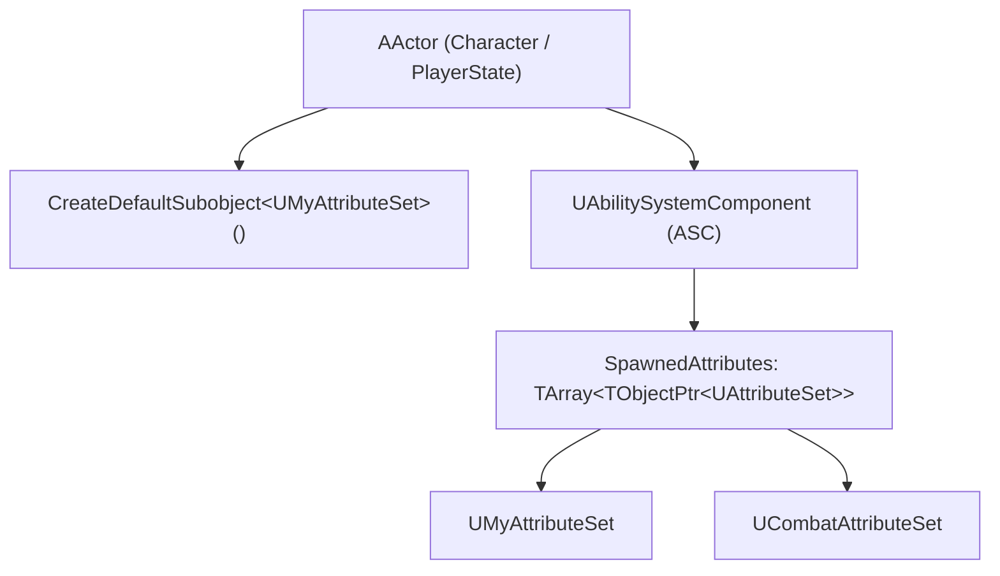
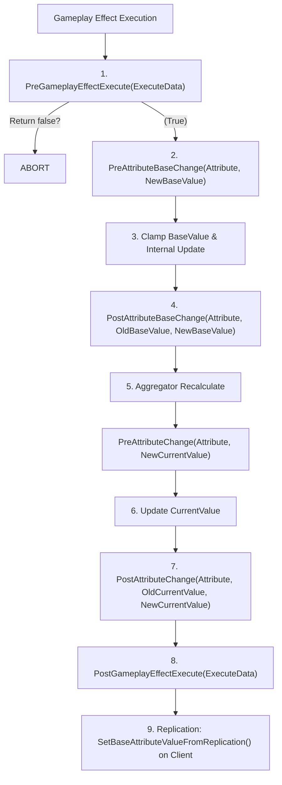

# Gameplay Ability System (GAS) Architecture & Usage Guide: Attribute Sets

**Engine Version:** Unreal Engine 5.8 (`UE_5.8`)  
**Module Target:** `GameplayAbilities` / `GameplayAbilitiesEditor`  
**Primary Source Citations:**
- `Engine/Plugins/Runtime/GameplayAbilities/Source/GameplayAbilities/Public/AttributeSet.h`
- `Engine/Plugins/Runtime/GameplayAbilities/Source/GameplayAbilities/Private/AttributeSet.cpp`
- `Engine/Plugins/Runtime/GameplayAbilities/Source/GameplayAbilities/Public/TickableAttributeSetInterface.h`
- `Engine/Plugins/Runtime/GameplayAbilities/Source/GameplayAbilities/Public/AbilitySystemComponent.h`
- `Engine/Plugins/Runtime/GameplayAbilities/Source/GameplayAbilities/Private/AbilitySystemComponent.cpp`
- `Engine/Plugins/Runtime/GameplayAbilities/Source/GameplayAbilities/Private/GameplayEffect.cpp`
- `Engine/Plugins/Runtime/GameplayAbilities/Source/GameplayAbilities/Public/GameplayEffectAggregator.h`
- `Engine/Plugins/Runtime/GameplayAbilities/Source/GameplayAbilities/Private/GameplayEffectAggregator.cpp`
- `Engine/Plugins/Runtime/GameplayAbilities/Source/GameplayAbilities/Public/AbilitySystemGlobals.h`
- `Engine/Plugins/Runtime/GameplayAbilities/Source/GameplayAbilities/Private/AbilitySystemGlobals.cpp`
- `Engine/Plugins/Runtime/GameplayAbilities/Source/GameplayAbilities/Public/GameplayAbilitiesDeveloperSettings.h`
- `Engine/Plugins/Runtime/GameplayAbilities/Source/GameplayAbilities/Public/AbilitySystemTestAttributeSet.h`
- `Engine/Plugins/Runtime/GameplayAbilities/Source/GameplayAbilities/Private/AbilitySystemTestAttributeSet.cpp`
- `Engine/Plugins/Runtime/GameplayAbilities/Source/GameplayAbilities/Public/AbilitySystemTestPawn.h`
- `Engine/Plugins/Runtime/GameplayAbilities/Source/GameplayAbilities/Private/AbilitySystemTestPawn.cpp`
- `Engine/Plugins/Runtime/GameplayAbilities/Source/GameplayAbilitiesEditor/Public/AttributeDetails.h`
- `Engine/Plugins/Runtime/GameplayAbilities/Source/GameplayAbilitiesEditor/Private/AttributeDetails.cpp`

---

## 1. Architecture

### 1.1 Core Types & Responsibilities

In Unreal Engine 5.8, the Gameplay Ability System structures character statistics and numerical properties using dedicated classes, structs, and property wrappers:

#### `UAttributeSet`
- **Class Header:** `Public/AttributeSet.h` (Line 185)
- **Base Class:** `UObject` (`DefaultToInstanced, Blueprintable, MinimalAPI`)
- **Responsibilities:**
  - Defines and encapsulates modular groups of `FGameplayAttributeData` properties (e.g., combat stats, health/shields, stamina, movement speeds).
  - Instantiated as a subobject on an actor (typically the character or player state) and registered with the actor's `UAbilitySystemComponent` (`SpawnedAttributes`).
  - Implements lifecycle hooks for attribute modification (`PreAttributeChange`, `PostAttributeChange`, `PreAttributeBaseChange`, `PostAttributeBaseChange`, `PreGameplayEffectExecute`, `PostGameplayEffectExecute`).
  - Supports network replication identification via `IsNameStableForNetworking()`, `SetNetAddressable()`, and `RegisterReplicationFragments()` (Iris replication integration).

#### `FGameplayAttributeData`
- **Header:** `Public/AttributeSet.h` (Line 21)
- **Structure:**
  ```cpp
  USTRUCT(BlueprintType)
  struct FGameplayAttributeData
  {
      GENERATED_BODY()
  protected:
      UPROPERTY(BlueprintReadOnly, Category = "Attribute")
      float BaseValue;

      UPROPERTY(BlueprintReadOnly, Category = "Attribute")
      float CurrentValue;
  };
  ```
- **Responsibilities:**
  - Encapsulates two values per attribute:
    - **`BaseValue`**: The permanent value of the attribute, altered only by instant Gameplay Effects, direct base modification, or level init.
    - **`CurrentValue`**: The dynamic value evaluated as `BaseValue` combined with temporary active modifiers (duration-based, infinite buffs/debuffs) through aggregators (`FAggregator`).
  - Provides accessors `GetBaseValue()`, `SetBaseValue(float)`, `GetCurrentValue()`, `SetCurrentValue(float)`.

#### `FGameplayAttribute`
- **Header:** `Public/AttributeSet.h` (Line 58)
- **Structure:**
  ```cpp
  USTRUCT(BlueprintType)
  struct FGameplayAttribute
  {
      GENERATED_USTRUCT_BODY()
  private:
      UPROPERTY(Category = GameplayAttribute, EditAnywhere)
      TFieldPath<FProperty> Attribute;

      UPROPERTY(Category = GameplayAttribute, VisibleAnywhere)
      TObjectPtr<UStruct> AttributeOwner;
  };
  ```
- **Responsibilities:**
  - Strong reflection handle wrapping a `FProperty*` pointing to an attribute property defined inside a `UAttributeSet` (or on the `UAbilitySystemComponent` for system attributes).
  - Used throughout GAS as a lightweight key (hashable via `PointerHash(Attribute.Get())`) to identify attributes in modifiers, queries, calculations, delegates, and capture specs.
  - Exposes helper methods: `GetNumericValueChecked(const UAttributeSet* Src)`, `SetNumericValueChecked(float& NewValue, UAttributeSet* Dest)`, `GetGameplayAttributeData(const UAttributeSet* Src)`, `GetAttributeSetClass()`.

#### `ITickableAttributeSetInterface`
- **Header:** `Public/TickableAttributeSetInterface.h` (Line 17)
- **Responsibilities:**
  - Pure virtual interface allowing an `UAttributeSet` to register for frame-by-frame updates (`Tick(float DeltaTime)` and `ShouldTick() const`).
  - Called directly during `UAbilitySystemComponent::TickComponent` (via `AbilitySystemComponent_Abilities.cpp`, iterating over `GetSpawnedAttributes()` for instances implementing `ITickableAttributeSetInterface`).

---

### 1.2 Data Flow & Registration



1. **Subobject Creation:** Attribute sets are created either as default subobjects during actor construction (`CreateDefaultSubobject<UMyAttributeSet>(TEXT("Attributes"))`) or dynamically at runtime using `UAbilitySystemComponent::GetOrCreateAttributeSubobject(TSubclassOf<UAttributeSet>)`.
2. **Registration:** `UAbilitySystemComponent::AddSpawnedAttribute(UAttributeSet* Attribute)` registers the set into `ASC->SpawnedAttributes`.
3. **Actor Info Linking:** `UAttributeSet::GetOwningAbilitySystemComponent()` queries the outer actor via `UAbilitySystemGlobals::GetAbilitySystemComponentFromActor(GetOwningActor())`.
4. **Aggregator Association:** When active Gameplay Effects modify an attribute, the ASC creates or fetches an `FAggregator` for that specific `FGameplayAttribute` on the owning `UAttributeSet`.

---

### 1.3 Attribute Metadata System

GAS provides built-in mechanisms to drive base values, min/max limits, and UI metadata from data tables:

#### `FAttributeMetaData`
- **Header:** `Public/AttributeSet.h` (Line 271)
- **Structure:**
  ```cpp
  USTRUCT(BlueprintType)
  struct FAttributeMetaData : public FTableRowBase
  {
      GENERATED_USTRUCT_BODY()

      UPROPERTY(EditAnywhere, BlueprintReadOnly, Category = "Gameplay Attribute")
      float BaseValue;

      UPROPERTY(EditAnywhere, BlueprintReadOnly, Category = "Gameplay Attribute")
      float MinValue;

      UPROPERTY(EditAnywhere, BlueprintReadOnly, Category = "Gameplay Attribute")
      float MaxValue;

      UPROPERTY()
      FString DerivedAttributeInfo;

      UPROPERTY(EditAnywhere, BlueprintReadOnly, Category = "Gameplay Attribute")
      bool bCanStack;
  };
  ```
- **Table Lookup:** `UAttributeSet::InitFromMetaDataTable(const UDataTable* DataTable)` iterates over all properties in the set (`TFieldIterator<FProperty>`). For each supported property, it searches rows matching the string key pattern `"{AttributeSetName}.{PropertyName}"` (e.g., `MyHealthSet.Health`) and sets `BaseValue` and `CurrentValue`.

#### `FAttributeSetInitter` & `FAttributeSetInitterDiscreteLevels`
- **Header:** `Public/AttributeSet.h` (Line 340, Line 351)
- **Implementation:** `Private/AttributeSet.cpp` (Line 565)
- **Structure:**
  - Manages curve tables (`UCurveTable`) to load stat progression across discrete character levels.
  - Rows are keyed as `[GroupName].[AttributeSetName].[Attribute]` (e.g., `Hero1.HealthSet.MaxHealth`).
  - Allocated in `UAbilitySystemGlobals::AllocAttributeSetInitter()` (instantiating `FAttributeSetInitterDiscreteLevels`).
  - Preloaded globally via `FAttributeSetInitter::PreloadAttributeSetData(GlobalAttributeDefaultsTables)`.
  - Applied per actor via `FAttributeSetInitter::InitAttributeSetDefaults(ASC, GroupName, Level, bInitialInit)`.

---

### 1.4 Evaluation Channels

- **Sources:** `Public/GameplayEffectTypes.h` (`EGameplayModEvaluationChannel`, `FGameplayModEvaluationChannelSettings`), `Public/GameplayEffectAggregator.h` (`FAggregatorModChannel`, `FAggregatorModChannelContainer`), `Public/GameplayAbilitiesDeveloperSettings.h`
- **Concept:**
  Gameplay Modifier Evaluation Channels allow complex layering of modifiers without circular math bugs. Modifiers run in order of channels:
  `Channel0` $\to$ `Channel1` $\to$ `Channel2` ... $\to$ `Channel9`.
  
  Within each channel, modifiers calculate using the standard order of operations:
  $$\text{Value}_{\text{channel}} = ((\text{Value}_{\text{in}} + \text{Add}) \times (1 + \text{Multiply})) / \text{Divide}$$
  
  The output of `Channel N` becomes the input base value for `Channel N+1`.
  
- **Configuration in UE 5.8:**
  - Configured in `UGameplayAbilitiesDeveloperSettings`:
    - `bAllowGameplayModEvaluationChannels`: Must be set to `true`.
    - `DefaultGameplayModEvaluationChannel`: Defaults to `Channel0`.
    - `GameplayModEvaluationChannelAliases[10]`: User-defined friendly names (e.g., `BaseStats`, `FlatBonus`, `MultiplierMods`, `OverrideCaps`).
  - In `FGameplayEffectAttributeCaptureSpec::AttemptCalculateAttributeMagnitudeUpToChannel`, evaluations can resolve up to a specific channel threshold.

---

## 2. The Complete Attribute Change Pipeline

GAS has two distinct pipelines for attribute alteration:
1. **The Execution Pipeline (Instant Gameplay Effects / Base Value Modification)**: Modifies the underlying permanent `BaseValue`.
2. **The Aggregator Pipeline (Duration / Infinite Gameplay Effects / Evaluated Current Value)**: Updates the temporary `CurrentValue` via recalculation without changing `BaseValue`.

### Step-by-Step Execution Sequence



#### Detailed Sequence:
1. **Instant GE Application:**
   `UAbilitySystemComponent::ApplyGameplayEffectSpecToSelf` processes an instant effect (`FActiveGameplayEffectsContainer::ExecuteActiveGameplayEffect` in `GameplayEffect.cpp`).
2. **`UAttributeSet::PreGameplayEffectExecute(FGameplayEffectModCallbackData& Data)`:**
   - **Trigger:** Only during instant GameplayEffect execution modifying an attribute.
   - **Purpose:** Game-wide conditional logic, defense mitigation, armor reduction, or dodging.
   - **Control:** Returns `bool`. Returning `false` completely aborts the modifier application.
3. **`UAttributeSet::PreAttributeBaseChange(const FGameplayAttribute& Attribute, float& NewValue) const`:**
   - **Trigger:** Called in `FActiveGameplayEffectsContainer::SetAttributeBaseValue` just before the permanent `BaseValue` changes.
   - **Purpose:** Enforce base value clamping (e.g., `NewValue = FMath::Clamp(NewValue, 0.f, MaxHealth.GetBaseValue())`).
   - **Rule:** Const function. MUST NOT trigger gameplay callbacks or gameplay events here.
4. **Base Value Assignment:**
   The `FGameplayAttributeData::BaseValue` is written. If an aggregator exists, `Aggregator->SetBaseValue(NewBaseValue)` is called.
5. **`UAttributeSet::PostAttributeBaseChange(const FGameplayAttribute& Attribute, float OldValue, float NewValue) const`:**
   - **Trigger:** Immediately after the permanent `BaseValue` is set.
   - **Rule:** Const hook for base-value-specific bookkeeping.
6. **Aggregator Dirty Evaluation:**
   When an aggregator's base value or modifier array changes, it recalculates the resulting current value.
7. **`UAttributeSet::PreAttributeChange(const FGameplayAttribute& Attribute, float& NewValue)`:**
   - **Trigger:** Called just before `CurrentValue` changes for *any* reason (instant damage, duration buff added, buff expired, base value change).
   - **Purpose:** Clamping the dynamic result (e.g., `NewValue = FMath::Clamp(NewValue, 0.f, MaxHealth.GetCurrentValue())`).
   - **Rule:** Do NOT trigger gameplay events (such as character death) here, as this fires on temporary buff additions and expirations.
8. **Current Value Assignment:**
   `FGameplayAttributeData::CurrentValue` is updated.
9. **`UAttributeSet::PostAttributeChange(const FGameplayAttribute& Attribute, float OldValue, float NewValue)`:**
   - **Trigger:** Called right after `CurrentValue` is updated.
   - **Purpose:** Responding to attribute changes (e.g., updating UI progress bars, adjusting movement speed components).
10. **`UAttributeSet::PostGameplayEffectExecute(const FGameplayEffectModCallbackData& Data)`:**
    - **Trigger:** Called at the very end of instant Gameplay Effect execution.
    - **Purpose:** Consume transient "Meta Attributes" (like incoming `Damage` or `Healing`), convert them into adjustments on persistent attributes (such as `Health`), handle fatal damage/death logic, and broadcast combat cues or game events.
11. **Client Replication RepNotify:**
    On network clients, the replicated `FGameplayAttributeData` triggers its `OnRep_` function. The helper macro `GAMEPLAYATTRIBUTE_REPNOTIFY(UMySet, Attribute, OldValue)` invokes `ASC->SetBaseAttributeValueFromReplication()`, ensuring local aggregators rewind and reconcile server authority properly.

---

## 3. Editor Customization & Tooling

### 3.1 Editor Customization Architecture
- **Source:** `GameplayAbilitiesEditor/Private/AttributeDetails.cpp` (`FAttributePropertyDetails`, `FAttributeDetails`)
- **Header:** `GameplayAbilitiesEditor/Public/AttributeDetails.h`
- **Registration:** In `GameplayAbilitiesEditorModule.cpp`:
  ```cpp
  PropertyModule.RegisterCustomPropertyTypeLayout("GameplayAttribute",
      FOnGetPropertyTypeCustomizationInstance::CreateStatic(&FAttributePropertyDetails::MakeInstance));
  PropertyModule.RegisterCustomClassLayout("AttributeSet",
      FOnGetDetailCustomizationInstance::CreateStatic(&FAttributeDetails::MakeInstance));
  ```

### 3.2 Key Editor Behaviors
1. **Picker Dropdown (`SGameplayAttributeWidget`):**
   - Automatically populates with all valid `FGameplayAttribute` properties across all loaded `UAttributeSet` classes.
   - Filters out internal properties marked with metadata tag `HideInDetailsView` or matching filter strings.
2. **Metadata Specifiers:**
   - `meta = (HideInDetailsView)`: Hides the entire attribute set or property from the editor attribute picker.
   - `meta = (HideFromModifiers)`: Prevents Gameplay Effects from directly targeting the attribute (used on attributes that should only be altered through custom mechanics or meta-attributes).
3. **Evaluation Channel Customization:**
   `FGameplayModEvaluationChannelSettingsDetails` provides the editor drop-down for picking channels, displaying custom aliases defined in project settings and hiding invalid/unconfigured channels.

---

## 4. Usage Patterns & Best Practices

### 4.1 Attribute Definition Pattern (The Accessor Macros)

Unreal Engine defines standard accessor macros in `AttributeSet.h` (Lines 408–470). Every attribute should use this pattern to expose static property getters, value getters, value setters, and initters.

```cpp
#define ATTRIBUTE_ACCESSORS_BASIC(ClassName, PropertyName) \
	GAMEPLAYATTRIBUTE_PROPERTY_GETTER(ClassName, PropertyName) \
	GAMEPLAYATTRIBUTE_VALUE_GETTER(PropertyName) \
	GAMEPLAYATTRIBUTE_VALUE_SETTER(PropertyName) \
	GAMEPLAYATTRIBUTE_VALUE_INITTER(PropertyName)
```

### 4.2 Handling Meta Attributes (Transient vs Persistent)
- **Persistent Attributes:** Replicated properties with real storage (e.g., `Health`, `MaxHealth`, `Shield`).
- **Meta Attributes:** Non-replicated, transient properties (e.g., `Damage`, `Healing`).
  - Gameplay Effects apply magnitude directly to the `Damage` meta attribute.
  - In `PostGameplayEffectExecute`, `Damage` is read, subtracted from `Health`, and reset to `0.f`.
  - **Benefits:** Damage calculations can take into account armor, damage mitigation shields, resistances, and invulnerability in C++ code before touching the replicated `Health`.

### 4.3 Network Replication Pattern
- Replicate attributes using `DOREPLIFETIME_CONDITION_NOTIFY(..., COND_None, REPNOTIFY_Always)`.
- Use `GAMEPLAYATTRIBUTE_REPNOTIFY(SetClass, PropertyName, OldValue)` inside each RepNotify function.
- Do NOT replicate transient meta attributes.

---

## 5. Complete C++ Implementation Example

The following example is a production-ready, fully compliant `UAttributeSet` implementing Health, MaxHealth, and an incoming Damage meta-attribute.

### 5.1 Header: `SHHealthSet.h`

```cpp
// Copyright SkyHunters. All Rights Reserved.

#pragma once

#include "CoreMinimal.h"
#include "AttributeSet.h"
#include "AbilitySystemComponent.h"
#include "SHHealthSet.generated.h"

// Standard GAS Attribute Accessor Macro helper
#define ATTRIBUTE_ACCESSORS(ClassName, PropertyName) \
	GAMEPLAYATTRIBUTE_PROPERTY_GETTER(ClassName, PropertyName) \
	GAMEPLAYATTRIBUTE_VALUE_GETTER(PropertyName) \
	GAMEPLAYATTRIBUTE_VALUE_SETTER(PropertyName) \
	GAMEPLAYATTRIBUTE_VALUE_INITTER(PropertyName)

/**
 * Attribute set managing Health, MaxHealth, and Damage processing for SkyHunters actors.
 * Grounded in UE 5.8 UAttributeSet API.
 */
UCLASS()
class SKYHUNTERS_API USHHealthSet : public UAttributeSet
{
	GENERATED_BODY()

public:
	USHHealthSet();

	// UObject replication lifecycle
	virtual void GetLifetimeReplicatedProps(TArray<FLifetimeProperty>& OutLifetimeProps) const override;

	// Clamping during dynamic evaluation (Buffs, Debuffs, Base adjustments)
	virtual void PreAttributeChange(const FGameplayAttribute& Attribute, float& NewValue) override;
	virtual void PostAttributeChange(const FGameplayAttribute& Attribute, float OldValue, float NewValue) override;

	// Clamping during BaseValue alterations
	virtual void PreAttributeBaseChange(const FGameplayAttribute& Attribute, float& NewValue) const override;

	// Pipeline execution for instant GameplayEffects
	virtual bool PreGameplayEffectExecute(FGameplayEffectModCallbackData& Data) override;
	virtual void PostGameplayEffectExecute(const FGameplayEffectModCallbackData& Data) override;

public:
	/** Current Health: Persistent, Replicated */
	UPROPERTY(BlueprintReadOnly, Category = "Attributes|Health", ReplicatedUsing = OnRep_Health)
	FGameplayAttributeData Health;
	ATTRIBUTE_ACCESSORS(USHHealthSet, Health)

	/** Maximum Health: Persistent, Replicated */
	UPROPERTY(BlueprintReadOnly, Category = "Attributes|Health", ReplicatedUsing = OnRep_MaxHealth)
	FGameplayAttributeData MaxHealth;
	ATTRIBUTE_ACCESSORS(USHHealthSet, MaxHealth)

	/** Meta Attribute: Damage (Transient, NOT Replicated). Used to process incoming damage modifications. */
	UPROPERTY(BlueprintReadOnly, Category = "Attributes|Damage")
	FGameplayAttributeData Damage;
	ATTRIBUTE_ACCESSORS(USHHealthSet, Damage)

protected:
	UFUNCTION()
	virtual void OnRep_Health(const FGameplayAttributeData& OldHealth);

	UFUNCTION()
	virtual void OnRep_MaxHealth(const FGameplayAttributeData& OldMaxHealth);

private:
	// Helper to clamp attributes proportionally when Max values change
	void AdjustAttributeForMaxChange(
		FGameplayAttributeData& AffectedAttribute,
		const FGameplayAttributeData& MaxAttribute,
		float NewMaxValue,
		const FGameplayAttribute& AffectedAttributeProperty
	);
};
```

---

### 5.2 Source: `SHHealthSet.cpp`

```cpp
// Copyright SkyHunters. All Rights Reserved.

#include "SHHealthSet.h"
#include "GameplayEffectExtension.h"
#include "Net/UnrealNetwork.h"

USHHealthSet::USHHealthSet()
	: Health(100.0f)
	, MaxHealth(100.0f)
	, Damage(0.0f)
{
}

void USHHealthSet::GetLifetimeReplicatedProps(TArray<FLifetimeProperty>& OutLifetimeProps) const
{
	Super::GetLifetimeReplicatedProps(OutLifetimeProps);

	// Replicate with REPNOTIFY_Always so predictive local clients always rewind/reconcile accurately
	DOREPLIFETIME_CONDITION_NOTIFY(USHHealthSet, Health, COND_None, REPNOTIFY_Always);
	DOREPLIFETIME_CONDITION_NOTIFY(USHHealthSet, MaxHealth, COND_None, REPNOTIFY_Always);
}

void USHHealthSet::PreAttributeBaseChange(const FGameplayAttribute& Attribute, float& NewValue) const
{
	Super::PreAttributeBaseChange(Attribute, NewValue);

	if (Attribute == GetHealthAttribute())
	{
		// Clamp Base Health between 0 and Base MaxHealth
		NewValue = FMath::Clamp(NewValue, 0.0f, GetMaxHealth());
	}
	else if (Attribute == GetMaxHealthAttribute())
	{
		// Max health cannot fall below 1
		NewValue = FMath::Max(NewValue, 1.0f);
	}
}

void USHHealthSet::PreAttributeChange(const FGameplayAttribute& Attribute, float& NewValue)
{
	Super::PreAttributeChange(Attribute, NewValue);

	if (Attribute == GetHealthAttribute())
	{
		// Enforce current clamp limits
		NewValue = FMath::Clamp(NewValue, 0.0f, GetMaxHealth());
	}
	else if (Attribute == GetMaxHealthAttribute())
	{
		NewValue = FMath::Max(NewValue, 1.0f);
	}
}

void USHHealthSet::PostAttributeChange(const FGameplayAttribute& Attribute, float OldValue, float NewValue)
{
	Super::PostAttributeChange(Attribute, OldValue, NewValue);

	if (Attribute == GetMaxHealthAttribute())
	{
		// When MaxHealth changes, adjust current health so current percentage remains constant
		AdjustAttributeForMaxChange(Health, MaxHealth, NewValue, GetHealthAttribute());
	}
}

bool USHHealthSet::PreGameplayEffectExecute(FGameplayEffectModCallbackData& Data)
{
	if (!Super::PreGameplayEffectExecute(Data))
	{
		return false;
	}

	// Example: Can check immunity tags or Dodge modifiers on Data.Target before execution
	return true;
}

void USHHealthSet::PostGameplayEffectExecute(const FGameplayEffectModCallbackData& Data)
{
	Super::PostGameplayEffectExecute(Data);

	FGameplayEffectContextHandle Context = Data.EffectSpec.GetContext();
	UAbilitySystemComponent* SourceASC = Context.GetOriginalInstigatorAbilitySystemComponent();
	AActor* InstigatorActor = Context.GetInstigator();
	AActor* TargetActor = GetOwningActor();

	// Process incoming Damage Meta-Attribute
	if (Data.EvaluatedData.Attribute == GetDamageAttribute())
	{
		const float LocalDamageDone = GetDamage();
		SetDamage(0.0f); // Consume the meta-attribute immediately

		if (LocalDamageDone > 0.0f)
		{
			// Apply damage to persistent Health
			const float OldHealth = GetHealth();
			const float NewHealth = FMath::Clamp(OldHealth - LocalDamageDone, 0.0f, GetMaxHealth());
			SetHealth(NewHealth);

			// Handle Death check on Authority
			if (NewHealth <= 0.0f && OldHealth > 0.0f)
			{
				if (UAbilitySystemComponent* TargetASC = GetOwningAbilitySystemComponent())
				{
					// Example: Send Death Tag event or gameplay event to target ASC
					FGameplayEventData Payload;
					Payload.EventTag = FGameplayTag::RequestGameplayTag(FName("Event.Character.Death"));
					Payload.Instigator = InstigatorActor;
					Payload.Target = TargetActor;
					Payload.ContextHandle = Context;
					TargetASC->HandleGameplayEvent(Payload.EventTag, &Payload);
				}
			}
		}
	}
	// Direct instant modification to Health (e.g. instant flat heal)
	else if (Data.EvaluatedData.Attribute == GetHealthAttribute())
	{
		SetHealth(FMath::Clamp(GetHealth(), 0.0f, GetMaxHealth()));
	}
}

void USHHealthSet::AdjustAttributeForMaxChange(
	FGameplayAttributeData& AffectedAttribute,
	const FGameplayAttributeData& MaxAttribute,
	float NewMaxValue,
	const FGameplayAttribute& AffectedAttributeProperty)
{
	UAbilitySystemComponent* AbilityComp = GetOwningAbilitySystemComponent();
	const float CurrentMaxValue = MaxAttribute.GetCurrentValue();

	if (!FMath::IsNearlyEqual(CurrentMaxValue, NewMaxValue) && AbilityComp)
	{
		// Maintain percentage ratio
		const float CurrentValue = AffectedAttribute.GetCurrentValue();
		const float NewDelta = (CurrentMaxValue > 0.0f)
			? (CurrentValue * (NewMaxValue / CurrentMaxValue)) - CurrentValue
			: NewMaxValue;

		AbilityComp->ApplyModToAttribute(AffectedAttributeProperty, EGameplayModOp::Additive, NewDelta);
	}
}

void USHHealthSet::OnRep_Health(const FGameplayAttributeData& OldHealth)
{
	GAMEPLAYATTRIBUTE_REPNOTIFY(USHHealthSet, Health, OldHealth);
}

void USHHealthSet::OnRep_MaxHealth(const FGameplayAttributeData& OldMaxHealth)
{
	GAMEPLAYATTRIBUTE_REPNOTIFY(USHHealthSet, MaxHealth, OldMaxHealth);
}
```

---

### 5.3 Actor Integration Example (Grounded in `AAbilitySystemTestPawn`)

```cpp
// AMyCharacter.h
#pragma once
#include "GameFramework/Character.h"
#include "AbilitySystemInterface.h"
#include "SHHealthSet.h"
#include "MyCharacter.generated.h"

UCLASS()
class SKYHUNTERS_API AMyCharacter : public ACharacter, public IAbilitySystemInterface
{
	GENERATED_BODY()

public:
	AMyCharacter();

	virtual UAbilitySystemComponent* GetAbilitySystemComponent() const override { return AbilitySystemComponent; }

protected:
	UPROPERTY(VisibleAnywhere, BlueprintReadOnly, Category = "Abilities")
	TObjectPtr<UAbilitySystemComponent> AbilitySystemComponent;

	UPROPERTY(VisibleAnywhere, BlueprintReadOnly, Category = "Abilities")
	TObjectPtr<USHHealthSet> HealthSet;
};

// AMyCharacter.cpp
#include "MyCharacter.h"

AMyCharacter::AMyCharacter()
{
	AbilitySystemComponent = CreateDefaultSubobject<UAbilitySystemComponent>(TEXT("AbilitySystemComponent"));
	AbilitySystemComponent->SetIsReplicated(true);
	AbilitySystemComponent->SetReplicationMode(EGameplayEffectReplicationMode::Mixed);

	// Create AttributeSet subobject - automatically registers with the ASC
	HealthSet = CreateDefaultSubobject<USHHealthSet>(TEXT("HealthSet"));
}
```

---

## 6. Common Pitfalls & Architectural Traps

1. **Clamping in the Wrong Hook:**
   - *Trap:* Clamping `Health` to `MaxHealth` only in `PostGameplayEffectExecute`.
   - *Result:* When a `MaxHealth` debuff duration expires or buffs apply via duration GameplayEffects, `PostGameplayEffectExecute` is never invoked, leaving `Health > MaxHealth`.
   - *Rule:* Always clamp in `PreAttributeChange` (for dynamic clamps) and `PreAttributeBaseChange` (for base value clamps).

2. **Triggering Gameplay Logic in `PreAttributeChange`:**
   - *Trap:* Spawning death animations or playing sound effects in `PreAttributeChange`.
   - *Result:* `PreAttributeChange` is invoked anytime an aggregator recalculates, including speculative predictions and temporary duration modifier calculations.
   - *Rule:* Restrict `PreAttributeChange` solely to numerical clamping. Trigger death, damage numbers, and game logic inside `PostGameplayEffectExecute` on the network authority.

3. **Replicating Meta Attributes:**
   - *Trap:* Marking `Damage` with `ReplicatedUsing = OnRep_Damage`.
   - *Result:* Redundant bandwidth usage and race conditions. Meta-attributes must be transient and processed strictly on the server inside `PostGameplayEffectExecute`.

4. **Forgetting `GAMEPLAYATTRIBUTE_REPNOTIFY`:**
   - *Trap:* Leaving `OnRep_Health` empty or setting values directly without notifying the ASC.
   - *Result:* Local client prediction aggregators fail to reconcile server rewind states correctly, causing visual jitter or de-synced attribute values.
