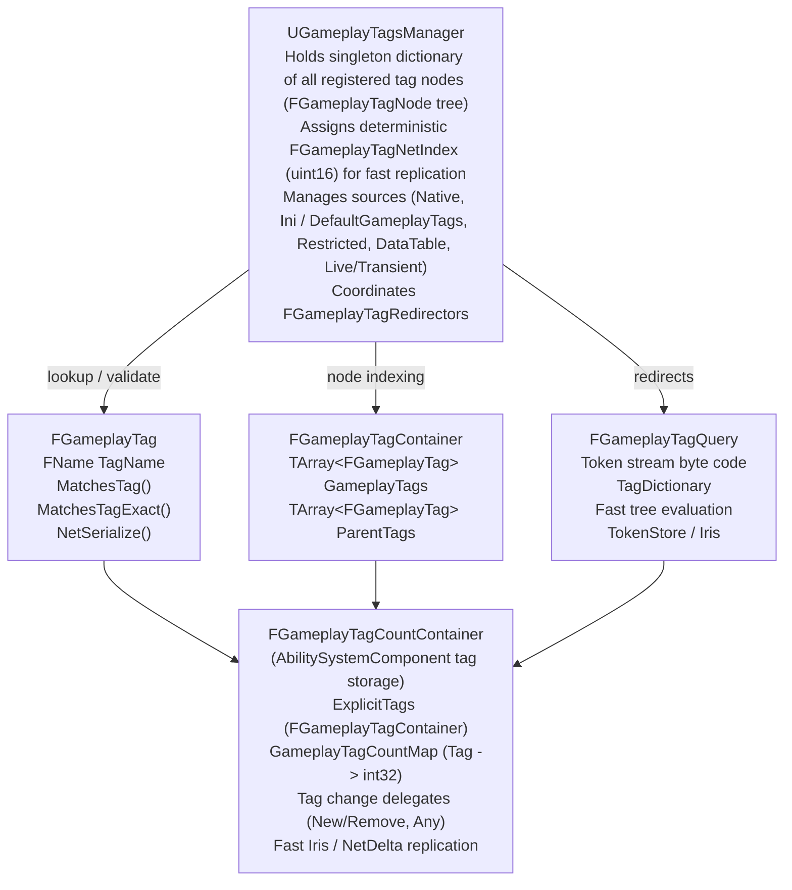

# GAS Architecture & Usage: GameplayTags in Unreal Engine 5.8

This document details the architecture, internals, data structures, network replication models, and GAS integration of the **Gameplay Tags** subsystem in Unreal Engine 5.8. All claims and code snippets are directly verifiable against the engine source code under `Engine/Source/Runtime/GameplayTags/` and `Engine/Plugins/Runtime/GameplayAbilities/`.

---

## 1. Architecture

The Gameplay Tags module (`IGameplayTagsModule`, defined in `Engine/Source/Runtime/GameplayTags/Public/GameplayTagsModule.h`) provides hierarchical, lightweight, dictionary-driven labels of the form `Category.SubCategory.Tag` (e.g., `Status.Debuff.Burning`). Gameplay tags replace hardcoded booleans and bitmasks, allowing modular categorization across abilities, effects, cues, and gameplay actors.

### 1.1 Core Types & Responsibilities



#### 1. `FGameplayTag`
*Source: `Engine/Source/Runtime/GameplayTags/Classes/GameplayTagContainer.h`*
* Encapsulates a single hierarchical tag via an internal `FName TagName`.
* Comparison semantics:
  * `operator==` / `operator!=`: Compares literal `FName` equality.
  * `MatchesTag(const FGameplayTag& TagToCheck) const`: Evaluates whether this tag matches `TagToCheck` hierarchically. For example, `"A.1".MatchesTag("A")` is **true**, whereas `"A".MatchesTag("A.1")` is **false**.
  * `MatchesTagExact(const FGameplayTag& TagToCheck) const`: Requires identical tag identity without checking ancestors.
  * `MatchesTagDepth(const FGameplayTag& TagToCheck) const`: Returns integer hierarchy depth matching parent elements.
  * `RequestDirectParent() const`: Requests direct ancestor tag (e.g., `A.B.C` -> `A.B`).
  * `GetGameplayTagParents() const`: Returns an `FGameplayTagContainer` populated with this tag and all its recursive parents.

#### 2. `FGameplayTagContainer`
*Source: `Engine/Source/Runtime/GameplayTags/Classes/GameplayTagContainer.h`*
* Manages an array of explicit tags:
  ```cpp
  TArray<FGameplayTag> GameplayTags;
  TArray<FGameplayTag> ParentTags;
  ```
* Internal mechanics:
  * When explicit tags are added via `AddTag(const FGameplayTag& TagToAdd)` or `AppendTags(const FGameplayTagContainer& Other)`, `FillParentTags()` populates `ParentTags` with all ancestor tags in the hierarchy.
  * `HasTag(const FGameplayTag& TagToCheck)` checks both `GameplayTags.Contains(TagToCheck) || ParentTags.Contains(TagToCheck)`, providing $O(1)$ amortized hierarchical membership tests without traversing tree nodes at query time.
  * `HasTagExact(const FGameplayTag& TagToCheck)` checks only explicit entries in `GameplayTags`.
  * `HasAny(const FGameplayTagContainer& ContainerToCheck)` and `HasAll(const FGameplayTagContainer& ContainerToCheck)` evaluate any/all conditions against explicit or parent matches.

#### 3. `FGameplayTagQuery` & `FGameplayTagQueryExpression`
*Source: `Engine/Source/Runtime/GameplayTags/Classes/GameplayTagContainer.h`*
* Encapsulates complex boolean logic combinations (AND, OR, NOT, EXACT) compiled into a lightweight byte token stream.
* Key fields:
  ```cpp
  int32 TokenStreamVersion;
  TArray<FGameplayTag> TagDictionary;
  TArray<uint8> QueryTokenStream;
  FString UserDescription;
  FString AutoDescription;
  ```
* `FQueryEvaluator` (in `GameplayTagContainer.cpp`) walks `QueryTokenStream` without heap allocations, testing `FGameplayTagContainer` tags directly.
* Expression types (`EGameplayTagQueryExprType`):
  * `AnyTagsMatch`, `AllTagsMatch`, `NoTagsMatch` (hierarchical).
  * `AnyTagsExactMatch`, `AllTagsExactMatch` (exact).
  * `AnyExprMatch`, `AllExprMatch`, `NoExprMatch` (compound tree logic).
* Methods:
  * `Matches(const FGameplayTagContainer& Tags) const`: Runs the bytecode stream against the provided container.
  * `ReplaceTagFast(const FGameplayTag& Tag)` / `ReplaceTagsFast(const FGameplayTagContainer& Tags)`: Updates dictionary tags dynamically without reallocating or rebuilding expression logic (heavily utilized by `UGameplayTagReponseTable`).

#### 4. `UGameplayTagsManager`
*Source: `Engine/Source/Runtime/GameplayTags/Classes/GameplayTagsManager.h`, `Private/GameplayTagsManager.cpp`*
* Engine singleton accessed via `UGameplayTagsManager::Get()`.
* Holds `FGameplayTagNode` hierarchy rooted at `TSharedPtr<FGameplayTagNode> GameplayRootTag`.
* Maps `FName` to `TSharedPtr<FGameplayTagNode>` via hash table (`GameplayTagNodeMap`).
* Handles tag registration, tag source tracking, restricted tag validation, runtime redirects, and network index assignment (`FGameplayTagNetIndex`).

---

### 1.2 Tag Sources & Registration Lifecycle

Tag definitions are ingested into `UGameplayTagsManager` from multiple distinct sources defined in `EGameplayTagSourceType` (`GameplayTagsManager.h`):

| Source Type (`EGameplayTagSourceType`) | Storage Location / Origin | Registration Timing & Behavior |
| :--- | :--- | :--- |
| `Native` | C++ modules via `FNativeGameplayTag` | Static init / module startup. Unregistered when modules unload. |
| `DefaultTagList` | `Config/DefaultGameplayTags.ini` (`GameplayTagList`) | Engine startup; synchronous load during `ConstructGameplayTagTree()`. |
| `TagList` | In configured search paths (`Config/Tags/*.ini`) | Project/plugin configuration files discovered during initialization. |
| `RestrictedTagList` | Restricted ini files (e.g., owner-protected tags) | Restricted tags cannot have non-restricted children unless explicitly allowed (`bAllowNonRestrictedChildren = true`). |
| `DataTable` | `UDataTable` assets (`FGameplayTagTableRow`) | Loaded via `GameplayTagTableList` configuration in Developer Settings. |
| `Transient / Live` | Editor / Live tagging tools (`GetTransientEditorName()`) | In-editor dynamic additions without engine restart. |

#### Lifecycle Walkthrough: Registration to Lookup

1. **Pre-Engine Init / Module Loading**:
   * Static instances of `FNativeGameplayTag` register with a global static set (`FNativeGameplayTag::GetRegisteredNativeTags()`).
   * When `UGameplayTagsManager::InitializeManager()` executes, it registers native tags, loads `DefaultGameplayTags.ini`, restricted lists, and data tables.
2. **Tree Construction (`ConstructGameplayTagTree`)**:
   * Nodes (`FGameplayTagNode`) are created hierarchically for every segment in tag names delimited by `.`.
   * For each node:
     * `CompleteTagWithParents` is populated.
     * `ChildTags` arrays are linked.
     * Source names and dev comments are attached (`WITH_EDITORONLY_DATA`).
3. **Network Index Assignment**:
   * `ConstructNetIndex()` generates `NetworkGameplayTagNodeIndex` (`TArray<TSharedPtr<FGameplayTagNode>>`).
   * Commonly replicated tags configured in `CommonlyReplicatedTags` receive early indices (fitting within the first packed bit segment).
4. **Delegate Broadcast**:
   * Callbacks registered via `UGameplayTagsManager::CallOrRegister_OnDoneAddingNativeTagsDelegate` or `CallOrRegister_OnAddNativeTagsDelegate` trigger.
   * `IGameplayTagsModule::OnGameplayTagTreeChanged` is broadcast.
5. **Runtime Lookup**:
   * Calls to `FGameplayTag::RequestGameplayTag(FName TagName, bool ErrorIfNotFound)` perform fast lookups into `GameplayTagNodeMap`.
   * If a tag was renamed or deprecated, `FGameplayTagRedirectors` re-routes the old tag name to the replacement tag.

---

### 1.3 Tag Redirectors

*Source: `Engine/Source/Runtime/GameplayTags/Public/GameplayTagRedirectors.h`, `Private/GameplayTagRedirectors.cpp`*

Configured in `DefaultGameplayTags.ini` under `[GameplayTagsList]` or plugin configs:
```ini
[GameplayTagsList]
+GameplayTagRedirects=(OldTagName="Status.Frozen", NewTagName="Status.Debuff.Frozen")
```

* Struct: `FGameplayTagRedirect` contains `OldTagName` and `NewTagName`.
* Manager: `FGameplayTagRedirectors::Get()` maintains `TMap<FName, FGameplayTag> TagRedirects`.
* Resolution Point:
  * Invoked inside `FGameplayTag::PostSerialize(const FArchive& Ar)` on package loading.
  * In `UGameplayTagsManager::SingleGameplayTagLoaded(FGameplayTag& Tag, FProperty* SerializingProperty)`, if `OldTagName` is encountered, `Tag` is automatically redirected to `NewTagName`, preventing broken assets when restructuring tag taxonomies.

---

### 1.4 Network Serialization

Gameplay tags replicate across the network with high frequency. UE 5.8 implements two serialization pipelines:

#### 1. Legacy Net Bit-Packing (`NetSerialize_Packed`)
*Source: `Engine/Source/Runtime/GameplayTags/Private/GameplayTagContainer.cpp`*
* Uses `FGameplayTagNetIndex` (16-bit integer, max 65535 indexed tags).
* Uses split-segment bit packing via `SerializeTagNetIndexPacked()`:
  * The first segment writes `NetIndexFirstBitSegment` bits (typically 5 to 7 bits) plus 1 continuation bit ("more").
  * If the index exceeds the first segment, the continuation bit is set to `1` and the remaining `(MaxBits - NetIndexFirstBitSegment)` bits are written.
  * Commonly replicated tags configured in `DefaultGameplayTags.ini` (`CommonlyReplicatedTags`) occupy index $0$ to $(2^{\text{segment}} - 1)$, allowing hot tags to replicate in as few as **6 to 8 bits total**.
* **Container Replication (`FGameplayTagContainer::NetSerialize`)**:
  * 1-bit boolean flag indicating if container is empty (`IsEmpty`). An empty container replicates in **1 single bit**.
  * If not empty: writes tag count using `NumBitsForContainerSize` (configured in manager), followed by sequential packed tag indices.

#### 2. Iris Replication System & Token Store
*Source: `Engine/Source/Runtime/GameplayTags/Public/GameplayTagTokenStore.h`, `GameplayTagNetSerializer.h`, `GameplayTagContainerNetSerializer.h`*
* UE 5.8 Iris integration exposes `UE::Net::FGameplayTagTokenStore` derived from `FNameTokenStore`.
* Dynamic replication assigns networked handles (`FNetToken`) resolved via `FNetTokenStoreState`.
* Iris serializers (`UE_NET_DECLARE_SERIALIZER(FGameplayTagNetSerializer)` and `UE_NET_DECLARE_SERIALIZER(FGameplayTagContainerNetSerializer)`) pack token descriptors into replication records with zero-overhead change detection.

---

### 1.5 GAS-Specific: `FGameplayTagCountContainer`

*Source: `Engine/Plugins/Runtime/GameplayAbilities/Source/GameplayAbilities/Public/GameplayEffectTypes.h`, `Private/GameplayEffectTypes.cpp`*

`AbilitySystemComponent` contains internal instances of `FGameplayTagCountContainer`:
* `GameplayTagCountContainer`: Loose/accumulated tags on the actor.
* Holds explicit tags and their combined count:
  ```cpp
  FGameplayTagContainer ExplicitTags;
  TMap<FGameplayTag, int32> GameplayTagCountMap;
  TArray<FGameplayTagCountItem> Items;
  ```

#### Count Modification & Hierarchy Unfolding
* When a tag (e.g. `State.Debuff.Burn`) is added with count delta $+1$:
  * Explicit count for `State.Debuff.Burn` in `Items` increments.
  * Hierarchical parents (`State.Debuff` and `State`) in `GameplayTagCountMap` also increment by $+1$.
  * If count transitions from $0 \rightarrow 1$, the tag is added to `ExplicitTags` and `ExplicitTags.FillParentTags()` executes.
* When count transitions to $0$:
  * The tag is removed from `ExplicitTags`.
  * Hierarchy parent counts in `GameplayTagCountMap` decrement.

#### Net Delta Serialization & Iris Support
* Supports `NetDeltaSerialize(FNetDeltaSerializeInfo& DeltaParams)` for efficient diff-based replication over standard actor channels.
* UE 5.8 includes `FGameplayTagCountContainerNetSerializer` (`Serialization/GameplayTagCountContainerNetSerializer.h`) for Iris replication state serialization.

#### Delegate Callbacks
* `RegisterGameplayTagEvent(const FGameplayTag& Tag, EGameplayTagEventType::Type EventType)` returns `FOnGameplayEffectTagCountChanged&`:
  * `EGameplayTagEventType::NewOrRemoved`: Fires strictly on $0 \rightarrow >0$ or $>0 \rightarrow 0$ transitions.
  * `EGameplayTagEventType::AnyCountChange`: Fires on every stack/count change (e.g., $1 \rightarrow 2$).
* `RegisterGenericGameplayEvent()` binds to `OnAnyTagChangeDelegate` for notifications on any tag mutation.

---

### 1.6 GAS Tag Response Table (`UGameplayTagReponseTable`)

*Source: `Engine/Plugins/Runtime/GameplayAbilities/Source/GameplayAbilities/Public/GameplayTagResponseTable.h`, `Private/GameplayTagResponseTable.cpp`*

`UGameplayTagReponseTable` is a `UDataAsset` that maps tag counts directly to automated `GameplayEffect` application, removal, or stacking without writing custom ASC listener code.

#### Response Architecture
* Entries: `TArray<FGameplayTagResponseTableEntry> Entries`.
* Structure:
  * `Positive`: `FGameplayTagReponsePair` (Tag, `ResponseGameplayEffects`, `SoftCountCap`).
  * `Negative`: `FGameplayTagReponsePair` (Tag, `ResponseGameplayEffects`, `SoftCountCap`).
* Execution Flow:
  1. `UGameplayTagReponseTable::RegisterResponseForEvents(UAbilitySystemComponent* ASC)`:
     * Registers delegate listener on `ASC->RegisterGameplayTagEvent(Tag, EGameplayTagEventType::AnyCountChange)` for both Positive and Negative tags.
     * Records weak pointer in `RegisteredASCs` map with handle cache (`FGameplayTagResponseAppliedInfo`).
  2. `TagResponseEvent(...)`:
     * Computes `TotalCount = PositiveCount - NegativeCount`.
     * If `TotalCount > 0`: Removes negative GE handles, applies/updates positive `ResponseGameplayEffects`.
     * If `TotalCount < 0`: Removes positive GE handles, applies/updates negative `ResponseGameplayEffects`.
     * If `TotalCount == 0`: Clears all response GE handles from the ASC.

---

## 2. Usage & Best Practices

### 2.1 Native Tag Declaration & Definition

Native tags defined in C++ provide compile-time safety, auto-completion, refactor resistance, and zero string-lookup overhead at runtime.

#### Header File (`MyGameplayTags.h`)
```cpp
#pragma once

#include "CoreMinimal.h"
#include "NativeGameplayTags.h"

namespace SkyHuntersTags
{
    // Declares extern FNativeGameplayTag references
    UE_DECLARE_GAMEPLAY_TAG_EXTERN(Status_Debuff_Burning);
    UE_DECLARE_GAMEPLAY_TAG_EXTERN(Status_Debuff_Frozen);
    UE_DECLARE_GAMEPLAY_TAG_EXTERN(Ability_Melee_HeavyAttack);
}
```

#### Source File (`MyGameplayTags.cpp`)
```cpp
#include "MyGameplayTags.h"

namespace SkyHuntersTags
{
    // Defines native gameplay tags with developer comments
    // Static assert enforces that this macro only lives in .cpp translation units
    UE_DEFINE_GAMEPLAY_TAG_COMMENT(Status_Debuff_Burning, "Status.Debuff.Burning", "Actor is afflicted with continuous fire damage.");
    UE_DEFINE_GAMEPLAY_TAG_COMMENT(Status_Debuff_Frozen, "Status.Debuff.Frozen", "Actor movement and actions are immobilized.");
    UE_DEFINE_GAMEPLAY_TAG(Ability_Melee_HeavyAttack, "Ability.Melee.HeavyAttack");
}
```

*Static Scoped Tags*: To restrict a tag to a single `.cpp` file:
```cpp
UE_DEFINE_GAMEPLAY_TAG_STATIC(Tag_LocalCooldown, "Cooldown.Skill.LocalSecret");
```

---

### 2.2 Constructing and Evaluating `FGameplayTagQuery` in C++

```cpp
#include "GameplayTagContainer.h"
#include "MyGameplayTags.h"

// Complex condition: (Burning OR Frozen) AND NOT Immune
FGameplayTagQuery BuildCrowdControlQuery(const FGameplayTag& TagImmunity)
{
    return FGameplayTagQuery::BuildQuery(
        FGameplayTagQueryExpression()
        .AllExprMatch()
        .AddExpr(
            FGameplayTagQueryExpression()
            .AnyTagsMatch()
            .AddTag(SkyHuntersTags::Status_Debuff_Burning)
            .AddTag(SkyHuntersTags::Status_Debuff_Frozen)
        )
        .AddExpr(
            FGameplayTagQueryExpression()
            .NoTagsMatch()
            .AddTag(TagImmunity)
        ),
        TEXT("Check if target is Crowd Controlled and not immune")
    );
}

// Evaluation:
bool CanApplyCriticalBonus(const FGameplayTagContainer& TargetTags, const FGameplayTagQuery& Query)
{
    return TargetTags.MatchesQuery(Query); // or Query.Matches(TargetTags)
}
```

---

### 2.3 Blueprint Usage Patterns

The `UBlueprintGameplayTagLibrary` (`Engine/Source/Runtime/GameplayTags/Classes/BlueprintGameplayTagLibrary.h`) exposes essential pure nodes for Blueprints:

1. **Tag Comparison**:
   * `MatchesTag(TagOne, TagTwo, bExactMatch)`: Hierarchical (`bExactMatch = false`) or exact (`bExactMatch = true`).
   * `MatchesAnyTags(TagOne, OtherContainer, bExactMatch)`: Test against any container item.
2. **Container Membership**:
   * `HasTag(TagContainer, Tag, bExactMatch)`: Fast container query.
   * `HasAnyTags(TagContainer, OtherContainer, bExactMatch)`: Intersects two tag containers.
   * `HasAllTags(TagContainer, OtherContainer, bExactMatch)`: Confirms subset inclusion.
3. **Query Evaluation**:
   * `DoesContainerMatchTagQuery(TagContainer, TagQuery)`: Executes bytecode evaluation directly in BP.
4. **Tag Filtering**:
   * `Filter(TagContainer, OtherContainer, bExactMatch)`: Returns a new container containing only matching tags.

---

### 2.4 Binding to ASC Tag Events in C++

```cpp
#include "AbilitySystemComponent.h"
#include "MyGameplayTags.h"

void ASkyHuntersCharacter::BeginPlay()
{
    Super::BeginPlay();

    if (UAbilitySystemComponent* ASC = GetAbilitySystemComponent())
    {
        // 1. Listen for when Burning is applied or completely removed
        ASC->RegisterGameplayTagEvent(
            SkyHuntersTags::Status_Debuff_Burning,
            EGameplayTagEventType::NewOrRemoved
        ).AddUObject(this, &ASkyHuntersCharacter::OnBurningTagNewOrRemoved);

        // 2. Listen for stack count adjustments (e.g., stacks 1 -> 2 -> 3)
        ASC->RegisterGameplayTagEvent(
            SkyHuntersTags::Status_Debuff_Burning,
            EGameplayTagEventType::AnyCountChange
        ).AddUObject(this, &ASkyHuntersCharacter::OnBurningTagCountChanged);
    }
}

void ASkyHuntersCharacter::OnBurningTagNewOrRemoved(const FGameplayTag Tag, int32 NewCount)
{
    const bool bIsBurning = (NewCount > 0);
    SetBurningVFXActive(bIsBurning);
}

void ASkyHuntersCharacter::OnBurningTagCountChanged(const FGameplayTag Tag, int32 NewCount)
{
    UpdateBurnStackUI(NewCount);
}
```

---

### 2.5 Configuring `UGameplayTagReponseTable` in GAS

1. **Create Data Asset**: In the Unreal Editor, create an asset inheriting from `GameplayTagReponseTable` (e.g., `DA_TagResponse_Elemental`).
2. **Configure Rows**:
   * `Positive.Tag`: `Status.Buff.Haste`
   * `Positive.ResponseGameplayEffects`: Add `GE_Haste_StatBuff`
   * `Positive.SoftCountCap`: `5` (caps response calculation to a maximum stack multiplier of 5)
   * `Negative.Tag`: `Status.Debuff.Slow`
   * `Negative.ResponseGameplayEffects`: Add `GE_Slow_StatDebuff`
3. **Assign to AbilitySystemGlobals or ASC**:
   * In `DefaultGame.ini`:
     ```ini
     [/Script/GameplayAbilities.AbilitySystemGlobals]
     GameplayTagResponseTableName="/Game/Data/DA_TagResponse_Elemental.DA_TagResponse_Elemental"
     ```
   * Or register explicitly on actor initialization:
     ```cpp
     if (UGameplayTagReponseTable* ResponseTable = GetResponseTable())
     {
         ResponseTable->RegisterResponseForEvents(AbilitySystemComponent);
     }
     ```

---

### 2.6 Common Pitfalls & Performance Guidelines

1. **Avoid `FGameplayTag::RequestGameplayTag` in Tick / Loops**:
   * `RequestGameplayTag` locks critical sections and performs map searches in non-shipping builds.
   * *Solution*: Cache `FGameplayTag` in class members, or declare tags via `FNativeGameplayTag`.
2. **`HasTag` vs `HasTagExact` in Container Checks**:
   * Calling `HasTag(ParentTag)` on a container holding `ParentTag.Child` returns `true`. If strict child differentiation is required, always use `HasTagExact`.
3. **Misconfiguring Net Index Bit Segments**:
   * If `NetIndexFirstBitSegment` in `DefaultGameplayTags.ini` is set too small, hot tags spill into the secondary segment.
   * Periodically run `GameplayTags.PrintReport` in development playtests to verify that `CommonlyReplicatedTags` matches the highest-frequency network tags.
4. **Direct FName comparisons**:
   * Comparing `Tag.GetTagName() == OtherTag.GetTagName()` bypasses tag hierarchy checks. Always use `Tag.MatchesTag(OtherTag)`.
5. **Dynamic Tag Creation at Runtime**:
   * Adding new gameplay tags at runtime on dedicated servers alters `NetworkGameplayTagNodeIndex` and will cause client-server serialization desynchronization unless dynamic replication (`bUseDynamicReplication` or Iris token stores) is explicitly configured. All project tags should be registered at startup via native declarations, INI files, or data tables.
