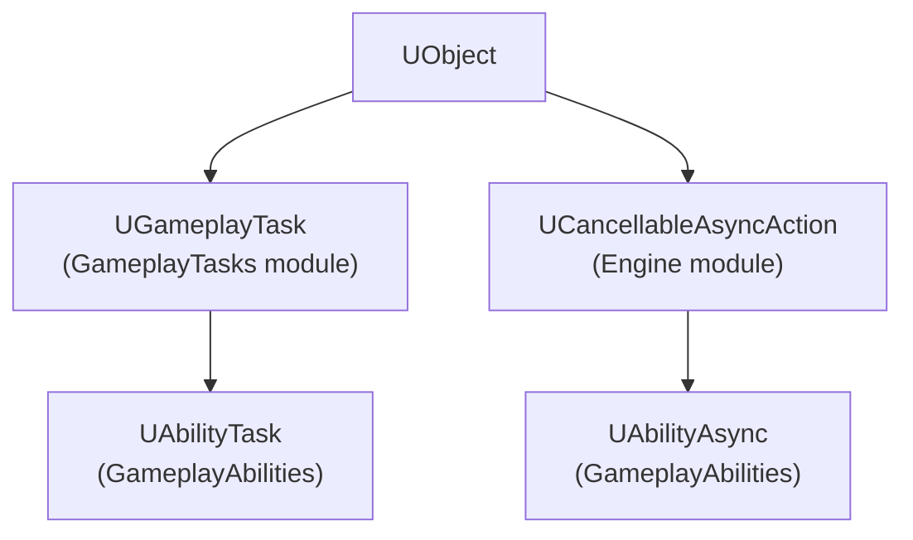
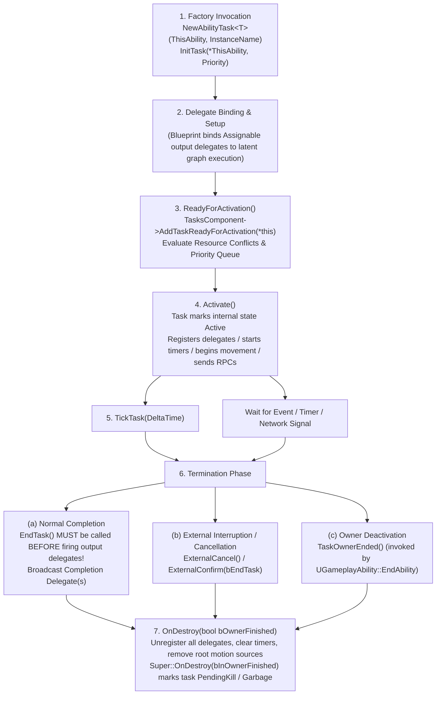

# Gameplay Ability System (GAS) Architecture & Usage Guide: Gameplay Tasks

**Engine Version:** Unreal Engine 5.8 (`UE_5.8`)  
**Module Targets:** `GameplayTasks`, `GameplayAbilities`, `GameplayAbilitiesEditor`  
**Primary Source Citations:**
- `Engine/Source/Runtime/GameplayTasks/Classes/GameplayTask.h`
- `Engine/Source/Runtime/GameplayTasks/Classes/GameplayTasksComponent.h`
- `Engine/Source/Runtime/GameplayTasks/Classes/GameplayTaskOwnerInterface.h`
- `Engine/Source/Runtime/GameplayTasks/Classes/GameplayTaskResource.h`
- `Engine/Source/Runtime/GameplayTasks/Public/GameplayTaskTypes.h`
- `Engine/Source/Runtime/GameplayTasks/Public/GameplayTasksModule.h`
- `Engine/Source/Runtime/GameplayTasks/Classes/Tasks/GameplayTask_ClaimResource.h`
- `Engine/Source/Runtime/GameplayTasks/Classes/Tasks/GameplayTask_SpawnActor.h`
- `Engine/Source/Runtime/GameplayTasks/Classes/Tasks/GameplayTask_TimeLimitedExecution.h`
- `Engine/Source/Runtime/GameplayTasks/Classes/Tasks/GameplayTask_WaitDelay.h`
- `Engine/Plugins/Runtime/GameplayAbilities/Source/GameplayAbilities/Public/Abilities/Tasks/AbilityTask.h`
- `Engine/Plugins/Runtime/GameplayAbilities/Source/GameplayAbilities/Public/Abilities/Tasks/AbilityTask_*.h` (All 40 task headers)
- `Engine/Plugins/Runtime/GameplayAbilities/Source/GameplayAbilities/Public/Abilities/Async/AbilityAsync.h`
- `Engine/Plugins/Runtime/GameplayAbilities/Source/GameplayAbilities/Public/Abilities/Async/AbilityAsync_*.h` (All 6 async action headers)
- `Engine/Source/Runtime/Engine/Classes/Kismet/BlueprintAsyncActionBase.h`

---

## 1. Architecture

### 1.1 Core Types & Responsibilities

In Unreal Engine 5.8, gameplay tasks form the asynchronous/latent action infrastructure for both AI systems and the Gameplay Ability System (GAS). They allow long-running operations—such as playing animations, waiting for input or tags, moving characters, and targeting—to execute over time without blocking the main game thread, dispatching execution back into Blueprint or C++ via dynamic multicast delegates.



#### `UGameplayTask`
- **Source:** `Engine/Source/Runtime/GameplayTasks/Classes/GameplayTask.h` (Line 145)
- **Base Class:** `UObject`, implements `IGameplayTaskOwnerInterface`
- **Class Specifiers:** `Abstract, BlueprintType, meta=(ExposedAsyncProxy=AsyncTask), config=Game, MinimalAPI`
- **Responsibilities:**
  - Base class for all gameplay tasks across gameplay systems (AI, GAS, scripted sequences).
  - Encapsulates state tracking (`EGameplayTaskState`: `Uninitialized`, `AwaitingActivation`, `Paused`, `Active`, `Finished`).
  - Implements priority and resource arbitration via `FGameplayResourceSet` and `ETaskResourceOverlapPolicy`.
  - Manages task execution lifecycle (`ReadyForActivation`, `Activate`, `TickTask`, `Pause`, `Resume`, `ExternalConfirm`, `ExternalCancel`, `EndTask`, `OnDestroy`).
  - Supports simulated tasks on network simulated proxies via `bSimulatedTask` and Iris replication integration via `RegisterReplicationFragments()`.

#### `IGameplayTaskOwnerInterface` & `UGameplayTaskOwnerInterface`
- **Source:** `Engine/Source/Runtime/GameplayTasks/Classes/GameplayTaskOwnerInterface.h` (Lines 15–45)
- **Responsibilities:**
  - Contract required for any object or component that owns and runs gameplay tasks.
  - Implemented by `UGameplayTasksComponent`, `UGameplayAbility`, `AAIController`, and `UGameplayTask` itself (for hierarchical sub-tasks).
  - Key methods:
    - `GetGameplayTasksComponent(const UGameplayTask& Task) const`: Resolves the governing `UGameplayTasksComponent`.
    - `GetGameplayTaskOwner(const UGameplayTask* Task) const`: Resolves the owning `AActor`.
    - `GetGameplayTaskAvatar(const UGameplayTask* Task) const`: Resolves the physical avatar actor (defaults to owner; in AI, Owner is `AAIController` while Avatar is `APawn`).
    - `GetGameplayTaskDefaultPriority() const`: Returns default task priority (`FGameplayTasks::DefaultPriority = 127`).
    - `OnGameplayTaskInitialized(UGameplayTask& Task)`: Lifecycle callback after initialization.
    - `OnGameplayTaskActivated(UGameplayTask& Task)`: Lifecycle callback upon activation/resumption.
    - `OnGameplayTaskDeactivated(UGameplayTask& Task)`: Lifecycle callback upon pause or completion.

#### `UGameplayTasksComponent`
- **Source:** `Engine/Source/Runtime/GameplayTasks/Classes/GameplayTasksComponent.h` (Line 61)
- **Base Class:** `UActorComponent`, implements `IGameplayTaskOwnerInterface`, `IVisualLoggerDebugSnapshotInterface`
- **Responsibilities:**
  - Placed on actors (or derived by `UAbilitySystemComponent`) to coordinate, queue, tick, and replicate gameplay tasks.
  - Maintains the task priority queue (`TaskPriorityQueue`), active ticking tasks (`TickingTasks`), known tasks (`KnownTasks`), and simulated proxy tasks (`SimulatedTasks`).
  - Manages claimed resource bitflags (`CurrentlyClaimedResources`) and enforces resource overlap rules (`AddTaskReadyForActivation`, `RemoveResourceConsumingTask`).
  - Handles network subobject replication for simulated tasks (`ReplicateSubobjects`, `OnRep_SimulatedTasks`).

#### `UGameplayTaskResource` & `FGameplayResourceSet`
- **Source:** `Engine/Source/Runtime/GameplayTasks/Classes/GameplayTaskResource.h` (Line 14), `GameplayTask.h` (Line 45)
- **Responsibilities:**
  - Up to 16 distinct resource classes can be defined per project (bitflags packed in `uint16`).
  - Assigns unique runtime resource IDs (`FGameplayResourceSet::MaxResources = 16`).
  - Allows tasks to claim or require mutually exclusive capabilities (e.g., movement, arms/aiming, audio channels).
  - `ETaskResourceOverlapPolicy`:
    - `StartOnTop`: Pause overlapping same-priority tasks.
    - `StartAtEnd`: Wait for other same-priority tasks to finish before starting.
    - `RequestCancelAndStartOnTop`: Request cancellation of same/lower priority tasks; pause remaining.
    - `RequestCancelAndStartAtEnd`: Request cancellation of same/lower priority tasks; wait for remaining.

#### `UAbilityTask`
- **Source:** `Engine/Plugins/Runtime/GameplayAbilities/Source/GameplayAbilities/Public/Abilities/Tasks/AbilityTask.h` (Line 90)
- **Base Class:** `UGameplayTask`
- **Responsibilities:**
  - Specialized base class for all latent/asynchronous actions executed within a `UGameplayAbility`.
  - Tied directly to the lifecycle and replication of an owning `UGameplayAbility` instance and its `UAbilitySystemComponent`.
  - Automatically terminated when the owning ability ends (`TaskOwnerEnded()` called by ability deactivation).
  - Maintains `EAbilityTaskWaitState` (`WaitingOnGame`, `WaitingOnUser`, `WaitingOnAvatar`) for network sync and prediction tracking.
  - Provides network prediction and role helpers: `IsPredictingClient()`, `IsForRemoteClient()`, `IsLocallyControlled()`, `GetActivationPredictionKey()`.
  - Handles deferred actor spawning via the two-phase `BeginSpawningActor()` and `FinishSpawningActor()` contract (enabling Blueprint "Expose on Spawn" pins).

#### `UAbilityAsync`
- **Source:** `Engine/Plugins/Runtime/GameplayAbilities/Source/GameplayAbilities/Public/Abilities/Async/AbilityAsync.h` (Line 22)
- **Base Class:** `UCancellableAsyncAction` (which derives from `UBlueprintAsyncActionBase`)
- **Responsibilities:**
  - Base class for ability-related asynchronous actions that are **not** bound to a `UGameplayAbility` lifespan.
  - Can be spawned from any Blueprint graph (Actors, Widgets, GameModes, Subsystems).
  - Kept alive solely by the Blueprint graph node or until explicitly ended via `EndAction()` or cancelled via `Cancel()`.
  - Binds directly to `UAbilitySystemComponent` delegates (tag changes, attribute changes, gameplay events, effect applications).

---

### 1.2 Task Lifecycle: Activate -> TickTask -> EndTask



#### Detailed Phase Mechanics

1. **Instantiation & Initialization (`InitTask`)**:
   - In C++, instantiated via `UAbilityTask::NewAbilityTask<T>(ThisAbility, InstanceName)`.
   - `InitTask(IGameplayTaskOwnerInterface& InTaskOwner, uint8 InPriority)` assigns `TaskOwner`, queries `InTaskOwner.GetGameplayTasksComponent()`, records initial priority (`FGameplayTasks::DefaultPriority = 127`), and transitions `TaskState` to `EGameplayTaskState::AwaitingActivation`.

2. **Activation Handshake (`ReadyForActivation` -> `Activate`)**:
   - Blueprint generated code (via `UK2Node_LatentAbilityCall`) calls `ReadyForActivation()` immediately after wiring delegate bindings.
   - If the task does not care about priorities or resources, `PerformActivation()` runs immediately, transitioning `TaskState` to `EGameplayTaskState::Active` and invoking `Activate()`.
   - If the task requires resources, `UGameplayTasksComponent::AddTaskReadyForActivation()` tests `CurrentlyClaimedResources`. Depending on `ResourceOverlapPolicy`, the task activates immediately, is placed into `TaskPriorityQueue`, or causes overlapping tasks to pause/cancel.

3. **Execution & Ticking (`TickTask`)**:
   - If `bTickingTask == true`, `UGameplayTasksComponent` registers the task in `TickingTasks`.
   - `UGameplayTasksComponent::TickComponent()` iterates ticking tasks and invokes `TickTask(DeltaTime)`.

4. **Completion & The Critical EndTask Order Rule**:
   - **`EndTask()` must be called before broadcasting output delegates.**
   - *Rationale (`GameplayTask.h`, Lines 224–227):* When a dynamic multicast delegate fires, blueprint execution resumes synchronously on the execution wire. If `EndTask()` has not yet executed, the task is still registered as `Active`. If the receiving blueprint graph calls `EndAbility()` or queries active tasks on the ability, re-entrant state corruption or dangling task queries occur.
   ```cpp
   // CORRECT ORDER:
   EndTask();
   OnFinish.Broadcast();

   // DANGEROUS ORDER:
   OnFinish.Broadcast(); // Re-entrant code in Blueprint might cancel or end ability
   EndTask();
   ```

5. **Destruction & Cleanup (`OnDestroy`)**:
   - `OnDestroy(bool bInOwnerFinished)` is the single point of truth for cleanup.
   - Must unbind all event delegates, remove root motion sources, invalidate timer handles, and unbind from `AbilitySystemComponent`.
   - Must always conclude with `Super::OnDestroy(bInOwnerFinished)` to mark the task for garbage collection.

---

### 1.3 Ownership, Instance Model & Memory Management

#### Hierarchical Ownership Structure
- **Task Owner:** Implements `IGameplayTaskOwnerInterface`. For `UAbilityTask`, the owner is the instanced `UGameplayAbility`.
- **Tasks Component:** The `UGameplayTasksComponent` on the avatar or owner actor (for GAS, `UAbilitySystemComponent` inherits `UGameplayTasksComponent`).
- **Owner Actor vs. Avatar Actor:**
  - `GetOwnerActor()`: Resolves the logical owner (e.g., `APlayerState` or `AAIController`).
  - `GetAvatarActor()`: Resolves the physical world actor (e.g., `ACharacter` or `APawn`).

#### Lifetime & Garbage Collection
- Tasks are `UObject` instances. They are kept alive by:
  1. The `KnownTasks` array inside `UGameplayTasksComponent`.
  2. The `ActiveTasks` list inside `UGameplayAbility`.
  3. The latent execution proxy reference maintained by the Blueprint VM during active execution.
- When an ability ends, `UGameplayAbility::EndAbility()` iterates its tracked ability tasks and invokes `TaskOwnerEnded()`. This immediately forces tasks to terminate via `OnDestroy(true)`, preventing abandoned background listeners or memory leaks.

#### Instance Naming (`InstanceName`)
- Tasks accept an optional `FName InstanceName`.
- Allows abilities to query, identify, or cancel specific running task instances using `FAbilityInstanceNamePredicate` or `FindResourceConsumingTaskByName(InstanceName)`.

---

### 1.4 Blueprint Latent Ability Tasks vs. Async Actions (`UAbilityAsync`)

A common source of confusion in GAS architecture is choosing between `UAbilityTask` and `UAbilityAsync`.

| Dimension | `UAbilityTask` | `UAbilityAsync` (`UCancellableAsyncAction`) |
| :--- | :--- | :--- |
| **Source Header** | `Abilities/Tasks/AbilityTask.h` | `Abilities/Async/AbilityAsync.h` |
| **Base Class** | `UGameplayTask` -> `UObject` | `UCancellableAsyncAction` -> `UBlueprintAsyncActionBase` |
| **Execution Context** | **Exclusively inside `UGameplayAbility`** graphs or C++ abilities | **Anywhere** (Actors, UI Widgets, Controllers, GameModes) |
| **Blueprint Node Type** | `UK2Node_LatentAbilityCall` | `UK2Node_AsyncAction` |
| **Lifespan Anchor** | Tied to the owning `UGameplayAbility`. Auto-aborts when ability ends | Tied to the spawning Blueprint graph instance or manual `EndAction()` |
| **Prediction & Net Roles** | Aware of ability prediction keys, client/server roles, and avatar syncing | Passive listener on `UAbilitySystemComponent` delegates |
| **Target Actor Spawning** | Supports deferred two-phase spawning (`BeginSpawningActor`) | Does not support deferred actor construction |
| **Ticking & Root Motion** | Can tick via `GameplayTasksComponent`, inject root motion sources | Cannot tick; delegate-driven only |
| **Typical Use Cases** | Play montage, wait input press/release, root motion dash, target data | UI listening to cooldowns/tags, passive HUD health bars, quest tracking |

---

## 2. Complete Task Catalog

### 2.1 Engine Gameplay Tasks (`GameplayTasks` Module)

These primitive tasks are defined in `Engine/Source/Runtime/GameplayTasks/Classes/Tasks/` and operate independently of GAS:

| Task Class | Header Path | Factory Method | Purpose |
| :--- | :--- | :--- | :--- |
| `UGameplayTask_ClaimResource` | `Classes/Tasks/GameplayTask_ClaimResource.h` | `ClaimResource(...)` / `ClaimResources(...)` | Claims one or more `UGameplayTaskResource` sets at specified priority without running logic. |
| `UGameplayTask_SpawnActor` | `Classes/Tasks/GameplayTask_SpawnActor.h` | `SpawnActor(...)` | Spawns an actor with deferred construction for exposing spawn parameters in tasks. |
| `UGameplayTask_TimeLimitedExecution` | `Classes/Tasks/GameplayTask_TimeLimitedExecution.h` | None (Internal Base) | Base task enforcing maximum execution duration before automatic termination. |
| `UGameplayTask_WaitDelay` | `Classes/Tasks/GameplayTask_WaitDelay.h` | `TaskWaitDelay(...)` | Primitive non-ability delay task that waits specified seconds before finishing. |

---

### 2.2 Complete AbilityTask Catalog (`GameplayAbilities` Module)

The following table documents all 40 Ability Task classes located in `Engine/Plugins/Runtime/GameplayAbilities/Source/GameplayAbilities/Public/Abilities/Tasks/`, grouped by functional domain.

#### Category 1: Input & Synchronization Tasks
| Task Class | Header Path | Factory Method | Purpose |
| :--- | :--- | :--- | :--- |
| `UAbilityTask_WaitInputPress` | `AbilityTask_WaitInputPress.h` | `WaitInputPress(...)` | Waits until the local player presses the input action bound to this ability. |
| `UAbilityTask_WaitInputRelease` | `AbilityTask_WaitInputRelease.h` | `WaitInputRelease(...)` | Waits until the local player releases the input action bound to this ability. |
| `UAbilityTask_WaitConfirm` | `AbilityTask_WaitConfirm.h` | `WaitConfirm(...)` | Waits for external generic confirmation input signal (`TargetConfirm`). |
| `UAbilityTask_WaitCancel` | `AbilityTask_WaitCancel.h` | `WaitCancel(...)` | Waits for external generic cancellation input signal (`TargetCancel`). |
| `UAbilityTask_WaitConfirmCancel` | `AbilityTask_WaitConfirmCancel.h` | `WaitConfirmCancel(...)` | Listens simultaneously for either confirmation or cancellation input signals. |
| `UAbilityTask_NetworkSyncPoint` | `AbilityTask_NetworkSyncPoint.h` | `WaitNetSync(...)` | Synchronizes execution flow between client and server via generic replicated events (`BothWait`, `OnlyServerWait`, `OnlyClientWait`). |

#### Category 2: Animation & State Tasks
| Task Class | Header Path | Factory Method | Purpose |
| :--- | :--- | :--- | :--- |
| `UAbilityTask_PlayAnimAndWait` | `AbilityTask_PlayAnimAndWait.h` | `CreatePlayAnimAndWaitProxy(...)` | Plays an `UAnimSequence` directly on skeletal mesh with root motion scaling and wait. |
| `UAbilityTask_PlayMontageAndWait` | `AbilityTask_PlayMontageAndWait.h` | `CreatePlayMontageAndWaitProxy(...)` | Plays an `UAnimMontage` and waits for OnComplete, OnBlendOut, OnInterrupted, or OnCancelled. |
| `UAbilityTask_StartAbilityState` | `AbilityTask_StartAbilityState.h` | `StartAbilityState(...)` | Scopes ability execution into distinct states, managing state interruption vs. normal completion. |
| `UAbilityTask_Repeat` | `AbilityTask_Repeat.h` | `RepeatAction(...)` | Executes repeated delegate callbacks at configured time intervals for a fixed count. |
| `UAbilityTask_WaitDelay` | `AbilityTask_WaitDelay.h` | `WaitDelay(...)` | Waits for a specified duration in seconds before firing completion wire. |

#### Category 3: Gameplay Tags Tasks
| Task Class | Header Path | Factory Method | Purpose |
| :--- | :--- | :--- | :--- |
| `UAbilityTask_WaitGameplayTag` | `AbilityTask_WaitGameplayTagBase.h` | None (Abstract Base) | Base task for listening to tag changes on the owning AbilitySystemComponent. |
| `UAbilityTask_WaitGameplayTagAdded` | `AbilityTask_WaitGameplayTag.h` | `WaitGameplayTagAdd(...)` | Waits until a specific Gameplay Tag is added to the owning ASC. |
| `UAbilityTask_WaitGameplayTagRemoved` | `AbilityTask_WaitGameplayTag.h` | `WaitGameplayTagRemove(...)` | Waits until a specific Gameplay Tag is removed from the owning ASC. |
| `UAbilityTask_WaitGameplayTagCountChanged` | `AbilityTask_WaitGameplayTagCountChanged.h` | `WaitGameplayTagCountChange(...)` | Waits for any change in the explicit tag count of a specific Gameplay Tag. |
| `UAbilityTask_WaitGameplayTagQuery` | `AbilityTask_WaitGameplayTagQuery.h` | `WaitGameplayTagQuery(...)` | Evaluates an `FGameplayTagQuery` continuously and triggers when tag criteria match. |

#### Category 4: Gameplay Events & Ability Lifecycle Tasks
| Task Class | Header Path | Factory Method | Purpose |
| :--- | :--- | :--- | :--- |
| `UAbilityTask_WaitGameplayEvent` | `AbilityTask_WaitGameplayEvent.h` | `WaitGameplayEvent(...)` | Listens for an `FGameplayEventData` payload dispatched with a matching Gameplay Tag. |
| `UAbilityTask_WaitAbilityActivate` | `AbilityTask_WaitAbilityActivate.h` | `WaitForAbilityActivate(...)` / `WaitForAbilityActivate_WithTagRequirements(...)` | Waits until another ability is activated on the ASC matching tag/query filters. |
| `UAbilityTask_WaitAbilityCommit` | `AbilityTask_WaitAbilityCommit.h` | `WaitForAbilityCommit(...)` / `WaitForAbilityCommit_WithTagRequirements(...)` | Waits until another ability commits (costs/cooldowns applied) on the ASC. |

#### Category 5: Attributes & Gameplay Effects Tasks
| Task Class | Header Path | Factory Method | Purpose |
| :--- | :--- | :--- | :--- |
| `UAbilityTask_WaitAttributeChange` | `AbilityTask_WaitAttributeChange.h` | `WaitForAttributeChange(...)` / `WaitForAttributeChangeWithTags(...)` | Waits until an attribute changes value, optionally filtered by tag requirements. |
| `UAbilityTask_WaitAttributeChangeThreshold` | `AbilityTask_WaitAttributeChangeThreshold.h` | `WaitForAttributeChangeThreshold(...)` | Waits until an attribute value crosses a numeric comparison threshold (`GreaterThan`, `LessThan`, etc.). |
| `UAbilityTask_WaitAttributeChangeRatioThreshold` | `AbilityTask_WaitAttributeChangeRatioThreshold.h` | `WaitForAttributeChangeRatioThreshold(...)` | Waits until the ratio between two attributes (e.g., Health/MaxHealth) crosses a threshold. |
| `UAbilityTask_WaitGameplayEffectApplied` | `AbilityTask_WaitGameplayEffectApplied.h` | None (Abstract Base) | Base task providing effect applied delegate listening mechanisms. |
| `UAbilityTask_WaitGameplayEffectApplied_Self` | `AbilityTask_WaitGameplayEffectApplied_Self.h` | `WaitGameplayEffectAppliedToSelf(...)` | Waits until a Gameplay Effect is applied to the owning actor itself. |
| `UAbilityTask_WaitGameplayEffectApplied_Target` | `AbilityTask_WaitGameplayEffectApplied_Target.h` | `WaitGameplayEffectAppliedToTarget(...)` | Waits until the owning actor applies a Gameplay Effect to an external target. |
| `UAbilityTask_WaitGameplayEffectRemoved` | `AbilityTask_WaitGameplayEffectRemoved.h` | `WaitForGameplayEffectRemoved(...)` | Waits until an active Gameplay Effect handle is removed from the ASC. |
| `UAbilityTask_WaitGameplayEffectStackChange` | `AbilityTask_WaitGameplayEffectStackChange.h` | `WaitForGameplayEffectStackChange(...)` | Waits until the stack count of an active Gameplay Effect handle changes. |
| `UAbilityTask_WaitGameplayEffectBlockedImmunity` | `AbilityTask_WaitGameplayEffectBlockedImmunity.h` | `WaitGameplayEffectBlockedByImmunity(...)` | Listens for Gameplay Effects blocked by granted immunity tags. |

#### Category 6: Targeting & Actor Spawning Tasks
| Task Class | Header Path | Factory Method | Purpose |
| :--- | :--- | :--- | :--- |
| `UAbilityTask_WaitTargetData` | `AbilityTask_WaitTargetData.h` | `WaitTargetData(...)` / `WaitTargetDataUsingActor(...)` | Spawns or references a targeting actor and waits for target confirmation/cancellation data. |
| `UAbilityTask_VisualizeTargeting` | `AbilityTask_VisualizeTargeting.h` | `VisualizeTargeting(...)` / `VisualizeTargetingUsingActor(...)` | Spawns targeting visualizer actor for previewing reticles without waiting for confirm data. |
| `UAbilityTask_SpawnActor` | `AbilityTask_SpawnActor.h` | `SpawnActor(...)` | Authoritatively spawns an actor using two-phase deferred initialization for spawn parameters. |

#### Category 7: Movement & Root Motion Tasks
| Task Class | Header Path | Factory Method | Purpose |
| :--- | :--- | :--- | :--- |
| `UAbilityTask_ApplyRootMotion_Base` | `AbilityTask_ApplyRootMotion_Base.h` | None (Abstract Base) | Base class for root motion tasks managing `FRootMotionSource` registration and replication. |
| `UAbilityTask_ApplyRootMotionConstantForce` | `AbilityTask_ApplyRootMotionConstantForce.h` | `ApplyRootMotionConstantForce(...)` | Applies continuous directional linear force to character movement over duration. |
| `UAbilityTask_ApplyRootMotionJumpForce` | `AbilityTask_ApplyRootMotionJumpForce.h` | `ApplyRootMotionJumpForce(...)` | Applies parametric jump curve root motion force with height, distance, and landing triggers. |
| `UAbilityTask_ApplyRootMotionMoveToActorForce` | `AbilityTask_ApplyRootMotionMoveToActorForce.h` | `ApplyRootMotionMoveToActorForce(...)` / `ApplyRootMotionMoveToComponentForce(...)` | Moves character dynamically toward target actor/component with adaptive tracking and lerp curves. |
| `UAbilityTask_ApplyRootMotionMoveToForce` | `AbilityTask_ApplyRootMotionMoveToForce.h` | `ApplyRootMotionMoveToForce(...)` | Applies root motion force steering the character to an absolute world location. |
| `UAbilityTask_ApplyRootMotionRadialForce` | `AbilityTask_ApplyRootMotionRadialForce.h` | `ApplyRootMotionRadialForce(...)` | Applies radial root motion (push or pull/vortex) with distance and time falloff curves. |
| `UAbilityTask_MoveToLocation` | `AbilityTask_MoveToLocation.h` | `MoveToLocation(...)` | Moves actor to target location over time via vector/float curves (direct transform interpolation). |
| `UAbilityTask_WaitMovementModeChange` | `AbilityTask_WaitMovementModeChange.h` | `CreateWaitMovementModeChange(...)` | Waits until `UCharacterMovementComponent` enters a specific `EMovementMode` (e.g., Walking, Falling). |
| `UAbilityTask_WaitOverlap` | `AbilityTask_WaitOverlap.h` | `WaitForOverlap(...)` | Listens for primitive component blocking hits/overlaps on the avatar actor. |
| `UAbilityTask_WaitVelocityChange` | `AbilityTask_WaitVelocityChange.h` | `CreateWaitVelocityChange(...)` | Ticks movement component and waits until projected directional velocity exceeds threshold. |

---

### 2.3 Complete AbilityAsync Action Catalog (`Public/Abilities/Async/`)

These asynchronous actions operate independently of any `UGameplayAbility` instance:

| Async Class | Header Path | Factory Method | Purpose |
| :--- | :--- | :--- | :--- |
| `UAbilityAsync` | `Async/AbilityAsync.h` | None (Abstract Base) | Base class for ability async actions, binding to `UAbilitySystemComponent` with cancellation hooks. |
| `UAbilityAsync_WaitAttributeChanged` | `Async/AbilityAsync_WaitAttributeChanged.h` | `WaitForAttributeChanged(...)` | Listens for attribute value changes on an actor/ASC from UI widgets or non-ability actors. |
| `UAbilityAsync_WaitGameplayEffectApplied` | `Async/AbilityAsync_WaitGameplayEffectApplied.h` | `WaitGameplayEffectAppliedToActor(...)` | Listens for Gameplay Effects applied to an actor, filtering by tag requirements. |
| `UAbilityAsync_WaitGameplayEvent` | `Async/AbilityAsync_WaitGameplayEvent.h` | `WaitGameplayEventToActor(...)` | Listens for Gameplay Events on an actor/ASC with tag filtering (`OnlyTriggerOnce`, `OnlyMatchExact`). |
| `UAbilityAsync_WaitGameplayTag` | `Async/AbilityAsync_WaitGameplayTag.h` | None (Abstract Base) | Base async action for listening to tag container alterations on an actor. |
| `UAbilityAsync_WaitGameplayTagAdded` | `Async/AbilityAsync_WaitGameplayTag.h` | `WaitGameplayTagAddToActor(...)` | Asynchronously triggers when a Gameplay Tag is added to an external actor's ASC. |
| `UAbilityAsync_WaitGameplayTagRemoved` | `Async/AbilityAsync_WaitGameplayTag.h` | `WaitGameplayTagRemoveFromActor(...)` | Asynchronously triggers when a Gameplay Tag is removed from an external actor's ASC. |
| `UAbilityAsync_WaitGameplayTagCountChanged` | `Async/AbilityAsync_WaitGameplayTagCountChanged.h` | `WaitGameplayTagCountChangeOnActor(...)` | Asynchronously monitors tag count changes for a specific tag on an actor. |
| `UAbilityAsync_WaitGameplayTagQuery` | `Async/AbilityAsync_WaitGameplayTagQuery.h` | `WaitGameplayTagQueryOnActor(...)` | Continuously monitors tag queries against an actor's ASC and fires on match state change. |

---

## 3. Movement and Root Motion Tasks in Detail

GAS integrates deeply with `UCharacterMovementComponent` using Root Motion Sources (`FRootMotionSource`). Root motion tasks inject predictable, replicated forces into character movement.

### 3.1 Architectural Root Motion Pipeline
1. `UAbilityTask_ApplyRootMotion_Base` derives from `UAbilityTask`.
2. On `Activate()`, the task queries `UCharacterMovementComponent` from `GetAvatarActor()`.
3. An `FRootMotionSource` subclass (e.g., `FRootMotionSource_ConstantForce`, `FRootMotionSource_RadialForce`, `FRootMotionSource_MoveToForce`) is allocated and configured.
4. `CharacterMovementComponent->ApplyRootMotionSource(RootMotionSource)` registers the force and returns a `uint16 RootMotionSourceID`.
5. When the force expires or reaches its destination, the movement component removes the source and the task's `OnFinish` delegate broadcasts.
6. `FinishVelocityMode` (`ERootMotionFinishVelocityMode`) defines post-motion momentum:
   - `MaintainLastRootMotionVelocity`: Retain velocity from root motion.
   - `SetVelocity`: Explicitly set character velocity to `SetVelocityOnFinish`.
   - `ClampVelocity`: Clamp character velocity to `ClampVelocityOnFinish`.

---

## 4. Usage Patterns & Implementation Guides

### 4.1 Creating a Custom AbilityTask (C++)

This production pattern demonstrates a custom ability task that ticks every frame, checks a proximity condition to a target actor, and manages lifecycle and delegate order correctly:

#### Header: `AbilityTask_WaitProximity.h`
```cpp
#pragma once

#include "CoreMinimal.h"
#include "Abilities/Tasks/AbilityTask.h"
#include "AbilityTask_WaitProximity.generated.h"

DECLARE_DYNAMIC_MULTICAST_DELEGATE_OneParam(FOnProximityReachedDelegate, float, FinalDistance);

UCLASS()
class SKYHUNTERS_API UAbilityTask_WaitProximity : public UAbilityTask
{
    GENERATED_BODY()

public:
    UAbilityTask_WaitProximity(const FObjectInitializer& ObjectInitializer);

    UPROPERTY(BlueprintAssignable)
    FOnProximityReachedDelegate OnProximityReached;

    /**
     * Waits until the avatar actor comes within TargetRadius of TargetActor.
     * @param OwningAbility The ability executing this task.
     * @param TargetActor The destination actor to monitor.
     * @param TargetRadius Distance threshold in centimeters.
     */
    UFUNCTION(BlueprintCallable, Category = "Ability|Tasks", meta = (HidePin = "OwningAbility", DefaultToSelf = "OwningAbility", BlueprintInternalUseOnly = "TRUE"))
    static UAbilityTask_WaitProximity* WaitProximity(
        UGameplayAbility* OwningAbility,
        FName TaskInstanceName,
        AActor* TargetActor,
        float TargetRadius = 200.0f);

    virtual void Activate() override;
    virtual void TickTask(float DeltaTime) override;
    virtual void OnDestroy(bool bInOwnerFinished) override;

protected:
    UPROPERTY()
    TWeakObjectPtr<AActor> MonitoredTargetActor;

    float DesiredRadiusSquared;
};
```

#### Source: `AbilityTask_WaitProximity.cpp`
```cpp
#include "Abilities/Tasks/AbilityTask_WaitProximity.h"
#include "GameFramework/Actor.h"

UAbilityTask_WaitProximity::UAbilityTask_WaitProximity(const FObjectInitializer& ObjectInitializer)
    : Super(ObjectInitializer)
{
    bTickingTask = true;
    DesiredRadiusSquared = 40000.0f; // Default 200 units squared
}

UAbilityTask_WaitProximity* UAbilityTask_WaitProximity::WaitProximity(
    UGameplayAbility* OwningAbility,
    FName TaskInstanceName,
    AActor* TargetActor,
    float TargetRadius)
{
    if (!OwningAbility || !TargetActor)
    {
        return nullptr;
    }

    UAbilityTask_WaitProximity* MyTask = NewAbilityTask<UAbilityTask_WaitProximity>(OwningAbility, TaskInstanceName);
    MyTask->MonitoredTargetActor = TargetActor;
    MyTask->DesiredRadiusSquared = FMath::Square(TargetRadius);
    return MyTask;
}

void UAbilityTask_WaitProximity::Activate()
{
    Super::Activate();

    AActor* Avatar = GetAvatarActor();
    if (!Avatar || !MonitoredTargetActor.IsValid())
    {
        // Fail immediately if preconditions are missing
        EndTask();
        return;
    }
}

void UAbilityTask_WaitProximity::TickTask(float DeltaTime)
{
    Super::TickTask(DeltaTime);

    AActor* Avatar = GetAvatarActor();
    AActor* Target = MonitoredTargetActor.Get();

    if (!Avatar || !Target)
    {
        EndTask();
        return;
    }

    const float DistSquared = FVector::DistSquared(Avatar->GetActorLocation(), Target->GetActorLocation());
    if (DistSquared <= DesiredRadiusSquared)
    {
        if (ShouldBroadcastAbilityTaskDelegates())
        {
            // CRITICAL CONTRACT: EndTask must be called before broadcasting output delegates!
            EndTask();
            OnProximityReached.Broadcast(FMath::Sqrt(DistSquared));
        }
        else
        {
            EndTask();
        }
    }
}

void UAbilityTask_WaitProximity::OnDestroy(bool bInOwnerFinished)
{
    // Clean up all local bindings and weak pointers
    MonitoredTargetActor.Reset();

    Super::OnDestroy(bInOwnerFinished);
}
```

---

### 4.2 Blueprint Latent Node Architecture (`UK2Node_LatentAbilityCall`)

When defining a factory function for an AbilityTask:
1. Tag `UFUNCTION` with `BlueprintCallable` and metadata:
   - `BlueprintInternalUseOnly = "true"`: Hides the static function from generic context menus so only the latent node is spawned.
   - `HidePin = "OwningAbility", DefaultToSelf = "OwningAbility"`: Auto-wires the calling `UGameplayAbility` self pin.
2. The Unreal Blueprint compiler binds the function to `UK2Node_LatentAbilityCall`.
3. The node exposes pins for each parameter, an input execution pin, and an output execution pin for **every `BlueprintAssignable` delegate** on the class.
4. Generated bytecode performs:
   ```
   Proxy = UCustomTask::FactoryMethod(Self, ...);
   Proxy->Delegate.AddDynamic(GraphEvent);
   Proxy->ReadyForActivation();
   ```

---

### 4.3 Creating an Asynchronous Action (`UAbilityAsync`)

For non-ability systems (such as a HUD Health Bar widget), implement `UAbilityAsync`:

#### Header: `AbilityAsync_ListenForStamina.h`
```cpp
#pragma once

#include "CoreMinimal.h"
#include "Abilities/Async/AbilityAsync.h"
#include "AbilityAsync_ListenForStamina.generated.h"

DECLARE_DYNAMIC_MULTICAST_DELEGATE_TwoParams(FOnStaminaChangedSignature, float, NewValue, float, OldValue);

UCLASS()
class SKYHUNTERS_API UAbilityAsync_ListenForStamina : public UAbilityAsync
{
    GENERATED_BODY()

public:
    UPROPERTY(BlueprintAssignable)
    FOnStaminaChangedSignature OnStaminaChanged;

    UFUNCTION(BlueprintCallable, Category = "Ability|Async", meta = (DefaultToSelf = "TargetActor", BlueprintInternalUseOnly = "TRUE"))
    static UAbilityAsync_ListenForStamina* ListenForStaminaChanged(AActor* TargetActor);

    virtual void Activate() override;
    virtual void EndAction() override;

protected:
    void OnStaminaAttributeChanged(const FOnAttributeChangeData& ChangeData);
};
```

#### Source: `AbilityAsync_ListenForStamina.cpp`
```cpp
#include "AbilityAsync_ListenForStamina.h"
#include "AbilitySystemComponent.h"
#include "AbilitySystemGlobals.h"

UAbilityAsync_ListenForStamina* UAbilityAsync_ListenForStamina::ListenForStaminaChanged(AActor* TargetActor)
{
    UAbilityAsync_ListenForStamina* Action = NewObject<UAbilityAsync_ListenForStamina>();
    Action->SetAbilityActor(TargetActor);
    return Action;
}

void UAbilityAsync_ListenForStamina::Activate()
{
    Super::Activate();

    UAbilitySystemComponent* ASC = GetAbilitySystemComponent();
    if (!ASC)
    {
        EndAction();
        return;
    }

    // Example binding to a specific FGameplayAttribute
    // (Assuming UCombatAttributeSet::GetStaminaAttribute() exists)
    // ASC->GetGameplayAttributeValueChangeDelegate(UCombatAttributeSet::GetStaminaAttribute())
    //    .AddUObject(this, &UAbilityAsync_ListenForStamina::OnStaminaAttributeChanged);
}

void UAbilityAsync_ListenForStamina::OnStaminaAttributeChanged(const FOnAttributeChangeData& ChangeData)
{
    if (ShouldBroadcastDelegates())
    {
        OnStaminaChanged.Broadcast(ChangeData.NewValue, ChangeData.OldValue);
    }
}

void UAbilityAsync_ListenForStamina::EndAction()
{
    UAbilitySystemComponent* ASC = GetAbilitySystemComponent();
    if (ASC)
    {
        // Unbind delegate
    }

    Super::EndAction();
}
```

---

## 5. Common Pitfalls & Best Practices

1. **Broadcasting Delegates Before `EndTask()`**:
   - *Problem:* Firing `OnFinish.Broadcast()` prior to `EndTask()`.
   - *Result:* If the receiving Blueprint execution immediately calls `EndAbility()`, the task is still registered in `ActiveTasks` and attempts a double destruction during teardown, triggering assertion crashes in `GameplayTasksComponent`.
   - *Remedy:* Always invoke `EndTask()` first, then broadcast completion delegates.

2. **Using `UAbilityTask` in Widgets or Controller Graphs**:
   - *Problem:* Calling an `AbilityTask` outside of a `UGameplayAbility`.
   - *Result:* The node requires `OwningAbility`. Passing `nullptr` or attempting to cast an Actor will fail at compile time or crash at runtime with `check(ThisAbility)`.
   - *Remedy:* Use `UAbilityAsync` or native `UAbilitySystemComponent` delegate bindings for UI widgets, player controllers, and game mode logic.

3. **Leaking Timers and External Delegate Subscriptions**:
   - *Problem:* Subscribing to world timers or component hit delegates in `Activate()` without unbinding in `OnDestroy()`.
   - *Result:* When an ability is abruptly cancelled via `CancelAbility()`, `TickTask` stops, but external callbacks remain bound to pending-kill task memory.
   - *Remedy:* Place all teardown logic inside `OnDestroy(bool bInOwnerFinished)`. Always conclude with `Super::OnDestroy(bInOwnerFinished)`.

4. **Instantiating Tasks via `NewObject<T>()` or `NewTask<T>()`**:
   - *Problem:* Calling `NewObject<T>()` directly or using `UGameplayTask::NewTask<T>()`.
   - *Result:* The task fails to initialize its link to the owning ability's ASC, bypassing prediction key registration and debug instrumentation.
   - *Remedy:* Always use `UAbilityTask::NewAbilityTask<T>(ThisAbility, InstanceName)`.

5. **Neglecting Simulated Proxy Tasks in Network Replication**:
   - *Problem:* Expecting an ability task that runs locally on autonomous proxies to automatically replicate motion to simulated proxies.
   - *Result:* Simulated proxies do not run the ability graph. Unless the task implements simulated proxy hooks (`bSimulatedTask = true`, `InitSimulatedTask`, and subobject replication in `GameplayTasksComponent`), other clients see erratic snapping or missed visuals.
   - *Remedy:* Use root motion tasks (which replicate through `CharacterMovementComponent`) or trigger replicated Gameplay Cues for visual effects across simulated proxies.
