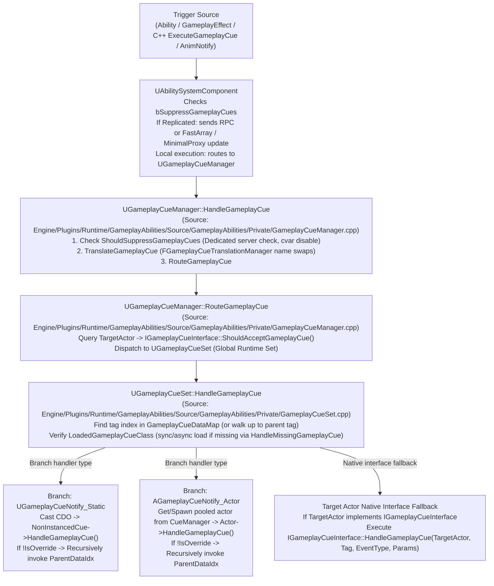
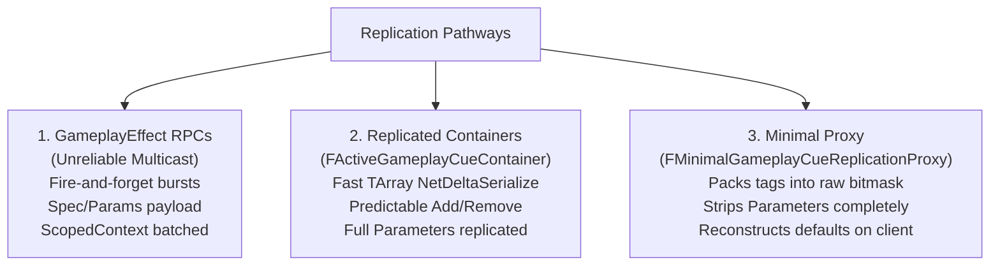

# Gameplay Ability System (GAS) Gameplay Cues Architecture & Implementation Guide (Unreal Engine 5.8)

## 1. Overview & Core Philosophy

**Gameplay Cues (GCs)** represent the cosmetic, audio-visual feedback layer of the Gameplay Ability System (GAS). They encapsulate everything a player *sees* or *hears*—particles (Niagara/Cascade), sound cues/metasounds, camera shakes, camera lens effects, force feedback, and decals—completely divorced from gameplay simulation logic, damage calculations, and server authority.

### Core Architectural Principles
1. **Cosmetic Separation**: Gameplay simulation runs on the server and autonomous clients; Gameplay Cues execute purely on clients (and listen servers). Dedicated servers bypass cosmetic cue execution by default.
2. **Tag-Driven Dispatch**: Gameplay Cues are addressed and triggered strictly by `FGameplayTag` hierarchies rooted at `GameplayCue` (e.g. `GameplayCue.Damage.Physical.Slash`).
3. **Bandwidth Optimization**: Rather than replicating complex cosmetic states, GAS replicates only the Cue Tag, prediction keys, and a compact payload struct (`FGameplayCueParameters` defined in `Engine/Plugins/Runtime/GameplayAbilities/Source/GameplayAbilities/Public/GameplayEffectTypes.h`).
4. **Hierarchical Tag Fallback**: If a specialized Cue (e.g. `GameplayCue.Damage.Physical.Slash`) has no matching handler, the system walks up the tag parent chain (`GameplayCue.Damage.Physical` -> `GameplayCue.Damage` -> `GameplayCue`) to find a valid handler.
5. **Static vs. Instanced Handlers**: GCs distinguish between lightweight, fire-and-forget burst effects that run on CDOs (`UGameplayCueNotify_Static`, `UGameplayCueNotify_Burst`) and stateful, persistent, or latent effects that spawn pooled world actors (`AGameplayCueNotify_Actor`, `AGameplayCueNotify_BurstLatent`, `AGameplayCueNotify_Looping`).

---

## 2. Comprehensive Type-to-Source Traceability Matrix

Every type, interface, container, notify, and editor class utilized across the Gameplay Cue subsystem is explicitly mapped below to its exact source file under the Unreal Engine 5.8 repository (`Engine/Plugins/Runtime/GameplayAbilities/Source/GameplayAbilities/` and `Engine/Plugins/Runtime/GameplayAbilities/Source/GameplayAbilitiesEditor/`):

| Type / Struct / Class | Source File Path | Module Layer | Primary Responsibility |
| :--- | :--- | :--- | :--- |
| `IGameplayCueInterface` | `Engine/Plugins/Runtime/GameplayAbilities/Source/GameplayAbilities/Public/GameplayCueInterface.h` | Runtime (Public) | Native interface implemented by actors (characters, pawns) to opt into and handle cue dispatches. |
| `UGameplayCueInterface` | `Engine/Plugins/Runtime/GameplayAbilities/Source/GameplayAbilities/Public/GameplayCueInterface.h` | Runtime (Public) | UObject interface reflection definition for `IGameplayCueInterface`. |
| `FActiveGameplayCue` | `Engine/Plugins/Runtime/GameplayAbilities/Source/GameplayAbilities/Public/GameplayCueInterface.h` | Runtime (Public) | Fast array serializer item storing a replicated cue tag, prediction key, and `FGameplayCueParameters`. |
| `FActiveGameplayCueContainer` | `Engine/Plugins/Runtime/GameplayAbilities/Source/GameplayAbilities/Public/GameplayCueInterface.h` | Runtime (Public) | `FFastArraySerializer` container managing active replicated cues on an ASC (`NetDeltaSerialize`). |
| `FGameplayCueTag` | `Engine/Plugins/Runtime/GameplayAbilities/Source/GameplayAbilities/Public/GameplayCueInterface.h` | Runtime (Public) | Details-customized wrapper struct around `FGameplayTag` restricted to the `GameplayCue` category. |
| `FMinimalGameplayCueReplicationProxy` | `Engine/Plugins/Runtime/GameplayAbilities/Source/GameplayAbilities/Public/GameplayCueInterface.h` | Runtime (Public) | Memory-compact proxy packing active cue tags and quantized vectors without parameter serialization. |
| `FMinimalGameplayCueReplicationProxyForNetSerializer` | `Engine/Plugins/Runtime/GameplayAbilities/Source/GameplayAbilities/Private/Serialization/InternalMinimalGameplayCueReplicationProxyNetSerializer.h` | Runtime (Private) | Iris / NetSerializer adapter struct for replicated tags and quantized locations. |
| `FGameplayCueParameters` | `Engine/Plugins/Runtime/GameplayAbilities/Source/GameplayAbilities/Public/GameplayEffectTypes.h` | Runtime (Public) | Comprehensive metadata struct carrying hit normals, locations, physical materials, instigators, and levels. |
| `EGameplayCueEvent::Type` | `Engine/Plugins/Runtime/GameplayAbilities/Source/GameplayAbilities/Public/GameplayEffectTypes.h` | Runtime (Public) | Lifecycle event enum: `OnActive`, `WhileActive`, `Executed`, `Removed`. |
| `FGameplayEffectCue` | `Engine/Plugins/Runtime/GameplayAbilities/Source/GameplayAbilities/Public/GameplayEffect.h` | Runtime (Public) | Configuration struct tying cue tags, level limits (`MinLevel`, `MaxLevel`), and magnitude attributes to a GE. |
| `UGameplayCueManager` | `Engine/Plugins/Runtime/GameplayAbilities/Source/GameplayAbilities/Public/GameplayCueManager.h` | Runtime (Public) | Singleton manager coordinating cue routing, object libraries, asset streaming, RPC flushing, and actor pooling. |
| `FGameplayCueObjectLibrary` | `Engine/Plugins/Runtime/GameplayAbilities/Source/GameplayAbilities/Public/GameplayCueManager.h` | Runtime (Public) | Wrapper encapsulating static and actor `UObjectLibrary` instances with async/sync scanning policies. |
| `FAsyncLoadPendingGameplayCue` | `Engine/Plugins/Runtime/GameplayAbilities/Source/GameplayAbilities/Public/GameplayCueManager.h` | Runtime (Public) | Deferral queue item storing pending cue events awaiting async class streaming completion. |
| `EGameplayCueExecutionOptions` | `Engine/Plugins/Runtime/GameplayAbilities/Source/GameplayAbilities/Public/GameplayCueManager.h` | Runtime (Public) | Flags to selectively ignore interfaces, notifies, tag translation, or suppression during dispatch. |
| `FGameplayCuePendingExecute` | `Engine/Plugins/Runtime/GameplayAbilities/Source/GameplayAbilities/Public/GameplayCue_Types.h` | Runtime (Public) | Batched execution record holding cues awaiting transmission upon send-context closure. |
| `FGameplayCueNotifyActorArray` | `Engine/Plugins/Runtime/GameplayAbilities/Source/GameplayAbilities/Public/GameplayCue_Types.h` | Runtime (Public) | Array wrapper maintaining pooled, recycled actor instances per world. |
| `FPreallocationInfo` | `Engine/Plugins/Runtime/GameplayAbilities/Source/GameplayAbilities/Public/GameplayCue_Types.h` | Runtime (Public) | Per-world pool container tracking preallocated actor arrays and recycling classes. |
| `UGameplayCueSet` | `Engine/Plugins/Runtime/GameplayAbilities/Source/GameplayAbilities/Public/GameplayCueSet.h` | Runtime (Public) | Data asset holding cue notify mappings and accelerated hierarchical lookup tables (`GameplayCueDataMap`). |
| `FGameplayCueNotifyData` | `Engine/Plugins/Runtime/GameplayAbilities/Source/GameplayAbilities/Public/GameplayCueSet.h` | Runtime (Public) | Record binding a Gameplay Cue tag to a soft object path and its resolved `LoadedGameplayCueClass`. |
| `FGameplayCueReferencePair` | `Engine/Plugins/Runtime/GameplayAbilities/Source/GameplayAbilities/Public/GameplayCueSet.h` | Runtime (Public) | Transient tag-to-soft-path pair utilized during cue set construction and batch ingestion. |
| `UGameplayCueTranslator` | `Engine/Plugins/Runtime/GameplayAbilities/Source/GameplayAbilities/Public/GameplayCueTranslator.h` | Runtime (Public) | Base class for runtime tag translation rules (e.g. material or character-specific tag redirection). |
| `FGameplayCueTranslationManager` | `Engine/Plugins/Runtime/GameplayAbilities/Source/GameplayAbilities/Public/GameplayCueTranslator.h` | Runtime (Public) | Registry and evaluation engine managing active translators and runtime name-swap graphs. |
| `UGameplayCueFunctionLibrary` | `Engine/Plugins/Runtime/GameplayAbilities/Source/GameplayAbilities/Public/GameplayCueFunctionLibrary.h` | Runtime (Public) | Blueprint utility library providing static functions to construct parameters and execute cues on actors. |
| `FGameplayCueNotify_SpawnCondition` | `Engine/Plugins/Runtime/GameplayAbilities/Source/GameplayAbilities/Public/GameplayCueNotifyTypes.h` | Runtime (Public) | Rule struct checking locally controlled policy, random chance, and physical surface mask allowances. |
| `FGameplayCueNotify_PlacementInfo` | `Engine/Plugins/Runtime/GameplayAbilities/Source/GameplayAbilities/Public/GameplayCueNotifyTypes.h` | Runtime (Public) | Transform positioning struct defining socket names, attach policies, and rotational/scaling overrides. |
| `FGameplayCueNotify_BurstEffects` | `Engine/Plugins/Runtime/GameplayAbilities/Source/GameplayAbilities/Public/GameplayCueNotifyTypes.h` | Runtime (Public) | Aggregated data definition for burst particle systems, sounds, camera shakes, decals, and force feedback. |
| `FGameplayCueNotify_LoopingEffects` | `Engine/Plugins/Runtime/GameplayAbilities/Source/GameplayAbilities/Public/GameplayCueNotifyTypes.h` | Runtime (Public) | Aggregated data definition for looping particles, sound loops, camera lens effects, and input device feedback. |
| `UGameplayCueNotify_Static` | `Engine/Plugins/Runtime/GameplayAbilities/Source/GameplayAbilities/Public/GameplayCueNotify_Static.h` | Runtime (Public) | Non-instanced base class executing burst cosmetic events on its Class Default Object (CDO). |
| `UGameplayCueNotify_Burst` | `Engine/Plugins/Runtime/GameplayAbilities/Source/GameplayAbilities/Public/GameplayCueNotify_Burst.h` | Runtime (Public) | Non-instanced static notify specialized for data-driven burst visual/audio effects. |
| `UGameplayCueNotify_HitImpact` | `Engine/Plugins/Runtime/GameplayAbilities/Source/GameplayAbilities/Public/GameplayCueNotify_HitImpact.h` | Runtime (Public) | Deprecated legacy static notify for particle and sound hit impacts (superseded by `_Burst`). |
| `AGameplayCueNotify_Actor` | `Engine/Plugins/Runtime/GameplayAbilities/Source/GameplayAbilities/Public/GameplayCueNotify_Actor.h` | Runtime (Public) | Instanced actor base class providing lifecycle management, preallocation, pooling, and world attachment. |
| `AGameplayCueNotify_BurstLatent` | `Engine/Plugins/Runtime/GameplayAbilities/Source/GameplayAbilities/Public/GameplayCueNotify_BurstLatent.h` | Runtime (Public) | Instanced actor notify for burst effects requiring latent actions, timelines, or delayed auto-destruction. |
| `AGameplayCueNotify_Looping` | `Engine/Plugins/Runtime/GameplayAbilities/Source/GameplayAbilities/Public/GameplayCueNotify_Looping.h` | Runtime (Public) | Instanced actor notify specialized for duration cues with discrete application, loop, and removal stages. |
| `UAnimNotify_GameplayCue` | `Engine/Plugins/Runtime/GameplayAbilities/Source/GameplayAbilities/Public/AnimNotify_GameplayCue.h` | Runtime (Public) | Animation notify triggering local non-replicated burst cues at specific animation montage frames. |
| `UAnimNotify_GameplayCueState` | `Engine/Plugins/Runtime/GameplayAbilities/Source/GameplayAbilities/Public/AnimNotify_GameplayCue.h` | Runtime (Public) | Animation notify state managing local non-replicated looping cues across montage frame intervals. |
| `UMovieSceneGameplayCueTrack` | `Engine/Plugins/Runtime/GameplayAbilities/Source/GameplayAbilities/Public/Sequencer/MovieSceneGameplayCueTrack.h` | Runtime (Public) | Cinematic track evaluating gameplay cues along Sequencer timelines. |
| `UMovieSceneGameplayCueSection` | `Engine/Plugins/Runtime/GameplayAbilities/Source/GameplayAbilities/Public/Sequencer/MovieSceneGameplayCueSections.h` | Runtime (Public) | Cinematic duration hook section mapping timeline intervals to `OnActive`, `WhileActive`, and `OnRemove`. |
| `UMovieSceneGameplayCueTriggerSection` | `Engine/Plugins/Runtime/GameplayAbilities/Source/GameplayAbilities/Public/Sequencer/MovieSceneGameplayCueSections.h` | Runtime (Public) | Cinematic trigger hook section firing instantaneous burst cues at discrete keyframes. |
| `FMovieSceneGameplayCueKey` | `Engine/Plugins/Runtime/GameplayAbilities/Source/GameplayAbilities/Public/Sequencer/MovieSceneGameplayCueSections.h` | Runtime (Public) | Sequencer key data binding cue tags, transforms, instigators, and magnitudes to cinematic tracks. |
| `FMovieSceneGameplayCueChannel` | `Engine/Plugins/Runtime/GameplayAbilities/Source/GameplayAbilities/Public/Sequencer/MovieSceneGameplayCueSections.h` | Runtime (Public) | Specialized animation channel storing and retiming `FMovieSceneGameplayCueKey` keyframes. |
| `SGameplayCueEditor` | `Engine/Plugins/Runtime/GameplayAbilities/Source/GameplayAbilitiesEditor/Private/SGameplayCueEditor.h` | Editor (Private) | Standalone Slate editor tab providing tag trees, handler mappings, and notify creation tooling. |
| `SGameplayCuePickerDialog` | `Engine/Plugins/Runtime/GameplayAbilities/Source/GameplayAbilitiesEditor/Private/SGameplayCueEditor_Picker.h` | Editor (Private) | Modal Slate dialog for scaffolding and instantiating new Gameplay Cue notify blueprints. |

---

## 3. Gameplay Cue Dispatch Pipeline

When an ability, gameplay effect, or manual invocation executes a Gameplay Cue, the request progresses through a deterministic, source-verifiable multi-stage pipeline:



### Detailed Sequence Steps
1. **Trigger Origin**:
   - *Gameplay Effect*: `UGameplayEffect::GameplayCues` (`Engine/Plugins/Runtime/GameplayAbilities/Source/GameplayAbilities/Public/GameplayEffect.h`) contains `FGameplayEffectCue` entries configured with `MinLevel`, `MaxLevel`, and `MagnitudeAttribute`. Added when the GE is applied (`OnActive`), updated while active, and removed on expiration (`OnRemove`), or executed instantly on periodic/instant GE execution (`Execute`).
   - *Gameplay Ability*: Invokes `K2_ExecuteGameplayCue`, `K2_AddGameplayCue`, or C++ `UAbilitySystemComponent::ExecuteGameplayCue(...)` (`Engine/Plugins/Runtime/GameplayAbilities/Source/GameplayAbilities/Public/AbilitySystemComponent.h`).
   - *Manual / Animation*: `UGameplayCueFunctionLibrary::ExecuteGameplayCueOnActor` (`Engine/Plugins/Runtime/GameplayAbilities/Source/GameplayAbilities/Public/GameplayCueFunctionLibrary.h`) or `UAnimNotify_GameplayCue::Notify` (`Engine/Plugins/Runtime/GameplayAbilities/Source/GameplayAbilities/Public/AnimNotify_GameplayCue.h`).
2. **Replication & Prediction Gate**:
   - If executed under a valid `FPredictionKey` on an autonomous client, the cue executes immediately locally.
   - On the server, `UGameplayCueManager::InvokeGameplayCueExecuted...` buffers the cue in `PendingExecuteCues`. When `FScopedGameplayCueSendContext` closes, `FlushPendingCues()` fires unreliable net multicast RPCs (`NetMulticast_InvokeGameplayCueExecuted_WithParams`).
   - If the client already predictively executed the cue using that prediction key, the incoming RPC is dropped to prevent double playback.
3. **Suppression & Dedicated Server Pruning**:
   - `UGameplayCueManager::ShouldSuppressGameplayCues` (`Engine/Plugins/Runtime/GameplayAbilities/Source/GameplayAbilities/Private/GameplayCueManager.cpp`) evaluates `GameplayCueRunOnDedicatedServer` CVar and `IsDedicatedServerForGameplayCue()`. On dedicated servers, it returns `true`, completely halting execution before any visual assets are touched.
4. **Tag Translation (`FGameplayCueTranslationManager`)**:
   - `UGameplayCueManager::TranslateGameplayCue` (`Engine/Plugins/Runtime/GameplayAbilities/Source/GameplayAbilities/Private/GameplayCueManager.cpp`) passes the tag to registered `UGameplayCueTranslator` classes (`Engine/Plugins/Runtime/GameplayAbilities/Source/GameplayAbilities/Public/GameplayCueTranslator.h`).
   - Translators inspect `Parameters` (such as `Parameters.PhysicalMaterial` or target actor metadata) and translate the tag into a specialized derivative tag (e.g., `GameplayCue.Impact.Flesh`).
5. **Interface Acceptance Gate**:
   - If target actor implements `IGameplayCueInterface`, `ShouldAcceptGameplayCue(TargetActor, Tag, EventType, Parameters)` (`Engine/Plugins/Runtime/GameplayAbilities/Source/GameplayAbilities/Public/GameplayCueInterface.h`) is queried. If the actor is dead, ragdolled, or opting out, it can reject the cue (`false`).
6. **Set Resolution (`UGameplayCueSet`)**:
   - The global runtime `UGameplayCueSet` (`Engine/Plugins/Runtime/GameplayAbilities/Source/GameplayAbilities/Public/GameplayCueSet.h`) performs a flat hash-map lookup in `GameplayCueDataMap` (`O(1)` time complexity via precomputed parent acceleration mapping built in `BuildAccelerationMap_Internal()` in `Engine/Plugins/Runtime/GameplayAbilities/Source/GameplayAbilities/Private/GameplayCueSet.cpp`).
   - If the tag is not directly bound, the precomputed map routes directly to the nearest registered ancestor tag index.
7. **Asset Streaming & Missing Cue Handling**:
   - If `LoadedGameplayCueClass` is null:
     - In Editor / sync mode: Synchronously loads via `CueManager->HandleMissingGameplayCue`.
     - In Runtime / async mode: Defers execution by pushing to `AsyncLoadPendingGameplayCues`, kicking off an async load via `FStreamableManager`. Once streaming completes, pending cues execute in exact historical order.
8. **Notify Object Execution**:
   - **Static Notify**: Retrieves the Class Default Object (CDO) via `CueData.LoadedGameplayCueClass->GetDefaultObject(false)`. Invokes `HandleGameplayCue` without instantiating any actor.
   - **Actor Notify**: Calls `CueManager->GetInstancedCueActor(...)` (`Engine/Plugins/Runtime/GameplayAbilities/Source/GameplayAbilities/Private/GameplayCueManager.cpp`). Searches the world's preallocated/recycled pool (`FPreallocationInfo`). If an unused instance exists, it is reset via `ReuseAfterRecycle()`, attached to the target actor if configured, and invoked. Otherwise, it spawns a new actor.
9. **Hierarchical Fallback Execution (`IsOverride`)**:
   - If `IsOverride == false` on the handling notify, `UGameplayCueSet::HandleGameplayCueNotify_Internal` (`Engine/Plugins/Runtime/GameplayAbilities/Source/GameplayAbilities/Private/GameplayCueSet.cpp`) recursively invokes `CueData.ParentDataIdx`, triggering parent tags in the same event frame.
10. **Direct Interface Dispatch**:
    - Finally, `RouteGameplayCue` executes `IGameplayCueInterface::HandleGameplayCue` on the target actor itself, allowing custom C++ character classes to intercept cues directly without creating separate notify assets.

---

## 4. Static vs. Actor Gameplay Cue Classes

GAS provides two distinct execution paradigms for Gameplay Cues:

| Metric / Feature | `UGameplayCueNotify_Static` (and `_Burst`) | `AGameplayCueNotify_Actor` (and `_Looping`, `_BurstLatent`) |
| :--- | :--- | :--- |
| **UObject Base** | `UObject` (Executes via Class Default Object) | `AActor` (Spawned / Recycled World Actor) |
| **Instance Count** | 0 instances in world (Pure CDO execution) | 1 per active cue / instigator (Managed in world) |
| **Memory Footprint** | Extremely low; zero per-event allocations | Actor overhead, component instances, pooled arrays |
| **Latent / Timelines** | **No** (Cannot use delays, timelines, or tick) | **Yes** (Supports `FTimerHandle`, `UTimelineComponent`, tick) |
| **Continuous Loops** | Unsuitable (No persistent state storage) | Native fit for duration/infinite loops (`WhileActive`) |
| **Recycling / Pooling** | N/A (CDO is static and persistent) | Built-in preallocation and recycling via `UGameplayCueManager` |
| **Ideal Use Cases** | Bullet impacts, blood splatters, footstep sounds, hit sparks | Lingering fire zones, burning overlays, charging laser beams |

### Architectural Comparison of Concrete Notify Subclasses

| Class | Base Class | Instanced? | Supported Events | Distinctive Mechanics | Source File |
| :--- | :--- | :--- | :--- | :--- | :--- |
| `UGameplayCueNotify_Static` | `UObject` | No | `OnExecute`, `OnActive`, `WhileActive`, `OnRemove` | Base CDO class. Exposes BP Native Events and `IsOverride`. | `Engine/Plugins/Runtime/GameplayAbilities/Source/GameplayAbilities/Public/GameplayCueNotify_Static.h` |
| `UGameplayCueNotify_Burst` | `UGameplayCueNotify_Static` | No | `OnExecute` (`OnBurst`) | Modern burst handler. Uses structured `FGameplayCueNotify_BurstEffects` (Niagara, Sound, CameraShake, Decal). | `Engine/Plugins/Runtime/GameplayAbilities/Source/GameplayAbilities/Public/GameplayCueNotify_Burst.h` |
| `UGameplayCueNotify_HitImpact` | `UGameplayCueNotify_Static` | No | `OnExecute` | **Deprecated** legacy static impact class holding raw `UParticleSystem` and `USoundBase`. | `Engine/Plugins/Runtime/GameplayAbilities/Source/GameplayAbilities/Public/GameplayCueNotify_HitImpact.h` |
| `AGameplayCueNotify_Actor` | `AActor` | Yes | `OnExecute`, `OnActive`, `WhileActive`, `OnRemove` | Base instanced actor. Manages recycling, `AutoDestroyDelay`, attachment, and per-instigator instancing. | `Engine/Plugins/Runtime/GameplayAbilities/Source/GameplayAbilities/Public/GameplayCueNotify_Actor.h` |
| `AGameplayCueNotify_BurstLatent` | `AGameplayCueNotify_Actor` | Yes | `OnExecute` (`OnBurst`) | Instanced burst actor allowing delayed timeline cleanup and latent Blueprint nodes before auto-recycling. | `Engine/Plugins/Runtime/GameplayAbilities/Source/GameplayAbilities/Public/GameplayCueNotify_BurstLatent.h` |
| `AGameplayCueNotify_Looping` | `AGameplayCueNotify_Actor` | Yes | `OnActive` (Application), `WhileActive` (Loop Start), `OnExecute` (Recurring), `OnRemove` (Removal) | Modern looping actor with dedicated sub-effect arrays for application vs loop vs recurring tick vs teardown. | `Engine/Plugins/Runtime/GameplayAbilities/Source/GameplayAbilities/Public/GameplayCueNotify_Looping.h` |

---

## 5. Semantic Lifecycles: Burst, Looping, and Hit-Impact

The cue system operates across four discrete lifecycle events defined in `EGameplayCueEvent::Type` (`Engine/Plugins/Runtime/GameplayAbilities/Source/GameplayAbilities/Public/GameplayEffectTypes.h`):

```cpp
UENUM(BlueprintType)
namespace EGameplayCueEvent
{
    enum Type : int
    {
        OnActive,       // Duration cue first applied (client witnessed activation)
        WhileActive,    // Duration cue active (join-in-progress, relevance catch-up)
        Executed,       // Instant/burst execution or periodic tick
        Removed         // Duration cue removed/expired
    };
}
```

### 5.1 Burst Semantics (`UGameplayCueNotify_Burst` & `AGameplayCueNotify_BurstLatent`)
- Triggered by `EGameplayCueEvent::Executed`.
- Fires one-shot cosmetic effects:
  - Spawns sound at hit location.
  - Spawns Niagara system with parameter overrides (`FGameplayCueNotify_ParticleInfo` in `Engine/Plugins/Runtime/GameplayAbilities/Source/GameplayAbilities/Public/GameplayCueNotifyTypes.h`).
  - Plays camera shakes for local view targets within radial attenuation.
  - Spawns decals projected onto the hit surface.
- `UGameplayCueNotify_Burst` executes on the CDO and returns immediately.
- `AGameplayCueNotify_BurstLatent` is pulled from the recycled pool, executes `OnBurst`, runs any latent timeline (e.g. fading a light intensity), and upon completion or `AutoDestroyDelay`, calls `K2_EndGameplayCue()` to return to the pool.

### 5.2 Looping Semantics (`AGameplayCueNotify_Looping`)
- Designed for ongoing buffs, debuffs, or environmental states.
- Lifecycle mapping:
  1. **`OnActive`**: Invokes `ApplicationEffects` (burst sound/particle indicating the buff started).
  2. **`WhileActive`**: Invokes `LoopingEffects` (persistent Niagara loops, looping audio components, active camera lens effects).
  3. **`Executed`**: Invoked if the owning GE executes a periodic tick while running.
  4. **`OnRemove`**: Deactivates looping Niagara components, fades out looping audio, triggers one-off removal bursts, and recycles the actor.

### 5.3 Join-in-Progress & Relevance Catch-up (`WhileActive`)
- If a client joins mid-match or a pawn becomes relevant after a duration Gameplay Effect was already applied:
  - The client did *not* witness the initial application (`OnActive` is skipped).
  - The ASC replication mechanisms (`FActiveGameplayEffectsContainer` or `FActiveGameplayCueContainer` in `Engine/Plugins/Runtime/GameplayAbilities/Source/GameplayAbilities/Public/GameplayCueInterface.h`) detect the existing cue and dispatch `EGameplayCueEvent::WhileActive`.
  - Looping notifies bind their continuous visual components without re-playing initial entry bursts.

---

## 6. Relevance, Culling, and Optimization Rules

Gameplay Cues can saturate client CPU/GPU threads and network bandwidth if not rigorously managed. Unreal Engine 5.8 incorporates multiple layers of relevance filtering and culling:

### 6.1 Spawn Conditions (`FGameplayCueNotify_SpawnCondition`)
Grounded in `Engine/Plugins/Runtime/GameplayAbilities/Source/GameplayAbilities/Public/GameplayCueNotifyTypes.h`:
- **Locally Controlled Policy (`EGameplayCueNotify_LocallyControlledPolicy`)**:
  - `Always`: Always spawns regardless of local control.
  - `LocalOnly`: Spawns only if the target is locally controlled (e.g., first-person weapon fire effects, HUD lens dirt).
  - `NotLocal`: Spawns only for simulated proxies or other remote players (e.g., third-person muzzle flashes).
- **Surface Mask Filtering (`AllowedSurfaceTypes` / `RejectedSurfaceTypes`)**:
  - Uses `FGameplayCueNotify_SurfaceMask` (64-bit mask) to instantly test `Parameters.PhysicalMaterial->SurfaceType`.
  - Rejects spawns if the surface does not match allowed types without executing blueprint graphs.
- **Random Chance (`ChanceToPlay`)**:
  - Drops cosmetic execution randomly (e.g., blood droplets spawning only 40% of hits).

### 6.2 Preallocation and Actor Recycling (`FPreallocationInfo`)
Grounded in `Engine/Plugins/Runtime/GameplayAbilities/Source/GameplayAbilities/Public/GameplayCueManager.h` and `Engine/Plugins/Runtime/GameplayAbilities/Source/GameplayAbilities/Private/GameplayCueManager.cpp`:
- Spawning and destroying actors every frame produces GC churn and frame hitching.
- In `AGameplayCueNotify_Actor` (`Engine/Plugins/Runtime/GameplayAbilities/Source/GameplayAbilities/Public/GameplayCueNotify_Actor.h`), designers specify `NumPreallocatedInstances`.
- At world initialization, `UGameplayCueManager::UpdatePreallocation(UWorld* World)` pre-spawns instances into `FPreallocationInfo::PreallocatedInstances`.
- When an actor cue finishes, `UGameplayCueManager::NotifyGameplayCueActorFinished`:
  1. Hides the actor and detaches it from the target.
  2. Resets internal state via `Actor->Recycle()`.
  3. Pushes the actor back onto the `PreallocatedInstances` pool.
- Governed by console variables:
  - `AbilitySystem.GameplayCueActorRecycle` (Enables/disables recycling).
  - `AbilitySystem.LogGameplayCueActorSpawning` (Logs allocations exceeding pool sizes).

### 6.3 Instancing Policies
Grounded in `Engine/Plugins/Runtime/GameplayAbilities/Source/GameplayAbilities/Public/GameplayCueNotify_Actor.h`:
- `bUniqueInstancePerInstigator`: If true, multiple players attacking the same target create separate cue actors (essential for beams connecting Instigator -> Target).
- `bUniqueInstancePerSourceObject`: Separates instances if applied by different weapons/items from the same instigator.
- If both are false, identical cue tags on the same target share a single actor instance, saving significant actor count.

---

## 7. Network Replication of Gameplay Cues

GAS provides three distinct replication pathways for Gameplay Cues, balancing bandwidth, precision, and server CPU:



### 7.1 Unreliable Net Multicast RPCs (`PendingExecuteCues`)
- Defined in `Engine/Plugins/Runtime/GameplayAbilities/Source/GameplayAbilities/Public/AbilitySystemComponent.h`.
- Used for instant burst cues triggered via abilities or effects.
- Methods on ASC:
  - `NetMulticast_InvokeGameplayCueExecuted_FromSpec`
  - `NetMulticast_InvokeGameplayCueExecuted_WithParams`
  - `NetMulticast_InvokeGameplayCueAddedAndWhileActive_FromSpec`
- **Batching & Flushing (`FScopedGameplayCueSendContext`)**:
  - Gameplay code wraps operations in `FScopedGameplayCueSendContext`.
  - When contexts are nested, `GameplayCueSendContextCount` increments in `Engine/Plugins/Runtime/GameplayAbilities/Source/GameplayAbilities/Public/GameplayCueManager.h`.
  - Individual RPCs are held in `PendingExecuteCues` (`Engine/Plugins/Runtime/GameplayAbilities/Source/GameplayAbilities/Public/GameplayCue_Types.h`).
  - Upon closing the outermost context, `UGameplayCueManager::FlushPendingCues()` combines redundant cues and sends batched RPCs, mitigating network packet explosion.

### 7.2 Active Gameplay Cue Container (`FActiveGameplayCueContainer`)
- Grounded in `Engine/Plugins/Runtime/GameplayAbilities/Source/GameplayAbilities/Public/GameplayCueInterface.h`.
- Implements `FFastArraySerializer` with `NetDeltaSerialize`.
- Tracks persistent active cues independently of Gameplay Effects via `ASC->ActiveGameplayCues`.
- Features built-in prediction tracking:
  - `PredictiveAdd(Tag, PredictionKey)` marks cues added predictively.
  - `PredictiveRemove(Tag)` prevents duplicate removal triggers when OnRep arrives.
  - Automatically reconciles mispredictions on rollback (`OnPredictiveGameplayCueCatchup` in `Engine/Plugins/Runtime/GameplayAbilities/Source/GameplayAbilities/Public/AbilitySystemComponent.h`).

### 7.3 Minimal Replication Proxy (`FMinimalGameplayCueReplicationProxy`)
- Grounded in `Engine/Plugins/Runtime/GameplayAbilities/Source/GameplayAbilities/Public/GameplayCueInterface.h` and `Engine/Plugins/Runtime/GameplayAbilities/Source/GameplayAbilities/Private/Serialization/InternalMinimalGameplayCueReplicationProxyNetSerializer.h`.
- Optimized for large player counts (e.g., Battle Royale, MMO pawns):
  - Standard fast array replication sends full parameters and property keys.
  - `FMinimalGameplayCueReplicationProxy` packs active tags into an inline array (`NumInlineTags = 16`) and quantized locations (`FVector_NetQuantize`).
  - Serializes raw tags via custom `NetSerialize` / Iris fragment.
  - **Does not replicate `FGameplayCueParameters`**. The receiving client reconstructs default parameters locally via `InitGameplayCueParametersFunc`.

---

## 8. Tag Translation (`UGameplayCueTranslator`)

Grounded in `Engine/Plugins/Runtime/GameplayAbilities/Source/GameplayAbilities/Public/GameplayCueTranslator.h` and `Engine/Plugins/Runtime/GameplayAbilities/Source/GameplayAbilities/Private/GameplayCueTranslator.cpp`:

The translation system decouples game logic from visual asset variations by dynamically converting generic tags into specific asset tags based on runtime parameters.

### Problem Solved
Without translation, an ability applying an impact cue must either:
1. Know about every surface material and construct monolithic branching trees.
2. Require separate Gameplay Effects for stone, wood, metal, water, and flesh.

### Architecture
- `FGameplayCueTranslationManager` manages translation lookups at startup and runtime.
- A translator overrides two core functions:
  1. `GetTranslationNameSpawns`: Called at startup to declare all potential tag transitions (e.g. `GameplayCue.Impact.*` -> `GameplayCue.Impact.{Surface}`).
  2. `GameplayCueToTranslationIndex`: Evaluates `Parameters.PhysicalMaterial` at runtime and returns the index of the substituted target tag.
- When `UGameplayCueManager::TranslateGameplayCue` runs, the tag is swapped in-place before the `GameplayCueSet` searches for notifies.

---

## 9. Animation & Sequencer Integration

### 9.1 Animation Montages (`UAnimNotify_GameplayCue` & `_GameplayCueState`)
Grounded in `Engine/Plugins/Runtime/GameplayAbilities/Source/GameplayAbilities/Public/AnimNotify_GameplayCue.h`:
- **`UAnimNotify_GameplayCue`**: Placed at an animation keyframe for burst cues (e.g., footstep dust, weapon swing woosh). Calls `UGameplayCueManager::ExecuteGameplayCue_NonReplicated` on the mesh owner.
- **`UAnimNotify_GameplayCueState`**: Placed as a duration notify state (e.g., flaming sword during an attack swing). Calls `AddGameplayCue_NonReplicated` on `NotifyBegin` and `RemoveGameplayCue_NonReplicated` on `NotifyEnd`.
- **Cosmetic Optimization**: Because animation montages are already synchronized across clients via standard animation replication, these notifies trigger **non-replicated cues**, avoiding redundant network RPCs.

### 9.2 Sequencer Tracks (`UMovieSceneGameplayCueTrack`)
Grounded in `Engine/Plugins/Runtime/GameplayAbilities/Source/GameplayAbilities/Public/Sequencer/MovieSceneGameplayCueTrack.h` and `Engine/Plugins/Runtime/GameplayAbilities/Source/GameplayAbilities/Private/Sequencer/MovieSceneGameplayCueSections.cpp`:
- Sequencer integrates Gameplay Cues directly into cinematic workflows without requiring dummy gameplay abilities:
  - **`UMovieSceneGameplayCueTriggerSection`**: Contains `FMovieSceneGameplayCueChannel` storing keyframed `FMovieSceneGameplayCueKey` entries for burst triggers.
  - **`UMovieSceneGameplayCueSection`**: Implements `UMovieSceneHookSection` evaluating `Begin`, `Update`, and `End` hooks that map directly to `OnActive`, `WhileActive`, and `OnRemove`.
- Evaluation executes `UE::MovieScene::ExecuteGameplayCueEvent`, resolving bound actors (`Instigator`, `EffectCauser`, track binding) and invoking `UGameplayCueManager::HandleGameplayCue`.
- Custom handlers can override dispatch via `UMovieSceneGameplayCueTrack::SetSequencerTrackHandler(...)`.

---

## 10. Gameplay Cue Editor Toolset (`SGameplayCueEditor`)

Grounded in `Engine/Plugins/Runtime/GameplayAbilities/Source/GameplayAbilitiesEditor/Private/SGameplayCueEditor.cpp`:

The Gameplay Cue Editor is a specialized Slate tool docked inside the Unreal Editor:
1. **Asset Discovery**: Scans paths configured in `GetAlwaysLoadedGameplayCuePaths()` and `GetValidGameplayCuePaths()` (`Engine/Plugins/Runtime/GameplayAbilities/Source/GameplayAbilities/Public/GameplayCueManager.h`).
2. **Tag Audit & Orphan Detection**: Displays a complete hierarchical tree of all defined `GameplayCue.*` tags. Highlights tags that have no registered notify asset (unhandled cues) or notify assets referencing deleted tags.
3. **One-Click Creation**: Right-clicking a tag offers dialog generation (`SGameplayCuePickerDialog` in `Engine/Plugins/Runtime/GameplayAbilities/Source/GameplayAbilitiesEditor/Private/SGameplayCueEditor_Picker.h`) to automatically scaffold a new `UGameplayCueNotify_Burst` or `AGameplayCueNotify_Looping` asset saved in the designated cue folder.
4. **Editor Previewing**: Allows scrubbing animations or previewing cue playback directly in the editor viewport without launching PIE via `LoadNotifyForEditorPreview(Tag)`.

---

## 11. Practical Implementation & Usage Guide

### 11.1 Native C++ Static Cue (`UGameplayCueNotify_Burst`)
Ideal for high-frequency projectile impacts and damage feedback.

```cpp
// Source: Custom project implementation extending UE 5.8 GCN Burst
#pragma once

#include "CoreMinimal.h"
#include "GameplayCueNotify_Burst.h" // Engine/Plugins/Runtime/GameplayAbilities/Source/GameplayAbilities/Public/GameplayCueNotify_Burst.h
#include "GCN_DamageImpact.generated.h"

UCLASS()
class SKYHUNTERS_API UGCN_DamageImpact : public UGameplayCueNotify_Burst
{
    GENERATED_BODY()

public:
    UGCN_DamageImpact()
    {
        // Bind to specific tag
        GameplayCueTag = FGameplayTag::RequestGameplayTag(TEXT("GameplayCue.Combat.Impact"));
        IsOverride = true;

        // Configure spawn conditions
        DefaultSpawnCondition.LocallyControlledPolicy = EGameplayCueNotify_LocallyControlledPolicy::Always;
        DefaultSpawnCondition.ChanceToPlay = 1.0f;

        // Configure default placement
        DefaultPlacementInfo.AttachPolicy = EGameplayCueNotify_AttachPolicy::DoNotAttach;
    }

    virtual bool OnExecute_Implementation(AActor* Target, const FGameplayCueParameters& Parameters) const override
    {
        // Native custom logic prior to default burst effects
        if (Parameters.RawMagnitude > 100.0f)
        {
            // Execute heavy hit feedback
        }

        return Super::OnExecute_Implementation(Target, Parameters);
    }
};
```

### 11.2 Native C++ Looping Cue Actor (`AGameplayCueNotify_Looping`)
Ideal for persistent elemental status effects (e.g., Burn, Freeze).

```cpp
#pragma once

#include "CoreMinimal.h"
#include "GameplayCueNotify_Looping.h" // Engine/Plugins/Runtime/GameplayAbilities/Source/GameplayAbilities/Public/GameplayCueNotify_Looping.h
#include "GCN_StatusBurn.generated.h"

UCLASS()
class SKYHUNTERS_API AGCN_StatusBurn : public AGameplayCueNotify_Looping
{
    GENERATED_BODY()

public:
    AGCN_StatusBurn()
    {
        GameplayCueTag = FGameplayTag::RequestGameplayTag(TEXT("GameplayCue.Status.Burn"));
        bAutoDestroyOnRemove = true;
        AutoDestroyDelay = 0.5f; // Wait for fire fadeout before recycling
        NumPreallocatedInstances = 8; // Pre-warm pool

        bAutoAttachToOwner = true;
        DefaultPlacementInfo.AttachPolicy = EGameplayCueNotify_AttachPolicy::AttachToTarget;
    }

    virtual bool OnActive_Implementation(AActor* Target, const FGameplayCueParameters& Parameters) override
    {
        // Triggered when burning starts
        return Super::OnActive_Implementation(Target, Parameters);
    }

    virtual bool OnRemove_Implementation(AActor* Target, const FGameplayCueParameters& Parameters) override
    {
        // Extinguish fire particles and sound
        return Super::OnRemove_Implementation(Target, Parameters);
    }
};
```

### 11.3 Triggering Cues from Gameplay Effects (`UGameplayEffect`)
In Unreal Engine 5.8, Gameplay Cues are attached to Gameplay Effects via the `GameplayCues` array (`Engine/Plugins/Runtime/GameplayAbilities/Source/GameplayAbilities/Public/GameplayEffect.h`):

```cpp
// Inside Gameplay Effect setup:
UGameplayEffect* BurnEffect = NewObject<UGameplayEffect>();
BurnEffect->DurationPolicy = EGameplayEffectDurationType::HasDuration;

FGameplayEffectCue CueConfig;
CueConfig.GameplayCueTags.AddTag(FGameplayTag::RequestGameplayTag(TEXT("GameplayCue.Status.Burn")));
CueConfig.MinLevel = 1.0f;
CueConfig.MaxLevel = 10.0f;
// Optional: bind magnitude to an attribute
CueConfig.MagnitudeAttribute = UCombatAttributeSet::GetBurnIntensityAttribute();

BurnEffect->GameplayCues.Add(CueConfig);
```

### 11.4 Manual Dispatch via C++ and Blueprint
```cpp
// Direct burst invocation from an Ability System Component:
FGameplayCueParameters Params;
Params.Location = HitResult.ImpactPoint;
Params.Normal = HitResult.ImpactNormal;
Params.PhysicalMaterial = HitResult.PhysMaterial;
Params.RawMagnitude = DamageDealt;
Params.Instigator = GetAvatarActor();
Params.EffectCauser = WeaponActor;

// Replicated burst cue:
AbilitySystemComponent->ExecuteGameplayCue(
    FGameplayTag::RequestGameplayTag(TEXT("GameplayCue.Combat.Impact")), 
    Params
);

// Non-replicated burst cue (e.g. purely local simulation or cosmetic camera shake):
UGameplayCueFunctionLibrary::ExecuteGameplayCueOnActor(
    GetAvatarActor(), 
    FGameplayTag::RequestGameplayTag(TEXT("GameplayCue.Feedback.CameraShake")), 
    Params
);
```

---

## 12. Common Pitfalls & Best Practices

1. **Dedicated Server Asset Loading**:
   - *Pitfall*: Hard-referencing Niagara assets or Audio cues in game code or unmanaged notify classes causes dedicated servers to load gigabytes of cosmetic assets into server RAM.
   - *Fix*: Always use `UGameplayCueNotify_Burst` / `_Looping` assets stored in valid cue directories. Ensure `GameplayCueRunOnDedicatedServer` remains `0` (default in `Engine/Plugins/Runtime/GameplayAbilities/Source/GameplayAbilities/Private/GameplayCueManager.cpp`), ensuring dedicated servers skip loading and execution.
2. **Missing Paths in Object Libraries**:
   - *Pitfall*: Placing Gameplay Cue Blueprints in arbitrary project subfolders causes `UGameplayCueManager` to miss them during asset registry scans, resulting in silent failures at runtime.
   - *Fix*: Register all cue directories in `DefaultGame.ini` under `[/Script/GameplayAbilities.AbilitySystemGlobals]` via `GameplayCueNotifyPaths`, or ensure they reside under `/Game/GameplayCueNotifies`.
3. **RPC Flooding via Unscoped Execution**:
   - *Pitfall*: Calling `ExecuteGameplayCue` inside high-frequency loops (e.g. shotgun pellet traces with 20 pellets) transmits 20 individual unreliable RPCs in a single frame.
   - *Fix*: Wrap bulk cue invocations in `FScopedGameplayCueSendContext SendContext;` (`Engine/Plugins/Runtime/GameplayAbilities/Source/GameplayAbilities/Public/GameplayCueManager.h`). This defers and batches cues until the scope exits.
4. **Predictive Double-Play**:
   - *Pitfall*: Playing a non-replicated cue on an autonomous client while simultaneously triggering a replicated cue on the server results in two cue executions on the client.
   - *Fix*: When triggering cues from predicted Gameplay Abilities, pass the active `FPredictionKey`. The system automatically reconciles the predictive local cue with the incoming server multicast.
5. **Ignoring `IsOverride`**:
   - *Pitfall*: Creating a child notify `GameplayCue.Damage.Physical.Slash` with `IsOverride = false` causes both `Slash` and the parent `GameplayCue.Damage.Physical` notifies to execute simultaneously, doubling audio and particle density.
   - *Fix*: Explicitly set `IsOverride = true` in `UGameplayCueNotify_Static` / `AGameplayCueNotify_Actor` if the specialized cue replaces parent cosmetic behavior entirely.
6. **Actor Pooling Leaks**:
   - *Pitfall*: Overriding `OnRemove` in a custom `AGameplayCueNotify_Actor` subclass without calling `Super::OnRemove` or `K2_EndGameplayCue` leaves the actor orphaned in the world, breaking recycling and eventually exceeding preallocation limits.
   - *Fix*: Always invoke `Super` or cleanly route lifecycle cleanup back to `UGameplayCueManager::NotifyGameplayCueActorFinished` (`Engine/Plugins/Runtime/GameplayAbilities/Source/GameplayAbilities/Private/GameplayCueManager.cpp`).
