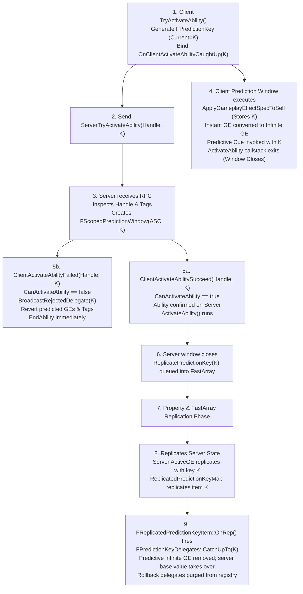

# Gameplay Ability System (GAS) Replication, Prediction & Networking Architecture (Unreal Engine 5.8)

## 1. Architectural Overview & Network Topology

The Gameplay Ability System (GAS) network architecture is built around a hybrid client-server model: **Server Authority with Client-Side Prediction and Server Reconciliation**. 

### Source File Footprint
All APIs, data structures, console variables, and serialization behaviors cited below are verified against Unreal Engine 5.8 source code:
- `Engine/Plugins/Runtime/GameplayAbilities/Source/GameplayAbilities/Public/GameplayPrediction.h`
- `Engine/Plugins/Runtime/GameplayAbilities/Source/GameplayAbilities/Private/GameplayPrediction.cpp`
- `Engine/Plugins/Runtime/GameplayAbilities/Source/GameplayAbilities/Public/AbilitySystemReplicationProxyInterface.h`
- `Engine/Plugins/Runtime/GameplayAbilities/Source/GameplayAbilities/Private/AbilitySystemReplicationProxyInterface.cpp`
- `Engine/Plugins/Runtime/GameplayAbilities/Source/GameplayAbilities/Public/AbilitySystemComponent.h`
- `Engine/Plugins/Runtime/GameplayAbilities/Source/GameplayAbilities/Private/AbilitySystemComponent.cpp`
- `Engine/Plugins/Runtime/GameplayAbilities/Source/GameplayAbilities/Private/AbilitySystemComponent_Abilities.cpp`
- `Engine/Plugins/Runtime/GameplayAbilities/Source/GameplayAbilities/Public/GameplayEffect.h`
- `Engine/Plugins/Runtime/GameplayAbilities/Source/GameplayAbilities/Private/GameplayEffect.cpp`
- `Engine/Plugins/Runtime/GameplayAbilities/Source/GameplayAbilities/Public/Abilities/GameplayAbilityRepAnimMontage.h`
- `Engine/Plugins/Runtime/GameplayAbilities/Source/GameplayAbilities/Private/GameplayAbilityRepAnimMontage.cpp`
- `Engine/Plugins/Runtime/GameplayAbilities/Source/GameplayAbilities/Public/Abilities/GameplayAbilityTypes.h`
- `Engine/Plugins/Runtime/GameplayAbilities/Source/GameplayAbilities/Public/Abilities/GameplayAbilityTargetTypes.h`
- `Engine/Plugins/Runtime/GameplayAbilities/Source/GameplayAbilities/Private/Abilities/GameplayAbilityTargetTypes.cpp`
- `Engine/Plugins/Runtime/GameplayAbilities/Source/GameplayAbilities/Public/Abilities/Tasks/AbilityTask_NetworkSyncPoint.h`
- `Engine/Plugins/Runtime/GameplayAbilities/Source/GameplayAbilities/Private/Abilities/Tasks/AbilityTask_NetworkSyncPoint.cpp`
- `Engine/Plugins/Runtime/GameplayAbilities/Source/GameplayAbilities/Public/Abilities/Tasks/AbilityTask_PlayMontageAndWait.h`
- `Engine/Plugins/Runtime/GameplayAbilities/Source/GameplayAbilities/Private/Abilities/Tasks/AbilityTask_PlayMontageAndWait.cpp`
- `Engine/Plugins/Runtime/GameplayAbilities/Source/GameplayAbilities/Public/Abilities/Async/AbilityAsync_WaitGameplayEvent.h`
- `Engine/Plugins/Runtime/GameplayAbilities/Source/GameplayAbilities/Private/Abilities/Async/AbilityAsync_WaitGameplayEvent.cpp`
- `Engine/Plugins/Runtime/GameplayAbilities/Source/GameplayAbilities/Public/Serialization/` & `Private/Serialization/` (All Net Serializers and Replication Fragments)
- `Engine/Plugins/Runtime/NetworkPredictionExtras/Source/NetworkPredictionExtras/Public/MockAbilitySimulation.h` & `Private/MockAbilitySimulation.cpp`

---

## 2. Authority vs. Prediction Model

GAS prediction focuses on **game simulation state** rather than purely visual client-side cosmetics (such as purely cosmetic local particle bursts or footsteps, which operate entirely outside prediction keys).

### Core Responsibilities by Network Role
| Network Role | Execution Responsibilities | Predictive Authority |
|---|---|---|
| **Server / Authority (`ROLE_Authority`)** | Sole arbiter of true game state. Evaluates and grants abilities (`FGameplayAbilitySpec`), processes application/removal of `GameplayEffect`s, applies Executions (`UGameplayEffectExecutionCalculation`), manages modifier aggregators, replicates state via FastArray and Property replication, and issues RPC accept/reject acknowledgments. | Authoritative. Generates server activation keys (`bIsServerInitiated = true`) when initiating abilities server-side, but never executes predictive rollbacks. |
| **Autonomous Proxy (`ROLE_AutonomousProxy`)** | Local controlling client. Predictively activates abilities (`TryActivateAbility`), predictively applies instant/duration GameplayEffects (converting instant modifications into temporary infinite-duration predicted deltas), executes Gameplay Cues locally, and runs Ability Tasks within an active prediction window. | Client-predicted. Generates local client prediction keys (`FPredictionKey::CreateNewPredictionKey`), sends them via Server RPCs, and binds rollback/catch-up delegates. |
| **Simulated Proxy (`ROLE_SimulatedProxy`)** | Non-local remote clients. Never predicts abilities or gameplay effects. Receives replicated state (attributes, active tags, cue proxies, replicated anim montages) and plays visual/auditory cues triggered by replication callbacks (`OnRep_*`). | Non-predictive listener. In `FPredictionKey::NetSerialize`, keys serialized to simulated proxies evaluate to `0` (invalid). |

### What GAS Predicts vs. What It Does Not
- **Predictable Actions:**
  1. **Ability Activation:** Initial activation call stack (`ActivateAbility`), granting local responsive feel.
  2. **GameplayEffect Application:**
     - Attribute Modifiers (Add, Multiply, Override) evaluated via temporary infinite duration effects.
     - Gameplay Tag additions/removals directly tracked in `FGameplayTagCountContainer`.
  3. **Gameplay Cue Events:** Executed immediately on the predicting client; RPC/multicast replicates with the prediction key, suppressing duplicate execution on the originator.
  4. **Animation Montages:** Played predictively via `PlayMontageAndWait` or `UAbilitySystemComponent::PlayMontageInternal`.
  5. **Target Data Gathering:** Cached locally and pushed to the server via `ServerSetReplicatedTargetData`.
- **Non-Predictable Elements:**
  1. **Gameplay Effect Removal:** Clients cannot predict the removal of effects; removal occurs strictly upon server state replication or prediction rollback.
  2. **Periodic Effects (Ticks/DoTs):** Periodic executions run strictly on the server.
  3. **Gameplay Effect Executions (`UGameplayEffectExecutionCalculation`):** Custom execution calculations operate solely on authority.
  4. **Meta Attributes:** Attributes like `Damage` or `Healing` (processed inside `PostGameplayEffectExecute`) cannot be predicted; they depend on authoritative backend damage pipelines.

---

## 3. FPredictionKey & Prediction Key Lifecycle

### 3.1 Structure Anatomy (`FPredictionKey`)
Declared in `Public/GameplayPrediction.h:296` and implemented in `Private/GameplayPrediction.cpp:115`:
```cpp
struct FPredictionKey
{
    int16 Current = 0;              // Monotonically increasing unique key ID (1..32767)
    int16 Base = 0;                 // Base key in a dependent chain (Client-side only, NotReplicated)
    bool bIsServerInitiated = false; // True if created by authority for server activations
    FObjectKey PredictiveConnectionObjectKey; // Server-only: remembers originating connection
};
```

### 3.2 Selective Connection NetSerialization
A foundational architectural rule in GAS is:
> **`FPredictionKey` replicates Client $\rightarrow$ Server. However, when replicating Server $\rightarrow$ Clients, it *only* serializes back to the connection that originally generated the key.**

In `FPredictionKey::NetSerialize`:
```cpp
// Private/GameplayPrediction.cpp
ValidKeyForConnection = (Current > 0) && (bIsServerInitiated || (PredictiveConnectionObjectKey == FObjectKey()) || (PredictiveConnectionObjectKey == FObjectKey(Map)));
Ar.SerializeBits(&ValidKeyForConnection, 1);
```
When replicating to any other client (simulated proxies or other players), `ValidKeyForConnection` is `0`, causing `Current` to deserialize as `0` (`IsValidKey() == false`).

---

### 3.3 End-to-End Prediction Key Lifecycle (Numbered Sequence)

The complete lifecycle for a client-predicted ability activation proceeds through nine discrete stages:



#### Step 1: Client Allocation & Setup
The local client calls `UAbilitySystemComponent::TryActivateAbility`. A new prediction key `K` is generated via `FPredictionKey::CreateNewPredictionKey(this)`. The client binds its catch-up delegate:
```cpp
ScopedPredictionKey.NewCaughtUpDelegate().BindUObject(this, &UAbilitySystemComponent::OnClientActivateAbilityCaughtUp, Handle, ScopedPredictionKey.Current);
```

#### Step 2: Client RPC Dispatch
The client calls `CallServerTryActivateAbility(Handle, InputPressed, ScopedPredictionKey)`. If an RPC batch window is active, the call is buffered; otherwise, `ServerTryActivateAbility` is transmitted immediately across the wire.

#### Step 3: Local Predictive Execution Window
Without waiting for the server's reply, the client immediately enters `ActivateAbility` with `ActivationInfo.SetActivationInfo(EGameplayAbilityActivationMode::Predicting, ScopedPredictionKey)`.
- Instant gameplay effects are converted into infinite-duration gameplay effects storing `PredictionKey = K`.
- Predictive tags are pushed to `FGameplayTagCountContainer`.
- Gameplay Cues execute locally with key `K`.
- **Critical Boundary:** The prediction window lasts strictly for the initial callstack of `ActivateAbility`. Once execution yields or enters a latent node/timer, the window closes.

#### Step 4: Server RPC Receipt & Window Reconstitution
The server receives `ServerTryActivateAbility_Implementation`. It notes the connection via `FObjectKey(Map)` in `NetSerialize`. It constructs an `FScopedPredictionWindow(this, PredictionKey)` which sets `ASC->ScopedPredictionKey = PredictionKey`.

#### Step 5: Server Evaluation & Explicit Branching
The server runs `CanActivateAbility`:
- **Branch A (Rejection):** If activation fails, the server sends `ClientActivateAbilityFailed(Handle, PredictionKey.Current)`.
  - The client immediately invokes `FPredictionKeyDelegates::BroadcastRejectedDelegate(Key)`.
  - The client terminates the local ability and rolls back all side effects registered to `Key`.
- **Branch B (Acceptance):** If activation succeeds, the server calls `ClientActivateAbilitySucceed(Handle, PredictionKey)` and invokes `ActivateAbility`. Side effects created on the server inherit `PredictionKey = K`.

#### Step 6: Server Prediction Acknowledgment Serialization
When the server's `FScopedPredictionWindow` destructs, it records `PredictionKey` into `UAbilitySystemComponent::ReplicatedPredictionKeyMap.ReplicatePredictionKey(Key)`. This queues `Key` into a replicated `FFastArraySerializer`.

#### Step 7: Property Replication & The Redo Suppression Phase
The server replicates authoritative `FActiveGameplayEffect` and attribute state to the client. When the client receives `FActiveGameplayEffect` containing prediction key `K`:
- In `FActiveGameplayEffect::PostReplicatedAdd`, the client observes that `Effect.PredictionKey == K`.
- The client suppresses duplicate "On Applied" gameplay cues and callbacks, resolving the **Redo** problem.

#### Step 8: ReplicatedPredictionKey FastArray Catch-Up
`FReplicatedPredictionKeyMap` replicates to the client. In `FReplicatedPredictionKeyItem::OnRep`:
- `FPredictionKeyDelegates::CatchUpTo(PredictionKey.Current)` is invoked.
- `FActiveGameplayEffectsContainer` receives notification to remove the temporary client-predicted infinite effects without firing "On Remove" cues.

#### Step 9: Delegation Cleanup & Final Reconciliation
The predictive side effects are seamlessly replaced by the authoritative replicated state. Unacknowledged/stale keys are scrubbed by `CVarMaxStaleKeysBeforeAck` logic to prevent memory leaks in `FPredictionKeyDelegates`.

---

### 3.4 Scoped Prediction Windows & Dependent Chains

#### `FScopedPredictionWindow`
Used to open additional prediction windows during an ability's execution (e.g., in response to input release in `UAbilityTask_WaitInputRelease`):
1. Client creates `FScopedPredictionWindow ScopedPrediction(ASC)`. A new key is generated.
2. Client sends an RPC containing `ScopedPrediction.ScopedPredictionKey`.
3. Server receives the RPC and constructs `FScopedPredictionWindow(ASC, InPredictionKey)`.
4. Both client and server execute the logic within the same scoped key, synchronizing atomic side effects outside initial activation.

#### `FScopedDiscardPredictions`
Introduced in UE 5.5/5.8 (`Public/GameplayPrediction.h:527`), this utility explicitly suppresses or drops prediction keys generated within a local block:
- Prevents leaking unbound delegates when calling functions that generate predictive keys but will not transmit them to the server (e.g., local montage previews).
- Configured with `EGasPredictionKeyResult`: `SilentlyDrop`, `Accept`, or `Reject`.

#### Dependent Key Chains & CVars (UE 5.5 / 5.8)
When ability $A$ triggers ability $B$, $B$ calls `FPredictionKey::GenerateDependentPredictionKey()`.
- $B$ sets `Base = A.Current`, establishing a dependency.
- **Engine CVars in `Private/GameplayPrediction.cpp`:**
  - `AbilitySystem.PredictionKey.MaxStaleKeysBeforeAck` (Default: `KeyRingBufferSize * 4 = 64`): Stale dropped key threshold before cleanup.
  - `AbilitySystem.PredictionKey.StaleKeyBehavior` (Default: `2` = Drop; `0` = CaughtUp, `1` = Reject): How unacknowledged stale keys are resolved.
  - `AbilitySystem.PredictionKey.DepChainBehavior` (Default: `1`; bitmask `0x1` = Newer accepted implies older accepted; `0x2` = Old accepted does NOT imply newer accepted; optimal long-term fix = `3`).
  - `AbilitySystem.PredictionKey.RepServerKeysAsAcknowledged` (Default: `0`): Prohibits server-initiated keys from being replicated as client acknowledgments, eliminating hash collisions.

---

## 4. Replication Modes (`EGameplayEffectReplicationMode`)

Defined in `Public/AbilitySystemComponent.h:81`:
```cpp
UENUM()
enum class EGameplayEffectReplicationMode : uint8
{
    Minimal,
    Mixed,
    Full,
};
```

### Complete Replication Mode Comparison
| Property / Subsystem | `Minimal` | `Mixed` | `Full` |
|---|---|---|---|
| **Intended Target Actors** | AI-controlled pawns, NPCs, environmental actors | Player-controlled pawns (Autonomous + Simulated) | Singleplayer, listen-server hosts, debug environments |
| **`FActiveGameplayEffectsContainer`** | **`COND_Never`** (Never replicated to any client) | Replicated **only** to Owner / Autonomous Proxy (`COND_ReplicateToOwner` via package map check). Not sent to Simulated Proxies. | **`COND_None`** (Replicated fully to all clients: Owner, Autonomous, and Simulated) |
| **Gameplay Tags Replication** | Replicated via `FMinimalReplicationTagCountMap` | Owner receives full `GameplayTagCountContainer`; Simulated proxies receive `FMinimalReplicationTagCountMap` | Replicated fully to all clients via `FGameplayTagCountContainer` |
| **Gameplay Cues Replication** | Replicated via unreliable multicasts or `FMinimalGameplayCueReplicationProxy` | Autonomous: local prediction + RPC suppression; Simulated: multicasts or `FMinimalGameplayCueReplicationProxy` | Autonomous: local prediction; Simulated: full replication from `ActiveGameplayEffects` + multicasts |
| **Attribute Replication** | Standard `FGameplayAttribute` property replication | Standard `FGameplayAttribute` property replication | Standard `FGameplayAttribute` property replication |
| **Bandwidth Footprint** | Extremely low (constant small tag map and Cues) | Highly optimized (full payload only to 1 client, minimal to rest) | High (O(N) active effect state broadcast to all viewers) |

---

## 5. Replication Proxies & Interface Architecture

### `IAbilitySystemReplicationProxyInterface`
Located in `Public/AbilitySystemReplicationProxyInterface.h` and implemented by `UAbilitySystemComponent`. Allows actors or external components to intercept and multiplex ability replication RPCs.

#### Key APIs & Proxy Call Surface
- `virtual void ForceReplication() = 0;`
- **Call Proxies (Server routing to client proxies):**
  - `Call_InvokeGameplayCueExecuted_FromSpec(Spec, PredictionKey)`
  - `Call_InvokeGameplayCueExecuted(GameplayCueTag, PredictionKey, EffectContext)`
  - `Call_InvokeGameplayCuesExecuted(GameplayCueTags, PredictionKey, EffectContext)`
  - `Call_InvokeGameplayCueExecuted_WithParams(GameplayCueTag, PredictionKey, GameplayCueParameters)`
  - `Call_InvokeGameplayCueAdded(GameplayCueTag, PredictionKey, EffectContext)`
  - `Call_InvokeGameplayCueAddedAndWhileActive_FromSpec(Spec, PredictionKey)`
- **Multicast Proxies (Unreliable NetMulticast RPC endpoints):**
  - `NetMulticast_InvokeGameplayCueExecuted_FromSpec(...)`
  - `NetMulticast_InvokeGameplayCueExecuted(...)`
  - `NetMulticast_InvokeGameplayCueAdded(...)`
  - `NetMulticast_InvokeGameplayCueAddedAndWhileActive_WithParams(...)`

### Minimal Replication Proxies
1. **`FMinimalGameplayCueReplicationProxy` (`Public/GameplayCueInterface.h:207`):**
   - Replicates active cues for simulated proxies when `ReplicationMode` is `Minimal` or `Mixed`.
   - Packs active cue tags and locations into fixed bit-width buffers (`NumBits = 5`, up to 31 active cues), avoiding full active effect structures.
2. **`FMinimalReplicationTagCountMap` (`Public/GameplayEffectTypes.h`):**
   - Serializes tag presence and fast counts for actors in Minimal/Mixed mode where simulated proxies do not have full effect containers.

---

## 6. Complete RPC Surface

The following table documents the complete network RPC surface between `UAbilitySystemComponent` client and server endpoints:

| Direction | RPC Method Name | Reliability | Parameters | Primary Responsibility |
|---|---|---|---|---|
| **Client $\rightarrow$ Server** | `ServerTryActivateAbility` | Reliable (WithValidation) | `FGameplayAbilitySpecHandle Handle, bool InputPressed, FPredictionKey PredictionKey` | Client requests ability activation with locally generated prediction key. |
| **Client $\rightarrow$ Server** | `ServerTryActivateAbilityWithEventData` | Reliable (WithValidation) | `FGameplayAbilitySpecHandle Handle, bool InputPressed, FPredictionKey PredictionKey, FGameplayEventData TriggerEventData` | Predictive activation triggered by an event payload. |
| **Client $\rightarrow$ Server** | `ServerSetReplicatedTargetData` | Reliable (WithValidation) | `FGameplayAbilitySpecHandle AbilityHandle, FPredictionKey AbilityOriginalPredictionKey, const FGameplayAbilityTargetDataHandle& ReplicatedTargetDataHandle, FGameplayTag ApplicationTag, FPredictionKey CurrentPredictionKey` | Transmits confirmed targeting data from client to server. |
| **Client $\rightarrow$ Server** | `ServerSetReplicatedTargetDataCancelled` | Reliable (WithValidation) | `FGameplayAbilitySpecHandle AbilityHandle, FPredictionKey AbilityOriginalPredictionKey, FPredictionKey CurrentPredictionKey` | Notifies server that target selection was cancelled. |
| **Client $\rightarrow$ Server** | `ServerSetReplicatedEvent` | Reliable (WithValidation) | `EAbilityGenericReplicatedEvent::Type EventType, FGameplayAbilitySpecHandle AbilityHandle, FPredictionKey AbilityOriginalPredictionKey, FPredictionKey CurrentPredictionKey` | Generic synchronization event (e.g., input confirm, sync point signal). |
| **Client $\rightarrow$ Server** | `ServerSetReplicatedEventWithPayload` | Reliable (WithValidation) | `EAbilityGenericReplicatedEvent::Type EventType, FGameplayAbilitySpecHandle AbilityHandle, FPredictionKey AbilityOriginalPredictionKey, FPredictionKey CurrentPredictionKey, FVector_NetQuantize100 VectorPayload` | Replicated generic event with quantized vector data. |
| **Client $\rightarrow$ Server** | `ServerEndAbility` | Reliable (WithValidation) | `FGameplayAbilitySpecHandle AbilityToEnd, FGameplayAbilityActivationInfo ActivationInfo, FPredictionKey PredictionKey` | Client notifies server that instanced ability has concluded. |
| **Client $\rightarrow$ Server** | `ServerCancelAbility` | Reliable (WithValidation) | `FGameplayAbilitySpecHandle AbilityToCancel, FGameplayAbilityActivationInfo ActivationInfo` | Client notifies server of explicit ability cancellation. |
| **Client $\rightarrow$ Server** | `ServerAbilityRPCBatch` | Reliable (WithValidation) | `FServerAbilityRPCBatch BatchInfo` | Batched client-to-server RPC grouping activate, target data, and optional end. |
| **Client $\rightarrow$ Server** | `ServerSetInputPressed` / `ServerSetInputReleased` | Reliable (WithValidation) | `FGameplayAbilitySpecHandle AbilityHandle` | Direct input state updates (used only if `bReplicateInputDirectly` is enabled). |
| **Client $\rightarrow$ Server** | `ServerCurrentMontageSetNextSectionName` | Reliable (WithValidation) | `UAnimSequenceBase* ClientAnimation, float ClientPosition, FName SectionName, FName NextSectionName` | Synchronizes montage section transitions to server. |
| **Client $\rightarrow$ Server** | `ServerCurrentMontageJumpToSectionName` | Reliable (WithValidation) | `UAnimSequenceBase* ClientAnimation, FName SectionName` | Jumps active replicated montage to specific section. |
| **Client $\rightarrow$ Server** | `ServerCurrentMontageSetPlayRate` | Reliable (WithValidation) | `UAnimSequenceBase* ClientAnimation, float InPlayRate` | Modifies active replicated montage play rate. |
| **Client $\rightarrow$ Server** | `ServerPrintDebug_Request` / `_RequestWithStrings` | Reliable (WithValidation) | `(TArray<FString> Strings)` | Diagnostic RPC requesting server-side GAS debug output. |
| **Server $\rightarrow$ Client** | `ClientActivateAbilitySucceed` | Reliable | `FGameplayAbilitySpecHandle Handle, FPredictionKey PredictionKey` | Server confirms ability activation; prediction key accepted. |
| **Server $\rightarrow$ Client** | `ClientActivateAbilitySucceedWithEventData` | Reliable | `FGameplayAbilitySpecHandle Handle, FPredictionKey PredictionKey, FGameplayEventData TriggerEventData` | Server confirms event-triggered ability activation. |
| **Server $\rightarrow$ Client** | `ClientActivateAbilityFailed` | Reliable | `FGameplayAbilitySpecHandle AbilityToActivate, int16 PredictionKey` | Server denies activation; client rolls back predictive side effects. |
| **Server $\rightarrow$ Client** | `ClientTryActivateAbility` | Reliable | `FGameplayAbilitySpecHandle AbilityToActivate` | Server commands client to execute local activation attempt. |
| **Server $\rightarrow$ Client** | `ClientEndAbility` | Reliable | `FGameplayAbilitySpecHandle AbilityToEnd, FGameplayAbilityActivationInfo ActivationInfo` | Server commands client to terminate active ability. |
| **Server $\rightarrow$ Client** | `ClientCancelAbility` | Reliable | `FGameplayAbilitySpecHandle AbilityToCancel, FGameplayAbilityActivationInfo ActivationInfo` | Server commands client to cancel active ability. |
| **Server $\rightarrow$ Client** | `ClientSetReplicatedEvent` | Reliable | `EAbilityGenericReplicatedEvent::Type EventType, FGameplayAbilitySpecHandle AbilityHandle, FPredictionKey AbilityOriginalPredictionKey` | Server signals generic synchronization event to client. |
| **Server $\rightarrow$ Client** | `ClientPrintDebug_Response` | Reliable | `const TArray<FString>& Strings, int32 GameFlags` | Server returns debug strings to client HUD/log. |
| **Multicast** | `NetMulticast_InvokeGameplayCueExecuted*` | Unreliable | `Tag, PredictionKey, Context / Parameters` | Multicast execution of instant burst Gameplay Cues. |
| **Multicast** | `NetMulticast_InvokeGameplayCueAdded*` | Unreliable | `Tag, PredictionKey, Context / Parameters` | Multicast addition of looping/durational Gameplay Cues. |

---

## 7. Net-Serialized Types & Iris NetSerializers

Unreal Engine 5.8 features native support for Iris Replication alongside traditional `NetSerialize` archives. The following table catalogs every net-serialized struct in GAS:

| Struct Name | Source Location | Serialization Mechanism | Iris Serializer Class / Trait | Special Network Logic |
|---|---|---|---|---|
| `FPredictionKey` | `GameplayPrediction.h` / `.cpp` | `NetSerialize` + Iris Serializer | `UE::Net::FPredictionKeyNetSerializer` (`bHasConnectionSpecificSerialization = true`) | Serializes non-zero key strictly to originating connection; simulated clients receive `0`. |
| `FGameplayEffectContextHandle` | `GameplayEffectTypes.h` | `NetSerialize` + Iris Serializer | `UE::Net::FGameplayEffectContextHandleNetSerializer` | Polymorphic handle; serializes subclass `UScriptStruct` ID followed by virtual struct `NetSerialize`. |
| `FGameplayEffectContext` | `GameplayEffectTypes.h` | `NetSerialize` + Iris Serializer | `UE::Net::FGameplayEffectContextNetSerializer` | Bit-packed flags for Instigator, EffectCauser, HitResult, and Actors. Safe quantized size: 496/528 bytes. |
| `FGameplayAbilityTargetDataHandle` | `GameplayAbilityTargetTypes.h` | `NetSerialize` + Iris Serializer | `UE::Net::FGameplayAbilityTargetDataHandleNetSerializer` | Array of polymorphic `FGameplayAbilityTargetData` pointers; serializes count, type IDs, and inner structs. |
| `FGameplayAbilityTargetingLocationInfo` | `GameplayAbilityTargetTypes.h` | `NetSerialize` + Iris Serializer | `UE::Net::FGameplayAbilityTargetingLocationInfoNetSerializer` | Location info supporting Actor, Component, Socket, or Literal Transform endpoints. |
| `FGameplayAbilityRepAnimMontage` | `GameplayAbilityRepAnimMontage.h` | `NetSerialize` + Iris Serializer | `UE::Net::FGameplayAbilityRepAnimMontageNetSerializer` (`bUseSerializerIsEqual = true`) | RepAnimPosition quantization (RepAnimPositionMethod); conditional position/section sync; skips redundant updates. |
| `FGameplayTagCountContainer` | `GameplayEffectTypes.h` | `NetDeltaSerialize` + Iris Serializer | `UE::Net::FGameplayTagCountContainerNetSerializer` | Tracks explicit tags, fast counts, and parent hierarchy; updates local delegates on delta changes. |
| `FMinimalGameplayCueReplicationProxy` | `GameplayCueInterface.h` | `NetSerialize` + Iris Serializer + ReplicationFragment | `UE::Net::FMinimalGameplayCueReplicationProxyNetSerializer` & `FMinimalGameplayCueReplicationProxyReplicationFragment` | Bit-packed 5-bit array for up to 31 cues; replication fragment mimics legacy receive logic under Iris. |
| `FMinimalReplicationTagCountMap` | `GameplayEffectTypes.h` | `NetDeltaSerialize` + Iris Serializer + ReplicationFragment | `UE::Net::FMinimalReplicationTagCountMapNetSerializer` & `FMinimalReplicationTagCountMapReplicationFragment` | Fast map replicating explicit tag counts to simulated proxies in Minimal and Mixed modes. |
| `FActiveGameplayEffectsContainer` | `GameplayEffect.h` | `FFastArraySerializer` (`NetDeltaSerialize`) | Standard FastArray delta serialization | Replicates `FActiveGameplayEffect` array with incremental delta changes and item dirty keys. |
| `FGameplayAbilitySpecContainer` | `GameplayAbilitySpec.h` | `FFastArraySerializer` (`NetDeltaSerialize`) | Standard FastArray delta serialization | Replicates granted ability specs (`ActivatableAbilities`) from server to client. |
| `FReplicatedPredictionKeyMap` | `GameplayPrediction.h` | `FFastArraySerializer` (`NetDeltaSerialize`) | Standard FastArray delta serialization | Ring buffer of acknowledged prediction keys replicating from authority back to client. |

---

## 8. Usage Patterns & Implementation Guide

### 8.1 Pattern: Client-Predicted Ability Activation & Authority Gate
Abilities must use `CommitAbility` to atomically check and commit costs/cooldowns. Use `HasAuthorityOrPredictionKey` to gate predictive side effects.

```cpp
// Source Grounding: GameplayAbility.h & AbilitySystemComponent.h
void UMyGameplayAbility::ActivateAbility(
    const FGameplayAbilitySpecHandle Handle,
    const FGameplayAbilityActorInfo* ActorInfo,
    const FGameplayAbilityActivationInfo ActivationInfo,
    const FGameplayEventData* TriggerEventData)
{
    // Check if running on authority or locally predicting with a valid prediction key
    if (!HasAuthorityOrPredictionKey(ActorInfo, &ActivationInfo))
    {
        return;
    }

    // Atomically commit cost and cooldown
    if (!CommitAbility(Handle, ActorInfo, ActivationInfo))
    {
        // Failed cost or cooldown check; end immediately
        K2_EndAbility();
        return;
    }

    // Apply predicted Gameplay Effect (instant damage/cost/buff)
    if (EffectClass)
    {
        FGameplayEffectSpecHandle SpecHandle = MakeOutgoingGameplayEffectSpec(EffectClass);
        if (SpecHandle.IsValid())
        {
            // ApplyGameplayEffectSpecToOwner automatically associates the current PredictionKey
            ApplyGameplayEffectSpecToOwner(Handle, ActorInfo, ActivationInfo, SpecHandle);
        }
    }
}
```

---

### 8.2 Pattern: Network Synchronization Points (`UAbilityTask_NetworkSyncPoint`)
When an ability requires client and server to synchronize execution flow (e.g., waiting for both sides before transitioning to phase 2):

```cpp
// Source Grounding: Public/Abilities/Tasks/AbilityTask_NetworkSyncPoint.h
// EAbilityTaskNetSyncType:
// - BothWait: Both wait until the other reaches this node
// - OnlyServerWait: Server waits for client; client continues immediately
// - OnlyClientWait: Client waits for server; server continues immediately

UAbilityTask_NetworkSyncPoint* SyncTask = UAbilityTask_NetworkSyncPoint::WaitNetSync(
    this,
    EAbilityTaskNetSyncType::BothWait
);
SyncTask->OnSync.AddDynamic(this, &UMyGameplayAbility::OnNetworkSyncComplete);
SyncTask->ReadyForActivation();
```

Inside `UAbilityTask_NetworkSyncPoint::Activate()`:
1. Client generates a scoped prediction window: `FScopedPredictionWindow ScopedPrediction(ASC, IsPredictingClient())`.
2. Client sends `ServerSetReplicatedEvent(GenericSignalFromClient, Handle, ActivationKey, ScopedPredictionKey)`.
3. Server responds via `ClientSetReplicatedEvent(GenericSignalFromServer, Handle, ActivationKey)`.
4. When both events arrive, `OnSync` is broadcast and the task completes.

---

### 8.3 Pattern: Replicated Montage Synchronization (`PlayMontageAndWait`)
Animation montages in GAS synchronize via `RepAnimMontageInfo` (`FGameplayAbilityRepAnimMontage`).

```cpp
// Source Grounding: Public/Abilities/Tasks/AbilityTask_PlayMontageAndWait.h
UAbilityTask_PlayMontageAndWait* MontageTask = UAbilityTask_PlayMontageAndWait::CreatePlayMontageAndWaitProxy(
    this,
    TEXT("AttackMontageTask"),
    AttackMontage,
    1.0f,               // Rate
    NAME_None,          // StartSection
    true,               // bStopWhenAbilityEnds
    1.0f,               // AnimRootMotionTranslationScale
    0.0f,               // StartTimeSeconds
    false               // bAllowInterruptAfterBlendOut
);

MontageTask->OnCompleted.AddDynamic(this, &UMyGameplayAbility::OnMontageFinished);
MontageTask->OnInterrupted.AddDynamic(this, &UMyGameplayAbility::OnMontageInterrupted);
MontageTask->OnCancelled.AddDynamic(this, &UMyGameplayAbility::OnMontageCancelled);
MontageTask->ReadyForActivation();
```

**Network Mechanics Under the Hood:**
- In `PlayMontageInternal`, `ASC->SetRepAnimMontageInfo()` populates `RepAnimMontageInfo`.
- Autonomous proxy plays the animation immediately with zero latency.
- Server updates `RepAnimMontageInfo` with `PlayInstanceId`, section name, and start time.
- Simulated proxies receive `OnRep_ReplicatedAnimMontage` and synchronize montage playback and blending.

---

### 8.4 Pattern: Decoupled Event Listening with `UAbilityAsync_WaitGameplayEvent`
`UAbilityAsync_WaitGameplayEvent` is an async node that listens for gameplay events on an actor's ASC without being coupled to an active ability lifecycle.

```cpp
// Source Grounding: Public/Abilities/Async/AbilityAsync_WaitGameplayEvent.h
UAbilityAsync_WaitGameplayEvent* WaitEventAction = UAbilityAsync_WaitGameplayEvent::WaitGameplayEventToActor(
    TargetActor,
    FGameplayTag::RequestGameplayTag(TEXT("Event.Combat.Stun")),
    false,  // OnlyTriggerOnce
    true    // OnlyMatchExact
);

WaitEventAction->EventReceived.AddDynamic(this, &UMyUIWidget::OnStunEventReceived);
WaitEventAction->Activate();
```

**Relevance to Networking:**
- `AbilityAsync_WaitGameplayEvent` operates locally on both client and server.
- It attaches to `ASC->GenericGameplayEventCallbacks` or container delegates.
- If triggered by a server-replicated Gameplay Event or locally fired event, it dispatches cleanly without owning an ability task handle.

---

## 9. Network Prediction Integration: Mover / MockAbility & `ShouldReconcile`

In modern Unreal Engine architectures (including Network Prediction / Mover 2.0 and the `NetworkPredictionExtras` reference plugin), state synchronization and reconciliation move beyond legacy character movement into explicit **Sync State** and **Aux State** buffers.

### Source Reference: `UMockFlyingAbilityComponent` & `FMockAbilitySyncState`
Located in `Engine/Plugins/Runtime/NetworkPredictionExtras/Source/NetworkPredictionExtras/`:
- `Public/MockAbilitySimulation.h:77-146`
- `Private/MockAbilitySimulation.cpp:65-83`

```cpp
// State changing during simulation tick (e.g. Stamina consumption)
struct FMockAbilitySyncState : public FFlyingMovementSyncState
{
    float Stamina = 100.f;

    bool ShouldReconcile(const FMockAbilitySyncState& AuthorityState) const
    {
        // Trace and check reconciliation tolerance
        UE_NP_TRACE_RECONCILE(Stamina != AuthorityState.Stamina, "Stamina:");

        // Delegate location/velocity reconciliation to base class
        return FFlyingMovementSyncState::ShouldReconcile(AuthorityState);
    }
};

// Auxiliary state acting as input/configuration to the simulation
struct FMockAbilityAuxState : public FFlyingMovementAuxState
{
    float MaxStamina = 100.f;
    float StaminaRegenRate = 20.f;
    int16 DashTimeLeft = 0;
    int16 BlinkWarmupLeft = 0;
    int16 PrimaryCooldown = 0;
    bool bIsSprinting = false;

    bool ShouldReconcile(const FMockAbilityAuxState& AuthorityState) const
    {
        UE_NP_TRACE_RECONCILE(MaxStamina != AuthorityState.MaxStamina, "MaxStamina:");
        UE_NP_TRACE_RECONCILE(StaminaRegenRate != AuthorityState.StaminaRegenRate, "StaminaRegenRate:");
        UE_NP_TRACE_RECONCILE(DashTimeLeft != AuthorityState.DashTimeLeft, "DashTimeLeft:");
        UE_NP_TRACE_RECONCILE(BlinkWarmupLeft != AuthorityState.BlinkWarmupLeft, "BlinkWarmupLeft:");
        UE_NP_TRACE_RECONCILE(PrimaryCooldown != AuthorityState.PrimaryCooldown, "PrimaryCooldown:");
        UE_NP_TRACE_RECONCILE(bIsSprinting != AuthorityState.bIsSprinting, "bIsSprinting:");

        return FFlyingMovementAuxState::ShouldReconcile(AuthorityState);
    }
};
```

### Architectural Contrast: GAS Prediction vs. Network Prediction Simulation
| Dimension | Traditional GAS (`FPredictionKey`) | Network Prediction (`ShouldReconcile`) |
|---|---|---|
| **Underlying Philosophy** | RPC protocol with optimistic execution and explicit rollback delegates. | Deterministic fixed-tick physical simulation with history buffer rewind and replay. |
| **Prediction Scope** | Ability activation window, initial callstack, discrete effect application. | Continuous frame-by-frame physics, stamina, dash cooldowns, and movement. |
| **Error Correction** | Rollback delegate execution (`FPredictionKeyDelegates::Reject`) or FastArray removal. | Rollback to authoritative frame when `ShouldReconcile()` returns `true`, re-simulating up to current frame. |
| **Network Payload** | Asynchronous RPCs + property FastArrays. | Synchronized bit-stream inputs and quantized Sync/Aux state buffers. |

---

## 10. Common Pitfalls & Best Practices

1. **Prediction Window Expiration across Latent Nodes:**
   - *Pitfall:* Attempting to apply a predicted GameplayEffect or spawn a projectile after a `Delay`, `WaitNetSync`, or latent task.
   - *Reason:* Once `ActivateAbility` yields, the original prediction key is closed and marked sent. Any actions in subsequent frames lack a valid prediction key (`IsValidKey() == false`), causing client effects to be ignored or desynchronized.
   - *Solution:* Use `FScopedPredictionWindow` within an input or task callback, or route subsequent actions authoritatively from the server.

2. **Replication Mode Misconfiguration on Player Characters:**
   - *Pitfall:* Setting `ReplicationMode = EGameplayEffectReplicationMode::Minimal` on a player pawn.
   - *Consequence:* `FActiveGameplayEffectsContainer` will be set to `COND_Never`. The owning autonomous client will receive zero active effects, breaking client prediction, cooldown tracking, and local UI.
   - *Rule:* Always set player-controlled characters to `Mixed` (or `Full`), reserving `Minimal` strictly for AI/NPC pawns.

3. **Missing `REPNOTIFY_Always` on Replicated Attributes:**
   - *Pitfall:* Replicating attributes using standard `COND_None` without `REPNOTIFY_Always`.
   - *Consequence:* If a client predictively modifies an attribute to `80`, and the server arrives at `80`, Unreal's default replication ignores the update because old local value equals new received value. The predicted infinite delta never resolves properly.
   - *Fix:* Always bind attribute properties with `DOREPLIFETIME_CONDITION_NOTIFY(UMyAttributeSet, Health, COND_None, REPNOTIFY_Always)` and call `GAMEPLAYATTRIBUTE_REPNOTIFY(UMyAttributeSet, Health, OldValue)` inside `OnRep_Health`.

4. **Circular Prediction Dependency Overflow:**
   - *Pitfall:* Uncontrolled chains of triggered abilities generating unbounded dependent prediction keys.
   - *Detection:* `GameplayPrediction.cpp:215` asserts `ensureAlwaysMsgf((Base == 0) || (Current - Base < 20), TEXT("Deep PredictionKey Chain Detected..."))`.
   - *Fix:* Break infinite event loops; gate chained triggers with gameplay tags to prevent circular triggers.

5. **Direct Montage Playback outside GAS:**
   - *Pitfall:* Calling `AnimInstance->Montage_Play` directly instead of using `UAbilitySystemComponent::PlayMontage` or `AbilityTask_PlayMontageAndWait`.
   - *Consequence:* Bypasses `RepAnimMontageInfo` serialization, leaving simulated proxies out of sync and breaking montage rejection rollback hooks.
