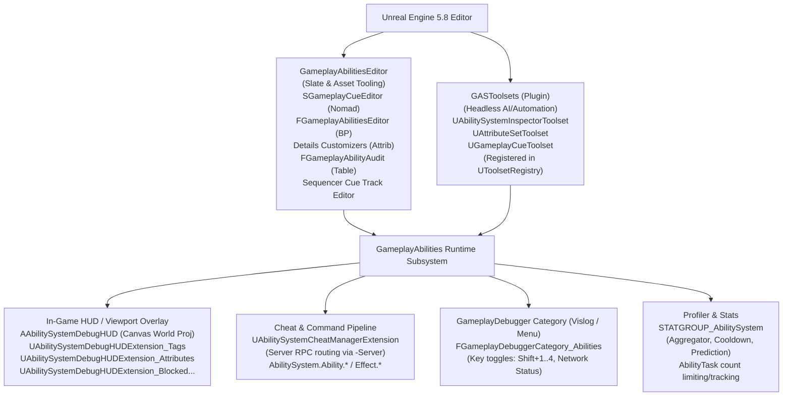

# Gameplay Ability System (GAS) — Editor, Toolsets, and Debug Architecture

> **Unreal Engine 5.8 Deep Dive**  
> **Source Base:** `UE_5.8`  
> **Primary Plugins:**  
> - `Engine/Plugins/Runtime/GameplayAbilities/Source/GameplayAbilitiesEditor/`  
> - `Engine/Plugins/Experimental/Toolsets/GASToolsets/Source/GASToolsets/`  
> - `Engine/Plugins/Runtime/GameplayAbilities/Source/GameplayAbilities/`

---

## 1. Overview & Architecture

The Unreal Engine 5.8 Gameplay Ability System (GAS) provides an extensive tooling, inspection, profiling, and debugging suite spanning authoring-time editor workflows, headless automation/AI toolsets, and multi-layered runtime/in-game inspection.



### Tool Catalog Table

| Tool / Subsystem | Purpose | Entry Point / Invocation | Full Source File Path (UE 5.8) |
| :--- | :--- | :--- | :--- |
| **GameplayCue Editor** | Central management, search, and generation of `GameplayCue.*` tags and associated static/actor notify assets. | Nomad Tab: `GameplayCueApp` (Window -> GameplayCue Editor) | `Engine/Plugins/Runtime/GameplayAbilities/Source/GameplayAbilitiesEditor/Private/SGameplayCueEditor.h`<br>`Engine/Plugins/Runtime/GameplayAbilities/Source/GameplayAbilitiesEditor/Private/GameplayAbilitiesEditorModule.cpp` |
| **Gameplay Abilities Blueprint Editor** | Specialized Blueprint graph editor for `UGameplayAbility` assets with custom node validation and schema rules. | Open any `GameplayAbilityBlueprint` asset | `Engine/Plugins/Runtime/GameplayAbilities/Source/GameplayAbilitiesEditor/Public/GameplayAbilitiesEditor.h`<br>`Engine/Plugins/Runtime/GameplayAbilities/Source/GameplayAbilitiesEditor/Public/GameplayAbilityGraphSchema.h` |
| **Attribute Property Customizer** | Inline struct customization for `FGameplayAttribute` selection dropdowns and category filtering. | Automatic in Details panel for `FGameplayAttribute` properties | `Engine/Plugins/Runtime/GameplayAbilities/Source/GameplayAbilitiesEditor/Public/AttributeDetails.h`<br>`Engine/Plugins/Runtime/GameplayAbilities/Source/GameplayAbilitiesEditor/Private/AttributeDetails.cpp` |
| **Attribute Set Layout Customizer** | Custom class details layout for `UAttributeSet` classes in Blueprint/asset editors. | Automatic in Details panel when editing an `AttributeSet` | `Engine/Plugins/Runtime/GameplayAbilities/Source/GameplayAbilitiesEditor/Public/AttributeDetails.h`<br>`Engine/Plugins/Runtime/GameplayAbilities/Source/GameplayAbilitiesEditor/Private/AttributeDetails.cpp` |
| **Gameplay Effect Details Customizer** | Custom class details view for `UGameplayEffect` tuning duration policies, periodic ticks, and modifiers. | Automatic in Details panel when editing a `GameplayEffect` | `Engine/Plugins/Runtime/GameplayAbilities/Source/GameplayAbilitiesEditor/Private/GameplayEffectDetails.h`<br>`Engine/Plugins/Runtime/GameplayAbilities/Source/GameplayAbilitiesEditor/Private/GameplayEffectDetails.cpp` |
| **Gameplay Cue Tag Customizer** | Property layout for `FGameplayCueTag` featuring jump-to-handler and inline notify creator buttons. | Automatic in Details panel for `FGameplayCueTag` properties | `Engine/Plugins/Runtime/GameplayAbilities/Source/GameplayAbilitiesEditor/Private/GameplayCueTagDetails.h`<br>`Engine/Plugins/Runtime/GameplayAbilities/Source/GameplayAbilitiesEditor/Private/GameplayCueTagDetails.cpp` |
| **Gameplay Ability Audit** | Audits batches of gameplay ability blueprints into structured `UDataTable` rows, analyzing execution paths and end calls. | Right-click Blueprint assets -> "Audit" (filter `NativeParentClass=GameplayAbility`) | `Engine/Plugins/Runtime/GameplayAbilities/Source/GameplayAbilitiesEditor/Public/GameplayAbilityAudit.h`<br>`Engine/Plugins/Runtime/GameplayAbilities/Source/GameplayAbilitiesEditor/Private/GameplayAbilityAudit.cpp` |
| **Sequencer Cue Track** | Authoring and scrubbing GameplayCue triggers inside MovieScene sequences via timeline tracks. | Sequencer Add Track -> Gameplay Cue Track | `Engine/Plugins/Runtime/GameplayAbilities/Source/GameplayAbilitiesEditor/Private/Sequencer/GameplayCueTrackEditor.h`<br>`Engine/Plugins/Runtime/GameplayAbilities/Source/GameplayAbilitiesEditor/Private/Sequencer/GameplayCueTrackEditor.cpp` |
| **Gameplay Effect Creation Menu** | Quick-add configurable parent GameplayEffect presets from the Editor File/Asset menu. | Editor Settings -> Project -> Gameplay Effect Parents | `Engine/Plugins/Runtime/GameplayAbilities/Source/GameplayAbilitiesEditor/Public/GameplayEffectCreationMenu.h`<br>`Engine/Plugins/Runtime/GameplayAbilities/Source/GameplayAbilitiesEditor/Private/GameplayEffectCreationMenu.cpp` |
| **Ability System Inspector Toolset** | Headless inspection of attributes, effects, granted abilities, and tags on any actor for scripts/AI agents. | C++ / Script: `UAbilitySystemInspectorToolset::*` | `Engine/Plugins/Experimental/Toolsets/GASToolsets/Source/GASToolsets/Private/AbilitySystemInspectorToolset.h`<br>`Engine/Plugins/Experimental/Toolsets/GASToolsets/Source/GASToolsets/Private/AbilitySystemInspectorToolset.cpp` |
| **Attribute Set Toolset** | Headless discovery and listing of native and BP `UAttributeSet` classes and member attributes across the project. | C++ / Script: `UAttributeSetToolset::*` | `Engine/Plugins/Experimental/Toolsets/GASToolsets/Source/GASToolsets/Private/AttributeSetToolset.h`<br>`Engine/Plugins/Experimental/Toolsets/GASToolsets/Source/GASToolsets/Private/AttributeSetToolset.cpp` |
| **Gameplay Cue Toolset** | Headless querying, creating, validating, removing cue tags and notify assets, or firing cues on selected actors. | C++ / Script: `UGameplayCueToolset::*` | `Engine/Plugins/Experimental/Toolsets/GASToolsets/Source/GASToolsets/Private/GameplayCueToolset.h`<br>`Engine/Plugins/Experimental/Toolsets/GASToolsets/Source/GASToolsets/Private/GameplayCueToolset.cpp` |
| **Ability System Debug HUD** | In-world spatial overhead canvas rendering of tags, attributes, and blocked abilities directly over actor avatars. | Console: `AbilitySystem.DebugBasicHUD`, `AbilitySystem.DebugAbilityTags`, `AbilitySystem.DebugAttribute` | `Engine/Plugins/Runtime/GameplayAbilities/Source/GameplayAbilities/Public/AbilitySystemDebugHUD.h`<br>`Engine/Plugins/Runtime/GameplayAbilities/Source/GameplayAbilities/Private/AbilitySystemDebugHUD.cpp` |
| **Gameplay Debugger (Abilities)** | Networked visual debugging overlay showing client vs server tag, ability, and effect reconciliation. | Gameplay Debugger key (`'` by default) -> Category selection | `Engine/Plugins/Runtime/GameplayAbilities/Source/GameplayAbilities/Public/GameplayDebuggerCategory_Abilities.h`<br>`Engine/Plugins/Runtime/GameplayAbilities/Source/GameplayAbilities/Private/GameplayDebuggerCategory_Abilities.cpp` |
| **ShowDebug AbilitySystem** | Classic legacy Canvas HUD category cycling through Attributes, GameplayEffects, and Abilities. | Console: `ShowDebug AbilitySystem`, `AbilitySystem.Debug.NextCategory` | `Engine/Plugins/Runtime/GameplayAbilities/Source/GameplayAbilities/Public/AbilitySystemComponent.h`<br>`Engine/Plugins/Runtime/GameplayAbilities/Source/GameplayAbilities/Private/AbilitySystemComponent.cpp` |
| **Cheat Manager Extension** | Exec console cheats to grant, activate, cancel abilities and apply/remove effects with server routing support. | Console: `AbilitySystem.Ability.*`, `AbilitySystem.Effect.*` | `Engine/Plugins/Runtime/GameplayAbilities/Source/GameplayAbilities/Private/AbilitySystemCheatManagerExtension.h`<br>`Engine/Plugins/Runtime/GameplayAbilities/Source/GameplayAbilities/Private/AbilitySystemCheatManagerExtension.cpp` |

---

## 2. Editor Tooling Architecture (`GameplayAbilitiesEditor`)

Root Directory: `Engine/Plugins/Runtime/GameplayAbilities/Source/GameplayAbilitiesEditor/`.

### 2.1 Editor Module Lifecycle (`IGameplayAbilitiesEditorModule`)
*Source: `Engine/Plugins/Runtime/GameplayAbilities/Source/GameplayAbilitiesEditor/Public/GameplayAbilitiesEditorModule.h`, `Engine/Plugins/Runtime/GameplayAbilities/Source/GameplayAbilitiesEditor/Private/GameplayAbilitiesEditorModule.cpp`*

The public interface `IGameplayAbilitiesEditorModule` defines module access and delegate customization endpoints:
- `GetGameplayCueNotifyClassesDelegate()`: Customizes the classes presented in the GameplayCue Editor notify creation dialogue.
- `GetGameplayCueInterfaceClassesDelegate()`: Customizes the interface types available to cue handlers.
- `GetGameplayCueNotifyPathDelegate()`: Provides project-specific save paths when new notifies are generated.
- `GetGameplayCueEditorStringsDelegate()`: Overrides user-facing descriptive strings displayed in the editor UI.

In `FGameplayAbilitiesEditorModule::StartupModule()`, the module executes the following initialization steps:
1. **Property Type Customizations**:
   - `GameplayAttribute` -> `FAttributePropertyDetails::MakeInstance` (`Engine/Plugins/Runtime/GameplayAbilities/Source/GameplayAbilitiesEditor/Public/AttributeDetails.h`, `Engine/Plugins/Runtime/GameplayAbilities/Source/GameplayAbilitiesEditor/Private/AttributeDetails.cpp`)
   - `ScalableFloat` -> `FScalableFloatDetails::MakeInstance` (`Engine/Source/Editor/DetailCustomizations/Public/DetailCustomizations.h`)
   - `GameplayEffectExecutionScopedModifierInfo` -> `FGameplayEffectExecutionScopedModifierInfoDetails::MakeInstance` (`Engine/Plugins/Runtime/GameplayAbilities/Source/GameplayAbilitiesEditor/Private/GameplayEffectExecutionScopedModifierInfoDetails.h`, `Engine/Plugins/Runtime/GameplayAbilities/Source/GameplayAbilitiesEditor/Private/GameplayEffectExecutionScopedModifierInfoDetails.cpp`)
   - `GameplayTagBlueprintPropertyMapping` -> `FGameplayTagBlueprintPropertyMappingDetails::MakeInstance` (`Engine/Plugins/Runtime/GameplayAbilities/Source/GameplayAbilitiesEditor/Private/GameplayTagBlueprintPropertyMappingDetails.h`, `Engine/Plugins/Runtime/GameplayAbilities/Source/GameplayAbilitiesEditor/Private/GameplayTagBlueprintPropertyMappingDetails.cpp`)
   - `GameplayEffectExecutionDefinition` -> `FGameplayEffectExecutionDefinitionDetails::MakeInstance` (`Engine/Plugins/Runtime/GameplayAbilities/Source/GameplayAbilitiesEditor/Private/GameplayEffectExecutionDefinitionDetails.h`, `Engine/Plugins/Runtime/GameplayAbilities/Source/GameplayAbilitiesEditor/Private/GameplayEffectExecutionDefinitionDetails.cpp`)
   - `GameplayEffectModifierMagnitude` -> `FGameplayEffectModifierMagnitudeDetails::MakeInstance` (`Engine/Plugins/Runtime/GameplayAbilities/Source/GameplayAbilitiesEditor/Private/GameplayEffectModifierMagnitudeDetails.h`, `Engine/Plugins/Runtime/GameplayAbilities/Source/GameplayAbilitiesEditor/Private/GameplayEffectModifierMagnitudeDetails.cpp`)
   - `GameplayCueTag` -> `FGameplayCueTagDetails::MakeInstance` (`Engine/Plugins/Runtime/GameplayAbilities/Source/GameplayAbilitiesEditor/Private/GameplayCueTagDetails.h`, `Engine/Plugins/Runtime/GameplayAbilities/Source/GameplayAbilitiesEditor/Private/GameplayCueTagDetails.cpp`)
   - `GameplayModEvaluationChannelSettings` -> `FGameplayModEvaluationChannelSettingsDetails::MakeInstance` (`Engine/Plugins/Runtime/GameplayAbilities/Source/GameplayAbilitiesEditor/Private/GameplayModEvaluationChannelSettingsDetails.h`, `Engine/Plugins/Runtime/GameplayAbilities/Source/GameplayAbilitiesEditor/Private/GameplayModEvaluationChannelSettingsDetails.cpp`)
   - `AttributeBasedFloat` -> `FAttributeBasedFloatDetails::MakeInstance` (`Engine/Plugins/Runtime/GameplayAbilities/Source/GameplayAbilitiesEditor/Private/AttributeBasedFloatDetails.h`, `Engine/Plugins/Runtime/GameplayAbilities/Source/GameplayAbilitiesEditor/Private/AttributeBasedFloatDetails.cpp`)
2. **Class Customizations**:
   - `AttributeSet` -> `FAttributeDetails::MakeInstance` (`Engine/Plugins/Runtime/GameplayAbilities/Source/GameplayAbilitiesEditor/Public/AttributeDetails.h`, `Engine/Plugins/Runtime/GameplayAbilities/Source/GameplayAbilitiesEditor/Private/AttributeDetails.cpp`)
   - `GameplayEffect` -> `FGameplayEffectDetails::MakeInstance` (`Engine/Plugins/Runtime/GameplayAbilities/Source/GameplayAbilitiesEditor/Private/GameplayEffectDetails.h`, `Engine/Plugins/Runtime/GameplayAbilities/Source/GameplayAbilitiesEditor/Private/GameplayEffectDetails.cpp`)
3. **Graph Panel Factory**:
   - Instantiates `FGameplayAbilitiesGraphPanelPinFactory` (`Engine/Plugins/Runtime/GameplayAbilities/Source/GameplayAbilitiesEditor/Private/GameplayAbilitiesGraphPanelPinFactory.h`) and registers it with `FEdGraphUtilities::RegisterVisualPinFactory`.
4. **Sequencer Integration**:
   - Instantiates `FGameplayCueTrackEditor::CreateTrackEditor` (`Engine/Plugins/Runtime/GameplayAbilities/Source/GameplayAbilitiesEditor/Private/Sequencer/GameplayCueTrackEditor.h`) and registers it with `ISequencerModule`.
   - Binds `SequencerModule.RegisterChannelInterface<FMovieSceneGameplayCueChannel>()` (`Engine/Plugins/Runtime/GameplayAbilities/Source/GameplayAbilitiesEditor/Private/Sequencer/MovieSceneGameplayCueSections.h`).
5. **Nomad Tab Spawner**:
   - Binds `FName("GameplayCueApp")` via `FGlobalTabmanager::Get()->RegisterNomadTabSpawner` to summon the standalone GameplayCue Editor window (`SGameplayCueEditor`).
6. **Curve Cache Invalidation**:
   - Hooks into `FReimportManager::Instance()->OnPostReimport()` to trigger `UCurveTable::InvalidateAllCachedCurves()` when curve tables are reloaded.

### 2.2 GameplayCue Editor (`SGameplayCueEditor` / `SGameplayCueEditor_Picker`)
*Source: `Engine/Plugins/Runtime/GameplayAbilities/Source/GameplayAbilitiesEditor/Private/SGameplayCueEditor.h`, `Engine/Plugins/Runtime/GameplayAbilities/Source/GameplayAbilitiesEditor/Private/SGameplayCueEditor.cpp`, `Engine/Plugins/Runtime/GameplayAbilities/Source/GameplayAbilitiesEditor/Private/SGameplayCueEditor_Picker.h`*

- **Class**: `class SGameplayCueEditor : public SUserWidget`
- **Key Methods**:
  - `Construct(const FArguments& InArgs)`: Builds tag hierarchy tree and notify handler list views.
  - `OnNewGameplayCueTagCommited(const FString& TagName, const FString& TagComment, const FName& TagSource)`: Adds new tags to the GameplayTags dictionary.
  - `CreateNewGameplayCueNotifyDialogue(FString GameplayCue, UClass* ParentClass)`: Spawns dialogue to author a new `UGameplayCueNotify_Static` or `AGameplayCueNotify_Actor` blueprint.
  - `OpenEditorForNotify(FString NotifyFullPath)`: Opens asset editor for target notify asset.
  - `HandleNotify_OpenAssetInEditor(AssetName, AssetType)` and `HandleNotify_FindAssetInEditor(AssetName, AssetType)`: Intercepts game-to-editor debugging callbacks registered on `UAbilitySystemGlobals::Get().AbilityOpenAssetInEditorCallbacks` and `AbilityFindAssetInEditorCallbacks` (`Engine/Plugins/Runtime/GameplayAbilities/Source/GameplayAbilities/Public/AbilitySystemGlobals.h`).

### 2.3 Gameplay Abilities Blueprint Editor (`FGameplayAbilitiesEditor`)
*Source: `Engine/Plugins/Runtime/GameplayAbilities/Source/GameplayAbilitiesEditor/Public/GameplayAbilitiesEditor.h`, `Engine/Plugins/Runtime/GameplayAbilities/Source/GameplayAbilitiesEditor/Private/GameplayAbilitiesEditor.cpp`, `Engine/Plugins/Runtime/GameplayAbilities/Source/GameplayAbilitiesEditor/Public/GameplayAbilityGraphSchema.h`, `Engine/Plugins/Runtime/GameplayAbilities/Source/GameplayAbilitiesEditor/Private/GameplayAbilityGraphSchema.cpp`*

- **Class**: `class FGameplayAbilitiesEditor : public FBlueprintEditor`
  - Specialized editor mode for `UGameplayAbilityBlueprint` assets created via `UGameplayAbilitiesBlueprintFactory` (`Engine/Plugins/Runtime/GameplayAbilities/Source/GameplayAbilitiesEditor/Public/GameplayAbilitiesBlueprintFactory.h`).
  - Calls `EnsureGameplayAbilityBlueprintIsUpToDate(UBlueprint* Blueprint)` on load to guarantee legacy graph pins and latent calls match current engine versions.
- **Graph Schema (`UGameplayAbilityGraphSchema`)**:
  - Extends `UEdGraphSchema_K2` (`Engine/Source/Editor/BlueprintGraph/Classes/EdGraphSchema_K2.h`).
  - Implements `ShouldAlwaysPurgeOnModification() const override { return true; }` to force immediate node recompilation and dependency updates.
  - Overrides `SpawnVariableGetNode` and `SpawnVariableSetNode` to sanitize pin types for ability-specific members.
- **Node Integration**:
  - `UK2Node_GameplayCueEvent` (`Engine/Plugins/Runtime/GameplayAbilities/Source/GameplayAbilitiesEditor/Public/K2Node_GameplayCueEvent.h`): Generates custom gameplay cue event entry points on character blueprints. Binds to `IGameplayTagsModule::OnGameplayTagTreeChanged` to refresh blueprint action menus when tags change.
  - `UK2Node_LatentAbilityCall` (`Engine/Plugins/Runtime/GameplayAbilities/Source/GameplayAbilitiesEditor/Public/K2Node_LatentAbilityCall.h`): Validates that latent execution tasks inherit from `UGameplayTask` (`Engine/Plugins/Runtime/GameplayAbilities/Source/GameplayAbilities/Public/GameplayTask.h`) and generates execution pins corresponding to multicast delegate outputs.

### 2.4 Gameplay Ability Audit (`FGameplayAbilityAuditRow`)
*Source: `Engine/Plugins/Runtime/GameplayAbilities/Source/GameplayAbilitiesEditor/Public/GameplayAbilityAudit.h`, `Engine/Plugins/Runtime/GameplayAbilities/Source/GameplayAbilitiesEditor/Private/GameplayAbilityAudit.cpp`*

Allows tech designers and QA to select batches of `UGameplayAbility` Blueprints in the Content Browser and generate a diagnostic `UDataTable`:
- **Struct**: `struct FGameplayAbilityAuditRow : public FTableRowBase`
  - `FillDataFromGameplayAbilityBlueprint(const UBlueprint& GameplayAbilityBlueprint)`
  - `FillDataFromGameplayAbility(const UGameplayAbility& GameplayAbility)`
- **Enums**:
  - `enum class EGameplayAbilityActivationPath : uint8`:
    - `Native`: Ability executes in C++ (`ActivateAbility` native).
    - `Blueprint`: Standard `Activate` event node implemented in graph.
    - `FromEvent`: Triggered via `ActivateAbilityFromEvent`.
  - `enum class EGameplayAbilityEndInBlueprints : uint8`:
    - `Missing = 0`: Ability lacks an `EndAbility` call in Blueprint (risk of hanging tasks).
    - `EndAbility = 1 << 0`: Calls `EndAbility` in Blueprint.
    - `EndAbilityLocally = 1 << 1`: Calls `EndAbilityLocally` in Blueprint (locally predicted).
- **Tag Data**: Audits `AbilityTags`, `CancelAbilitiesWithTag`, `BlockAbilitiesWithTag`, `ActivationRequiredTags`, and `ActivationBlockedTags`.

### 2.5 Sequencer Cue Integration (`FGameplayCueTrackEditor`)
*Source: `Engine/Plugins/Runtime/GameplayAbilities/Source/GameplayAbilitiesEditor/Private/Sequencer/GameplayCueTrackEditor.h`, `Engine/Plugins/Runtime/GameplayAbilities/Source/GameplayAbilitiesEditor/Private/Sequencer/GameplayCueTrackEditor.cpp`*

- **Class**: `class FGameplayCueTrackEditor : public FMovieSceneTrackEditor`
  - Created via `FGameplayCueTrackEditor::CreateTrackEditor(TSharedRef<ISequencer> InSequencer)`.
  - Manages `UMovieSceneGameplayCueTrack` and `FMovieSceneGameplayCueChannel` sections (`Engine/Plugins/Runtime/GameplayAbilities/Source/GameplayAbilitiesEditor/Private/Sequencer/MovieSceneGameplayCueSections.h`).
  - Provides timeline keyframing of `GameplayCue` events with payload parameters directly synchronized to cinematic sequences.

### 2.6 Gameplay Effect Creation Menu (`UGameplayEffectCreationMenu`)
*Source: `Engine/Plugins/Runtime/GameplayAbilities/Source/GameplayAbilitiesEditor/Public/GameplayEffectCreationMenu.h`, `Engine/Plugins/Runtime/GameplayAbilities/Source/GameplayAbilitiesEditor/Private/GameplayEffectCreationMenu.cpp`*

- **Class**: `class UGameplayEffectCreationMenu : public UObject` (Config = `Game`, DefaultConfig)
  - Allows projects to specify data-driven parent `UGameplayEffect` classes accessible directly from the Editor File/Asset menus.
  - Configured via `FGameplayEffectCreationData`: `MenuPath` (e.g. `"Status|Hard|Stun"`), `BaseName` (e.g. `"GE_Stun"`), and `ParentGameplayEffect` (`TSubclassOf<UGameplayEffect>`).
  - Customizable asset naming function: `UGameplayEffectCreationMenu::GetDefaultAssetNameFunc`.

---

## 3. Toolset API (`GASToolsets`)

Root Directory: `Engine/Plugins/Experimental/Toolsets/GASToolsets/Source/GASToolsets/`.  
The `GASToolsets` plugin registers automated headless tools with the engine's `UToolsetRegistry` (`Engine/Plugins/Experimental/Toolsets/ToolsetRegistry/Source/ToolsetRegistry/Public/ToolsetRegistry/UToolsetRegistry.h`) for consumption by scripting environments and LLM/AI workflows.

### 3.1 Module Initialization (`FGASToolsetsModule`)
*Source: `Engine/Plugins/Experimental/Toolsets/GASToolsets/Source/GASToolsets/Public/GASToolsets.h`, `Engine/Plugins/Experimental/Toolsets/GASToolsets/Source/GASToolsets/Private/GASToolsets.cpp`*

On startup, registers three toolset definitions via `UToolsetRegistry::RegisterToolsetClass`:
```cpp
UToolsetRegistry::RegisterToolsetClass(UGameplayCueToolset::StaticClass());
UToolsetRegistry::RegisterToolsetClass(UAttributeSetToolset::StaticClass());
UToolsetRegistry::RegisterToolsetClass(UAbilitySystemInspectorToolset::StaticClass());
```
On shutdown, safely unregisters them using `UToolsetRegistry::UnregisterToolsetClass`.

### 3.2 Ability System Inspector Toolset (`UAbilitySystemInspectorToolset`)
*Source: `Engine/Plugins/Experimental/Toolsets/GASToolsets/Source/GASToolsets/Private/AbilitySystemInspectorToolset.h`, `Engine/Plugins/Experimental/Toolsets/GASToolsets/Source/GASToolsets/Private/AbilitySystemInspectorToolset.cpp`*

Provides tools for inspecting the runtime state of an `AbilitySystemComponent`. Each function takes a direct actor pointer and raises a script error if the actor is null or lacks an ASC:

```cpp
UCLASS(BlueprintType, Hidden)
class UAbilitySystemInspectorToolset : public UToolsetDefinition
{
    GENERATED_BODY()
public:
    UFUNCTION(meta = (AICallable), Category = "AbilitySystem")
    static TArray<FRuntimeAttributeValue> GetAttributeValues(AActor* Actor);

    UFUNCTION(meta = (AICallable), Category = "AbilitySystem")
    static TArray<FActiveEffectInfo> GetActiveEffects(AActor* Actor);

    UFUNCTION(meta = (AICallable), Category = "AbilitySystem")
    static TArray<FGrantedAbilityInfo> GetGrantedAbilities(AActor* Actor);

    UFUNCTION(meta = (AICallable), Category = "AbilitySystem")
    static TArray<FString> GetActiveTags(AActor* Actor);
};
```

#### Inspector Data Structures:
- **`FRuntimeAttributeValue`**:
  - `AttributeName` (`FString`): Short attribute name (e.g., `"Health"`).
  - `FullName` (`FString`): Fully-qualified name including owning set (e.g., `"UMyHealthSet.Health"`).
  - `SetClassName` (`FString`): Name of the owning `UAttributeSet` class.
  - `BaseValue` (`float`): Permanent base value unaffected by temporary modifiers.
  - `CurrentValue` (`float`): Current value after all active modifiers are applied.
- **`FActiveEffectInfo`**:
  - `EffectName` (`FString`): Name of the `UGameplayEffect` class.
  - `StackCount` (`int32`): Current stack count (1 for non-stacking).
  - `TotalDuration` (`float`): Total duration in seconds (-1.0 for infinite).
  - `RemainingDuration` (`float`): Remaining duration in seconds (-1.0 for infinite).
  - `GrantedTags` (`TArray<FString>`): Tags granted to the owner by this effect.
- **`FGrantedAbilityInfo`**:
  - `AbilityName` (`FString`): Name of the `UGameplayAbility` class.
  - `Level` (`int32`): Grant level.
  - `bIsActive` (`bool`): True if at least one instance is executing.

### 3.3 Attribute Set Toolset (`UAttributeSetToolset`)
*Source: `Engine/Plugins/Experimental/Toolsets/GASToolsets/Source/GASToolsets/Private/AttributeSetToolset.h`, `Engine/Plugins/Experimental/Toolsets/GASToolsets/Source/GASToolsets/Private/AttributeSetToolset.cpp`*

Scans both native C++ classes and Blueprint assets across the project using the Asset Registry:

```cpp
UCLASS(BlueprintType, Hidden)
class UAttributeSetToolset : public UToolsetDefinition
{
    GENERATED_BODY()
public:
    UFUNCTION(meta = (AICallable), Category = "AttributeSets")
    static TArray<FAttributeSetClassInfo> FindAttributeSetClasses();

    UFUNCTION(meta = (AICallable), Category = "AttributeSets")
    static TArray<FGameplayAttributeInfo> ListAttributes(const FString& ClassName);
};
```
- **`FAttributeSetClassInfo`**: Contains `ClassName` (`FString`), `AssetPath` (`FString`, empty for native C++), and `Attributes` (`TArray<FGameplayAttributeInfo>`).
- **`FGameplayAttributeInfo`**: Contains `AttributeName` (`FString`), `FullName` (`FString`), and `SetClassName` (`FString`).

### 3.4 Gameplay Cue Toolset (`UGameplayCueToolset`)
*Source: `Engine/Plugins/Experimental/Toolsets/GASToolsets/Source/GASToolsets/Private/GameplayCueToolset.h`, `Engine/Plugins/Experimental/Toolsets/GASToolsets/Source/GASToolsets/Private/GameplayCueToolset.cpp`*

Provides tools for inspecting, executing, and authoring gameplay cues:

```cpp
UCLASS(BlueprintType, Hidden)
class UGameplayCueToolset : public UToolsetDefinition
{
    GENERATED_BODY()
public:
    UFUNCTION(meta = (AICallable), Category = "GameplayCues")
    static TArray<FString> ListCues(const FString& ParentTag);

    UFUNCTION(meta = (AICallable), Category = "GameplayCues")
    static FGameplayCueInfo GetCueInfo(const FString& CueTag);

    UFUNCTION(meta = (AICallable), Category = "GameplayCues")
    static bool ExecuteCueOnSelectedActor(const FString& CueTag, float NormalizedMagnitude, FVector Location, FVector Normal);

    UFUNCTION(meta = (AICallable), Category = "GameplayCues")
    static TArray<FGameplayCueNotifyInfo> FindCueNotifyAssets(const FString& ParentTag);

    UFUNCTION(meta = (AICallable), Category = "GameplayCues")
    static FString CreateCueNotifyAsset(const FString& CueTag, const FString& PackagePath, const FString& AssetName, bool bIsActor);

    UFUNCTION(meta = (AICallable), Category = "GameplayCues")
    static bool AddCueTag(const FString& CueTag, const FString& Comment);

    UFUNCTION(meta = (AICallable), Category = "GameplayCues")
    static bool RemoveCueTag(const FString& CueTag);

    UFUNCTION(meta = (AICallable), Category = "GameplayCues")
    static TArray<FString> FindCueTagsWithoutNotifies();
};
```
- **Data Structures**:
  - `FGameplayCueInfo`: `Tag`, `NotifyAssetPath`, `NotifyType` (`"Static"`, `"Actor"`, or `"None"`).
  - `FGameplayCueNotifyInfo`: `CueTag`, `AssetPath`, `AssetName`, `NotifyType`.

---

## 4. Runtime Debugging Systems

### 4.1 Ability System Debug HUD (`AAbilitySystemDebugHUD`)
*Source: `Engine/Plugins/Runtime/GameplayAbilities/Source/GameplayAbilities/Public/AbilitySystemDebugHUD.h`, `Engine/Plugins/Runtime/GameplayAbilities/Source/GameplayAbilities/Private/AbilitySystemDebugHUD.cpp`*

`AAbilitySystemDebugHUD` hooks into the engine's `UDebugDrawService` (`Engine/Source/Runtime/Engine/Public/Debug/DebugDrawService.h`) to render 3D-projected text directly over avatars with `UAbilitySystemComponent` within a max distance defined by `AbilitySystem.DebugDrawMaxDistance` (default `2048.0f`).

#### Modular HUD Extensions (`UAbilitySystemDebugHUDExtension`):
Extensions derive from `UAbilitySystemDebugHUDExtension` and evaluate per-actor debug strings:

1. **`UAbilitySystemDebugHUDExtension_Tags`**:
   - Source: `Engine/Plugins/Runtime/GameplayAbilities/Source/GameplayAbilities/Public/AbilitySystemDebugHUD.h` (line 66)
   - Command: `AbilitySystem.DebugAbilityTags [TagName] [TagName]...`
   - Counts tag contributions across active `GameplayEffects` via `FActiveGameplayEffectsContainer::ConstIterator` and displays all or filtered owned tags with source counts.
2. **`UAbilitySystemDebugHUDExtension_Attributes`**:
   - Source: `Engine/Plugins/Runtime/GameplayAbilities/Source/GameplayAbilities/Public/AbilitySystemDebugHUD.h` (line 89)
   - Command: `AbilitySystem.DebugAttribute [AttributeName] [AttributeName]...`
   - Command: `AbilitySystem.DebugIncludeModifiers` (toggles breakdown of individual modifier contributions).
   - Command: `AbilitySystem.ClearDebugAttributes` (clears active watch list).
   - Renders `BaseValue` and `CurrentValue` for monitored attributes.
3. **`UAbilitySystemDebugHUDExtension_BlockedAbilityTags`**:
   - Source: `Engine/Plugins/Runtime/GameplayAbilities/Source/GameplayAbilities/Public/AbilitySystemDebugHUD.h` (line 114)
   - Command: `AbilitySystem.DebugBlockedAbilityTags [TagName]...`
   - Renders tags that are currently blocking ability activations.
4. **Basic HUD**:
   - Command: `AbilitySystem.DebugBasicHUD` (`AAbilitySystemDebugHUD::ToggleBasicHUD`)
   - Renders local player ASC state (Active abilities, effects, attributes).

Custom HUD replacement is supported via `AAbilitySystemDebugHUD::RegisterHUDClass(InHUDClass)`.

### 4.2 Gameplay Debugger Category (`FGameplayDebuggerCategory_Abilities`)
*Source: `Engine/Plugins/Runtime/GameplayAbilities/Source/GameplayAbilities/Public/GameplayDebuggerCategory_Abilities.h`, `Engine/Plugins/Runtime/GameplayAbilities/Source/GameplayAbilities/Private/GameplayDebuggerCategory_Abilities.cpp`*

Integrated into Unreal's Gameplay Debugger tool (`#if WITH_GAMEPLAY_DEBUGGER_MENU`).

#### Data Collection & Replication:
- Runs in two phases: `CollectData(OwnerPC, DebugActor)` on the server/local context, serialized through `FRepData`, followed by `DrawData(OwnerPC, CanvasContext)` on the local client.
- **Replication Reconciler (`ENetworkStatus`)**:
  - `ServerOnly` (`{cyan}`): Exists only on the authority.
  - `LocalOnly` (`{green}`): Exists only on local simulated/autonomous client.
  - `Networked` (`{yellow}`): Synchronized between server and client.
  - `Detached` (`{violetred}`): Values match but are not networked.

#### Interactive Sub-Category Toggles (Shift + Key):
- **Shift + 1**: `OnShowGameplayTagsToggle` — Displays owned tags and counts.
- **Shift + 2**: `OnShowGameplayAbilitiesToggle` — Displays granted abilities, activation status, level, and source.
- **Shift + 3**: `OnShowGameplayEffectsToggle` — Displays active effects, duration, remaining time, period, stack counts, and server/client replication IDs.
- **Shift + 4**: `OnShowGameplayAttributesToggle` — Displays base vs current attribute values with color-coded network status.

### 4.3 Classic In-Game HUD: `ShowDebug AbilitySystem`
*Source: `Engine/Plugins/Runtime/GameplayAbilities/Source/GameplayAbilities/Public/AbilitySystemComponent.h`, `Engine/Plugins/Runtime/GameplayAbilities/Source/GameplayAbilities/Private/AbilitySystemComponent.cpp`*

Invoked via the standard HUD debugging pipeline (`AHUD::OnShowDebugInfo` -> `UAbilitySystemComponent::OnShowDebugInfo`):
- Switch categories via console command: `AbilitySystem.Debug.NextCategory` (`AbilitySystemComponent.cpp`, line 2513)
- Directly select category: `AbilitySystem.Debug.SetCategory <CategoryName>` (`AbilitySystemComponent.cpp`, line 2519)
- **Available Categories**:
  - `Attributes`: All registered attribute sets and properties.
  - `GameplayEffects`: Active effect container dump with durations and stacks.
  - `Ability`: Granted ability specs, input bindings, and active execution states.

---

## 5. Cheat Commands & Console Pipeline

### 5.1 Cheat Manager Extension (`UAbilitySystemCheatManagerExtension`)
*Source: `Engine/Plugins/Runtime/GameplayAbilities/Source/GameplayAbilities/Private/AbilitySystemCheatManagerExtension.h`, `Engine/Plugins/Runtime/GameplayAbilities/Source/GameplayAbilities/Private/AbilitySystemCheatManagerExtension.cpp`*

Derives from `UCheatManagerExtension` (`Engine/Source/Runtime/Engine/Classes/GameFramework/CheatManager.h`) and automatically registers itself upon cheat manager creation:
```cpp
UCheatManager::RegisterForOnCheatManagerCreated(FOnCheatManagerCreated::FDelegate::CreateLambda(
    [](UCheatManager* CheatManager)
    {
        CheatManager->AddCheatManagerExtension(NewObject<UAbilitySystemCheatManagerExtension>(CheatManager));
    }));
```

Console commands routed via `ForwardToAbilitySystemCheatManagerExtension`:

| Console Command | Exec Method | Parameter Syntax | Description | Cited Source File |
| :--- | :--- | :--- | :--- | :--- |
| `AbilitySystem.Ability.Grant` | `AbilityGrant` | `<ClassName/AssetName>` | Grants ability to local pawn (Authority-only; automatically routed to server). | `Engine/Plugins/Runtime/GameplayAbilities/Source/GameplayAbilities/Private/AbilitySystemCheatManagerExtension.cpp` (line 581) |
| `AbilitySystem.Ability.Activate` | `AbilityActivate` | `[-Server] <TagName/ClassName/AssetName>` | Activates ability matching tag substring, asset path, or class name. | `Engine/Plugins/Runtime/GameplayAbilities/Source/GameplayAbilities/Private/AbilitySystemCheatManagerExtension.cpp` (line 613) |
| `AbilitySystem.Ability.Cancel` | `AbilityCancel` | `[-Server] <PartialName>` | Cancels executing ability matching partial name. | `Engine/Plugins/Runtime/GameplayAbilities/Source/GameplayAbilities/Private/AbilitySystemCheatManagerExtension.cpp` (line 597) |
| `AbilitySystem.Ability.ListGranted` | `AbilityListGranted` | *(None)* | Dumps all granted abilities and levels on local player. | `Engine/Plugins/Runtime/GameplayAbilities/Source/GameplayAbilities/Private/AbilitySystemCheatManagerExtension.cpp` (line 632) |
| `AbilitySystem.Effect.Apply` | `EffectApply` | `[-Server] <Class/AssetName> [Level]` | Applies gameplay effect with optional level override. | `Engine/Plugins/Runtime/GameplayAbilities/Source/GameplayAbilities/Private/AbilitySystemCheatManagerExtension.cpp` (line 675) |
| `AbilitySystem.Effect.Remove` | `EffectRemove` | `[-Server] <Handle/Name>` | Removes active gameplay effect by name or handle string. | `Engine/Plugins/Runtime/GameplayAbilities/Source/GameplayAbilities/Private/AbilitySystemCheatManagerExtension.cpp` (line 648) |
| `AbilitySystem.Effect.ListActive` | `EffectListActive` | `[-Server]` | Lists all active effects, remaining duration, and stacks. | `Engine/Plugins/Runtime/GameplayAbilities/Source/GameplayAbilities/Private/AbilitySystemCheatManagerExtension.cpp` (line 642) |

*Note: Passing `-Server` routes the execution through the player controller's server RPC.*

### 5.2 Diagnostic CVars & Toggles

#### Ability Execution & Prediction:
- `AbilitySystem.IgnoreCooldowns <0|1>`: Cheat variable ignoring all ability cooldown requirements (`Engine/Plugins/Runtime/GameplayAbilities/Source/GameplayAbilities/Private/AbilitySystemGlobals.cpp`, line 39).
- `AbilitySystem.IgnoreCosts <0|1>`: Cheat variable ignoring all attribute cost requirements (`Engine/Plugins/Runtime/GameplayAbilities/Source/GameplayAbilities/Private/AbilitySystemGlobals.cpp`, line 40).
- `AbilitySystem.GlobalAbilityScale <float>`: Scales montage and root motion tasks for animation tuning (`Engine/Plugins/Runtime/GameplayAbilities/Source/GameplayAbilities/Private/AbilitySystemGlobals.cpp`, line 42).
- `AbilitySystem.DenyClientActivations <N>`: Forces the server to reject the next $N$ client-predicted ability activations to verify misprediction rollback (`Engine/Plugins/Runtime/GameplayAbilities/Source/GameplayAbilities/Private/AbilitySystemComponent_Abilities.cpp`, line 1485).
- `AbilitySystem.PredictionKey.StaleKeyBehavior <0|1|2>`: Dictates handling of expired keys ($0=\text{CaughtUp}$, $1=\text{Reject}$, $2=\text{Drop}$; default 2) (`Engine/Plugins/Runtime/GameplayAbilities/Source/GameplayAbilities/Private/GameplayPrediction.cpp`, line 28).

#### Gameplay Cue Debugging:
- `AbilitySystem.DisplayGameplayCues <0|1>`: Renders 3D in-world text labels when cues fire (`Engine/Plugins/Runtime/GameplayAbilities/Source/GameplayAbilities/Private/GameplayCueManager.cpp`, line 42).
- `AbilitySystem.DisableGameplayCues <0|1>`: Globally suppresses all gameplay cue dispatches (`Engine/Plugins/Runtime/GameplayAbilities/Source/GameplayAbilities/Private/GameplayCueManager.cpp`, line 45).
- `AbilitySystem.GameplayCue.DisplayDuration <float>`: World text display time in seconds (`Engine/Plugins/Runtime/GameplayAbilities/Source/GameplayAbilities/Private/GameplayCueManager.cpp`, line 48).
- `AbilitySystem.LogGameplayCueActorSpawning <0|1>`: Logs all `AGameplayCueNotify_Actor` spawns (`Engine/Plugins/Runtime/GameplayAbilities/Source/GameplayAbilities/Private/GameplayCueManager.cpp`, line 39).
- `AbilitySystem.GameplayCueFailLoads <0|1>`: Simulates async asset load failures / IO contention (`Engine/Plugins/Runtime/GameplayAbilities/Source/GameplayAbilities/Private/GameplayCueSet.cpp`, line 49).

#### Task Leak Diagnostics:
- `AbilitySystem.AbilityTask.MaxCount <int>`: Cap on active `UAbilityTask` instances before triggering warnings (`Engine/Plugins/Runtime/GameplayAbilities/Source/GameplayAbilities/Private/Tasks/AbilityTask.cpp`, line 35).
- `AbilitySystem.AbilityTask.Debug.RecordingEnabled <0|1|2>`: Enables task profiling ($0=\text{disabled}$, $1=\text{non-shipping}$, $2=\text{all builds}$) (`Engine/Plugins/Runtime/GameplayAbilities/Source/GameplayAbilities/Private/Tasks/AbilityTask.cpp`, line 43).
- `AbilitySystem.AbilityTask.Debug.SourceRecordingEnabled <0|1>`: Tracks instantiating ability class for each task (`Engine/Plugins/Runtime/GameplayAbilities/Source/GameplayAbilities/Private/Tasks/AbilityTask.cpp`, line 50).
- `AbilitySystem.AbilityTask.Debug.PrintCounts`: Console command that prints active task counts grouped by task and ability class (`Engine/Plugins/Runtime/GameplayAbilities/Source/GameplayAbilities/Private/Tasks/AbilityTask.cpp`, line 63).

---

## 6. Profiler & Engine Stats (`AbilitySystemStats.h`)

*Source: `Engine/Plugins/Runtime/GameplayAbilities/Source/GameplayAbilities/Public/AbilitySystemStats.h`*

GAS registers a dedicated stat group: `STATGROUP_AbilitySystem` (Category: `STATCAT_Advanced`).  
To display stats in real time: `stat AbilitySystem`.

### Cycle Stats (`DECLARE_CYCLE_STAT_EXTERN`):
- **Effect Application & Execution**:
  - `STAT_ApplyGameplayEffectSpec` (line 24): Total time spent applying specs.
  - `STAT_ApplyGameplayEffectToTarget` (line 36): Target application time.
  - `STAT_ExecuteActiveEffectsFrom` (line 37): Execution iteration.
  - `STAT_InternalExecuteMod` (line 38): Modifier math processing.
  - `STAT_PostGameplayEffectExecute` (line 39): Callback handling on attribute sets.
  - `STAT_OnActiveGameplayEffectAdded` (line 40) / `STAT_OnActiveGameplayEffectRemoved` (line 41): Container bookkeeping.
  - `STAT_RemoveActiveGameplayEffect` (line 23): Removal cleanup.
- **Tag Evaluation**:
  - `STAT_GameplayEffectsHasAllTags` (line 10): Time spent evaluating required tags.
  - `STAT_GameplayEffectsHasAnyTag` (line 11): Time spent checking blocked tags.
  - `STAT_GameplayEffectsGetOwnedTags` (line 12): Aggregating owned tags.
  - `STAT_HasMatchingGameplayTag` (line 33): Tag matching queries.
- **Attribute Aggregators**:
  - `STAT_AggregatorEvaluate` (line 30): Calculating modified attribute channel values.
  - `STAT_AggregatorBroadcastOnDirty` (line 31): Dirty notification cascade.
  - `STAT_CanApplyAttributeModifiers` (line 14): Evaluation checking.
- **Gameplay Cues**:
  - `STAT_HandleGameplayCueNotifyStatic` (line 34): Static notify dispatch overhead.
  - `STAT_HandleGameplayCueNotifyActor` (line 35): Actor notify dispatch overhead.
  - `STAT_GameplayCueInterface_HandleGameplayCue` (line 42): Native interface routing.
- **Tasks & Spec Resolution**:
  - `STAT_TickAbilityTasks` (line 28): Ticking active ability tasks.
  - `STAT_FindAbilitySpecFromHandle` (line 29): Handle hash map lookups.
  - `STAT_GameplayAbilityGetCooldownTimeRemaining` (line 21): Cooldown duration queries.

### Accumulator Stats:
- `STAT_AbilitySystem_TaskCount` (line 44): Number of currently alive `UAbilityTask` instances.

---

## 7. Automated Test Suite

GAS includes automated tests verifying key engine invariants.

### 7.1 Runtime GAS Unit Tests (`GameplayAbilities/Private/Tests/`)

| Test Name / Filter | Test Class | Type | Coverage & Verification Invariants | Full Source File Path (UE 5.8) |
| :--- | :--- | :--- | :--- | :--- |
| `System.AbilitySystem.AbilitySystemComponent` | `FAbilitySystemComponentTest` | Automation Test Base (Custom Harness) | Tests full ability lifecycles (`ActivateAbilityFlow` and `FailedAbilityFlow`) verifying callbacks: `AbilityActivatedCallbacks`, `AbilityCommittedCallbacks`, `AbilityFailedCallbacks`, `AbilityEndedCallbacks`. | `Engine/Plugins/Runtime/GameplayAbilities/Source/GameplayAbilities/Private/Tests/AbilitySystemComponentTests.cpp` (lines 247–334) |
| `System.AbilitySystem.GameplayEffects` | `FGameplayEffectsTest` | Automation Test Base (Custom Harness) | Tests: `Test_InstantDamage`, `Test_InstantDamageRemap`, `Test_ManaBuff`, `Test_AttributeAggregators`, `Test_PeriodicDamage`, `Test_StackLimit`, `Test_SetByCallerStackingDuration`, `Test_GameplayCues`. | `Engine/Plugins/Runtime/GameplayAbilities/Source/GameplayAbilities/Private/Tests/GameplayEffectTests.cpp` (lines 790–875) |
| `System.AbilitySystem.PredictionKey.UnitTest` | `FGameplayPredictionKeyTest_UnitTest` | Simple Automation Test | Unit tests for base `FPredictionKey` initialization, current key counters, and invalidation rules. | `Engine/Plugins/Runtime/GameplayAbilities/Source/GameplayAbilities/Private/Tests/PredictionKeyTests.cpp` (line 15) |
| `System.AbilitySystem.PredictionKey.ScopedPredictions` | `FGameplayPredictionKeyTest_ScopedPredictionsTest` | Simple Automation Test | Tests scoped prediction chains, verifying server acknowledgment cascades and dependent prediction keys. | `Engine/Plugins/Runtime/GameplayAbilities/Source/GameplayAbilities/Private/Tests/PredictionKeyTests.cpp` (line 16) |
| `System.AbilitySystem.GameplayTagCountContainer` | `FGameplayTagCountContainerTests` | Simple Automation Test | Tests `FGameplayTagCountContainer` ref-counting: addition, subtraction, parent tag queries, explicit tags vs parent tags. | `Engine/Plugins/Runtime/GameplayAbilities/Source/GameplayAbilities/Private/Tests/GameplayTagCountContainerTests.cpp` (line 6) |
| `System.AbilitySystem.GameplayTagRequirements.ConvertTagFieldsToTagQuery` | `FGameplayTagQueryMatchesTagRequirementsTest` | Simple Automation Test | Verifies algorithmic conversion of `FGameplayTagRequirements` (`RequireTags`, `IgnoreTags`) into equivalent `FGameplayTagQuery` structures. | `Engine/Plugins/Runtime/GameplayAbilities/Source/GameplayAbilities/Private/Tests/GameplayTagQueryTests.cpp` (line 11) |
| `GameplayCue_Test` Unit Test Notify | `UGameplayCueNotify_UnitTest` | Test Fixture | Mock notify verifying execution counters: `NumOnExecuteCalls`, `NumOnActiveCalls`, `NumWhileActiveCalls`, `NumOnRemoveCalls`. | `Engine/Plugins/Runtime/GameplayAbilities/Source/GameplayAbilities/Private/Tests/GameplayCueTests.h` (lines 17–51) |

### 7.2 Toolset Automation Tests (`GASToolsets/Private/Tests/`)

| Test Name / Filter | Test Class | Type | Coverage | Full Source File Path (UE 5.8) |
| :--- | :--- | :--- | :--- | :--- |
| `AI.Toolsets.GASToolsets.AbilitySystemInspectorToolset` | `FAbilitySystemInspectorToolsetSpec` | BDD Spec (`BEGIN_DEFINE_SPEC`) | Null-actor safety (`GetAttributeValues`, `GetActiveEffects`, `GetGrantedAbilities`, `GetActiveTags` return empty), valid actor attribute reflection, active GE extraction, and tag listing. | `Engine/Plugins/Experimental/Toolsets/GASToolsets/Source/GASToolsets/Private/Tests/AbilitySystemInspectorToolsetTest.cpp` (lines 13–230) |
| `AI.Toolsets.GASToolsets.AttributeSetToolset` | `FAttributeSetToolsetSpec` | BDD Spec (`BEGIN_DEFINE_SPEC`) | Discovery of native/BP attribute set classes (`FindAttributeSetClasses`), attribute counts, and attribute reflection (`ListAttributes`). | `Engine/Plugins/Experimental/Toolsets/GASToolsets/Source/GASToolsets/Private/Tests/AttributeSetToolsetTest.cpp` (lines 10–136) |

---

## 8. Usage Guide & Production Pitfalls

### 8.1 Common Workflows

#### Workflow A: Diagnosing Server vs Client Desync in Abilities/Effects
1. Start PIE with 2+ players (Listen Server or Dedicated Server).
2. Press `'` on client to open the Gameplay Debugger (`Engine/Plugins/Runtime/GameplayAbilities/Source/GameplayAbilities/Private/GameplayDebuggerCategory_Abilities.cpp`).
3. Observe color coding:
   - Yellow text: Reconciled between Server and Client (`Networked`).
   - Green text: Executing locally without server acknowledgement (`LocalOnly`).
   - Cyan text: Exists on server but missing on local client (`ServerOnly`).
4. Press `Shift + 3` to inspect GameplayEffect replication IDs and stack counters.
5. If an effect shows cyan, verify replication conditions:
   ```ini
   AbilitySystem.UseReplicationConditionForActiveGameplayEffects=True
   ```
   *(Defined in `Engine/Plugins/Runtime/GameplayAbilities/Source/GameplayAbilities/Private/AbilitySystemComponent.cpp`, line 42)*.

#### Workflow B: Profiling Ability Task Accumulation (Memory Leaks)
If encountering frame drops during prolonged play:
1. Open console and check active tasks:
   ```
   AbilitySystem.AbilityTask.Debug.RecordingEnabled 1
   AbilitySystem.AbilityTask.Debug.SourceRecordingEnabled 1
   ```
   *(Defined in `Engine/Plugins/Runtime/GameplayAbilities/Source/GameplayAbilities/Private/Tasks/AbilityTask.cpp`, lines 43 & 50)*.
2. Reproduce ability usage, then run:
   ```
   AbilitySystem.AbilityTask.Debug.PrintCounts
   ```
   *(Defined in `Engine/Plugins/Runtime/GameplayAbilities/Source/GameplayAbilities/Private/Tasks/AbilityTask.cpp`, line 63)*.
3. Look for classes where task instances continue to climb. This indicates abilities that failed to execute `EndAbility()` or tasks that were not bound to an end condition.

#### Workflow C: Authoring New Gameplay Cues via Toolset/Editor
1. Open `Window -> GameplayCue Editor` (Nomad tab: `GameplayCueApp`, spawned in `Engine/Plugins/Runtime/GameplayAbilities/Source/GameplayAbilitiesEditor/Private/GameplayAbilitiesEditorModule.cpp`).
2. Search for the desired tag (e.g., `GameplayCue.Combat.Impact`).
3. If no notify is bound, select "Add Notify" -> choose `UGameplayCueNotify_Static` (instant sound/VFX) or `AGameplayCueNotify_Actor` (looping duration actor).
4. The editor automatically generates the asset in the configured directory via `IGameplayAbilitiesEditorModule::Get().GetGameplayCueNotifyPathDelegate()`.

### 8.2 Common Pitfalls & Traps

1. **Non-Instanced Abilities Deprecation in UE 5.8**:
   - `EGameplayAbilityInstancingPolicy::NonInstanced` is deprecated. Using it triggers validation errors in `UGameplayAbility::IsDataValid` (`Engine/Plugins/Runtime/GameplayAbilities/Source/GameplayAbilities/Private/Abilities/GameplayAbility.cpp`, line 262).
   - Temporary escape hatch: `AbilitySystem.Fix.AllowNonInstancedAbilities 1` (`GameplayAbility.cpp`, line 35).
   - Production fix: Migrate all abilities to `InstancedPerActor`.
2. **Replicated Properties on Abilities**:
   - Replicated properties on `UGameplayAbility` instances are deprecated due to nondeterministic replication arrival ordering relative to RPCs (`Engine/Plugins/Runtime/GameplayAbilities/Source/GameplayAbilities/Private/Abilities/GameplayAbility.cpp`, line 42). Controlled via `AbilitySystem.DeprecateReplicatedProperties` (default `2`, warns except during automation). Use Gameplay Attributes or replicated Gameplay Effects instead of raw properties on abilities.
3. **GameplayCue Tag Path Missing**:
   - When creating cues through the editor or `UGameplayCueToolset::CreateCueNotifyAsset`, ensure the tag starts with the exact root `GameplayCue.` (enforced by `UGameplayCueToolset::AddCueTag` in `Engine/Plugins/Experimental/Toolsets/GASToolsets/Source/GASToolsets/Private/GameplayCueToolset.cpp`, line 122).
4. **Cheat Commands on Dedicated Servers**:
   - Running `AbilitySystem.Ability.Grant` locally in client PIE will fail silently if not passed to authority. The console command lambda automatically forwards to the server, but when creating custom debug cheats, always check `PC->HasAuthority()` or pass `-Server` (`Engine/Plugins/Runtime/GameplayAbilities/Source/GameplayAbilities/Private/AbilitySystemCheatManagerExtension.cpp`, line 547).
