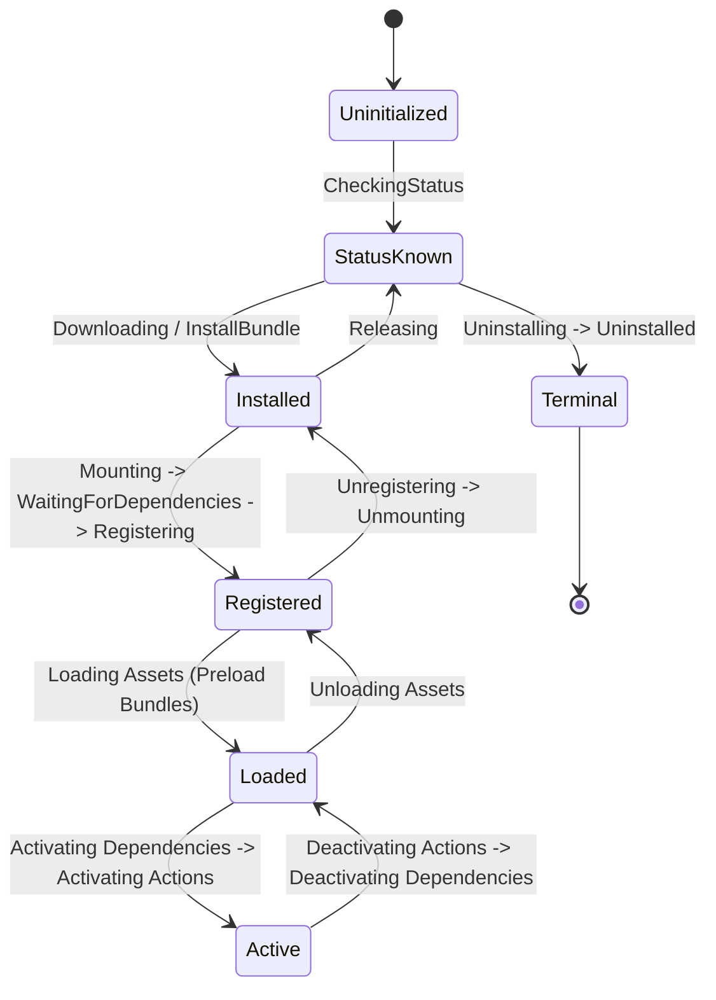
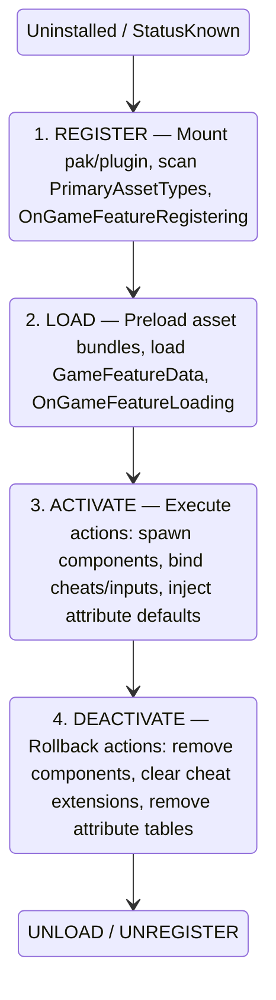
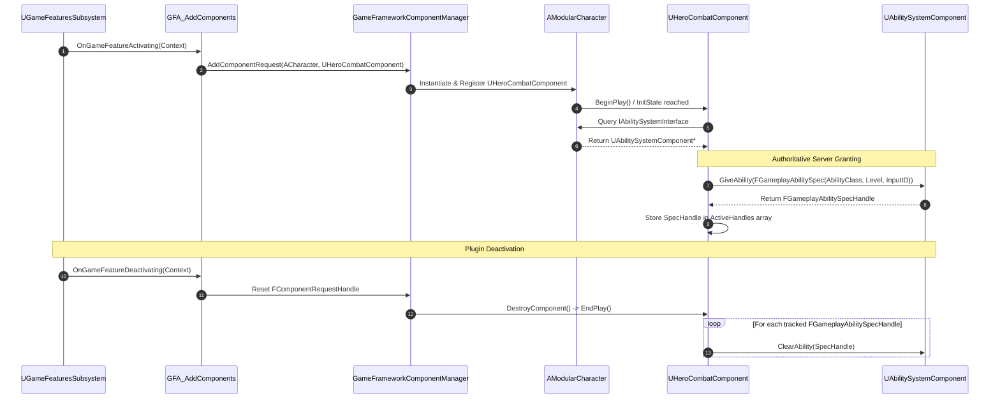

# GameFeatures Plugin & Modular Gameplay Architecture (Unreal Engine 5.8)

## 1. Overview & Architectural Philosophy

The **Game Features Plugin (GFP)** architecture in Unreal Engine 5.8 provides a modular, data-driven framework for packaging standalone game systems, content sets, and gameplay mechanics into decoupled plugins. Rather than compiling all capabilities directly into the core monolithic executable or main project content directory, Game Features enables developers to isolate systems into modular units that can be independently downloaded, mounted, loaded, activated, deactivated, and unloaded at runtime.

When integrated with the **Gameplay Ability System (GAS)** and **Modular Gameplay** framework, Game Features establishes a clean decoupling boundary:
1. **Dynamic Actor Capability Extension**: Actors (such as Player Characters, Player States, and Game States) remain generic stubs or baseline modular entities. Game Features dynamically injects Actor Components, Input Mapping Contexts, and Ability Sets at runtime when a feature activates.
2. **Deterministic Lifecycle & Rollback**: Every resource granted to an actor or registered with engine subsystems during activation is tracked through request handles and state change contexts. When a feature deactivates, granted ability specs, active effects, attribute sets, input bindings, and actor components are cleanly revoked without leaving lingering state or requiring hard restarts.
3. **Data-Driven Feature Definition**: The primary configuration asset for a plugin is `UGameFeatureData` (a `UPrimaryDataAsset` subclass), which aggregates an extensible list of `UGameFeatureAction` objects and defines primary asset scanning rules for the `UAssetManager`.
4. **State Machine-Driven Orchestration**: The engine coordinates plugin states using internal state machines (`UGameFeaturePluginStateMachine`) managed by the engine subsystem `UGameFeaturesSubsystem`, governed by project-specific rules implemented in `UGameFeaturesProjectPolicies`.

---

## 2. Core Source Dependency & Module Summary

The Game Features system is distributed across the `GameFeatures` runtime plugin, the `GameFeaturesEditor` plugin, the `ModularGameplay` framework, and experimental ability integrations.

### 2.1 GameFeatures Runtime Plugin
Source Directory: `Engine/Plugins/Runtime/GameFeatures/Source/GameFeatures/`

| Source File | Key Types | Responsibility |
| :--- | :--- | :--- |
| `Public/GameFeaturesSubsystem.h`<br>`Private/GameFeaturesSubsystem.cpp` | `UGameFeaturesSubsystem`<br>`FGameFeaturePluginIdentifier`<br>`FGameFeatureStateChangeContext`<br>`FGameFeatureProtocolOptions`<br>`EGameFeatureTargetState`<br>`EBuiltInAutoState` | Core Engine Subsystem orchestrating the registration, loading, activation, deactivation, and unloading of all Game Feature plugins. |
| `Public/GameFeaturesProjectPolicies.h`<br>`Private/GameFeaturesProjectPolicies.cpp` | `UGameFeaturesProjectPolicies`<br>`UDefaultGameFeaturesProjectPolicies`<br>`EGameFeaturesProjectPoliciesThreadSafetyVersion` | Project-extensible policy singleton managing plugin discovery, URL resolution, cooking rules, preloading bundles, and access permissions. |
| `Public/GameFeaturesSubsystemSettings.h`<br>`Private/GameFeaturesSubsystemSettings.cpp` | `UGameFeaturesSubsystemSettings` | Project Developer Settings class configuring the policy class, forced enabled/disabled plugins, and additional uplugin metadata keys. |
| `Public/GameFeatureData.h`<br>`Private/GameFeatureData.cpp` | `UGameFeatureData`<br>`FGameFeatureDataExternalAssetsPathCache` | Primary Data Asset defining the feature's actions (`TArray<TObjectPtr<UGameFeatureAction>> Actions`) and primary asset scan directories. |
| `Public/GameFeatureAction.h`<br>`Private/GameFeatureAction.cpp` | `UGameFeatureAction`<br>`FGameFeatureActivatingContext`<br>`FGameFeatureDeactivatingContext` | Abstract base class for all modular feature actions defining lifecycle hooks: Registering, Loading, Activating, Deactivating, Unloading, Unregistering. |
| `Public/GameFeatureAction_AddComponents.h`<br>`Private/GameFeatureAction_AddComponents.cpp` | `UGameFeatureAction_AddComponents`<br>`FGameFeatureComponentEntry` | Adds actor-to-component spawn requests to `UGameFrameworkComponentManager` across client/server net modes. |
| `Public/GameFeatureAction_AddCheats.h`<br>`Private/GameFeatureAction_AddCheats.cpp` | `UGameFeatureAction_AddCheats` | Injects modular `UCheatManagerExtension` classes into player cheat managers when the feature activates. |
| `Public/GameFeatureAction_AddActorFactory.h`<br>`Private/GameFeatureAction_AddActorFactory.cpp` | `UGameFeatureAction_AddActorFactory` | Registers custom editor actor factories dynamically upon plugin registration. |
| `Public/GameFeatureAction_AddWPContent.h`<br>`Private/GameFeatureAction_AddWPContent.cpp` | `UGameFeatureAction_AddWPContent` | Injects Content Bundle descriptors into World Partition runtime grids. |
| `Public/GameFeatureAction_AddWorldPartitionContent.h`<br>`Private/GameFeatureAction_AddWorldPartitionContent.cpp` | `UGameFeatureAction_AddWorldPartitionContent` | Modern World Partition content injector managing runtime partition containers. |
| `Public/GameFeatureAction_DataRegistry.h`<br>`Private/GameFeatureAction_DataRegistry.cpp` | `UGameFeatureAction_DataRegistry` | Loads and initializes `UDataRegistry` assets upon registration or activation. |
| `Public/GameFeatureAction_DataRegistrySource.h`<br>`Private/GameFeatureAction_DataRegistrySource.cpp` | `UGameFeatureAction_DataRegistrySource` | Registers data registry data sources (data tables, curve tables). |
| `Public/GameFeatureAction_AudioActionBase.h`<br>`Private/GameFeatureAction_AudioActionBase.cpp` | `UGameFeatureAction_AudioActionBase` | Base class for audio-driven feature actions binding to audio device creation/destruction. |
| `Public/GameFeatureAction_AddChunkOverride.h`<br>`Private/GameFeatureAction_AddChunkOverride.cpp` | `UGameFeatureAction_AddChunkOverride` | Overrides chunk ID assignments during asset cooking for modular packaging. |
| `Public/IrisFilterGameFeatureAction.h`<br>`Private/IrisFilterGameFeatureAction.cpp` | `UIrisFilterGameFeatureAction` | Creates and destroys Iris network replication object filters (`FNetObjectFilterDefinition`) on activation. |
| `Public/GameFeatureStateHandle.h`<br>`Private/GameFeatureStateHandle.cpp` | `FGameFeatureStateHandle`<br>`EGameFeatureStateHandleOptions` | Move-only RAII handle tracking ownership and reference counts across plugins and dependencies. |
| `Private/GameFeaturePluginStateMachine.h`<br>`Private/GameFeaturePluginStateMachine.cpp` | `UGameFeaturePluginStateMachine`<br>`UE::GameFeatures::FStateMachineExecutor` | Internal finite state machine transitioning individual plugins through install, mount, register, load, and activate states. |

### 2.2 AbilitySystemGameFeatureActions Plugin
Source Directory: `Engine/Plugins/Experimental/AbilitySystemGameFeatureActions/`

| Source File | Key Types | Responsibility |
| :--- | :--- | :--- |
| `AbilitySystemGameFeatureActions.uplugin` | Plugin Descriptor | Declares plugin dependencies on `GameFeatures` and `GameplayAbilities`. |
| `Source/AbilitySystemGameFeatureActions/Public/GameFeatureAction_AddAttributeDefaults.h`<br>`Source/AbilitySystemGameFeatureActions/Private/GameFeatureAction_AddAttributeDefaults.cpp` | `UGameFeatureAction_AddAttributeDefaults` | Ability System GFA loading global attribute default curve tables into `UAbilitySystemGlobals::AddAttributeDefaultTables` on register/activate and removing on unregister/deactivate. |
| `Source/AbilitySystemGameFeatureActions/Private/AbilitySystemGameFeatureActionsModule.cpp` | `IModuleInterface` | Module initialization and shutdown implementation for `AbilitySystemGameFeatureActions`. |

### 2.3 ModularGameplay Framework
Source Directory: `Engine/Plugins/Runtime/ModularGameplay/Source/ModularGameplay/`

| Source File | Key Types | Responsibility |
| :--- | :--- | :--- |
| `Public/Components/GameFrameworkComponentManager.h`<br>`Private/Components/GameFrameworkComponentManager.cpp` | `UGameFrameworkComponentManager`<br>`FComponentRequestHandle`<br>`EGameFrameworkAddComponentFlags` | GameInstance subsystem coordinating dynamic component addition, receiver registration (`AddReceiver`/`RemoveReceiver`), and extension delegates. |
| `Public/Components/GameFrameworkInitStateInterface.h`<br>`Private/Components/GameFrameworkInitStateInterface.cpp` | `IGameFrameworkInitStateInterface`<br>`FActorInitStateChangedParams` | Standardized interface for coordinating modular actor initialization state flow (e.g. `InitState.Spawned` $\rightarrow$ `InitState.DataAvailable` $\rightarrow$ `InitState.DataInitialized` $\rightarrow$ `InitState.GameplayReady`). |

### 2.4 GameplayAbilities Integration Targets
Source Directory: `Engine/Plugins/Runtime/GameplayAbilities/Source/GameplayAbilities/`

| Source File | Key Types | Responsibility |
| :--- | :--- | :--- |
| `Public/AbilitySystemComponent.h`<br>`Private/AbilitySystemComponent.cpp` | `UAbilitySystemComponent` | Core Actor Component managing ability specs (`GiveAbility`, `ClearAbility`), active gameplay effects, and attribute sets. |
| `Public/AbilitySystemInterface.h`<br>`Private/AbilitySystemInterface.cpp` | `IAbilitySystemInterface` | Native interface exposing `GetAbilitySystemComponent()` for decoupled actor-to-ASC retrieval across pawns and player states. |
| `Public/GameplayAbilitySet.h`<br>`Private/Abilities/GameplayAbilitySet.cpp` | `UGameplayAbilitySet`<br>`FGameplayAbilityBindInfo` | Data asset defining sets of `UGameplayAbility` classes and input command mappings batch-granted via `GiveAbilities(UAbilitySystemComponent*)`. |
| `Public/GameplayAbilitySpecHandle.h` | `FGameplayAbilitySpecHandle` | 128-bit unique handle identifying granted ability specs on an ASC, critical for clean deactivation rollback. |
| `Public/AbilitySystemGlobals.h`<br>`Private/AbilitySystemGlobals.cpp` | `UAbilitySystemGlobals` | Runtime singleton holding `AddAttributeDefaultTables` and `RemoveAttributeDefaultTables` called by `UGameFeatureAction_AddAttributeDefaults`. |

---

## 3. Subsystem Lifecycle & State Machine

The lifecycle of every Game Feature Plugin is managed by `UGameFeaturesSubsystem` (an `UEngineSubsystem` defined in `Engine/Plugins/Runtime/GameFeatures/Source/GameFeatures/Public/GameFeaturesSubsystem.h`) using an underlying state machine `UGameFeaturePluginStateMachine` (defined in `Engine/Plugins/Runtime/GameFeatures/Source/GameFeatures/Private/GameFeaturePluginStateMachine.h`).



### 3.1 The 4 Primary Lifecycle Phases

The operational lifecycle of a Game Feature Plugin moves across four distinct milestones:



#### Phase 1: Registration (`RegisterGameFeaturePlugin`)
- **API Call**: `UGameFeaturesSubsystem::RegisterGameFeaturePlugin(const FString& PluginURL, const FGameFeaturePluginLoadComplete& CompleteDelegate)` (cited: `Engine/Plugins/Runtime/GameFeatures/Source/GameFeatures/Public/GameFeaturesSubsystem.h`, Line 616).
- **StateMachine Flow**: `StatusKnown` $\rightarrow$ `Downloading` $\rightarrow$ `Installed` $\rightarrow$ `Mounting` $\rightarrow$ `WaitingForDependencies` $\rightarrow$ `Registering` $\rightarrow$ `Registered`.
- **System Behavior**:
  1. Validates the `.uplugin` descriptor via `UGameFeaturesProjectPolicies::IsPluginAllowed(const FString& PluginURL, FString* OutReason)` (cited: `Engine/Plugins/Runtime/GameFeatures/Source/GameFeatures/Public/GameFeaturesProjectPolicies.h`, Line 111).
  2. Mounts the plugin's content directory and file system paths.
  3. Locates and registers the root `UGameFeatureData` primary asset (cited: `Engine/Plugins/Runtime/GameFeatures/Source/GameFeatures/Public/GameFeatureData.h`, Line 43).
  4. Calls `UGameFeaturesSubsystem::AddGameFeatureToAssetManager(const UGameFeatureData* GameFeatureToAdd, const FString& PluginName, TArray<FName>& OutNewPrimaryAssetTypes)` (cited: `Engine/Plugins/Runtime/GameFeatures/Source/GameFeatures/Public/GameFeaturesSubsystem.h`, Line 886), registering `PrimaryAssetTypesToScan` into `UAssetManager`.
  5. Initializes base plugin `.ini` configurations via `UGameFeatureData::InitializeBasePluginIniFile(const FString& PluginInstalledFilename)` (cited: `Engine/Plugins/Runtime/GameFeatures/Source/GameFeatures/Public/GameFeatureData.h`, Line 58).
  6. Dispatches `UGameFeatureAction::OnGameFeatureRegistering()` across all actions in `GameFeatureData->GetActions()`.
  7. If configured with `bApplyOnRegister = true`, `UGameFeatureAction_AddAttributeDefaults` calls `UAbilitySystemGlobals::AddAttributeDefaultTables` during this phase.

#### Phase 2: Loading (`LoadGameFeaturePlugin`)
- **API Call**: `UGameFeaturesSubsystem::LoadGameFeaturePlugin(const FString& PluginURL, const FGameFeaturePluginLoadComplete& CompleteDelegate)` (cited: `Engine/Plugins/Runtime/GameFeatures/Source/GameFeatures/Public/GameFeaturesSubsystem.h`, Line 611).
- **StateMachine Flow**: `Registered` $\rightarrow$ `Loading` $\rightarrow$ `Loaded`.
- **System Behavior**:
  1. Verifies that all plugin dependencies are at least in the `Loaded` state.
  2. Queries `UGameFeaturesProjectPolicies::GetPreloadAssetListForGameFeature` and `GetPreloadBundleStateForPlugin(const FString& PluginName)` (cited: `Engine/Plugins/Runtime/GameFeatures/Source/GameFeatures/Public/GameFeaturesProjectPolicies.h`, Line 85).
  3. Executes asynchronous streamable bundle loading via `UAssetManager::LoadPrimaryAssets` for preloaded assets and bundle states (e.g., `Client`, `Server`).
  4. Initializes hierarchical `.ini` files via `UGameFeatureData::InitializeHierarchicalPluginIniFiles(const FString& PluginInstalledFilename)` (cited: `Engine/Plugins/Runtime/GameFeatures/Source/GameFeatures/Public/GameFeatureData.h`, Line 61).
  5. Dispatches `UGameFeatureAction::OnGameFeatureLoading()` across all actions.

#### Phase 3: Activation (`LoadAndActivateGameFeaturePlugin` / `ChangeGameFeatureTargetState`)
- **API Call**: `UGameFeaturesSubsystem::LoadAndActivateGameFeaturePlugin(const FString& PluginURL, const FGameFeaturePluginLoadComplete& CompleteDelegate)` (cited: `Engine/Plugins/Runtime/GameFeatures/Source/GameFeatures/Public/GameFeaturesSubsystem.h`, Line 621) or `ChangeGameFeatureTargetState(const FString& PluginURL, EGameFeatureTargetState TargetState, ...)` (Line 626).
- **StateMachine Flow**: `Loaded` $\rightarrow$ `ActivatingDependencies` $\rightarrow$ `Activating` $\rightarrow$ `Active`.
- **System Behavior**:
  1. Activates all declared dependencies recursively.
  2. Constructs `FGameFeatureActivatingContext` containing the target world contexts.
  3. Dispatches `UGameFeatureAction::OnGameFeatureActivating(FGameFeatureActivatingContext& Context)` sequentially across all actions.
  4. Actions add requests to `UGameFrameworkComponentManager` (such as `UGameFeatureAction_AddComponents`), inject cheat extensions (`UGameFeatureAction_AddCheats`), or register attribute defaults if `bApplyOnRegister = false` (`UGameFeatureAction_AddAttributeDefaults`).
  5. Dispatches `UGameFeatureAction::OnGameFeatureActivated()` once all actions finish activation.

#### Phase 4: Deactivation (`DeactivateGameFeaturePlugin`)
- **API Call**: `UGameFeaturesSubsystem::DeactivateGameFeaturePlugin(const FString& PluginURL, const FGameFeaturePluginDeactivateComplete& CompleteDelegate)` (cited: `Engine/Plugins/Runtime/GameFeatures/Source/GameFeatures/Public/GameFeaturesSubsystem.h`, Line 648).
- **StateMachine Flow**: `Active` $\rightarrow$ `Deactivating` $\rightarrow$ `DeactivatingDependencies` $\rightarrow$ `Loaded`.
- **System Behavior**:
  1. Constructs `FGameFeatureDeactivatingContext`.
  2. Dispatches `UGameFeatureAction::OnGameFeatureDeactivating(FGameFeatureDeactivatingContext& Context)` across all actions.
  3. Actions release handles: `UGameFeatureAction_AddComponents` resets `TSharedPtr<FComponentRequestHandle>`, immediately removing components from alive actors. `UGameFeatureAction_AddAttributeDefaults` calls `UAbilitySystemGlobals::RemoveAttributeDefaultTables`.
  4. Deactivates dependencies whose reference counts have reached zero.

---

## 4. Policy Architecture (`UGameFeaturesProjectPolicies`)

Source: `Engine/Plugins/Runtime/GameFeatures/Source/GameFeatures/Public/GameFeaturesProjectPolicies.h` (Line 47)

The project policy class acts as the bridge between generic GameFeatures engine logic and game-specific rules (packaging, streaming, network authentication, fast-cook rules, platform filtering).

### 4.1 Key Policy Virtual Interfaces

```cpp
// Engine/Plugins/Runtime/GameFeatures/Source/GameFeatures/Public/GameFeaturesProjectPolicies.h
class UGameFeaturesProjectPolicies : public UObject
{
    GENERATED_BODY()
public:
    virtual void InitGameFeatureManager();
    virtual void ShutdownGameFeatureManager();

    // Thread Safety contract version (None = 0, Initial = 1)
    virtual EGameFeaturesProjectPoliciesThreadSafetyVersion GetThreadSafetyVersion() const;

    // Cooking & Filtering
    virtual bool WillPluginBeCooked(const FString& PluginFilename, const FGameFeaturePluginDetails& PluginDetails) const;
    virtual bool IsPluginAllowed(const FString& PluginURL, FString* OutReason) const;

    // Asset Preloading & Bundles
    virtual TArray<FPrimaryAssetId> GetPreloadAssetListForGameFeature(const UGameFeatureData* GameFeatureToLoad, bool bIncludeLoadedAssets = false) const;
    virtual const TArray<FName> GetPreloadBundleStateForPlugin(const FString& PluginName) const;
    virtual void GetGameFeatureLoadingMode(bool& bLoadClientData, bool& bLoadServerData) const;

    // URL & Protocol Resolution
    virtual bool GetGameFeaturePluginURL(const TSharedRef<IPlugin>& Plugin, FString& OutPluginURL) const;
    virtual FString GetInstallBundleName(FStringView PluginName, bool bEvenIfDoesntExist = false);
    virtual FString GetOptionalInstallBundleName(FStringView PluginName, bool bEvenIfDoesntExist = false);

protected:
    UE::FTransactionallySafeRecursiveMutex Mutex;
};
```

### 4.2 Built-In Auto State Resolution

In `.uplugin` descriptor JSON, plugins configure auto-loading behavior using metadata:
- `BuiltInAutoRegister`: Automatically registers the plugin on boot.
- `BuiltInAutoLoad`: Automatically loads assets on boot.
- `BuiltInAutoActivate`: Automatically activates the feature on boot.

`UDefaultGameFeaturesProjectPolicies` (cited: `Engine/Plugins/Runtime/GameFeatures/Source/GameFeatures/Public/GameFeaturesProjectPolicies.h`, Line 192) parses these flags in `InitGameFeatureManager()`:
```cpp
// Engine/Plugins/Runtime/GameFeatures/Source/GameFeatures/Private/GameFeaturesProjectPolicies.cpp
void UDefaultGameFeaturesProjectPolicies::InitGameFeatureManager()
{
    // Evaluates BuiltInAutoState (Installed, Registered, Loaded, Active),
    // and invokes UGameFeaturesSubsystem::LoadBuiltInGameFeaturePlugins() with filter callbacks.
}
```

---

## 5. Built-in Action Catalog Table

Every action inherits from `UGameFeatureAction` (cited: `Engine/Plugins/Runtime/GameFeatures/Source/GameFeatures/Public/GameFeatureAction.h`, Line 16). The table below details all built-in action types present in UE 5.8:

| Action Class | Source File Citation | Hook Lifetime | Primary Behavior | Rollback / Cleanup Mechanism |
| :--- | :--- | :--- | :--- | :--- |
| `UGameFeatureAction_AddComponents` | `Engine/Plugins/Runtime/GameFeatures/Source/GameFeatures/Public/GameFeatureAction_AddComponents.h`<br>`Private/GameFeatureAction_AddComponents.cpp` | `Activating`<br>`Deactivating` | Iterates `ComponentList` (`FGameFeatureComponentEntry`). Calls `UGameFrameworkComponentManager::AddComponentRequest(Entry.ActorClass, ComponentClass, Entry.AdditionFlags)` across client/server net modes. | Resets all stored `TSharedPtr<FComponentRequestHandle>`. Destructor of `FComponentRequestHandle` calls `Manager->RemoveComponentRequest()`, which immediately destroys components on live actors. |
| `UGameFeatureAction_AddCheats` | `Engine/Plugins/Runtime/GameFeatures/Source/GameFeatures/Public/GameFeatureAction_AddCheats.h`<br>`Private/GameFeatureAction_AddCheats.cpp` | `Activating`<br>`Deactivating` | Binds to `UCheatManager::RegisterForOnCheatManagerCreated`. Spawns instances of `CheatManagers` (`TSoftClassPtr<UCheatManagerExtension>`) on player controllers. | Unregisters delegate, iterates `SpawnedCheatManagers`, and removes spawned extensions from the owning cheat manager. |
| `UGameFeatureAction_AddActorFactory` | `Engine/Plugins/Runtime/GameFeatures/Source/GameFeatures/Public/GameFeatureAction_AddActorFactory.h`<br>`Private/GameFeatureAction_AddActorFactory.cpp` | `Registering`<br>`Unregistering` | (Editor-only) Instantiates and registers a custom `UActorFactory` with `GEditor->ActorFactories`. | Unregisters and unloads the added `UActorFactory` from editor lists. |
| `UGameFeatureAction_AddWPContent` | `Engine/Plugins/Runtime/GameFeatures/Source/GameFeatures/Public/GameFeatureAction_AddWPContent.h`<br>`Private/GameFeatureAction_AddWPContent.cpp` | `Registering`<br>`Activating`<br>`Deactivating`<br>`Unregistering` | Injects Content Bundle descriptors (`UContentBundleDescriptor`) into the World Partition streaming engine via `FContentBundleClient`. | Releases `FContentBundleClient`, unloading injected world partition streaming cells. |
| `UGameFeatureAction_AddWorldPartitionContent` | `Engine/Plugins/Runtime/GameFeatures/Source/GameFeatures/Public/GameFeatureAction_AddWorldPartitionContent.h`<br>`Private/GameFeatureAction_AddWorldPartitionContent.cpp` | `Registering`<br>`Activating`<br>`Deactivating`<br>`Unregistering` | Modern World Partition content injector supporting external data layers and content bundle runtime containers. | Deactivates injected content containers and unregisters client context. |
| `UGameFeatureAction_DataRegistry` | `Engine/Plugins/Runtime/GameFeatures/Source/GameFeatures/Public/GameFeatureAction_DataRegistry.h`<br>`Private/GameFeatureAction_DataRegistry.cpp` | `Registering`<br>`Activating`<br>`Deactivating`<br>`Unregistering` | Loads `UDataRegistry` assets synchronously or asynchronously via `UDataRegistrySubsystem`. Supports preloading in editor/commandlets. | Unregisters and releases acquired data registries from the subsystem. |
| `UGameFeatureAction_DataRegistrySource` | `Engine/Plugins/Runtime/GameFeatures/Source/GameFeatures/Public/GameFeatureAction_DataRegistrySource.h`<br>`Private/GameFeatureAction_DataRegistrySource.cpp` | `Activating`<br>`Deactivating` | Injects data table or curve table sources into an existing globally registered `UDataRegistry`. | Removes added source handles from target data registries. |
| `UGameFeatureAction_AudioActionBase` | `Engine/Plugins/Runtime/GameFeatures/Source/GameFeatures/Public/GameFeatureAction_AudioActionBase.h`<br>`Private/GameFeatureAction_AudioActionBase.cpp` | `Activating`<br>`Deactivating` | Abstract base binding to `FAudioDevice::OnAudioDeviceCreated` and `Destroyed`. Subclasses apply audio routing/mixes. | Removes audio routing modifiers from all active `FAudioDeviceHandle` instances. |
| `UGameFeatureAction_AddChunkOverride` | `Engine/Plugins/Runtime/GameFeatures/Source/GameFeatures/Public/GameFeatureAction_AddChunkOverride.h`<br>`Private/GameFeatureAction_AddChunkOverride.cpp` | `Registering`<br>`Unregistering` | (Cook/Editor) Registers chunk assignment overrides for assets belonging to this plugin during package chunking. | Clears static chunk assignment map entries in memory. |
| `UIrisFilterGameFeatureAction` | `Engine/Plugins/Runtime/GameFeatures/Source/GameFeatures/Public/IrisFilterGameFeatureAction.h`<br>`Private/IrisFilterGameFeatureAction.cpp` | `Activating`<br>`Deactivating` | Instantiates `FNetObjectFilterDefinition` rules inside the Iris Replication System for all applicable `UWorld` contexts. | Destroys replication object filters from `AddedToWorlds`. |
| `UGameFeatureAction_AddAttributeDefaults` | `Engine/Plugins/Experimental/AbilitySystemGameFeatureActions/Source/AbilitySystemGameFeatureActions/Public/GameFeatureAction_AddAttributeDefaults.h`<br>`Private/GameFeatureAction_AddAttributeDefaults.cpp` | `Registering` or `Activating`<br>`Deactivating`<br>`Unregistering` | Injects attribute default curve tables (`AttribDefaultTableNames`) into `UAbilitySystemGlobals::AddAttributeDefaultTables`. Controlled by `bApplyOnRegister`. | Calls `UAbilitySystemGlobals::RemoveAttributeDefaultTables` (controlled by CVar `GameFeatureAction_AddAttributeDefaults.AllowRemoveAttributeDefaultTables`). |

---

## 6. Integration with GAS (Gameplay Ability System) in UE 5.8

In Unreal Engine 5.8, there is **no monolithic `GameFeatureAction_AddAbilities` class built into the engine source tree**. The dedicated ability plugin under `Engine/Plugins/Experimental/AbilitySystemGameFeatureActions/` exposes exactly one action: `UGameFeatureAction_AddAttributeDefaults`.

Instead, modular GAS architectures in UE 5.8 bridge Game Features and Abilities through three foundational engine systems:
1. **Dynamic Actor Component Registration**: `UGameFeatureAction_AddComponents` coupled with `UGameFrameworkComponentManager`.
2. **Actor Capability Initialization**: `IAbilitySystemInterface` and `IGameFrameworkInitStateInterface`.
3. **Data-Driven Ability Granting**: `UGameplayAbilitySet` and component-mediated `FGameplayAbilitySpecHandle` tracking.

---

### 6.1 The Ability System Game Feature Actions Plugin

Source: `Engine/Plugins/Experimental/AbilitySystemGameFeatureActions/`

#### Plugin Configuration (`AbilitySystemGameFeatureActions.uplugin`)
The plugin descriptor establishes the direct bridge between `GameFeatures` and `GameplayAbilities`:
```json
{
    "FileVersion": 3,
    "Version": 1,
    "VersionName": "0.1",
    "FriendlyName": "Gameplay Abilities Game Feature Actions",
    "Description": "Game feature actions to support modular use of the gameplay abilities system",
    "Category": "Gameplay",
    "Plugins": [
        { "Name": "GameFeatures", "Enabled": true },
        { "Name": "GameplayAbilities", "Enabled": true }
    ]
}
```

#### `UGameFeatureAction_AddAttributeDefaults`
Source:
- `Source/AbilitySystemGameFeatureActions/Public/GameFeatureAction_AddAttributeDefaults.h` (Line 16)
- `Source/AbilitySystemGameFeatureActions/Private/GameFeatureAction_AddAttributeDefaults.cpp` (Line 19)

This action dynamically registers attribute default tables with the Ability System Globals singleton:
```cpp
// Public/GameFeatureAction_AddAttributeDefaults.h
UCLASS(MinimalAPI, meta = (DisplayName = "Add Attribute Defaults"))
class UGameFeatureAction_AddAttributeDefaults final : public UGameFeatureAction
{
    GENERATED_BODY()
public:
    virtual void OnGameFeatureRegistering() override;
    virtual void OnGameFeatureActivating(FGameFeatureActivatingContext& Context) override;
    virtual void OnGameFeatureUnregistering() override;
    virtual void OnGameFeatureDeactivating(FGameFeatureDeactivatingContext& Context) override;

    UPROPERTY(EditAnywhere, Category = Attributes, AdvancedDisplay)
    bool bApplyOnRegister = true;

    UPROPERTY(EditAnywhere, Category = Attributes)
    TArray<FSoftObjectPath> AttribDefaultTableNames;
};
```

**Implementation Mechanics in UE 5.8**:
- When `bApplyOnRegister = true`, the action hooks `OnGameFeatureRegistering()` and `OnGameFeatureUnregistering()`.
- When `bApplyOnRegister = false`, it applies during `OnGameFeatureActivating()` and removes during `OnGameFeatureDeactivating()`.
- It registers tables via:
  ```cpp
  // Private/GameFeatureAction_AddAttributeDefaults.cpp
  UAbilitySystemGlobals& AbilitySystemGlobals = UAbilitySystemGlobals::Get();
  AbilitySystemGlobals.AddAttributeDefaultTables(AttributeDefaultTablesOwnerName, *AttribDefaultTableNamesToAdd);
  ```
  (cited: `Engine/Plugins/Runtime/GameplayAbilities/Source/GameplayAbilities/Public/AbilitySystemGlobals.h`, Line 292).
- On deactivation/unregistration, if console variable `GameFeatureAction_AddAttributeDefaults.AllowRemoveAttributeDefaultTables` is true, it calls:
  ```cpp
  AbilitySystemGlobals.RemoveAttributeDefaultTables(AttributeDefaultTablesOwnerName, AttribDefaultTableNames);
  ```
  (cited: `Engine/Plugins/Runtime/GameplayAbilities/Source/GameplayAbilities/Public/AbilitySystemGlobals.h`, Line 293).

---

### 6.2 Dynamic Component Injection via `GameFeatureAction_AddComponents`

Source:
- `Engine/Plugins/Runtime/GameFeatures/Source/GameFeatures/Public/GameFeatureAction_AddComponents.h`
- `Engine/Plugins/Runtime/GameFeatures/Source/GameFeatures/Private/GameFeatureAction_AddComponents.cpp`
- `Engine/Plugins/Runtime/ModularGameplay/Source/ModularGameplay/Public/Components/GameFrameworkComponentManager.h`

In UE 5.8, actors opt into modular component extension by registering as receivers with `UGameFrameworkComponentManager`.

#### Actor Receiver Setup
```cpp
// In AModularCharacter.cpp
#include "Components/GameFrameworkComponentManager.h"

void AModularCharacter::PreInitializeComponents()
{
    Super::PreInitializeComponents();
    // Opt-in this actor to receive dynamically requested components
    UGameFrameworkComponentManager::AddGameFrameworkComponentReceiver(this);
}

void AModularCharacter::EndPlay(const EEndPlayReason::Type EndPlayReason)
{
    // Unbind receiver when exiting world
    UGameFrameworkComponentManager::RemoveGameFrameworkComponentReceiver(this);
    Super::EndPlay(EndPlayReason);
}
```

#### How `UGameFeatureAction_AddComponents` Injects Components
Inside `UGameFeatureAction_AddComponents::AddComponentRequest` (cited: `Private/GameFeatureAction_AddComponents.cpp`, Line 324):
```cpp
TSharedPtr<FComponentRequestHandle> UGameFeatureAction_AddComponents::AddComponentRequest(
    TNotNull<UWorld*> World, 
    TNotNull<UGameFrameworkComponentManager*> Manager, 
    const FGameFeatureComponentEntry& Entry)
{
    if (!Entry.ActorClass.IsNull())
    {
        TSubclassOf<UActorComponent> ComponentClass = Entry.ComponentClass.LoadSynchronous();
        if (ComponentClass)
        {
            return Manager->AddComponentRequest(
                Entry.ActorClass, 
                ComponentClass, 
                static_cast<EGameFrameworkAddComponentFlags>(Entry.AdditionFlags));
        }
    }
    return nullptr;
}
```

When `Manager->AddComponentRequest` is called:
1. `UGameFrameworkComponentManager::CreateComponentOnInstance` executes for all registered matching receiver actors.
2. The component is instantiated: `UActorComponent* NewComp = NewObject<UActorComponent>(ActorInstance, ComponentClass)`.
3. `NewComp->RegisterComponent()` is invoked.
4. When the feature deactivates, `FComponentRequestHandle`'s destructor calls `Manager->RemoveComponentRequest()`, which immediately destroys the component instance from live actors.

---

### 6.3 Granting Abilities via Modular Feature Components & `UGameplayAbilitySet`

Because `GameFeatureAction_AddAbilities` is not an engine-level class in UE 5.8, projects grant abilities modularly using **Feature Components** injected by `GameFeatureAction_AddComponents` or custom project actions that leverage `UGameplayAbilitySet`.

Source: `Engine/Plugins/Runtime/GameplayAbilities/Source/GameplayAbilities/Public/GameplayAbilitySet.h` (Line 63)

#### The `UGameplayAbilitySet` Data Asset
`UGameplayAbilitySet` pairs ability classes with input commands:
```cpp
// Engine/Plugins/Runtime/GameplayAbilities/Source/GameplayAbilities/Public/GameplayAbilitySet.h
UCLASS(MinimalAPI)
class UGameplayAbilitySet : public UDataAsset
{
    GENERATED_UCLASS_BODY()

    UPROPERTY(EditAnywhere, Category = AbilitySet)
    TArray<FGameplayAbilityBindInfo> Abilities;

    UE_API void GiveAbilities(UAbilitySystemComponent* AbilitySystemComponent) const;
};
```

In `Engine/Plugins/Runtime/GameplayAbilities/Source/GameplayAbilities/Private/Abilities/GameplayAbilitySet.cpp` (Line 22):
```cpp
void UGameplayAbilitySet::GiveAbilities(UAbilitySystemComponent* AbilitySystemComponent) const
{
    for (const FGameplayAbilityBindInfo& BindInfo : Abilities)
    {
        if (BindInfo.GameplayAbilityClass)
        {
            AbilitySystemComponent->GiveAbility(
                FGameplayAbilitySpec(BindInfo.GameplayAbilityClass, 1, (int32)BindInfo.Command));
        }
    }
}
```

#### Component-Driven GAS Granting Pattern in UE 5.8
When a modular feature plugin needs to grant abilities to a character:
1. The Game Feature plugin defines a feature component (e.g. `UHeroCombatComponent : public UActorComponent`).
2. The plugin's `UGameFeatureData` includes a `UGameFeatureAction_AddComponents` entry that attaches `UHeroCombatComponent` to `ACharacter` or `APlayerState`.
3. In `UHeroCombatComponent::BeginPlay()` or upon reaching `IGameFrameworkInitStateInterface` state `InitState.GameplayReady`:
   - It queries `IAbilitySystemInterface::GetAbilitySystemComponent()` (cited: `Engine/Plugins/Runtime/GameplayAbilities/Source/GameplayAbilities/Public/AbilitySystemInterface.h`, Line 26).
   - On the authoritative server (`ASC->IsOwnerActorAuthoritative()`), it grants ability sets and stores the returned `FGameplayAbilitySpecHandle` values (cited: `Engine/Plugins/Runtime/GameplayAbilities/Source/GameplayAbilities/Public/GameplayAbilitySpecHandle.h`).
4. In `UHeroCombatComponent::EndPlay()`:
   - When the Game Feature deactivates, `UGameFeatureAction_AddComponents` releases its `FComponentRequestHandle`, tearing down `UHeroCombatComponent`.
   - `UHeroCombatComponent::EndPlay()` calls `ASC->ClearAbility(Handle)` for each tracked handle, ensuring clean rollback.



---

## 7. Practical Usage Guide & Step-by-Step Patterns

### 7.1 Creating a Game Feature Plugin

1. In Unreal Editor, open **Edit** $\rightarrow$ **Plugins** $\rightarrow$ **Add Plugin**.
2. Select **Game Feature (Content Only)** or **Game Feature (with C++ code)** based on template requirements (`FGameFeaturePluginTemplateDescription` in `Engine/Plugins/Runtime/GameFeatures/Source/GameFeaturesEditor/Public/GameFeaturePluginTemplate.h`, Line 14).
3. Set the plugin path under `<ProjectRoot>/Plugins/GameFeatures/<FeatureName>/`.
4. Ensure the `.uplugin` file includes modular dependencies:
   ```json
   {
     "FileVersion": 3,
     "Version": 1,
     "VersionName": "1.0",
     "FriendlyName": "ShooterAbilities",
     "Description": "Modular ability set for shooter heroes",
     "Category": "Game Features",
     "CreatedBy": "Studio",
     "EnabledByDefault": false,
     "CanContainContent": true,
     "IsBetaVersion": false,
     "Installed": false,
     "ExplicitlyLoaded": true,
     "BuiltInAutoRegister": true,
     "BuiltInAutoLoad": false,
     "BuiltInAutoActivate": false,
     "Plugins": [
       {
         "Name": "GameplayAbilities",
         "Enabled": true
       },
       {
         "Name": "ModularGameplay",
         "Enabled": true
       },
       {
         "Name": "AbilitySystemGameFeatureActions",
         "Enabled": true
       }
     ]
   }
   ```
5. Inside the plugin's root content directory (`/ShooterAbilities/`), create the primary asset:
   - Type: `UGameFeatureData` (cited: `Engine/Plugins/Runtime/GameFeatures/Source/GameFeatures/Public/GameFeatureData.h`).
   - Asset Name: Must match the plugin root convention, typically `ShooterAbilities`.

---

### 7.2 Custom Project Policy Implementation

Define a custom project policy to enforce security rules, URL schemes, and preloading behaviors:

```cpp
// Source/MyGame/Public/MyGameFeaturesProjectPolicies.h
#pragma once

#include "GameFeaturesProjectPolicies.h"
#include "MyGameFeaturesProjectPolicies.generated.h"

// Engine/Plugins/Runtime/GameFeatures/Source/GameFeatures/Public/GameFeaturesProjectPolicies.h
UCLASS()
class MYGAME_API UMyGameFeaturesProjectPolicies : public UDefaultGameFeaturesProjectPolicies
{
    GENERATED_BODY()

public:
    virtual void InitGameFeatureManager() override;
    virtual void ShutdownGameFeatureManager() override;
    virtual EGameFeaturesProjectPoliciesThreadSafetyVersion GetThreadSafetyVersion() const override 
    { 
        return EGameFeaturesProjectPoliciesThreadSafetyVersion::Initial; 
    }
    virtual bool IsPluginAllowed(const FString& PluginURL, FString* OutReason) const override;
    virtual const TArray<FName> GetPreloadBundleStateForPlugin(const FString& PluginName) const override;
};
```

```cpp
// Source/MyGame/Private/MyGameFeaturesProjectPolicies.cpp
#include "MyGameFeaturesProjectPolicies.h"
#include "GameFeaturesSubsystemSettings.h"

void UMyGameFeaturesProjectPolicies::InitGameFeatureManager()
{
    Super::InitGameFeatureManager();
    UE_LOG(LogGameFeatures, Log, TEXT("Custom Game Feature Policy initialized."));
}

void UMyGameFeaturesProjectPolicies::ShutdownGameFeatureManager()
{
    Super::ShutdownGameFeatureManager();
}

bool UMyGameFeaturesProjectPolicies::IsPluginAllowed(const FString& PluginURL, FString* OutReason) const
{
    // Fast-cook or tournament security filtering
    if (PluginURL.Contains(TEXT("DebugCheats")) && FPlatformProperties::RequiresCookedData())
    {
        if (OutReason)
        {
            *OutReason = TEXT("DebugCheats plugin disallowed in shipping builds.");
        }
        return false;
    }
    return Super::IsPluginAllowed(PluginURL, OutReason);
}

const TArray<FName> UMyGameFeaturesProjectPolicies::GetPreloadBundleStateForPlugin(const FString& PluginName) const
{
    // Preload both Client and Server asset bundles
    return { UGameFeaturesSubsystemSettings::LoadStateClient, UGameFeaturesSubsystemSettings::LoadStateServer };
}
```

Register this policy class in `DefaultGame.ini`:
```ini
[/Script/GameFeatures.GameFeaturesSubsystemSettings]
GameFeaturesManagerClassName=/Script/MyGame.MyGameFeaturesProjectPolicies
```

---

### 7.3 Activating and Deactivating Features in C++

```cpp
#include "GameFeaturesSubsystem.h"

void UMyGameModeManager::ActivateHeroFeature(const FString& PluginName)
{
    UGameFeaturesSubsystem& Subsystem = UGameFeaturesSubsystem::Get();

    FString PluginURL;
    if (!Subsystem.GetPluginURLByName(PluginName, PluginURL))
    {
        UE_LOG(LogGameFeatures, Error, TEXT("Plugin URL not found for %s"), *PluginName);
        return;
    }

    // Asynchronous load and activation with callback
    Subsystem.LoadAndActivateGameFeaturePlugin(
        PluginURL,
        FGameFeaturePluginLoadComplete::CreateLambda([PluginName](const UE::GameFeatures::FResult& Result)
        {
            if (Result.HasError())
            {
                UE_LOG(LogGameFeatures, Error, TEXT("Failed to activate %s: %s"), 
                    *PluginName, *Result.GetError());
            }
            else
            {
                UE_LOG(LogGameFeatures, Log, TEXT("Successfully activated %s"), *PluginName);
            }
        })
    );
}

void UMyGameModeManager::DeactivateHeroFeature(const FString& PluginName)
{
    UGameFeaturesSubsystem& Subsystem = UGameFeaturesSubsystem::Get();

    FString PluginURL;
    if (Subsystem.GetPluginURLByName(PluginName, PluginURL))
    {
        Subsystem.DeactivateGameFeaturePlugin(
            PluginURL,
            FGameFeaturePluginDeactivateComplete::CreateLambda([PluginName](const UE::GameFeatures::FResult& Result)
            {
                UE_LOG(LogGameFeatures, Log, TEXT("Deactivated %s"), *PluginName);
            })
        );
    }
}
```

---

### 7.4 Using `FGameFeatureStateHandle` for Reference-Counted Scope Management

Source: `Engine/Plugins/Runtime/GameFeatures/Source/GameFeatures/Public/GameFeatureStateHandle.h` (Line 26)

In complex gameplay flows (e.g. game modes, match phases, dynamic zones), multiple systems may request the same Game Feature Plugin. Managing activations manually can result in premature deactivation. `FGameFeatureStateHandle` provides RAII-managed reference counting:

```cpp
class FMatchPhaseScope
{
public:
    void StartPhase(const FString& PhasePluginName)
    {
        // Initializes state handle with dependency tracking
        FeatureHandle.InitAndRegister(TEXT("MatchPhaseScope"), EGameFeatureStateHandleOptions::TrackDependencies);
        
        // Subsystem increments reference count for PhasePluginName
        // When FeatureHandle falls out of scope or is released, ref counts decrement automatically
    }

    void EndPhase()
    {
        FeatureHandle.ReleaseAndUnregister([](bool bSuccess)
        {
            UE_LOG(LogGameFeatures, Log, TEXT("Phase feature handle released cleanly."));
        });
    }

private:
    FGameFeatureStateHandle FeatureHandle;
};
```

---

## 8. Common Pitfalls & Architectural Best Practices

### 8.1 Hard References to Plugin Assets in Core Modules
- **Pitfall**: Referencing an asset inside `/ShooterAbilities/` from a core class located in `/Game/` or engine code.
- **Consequence**: Forces the Game Feature plugin to be cooked and mounted permanently, breaking modularity and causing missing asset crashes if the plugin is unloaded.
- **Remedy**: Always use `TSoftObjectPtr`, `TSoftClassPtr`, or Asset Registry Gameplay Tags in core code. Let the Game Feature Action inject references into core systems at runtime.

### 8.2 Client-Server Asymmetric Component Addition
- **Pitfall**: Configuring `FGameFeatureComponentEntry` with `bClientComponent = true` and `bServerComponent = false` for a component that replicates or hosts server-side ability logic.
- **Consequence**: The client instantiates the component, but the server lacks the component. Replicated properties and RPCs fail, resulting in desyncs or server crashes.
- **Remedy**: Components hosting `UAbilitySystemComponent` or executing authoritative gameplay logic must have `bServerComponent = true`.

### 8.3 Leaking `FGameplayAbilitySpecHandle` Across Feature Boundaries
- **Pitfall**: Storing raw pointers to `UGameplayAbility*` instead of tracking `FGameplayAbilitySpecHandle` in custom ability granting components.
- **Consequence**: On deactivation, calling `ClearAbility` without valid handles leaves orphan ability specifications active in the ASC. Characters retain abilities from deactivated game modes.
- **Remedy**: Always store granted handles inside an actor-keyed tracker array or map and call `ASC->ClearAbility(Handle)` during component teardown (`EndPlay`).

### 8.4 Premature Ability Activation Before Actor Initialization
- **Pitfall**: Attempting to grant abilities and activate passive effects as soon as an actor spawns, before `Pawn->PossessedBy()` or `PlayerState` replication has completed.
- **Consequence**: `AbilityActorInfo` is uninitialized or missing its avatar actor, leading to crashes in ability activation code or unpredicted RPC errors.
- **Remedy**: Integrate with `IGameFrameworkInitStateInterface` (cited: `Engine/Plugins/Runtime/ModularGameplay/Source/ModularGameplay/Public/Components/GameFrameworkInitStateInterface.h`). Wait until the actor announces `InitState.GameplayReady` before executing `ASC->GiveAbility()`.

### 8.5 Asset Registry Tag Scanning Omission
- **Pitfall**: Placing primary assets (abilities, weapon definitions) in custom subdirectories without configuring `PrimaryAssetTypesToScan` in `UGameFeatureData` (cited: `Engine/Plugins/Runtime/GameFeatures/Source/GameFeatures/Public/GameFeatureData.h`, Line 49).
- **Consequence**: `UAssetManager` never scans the directory. Async bundle loading fails to find primary assets, and bundle states (`Client`, `Server`) remain unpopulated.
- **Remedy**: Populate `PrimaryAssetTypesToScan` in `GameFeatureData` with appropriate directories and rules for all discrete primary assets packaged within the plugin.
