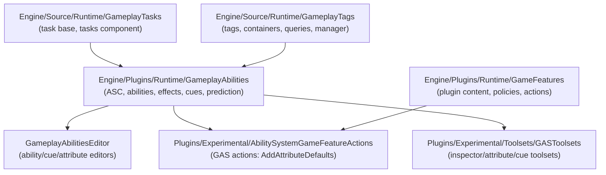

# Gameplay Ability System (GAS) — Architecture & Usage, UE 5.8

Full documentation set for every element related to the Gameplay Ability System, grounded in the actual UE 5.8 source (`UE_5.8`). Each file covers **architecture** (types, responsibilities, key APIs, data flow) and **usage** (patterns, examples, pitfalls).

## Index

| File | Scope |
|---|---|
| [01_Core_Architecture.md](01_Core_Architecture.md) | `UAbilitySystemComponent`, globals, interfaces, module lifecycle, developer settings |
| [02_Abilities.md](02_Abilities.md) | `UGameplayAbility`, specs/handles, actor info, target actors, ability sets, BP latent nodes |
| [03_GameplayEffects.md](03_GameplayEffects.md) | `UGameplayEffect`, specs, active effects, policies, components, aggregators, execution calculations |
| [04_AttributeSets.md](04_AttributeSets.md) | `UAttributeSet`, attribute data, metadata, init, change pipeline |
| [05_GameplayTags.md](05_GameplayTags.md) | `FGameplayTag`, containers, queries, tag sources, manager, response table |
| [06_GameplayTasks.md](06_GameplayTasks.md) | `UGameplayTasksComponent`, `UAbilityTask`, async actions, full task catalog |
| [07_GameplayCues.md](07_GameplayCues.md) | Cue interface, manager, set, translator, notify classes, sequencer track |
| [08_Replication_Prediction_Networking.md](08_Replication_Prediction_Networking.md) | Prediction keys, replication proxy, RPC surface, net serializers, replication modes |
| [09_Editor_Toolsets_Debug.md](09_Editor_Toolsets_Debug.md) | GameplayAbilitiesEditor, GASToolsets, debug HUD, GameplayDebugger category, tests |
| [10_GameFeatures_Plugin.md](10_GameFeatures_Plugin.md) | GameFeatures subsystem, policies, actions, GAS integration |
| [11_Usage_Guide.md](11_Usage_Guide.md) | End-to-end setup, canonical wiring, patterns, cheat commands, pitfalls |

## Module map

Source roots:
- GAS plugin: `Engine/Plugins/Runtime/GameplayAbilities` (modules `GameplayAbilities`, `GameplayAbilitiesEditor`)
- Tags: `Engine/Source/Runtime/GameplayTags`
- Tasks: `Engine/Source/Runtime/GameplayTasks`
- GameFeatures: `Engine/Plugins/Runtime/GameFeatures`
- GAS game-feature actions: `Engine/Plugins/Experimental/AbilitySystemGameFeatureActions` (depends on `GameplayAbilities` + `ModularGameplay`; `GameFeatures.Build.cs` itself has no `GameplayAbilities` dependency)
- Toolsets: `Engine/Plugins/Experimental/Toolsets/GASToolsets`

## Graph facts (from `graphify-out/graph.json`)

- GAS plugin corpus: **7,734 nodes**, 13,276 internal edges, 1,802 cross-community edges, spread across **352 communities** — GAS is a federation of thin clusters, not one hub.
- Highest-degree GAS files: `GameplayEffect.cpp` (231), `AbilitySystemComponent.cpp` (194), `AbilitySystemComponent_Abilities.cpp` (187), `FActiveGameplayEffectHandle` (142), `GameplayAbility.cpp` (135), `AbilitySystemBlueprintLibrary.cpp` (119), `UGameplayCueManager` (95).
- Cross-community bridges: Core Engine Types (534 edges), Material Value Types (177), Reflection and Property Change (140), Module Lifecycle and Factories (102), Slate UI Rendering (75).
- Bridge symbols: `ObjectMacros.h` (363), `ReflectedTypeAccessors.h` (272), `ScriptMacros.h` (272), `TArray` (208), `FGameplayTag` (200), `AActor` (189), `FPredictionKey` (111), `FNetSerializationContext` (84) — GAS integrates through reflection/macro plumbing, tags, actors, and the networking layer.
