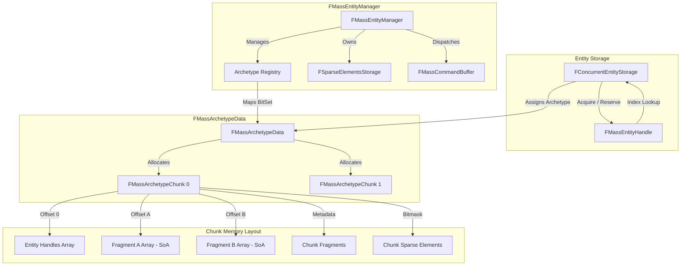

# Core Architecture — UE 5.8 MASS

## Scope
MassCore and MassEntity ECS foundational architecture: entity lifecycle, archetype composition, chunk memory layout (Structure of Arrays), sparse elements storage, thread safety model, and the engine module lifecycle.

## Architecture

Mass in Unreal Engine 5.8 splits low-level ECS primitives from orchestration into two primary modules:
- **`MassCore`**: Defines fundamental data models (`FMassEntityHandle`, `FMassElement`, `FMassFragment`, `FMassTag`, `FMassChunkFragment`, `FMassSharedFragment`, `FMassConstSharedFragment`, `FArchetypeGroup`).
- **`MassEntity`**: Contains archetype management (`FMassEntityManager`, `FMassArchetypeData`), entity allocation storage (`IEntityStorageInterface`, `FConcurrentEntityStorage`), runtime sparse elements (`FSparseElementsStorage`), type registries (`FMassBitSetRegistry`, `FTypeManager`), and world subsystem integration (`UMassEntitySubsystem`).

### Memory Layout (Chunk SoA)
MASS stores entities in contiguous memory blocks called chunks (`FMassArchetypeChunk`), defaulting to 64 KiB (`UMassEntitySettings::ChunkMemorySize`, clamped to power of two).
- **Structure-of-Arrays (SoA)**: Within a chunk, fragment types are laid out in separate parallel arrays rather than Array-of-Structures (AoS), maximizing SIMD vectorize potential and cache utilization during system queries.
- **Header & Layout offsets**:
  1. Chunk index 0 offset (`EntityListOffsetWithinChunk = 0`): Dense array of `FMassEntityHandle` (`NumEntitiesPerChunk * sizeof(FMassEntityHandle)`).
  2. Aligned fragment arrays: Sorted deterministically by `UScriptStruct` pointer address (`FScriptStructSortOperator`). Offsets aligned via `Align(Offset, FragmentType->GetMinAlignment())`.
  3. Chunk fragments: Stored directly in `ChunkFragmentData` (`TArray<FInstancedStruct>`), instantiated once per chunk.
  4. Shared & Const Shared fragments: Pointed to via `FMassArchetypeSharedFragmentValues` attached to chunk metadata.
  5. Sparse elements presence: Per-chunk `FChunkSparseElements` tracking which entity slots hold sparse tags/fragments without mutating archetype identity.

### Entity Storage and Handles
Entities are identified by a 64-bit value via `FMassEntityHandle`:
- `int32 Index`: Direct index into `IEntityStorageInterface`. Index 0 is strictly reserved as `UE::Mass::Private::InvalidEntityIndex`.
- `int32 SerialNumber`: Generational versioning counter. In UE 5.8's `FConcurrentEntityStorage`, this mirrors `GenerationId` (30 bits) and `bIsAllocated` (1 bit).
- Handle validation: A handle is valid if `Index > 0`, `Index < Capacity`, `Storage.GetSerialNumber(Index) == Handle.SerialNumber`, and `Storage.GetEntityState(Index) == EEntityState::Created`.

In UE 5.8, single-threaded storage (`FSingleThreadedEntityStorage`, `REQUESTED_MASS_CONCURRENT_RESERVE`) is deprecated (`UE_DEPRECATED(5.8)`). `FConcurrentEntityStorage` is the standard backend:
- Organizes entity slots into fixed-size pages (`MaxEntitiesPerPage`, default 65,536).
- Pages allocated via `PageAllocateMutex`; index recycling handled via thread-safe `FreeListMutex`.
- Supports concurrent reservation (`Acquire`/`AcquireOne`) and release (`Release`/`ForceRelease`). Archetype assignment and chunk addition remain serialized or deferred.

### Archetype Identity and Migration
An archetype is uniquely defined by its composition bitset (`FMassElementBitSet`).
- Fragment addition or removal mutates the entity composition, requiring **archetype migration**:
  1. Target archetype lookup in `FragmentHashToArchetypeMap` / `AllArchetypes` (created via `CreateArchetype` if missing).
  2. Data copying: Values for common fragments are copied from source chunk to target chunk. Newly added fragments are default-initialized.
  3. Swap-and-pop removal: The migrated entity is removed from its source chunk by swapping with the chunk's trailing entity, updating `EntityMap` and incrementing `EntityOrderVersion`.
  4. Sparse elements are migrated via `FChunkSparseElements::MoveElementsFrom`.

## Key types

| Symbol | Module | Responsibility |
| :--- | :--- | :--- |
| `FMassEntityHandle` | `MassCore` | 64-bit handle (`Index` + `SerialNumber`) identifying an entity across frame boundaries and archetype migrations. |
| `FMassElement` | `MassCore` | Root `USTRUCT` base for fragments, tags, chunk fragments, and shared fragments. |
| `FMassFragment` | `MassCore` | Per-entity data struct; must satisfy `CFragment` (trivially copyable or explicit trait opt-in). |
| `FMassTag` | `MassCore` | Zero-sized presence marker; occupies zero payload bytes within chunks. |
| `FMassChunkFragment` | `MassCore` | Per-chunk data struct shared across all entities hosted within a chunk. |
| `FMassSharedFragment` / `FMassConstSharedFragment` | `MassCore` | Shared data instances shared across chunks or archetypes via reference handles. |
| `FMassEntityManager` | `MassEntity` | Central ECS hub; owns entity storage, archetype repository, observer manager, and deferred command buffer. |
| `IEntityStorageInterface` | `MassEntity` | Abstract interface defining handle reservation, state checks, and archetype assignment. |
| `FConcurrentEntityStorage` | `MassEntity` | Paged concurrent entity storage permitting multi-threaded entity handle acquisition. |
| `FMassArchetypeData` | `MassEntity` | Owns chunks, fragment offsets, entity maps, and version timestamps for a specific entity composition. |
| `FMassArchetypeHandle` | `MassEntity` | Opaque handle encapsulating `TSharedPtr<FMassArchetypeData>`. |
| `FMassArchetypeChunk` | `MassEntity` | Represents a raw memory slab containing the dense SoA arrays and chunk fragment storage. |
| `FMassArchetypeHelper` | `MassEntity` | Internal utility bridging handles to `FMassArchetypeData` and evaluating query requirement compatibility. |
| `FMassElementBitSet` | `MassEntity` | Type bitset representing archetype composition (fragments, tags, chunk fragments, shared fragments). |
| `FMassBitSetRegistry` | `MassEntity` | Type registration cache mapping `UScriptStruct` types to deterministic bit indices. |
| `FSparseElementsStorage` | `MassEntity` | Packed struct chunks managing optional sparse fragments without triggering archetype transitions. |
| `FMassEntityCollection` | `MassEntity` | Cached collection of entity handles grouped into versioned chunk ranges for processor pipelines. |
| `FMassEntitySubsystem` | `MassEntity` | World subsystem hosting the default `FMassEntityManager` instance for a `UWorld`. |

## Data flow



## Usage

### Creating Entities and Adding Fragments (Synchronous)
```cpp
#include "MassEntityManager.h"
#include "Mass/EntityHandle.h"
#include "MyFragments.h"

void SpawnEntities(FMassEntityManager& EntityManager)
{
    // 1. Build archetype from fragments and tags
    FMassArchetypeHandle Archetype = EntityManager.CreateArchetype({
        FTransformFragment::StaticStruct(),
        FVelocityFragment::StaticStruct(),
        FEnemyTag::StaticStruct()
    });

    // 2. Batch-create entities
    TArray<FMassEntityHandle> SpawnedEntities;
    EntityManager.BatchCreateEntities(Archetype, 1000, SpawnedEntities);

    // 3. Populate fragment values
    for (FMassEntityHandle Entity : SpawnedEntities)
    {
        FVelocityFragment& Velocity = EntityManager.GetFragmentDataChecked<FVelocityFragment>(Entity);
        Velocity.Value = FVector(100.0f, 0.0f, 0.0f);
    }
}
```

### Archetype Migration via Fragment Mutation
```cpp
void MakeEntityStunned(FMassEntityManager& EntityManager, FMassEntityHandle Entity)
{
    // Direct addition causes archetype migration via swap-and-pop
    EntityManager.AddFragmentToEntity(Entity, FStunnedFragment::StaticStruct());
    
    // Setting fragment value after migration
    FStunnedFragment& Stunned = EntityManager.GetFragmentDataChecked<FStunnedFragment>(Entity);
    Stunned.DurationRemaining = 2.5f;

    // Remove fragment - migrates entity back
    EntityManager.RemoveFragmentFromEntity(Entity, FStunnedFragment::StaticStruct());
}
```

### Thread-Safe Entity Reservation
```cpp
#include "MassEntityManager.h"
#include "MassCommands.h"

void WorkerThreadReserve(FMassEntityManager& EntityManager, TArray<FMassEntityHandle>& OutReserved)
{
    // Concurrently reserve entity handles without chunk lock contention
    EntityManager.BatchReserveEntities(500, OutReserved);

    // Defer building entities with fragment values via command buffer during processing
    FMassCommandBuffer& CmdBuffer = EntityManager.Defer();
    for (FMassEntityHandle Handle : OutReserved)
    {
        CmdBuffer.PushCommand<FMassCommandBuildEntity>(Handle, FTransformFragment(), FVelocityFragment());
    }
}
```

## Pitfalls

1. **Calling Synchronous APIs During Processing**:
   Methods like `AddFragmentToEntity`, `DestroyEntity`, or `CreateArchetype` trigger `CHECK_SYNC_API()` assertions if executed while processors run (`IsProcessing() == true`). Always use `EntityManager.Defer()` or `FMassExecutionContext::Defer()`.
2. **Fragment Non-Trivial Copying Violations**:
   Fragments must satisfy `UE::Mass::CFragment`. Embedding heap-allocating containers (`FString`, `TArray`, `TMap`) triggers compile errors (`MASS_STATIC_CHECK_FRAGMENT`). Use `FName`, inline fixed arrays, or specialize `TMassFragmentTraits<T>::AuthorAcceptsItsNotTriviallyCopyable = true` (not recommended for performance).
3. **Handle Invalidation on Chunk Compaction**:
   Removing an entity swaps it with the chunk's last active entity. Raw chunk pointers (`FMassRawEntityInChunkData`) or raw fragment pointers are invalidated. Never cache pointers across frame ticks or command flushes; rely on `FMassEntityHandle`.
4. **Header Deprecations in UE 5.8**:
   Including `MassEntityHandle.h` triggers `UE_DEPRECATED_HEADER(5.8)`. Always include `Mass/EntityHandle.h` and depend on `MassCore`.
5. **Excessive Archetype Proliferation**:
   Using structural fragments/tags for short-lived state changes (e.g. `bIsAttacking`) triggers continuous archetype migrations and chunk fragmentation. Use `FMassSparseTag` or bitmasks inside an existing fragment instead.

## Source files

- `Engine/Source/Runtime/Mass/MassCore/Public/Mass/EntityHandle.h` — Definition of `FMassEntityHandle`.
- `Engine/Source/Runtime/Mass/MassCore/Public/Mass/EntityElementTypes.h` — `FMassElement`, `FMassFragment`, `FMassTag`, `FMassChunkFragment`, `FMassSharedFragment`.
- `Engine/Source/Runtime/Mass/MassCore/Public/Mass/ArchetypeGroup.h` — Archetype grouping identifiers and group hierarchy.
- `Engine/Source/Runtime/MassEntity/Public/MassEntityManager.h` — `FMassEntityManager` god node, transaction and batch APIs.
- `Engine/Source/Runtime/MassEntity/Public/MassEntityManagerStorage.h` — `IEntityStorageInterface`, `FConcurrentEntityStorage`, and init params.
- `Engine/Source/Runtime/MassEntity/Public/MassArchetypeTypes.h` — `FMassArchetypeHandle`, `FMassArchetypeEntityCollection`, `FMassArchetypeChunkIterator`.
- `Engine/Source/Runtime/MassEntity/Internal/MassArchetypeData.h` — `FMassArchetypeData`, `FMassArchetypeChunk`, `FMassArchetypeHelper`.
- `Engine/Source/Runtime/MassEntity/Public/MassElement.h` — `FMassElementBitSet`, bitset enumeration traits.
- `Engine/Source/Runtime/MassEntity/Public/MassBitSetRegistry.h` — Struct tracker bitset registries for tags and fragments.
- `Engine/Source/Runtime/MassEntity/Public/MassSparseElementsStorage.h` — Packed struct pools and iterators for sparse elements.
- `Engine/Source/Runtime/MassEntity/Public/MassEntityConcepts.h` — Compile-time concepts (`CFragment`, `CTag`, `CChunkFragment`, etc.).
- `Engine/Source/Runtime/MassEntity/Public/MassEntitySubsystem.h` — `UMassEntitySubsystem` world lifecycle integration.
- `Engine/Source/Runtime/MassEntity/Public/MassEntityCollection.h` — `FEntityCollection` dynamic handle-to-range caching.
- `Engine/Source/Runtime/MassEntity/Private/MassEntityManager.cpp` — Implementation of entity lifecycle, migration, and observation hooks.
- `Engine/Source/Runtime/MassEntity/Private/MassArchetypeData.cpp` — Chunk layout sizing, fragment SoA layout math, swap-and-pop logic.

## Graph facts

- Node counts: `MassEntity` contains 2,899 nodes; `MassCore` (under `Mass`) contains 736 nodes.
- God Node Degree: `FMassEntityManager` is the most connected symbol in the entire MASS ecosystem with 848 header edges, 662 source edges, and a symbol degree of 539.
- Archetype Clustering: `FMassArchetypeData.h` (165 nodes, 596 edges) and `FMassArchetypeData.cpp` (402 edges) form the core execution and memory management hub.
- BitSet Centrality: `FMassElementBitSet` has a degree of 81, acting as the universal composition bridge connecting query caching, archetype registration, and processor requirement solvers.
