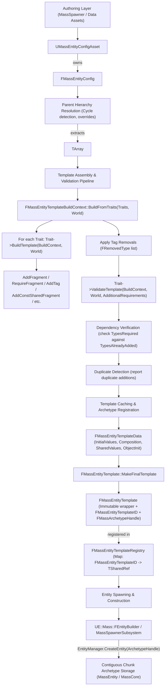
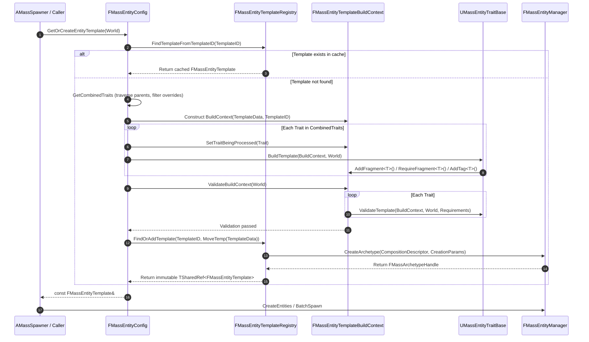

# Entities, Fragments & Traits — UE 5.8 MASS

## Scope
Entity composition and authoring layers across `MassCore`, `MassEntity`, and `MassSpawner`. Covers element types (`FMassFragment`, `FMassTag`, `FMassSharedFragment`, `FMassConstSharedFragment`, `FMassChunkFragment`, and sparse variants), `UMassEntityTraitBase`, `FMassEntityTemplate`, `FMassEntityTemplateBuildContext`, `FMassEntityTemplateRegistry`, `FMassEntityConfig`, `UMassEntityConfigAsset`, `UE::Mass::FEntityBuilder`, validation/inspection pipelines, runtime configuration assets, and the cross-module trait catalog.

## Architecture

MASS splits authoring from execution. Designers configure agents using high-level traits inside entity config assets, while runtime processors iterate low-level archetypes arranged in contiguous chunk memory.



### Element Types Hierarchy
In UE 5.8, root element types have moved from `MassEntity/Public/MassEntityElementTypes.h` (now a `UE_DEPRECATED_HEADER(5.8)` forwarding shim) to `Engine/Source/Runtime/Mass/MassCore/Public/Mass/EntityElementTypes.h`:
- `FMassElement`: Base USTRUCT for all ECS elements.
- `FMassFragment`: Per-entity component data stored in chunk SoA arrays. Must be trivially copyable, or opt out by specializing `TMassFragmentTraits<T>::AuthorAcceptsItsNotTriviallyCopyable = true`.
- `FMassSparseFragment`: Inherits `FMassFragment`. Managed via `FSparseElementsStorage` without mutating the archetype chunk composition.
- `FMassTag`: Zero-sized marker struct. Stored purely as bit flags inside `FMassArchetypeCompositionDescriptor` / `FMassTagBitSet`; consumes 0 bytes of chunk memory.
- `FMassSparseTag`: Inherits `FMassTag`. Stored in sparse bitsets per entity without altering archetype layout.
- `FMassChunkFragment`: Chunk-level data allocated once per chunk (`FMassArchetypeChunk::ChunkFragmentData`), shared by all entities in that chunk.
- `FMassSharedFragment` / `FMassConstSharedFragment`: Shared data instances referenced via handle/pointer, shared across multiple entities and archetypes.

### Trait -> Template -> Archetype Pipeline
1. **Config Evaluation**: `FMassEntityConfig::GetOrCreateEntityTemplate` resolves the inheritance chain against its `Parent` asset, detects cycles, and builds an ordered array of `UMassEntityTraitBase*`. Subclasses or matching trait classes in child configs override parent traits (`ValidTargetConfig` filtering allows separate client/server variations).
2. **Context Creation**: Allocates transient `FMassEntityTemplateData` and wraps it in `FMassEntityTemplateBuildContext`.
3. **Execution (`BuildFromTraits`)**:
   - Compares each trait's `ValidTargetConfig` against `WorldProcessingFlags` (`Utils::DetermineProcessorExecutionFlags`).
   - Invokes `UMassEntityTraitBase::BuildTemplate(BuildContext, World)`.
   - Records all added elements into `FTraitData::TypesAdded`.
   - Removes tags queued via `BuildContext.RemoveTag<T>()`.
4. **Validation Phase (`ValidateBuildContext`)**:
   - Calls `UMassEntityTraitBase::ValidateTemplate` on every trait, permitting dynamic dependency declaration via `FAdditionalTraitRequirements`.
   - Cross-checks all `FTraitData::TypesRequired` against `TypesAlreadyAdded`. If any required fragment/tag is absent or was removed, validation fails (`ErrorCount > 0`).
   - Emits duplicate element notifications to `FMassDebugger` (`UE::Mass::Debug::bReportDuplicatedFragmentsAsWarnings`).
5. **Finalization (`FMassEntityTemplate::MakeFinalTemplate`)**:
   - Sorts fragment elements for deterministic ordering.
   - Calls `FMassEntityManager::CreateArchetype(CompositionDescriptor, CreationParams)`.
   - Stores the resulting `FMassArchetypeHandle` inside `FMassEntityTemplate`.
6. **Registration**: Registers the immutable `TSharedRef<FMassEntityTemplate>` in `FMassEntityTemplateRegistry` under its `FMassEntityTemplateID`.

### Template Caching & IDs
- **`FMassEntityTemplateID`**: Formed by hashing `ConfigGuid` (from `FMassEntityConfig`) and an optional integer `FlavorHash` using CityHash (`CityHash128to64`).
- **Registry Lifetime**: `FMassEntityTemplateRegistry` is held by `UMassSpawnerSubsystem` (one per world) or standalone owners. Templates are built on-demand once and reused for all subsequent spawn operations.

### Runtime Configuration Assets
- **`UMassEntityConfigAsset`**: `UDataAsset` hosting a root `FMassEntityConfig`.
- **`FMassEntityConfig`**: Can be embedded directly into actors, spawners (`AMassSpawner`), or components. Holds an array of `UMassEntityTraitBase` pointers and an optional pointer to a parent `UMassEntityConfigAsset`.
- **Hierarchical Overrides**: Child configs can override parent traits by providing another trait of the exact same class or superclass, or augment them with new traits.

### Dynamic Construction with `UE::Mass::FEntityBuilder`
Defined in `Engine/Source/Runtime/MassEntity/Public/MassEntityBuilder.h`, `FEntityBuilder` provides a fluent, type-safe API for building entities imperatively in C++ without requiring data assets:
- Reserves an `FMassEntityHandle` up-front while accumulating fragments and tags.
- Converts to `FMassEntityHandle` implicitly or via `GetEntityHandle()`.
- Flushes creation to `FMassEntityManager` upon `Commit()`, or defers execution when configured via `SetForceDeferredCommit(true)`.
- Instantiates directly from existing templates via `FMassEntityTemplate::CreateEntityBuilder`.

## Key types

| Symbol | Module | Responsibility |
| :--- | :--- | :--- |
| `FMassElement` | `MassCore` | Root `USTRUCT` base for fragments, tags, chunk fragments, and shared fragments (`Mass/EntityElementTypes.h`). |
| `FMassFragment` | `MassCore` | Base `USTRUCT` for per-entity data stored in chunk SoA columns. |
| `FMassTag` | `MassCore` | Base `USTRUCT` for zero-byte presence flags tested by queries. |
| `FMassSharedFragment` | `MassCore` | Base `USTRUCT` for mutable shared fragments referenced across entities. |
| `FMassConstSharedFragment` | `MassCore` | Base `USTRUCT` for immutable shared fragments. |
| `FMassChunkFragment` | `MassCore` | Base `USTRUCT` for chunk-wide shared data. |
| `UMassEntityTraitBase` | `MassSpawner` | Abstract UObject base defining `BuildTemplate`, `ValidateTemplate`, and `DestroyTemplate`. |
| `FMassEntityTemplate` | `MassSpawner` | Finalized, immutable template binding an archetype handle, template ID, initial values, and initializers. |
| `FMassEntityTemplateData` | `MassSpawner` | Mutable intermediate representation used to collect composition descriptors and values during build. |
| `FMassEntityTemplateBuildContext` | `MassSpawner` | Context object passed to `BuildTemplate`; records added types, dependencies, tag removals, and initializers. |
| `FMassEntityTemplateRegistry` | `MassSpawner` | World-bound repository storing finalized templates keyed by `FMassEntityTemplateID`. |
| `FMassEntityConfig` | `MassSpawner` | Embedded struct managing trait lists, parent asset inheritance, and template instantiation. |
| `UMassEntityConfigAsset` | `MassSpawner` | Data asset wrapper exposing `FMassEntityConfig` to the editor and content browser. |
| `UE::Mass::FEntityBuilder` | `MassEntity` | Fluent imperative builder for direct C++ entity creation and composition without traits. |
| `UMassTranslator` | `MassSpawner` | Abstract processor coordinating bi-directional data synchronization between UObjects and Mass fragments. |

## Data flow



## Usage

### 1. Authoring a Custom C++ Trait
Below is the standard UE 5.8 pattern for authoring traits, matching engine implementations such as `UMassMovementTrait`:

```cpp
#pragma once

#include "MassEntityTraitBase.h"
#include "MassCommonFragments.h"
#include "CustomEnemyFragments.h"
#include "CustomEnemyTrait.generated.h"

UCLASS(meta = (DisplayName = "Custom Enemy Setup"))
class UCustomEnemyTrait : public UMassEntityTraitBase
{
    GENERATED_BODY()

public:
    UPROPERTY(EditAnywhere, Category = "Combat")
    float BaseHealth = 100.0f;

    UPROPERTY(EditAnywhere, Category = "Movement")
    float MaxSpeed = 600.0f;

    virtual void BuildTemplate(FMassEntityTemplateBuildContext& BuildContext, const UWorld& World) const override
    {
        // 1. Declare hard prerequisite fragments from other traits (e.g. transform from movement/representation)
        BuildContext.RequireFragment<FTransformFragment>();

        // 2. Add per-entity data fragments and initialize values
        FEnemyCombatFragment& CombatFrag = BuildContext.AddFragment_GetRef<FEnemyCombatFragment>();
        CombatFrag.Health = BaseHealth;
        CombatFrag.MaxHealth = BaseHealth;
        // 3. Add tags for processor query filtering
        BuildContext.AddTag<FEnemyAgentTag>();

        // 4. Share immutable configuration parameters via EntityManager
        FMassEntityManager& EntityManager = UE::Mass::Utils::GetEntityManagerChecked(World);
        FEnemyParameters SharedParams;
        SharedParams.MaxSpeed = MaxSpeed;
        const FConstSharedStruct SharedParamsStruct = EntityManager.GetOrCreateConstSharedFragment(SharedParams);
        BuildContext.AddConstSharedFragment(SharedParamsStruct);
    }

    virtual bool ValidateTemplate(const FMassEntityTemplateBuildContext& BuildContext, const UWorld& World, 
                                  FAdditionalTraitRequirements& OutTraitRequirements) const override
    {
        // Dynamic prerequisite checks based on context inspection
        if (BaseHealth <= 0.0f)
        {
            return false;
        }
        return true;
    }
};
```

### 2. Imperative Spawning with `UE::Mass::FEntityBuilder`
For code-driven procedural spawning without data assets:

```cpp
#include "MassEntityBuilder.h"
#include "MassCommonFragments.h"
#include "CustomEnemyFragments.h"

void SpawnDirectEntity(FMassEntityManager& EntityManager)
{
    // MakeEntityBuilder returns a fluent builder; commits once Commit() is called
    FMassEntityHandle NewEntity = EntityManager.MakeEntityBuilder()
        .Add<FEnemyAgentTag>()
        .Add<FTransformFragment>(FTransform(FVector(100.f, 200.f, 300.f)))
        .Add<FAgentRadiusFragment>(FAgentRadiusFragment{ .Radius = 45.0f })
        .Commit();
}
```

### 3. Spawning from Templates
Using an existing `FMassEntityTemplate` to instantiate entities:

```cpp
void SpawnFromTemplate(const FMassEntityTemplate& Template, TSharedRef<FMassEntityManager> EntityManager)
{
    UE::Mass::FEntityBuilder Builder = Template.CreateEntityBuilder(EntityManager);
    // Mutate or customize specific fragment values before committing
    if (FTransformFragment* Transform = Builder.Find<FTransformFragment>())
    {
        Transform->GetMutableTransform().SetLocation(FVector(500.f, 0.f, 100.f));
    }
    FMassEntityHandle Entity = Builder.Commit();
}
```

## Trait Catalog by Module

The following catalog lists prominent traits across UE 5.8 plugins and engine modules, grounded in their definition headers:

| Module | Trait Class | Header Path | Core Responsibilities & Fragments Added |
| :--- | :--- | :--- | :--- |
| **MassSpawner** | `UMassAssortedFragmentsTrait` | `MassSpawner/Public/MassAssortedFragmentsTrait.h` | Generic container trait; appends arbitrary instanced fragments (`FMassFragment`) and tags (`FMassTag`) configured in editor properties. |
| **MassMovement** | `UMassMovementTrait` | `MassMovement/Public/Movement/MassMovementTrait.h` | Movement simulation; adds `FMassVelocityFragment`, `FMassForceFragment`, `FMassDesiredMovementFragment`, const shared `FMassMovementParameters`. Requires `FTransformFragment`, `FAgentRadiusFragment`. |
| **MassMovement** | `USpringMovementTrait` | `MassMovement/Public/MassSpringMovementTrait.h` | Spring/damping movement simulation; adds `FSpringMovementFragment`. |
| **MassMovement** | `UMassSimpleMovementTrait` | `MassMovement/Public/Example/MassSimpleMovementTrait.h` | Basic kinematic movement test trait; adds velocity and wander fragments. |
| **MassMovement** | `UMassVelocityRandomizerTrait`| `MassMovement/Public/Example/MassVelocityRandomizerTrait.h`| Randomizes initial velocity vectors during initialization. |
| **MassRepresentation** | `UMassMovableVisualizationTrait` | `MassRepresentation/Public/MassMovableVisualizationTrait.h` | Modern representation trait for dynamic entities; adds actor/ISM visual representation fragments, LOD tracking, transforms. |
| **MassRepresentation** | `UMassStationaryVisualizationTrait` | `MassRepresentation/Public/MassStationaryVisualizationTrait.h` | Representation trait optimized for static/stationary entities without velocity. |
| **MassRepresentation** | `UMassVisualizationTrait` | `MassRepresentation/Public/MassVisualizationTrait.h` | Soft-deprecated base visualization trait. |
| **MassLOD** | `UMassLODCollectorTrait` | `MassLOD/Public/MassLODTrait.h` | Assigns LOD calculation fragments based on player viewer distance and importance. |
| **MassLOD** | `UMassDistanceLODCollectorTrait` | `MassLOD/Public/MassLODTrait.h` | Distance-only LOD calculation variant. |
| **MassLOD** | `UMassSimulationLODTrait` | `MassLOD/Public/MassLODTrait.h` | Tunes simulation ticking frequency based on entity LOD. |
| **MassSmartObjects** | `UMassSmartObjectUserTrait` | `MassSmartObjects/Public/MassSmartObjectUserTrait.h` | Smart Object interaction; adds `FMassSmartObjectUserFragment`, handles search and claim interactions. |
| **MassReplication** | `UMassReplicationTrait` | `MassReplication/Public/MassReplicationTrait.h` | Network replication; binds entity state to `FMassReplicationContext` and client/server synchronization channels. |
| **MassActors** | `UMassAgentCapsuleCollisionSyncTrait` | `MassActors/Public/MassAgentTraits.h` | Synchronizes Mass transform and velocity into a target actor `UCapsuleComponent`. |
| **MassActors** | `UMassAgentMovementSyncTrait` | `MassActors/Public/MassAgentTraits.h` | Synchronizes movement parameters with actor `UCharacterMovementComponent`. |
| **MassActors** | `UMassAgentOrientationSyncTrait` | `MassActors/Public/MassAgentTraits.h` | Synchronizes actor yaw and pitch with entity orientation. |
| **MassActors** | `UMassAgentFeetLocationSyncTrait` | `MassActors/Public/MassAgentTraits.h` | Offsets actor root to align agent feet with Mass floor hit location. |
| **MassNavigation** | `UMassSteeringTrait` | `MassNavigation/Public/Steering/MassSteeringTrait.h` | Target steering and acceleration calculation; adds `FMassSteeringFragment`. |
| **MassNavigation** | `UMassSmoothOrientationTrait` | `MassNavigation/Public/SmoothOrientation/MassSmoothOrientationTrait.h` | Interpolates heading changes; adds `FMassSmoothOrientationFragment`. |
| **MassNavigation** | `UMassObstacleAvoidanceTrait` | `MassNavigation/Public/Avoidance/MassAvoidanceTrait.h` | Standing and moving obstacle avoidance; adds `FMassAvoidanceFragment`. |
| **MassNavigation** | `UMassNavigationObstacleTrait` | `MassNavigation/Public/Avoidance/MassNavigationObstacleTrait.h` | Marks entity as an obstacle for other agents. |
| **MassZoneGraphNavigation** | `UMassZoneGraphNavigationTrait` | `MassZoneGraphNavigation/Public/MassZoneGraphNavigationTrait.h` | ZoneGraph lane following; adds lane location, lane path offset, and target progress fragments. |
| **MassNavMeshNavigation** | `UMassNavMeshNavigationTrait` | `MassNavMeshNavigation/Public/MassNavMeshNavigationTrait.h` | NavMesh pathfinding and path following integration. |
| **MassAIBehavior** | `UMassStateTreeTrait` | `MassAIBehavior/Public/MassStateTreeTrait.h` | StateTree execution; adds `FMassStateTreeInstanceFragment` and evaluator requirements. |
| **MassAIBehavior** | `UMassLookAtTrait` / `UMassLookAtTargetTrait` | `MassAIBehavior/Public/MassLookAtTrait.h` | Look-at gaze target calculation and tracking fragments. |
| **MassAIBehavior** | `UMassZoneGraphAnnotationTrait` | `MassAIBehavior/Public/MassZoneGraphAnnotationTrait.h` | Applies dynamic ZoneGraph behavioral annotations to agents. |
| **MassCrowd** | `UMassCrowdMemberTrait` | `MassCrowd/Public/MassCrowdMemberTrait.h` | Integrates with crowd lane tracking and lane switching logic. |
| **MassCrowd** | `UMassCrowdServerRepresentationTrait` | `MassCrowd/Public/MassCrowdServerRepresentationTrait.h` | Dedicated server minimal representation for crowd entities. |
| **MassCharacterTrajectory** | `UCharacterTrajectoryTrait` | `MassCharacterTrajectory/Public/MassCharacterTrajectoryTrait.h` | Future prediction history buffers; adds `FMassCharacterTrajectoryFragment`. |
| **UAFMass** | `UMassUAFTrait` | `UAFMass/Private/Traits/MassUAFTrait.h` | Universal Animation Framework (UAF) binding; associates `FUAFSystemFactoryAsset` with entity. |
| **UAFMass** | `UCharacterTrajectoryUAFTrait` | `UAFMass/Private/Traits/CharacterTrajectoryUAFTrait.h` | Feeds Mass character trajectories into UAF animation variables. |
| **MassGameplayDebug** | `UMassDebugVisualizationTrait` | `MassGameplayDebug/Public/MassDebugVisualizationTrait.h` | Debug rendering (cones, vectors, bounding spheres) via GameplayDebugger. |

## Pitfalls

1. **Tag Removals (`RemoveTag`) vs Required Dependencies**: `BuildContext.RemoveTag<T>()` stages tag removals until after all traits have executed `BuildTemplate`. However, if another trait subsequently validates `BuildContext.RequireTag<T>()`, validation will fail because `TypesAlreadyAdded` strips removed elements before requirement checks.
2. **Missing `ValidTargetConfig` Synchronization**: When configuring different traits for client vs server (e.g. `UMassMovableVisualizationTrait` vs `UMassCrowdServerRepresentationTrait`), ensure both specify mutually exclusive `ValidTargetConfig` flags (e.g., `Client` vs `DedicatedServer`). If flags overlap, child config inheritance will treat the second trait as an override of the first.
3. **Data Inspection Mode Guarding**: During editor asset compilation and thumbnail rendering, `BuildContext.IsInspectingData()` returns `true`. Trait authors must avoid accessing world subsystems (e.g. `UWorld::GetSubsystem`) or dereferencing runtime world pointers when `IsInspectingData()` is true.
4. **Shared Fragment Pointer Lifetime**: Calling `BuildContext.AddConstSharedFragment` requires a struct allocated and managed by `FMassEntityManager::GetOrCreateConstSharedFragment`. Never pass stack-allocated `FConstSharedStruct` references directly into template data without registry persistence.
5. **Non-Trivially Copyable Fragments**: Adding a struct that contains `FString`, `TArray`, or complex UObject pointers without specializing `TMassFragmentTraits<T>::AuthorAcceptsItsNotTriviallyCopyable = true` will trigger `static_assert` failure `MASS_INVALID_FRAGMENT_MSG`. Keep fragments plain old data (POD) where possible.
6. **Config GUID Collisions**: If `FMassEntityConfig` instances are duplicated in memory or cloned without calling `PostDuplicate`/`ForceRegenerateGUID`, both configs will share the same `ConfigGuid`, causing `FMassEntityTemplateRegistry` to return the first template for both instances.

## Source files

- `Engine/Source/Runtime/Mass/MassCore/Public/Mass/EntityElementTypes.h` — Definition site of `FMassElement`, `FMassFragment`, `FMassSparseFragment`, `FMassTag`, `FMassSparseTag`, `FMassChunkFragment`, `FMassSharedFragment`, `FMassConstSharedFragment`.
- `Engine/Source/Runtime/MassEntity/Public/MassEntityElementTypes.h` — `UE_DEPRECATED_HEADER(5.8)` shim forwarding to `Mass/EntityElementTypes.h`.
- `Engine/Source/Runtime/Mass/MassCore/Public/Mass/EntityFragments.h` — Core fragment definitions including `FTransformFragment`.
- `Engine/Source/Runtime/MassEntity/Public/MassEntityFragments.h` — `UE_DEPRECATED_HEADER(5.8)` shim forwarding to `Mass/EntityFragments.h`.
- `Engine/Source/Runtime/MassEntity/Public/MassEntityBuilder.h` — Definition of `UE::Mass::FEntityBuilder` and helper methods.
- `Engine/Plugins/Runtime/MassGameplay/Source/MassSpawner/Public/MassEntityTraitBase.h` — Definition of `UMassEntityTraitBase` and `FAdditionalTraitRequirements`.
- `Engine/Plugins/Runtime/MassGameplay/Source/MassSpawner/Public/MassEntityTemplate.h` — Declarations for `FMassEntityTemplateID`, `FMassEntityTemplateData`, `FMassEntityTemplate`.
- `Engine/Plugins/Runtime/MassGameplay/Source/MassSpawner/Public/MassEntityTemplateRegistry.h` — Declarations for `FMassEntityTemplateBuildContext` and `FMassEntityTemplateRegistry`.
- `Engine/Plugins/Runtime/MassGameplay/Source/MassSpawner/Public/MassEntityConfigAsset.h` — Declarations for `FMassEntityConfig` and `UMassEntityConfigAsset`.
- `Engine/Plugins/Runtime/MassGameplay/Source/MassSpawner/Public/MassAssortedFragmentsTrait.h` — Generic fragment container trait.
- `Engine/Plugins/Runtime/MassGameplay/Source/MassSpawner/Public/MassTranslator.h` — `UMassTranslator` processor base.

## Graph facts

Relevant node and connectivity metrics from `local://mass_graph_facts.md`:
- `Engine/Plugins/Runtime/MassGameplay` is the largest plugin community in the MASS corpus with **4,485 nodes**, housing all spawner, trait, representation, movement, and actor sync mechanisms.
- `Engine/Source/Runtime/MassEntity` provides the backing ECS storage and builder interfaces with **2,899 nodes**.
- `FMassFragment` is one of the highest-degree core symbols with **86 degree connections**, tying together queries, processors, traits, and chunk memory layouts.
- Cross-community bridges into `Core Engine Types` (1,227 edges) and `Reflection and Property Change` (265 edges) are heavily utilized by `UMassEntityTraitBase`, `FMassEntityConfig`, and `FInstancedStruct` property serialization during template construction.
- Spawner-to-Entity boundary: `FMassEntityTemplate` translates editor-reflected trait graphs into dense runtime archetypes governed by `FMassEntityManager` (degree 539).
