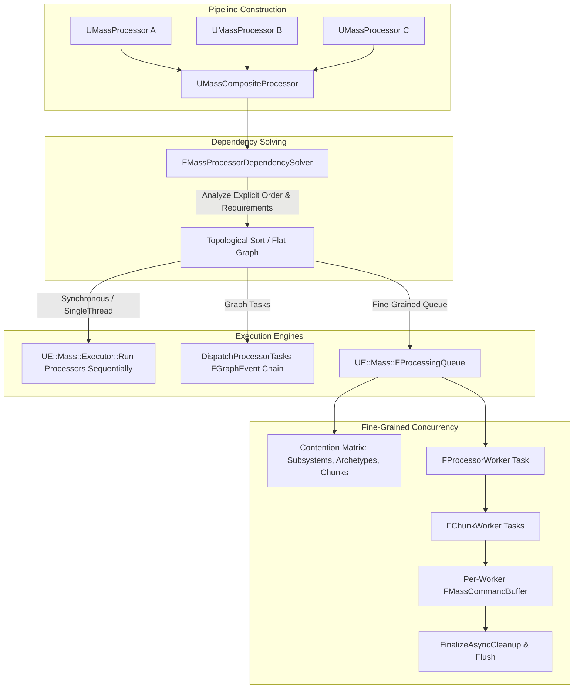
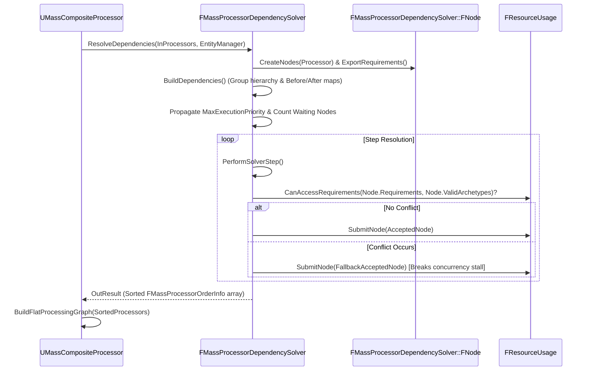

# Processors and Execution — UE 5.8 MASS

## Scope
`UMassProcessor` API, composite orchestration (`UMassCompositeProcessor`), execution ordering, dependency solving (`FMassProcessorDependencySolver`), fine-grained runtime task queuing (`UE::Mass::FProcessingQueue`, `FQueuedProcessor`), typed query accessors (`UE::Mass::FQueryExecutor`, `FQueryDefinition`), the static runner namespace `UE::Mass::Executor`, execution modes, pruning rules, and multithreading contention resolution.

## Architecture

MASS processor execution in Unreal Engine 5.8 operates at three distinct structural layers:
1. **Pipeline & Graph Specification Layer (`UMassProcessor`, `UMassCompositeProcessor`, `FMassProcessorExecutionOrder`)**: Declares processor groupings, phase assignment (`EMassProcessingPhase`), net/world execution filters (`EProcessorExecutionFlags`), and explicit before/after dependencies.
2. **Dependency & Contention Resolution Layer (`FMassProcessorDependencySolver`)**: Analyzes explicit ordering rules combined with resource usage bitsets (`FMassExecutionRequirements`) across archetypes. It resolves a deterministic execution sequence or builds a flat dependency task graph (`FlatProcessingGraph`).
3. **Task & Query Dispatch Layer (`FProcessingQueue`, `FQueuedProcessor`, `MassExecutor`)**: Dispatches work concurrently. In parallel mode (`MASS_DO_PARALLEL`), execution splits across background worker tasks via `UE::Tasks` and `TaskGraph`, enforcing mutual exclusion on contending archetype chunks and external subsystems via dynamically tracked bitmasks (`FContentionMatrix`).



### Processor Lifecycle
Every processor follows a strict initialization and execution lifecycle managed by `UMassEntityManager`:
- **Construction & CDO Setup**: Subclass constructor defines default flags (`ExecutionFlags`, `bAutoRegisterWithProcessingPhases`, `bRequiresGameThreadExecution`, `ExecutionPriority`).
- **Query Registration (`RegisterQuery`)**: Member `FMassEntityQuery` variables are registered during constructor or class instantiation. Pointers are validated against processor object memory boundaries (`checkfSlow`).
- **Initialization (`CallInitialize` -> `InitializeInternal`)**: Invoked by owning subsystem/composite.
  1. Owned queries initialize against `FMassEntityManager`.
  2. `ConfigureQueries` runs (must NOT call `Super::ConfigureQueries` if custom queries exist; default implementation delegates to `AutoExecuteQuery`).
  3. Archetypes requested for dynamic creation are pre-resolved (`ResolveRequestedArchetypes`).
  4. Game-thread requirement is aggregated: if any query or `ProcessorRequirements` demands the game thread, `bRequiresGameThreadExecution` is forced `true`.
  5. User overrides in `InitializeInternal` execute.
- **Execution (`CallExecute` -> `Execute`)**:
  1. Checks `IsActive()`.
  2. Verifies subsystem access prerequisites via `Context.CacheSubsystemRequirements(ProcessorRequirements)`.
  3. Sets active creation requirements on `Context` (`SetActiveArchetypeRequirements`).
  4. Calls `Execute(EntityManager, Context)` (or `AutoExecuteQuery->CallExecute(Context)`).
  5. If `ActivationState == EActivationState::OneShot`, transitions to `EActivationState::Inactive`.

## Key types

| Symbol | Module | Responsibility |
| :--- | :--- | :--- |
| `UMassProcessor` | `MassEntity` | Base UObject class for all MASS execution units; owns queries, requirements, and execution order. |
| `UMassCompositeProcessor` | `MassEntity` | Hierarchical composite container holding `ChildPipeline` and generating flat graph representations. |
| `FMassProcessorExecutionOrder` | `MassEntity` | USTRUCT specifying `ExecuteInGroup`, `ExecuteBefore`, and `ExecuteAfter` naming tokens. |
| `FMassProcessorDependencySolver` | `MassEntity` | Graph builder sorting processors into dependency-safe execution sequences and detecting cycles. |
| `FMassExecutionRequirements` | `MassEntity` | Bitset container tracking Read/Write access on fragments, chunks, shared structs, sparse elements, and subsystems. |
| `UE::Mass::FProcessingQueue` | `MassEntity` | Multi-threaded task scheduler dynamically evaluating chunk-level and global-level resource contention. |
| `UE::Mass::FQueuedProcessor` | `MassEntity` | Internal scheduler descriptor tracking explicit dependencies, running queries, and chunk dispatch queues. |
| `UE::Mass::FContentionMatrix` | `MassEntity` | Dynamically sized bit-matrix (`NumElements x WordsPerRow`) tracking mutual exclusion pairs. |
| `UE::Mass::FActiveContentionTracker` | `MassEntity` | Atomic-backed runtime tracker monitoring active contention counts per item index. |
| `UE::Mass::FQueryExecutor` | `MassEntity` | Base struct providing high-level type-safe query iteration utilities over entity chunks. |
| `UE::Mass::FQueryDefinition` | `MassEntity` | Templated compile-time tuple accessor mapping typed fragment/tag/subsystem requirements into queries. |
| `UE::Mass::Executor` | `MassEntity` | Static entry-point namespace (`Run`, `RunWithCollection`, `RunSparseEntities`, `TriggerParallelTasks`). |
| `UMassObserverProcessor` | `MassEntity` | Specialized processor activated by entity lifecycle operations (`EMassObservedOperationFlags`). |

## Data flow

### Dependency Solving & Graph Construction


1. **Node Extraction**: Solver assigns an `FNode` to each processor (or group). Processors export all fragment and subsystem bitsets via `ExportRequirements(OutRequirements)`. Thread-safe subsystems cached in `MultiThreadedSystemsBitSet` are masked out from read/write conflict tests.
2. **Priority Propagation**: In `IncreaseWaitingNodesCountAndPriority`, child priority is pushed up the chain (`MaxExecutionPriority = FMath::Max(ChildPriority + 1, MaxExecutionPriority)`). Dependency-heavy processors gain priority to clear the critical execution path early.
3. **Topological Step Execution (`PerformSolverStep`)**: Iterates ready nodes (`TransientDependencies.Num() == 0`). If parallel solving is targeted (`!bSingleThreadTarget`), `ResourceUsage.CanAccessRequirements` ensures concurrent processors do not contend on mutable fragments or subsystems across identical archetypes. If every remaining node contends, `FallbackAcceptedNodeIndex` forces the highest-priority blocked node forward.
4. **Cycle Mitigation**: When cycles occur in explicit before/after dependencies, `LogCycle` logs the cyclic loop to `LogMassDependencies`, and `Solve` forcibly severs the first transient dependency edge.

### Contention Resolution & Legacy Mode (`bAggregateRequirements`)
The engine supports two levels of requirement isolation within `FProcessingQueue`:
- **Fine-Grained Mode (`bAggregateRequirements = false`)**: Contention is evaluated independently per `FMassEntityQuery` owned by the processor. A processor with Query A (writing `FTransformFragment`) and Query B (writing `FVelocityFragment`) only contends on transforms while Query A runs chunks, and only on velocities while Query B runs chunks.
- **Legacy Aggregated Mode (`bAggregateRequirements = true`)**: The processor combines all owned query requirements, processor subsystem requirements, and creation bitsets into a unified `FDataAccess` bitmask:
  ```cpp
  if (bAggregateRequirements)
  {
      for (int32 QueryIndex = 0; QueryIndex < QueryCount; ++QueryIndex)
      {
          DataAccess.Add(QueryInfos[QueryIndex].DataAccess);
      }
      for (FQueryInfo& Info : QueryInfos)
      {
          Info.DataAccess.Add(DataAccess);
      }
  }
  ```
  In this mode, any write requirement in any query blocks execution across all queries for the entire duration of the processor.
- **Game-Thread Aggregation (`bAggregateThreadRequirements`)**: If any single query demands game-thread access, the entire processor and all sibling queries are pinned to the game thread.

### Game-Thread vs Parallel Execution
Execution threading is selected at both phase and processor granularity:
- **`bRequiresGameThreadExecution`**: Determined by processor CDO, `ProcessorRequirements.DoesRequireGameThreadExecution()`, or any query requirement requiring UObject/Subsystem main-thread operations.
- **Task Graph Dispatch (`DispatchProcessorTasks`)**:
  - Main Thread: Constructs `FMassProcessorsTask_GameThread` targeting `ENamedThreads::GameThread` with `ENamedThreads::HighTaskPriority`.
  - Background Worker: Constructs `FMassProcessorTask` running on any worker thread via TaskGraph.
  - Command Buffer Management: Worker tasks isolate mutation by providing a local `FMassCommandBuffer`. After `CallExecute`, commands are appended back to the context via `MainSharedPtr->MoveAppend(ExecutionContext.Defer())`.
- **`FProcessingQueue` Runner**:
  - `RunMainThread`: Dispatches ready game-thread processors using `RemainingMainThreadProcessorIndices`. If idle but work remains, yields via `FChangeListener::WaitForChange()` on `QueueChangeTracker` using `FOversubscriptionScope`.
  - `Run`: Dispatches off-thread processor workers concurrently using `UE::Tasks::Launch(TEXT("Mass Processor Worker Task"))`.

### Activation States & Pruning Rules
- **`EActivationState`**:
  - `Active`: Normal evaluation every phase tick.
  - `Inactive`: Processor is skipped during `CallExecute`. In `UMassCompositeProcessor::DispatchProcessorTasks`, disabled processors do not dispatch tasks; their prerequisites are lazily gathered and forwarded to dependent nodes (`AdditionalEvents[NodeIndex]`) so downstream tasks do not stall or run prematurely.
  - `OneShot`: Executes once on the immediate next `CallExecute`, then automatically calls `MakeInactive()`.
- **`EMassQueryBasedPruning`**:
  - `Prune` (Default): If no entities in the `FMassEntityManager` match the archetypes required by any owned query, the processor is excluded from the active processing pipeline graph during `ResolveDependencies`.
  - `Never`: Prevents runtime pruning even if matching archetypes count is 0 (essential for processors that create entities from scratch or monitor external systems).
  - Configurable via `ShouldAllowQueryBasedPruning(const bool bRuntimeMode)`.

## Usage

### 1. Standard Query Processor (C++)
Processors overriding `Execute` manually configure queries inside `ConfigureQueries`.
```cpp
UCLASS()
class UCombatMovementProcessor : public UMassProcessor
{
	GENERATED_BODY()
public:
	UCombatMovementProcessor()
	{
		bAutoRegisterWithProcessingPhases = true;
		ProcessingPhase = EMassProcessingPhase::PrePhysics;
		ExecutionOrder.ExecuteInGroup = UE::Mass::ProcessorGroupNames::Movement;
		ExecutionOrder.ExecuteBefore.Add(TEXT("PhysicsSyncProcessor"));
		ExecutionPriority = 10;
		bRequiresGameThreadExecution = false;
	}

protected:
	virtual void ConfigureQueries(const TSharedRef<FMassEntityManager>& EntityManager) override
	{
		// DO NOT call Super::ConfigureQueries when declaring custom member queries
		MovementQuery.AddRequirement<FTransformFragment>(EMassFragmentAccess::ReadWrite);
		MovementQuery.AddRequirement<FVelocityFragment>(EMassFragmentAccess::ReadOnly);
		MovementQuery.AddConstSharedRequirement<FMovementConfigSharedFragment>();
		MovementQuery.RegisterWithProcessor(*this);
	}

	virtual void Execute(FMassEntityManager& EntityManager, FMassExecutionContext& Context) override
	{
		MovementQuery.ForEachEntityChunk(Context, [](FMassExecutionContext& ChunkContext)
		{
			TArrayView<FTransformFragment> Transforms = ChunkContext.GetMutableFragmentView<FTransformFragment>();
			TConstArrayView<FVelocityFragment> Velocities = ChunkContext.GetFragmentView<FVelocityFragment>();
			const FMovementConfigSharedFragment& Config = ChunkContext.GetConstSharedFragment<FMovementConfigSharedFragment>();
			const float DeltaTime = ChunkContext.GetDeltaTimeSeconds();

			for (int32 EntityIdx = 0; EntityIdx < ChunkContext.GetNumEntities(); ++EntityIdx)
			{
				Transforms[EntityIdx].GetMutableTransform().AddToTranslation(Velocities[EntityIdx].Value * DeltaTime * Config.SpeedScale);
			}
		});
	}

private:
	FMassEntityQuery MovementQuery;
};
```

### 2. Typed-Accessor Query Executor Pattern (`FQueryExecutor` & `FQueryDefinition`)
UE 5.8 introduces the typed-accessor query pattern, replacing string/type lookups with compile-time verified accessor tuples and eliminating boilerplate `GetMutableFragmentView` calls.
```cpp
#include "MassQueryExecutor.h"

// 1. Declare the type-safe Query Executor
struct FDamageApplierQueryExecutor : public UE::Mass::FQueryExecutor
{
	UE::Mass::FQueryDefinition<
		UE::Mass::FMutableFragmentAccess<FHealthFragment>,
		UE::Mass::FConstFragmentAccess<FDamageBufferFragment>,
		UE::Mass::FMassTagRequired<FAliveTag>,
		UE::Mass::FMassTagBlocked<FInvulnerableTag>,
		UE::Mass::FMutableSubsystemAccess<UCombatAudioSubsystem>
	> Accessors{ *this };

	virtual void Execute(FMassExecutionContext& Context) override
	{
		// Iterates entity chunks with automatic SetupForChunk binding
		ForEachEntityChunk(Context, Accessors, [](FMassExecutionContext& ChunkContext, auto& Data)
		{
			UCombatAudioSubsystem& Audio = Data.template Get<UCombatAudioSubsystem>();
			TArrayView<FHealthFragment> HealthList = Data.template Get<FHealthFragment>();
			TConstArrayView<FDamageBufferFragment> DamageList = Data.template Get<FDamageBufferFragment>();

			for (uint32 EntityIndex : ChunkContext.CreateEntityIterator())
			{
				if (DamageList[EntityIndex].PendingDamage > 0.f)
				{
					HealthList[EntityIndex].CurrentHealth -= DamageList[EntityIndex].PendingDamage;
					Audio.PlayHitSound(HealthList[EntityIndex].CurrentHealth <= 0.f);
				}
			}
		});
	}
};

// 2. Bind into a processor using AutoExecuteQuery
UCLASS()
class UDamageApplierProcessor : public UMassProcessor
{
	GENERATED_BODY()
public:
	UDamageApplierProcessor()
	{
		bAutoRegisterWithProcessingPhases = true;
		ProcessingPhase = EMassProcessingPhase::DuringPhysics;
	}

protected:
	virtual void InitializeInternal(UObject& Owner, const TSharedRef<FMassEntityManager>& EntityManager) override
	{
		Super::InitializeInternal(Owner, EntityManager);
		
		// Bind typed executor to processor member query
		AutoExecuteQuery = UE::Mass::FQueryExecutor::CreateQuery<FDamageApplierQueryExecutor>(BoundQuery, this);
	}

	// ConfigureQueries and Execute default to calling AutoExecuteQuery implementations automatically!

private:
	FMassEntityQuery BoundQuery{ *this };
};
```

### 3. Dynamic Processors & Sparse Execution
Processors can be instantiated dynamically outside the phase manager and executed over explicit collections:
```cpp
void ExecuteDynamicPipeline(UWorld* World, FMassArchetypeHandle TargetArchetype, TConstArrayView<FMassEntityHandle> SpecificEntities)
{
	UMassEntitySubsystem* EntitySubsystem = World->GetSubsystem<UMassEntitySubsystem>();
	FMassEntityManager& EntityManager = EntitySubsystem->GetMutableEntityManager();

	UDamageApplierProcessor* DynamicProc = NewObject<UDamageApplierProcessor>();
	DynamicProc->MarkAsDynamic(); // Disables global auto-registration & allows duplicate instances
	DynamicProc->CallInitialize(EntitySubsystem, EntityManager.AsShared());

	FMassRuntimePipeline DynamicPipeline;
	DynamicPipeline.AppendProcessor(*DynamicProc);

	UE::Mass::FProcessingContext Context(EntityManager, World->GetDeltaSeconds());
	
	// Execute exclusively over specified entities of the given archetype
	UE::Mass::Executor::RunSparseEntities(DynamicPipeline, Context, TargetArchetype, SpecificEntities);
}
```

## Pitfalls

1. **`Super::ConfigureQueries` Assertion**: `UMassProcessor::ConfigureQueries` checks if `AutoExecuteQuery` is valid. If null and queries exist in `OwnedQueries`, it logs a warning. If you implement custom queries, do NOT call `Super::ConfigureQueries(EntityManager)`.
2. **Calling `RegisterQuery` with Non-Member Queries**: `RegisterQuery` verifies that the `FMassEntityQuery` memory range falls strictly between `this` and `this + GetClass()->GetStructureSize()`. Registering stack-allocated or heap-allocated external queries causes an explicit `checkf` crash.
3. **Implicit Dependency Stalls on Inactive Processors**: Deactivating a processor via `MakeInactive()` does not delete it from composite graph tracking. Downstream processors waiting on it will not deadlock; its prerequisites are automatically inherited by subsequent nodes. However, if downstream processors rely on side-effects produced by the inactive processor, logic bugs will occur without engine warnings.
4. **`bAggregateRequirements` Legacy Stalls**: Leaving `bAggregateRequirements = true` causes `FProcessingQueue` to merge all subsystem and fragment write bitsets across all queries in a processor. This forces the entire processor to run sequentially against any other processor touching those resources, destroying chunk-level concurrency.
5. **Blueprint Limitation**: `UMassProcessor` is an abstract native base class. `Execute` and `ConfigureQueries` are C++ virtual methods and are NOT Blueprint-implementable events (`BlueprintType` is present on some helper structs, but processors cannot be written in Blueprint graphs).

## Source files
- `Engine/Source/Runtime/MassEntity/Public/MassProcessor.h`
- `Engine/Source/Runtime/MassEntity/Private/MassProcessor.cpp`
- `Engine/Source/Runtime/MassEntity/Public/MassProcessorDependencySolver.h`
- `Engine/Source/Runtime/MassEntity/Private/MassProcessorDependencySolver.cpp`
- `Engine/Source/Runtime/MassEntity/Public/MassProcessingQueue.h`
- `Engine/Source/Runtime/MassEntity/Private/MassProcessingQueue.cpp`
- `Engine/Source/Runtime/MassEntity/Public/MassProcessingQueueTypes.h`
- `Engine/Source/Runtime/MassEntity/Private/MassProcessingQueueTypes.cpp`
- `Engine/Source/Runtime/MassEntity/Public/MassQueryExecutor.h`
- `Engine/Source/Runtime/MassEntity/Public/MassExecutor.h`
- `Engine/Source/Runtime/MassEntity/Private/MassExecutor.cpp`
- `Engine/Source/Runtime/MassEntity/Public/MassProcessingTypes.h`
- `Engine/Source/Runtime/MassEntity/Public/MassObserverProcessor.h`

## Graph facts
Relevant architecture relationships extracted from the UE 5.8 codebase knowledge graph:
- **Central Execution Bridges**: `MassEntity/Public/MassProcessingQueueTypes.h` (node count: 142, edge degree: 479) and `MassEntity/Public/MassQueryExecutor.h` (node count: 121, edge degree: 414) are among the top five highest-degree interface headers across the entire MASS corpus.
- **Context Plumbing**: `FMassExecutionContext` (edge degree: 476, symbol degree: 117) forms the sole runtime bridge linking `UMassProcessor::Execute`, `FQueryExecutor::ForEachEntityChunk`, and `FMassEntityManager` scoped processing blocks.
- **Contention Hub**: `FMassExecutionRequirements` bridges query composition bitsets (`FMassElementBitSet`, degree: 81) to `FMassProcessorDependencySolver`, making requirement bitmasks the deciding factor in topological parallel sorting across the 536 MASS communities.
