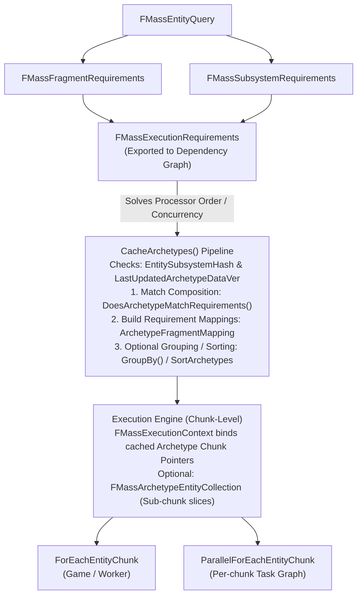
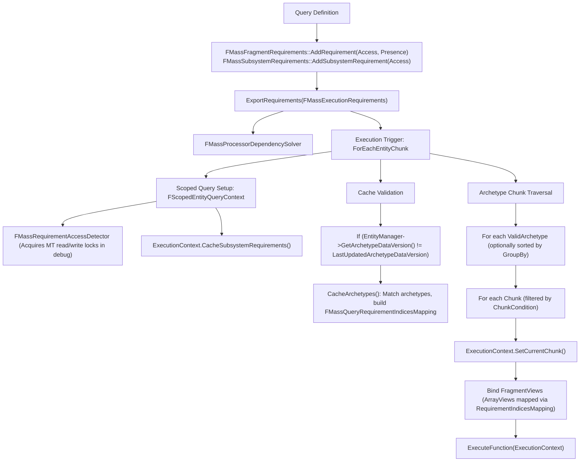

# Entity Queries and Requirements — UE 5.8 MASS

## Scope
This document covers the query and access declaration subsystems in Unreal Engine 5.8 MASS ECS: `FMassEntityQuery`, `FMassFragmentRequirements`, `FMassSubsystemRequirements`, `FMassExecutionRequirements`, `FMassEntityCreationRequirements`, `FMassRequirementAccessDetector`, transient views (`FMassEntityView`), archetype entity collections (`FMassArchetypeEntityCollection`, `UE::Mass::FEntityCollection`), cached chunk/fragment views inside `FMassExecutionContext`, execution pipelines (`ForEachEntityChunk`, `ParallelForEachEntityChunk`), accessor classification, optional element ergonomics, and subsystem thread safety traits.

## Architecture

Mass ECS queries decouple what data an operation needs from how entities are laid out in memory:



1. **Access Declaration**: Processors declare data access patterns via `FMassFragmentRequirements` and `FMassSubsystemRequirements`.
2. **Dependency Resolution**: Queries export bitsets into `FMassExecutionRequirements` consumed by `FMassProcessorDependencySolver` to sequence processors and prevent concurrent read/write data races.
3. **Archetype Matching & Caching**: When executed, queries match registered archetypes via `FMassElementBitSet` operations, building direct chunk offset tables (`FMassQueryRequirementIndicesMapping`).
4. **Execution Dispatch**: Archetypes are iterated chunk-by-chunk. Iteration binds fragment arrays directly into `FMassExecutionContext` before user closures execute.

## Key Types

| Symbol | Module | Responsibility |
| :--- | :--- | :--- |
| `FMassEntityQuery` | `MassEntity` | Cached archetype query driver; executes chunk/entity processing loops over matched archetypes. |
| `FMassFragmentRequirements` | `MassEntity` | Declaration base for fragments, tags, chunks, shared, indirect, and sparse element dependencies. |
| `FMassSubsystemRequirements` | `MassEntity` | Declaration base for world/engine/game-instance subsystem dependencies and GT-affinity checking. |
| `FMassExecutionRequirements` | `MassEntity` | Read/write bitset collection exported to `FMassProcessorDependencySolver` for DAG scheduling. |
| `FMassEntityCreationRequirements` | `MassEntity` | Declares archetypes that an execution block intends to spawn, treated as write access during scheduling. |
| `FMassRequirementAccessDetector` | `MassEntity` | Debug multithreaded access validator tracking simultaneous read/write locks per struct type. |
| `FMassEntityView` | `MassEntity` | Scoped wrapper providing instant fragment access for a single entity in a known or queried archetype. |
| `FMassArchetypeEntityCollection` | `MassEntity` | Compact slice descriptor grouping contiguous entity index ranges within a single archetype. |
| `UE::Mass::FEntityCollection` | `MassEntity` | Dynamic container of arbitrary entity handles that caches self-updating archetype sub-ranges. |
| `FMassExecutionContext` | `MassEntity` | Per-chunk execution environment containing bound fragment views, deferred commands, and delta time. |
| `TMassExternalSubsystemTraits<T>` | `MassCore` | Trait template dictating thread affinity (`GameThreadOnly`) and thread-safe writes for subsystems. |

## Data Flow



## Accessor Kinds and Access Modes

### Accessor Matrix
Mass queries support multiple memory topologies and access patterns:

| Accessor Kind | Target Storage | Access Modes Supported | Presence Modes Supported | Iteration Context Method |
| :--- | :--- | :--- | :--- | :--- |
| **Fragment** | Per-entity chunk array | `ReadOnly`, `ReadWrite` | `All`, `Any`, `None`, `Optional` | `Context.GetFragmentView<T>()`, `Context.GetMutableFragmentView<T>()` |
| **Chunk Fragment** | Per-chunk header | `ReadOnly`, `ReadWrite` | `All`, `None`, `Optional` | `Context.GetChunkFragment<T>()`, `Context.GetMutableChunkFragment<T>()` |
| **Const Shared** | Archetype shared pool | `ReadOnly` | `All`, `None`, `Optional` | `Context.GetConstSharedFragment<T>()` |
| **Shared Fragment** | Shared pool (thread mutable) | `ReadOnly`, `ReadWrite` | `All`, `None`, `Optional` | `Context.GetSharedFragment<T>()`, `Context.GetMutableSharedFragment<T>()` |
| **Tag** | Archetype bitmask (no payload)| `None` | `All`, `Any`, `None`, `Optional` | `Context.DoesArchetypeHaveTag<T>()` |
| **Sparse Element** | Sparse type pool | Implied `ReadWrite` in graph | `All`, `Any`, `None`, `Optional` | `Context.GetSparseElement<T>(It)`, `Context.GetMutableSparseElement<T>(It)` |
| **Linked Entity** | Linked entity chunk array | `ReadOnly`, `ReadWrite` | Bound via `FMassEntityLinkFragment` | `Context.GetLinkedEntityFragmentPtr<T>()`, `Context.GetLinkedEntityConstFragmentPtr<T>()` |
| **Indirect Fragment**| External entity fragment | `ReadOnly`, `ReadWrite` | Solver-only access declaration | `Context.GetIndirectFragmentPtr<T>(Entity)` |
| **Subsystem** | Engine / World UObject | `ReadOnly`, `ReadWrite` | Mandatory / Optional in query | `Context.GetSubsystem<T>()`, `Context.GetMutableSubsystem<T>()` |

### Presence Mode Semantics
* `EMassFragmentPresence::All`: Every archetype processed must possess this element.
* `EMassFragmentPresence::Any`: Matched archetypes must contain at least one element marked `Any` within the query.
* `EMassFragmentPresence::None`: Excludes any archetype containing this element (negative filtering).
* `EMassFragmentPresence::Optional`: Archetype matches whether the element is present or absent. When present, accessors yield a valid view; when absent, accessors return empty arrays or null pointers.

## Requirement Declaration & Filtering

### Archetype Matching Mechanics
Archetype matching does bitwise evaluation against `FMassElementBitSet`:
1. **Negative Filter**: If negative requirements exist, `ArchetypeCompositionBitSet.HasNone(...)` must return true across all excluded fragments, tags, chunk fragments, and shared fragments.
2. **Positive Filter**:
   - `HasAll(RequiredAllFragments)`
   - `HasAll(RequiredAllTags)`
   - `HasAll(RequiredAllChunkFragments | RequiredAllSharedFragments | RequiredAllConstSharedFragments)`
   - `RequiredAny.IsEmpty() || HasAny(RequiredAnyFragments | RequiredAnyTags)`
3. **Optional Fallback**: If no positive requirements are registered, the archetype must match at least one optional element (`DoesMatchAnyOptionals`). Purely empty queries fail validation unless tied to explicit `FMassArchetypeEntityCollection` inputs.
4. **Sparse Elements Exception**: Sparse elements are excluded from archetype composition bitsets (`DoesArchetypeMatchRequirements` ignores sparse types). Filtering for sparse requirements happens per-entity inside `FSparseEntityIterator` via `FMassExecutionContext::ExecuteSparseElementsFilter`.

### Subsystem Access Validation
Subsystem access is governed by bitmasks in `FMassSubsystemAccess`:
* `RequiredConstSubsystems` and `RequiredMutableSubsystems` validate access indices via `FMassExternalSubsystemBitSet::GetTypeIndex<T>()`.
* Undeclared runtime access triggers `ensureMsgf` in non-shipping builds: `"Undeclared read/write access to subsystem %s"`.
* Subsystems are checked at query launch by `ExecutionContext.CacheSubsystemRequirements(Query)`. If a required subsystem is unavailable, execution skips that query gracefully and logs to Visual Logger.

### Thread Affinity via `TMassExternalSubsystemTraits`
Processors and queries inherit thread restrictions from subsystem traits declared in `MassCore`:
```cpp
template<typename T>
struct TMassExternalSubsystemTraits final
{
    enum
    {
        // Defaults to true: forces GT execution if required by a query
        GameThreadOnly = true,
        // When false, RW operations enforce sequential processor execution in the solver
        ThreadSafeWrite = !GameThreadOnly,
    };
};
```
Specializing `TMassExternalSubsystemTraits<T>::GameThreadOnly = false` informs `FMassProcessorDependencySolver` and `FMassEntityQuery::DoesRequireGameThreadExecution()` that chunks accessing this subsystem may execute across worker threads.

## Chunk-Level vs Entity-Level Iteration Cost

### Chunk-Level Iteration (`ForEachEntityChunk`)
* **Cost Structure**: Amortized $O(1)$ per chunk for binding pointers and array views.
* **Vectorization & Cache Efficiency**: Fragments are contiguous arrays in chunk memory. Loops iterate over flat memory buffers (`TArrayView<T>`), allowing SIMD autovectorization and high hardware prefetch efficiency.
* **Overhead**: Minimum. Best for homogenous updates (physics, transforms, simulation loops).

```cpp
void UMyMovementProcessor::Execute(FMassEntityManager& EntityManager, FMassExecutionContext& Context)
{
    MovementQuery.ForEachEntityChunk(Context, [](FMassExecutionContext& Context)
    {
        const int32 NumEntities = Context.GetNumEntities();
        const TConstArrayView<FTransformFragment> Transforms = Context.GetFragmentView<FTransformFragment>();
        const TArrayView<FVelocityFragment> Velocities = Context.GetMutableFragmentView<FVelocityFragment>();

        for (int32 i = 0; i < NumEntities; ++i)
        {
            Velocities[i].Value += FVector(0.f, 0.f, -980.f) * Context.GetDeltaTimeSeconds();
        }
    });
}
```

### Entity-Level Iteration (`FEntityIterator` & `ForEachEntityInChunk`)
* **Cost Structure**: Minor branch overhead per entity; supports step debugging and breakpoint traps (`TestBreakpoints`).
* **Sparse Overhead**: When sparse elements are involved, using `FSparseEntityIterator` evaluates `ExecuteSparseElementsFilter` for each entity, introducing hash-table or sparse array lookups.
* **Overhead**: Moderately higher than raw pointer indexing, but necessary when dealing with irregular sparse elements or conditional per-entity operations.

### Parallel Execution (`ParallelForEachEntityChunk`)
* Uses `ParallelForWithTaskContext` or `ParallelFor` across all jobs generated from valid archetype chunks.
* Thread-safe command buffers: When `bAllowParallelCommands` is enabled (default), each parallel worker receives an isolated `FMassCommandBuffer`, merged back into `ExecutionContext.Defer()` upon job completion.
* Flag `EParallelExecutionFlags::AutoBalance` queues chunks dynamically instead of static equal partition, mitigating load imbalances across chunks of varying cost.

## View Caching and Invalidation

### Query Archetype Cache
* `FMassEntityQuery` tracks two cache invalidation variables:
  1. `EntitySubsystemHash`: Detects changes to the underlying `FMassEntityManager` pointer.
  2. `LastUpdatedArchetypeDataVersion`: Compares against `FMassEntityManager::GetArchetypeDataVersion()`.
* When a new archetype is registered in `FMassEntityManager`, the global data version increments.
* During `CacheArchetypes()`, queries inspect `LastUpdatedArchetypeDataVersion`. If stale, only newly created archetypes since the last recorded version are evaluated and appended (`NewValidArchetypes`), avoiding re-scanning the entire archetype registry.
* Requirement modifications (`AddRequirement`, `AddTagRequirement`) invoke `IncrementChangeCounter()`, forcing a complete invalidation of `ValidArchetypes` and rebuilding `FMassQueryRequirementIndicesMapping`.

### Transient Views (`FMassEntityView`)
* Represents a single entity within an archetype without allocating heap memory.
* Resolves directly against `FMassArchetypeData` chunk storage or through `FMassEntityManager`.
* **Lifetime**: Strictly transient stack object. Must **NEVER** be stored in heap structures or cached across frames because archetype migrations (adding/removing fragments) relocate entities between chunks, leaving the view dangling.

### Sub-Chunk Slices (`FMassArchetypeEntityCollection` & `FEntityCollection`)
* `FMassArchetypeEntityCollection` stores an archetype handle and an array of contiguous slices (`FArchetypeEntityRange { ChunkIndex, SubchunkStart, Length }`).
* Slices allow queries to run on filtered subsets of entities (such as octree queries or spatial hash results) without copying entity data.
* `UE::Mass::FEntityCollection` wraps arbitrary handles, tracks archetype modifications via `IsUpToDate()`, and reconstructs `FMassArchetypeEntityCollection` sub-ranges automatically when entity ordering changes.

## Usage Snippets

### Standard Processor Query Setup
```cpp
// Header definition
UCLASS()
class UCombatDamageProcessor : public UMassProcessor
{
    GENERATED_BODY()
public:
    UCombatDamageProcessor();
protected:
    virtual void ConfigureQueries(const TSharedRef<FMassEntityManager>& EntityManager) override;
    virtual void Execute(FMassEntityManager& EntityManager, FMassExecutionContext& Context) override;

private:
    FMassEntityQuery EntityQuery;
};

// Implementation
UCombatDamageProcessor::UCombatDamageProcessor()
    : EntityQuery(*this)
{
    bAutoRegisterWithProcessingPhases = true;
    ExecutionFlags = static_cast<int32>(EProcessorExecutionFlags::AllNetModes);
}

void UCombatDamageProcessor::ConfigureQueries(const TSharedRef<FMassEntityManager>& EntityManager)
{
    // EntityQuery is registered with *this in constructor
    // Fragment requirements
    EntityQuery.AddRequirement<FTransformFragment>(EMassFragmentAccess::ReadOnly, EMassFragmentPresence::All);
    EntityQuery.AddRequirement<FHealthFragment>(EMassFragmentAccess::ReadWrite, EMassFragmentPresence::All);
    EntityQuery.AddRequirement<FShieldFragment>(EMassFragmentAccess::ReadWrite, EMassFragmentPresence::Optional);

    // Tag requirements
    EntityQuery.AddTagRequirement<FDeadTag>(EMassFragmentPresence::None);
    EntityQuery.AddTagRequirement<FInCombatTag>(EMassFragmentPresence::All);

    // Chunk and Shared requirements
    EntityQuery.AddChunkRequirement<FCombatZoneChunkFragment>(EMassFragmentAccess::ReadOnly);
    EntityQuery.AddConstSharedRequirement<FCombatParametersSharedFragment>();

    // Subsystem requirement (Read-only)
    EntityQuery.AddSubsystemRequirement<UCombatSimulationSubsystem>(EMassFragmentAccess::ReadOnly);
}

void UCombatDamageProcessor::Execute(FMassEntityManager& EntityManager, FMassExecutionContext& Context)
{
    EntityQuery.ForEachEntityChunk(Context, [](FMassExecutionContext& Context)
    {
        const int32 NumEntities = Context.GetNumEntities();
        const TConstArrayView<FTransformFragment> Transforms = Context.GetFragmentView<FTransformFragment>();
        const TArrayView<FHealthFragment> HealthList = Context.GetMutableFragmentView<FHealthFragment>();
        
        // Optional fragment access
        TArrayView<FShieldFragment> ShieldList;
        const bool bHasShields = Context.DoesArchetypeHaveFragment<FShieldFragment>();
        if (bHasShields)
        {
            ShieldList = Context.GetMutableFragmentView<FShieldFragment>();
        }

        const FCombatZoneChunkFragment& Zone = Context.GetChunkFragment<FCombatZoneChunkFragment>();
        const FCombatParametersSharedFragment& Params = Context.GetConstSharedFragment<FCombatParametersSharedFragment>();
        const UCombatSimulationSubsystem& CombatSubsystem = Context.GetSubsystemChecked<UCombatSimulationSubsystem>();

        for (int32 i = 0; i < NumEntities; ++i)
        {
            float Damage = Zone.BaseDamagePerSecond * Context.GetDeltaTimeSeconds();
            if (bHasShields && ShieldList[i].ShieldValue > 0.f)
            {
                ShieldList[i].ShieldValue = FMath::Max(0.f, ShieldList[i].ShieldValue - Damage);
            }
            else
            {
                HealthList[i].Value -= Damage;
            }
        }
    });
}
```

### Dynamic Sub-Collection Query Execution
```cpp
void ProcessTargetEntities(const TSharedRef<FMassEntityManager>& EntityManager, TConstArrayView<FMassEntityHandle> Targets)
{
    FMassEntityQuery Query(EntityManager);
    Query.AddRequirement<FHealthFragment>(EMassFragmentAccess::ReadWrite);

    // Build entity collection from scattered handles
    UE::Mass::FEntityCollection Collection(Targets);
    TConstArrayView<FMassArchetypeEntityCollection> SubCollections = Collection.GetUpToDatePerArchetypeCollections(*EntityManager);

    FMassExecutionContext Context(*EntityManager);
    Query.ForEachEntityChunkInCollections(SubCollections, Context, [](FMassExecutionContext& Context)
    {
        TArrayView<FHealthFragment> Health = Context.GetMutableFragmentView<FHealthFragment>();
        for (FMassExecutionContext::FEntityIterator It = Context.CreateEntityIterator(); It; ++It)
        {
            Health[*It].Value += 10.0f;
        }
    });
}
```

## Pitfalls

1. **Query Modification After Execution**: Calling `AddRequirement` after queries have already run or been registered causes internal change counters to increment, triggering complete cache evictions (`CacheArchetypes` rebuilds). All requirements must be finalized during `ConfigureQueries`.
2. **Accessing Optional Fragments Unchecked**: Calling `Context.GetFragmentView<T>()` on an optional fragment that the current chunk archetype lacks will fail `MASS_CHECK_IF_VALID` assertions. Always verify presence using `Context.DoesArchetypeHaveFragment<T>()` before fetching optional views.
3. **Persisting `FMassEntityView`**: Storing `FMassEntityView` instances across stack boundaries causes dangling pointer crashes when command buffers flush and entities migrate across archetypes.
4. **Subsystem Thread Safety Assumptions**: Requesting read/write access to a subsystem without defining `TMassExternalSubsystemTraits<T>::GameThreadOnly = false` silently forces whole-processor execution onto the Game Thread.
5. **Parallel Command Buffer Safety**: Calling `Context.Defer()` inside `ParallelForEachEntityChunk` requires `bAllowParallelCommands = true` (default). If manually disabled via `SetParallelCommandBufferEnabled(false)` for optimization, any deferred command execution within worker threads will crash.
6. **Sparse Elements in Archetype Matching**: Adding sparse element requirements does not filter archetypes in `CacheArchetypes()`. Sparse requirements must be iterated using `Context.CreateSparseEntityIterator()`; using raw indices will process entities that lack the sparse element.

## Source Files

### Engine/Source/Runtime/MassEntity/
* `Public/MassEntityQuery.h` — Definition of `FMassEntityQuery`, match overrides, parallel execution flags.
* `Private/MassEntityQuery.cpp` — Query compilation, archetype caching, parallel chunk job partitioning.
* `Public/MassRequirements.h` — `FMassFragmentRequirements`, `FMassSubsystemRequirements`, `FMassEntityCreationRequirements`.
* `Private/MassRequirements.cpp` — Bitset matching logic (`DoesArchetypeMatchRequirements`), requirement export.
* `Public/MassEntityView.h` — Transient per-entity accessor view.
* `Public/MassEntityCollection.h` — `UE::Mass::FEntityCollection` dynamic handle-to-archetype manager.
* `Public/MassArchetypeTypes.h` — `FMassArchetypeEntityCollection`, subchunk ranges (`FArchetypeEntityRange`).
* `Public/MassExecutionContext.h` — Execution environment, array view bindings, iterators.
* `Private/MassExecutionContext.cpp` — Chunk binding mechanics and subsystem requirement caching.
* `Public/MassRequirementAccessDetector.h` — Debug multithreaded conflict detection.
* `Public/MassSubsystemAccess.h` — Runtime subsystem bitset validation and fetchers.
* `Public/MassSubsystemBase.h` — Base class for Mass world subsystems.

### Engine/Source/Runtime/Mass/MassCore/
* `Public/Mass/ExternalSubsystemTraits.h` — `TMassExternalSubsystemTraits`, `TMassSharedFragmentTraits`, `TMassFragmentTraits`.

## Graph Facts
* Corroborating graph data: `FMassEntityQuery` has an edge degree of 201 within the MASS corpus, acting as the second most interconnected symbol after `FMassEntityManager` (degree 539).
* `FMassExecutionContext` represents the central runtime boundary with an edge degree of 476, binding `FMassArchetypeData` (degree 596) directly into query closures.
* Access detection bridges Mass to core engine debugging via Slate UI rendering and visual loggers (`LogMass`), while subsystem requirements enforce boundaries across Core Engine Types (1,227 cross-community bridges).
