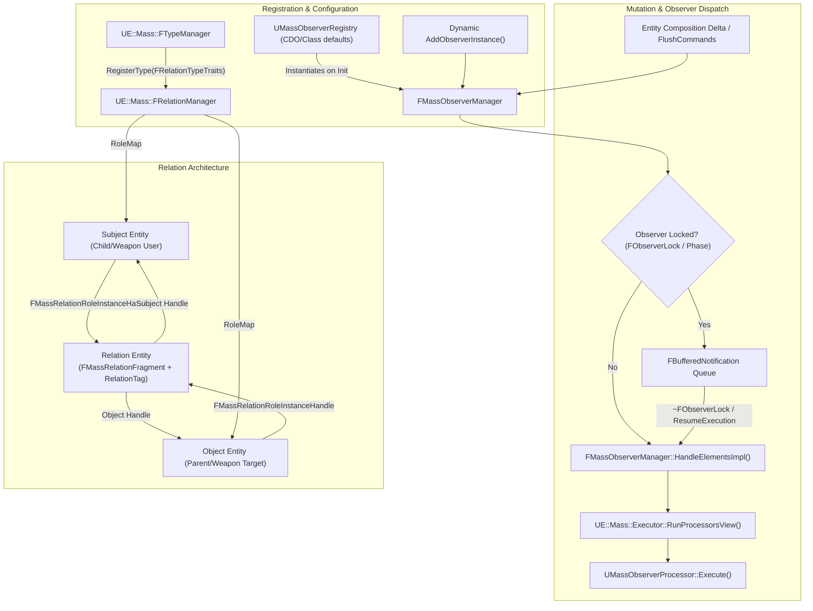

# Observers and Relations — UE 5.8 MASS

## Scope
This document covers reactive composition lifecycle notifications and entity-to-entity relationship modeling in UE 5.8 MASS. Specifically:
- **Observers**: `FMassObserverManager`, `UMassObserverRegistry`, `UMassObserverProcessor`, `FMassObserverNotificationTypes`, observer locking/buffering, and multi-type observation.
- **Relations**: `MassEntityRelations.h`, `UE::Mass::FRelationManager`, `MassRelationCommands.h`, `MassRelationObservers.h`, `Relations/MassChildOf.h`, role semantics (`ERelationRole::Subject` vs `ERelationRole::Object`), `FRelationTypeTraits`, and `FMassRelationRoleInstanceHandle`.

## Architecture

MASS observers decouple reaction logic from mutation sites: rather than manually dispatching events when fragments or tags are added or removed, mutating operations evaluate `ObservedElements` bitsets and dispatch execution through `FMassObserverManager`.

Relations represent binary directed links between entities (`Subject` $\to$ `Object`). Each relation instance is backed by a distinct **Relation Entity** containing an `FMassRelationFragment` and the relation tag, with secondary cross-referencing maintained in `FRelationData::RoleMap` using bit-packed `FMassRelationRoleInstanceHandle` identifiers.



## Key types

| Symbol | Module / Header | Responsibility |
| :--- | :--- | :--- |
| `FMassObserverManager` | `MassEntity` / `Public/MassObserverManager.h` | Per-`FMassEntityManager` manager tracking pipelines per observed struct and operation. Dispatches synchronous and buffered notifications. |
| `UMassObserverRegistry` | `MassEntity` / `Public/MassObserverRegistry.h` | Global CDO registry mapping struct types and operation flags to `UMassProcessor` classes. |
| `UMassObserverProcessor` | `MassEntity` / `Public/MassObserverProcessor.h` | Abstract base processor for observation. Configures `ObservedTypes` and `ObservedOperations`, deduplicated per entity batch during dispatch. |
| `FMassObserverExecutionContext` | `MassEntity` / `Public/MassObserverProcessor.h` | Context payload placed into `ProcessingContext.AuxData` during observer execution, exposing current operation and struct types. |
| `FObserverLock` | `MassEntity` / `Public/MassObserverNotificationTypes.h` | Scoped synchronization lock that suppresses immediate observer dispatch and buffers `FBufferedNotification` payloads until release. |
| `FCreationContext` | `MassEntity` / `Public/MassObserverNotificationTypes.h` | Dedicated token ensuring `CreateEntity` observers fire only after all construction and composition mutations settle. |
| `FRelationTypeTraits` | `MassEntity` / `Public/MassEntityRelations.h` | Defines relation properties: `RelationTagType`, `RelationFragmentType`, hierarchy flag, and role traits (`FRoleTraits`) for Subject and Object. |
| `FRoleTraits` | `MassEntity` / `Public/MassEntityRelations.h` | Per-role configuration: participant fragment element, exclusivity (`bExclusive`), external lookup requirement, and `ERemovalPolicy`. |
| `ERelationRole` | `MassEntity` / `Public/MassEntityRelations.h` | Role specifier: `ERelationRole::Subject` (index 0) or `ERelationRole::Object` (index 1). |
| `ERemovalPolicy` | `MassEntity` / `Public/MassEntityRelations.h` | Lifecycle cascade policy when a participant is destroyed: `CleanUp`, `Destroy`, `Splice`, `Custom`. |
| `FMassRelationFragment` | `MassEntity` / `Public/MassEntityRelations.h` | Base fragment stored on the relation entity holding `Subject` and `Object` entity handles. |
| `FMassRelationRoleInstanceHandle` | `MassEntity` / `Public/MassEntityRelations.h` | 64-bit aligned compact identifier packing 30-bit Role Entity index, 30-bit Relation Entity index, and 2-bit Role enum. |
| `FRelationManager` | `MassEntity` / `Public/MassRelationManager.h` | Subsystem on `FMassEntityManager` managing `FRelationData`, `RoleMap`, topology traversal, and instance lifecycle. |
| `FMassCommandMakeRelation<T>` | `MassEntity` / `Public/MassRelationCommands.h` | Deferred batched command to instantiate relation pairs via command buffers. |
| `UMassRelationObserver` | `MassEntity` / `Public/MassRelationObservers.h` | Base observer querying relation instances; auto-injects relation tags and fragments into requirements. |
| `UMassRelationRoleDestruction` | `MassEntity` / `Public/MassRelationObservers.h` | Built-in destruction observer executing removal cascades (`Destroy`, `CleanUp`, `Splice`) when participant entities die. |
| `FMassChildOfRelation` | `MassEntity` / `Public/Relations/MassChildOf.h` | Engine built-in relation tag representing hierarchical parent-child ownership (`Subject=Child`, `Object=Parent`). |

## Data flow

### 1. Observer Registration and Dispatch Flow
1. **Registration**: During engine startup, `UMassObserverProcessor::PostInitProperties()` registers classes into `UMassObserverRegistry`. When an `FMassEntityManager` initializes, its `FMassObserverManager` instantiates processors into `FMassObserversMap ElementObservers[EMassObservedOperation::MAX]`.
2. **Operations Supported (`EMassObservedOperation`)**:
   - `AddElement` (value 0): Fragment or tag added to existing entity.
   - `RemoveElement` (value 1): Fragment or tag removed from existing entity.
   - `DestroyEntity` (value 2): Entity is being destroyed (treated as full element removal).
   - `CreateEntity` (value 3): Entity created with archetype (treated as initial element addition).
3. **Execution Delivery**:
   - When composition changes occur, `FMassObserverManager::OnCompositionChanged` checks if `ObservedElements[Operation].HasAny(CompositionDelta)`.
   - If `LocksCount > 0` (e.g. during a parallel processing phase or command flush), notifications are appended to `ActiveObserverLock->BufferedNotifications`.
   - During immediate dispatch, `HandleElementsImpl` sets up `FMassObserverExecutionContext` into `ProcessingContext.AuxData`.
   - Multi-type processors observing several matching elements are deduplicated using a `SeenProcessors` inline buffer so `Execute()` triggers **exactly once per batch**.

### 2. Relation Lifecycle and Topology Flow
1. **Creation**:
   - `FRelationManager::CreateRelationInstances(TypeHandle, Subjects, Objects)` allocates a relation entity via `FEntityBuilder`.
   - Adds the relation tag struct (`FRelationTypeTraits::RelationTagType`) and relation fragment (`RelationFragmentType`, default `FMassRelationFragment`).
   - Populates `RelationFragment.Subject = Subject` and `RelationFragment.Object = Object`.
   - Calls `Relations::Private::AddRoleInstance()` to populate `RoleMap[Subject][Object]` and `RoleMap[Object][Subject]`.
   - If a role is marked `bExclusive = true` (e.g. `Object` in `ChildOf`), any preexisting relation entity on that role is queued for destruction.
2. **Cascaded Destruction**:
   - When a participant entity is destroyed, `UMassRelationRoleDestruction` catches the `DestroyEntity` operation.
   - Under `ERemovalPolicy::Destroy` (default for Parent in `ChildOf`), destroying the Parent queues destruction of both the Relation Entity and the Subject (Child).
   - Under `ERemovalPolicy::CleanUp`, destroying the Subject cleans up the `RoleMap` entries and destroys the Relation Entity without destroying the Parent.
   - Under `ERemovalPolicy::Splice`, destroying an intermediate entity reparents its Subjects to its Object before destroying the relation entities.

## Ordering guarantees and Semantics

1. **Pre-Remove vs Post-Remove**:
   - When unlocked, `RemoveElement` and `DestroyEntity` fire **synchronously before removal** (`OnPreCompositionRemoved` / `OnPreEntityDestroyed`). Processors can inspect the fragments before they disappear.
   - **Warning under lock**: If mutations happen during an active `FObserverLock`, notifications are buffered. Removal observers fire *post-factum* on lock release, where the removed fragment data is **no longer accessible**.
2. **Creation Ordering**:
   - `CreateEntity` observers execute after the entity has fully settled into its initial archetype.
   - `UMassRelationEntityCreation` runs at execution priority `RelationCreationObserverExecutionPriority = 1024`.
3. **Pipeline Priority**:
   - Within each observed struct's `FMassRuntimePipeline`, processors are sorted via `FMassRuntimePipeline::SortByExecutionPriority()`.
4. **Thread Safety**:
   - `FObserverLock` tracks `OwnerThreadId`. Appending to buffered notifications takes an internal `NotificationLock` (`FTransactionallySafeCriticalSection`).

## Usage

### 1. Implementing an Observer Processor

Observers inherit from `UMassObserverProcessor`. Configure `ObservedTypes` and `ObservedOperations` in the constructor. Access execution auxiliary data via `Context.GetAuxData<FMassObserverExecutionContext>()`.

```cpp
#include "MassObserverProcessor.h"
#include "MassExecutionContext.h"
#include "MassEntityQuery.h"
#include "MyFragments.h"

UCLASS()
class UMyCombatStateObserver : public UMassObserverProcessor
{
    GENERATED_BODY()

public:
    UMyCombatStateObserver()
    {
        // Observe multiple fragments simultaneously
        ObservedTypes = { FMyCombatStatsFragment::StaticStruct(), FMyStunTag::StaticStruct() };
        ObservedOperations = EMassObservedOperationFlags::Add;
        ExecutionPriority = 500;
    }

protected:
    virtual void ConfigureQueries(const TSharedRef<FMassEntityManager>& EntityManager) override
    {
        EntityQuery.AddRequirement<FMyCombatStatsFragment>(EMassFragmentAccess::ReadWrite);
        EntityQuery.AddTagRequirement<FMyStunTag>(EMassFragmentPresence::Optional);
    }

    virtual void Execute(FMassEntityManager& EntityManager, FMassExecutionContext& Context) override
    {
        // Inspect observer metadata passed by FMassObserverManager
        const FMassObserverExecutionContext& ObsContext = Context.GetAuxData<FMassObserverExecutionContext>();
        const UScriptStruct* TriggeringType = ObsContext.GetCurrentType();

        EntityQuery.ForEachEntityChunk(Context, [TriggeringType](FMassExecutionContext& ChunkContext)
        {
            auto StatsList = ChunkContext.GetMutableFragmentView<FMyCombatStatsFragment>();
            for (FMassExecutionContext::FEntityIterator It = ChunkContext.CreateEntityIterator(); It; ++It)
            {
                StatsList[*It].InitializeCombatTimers();
            }
        });
    }

private:
    FMassEntityQuery EntityQuery{*this};
};
```

### 2. Custom Relation Declaration, Registration, and Instantiation

Relations derive from `FMassRelation`. Custom types register traits with `FTypeManager`.

```cpp
#include "MassEntityRelations.h"
#include "MassRelationManager.h"
#include "MassRelationCommands.h"
#include "MassTypeManager.h"

// 1. Declare relation tag struct
USTRUCT()
struct FMassTargetLockRelation : public FMassRelation
{
    GENERATED_BODY()
};

// 2. Registration function (e.g. during module startup or built-in registration)
UE::Mass::FTypeHandle RegisterTargetLockRelation(FMassEntityManager& EntityManager)
{
    using namespace UE::Mass;
    using namespace UE::Mass::Relations;

    FRelationTypeTraits Traits(FMassTargetLockRelation::StaticStruct());
    Traits.RelationName = TEXT("TargetLock");

    // Subject (Attacker): can lock at most one target at a time
    Traits.RoleTraits[static_cast<int32>(ERelationRole::Subject)].bExclusive = true;
    Traits.RoleTraits[static_cast<int32>(ERelationRole::Subject)].DestructionPolicy = ERemovalPolicy::CleanUp;

    // Object (Target): multiple attackers can target the same entity
    Traits.RoleTraits[static_cast<int32>(ERelationRole::Object)].bExclusive = false;
    Traits.RoleTraits[static_cast<int32>(ERelationRole::Object)].DestructionPolicy = ERemovalPolicy::CleanUp;

    return EntityManager.GetTypeManager().RegisterType(MoveTemp(Traits));
}

// 3. Creating relation instances (Immediate & Deferred)
void LinkEntities(FMassEntityManager& EntityManager, FMassEntityHandle Attacker, FMassEntityHandle Target)
{
    UE::Mass::FRelationManager& RelManager = EntityManager.GetRelationManager();

    // Immediate creation
    FMassEntityHandle RelEntity = RelManager.CreateRelationInstance<FMassTargetLockRelation>(Attacker, Target);

    // Fast zero-allocation participant lookup
    RelManager.ForEachRelationObject(
        RelManager.GetRelationTypeHandle(FMassTargetLockRelation::StaticStruct()),
        Attacker,
        [](FMassEntityHandle FoundTarget)
        {
            // Process found target
        });

    // Deferred creation inside processor execution
    // Context.Defer().PushCommand<FMassCommandMakeRelation<FMassTargetLockRelation>>(Attacker, Target);
}
```

## Pitfalls

1. **Buffered Removal Observer Invalidation**:
   When mutations occur while observers are locked (`LocksCount > 0`, such as inside a processing phase), `RemoveElement` notifications are deferred. When `ResumeExecution` runs upon lock destruction, the entities no longer possess the removed fragments. Calling `ExecutionContext.GetFragmentView` for the removed type inside a deferred observer will fail or read unassociated memory.
2. **Duplicate Multi-Type Dispatch Misconception**:
   In older versions of Mass, observing $N$ types resulted in $N$ separate executions when an archetype containing all $N$ was instantiated. In UE 5.8, `FMassObserverManager::HandleElementsImpl` deduplicates processors using `SeenProcessors`. `Execute()` runs **once** for the entire batch.
3. **Relation Exclusivity Overwrite**:
   If `FRoleTraits::bExclusive` is `true` for a role (e.g. `Object` in `ChildOf`), establishing a new relation with that same role will automatically queue destruction of the previous relation entity.
4. **Hierarchical Self-Relation**:
   If `FRelationTypeTraits::bHierarchical` is `true`, passing `Subject == Object` to `CreateRelationInstances` asserts and fails validation.
5. **Blueprint Limitation**:
   Neither `FMassRelationManager` nor `FMassObserverManager` provide Blueprint script APIs. Relations and observers are pure C++ ECS constructs; fragment structs and relation tags use `USTRUCT()` strictly for Unreal reflection and serialization.

## Source files

### Primary Implementation
- `Engine/Source/Runtime/MassEntity/Public/MassObserverManager.h`
- `Engine/Source/Runtime/MassEntity/Private/MassObserverManager.cpp`
- `Engine/Source/Runtime/MassEntity/Public/MassObserverRegistry.h`
- `Engine/Source/Runtime/MassEntity/Private/MassObserverRegistry.cpp`
- `Engine/Source/Runtime/MassEntity/Public/MassObserverProcessor.h`
- `Engine/Source/Runtime/MassEntity/Private/MassObserverProcessor.cpp`
- `Engine/Source/Runtime/MassEntity/Public/MassObserverNotificationTypes.h`
- `Engine/Source/Runtime/MassEntity/Private/MassObserverNotificationTypes.cpp`
- `Engine/Source/Runtime/MassEntity/Public/MassEntityRelations.h`
- `Engine/Source/Runtime/MassEntity/Private/MassEntityRelations.cpp`
- `Engine/Source/Runtime/MassEntity/Public/MassRelationManager.h`
- `Engine/Source/Runtime/MassEntity/Private/MassRelationManager.cpp`
- `Engine/Source/Runtime/MassEntity/Public/MassRelationCommands.h`
- `Engine/Source/Runtime/MassEntity/Public/MassRelationObservers.h`
- `Engine/Source/Runtime/MassEntity/Private/MassRelationObservers.cpp`
- `Engine/Source/Runtime/MassEntity/Public/Relations/MassChildOf.h`
- `Engine/Source/Runtime/MassEntity/Private/Relations/MassChildOf.cpp`

### Tests and Verification
- `Engine/Source/Developer/MassEntityTestSuite/Private/MassObserverTest.cpp`
- `Engine/Source/Developer/MassEntityTestSuite/Private/MassRelationTest.cpp`
- `Engine/Source/Developer/MassEntityTestSuite/Private/MassChildOfRelationTest.cpp`
- `Engine/Source/Developer/MassEntityTestSuite/Private/Coverage/MassObserverProcessorTest.cpp`
- `Engine/Source/Developer/MassEntityTestSuite/Private/Coverage/MassRelationCoverageTest.cpp`

## Graph facts

- `RelationTypeHandle` has **82 edges**, making relations one of the foundational cross-subsystem type handles in the core ECS topology.
- `FMassEntityManager` is the primary hub node (degree 848) connecting `FMassObserverManager` and `UE::Mass::FRelationManager`.
- Observer dispatch paths connect directly to `FMassExecutionContext` (degree 476) and `FMassQueryExecutor` (degree 414) during runtime batch execution.
