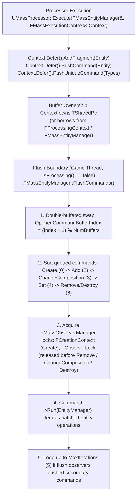
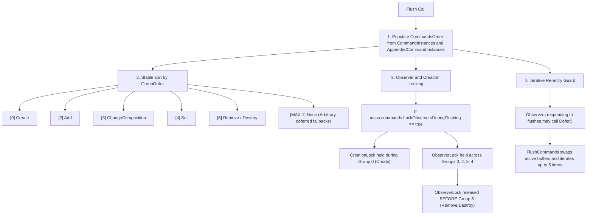

# Commands and Defers — UE 5.8 MASS

## Scope

This document details structural entity mutations in UE 5.8 MASS, covering `FMassCommandBuffer`, the command catalog in `MassCommands.h`, the deferred execution APIs in `FMassExecutionContext`, execution context types (`EMassExecutionContextType`), archetype grouping via `UE::Mass::FArchetypeGroups` and `MassArchetypeGroupCommands.h`, relation establishment via `MassRelationCommands.h`, bulk operations, buffer ownership, and thread-safety flush semantics.

## Architecture

Mass processes entities across contiguous archetype chunks in parallel or serial query execution loops. Structural changes—such as spawning entities, destroying entities, adding or removing fragments, and mutating archetype memberships—invalidate chunk arrays, alter archetype memory layouts, and invalidate cached iteration pointers. Therefore, all structural mutations occurring during processing phases are recorded into an `FMassCommandBuffer` rather than being executed immediately.



### Buffer Ownership and Thread Concurrency

- **Thread-Affinity**: `FMassCommandBuffer` records the thread on which it was created (`OwnerThreadId`). Pushing commands checks `OwnerThreadId == FPlatformTLS::GetCurrentThreadId()`. A single command buffer instance is **not thread-safe for concurrent writes** without external locking; each worker thread in parallel dispatch receives its own execution context and command buffer.
- **MoveAppend Aggregation**: Worker command buffers are aggregated into the primary command buffer via `FMassCommandBuffer::MoveAppend` before flushing. `MoveAppend` protects appends with `AppendingCommandsCS` (`FTransactionallySafeCriticalSection`) and `PendingBatchCommandsDetector` (`UE_MT_DECLARE_TS_RW_ACCESS_DETECTOR`).
- **Game Thread Flush**: Flush operations are strictly game-thread exclusive (`check(IsInGameThread())`) and must occur outside active processing scopes (`check(IsProcessing() == false)`).

## Key types

| Symbol | Module | Responsibility |
| :--- | :--- | :--- |
| `FMassCommandBuffer` | `MassEntity` | Accumulates batched and unique structural commands; executes ordered replay on `FMassEntityManager`. |
| `FMassBatchedCommand` | `MassEntity` | Abstract base class for type-indexed command buckets executing via `Run(FMassEntityManager&)`. |
| `FMassBatchedEntityCommand` | `MassEntity` | Base class for batched operations tracking a target array of `FMassEntityHandle`. |
| `EMassCommandOperationType` | `MassEntity` | Execution ordering discriminator: `Create`, `Add`, `Remove`, `ChangeComposition`, `Set`, `Destroy`, `None`. |
| `EMassExecutionContextType` | `MassEntity` | Context execution role validator: `Local` (query run outside processor) vs `Processor` (managed execution). |
| `FMassExecutionContext` | `MassEntity` | Per-query execution state exposing `Defer()` and managing chunk fragment view bindings. |
| `UE::Mass::FProcessingContext` | `MassEntity` | High-level execution harness passed to processors; owns the `TSharedPtr<FMassCommandBuffer>` and manages automatic flush flags. |
| `UE::Mass::FArchetypeGroups` | `MassCore` | Composition-level sparse container managing entity assignment to `FArchetypeGroupHandle` groupings. |
| `UE::Mass::Command::FGroupEntities` | `MassEntity` | Batched command applying archetype group assignments (`BatchGroupEntities`) at flush time. |
| `FMassCommandMakeRelation<TRelation>` | `MassEntity` | Batched command establishing parent-child ECS relations via `BatchCreateRelations<TRelation>`. |

## Command Catalog

`MassCommands.h` organizes structural commands into typed batches. Commands registered via `PushCommand<T>()` reuse a single static-indexed instance per command buffer, grouping thousands of entity alterations into bulk array operations.

| Command Symbol | Op Group | Batching Strategy | Description |
| :--- | :--- | :--- | :--- |
| `FMassCommandDestroyEntities` | `Destroy` (6) | Cross-chunk | Bulk entity destruction via `EntityManager.BatchDestroyEntities`. |
| `FMassCommandAddElements<T...>` | `Add` (2) | Cross-chunk | Compile-time addition of fragments, tags, and sparse elements. |
| `FMassCommandAddElementList` | `Add` (2) | Per-instance | Dynamic runtime-typed addition of `UScriptStruct` element lists. |
| `FMassCommandAddElement` | `Add` (2) | Per-instance | Dynamic single-type addition of a runtime `UScriptStruct`. |
| `FMassCommandRemoveElements<T...>` | `Remove` (6) | Cross-chunk | Compile-time removal of fragments, tags, shared fragments, or sparse elements. |
| `FMassCommandRemoveElementList` | `Remove` (6) | Per-instance | Dynamic runtime-typed removal of `UScriptStruct` element lists. |
| `FMassCommandSwapTags<TOld, TNew>` | `ChangeComposition` (3) | Cross-chunk | Atomically removes `TOld` tag and adds `TNew` tag across chunk entities. |
| `FMassCommandAddFragmentInstances<T...>` | `Add` (2) | Cross-chunk | Adds fragments with entity-specific initial values payload. |
| `FMassCommandAddElementsWithSharedFragments<T...>` | `Add` (2) | Per-hash group | Adds fragments/tags plus shared fragment values partitioned by shared hash. |
| `FMassCommandAddFragmentInstancesWithSharedFragments` | `Add` (2) | Per-hash group | Adds initial fragment values and shared fragments partitioned by shared hash. |
| `FMassCommandBuildEntity<T...>` | `Create` (0) | Cross-chunk | Instantiates new entities initialized with fragment and tag payloads. |
| `FMassCommandBuildEntityWithSharedFragments` | `Create` (0) | Per-hash group | Instantiates entities with shared fragment configurations. |
| `UE::Mass::Command::FGroupEntities` | `ChangeComposition` (3) | Per-handle group | Partitions entities into archetype group collections (`BatchGroupEntities`). |
| `FMassCommandMakeRelation<TRelation>` | `Add` (2) | Bulk array | Creates ECS relations linking target entities to parent entities. |
| `FMassDeferredCommand<OpType>` | User-defined | FIFO callable | Lambda execution (`TFunction<void(FMassEntityManager&)>`) deferred to designated op phase. |

## Data Flow & Flush Ordering

When `FMassCommandBuffer::Flush(FMassEntityManager&)` runs, commands are not replayed in insertion order; they are grouped and sorted to ensure state validity across archetypes and observer triggers.



### Execution Flush Timing Points

Flush execution occurs at well-defined lifecycle gates:
1. **End of Processing Phase**: `FMassProcessingPhaseManager::OnPhaseEnd` flushes all pending commands when the phase processor completes.
2. **Task Graph Synchronization**: When parallel tasks run via `FMassExecutorDispatchTask`, completion triggers `FMassExecutorDoneTask::DoTask` on the designated game thread, where worker buffers are appended via `MoveAppend` and flushed via `ExecutionContext.FlushDeferred()`.
3. **Execution Context Scope Termination**: When an isolated `FMassExecutionContext` is destroyed, if `bFlushDeferredCommands == true`, it immediately invokes `EntityManager->FlushCommands(DeferredCommandBuffer)`.
4. **World Teardown**: `UMassEntitySubsystem::Deinitialize` explicitly invokes `EntityManager->FlushCommands()` to drain entity destruction prior to sub-system cleanup.

## Context Types: Local vs Processor

`EMassExecutionContextType` acts as a contract between entity queries and the runtime dispatch system:

```cpp
enum class EMassExecutionContextType : uint8
{
    Local,      // Context used for standalone, ad-hoc queries (e.g., in unit tests or gameplay helpers)
    Processor   // Context configured and managed by a UMassProcessor inside a pipeline
};
```

- When a query is registered to a processor via `FMassEntityQuery::RegisterWithProcessor(Owner)`, its `ExpectedContextType` is set to `EMassExecutionContextType::Processor`.
- At query execution time in debug builds, `MassEntityQuery.cpp` enforces:
  ```cpp
  checkf(ExecutionContext.GetExecutionType() == ExpectedContextType 
      && (ExpectedContextType == EMassExecutionContextType::Local || bRegistered),
      TEXT("ExecutionContextType mismatch, make sure all the queries run as part of processor execution are registered with some processor"));
  ```
- `UE::Mass::FProcessingContext::GetExecutionContext()` automatically configures `ExecutionContext.SetExecutionType(EMassExecutionContextType::Processor)`. Standalone queries using transient stack contexts remain `EMassExecutionContextType::Local`.

## Archetype Groups & Relations

### Archetype Groups
In UE 5.8, archetype group types moved from `MassEntity` to `MassCore` (`Mass/ArchetypeGroup.h`). Archetype groups partition entities within identical fragment compositions into disjoint archetype subsets (for example, grouping by streaming level, spatial cell, or team hierarchy):
- An entity belongs to an `FArchetypeGroups` set consisting of sparse `FArchetypeGroupID` entries keyed by `FArchetypeGroupType`.
- Within processors, grouping changes are queued via `FMassCommandBuffer::PushCommand<UE::Mass::Command::FGroupEntities>`:
  ```cpp
  Context.Defer().PushCommand<UE::Mass::Command::FGroupEntities>(GroupHandle, MoveTemp(EntityArray));
  ```
- When flushed, this invokes `FMassEntityManager::BatchGroupEntities`, moving entities into the targeted group's sub-archetype.

### Entity Relations
Relations link pairs of entities (parent-child, targets, owner) using relation fragment types:
- Queued through `FMassCommandMakeRelation<TRelation>`:
  ```cpp
  Context.Defer().PushCommand<FMassCommandMakeRelation<FMyParentRelation>>(ChildEntity, ParentEntity);
  ```
- Batched at flush time via `FMassEntityManager::BatchCreateRelations<TRelation>(TargetEntities, Parents)`.

## Usage Snippets

### 1. Adding/Removing Fragments & Changing Tags in a Processor

```cpp
#include "MassProcessor.h"
#include "MassExecutionContext.h"
#include "MassCommands.h"

void UMyStatusProcessor::Execute(FMassEntityManager& EntityManager, FMassExecutionContext& Context)
{
    EntityQuery.ForEachEntityChunk(Context, [](FMassExecutionContext& Context)
    {
        const int32 NumEntities = Context.GetNumEntities();
        TConstArrayView<FMassEntityHandle> Entities = Context.GetEntities();
        TConstArrayView<FDamageFragment> Damages = Context.GetFragmentView<FDamageFragment>();

        FMassCommandBuffer& CommandBuffer = Context.Defer();

        for (int32 i = 0; i < NumEntities; ++i)
        {
            if (Damages[i].CurrentHealth <= 0.0f)
            {
                // Atomically swap tag: removes FAliveTag, adds FDeadTag
                CommandBuffer.SwapTags<FAliveTag, FDeadTag>(Entities[i]);

                // Remove temporary damage processing fragment
                CommandBuffer.RemoveFragment<FDamageFragment>(Entities[i]);

                // Add ragdoll state fragment with compile-time type safety
                CommandBuffer.AddFragment<FRagdollStateFragment>(Entities[i]);
            }
        }
    });
}
```

### 2. Spawning and Initializing Entities with Values

```cpp
void UMySpawnerProcessor::Execute(FMassEntityManager& EntityManager, FMassExecutionContext& Context)
{
    // Reserve entity handle first; FMassCommandBuildEntity populates the reserved handle with initial values
    const FMassEntityHandle NewEntity = EntityManager.ReserveEntity();

    // Build entities deferred with initial fragment values
    FTransformFragment InitialTransform;
    InitialTransform.SetTransform(FTransform(FVector(100.f, 0.f, 50.f)));

    FMassVelocityFragment InitialVelocity;
    InitialVelocity.Value = FVector(500.f, 0.f, 0.f);

    // Creates entity in archetype containing FTransformFragment, FMassVelocityFragment, and FNpcTag
    Context.Defer().PushCommand<FMassCommandBuildEntity>(
        NewEntity,
        InitialTransform,
        InitialVelocity,
        FNpcTag()
    );
}
```

### 3. Bulk Runtime Type Alterations & Destroying Entities

```cpp
void UMyCleanupProcessor::Execute(FMassEntityManager& EntityManager, FMassExecutionContext& Context)
{
    TArray<FMassEntityHandle> EntitiesToDestroy;
    TArray<const UScriptStruct*> DynamicTypesToRemove = { FStatusEffectFragment::StaticStruct(), FBuffTag::StaticStruct() };

    EntityQuery.ForEachEntityChunk(Context, [&](FMassExecutionContext& Context)
    {
        TConstArrayView<FMassEntityHandle> Entities = Context.GetEntities();
        for (FMassEntityHandle Entity : Entities)
        {
            EntitiesToDestroy.Add(Entity);
        }
    });

    FMassCommandBuffer& CommandBuffer = Context.Defer();

    // Runtime-typed element removal across multiple entities
    CommandBuffer.RemoveElements(EntitiesToDestroy, DynamicTypesToRemove);

    // Bulk destroy queued entities
    CommandBuffer.DestroyEntities(MoveTemp(EntitiesToDestroy));
}
```

### 4. Custom Deferred Logic via Lambda

```cpp
void UMyCustomProcessor::Execute(FMassEntityManager& EntityManager, FMassExecutionContext& Context)
{
    FMassEntityHandle TargetEntity = /* ... */;

    // Enqueue arbitrary logic into the Set (4) operation phase
    Context.Defer().PushCommand<FMassDeferredSetCommand>([TargetEntity](FMassEntityManager& Manager)
    {
        if (Manager.IsEntityValid(TargetEntity))
        {
            FInventoryFragment* Inventory = Manager.GetFragmentDataPtr<FInventoryFragment>(TargetEntity);
            if (Inventory)
            {
                Inventory->Coins += 50;
            }
        }
    });
}
```

## Pitfalls

1. **Pushing Commands Across Threads**: `FMassCommandBuffer` asserts `OwnerThreadId == FPlatformTLS::GetCurrentThreadId()`. Never share a single `FMassCommandBuffer` instance across multiple concurrent worker threads. Worker tasks in `ParallelFor` must each maintain their own buffer and merge via `MoveAppend` onto the main thread buffer before flush.
2. **Immediate Fragment Pointer Invalidation**: Code pushed to `Context.Defer()` does **not** take effect immediately. Calling `Context.Defer().AddFragment<T>(Entity)` followed by `Context.GetFragmentView<T>()` in the same processor execution loop will fail; the fragment does not exist in the archetype until after the phase flush.
3. **Flushing Inside Active Processing Loops**: Calling `EntityManager.FlushCommands()` while `EntityManager.IsProcessing() == true` triggers an assertion failure. Mutations must be deferred until the processing phase terminates.
4. **Observer Access to Removed Data**: `bLockObserversDuringFlushing` controls whether observers are locked during flushes. Observers listening for fragment removal must fire before fragment memory is freed. UE 5.8 releases observer locks prior to executing `Remove`, `ChangeComposition`, and `Destroy` operations so removal-observers can inspect entity data prior to archetype transition.
5. **Secondary Command Cascades**: If observers reacting to flush operations push more commands via `Defer()`, `FMassEntityManager::FlushCommands()` loops up to `MaxIterations = 5`. Exceeding 5 iterations logs an error (`LogMass, Error`) and stops flushing to prevent infinite loops.
6. **5.8 Header Relocation for Archetype Groups**: `MassArchetypeGroup.h` in `MassEntity` is a `UE_DEPRECATED_HEADER(5.8)` forwarding shim. Native group types (`FArchetypeGroups`, `FArchetypeGroupHandle`) reside in `MassCore/Public/Mass/ArchetypeGroup.h` under the `UE::Mass` namespace. Commands remain in `MassEntity/Public/MassArchetypeGroupCommands.h`.

## Source files

- `Engine/Source/Runtime/MassEntity/Public/MassCommandBuffer.h`
- `Engine/Source/Runtime/MassEntity/Private/MassCommandBuffer.cpp`
- `Engine/Source/Runtime/MassEntity/Public/MassCommands.h`
- `Engine/Source/Runtime/MassEntity/Public/MassExecutionContext.h`
- `Engine/Source/Runtime/MassEntity/Private/MassExecutionContext.cpp`
- `Engine/Source/Runtime/MassEntity/Public/MassProcessingContext.h`
- `Engine/Source/Runtime/MassEntity/Private/MassProcessingContext.cpp`
- `Engine/Source/Runtime/MassEntity/Public/MassArchetypeGroupCommands.h`
- `Engine/Source/Runtime/MassEntity/Public/MassRelationCommands.h`
- `Engine/Source/Runtime/MassEntity/Private/MassEntityManager.cpp` (Flush orchestration)
- `Engine/Source/Runtime/MassEntity/Private/MassExecutor.cpp` (Parallel task flush dispatch)
- `Engine/Source/Runtime/Mass/MassCore/Public/Mass/ArchetypeGroup.h` (UE 5.8 MassCore grouping definitions)

## Graph facts

- `MassCommands.h` ranks among the top MASS headers with **425 cross-community edges** and **116 nodes**, serving as the central command definition bridge for both `MassGameplay` and `MassAI`.
- `FMassExecutionContext` is one of the highest-degree symbols (**117 edges**) in the MASS graph, binding queries, command buffers, and chunk views.
- Structural mutations converge through `FMassEntityManager`, the primary god node of the entire module (**848 edges** in header, **662 edges** in `.cpp`, **539 symbol degree**).
- Command buffering decouples gameplay clusters in `MassGameplay` (4,485 nodes) and `MassAI` (2,205 nodes) from direct write-locks on core ECS archetype storage.
