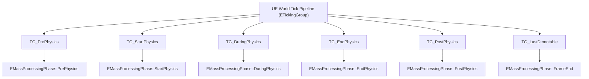
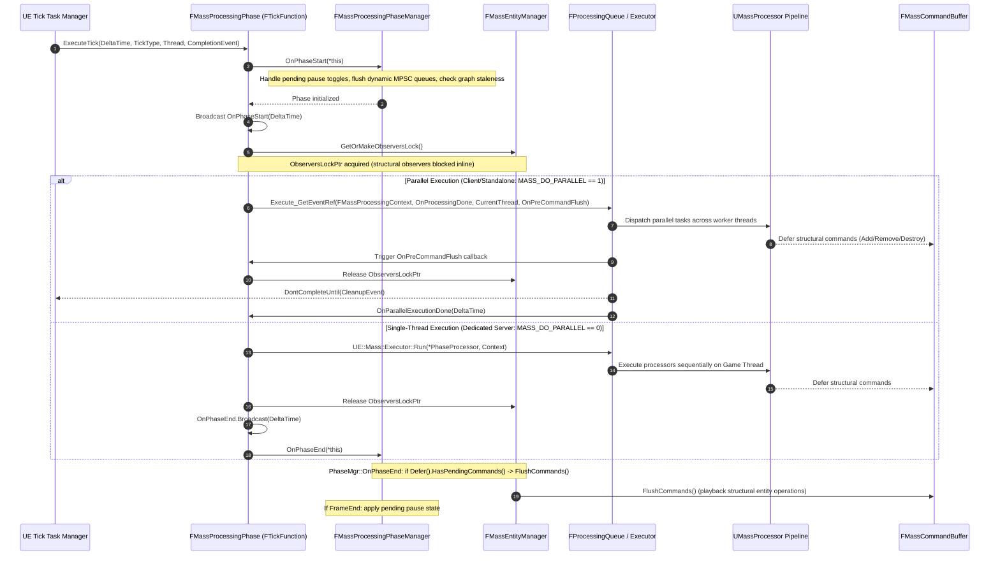

# Simulation and Phases — UE 5.8 MASS

## Scope
Frame lifecycle execution in Mass: `FMassProcessingPhaseManager`, phase definitions (`EMassProcessingPhase`), configuration (`FMassProcessingPhaseConfig`), Unreal Engine tick group orchestration, `UMassSimulationSubsystem` world subsystem lifecycle, thread safety and execution context (`FMassProcessingContext`), subsystem dependency resolution (`FMassSubsystemAccess`, `TMassExternalSubsystemTraits`), and dedicated-server single-thread vs client/standalone multi-threaded execution models.

## Architecture

Mass simulation organizes processor execution into discrete, ordered phases mapped directly into Unreal Engine's level tick pipeline. Instead of running a single monolithic tick, execution is partitioned across distinct engine tick groups, allowing Mass systems to interleave with physics simulation, character movement, animation evaluation, and render state preparation.



### Phase Manager and Phase Tick Functions
- **`FMassProcessingPhaseManager`**: Non-UObject, shared-referenced orchestrator (`FGCObject`, `TSharedFromThis<FMassProcessingPhaseManager>`). Owns an array of 6 `FMassProcessingPhase` instances and their corresponding dependency build states (`FPhaseGraphBuildState`).
- **`FMassProcessingPhase`**: Inherits from `FTickFunction`. Each phase instance is registered with `UWorld::PersistentLevel` under its assigned `ETickingGroup`. When ticked by Unreal's tick task manager, it initiates its phase's processor pipeline.
- **Phase to Tick Group Mapping**:
  - `PrePhysics` $\rightarrow$ `TG_PrePhysics` (Optionally prioritized via `UE::Mass::Tweakables::bMakePrePhysicsTickFunctionHighPriority`)
  - `StartPhysics` $\rightarrow$ `TG_StartPhysics`
  - `DuringPhysics` $\rightarrow$ `TG_DuringPhysics`
  - `EndPhysics` $\rightarrow$ `TG_EndPhysics`
  - `PostPhysics` $\rightarrow$ `TG_PostPhysics`
  - `FrameEnd` $\rightarrow$ `TG_LastDemotable`
- **Phase Execution Pipeline**:
  Each `FMassProcessingPhase` hosts an outer `UMassCompositeProcessor` (named `ProcessingPhase_<PhaseName>`) and a `UE::Mass::FProcessingQueue`. Processors are sorted into dependency DAGs via `FMassProcessorDependencySolver`.

### Execution Modes and Threading (`MASS_DO_PARALLEL`)
- **Macro Definition**: `MASS_DO_PARALLEL` is `#define MASS_DO_PARALLEL !UE_SERVER` in `MassProcessingTypes.h`.
- **Client & Standalone**: Multi-threaded execution is enabled (`bFullyParallel = true`). Work is dispatched to TaskGraph or Background Workers via `UE::Mass::FProcessingQueue` or `UE::Mass::Executor::TriggerParallelTasks`. Processor completion graph events block tick completion via `MyCompletionGraphEvent->DontCompleteUntil(CleanupEvent)`.
- **Dedicated Server (`UE_SERVER`)**: `MASS_DO_PARALLEL` is `0`. Processors run strictly synchronously on the Game Thread via `UE::Mass::Executor::Run(*PhaseProcessor, Context)`. Dependency solver forces `bSingleThreadTarget = true`.
- **Observer Locking**: During parallel or single-threaded phase execution, `EntityManager.GetOrMakeObserversLock()` is held (`ObserversLockPtr`). Observers cannot trigger inline structural mutations; mutations are deferred to command buffers until lock release.

### Subsystem Access and Thread Affinity
- **`FMassSubsystemAccess`**: Embedded inside `FMassExecutionContext`. Resolves, caches, and validates access to `USubsystem` instances (`UWorldSubsystem`, `UEngineSubsystem`, `UGameInstanceSubsystem`, `ULocalPlayerSubsystem`).
- **Access Safety Verification**: Checked against `FMassExternalSubsystemBitSet` (`ConstSubsystemsBitSet` and `MutableSubsystemsBitSet`) declared by processors in their `FMassSubsystemRequirements`. Undeclared access asserts at runtime.
- **`TMassExternalSubsystemTraits<T>`**: Declares thread safety properties for external subsystems:
  - `GameThreadOnly` (Default: `true`): Subsystem cannot be safely called off the Game Thread. Processors requiring mutable or const access will be scheduled on the Game Thread unless specialized.
  - `ThreadSafeWrite` (Default: `!GameThreadOnly`): If `true`, Mass treats writes as concurrent-safe, allowing read/write operations across worker threads without serializing the processor.

### World Subsystems and Lifecycle
- **`UMassSubsystemBase`**: Abstract base class for Mass world subsystems (`UWorldSubsystem`). Controls subsystem instantiation through `AreRuntimeMassSubsystemsAllowed(Outer)` (gated by console variable `mass.RuntimeSubsystemsEnabled`).
- **`UMassEntitySubsystem`**: Hosts the default world `FMassEntityManager` instance. Created before dependent subsystems via `Collection.InitializeDependency<UMassEntitySubsystem>()`.
- **`UMassSimulationSubsystem`**: Orchestrates world-level simulation start/stop, pipeline rebuilds, dynamic processor registration, and pause/resume logic. Holds the primary `TSharedRef<FMassProcessingPhaseManager>`.

## Key types

| Symbol | Module | Responsibility |
| :--- | :--- | :--- |
| `FMassProcessingPhaseManager` | `MassEntity` | Owns all 6 `FMassProcessingPhase` tick functions, graph build states, dynamic processor MPSC queues, and start/stop/pause state machine. |
| `FMassProcessingPhase` | `MassEntity` | `FTickFunction` representing a single execution phase tied to a specific engine `ETickingGroup`. Dispatches phase processors via processing queues or executors. |
| `FMassProcessingPhaseConfig` | `MassEntity` | Configuration struct storing phase name, composite processor class, and processor CDOs from settings. |
| `EMassProcessingPhase` | `MassEntity` | Enum defining the 6 lifecycle phases: `PrePhysics`, `StartPhysics`, `DuringPhysics`, `EndPhysics`, `PostPhysics`, `FrameEnd`. |
| `FMassProcessingContext` | `MassEntity` | `UE::Mass::FProcessingContext`. Context passed to phase runners holding `FMassEntityManager`, `DeltaSeconds`, `AuxData`, and deferred command buffers. |
| `UMassSimulationSubsystem` | `MassSimulation` | World subsystem managing simulation lifecycle (`OnWorldBeginPlay`, `StartSimulation`, `StopSimulation`, pause, dynamic processor routing). |
| `UMassEntitySubsystem` | `MassEntity` | World subsystem creating and owning the world's default `FMassEntityManager`. |
| `UMassSubsystemBase` | `MassEntity` | Base class for Mass `UWorldSubsystem` types; enforces `mass.RuntimeSubsystemsEnabled` and tracks late-creation lifecycle flags. |
| `FMassSubsystemAccess` | `MassEntity` | Provides checked, bitset-validated fetching and caching of engine/world subsystems during query and processor execution. |
| `TMassExternalSubsystemTraits<T>` | `MassCore` | Traits struct defining `GameThreadOnly` and `ThreadSafeWrite` characteristics for subsystems used in Mass queries. |
| `UMassSettings` | `MassEntity` | Developer settings hub registering modular settings sections. |
| `UMassEntitySettings` | `MassEntity` | Configures `ChunkMemorySize` (default 128 KiB), phase configurations, processor CDO lists, and dependency graph dump paths. |
| `UMassSimulationSettings` | `MassSimulation` | Configures budgets for actor spawning time slices, compaction slices, and retry intervals. |
| `UMassGameplaySettings` | `MassCommon` | Settings container for visual logging and common gameplay flags. |
| `EProcessorExecutionFlags` | `MassEntity` | Bitflag enum (`Standalone`, `Server`, `Client`, `Editor`, `EditorWorld`) dictating processor filtering based on net mode and world context. |

## Data flow

### Per-Frame Phase Tick and Execution Sequence



### Processor Inclusion and Filtering
Processors join phases through reflection discovery, settings configuration, and execution flags:
1. **Settings Assembly**: `UMassEntitySettings::BuildProcessorListAndPhases()` discovers all `UMassProcessor` CDOs.
2. **Phase Assignment**: `UMassProcessor::GetProcessingPhase()` specifies the target `EMassProcessingPhase`.
3. **Execution Flag Evaluation**:
   - `UE::Mass::Utils::DetermineProcessorExecutionFlags(World)` inspects `ENetMode`:
     - `NM_DedicatedServer` $\rightarrow$ `EProcessorExecutionFlags::Server`
     - `NM_Client` $\rightarrow$ `EProcessorExecutionFlags::Client`
     - `NM_ListenServer` $\rightarrow$ `EProcessorExecutionFlags::Server | EProcessorExecutionFlags::Client`
     - `NM_Standalone` $\rightarrow$ `EProcessorExecutionFlags::Standalone`
   - Processors whose `ExecutionFlags` do not overlap the active world flags are pruned by `FMassProcessorDependencySolver`.
4. **Dynamic Registration**: Runtime processors register via `UMassSimulationSubsystem::RegisterDynamicProcessor(Processor)`, which enqueues an operation into `TMpscQueue<FDynamicProcessorOperation> PendingDynamicProcessors[Phase]`. Operations are dequeued at the start of the next phase tick (`HandlePendingDynamicProcessorOperations`).

### Pause and Resume State Machine
Pause and resume requests are designed not to tear down or corrupt in-flight phase cycles:
- `Pause()`: Sets `bIsPauseTogglePending = true`. Pausing takes effect strictly at the conclusion of `EMassProcessingPhase::FrameEnd` in `OnPhaseEnd()`.
- `Resume()`: Sets `bIsPauseTogglePending = true`. Resuming takes effect strictly at the start of `EMassProcessingPhase::PrePhysics` in `OnPhaseStart()`.
- During paused ticks, tick functions execute to broadcast start/end events, but processor pipeline execution is bypassed (`PhaseManager->IsPaused() == true`).

## Usage

### 1. Declaring External Subsystem Traits for Mass Access
Subsystems accessed by Mass processors off the Game Thread must declare traits in accessible headers:

```cpp
#include "Mass/ExternalSubsystemTraits.h"
#include "Subsystems/WorldSubsystem.h"
#include "MySpatialAudioSubsystem.generated.h"

UCLASS()
class UMySpatialAudioSubsystem : public UWorldSubsystem
{
    GENERATED_BODY()
public:
    void PostAudioEventConcurrent(const FVector& Location, int32 SoundID) const;
};

// Trait specialization: inform Mass the subsystem allows concurrent read operations off the Game Thread
template<>
struct TMassExternalSubsystemTraits<UMySpatialAudioSubsystem> final
{
    enum
    {
        GameThreadOnly = false,
        ThreadSafeWrite = false
    };
};
```

### 2. Creating a Custom Phase-Bound Processor
```cpp
#include "MassProcessor.h"
#include "MassProcessingTypes.h"
#include "MassExecutionContext.h"
#include "MySpatialAudioSubsystem.h"
#include "MyAudioEmitterFragment.h"
#include "MyAudioProcessor.generated.h"

UCLASS()
class UMyAudioProcessor : public UMassProcessor
{
    GENERATED_BODY()

public:
    UMyAudioProcessor()
        : EntityQuery(*this)
    {
        // Bind to PostPhysics so transform updates are completed
        ProcessingPhase = EMassProcessingPhase::PostPhysics;
        ExecutionOrder.ExecuteAfter.Add(UE::Mass::ProcessorGroupNames::Movement);
        ExecutionFlags = static_cast<uint8>(EProcessorExecutionFlags::AllNetModes);
        bRequiresGameThreadExecution = false;
    }

protected:
    virtual void ConfigureQueries(const TSharedRef<FMassEntityManager>& EntityManager) override
    {
        EntityQuery.AddRequirement<FMyAudioEmitterFragment>(EMassFragmentAccess::ReadOnly);
        EntityQuery.AddRequirement<FTransformFragment>(EMassFragmentAccess::ReadOnly);
        EntityQuery.AddSubsystemRequirement<UMySpatialAudioSubsystem>(EMassFragmentAccess::ReadOnly);
    }

    virtual void Execute(FMassEntityManager& EntityManager, FMassExecutionContext& Context) override
    {
        const UMySpatialAudioSubsystem& AudioSubsystem = Context.GetSubsystemChecked<UMySpatialAudioSubsystem>();

        EntityQuery.ForEachEntityChunk(Context, [&AudioSubsystem](FMassExecutionContext& ChunkContext)
        {
            const auto Emitters = ChunkContext.GetFragmentView<FMyAudioEmitterFragment>();
            const auto Transforms = ChunkContext.GetFragmentView<FTransformFragment>();

            for (int32 i = 0; i < ChunkContext.GetNumEntities(); ++i)
            {
                if (Emitters[i].bActive)
                {
                    AudioSubsystem.PostAudioEventConcurrent(Transforms[i].GetTransform().GetLocation(), Emitters[i].SoundID);
                }
            }
        });
    }

private:
    FMassEntityQuery EntityQuery;
};
```

### 3. Dynamic Processor Registration and Simulation Control
```cpp
#include "Kismet/GameplayStatics.h"
#include "MassSimulationSubsystem.h"
#include "MyDynamicDebugProcessor.h"

void AMyGameModeBase::InitGame(const FString& MapName, const FString& Options, FString& ErrorMessage)
{
    Super::InitGame(MapName, Options, ErrorMessage);

    if (UMassSimulationSubsystem* SimSubsystem = UWorld::GetSubsystem<UMassSimulationSubsystem>(GetWorld()))
    {
        // Listen to simulation phase hooks
        SimSubsystem->GetOnProcessingPhaseStarted(EMassProcessingPhase::PrePhysics).AddUObject(
            this, &AMyGameModeBase::OnMassPrePhysicsStarted);

        // Instantiate and dynamically attach runtime processor
        UMyDynamicDebugProcessor* DynamicProc = NewObject<UMyDynamicDebugProcessor>(this);
        SimSubsystem->RegisterDynamicProcessor(*DynamicProc);
    }
}
```

## Pitfalls

1. **Undeclared Subsystem Access**: Fetching a subsystem via `Context.GetSubsystem<T>()` or `Context.GetMutableSubsystem<T>()` without declaring `EntityQuery.AddSubsystemRequirement<T>()` triggers an ensure failure in `FMassSubsystemAccess`.
2. **Accessing GameThread-Only Subsystems on Worker Threads**: If `TMassExternalSubsystemTraits<T>::GameThreadOnly` is `true` (the default) and a processor is allowed to run on worker threads (`bRequiresGameThreadExecution = false`), querying that subsystem concurrently causes thread-safety crashes.
3. **Flushing Command Buffers Mid-Phase**: Modifying entities during execution must go through deferred commands (`Context.Defer()`). Direct calls to `EntityManager.FlushCommands()` while `bIsDuringMassProcessing` or `ObserversLockPtr` is held fail assertion checks (`ensure(!IsProcessing())`).
4. **Expecting PIE Simulation in Uninitialized Worlds**: `UMassSimulationSubsystem::OnWorldBeginPlay` triggers `StartSimulation`. In editor preview worlds or before `BeginPlay` executes, simulation remains stopped unless explicitly kicked off. Late-created subsystems must invoke `HandleLateCreation()`.
5. **Dedicated Server Race Expectations**: Code assuming multi-threaded query execution will run single-threaded on dedicated servers due to `MASS_DO_PARALLEL !UE_SERVER`. Logic relying on thread-pool concurrency or specific task graphs will execute sequentially on the Game Thread.
6. **Dynamic Processor Phase Mismatch**: Passing a dynamic processor whose `ProcessingPhase` is set to `EMassProcessingPhase::MAX` will trigger an assertion in `FMassProcessingPhaseManager::RegisterDynamicProcessor`.
7. **Immediate Pause Assumption**: Calling `UMassSimulationSubsystem::PauseSimulation()` does not immediately freeze the current phase; the cycle finishes up to `EMassProcessingPhase::FrameEnd` before pausing takes effect.

## Source files

- `Engine/Source/Runtime/MassEntity/Public/MassProcessingPhaseManager.h` — Definition of `FMassProcessingPhaseManager`, `FMassProcessingPhase`, and `FMassProcessingPhaseConfig`.
- `Engine/Source/Runtime/MassEntity/Private/MassProcessingPhaseManager.cpp` — Implementation of phase tick functions, tick group assignment, and pause state machine.
- `Engine/Source/Runtime/MassEntity/Public/MassProcessingTypes.h` — `EMassProcessingPhase`, `EProcessorExecutionFlags`, and `MASS_DO_PARALLEL` macro definitions.
- `Engine/Source/Runtime/MassEntity/Public/MassProcessingContext.h` — `UE::Mass::FProcessingContext` wrapping execution contexts and deferred command buffers.
- `Engine/Source/Runtime/MassEntity/Public/MassSubsystemBase.h` — `UMassSubsystemBase` and `UMassTickableSubsystemBase` definitions.
- `Engine/Source/Runtime/MassEntity/Public/MassSubsystemAccess.h` — `FMassSubsystemAccess` caching and bitset validation implementation.
- `Engine/Source/Runtime/Mass/MassCore/Public/Mass/ExternalSubsystemTraits.h` — `TMassExternalSubsystemTraits` definitions (forwarded by deprecated shim `MassEntity/Public/MassExternalSubsystemTraits.h`).
- `Engine/Source/Runtime/MassEntity/Public/MassEntitySubsystem.h` — `UMassEntitySubsystem` hosting `FMassEntityManager`.
- `Engine/Source/Runtime/MassEntity/Public/MassEntitySettings.h` — Project settings for phase configurations and processor discovery.
- `Engine/Source/Runtime/MassEntity/Private/MassEntityUtils.cpp` — `DetermineProcessorExecutionFlags` and net mode resolution.
- `Engine/Plugins/Runtime/MassGameplay/Source/MassSimulation/Public/MassSimulationSubsystem.h` — `UMassSimulationSubsystem` world lifecycle coordinator.
- `Engine/Plugins/Runtime/MassGameplay/Source/MassSimulation/Private/MassSimulationSubsystem.cpp` — World BeginPlay integration and simulation start/stop handling.
- `Engine/Plugins/Runtime/MassGameplay/Source/MassSimulation/Public/MassSimulationSettings.h` — Spawning and entity compaction time-slice budgets.
- `Engine/Plugins/Runtime/MassGameplay/Source/MassCommon/Public/MassGameplaySettings.h` — Common gameplay debug flags.

## Graph facts

- Corpus Size: 12,818 nodes, 15,979 internal edges across 536 communities.
- `FMassProcessingQueueTypes.h` holds 142 graph nodes and 479 edges, serving as the high-throughput bridge connecting phase execution queues to parallel worker tasks.
- `FMassExecutionContext` is one of the highest-degree symbols in MASS (degree 117, 476 file edges), encapsulating subsystem access, chunk iteration, and deferred command buffer dispatch for all phase processors.
- `FMassEntityManager` is the primary hub node (degree 539, 848 file edges), mediating phase transitions, observer lock lifecycle, and end-of-phase command flushes.
- Mass gameplay forms a federation of per-module clusters (`MassSimulation`, `MassActors`, `MassSpawner`, `MassLOD`, `MassRepresentation`) that declare explicit initialization dependencies on `UMassSimulationSubsystem` and bind delegate hooks into `EMassProcessingPhase::PrePhysics` and `EMassProcessingPhase::PostPhysics`.
