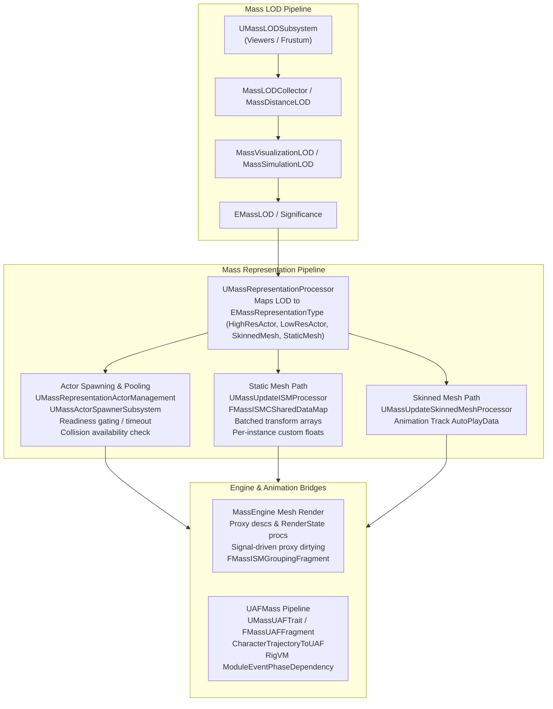
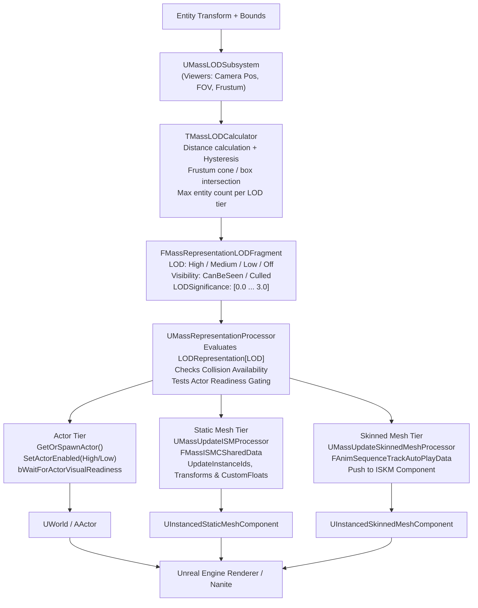

# Representation, LOD, and Animation — UE 5.8 MASS

## Scope
Mass representation, Level of Detail (LOD), mesh render states, and Universal Animation Framework (UAF / AnimNext) integration:
- **`MassRepresentation`**: Visualization traits, static & skinned mesh instancing, actor lifecycle management, readiness gating, distance LOD calculation, stationary ISM switching, transform & animation update processors.
- **`MassLOD`**: Viewer registration, frustum & distance collection, simulation & visualization LOD calculators, count-based distance adaptation, hysteresis buffers, and chunk-based variable tick rate controllers.
- **`MassEngine` (Mesh / Render-State)**: Native scene proxy descriptors, render state lifecycles (`FMassRenderPrimitiveFragment`, `FMassRenderStaticMeshFragment`, `FMassRenderISMFragment`), observer/signal render state updates, and ISM grouping scoping (`FMassISMGroupingFragment`).
- **`UAFMass`**: Trait (`UMassUAFTrait`), execution processors (`UMassUAFInitializer`, `UMassUAFProcessor`, `UMassAnimPoseDebugProcessor`, `UMassUAFDestructor`), subsystem ownership (`UMassUAFSubsystem`), trajectory synchronization (`UCharacterTrajectoryToUAFProcessor`), RigVM phase dependency (`FRigVMTrait_ModuleEventDependency_MassPhaseProcessor`), and component bridging (`FMassUAFComponentWrapperFragment`).

---

## Architecture

The representation system bridges lightweight data-oriented ECS entities to Unreal Engine's rendering pipeline (ISMC/Nanite, Instanced Skinned Meshes, and full `AActor` hierarchies) through hierarchical LOD evaluation and batched buffer updates.



### Representation Tiers and Transition Lifecycle
Entities transition across four representation tiers defined in `EMassRepresentationType`:
1. **`HighResSpawnedActor`**: Spawns or enables a complete `AActor` hierarchy with full gameplay components, physics, and tick enabled (`EMassActorEnabledType::HighRes`).
2. **`LowResSpawnedActor`**: Spawns or enables a simplified actor with disabled or throttled sub-components (`EMassActorEnabledType::LowRes`).
3. **`SkinnedMeshInstance`**: Binds entity to `UInstancedSkinnedMeshComponent` (ISKM). Skeletal poses driven via vertex animation / AnimNext transform providers (`UTransformProviderData`) and playback tracks (`FAnimSequenceTrackAutoPlayData`).
4. **`StaticMeshInstance`**: Binds entity to `UInstancedStaticMeshComponent` (ISMC) or Nanite-enabled instancing.
5. **`None`**: Culled entity outside max distance or fully off-screen; completely removed from render passes.

### Visual Readiness Gating & Seamless Hysteresis
To prevent visual pops when switching from an instanced mesh to a spawned actor:
- `FMassRepresentationParameters::bWaitForActorVisualReadiness`: While `UMassRepresentationActorManagement::IsActorReadyForRepresentation()` returns false (e.g., soft meshes or textures still streaming), `bIsWaitingForActorVisualReadiness` stays true. The static/skinned mesh instance remains rendered to cover the visual gap.
- Gating is protected against runaway overrides by `ActorVisualReadinessWaitFrames` (capped at 255; bounded by cvar `ai.massrepresentation.MaxActorVisualReadinessWaitFrames`).
- `bKeepActorExtraFrame`: When transitioning actor $\rightarrow$ ISM, keeps the actor alive an extra frame to cover occlusion query latency.

---

## Key types

| Symbol | Module | Responsibility |
| :--- | :--- | :--- |
| `UMassRepresentationSubsystem` | `MassRepresentation` | Central registry for visualization descriptions (`FStaticMeshInstanceVisualizationDescHandle`, `FSkinnedMeshInstanceVisualizationDescHandle`), actor templates, and ISM shared data maps. |
| `UMassRepresentationProcessor` | `MassRepresentation` | Abstract base processor evaluating desired representation from LOD and triggering actor spawning/pooling or mesh allocation. |
| `UMassRepresentationActorManagement` | `MassRepresentation` | Policy UObject controlling actor spawning priority, readiness gating (`IsActorReadyForRepresentation`), enabling/disabling, and transform teleportation. |
| `UMassUpdateISMProcessor` | `MassRepresentation` | Gathers entity transforms and batches them into `FMassISMCSharedData` for instanced rendering. |
| `UMassUpdateInstancedSkinnedMeshProcessor` | `MassRepresentation` | Batches entity transforms into `FMassInstancedSkinnedMeshComponentSharedData` for skinned mesh instancing. |
| `UMassConsumeInstancedSkinnedMeshAnimationProcessor` | `MassRepresentation` | Consumes `FMassRepresentationAnimationFragment` auto-play track data and forwards parameters into ISKM component buffers. |
| `UMassStationaryISMSwitcherProcessor` | `MassRepresentation` | Handles stationary entities (`FMassStaticRepresentationTag`), adding/removing instances only when switching representation tiers. |
| `UMassLODSubsystem` | `MassLOD` | Tracks active viewers (`FViewerInfo`, `FMassViewerHandle`, player controllers, editor viewports) and viewport frustums. |
| `TMassLODCalculator<TLODLogic>` | `MassLOD` | Evaluates distance, frustum culling, and count caps to output `EMassLOD::Type` and floating-point `LODSignificance` (0.0 to 3.0+). |
| `TMassLODTickRateController` | `MassLOD` | Manages variable chunk tick rates (`FMassVariableTickChunkFragment`), staggering execution intervals based on simulation LOD. |
| `FMassISMCSharedDataMap` | `MassRepresentation` | Robin Hood / sparse map tracking `FMassISMCSharedData` with bit-array dirty tracking (`FDirtyIterator`) for bulk render proxy synchronization. |
| `FMassRenderISMFragment` | `MassEngine` | Engine-level fragment holding sparse per-instance transform data (`PerInstanceSMData`), custom floats, and scene proxy descriptions. |
| `FMassISMGroupingFragment` | `MassEngine` | Const shared fragment providing a GUID to partition ISM batches by spatial cell or streaming level. |
| `UMassUAFTrait` | `UAFMass` | Entity trait building `FMassUAFFragment` with `TInstancedStruct<FUAFSystemFactoryAsset>`. |
| `UMassUAFProcessor` | `UAFMass` | Dispatches `FRigUnit_AnimNextPrePhysicsEvent` ticks on `UE::UAF::FSystemReference` across entity chunks. |
| `UCharacterTrajectoryToUAFProcessor` | `UAFMass` | Pushes Mass character trajectory prediction samples into `UUAFComponent` animation variables. |
| `FRigVMTrait_ModuleEventDependency_MassPhaseProcessor` | `UAFMass` | RigVM trait enforcing execution prerequisites between AnimNext module tick functions and Mass processing phases (`EMassProcessingPhase`). |

---

## Data flow



### 1. Viewer & Distance Evaluation
1. `UMassLODSubsystem` tracks all active camera sources (`FViewerInfo`).
2. `UMassVisualizationLODProcessor` or `UMassDistanceLODProcessor` executes `TMassLODCalculator::CalculateLOD()`.
3. Distance is evaluated against `BaseLODDistance` (when off-frustum) or `VisibleLODDistance` (when in-frustum).
4. **Hysteresis**: `BufferHysteresisOnDistancePercentage` expands current LOD bounds by a configurable delta percentage (e.g. 10%), preventing rapid flickering at boundary distances.
5. **Count Caps**: If `LODMaxCount[LOD]` is exceeded, `bHasAdjustedDistancesFromCount` kicks in to shrink effective threshold distances dynamically.

### 2. Representation Resolution & Transition
1. `UMassRepresentationProcessor::UpdateRepresentation()` reads `FMassRepresentationLODFragment` and determines `WantedRepresentationType`.
2. If transitioning to Actor representation:
   - Queries `UMassRepresentationActorManagement::GetOrSpawnActor()`.
   - If `bWaitForActorVisualReadiness` is enabled, checks `IsActorReadyForRepresentation()`. If unready, remains on instanced mesh tier temporarily.
3. If transitioning to Mesh representation:
   - Deactivates or releases the actor via `ReleaseActorOrCancelSpawning()`.
   - Passes instance tracking to `FMassISMCSharedData` or skinned mesh shared data.

### 3. Batched Render Synchronization
1. `UMassUpdateISMProcessor` writes transforms into `FMassISMCSharedData::StaticMeshInstanceTransforms`.
2. Custom floats (material parameters, sub-surface values, tint) are buffered via `AddBatchedCustomDataFloats`.
3. `UMassVisualizationComponent::EndVisualChanges()` traverses dirty entries in `FMassISMCSharedDataMap` using `FDirtyIterator`, pushing batch updates directly to the underlying `UInstancedStaticMeshComponent` render proxy.

---

## Usage

### 1. Declaring a Movable Visualization Trait in C++

```cpp
#include "MassMovableVisualizationTrait.h"
#include "MassRepresentationTypes.h"
#include "Engine/StaticMesh.h"

UMyEntityVisualizationTrait::UMyEntityVisualizationTrait()
{
    // Configure Static Mesh Representation
    FMassStaticMeshInstanceVisualizationMeshDesc MeshDesc;
    MeshDesc.Mesh = LoadObject<UStaticMesh>(nullptr, TEXT("/Game/Meshes/SM_Drone.SM_Drone"));
    MeshDesc.MinLODSignificance = float(EMassLOD::Medium);
    MeshDesc.MaxLODSignificance = float(EMassLOD::Max);
    MeshDesc.bCastShadows = true;
    MeshDesc.Mobility = EComponentMobility::Movable;

    StaticMeshInstanceDesc.Meshes.Add(MeshDesc);

    // High & Low resolution actor templates
    HighResTemplateActor = ADroneActorHighRes::StaticClass();
    LowResTemplateActor = ADroneActorLowRes::StaticClass();

    // Map LOD levels to representation tiers
    Params.LODRepresentation[EMassLOD::High] = EMassRepresentationType::HighResSpawnedActor;
    Params.LODRepresentation[EMassLOD::Medium] = EMassRepresentationType::StaticMeshInstance;
    Params.LODRepresentation[EMassLOD::Low] = EMassRepresentationType::StaticMeshInstance;
    Params.LODRepresentation[EMassLOD::Off] = EMassRepresentationType::None;

    // Note: FMassRepresentationParameters uses bDoWaitForActorVisualReadiness; bWaitForActorVisualReadiness is on the trait
    Params.bKeepLowResActors = true;
    Params.bDoWaitForActorVisualReadiness = true;

    // LOD Distance & Hysteresis settings
    LODParams.VisibleLODDistance[EMassLOD::High] = 2000.0f;
    LODParams.VisibleLODDistance[EMassLOD::Medium] = 6000.0f;
    LODParams.VisibleLODDistance[EMassLOD::Low] = 15000.0f;
    LODParams.BufferHysteresisOnDistancePercentage = 10.0f;
}

```

### 2. Custom Actor Readiness Gating

```cpp
#include "MassRepresentationActorManagement.h"
#include "GameFramework/Actor.h"

UCLASS()
class UMyCustomActorManagement : public UMassRepresentationActorManagement
{
    GENERATED_BODY()

public:
    virtual bool IsActorReadyForRepresentation(const AActor& Actor) const override
    {
        // On dedicated servers, rendering checks are invalid; short-circuit to ready
        if (Actor.GetNetMode() == NM_DedicatedServer)
        {
            return true;
        }

        // Ensure asynchronous mesh streaming has resolved before exposing actor
        const AMyPawn* Pawn = Cast<AMyPawn>(&Actor);
        return Pawn && Pawn->HasFinishedStreamingVisualAssets();
    }
};
```

### 3. Driving UAF / AnimNext Animation Trajectory

```cpp
#include "MassEntityTraitBase.h"
#include "UAF/UAFAssetData.h"
#include "Fragments/MassUAFFragment.h"
#include "MassEntityTemplateRegistry.h"

void UMyUAFCharacterTrait::BuildTemplate(FMassEntityTemplateBuildContext& BuildContext, const UWorld& World) const
{
    // Attach UAF Execution Fragment
    FMassUAFFragment& UAFFragment = BuildContext.AddFragment_GetRef<FMassUAFFragment>();
    UAFFragment.Asset = UAFSystemAsset;

    // Attach Character Trajectory Fragment consumed by UCharacterTrajectoryToUAFProcessor
    BuildContext.AddFragment<FCharacterTrajectoryFragment>();
    BuildContext.AddFragment<FMassUAFComponentWrapperFragment>();
}
```

---

## Pitfalls

1. **Dedicated Server Visual Readiness Hangs**:
   - `UMassRepresentationActorManagement::IsActorReadyForRepresentation()` must check `IsNetMode(NM_DedicatedServer)` and return `true` immediately. Checks relying on `WasRecentlyRendered()` or render proxy creation will never complete on dedicated servers, locking entities in default representations until wait frames time out.
2. **Actor Visual Readiness Timeout Saturations**:
   - `ActorVisualReadinessWaitFrames` increments each frame up to 255. If a game-side readiness check never succeeds, the entity is force-enabled with a diagnostic warning once `ai.massrepresentation.MaxActorVisualReadinessWaitFrames` is exceeded.
3. **Stationary Mesh Contamination**:
   - Moving stationary meshes with `UMassUpdateISMProcessor` violates static instance caching. Use `UMassMovableVisualizationTrait` for transforming entities. Stationary entities must use `UMassStationaryVisualizationTrait` with `UMassStationaryISMSwitcherProcessor`.
4. **Instanced Skinned Mesh Component Transform Providers**:
   - `FMassSkinnedMeshInstanceVisualizationMeshDesc` requires a valid `UTransformProviderData` asset when using ISKM vertex skinning; forgetting to assign it results in missing skeletal deformations or fallback unposed meshes.
5. **Thread Safety in Actor Spawning**:
   - `UMassRepresentationProcessor` relies on `FMassCommandBuffer` and GameThread-only operations for actor spawning/destruction (`TMassSharedFragmentTraits<FMassRepresentationParameters>::GameThreadOnly = true`). Calling actor spawner logic inside parallel chunk iterations will assert.
6. **AnimNext Tick Function Ordering**:
   - When binding `FRigVMTrait_ModuleEventDependency_MassPhaseProcessor`, ensure the prerequisite relationship matches execution expectations. `Ordering == EAnimNextModuleEventDependencyOrdering::Before` sets the phase tick function as a prerequisite to the AnimNext component, whereas `After` sets AnimNext as the prerequisite to the phase.

---

## Source files

### MassRepresentation
- `Engine/Plugins/Runtime/MassGameplay/Source/MassRepresentation/Public/MassRepresentationTypes.h`
- `Engine/Plugins/Runtime/MassGameplay/Source/MassRepresentation/Public/MassRepresentationFragments.h`
- `Engine/Plugins/Runtime/MassGameplay/Source/MassRepresentation/Public/MassRepresentationSubsystem.h`
- `Engine/Plugins/Runtime/MassGameplay/Source/MassRepresentation/Public/MassRepresentationProcessor.h`
- `Engine/Plugins/Runtime/MassGameplay/Source/MassRepresentation/Public/MassRepresentationActorManagement.h`
- `Engine/Plugins/Runtime/MassGameplay/Source/MassRepresentation/Public/MassVisualizationTrait.h`
- `Engine/Plugins/Runtime/MassGameplay/Source/MassRepresentation/Public/MassMovableVisualizationTrait.h`
- `Engine/Plugins/Runtime/MassGameplay/Source/MassRepresentation/Public/MassStationaryVisualizationTrait.h`
- `Engine/Plugins/Runtime/MassGameplay/Source/MassRepresentation/Public/MassSkinnedMeshRepresentationTypes.h`
- `Engine/Plugins/Runtime/MassGameplay/Source/MassRepresentation/Public/MassUpdateISMProcessor.h`
- `Engine/Plugins/Runtime/MassGameplay/Source/MassRepresentation/Public/MassUpdateSkinnedMeshProcessor.h`
- `Engine/Plugins/Runtime/MassGameplay/Source/MassRepresentation/Public/MassRepresentationAnimationProcessor.h`
- `Engine/Plugins/Runtime/MassGameplay/Source/MassRepresentation/Public/MassStationaryISMSwitcherProcessor.h`
- `Engine/Plugins/Runtime/MassGameplay/Source/MassRepresentation/Public/MassVisualizationLODProcessor.h`
- `Engine/Plugins/Runtime/MassGameplay/Source/MassRepresentation/Public/MassDistanceLODProcessor.h`

### MassLOD
- `Engine/Plugins/Runtime/MassGameplay/Source/MassLOD/Public/MassLODTypes.h`
- `Engine/Plugins/Runtime/MassGameplay/Source/MassLOD/Public/MassLODSubsystem.h`
- `Engine/Plugins/Runtime/MassGameplay/Source/MassLOD/Public/MassLODCalculator.h`
- `Engine/Plugins/Runtime/MassGameplay/Source/MassLOD/Public/MassLODTickRateController.h`
- `Engine/Plugins/Runtime/MassGameplay/Source/MassLOD/Public/MassSimulationLOD.h`
- `Engine/Plugins/Runtime/MassGameplay/Source/MassLOD/Public/MassLODTrait.h`
- `Engine/Plugins/Runtime/MassGameplay/Source/MassLOD/Public/MassLODFragments.h`

### MassEngine (Mesh / Render-State)
- `Engine/Source/Runtime/Mass/MassEngine/Public/Mesh/MassEngineMeshFragments.h`
- `Engine/Source/Runtime/Mass/MassEngine/Public/Mesh/MassEngineMeshUtils.h`
- `Engine/Source/Runtime/Mass/MassEngine/Public/Mesh/MassEngineRenderStateProcessors.h`
- `Engine/Source/Runtime/Mass/MassEngine/Public/Mesh/MassEngineRenderISMProcessors.h`
- `Engine/Source/Runtime/Mass/MassEngine/Public/Mesh/MassEngineRenderStaticMeshProcessors.h`

### UAFMass (Universal Animation Framework)
- `Engine/Plugins/Experimental/UAF/UAFMass/Source/UAFMass/Public/Fragments/MassUAFComponentFragment.h`
- `Engine/Plugins/Experimental/UAF/UAFMass/Source/UAFMass/Private/Fragments/MassUAFFragment.h`
- `Engine/Plugins/Experimental/UAF/UAFMass/Source/UAFMass/Private/Traits/MassUAFTrait.h`
- `Engine/Plugins/Experimental/UAF/UAFMass/Source/UAFMass/Private/Subsystems/MassUAFSubsystem.h`
- `Engine/Plugins/Experimental/UAF/UAFMass/Source/UAFMass/Private/Processors/MassUAFProcessor.h`
- `Engine/Plugins/Experimental/UAF/UAFMass/Source/UAFMass/Private/Processors/CharacterTrajectoryToUAFProcessor.h`
- `Engine/Plugins/Experimental/UAF/UAFMass/Source/UAFMass/Private/Module/RigVMTrait_ModuleEventDependency_MassPhaseProcessor.h`

---

## Graph facts

- `MassRepresentationTypes.h` is a high-degree structural hub in the MASS corpus (**116 nodes, 386 edge degree**), tying together LOD significance ranges, static mesh instance descriptions, and ISMC shared buffers.
- `MassSkinnedMeshRepresentationTypes.h` represents another prominent architectural cluster (**128 nodes, 420 edge degree**), integrating instanced skinned mesh component management, transform providers, and animation playback tracks.
- Cross-community boundary: Mass leaves its core ECS data plane to interface with Slate/Editor rendering and Render Graph (RDG) primitive scene proxies via `FMassRenderPrimitiveFragment`, `FMassPrimitiveRenderStateHelper` (**63 edge degree**), and `UMassCreateRenderStateProcessor`.
- `UAFMass` provides an experimental 124-node bridge interconnecting Mass entity chunks with AnimNext / Universal Animation Framework RigVM pipelines, running parallel evaluation in `EMassProcessingPhase::PrePhysics`.
