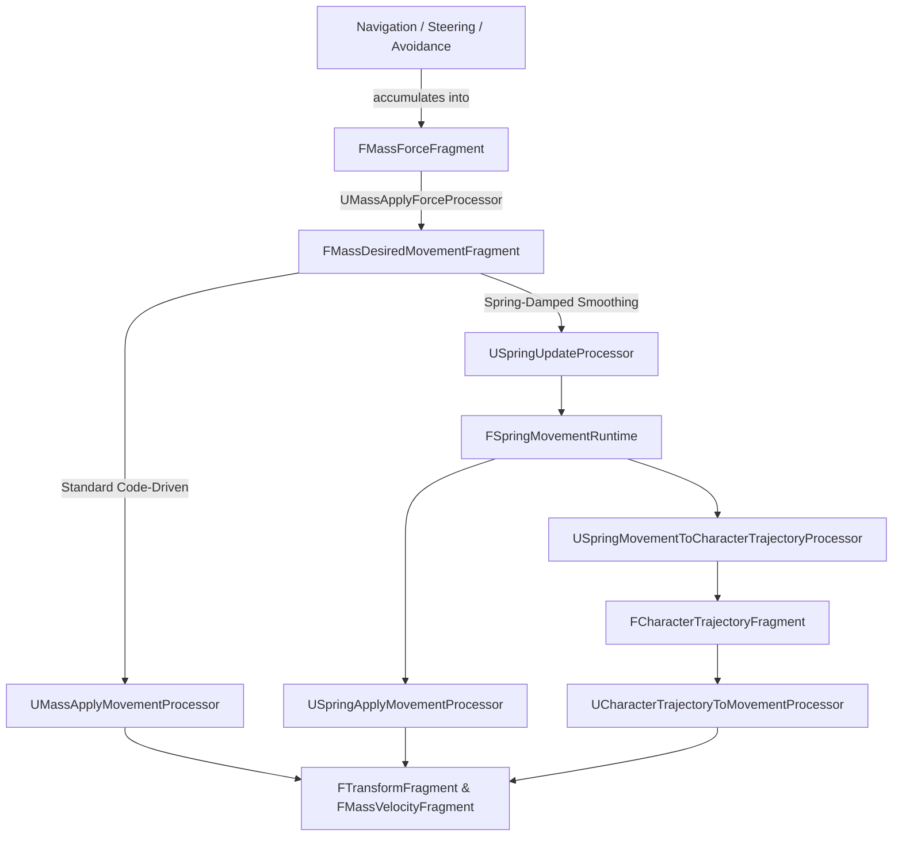
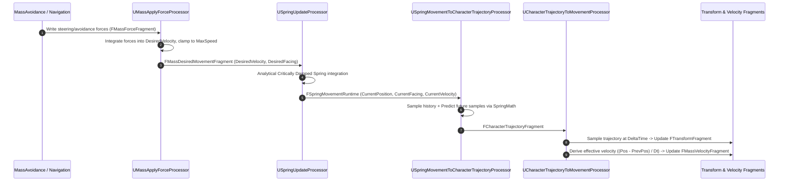

# Movement and Locomotion — UE 5.8 MASS

## Scope
Mass gameplay movement pipeline, steering integration, velocity-to-transform resolution, spring-damped motion smoothing, character animation trajectory generation, physics body instance lifecycle batching (`MassEngine`), and editor movement style authoring (`MassMovementEditor`). Interaction boundaries with `MassNavigation` and `MassRepresentation`.

## Architecture

MASS movement operates as a staged pipeline running within the simulation phase (`EMassProcessingPhase::PrePhysics` by default). The pipeline transforms navigational intent into spatial displacement:



### 1. Movement Pipeline Stages
1. **Force Accumulation**: Navigation steering and avoidance processors (e.g., `UMassMovingAvoidanceProcessor` in `MassAI`) write additive acceleration forces to `FMassForceFragment`.
2. **Force Application (`UMassApplyForceProcessor`)**: Runs in `UE::Mass::ProcessorGroupNames::ApplyForces` after avoidance. Computes `DesiredVelocity = DesiredVelocity + (Force * DeltaTime)`, clamps magnitude to `FMassMovementParameters::MaxSpeed`, and resets `FMassForceFragment::Value` to zero.
3. **Integration Modes**:
   - **Direct Code-Driven (`UMassApplyMovementProcessor`)**: Executes in `UE::Mass::ProcessorGroupNames::Movement`. Direct Euler integration: `Velocity.Value = DesiredVelocity`, then `Location += Velocity * DeltaTime`. Requires `FMassCodeDrivenMovementTag`, skips entities having `FSpringMovementSettings` or `FMassCustomMovementTag`.
   - **Spring-Damped Movement (`USpringUpdateProcessor` + `USpringApplyMovementProcessor`)**: Smooths velocity and facing towards target values using an analytical critically damped spring (`SpringMath::SpringCharacterUpdate`, `SpringMath::CriticalSpringDamperQuat`). Runs in `UE::Mass::ProcessorGroupNames::SpringMovement`. If no custom movement tag exists, `USpringApplyMovementProcessor` applies runtime state to `FTransformFragment` and `FMassVelocityFragment`.
   - **Trajectory-Driven Movement (`UCharacterTrajectoryToMovementProcessor`)**: Runs in `UE::Mass::ProcessorGroupNames::CharacterTrajectoryMovement`. Evaluates the trajectory curve at $t = \Delta t$ (`GetSampleAtTime(DeltaTime)`), assigns transform, and derives effective Euler velocity `(NewPos - PrevPos) / DeltaTime` to keep downstream motion components consistent.
4. **Off-LOD Handling**: Movement processors exclude entities tagged with `FMassOffLODTag`. When an entity re-enters LOD, `USpringMovementLODResyncObserver` observes the removal of `FMassOffLODTag` and reinitializes `FSpringMovementRuntime` with the entity's current transform and velocity, preventing violent visual pops.

### 2. Speeds, Paces, and Movement Styles
Speed assignment is handled deterministically via `FMassMovementParameters` (a const shared fragment):
- Agents query `GenerateDesiredSpeed(StyleRef, UniqueId)`.
- It evaluates `FMassMovementStyleParameters` matching the style's `FGuid`.
- A pseudo-random roll using `UE::RandomSequence::FRand(UniqueId)` selects a discrete speed entry (`FMassMovementStyleSpeedParameters`) based on cumulative probability thresholds.
- Speed variance is evaluated deterministically via `UE::RandomSequence::RandRange(UniqueId, 1.0f - Variance, 1.0f + Variance)`.

### 3. Character Animation Trajectory
Animation systems (Motion Matching, Pose Search) rely on past motion history and predicted future paths via `FCharacterTrajectoryFragment`:
- Buffer layout follows PoseSearch conventions: `[0 .. NumHistory-2]` (past samples), `[NumHistory-1]` ($t=0$, start of frame), `[NumHistory]` ($t=\Delta t$, predicted frame end), `[NumHistory+1 .. end]` (future predictions).
- Trajectory generation processors (`USpringMovementToCharacterTrajectoryProcessor` or `UMovementToCharacterTrajectoryProcessor`) run in group `CharacterTrajectoryGeneration` *before* movement integration, reading un-mutated start-of-frame transforms.
- In actor/component contexts, `UCharacterTrajectoryTrait` initializes `FCharacterTrajectoryFragment::MeshRelativeTransform` from `USkeletalMeshComponent` relative transform. In actor-less contexts, `FCharacterTrajectoryParameters::Offset` provides manual mesh-to-world offsets.

### 4. RigidBody & Physics Integration (`MassEngine`)
Mass entities can interface with Chaos physics bodies without maintaining heavy Actor or Component hierarchies:
- **`FMassPhysicsBodyInstanceFragment`**: Holds a shared pointer `TSharedPtr<FBodyInstance>` and an optional `TSharedPtr<FChaosUserDefinedEntity>`.
- **`UMassPhysicsBodyInstancesBatcher`**: Scans uninitialized entities (`FMassPhysicsBodyInstanceFragment` without `FMassPhysicsBodyInstanceInitializedTag`), aggregates them by static mesh (`FMassStaticMeshFragment`), collision settings (`FMassPhysicsCollisionSettingsFragment`), and simulation type (`Static`, `NonSimulatedDynamic`, `SimulatedDynamic`), then creates batch request entities hosting `FMassPhysicsBodyInstancesInitializationRequestFragment`.
- **`UMassPhysicsBodyInstancesBatchInitializer`**: Initializes batched Chaos bodies via `FInitBodiesHelper<bCompileStatic>` and locks Chaos write interfaces (`FPhysicsObjectExternalInterface::LockWrite`) to register user-defined entities.
- **`UMassPhysicsBodyInstanceReInitializer`**: Observer processor triggering re-initialization when collision or body instance properties are modified.

### 5. Movement Editor & Styling
`MassMovementEditor` provides authoring workflows for styles:
- `UMassMovementSettings`: Project configuration asset storing available `FMassMovementStyle` definitions (name and GUID).
- `FMassMovementStyleRefDetails`: Slate property customization implementing `IPropertyTypeCustomization` for `FMassMovementStyleRef`. Presents a combo-box dropdown sourced from `UMassMovementSettings`.
- `UE::MassMovement::Delegates::OnMassMovementNamesChanged`: Multicast editor delegate that triggers Slate UI updates when movement styles are modified in Project Settings.

## Key types

| Symbol | Module | Responsibility |
| :--- | :--- | :--- |
| `FMassVelocityFragment` | `MassMovement` | Entity linear velocity (`Value`), debug previous value. |
| `FMassDesiredMovementFragment` | `MassMovement` | Target movement state (`DesiredVelocity`, `DesiredFacing`, `DesiredMaxSpeedOverride`). |
| `FMassForceFragment` | `MassMovement` | Accumulator for additive external/steering/avoidance forces. |
| `FMassMovementParameters` | `MassMovement` | Const shared configuration for speeds, acceleration, height smoothing, and styles. |
| `FMassCodeDrivenMovementTag` | `MassMovement` | Tag enabling direct velocity-to-transform updates in `UMassApplyMovementProcessor`. |
| `FMassCustomMovementTag` | `MassMovement` | Tag signaling custom displacement authority; disables default movement processors. |
| `UMassApplyForceProcessor` | `MassMovement` | Integrates `FMassForceFragment` into `FMassDesiredMovementFragment` and clamps to max speed. |
| `UMassApplyMovementProcessor` | `MassMovement` | Applies desired velocity directly to position for code-driven agents. |
| `FSpringMovementSettings` | `MassMovement` | Const shared smoothing configuration (`VelocitySmoothingTime`, `FacingSmoothingTime`). |
| `FSpringMovementRuntime` | `MassMovement` | Internal state for critically damped spring (`Position`, `Velocity`, `Accel`, `Facing`, `AngularVelocity`). |
| `USpringUpdateProcessor` | `MassMovement` | Updates `FSpringMovementRuntime` analytical spring equations towards desired movement. |
| `USpringApplyMovementProcessor` | `MassMovement` | Writes spring runtime state to entity `FTransformFragment` and `FMassVelocityFragment`. |
| `USpringMovementLODResyncObserver` | `MassMovement` | Resets spring runtime state when `FMassOffLODTag` is removed to prevent interpolation pops. |
| `UMassMovementSettings` | `MassMovement` | Module configuration class holding project-wide movement styles. |
| `FCharacterTrajectoryFragment` | `MassCharacterTrajectory` | Trajectory history and prediction buffer (`FTransformTrajectory`). |
| `FCharacterTrajectoryParameters` | `MassCharacterTrajectory` | Const shared trajectory sampling configuration (`NumHistorySamples`, `NumPredictionSamples`, `Interval`). |
| `FCharacterTrajectoryMovementTag` | `MassCharacterTrajectory` | Tag activating trajectory-driven movement. |
| `USpringMovementToCharacterTrajectoryProcessor` | `MassCharacterTrajectory` | Generates smoothed future trajectory prediction from spring damper state. |
| `UMovementToCharacterTrajectoryProcessor` | `MassCharacterTrajectory` | Generates linear future trajectory prediction from velocity extrapolation. |
| `UCharacterTrajectoryToMovementProcessor` | `MassCharacterTrajectory` | Moves entity along the generated trajectory and calculates effective Euler velocity. |
| `FMassPhysicsBodyInstanceFragment` | `MassEngine` | Holds Chaos `FBodyInstance` shared pointer and `FChaosUserDefinedEntity`. |
| `FMassPhysicsCollisionSettingsFragment` | `MassEngine` | Const shared collision profile and response container. |
| `UMassPhysicsBodyInstancesBatcher` | `MassEngine` | Groups individual uninitialized physics bodies into batched request entities. |
| `UMassPhysicsBodyInstancesBatchInitializer` | `MassEngine` | Spawns batched Chaos physics bodies using `FInitBodiesHelper`. |
| `FMassMovementStyleRefDetails` | `MassMovementEditor` | Slate property customization providing dropdown selection for `FMassMovementStyleRef`. |

## Data flow



## Usage

### 1. Simple Code-Driven Movement Archetype
Configuring an entity trait for standard direct movement:

```cpp
#include "MassEntityTemplateRegistry.h"
#include "MassCommonFragments.h"
#include "MassMovementFragments.h"

void UMyMovementTrait::BuildTemplate(FMassEntityTemplateBuildContext& BuildContext, const UWorld& World) const
{
    BuildContext.RequireFragment<FTransformFragment>();
    BuildContext.AddFragment<FMassVelocityFragment>();
    BuildContext.AddFragment<FMassForceFragment>();
    BuildContext.AddFragment<FMassDesiredMovementFragment>();

    FMassEntityManager& EntityManager = UE::Mass::Utils::GetEntityManagerChecked(World);
    
    FMassMovementParameters MovementParams;
    MovementParams.MaxSpeed = 500.f;
    MovementParams.MaxAcceleration = 400.f;
    MovementParams.DefaultDesiredSpeed = 300.f;
    MovementParams.bIsCodeDrivenMovement = true;

    const FConstSharedStruct MovementShared = EntityManager.GetOrCreateConstSharedFragment(MovementParams.GetValidated());
    BuildContext.AddConstSharedFragment(MovementShared);

    // Enables UMassApplyMovementProcessor
    BuildContext.AddTag<FMassCodeDrivenMovementTag>();
}
```

### 2. Spring Movement with Animation Trajectory Driven Movement
For high-fidelity crowds utilizing Motion Matching and critically damped steering:

```cpp
#include "MassSpringMovementTrait.h"
#include "MassCharacterTrajectoryTrait.h"

// In Entity Config Asset or C++ Trait setup:
// 1. Add UMassMovementTrait: provides basic velocity, force, and FMassMovementParameters.
// 2. Add USpringMovementTrait: adds FSpringMovementRuntime and FSpringMovementSettings.
// 3. Add UCharacterTrajectoryTrait: adds FCharacterTrajectoryFragment and sampling params.
// 4. Add UCharacterTrajectoryMovementTrait:
//    - Adds FCharacterTrajectoryMovementTag
//    - Adds FMassCustomMovementTag (disables USpringApplyMovementProcessor and UMassApplyMovementProcessor)
//
// Execution Order:
// UMassApplyForceProcessor -> USpringUpdateProcessor -> 
// USpringMovementToCharacterTrajectoryProcessor -> UCharacterTrajectoryToMovementProcessor
```

### 3. Physics Body Batching Setup
Spawning static mesh entities backed by batched Chaos collision:

```cpp
#include "Physics/MassEnginePhysicsFragments.h"
#include "Mesh/MassEngineMeshFragments.h"

void BuildPhysicsEntity(FMassEntityTemplateBuildContext& BuildContext, const UWorld& World, UStaticMesh* Mesh)
{
    BuildContext.RequireFragment<FTransformFragment>();
    BuildContext.AddFragment<FMassPhysicsBodyInstanceFragment>();

    // Mark as dynamic simulated body if physics simulation is required
    BuildContext.AddTag<FMassPhysicsDynamicBodyTag>();
    BuildContext.AddTag<FMassPhysicsSimulatedBodyTag>();

    FMassEntityManager& EntityManager = UE::Mass::Utils::GetEntityManagerChecked(World);

    FMassStaticMeshFragment MeshFragment(InMesh);
    BuildContext.AddConstSharedFragment(EntityManager.GetOrCreateConstSharedFragment(MeshFragment));

    FMassPhysicsCollisionSettingsFragment CollisionFragment;
    CollisionFragment.CollisionType = ECollisionEnabled::QueryAndPhysics;
    BuildContext.AddConstSharedFragment(EntityManager.GetOrCreateConstSharedFragment(CollisionFragment));
}
```

## Pitfalls

1. **Tag Conflicts with Custom Movement**:
   `UMassApplyMovementProcessor` and `USpringApplyMovementProcessor` explicitly check for `FMassCustomMovementTag` (`EMassFragmentPresence::None`). If a custom movement processor (e.g. trajectory movement, physics replication) is introduced without adding `FMassCustomMovementTag`, multiple processors will write to `FTransformFragment` during the same frame, causing severe position jitter.

2. **Spring Latency Degrading Avoidance**:
   Spring damping introduces a delay between the desired velocity computed by avoidance/navigation algorithms and the resulting entity displacement. High values of `VelocitySmoothingTime` (> 0.2s) in `FSpringMovementSettings` cause agents to lag behind steering vectors, leading to obstacle clipping or agent inter-penetration.

3. **Trajectory History Frame Timing**:
   Trajectory generation processors (`USpringMovementToCharacterTrajectoryProcessor`) run *before* movement integration. They read start-of-frame transforms from `FTransformFragment`. If a developer schedules a custom trajectory processor *after* movement integration without adjusting PoseSearch history sampling indices, history buffers will contain duplicate or temporally shifted frames.

4. **Stale Physics Body Owners**:
   `FMassPhysicsBodyInstanceFragment::BodyInstanceOwnerObject` is a `TWeakObjectPtr<UObject>`. `UMassPhysicsBodyInstancesBatchInitializer` validates this weak pointer before invoking Chaos `InitBodies`. If the owner actor or component is destroyed mid-frame, unverified access to raw body pointers will crash the physics scene.

5. **LOD Transition Pops**:
   Entities transitioning off-LOD (`FMassOffLODTag`) stop ticking movement and spring processors. If an entity is moved or teleported while off-LOD, failing to register `USpringMovementLODResyncObserver` leaves `FSpringMovementRuntime` holding stale position and velocity, which causes explosive spring acceleration upon returning on-LOD.

## Source files

### MassMovement (`Engine/Plugins/Runtime/MassGameplay/Source/MassMovement/`)
- `Public/MassMovementFragments.h` — `FMassVelocityFragment`, `FMassDesiredMovementFragment`, `FMassForceFragment`, `FMassMovementParameters`, tags (`FMassCodeDrivenMovementTag`, `FMassCustomMovementTag`).
- `Public/MassMovementTypes.h` — `FMassMovementStyleRef`, `FMassMovementStyle`, `FMassMovementStyleParameters`, `UE::Mass::ProcessorGroupNames::SpringMovement`.
- `Public/MassMovementSettings.h` — `UMassMovementSettings` module configuration.
- `Public/MassMovementDelegates.h` — `UE::MassMovement::Delegates::OnMassMovementNamesChanged`.
- `Public/MassSpringMovementFragments.h` — `FSpringMovementSettings`, `FSpringMovementRuntime`.
- `Public/MassSpringMovementProcessors.h` — `USpringUpdateProcessor`, `USpringApplyMovementProcessor`, `USpringMovementLODResyncObserver`.
- `Public/Movement/MassMovementProcessors.h` — `UMassApplyForceProcessor`, `UMassApplyMovementProcessor`.
- `Public/Movement/MassMovementTrait.h` — `UMassMovementTrait`.
- `Public/MassSpringMovementTrait.h` — `USpringMovementTrait`.
- `Public/Example/MassVelocityRandomizerTrait.h` — `UMassVelocityRandomizerTrait`, `UMassRandomVelocityInitializer`.
- `Public/Example/MassSimpleMovementTrait.h` — `UMassSimpleMovementTrait`, `UMassSimpleMovementProcessor`.
- `Private/MassMovementProcessors.cpp` — Force and movement processor implementation.
- `Private/MassSpringMovementProcessors.cpp` — Analytical spring damper update, apply, and LOD resync logic.

### MassCharacterTrajectory (`Engine/Plugins/Runtime/MassGameplay/Source/MassCharacterTrajectory/`)
- `Public/MassCharacterTrajectoryFragments.h` — `FCharacterTrajectoryParameters`, `FCharacterTrajectoryFragment`, `FCharacterTrajectoryMovementTag`.
- `Public/MassCharacterTrajectoryGenerationProcessors.h` — `USpringMovementToCharacterTrajectoryProcessor`, `UMovementToCharacterTrajectoryProcessor`.
- `Public/MassCharacterTrajectoryMovementProcessor.h` — `UCharacterTrajectoryToMovementProcessor`.
- `Public/MassCharacterTrajectoryTrait.h` — `UCharacterTrajectoryTrait`, `UCharacterTrajectoryMovementTrait`.
- `Private/MassCharacterTrajectoryGenerationProcessors.cpp` — PoseSearch integration and trajectory sample prediction.
- `Private/MassCharacterTrajectoryMovementProcessor.cpp` — Trajectory sampling at $\Delta t$ and effective velocity derivation.
- `Private/MassCharacterTrajectoryTrait.cpp` — Trajectory trait registration and SkeletalMesh relative transform binding.

### MassEngine Physics (`Engine/Source/Runtime/Mass/MassEngine/`)
- `Public/Physics/MassEnginePhysicsFragments.h` — `FMassPhysicsBodyInstanceFragment`, `FMassPhysicsCollisionSettingsFragment`, tags (`FMassPhysicsDynamicBodyTag`, `FMassPhysicsSimulatedBodyTag`, `FMassPhysicsBodyInstanceInitializedTag`), `FMassPhysicsBodyInstancesInitializationRequestFragment`.
- `Private/RigidBody/MassPhysicsProcessors.h` — `UMassPhysicsBodyInstancesBatcher`, `UMassPhysicsBodyInstancesBatchInitializer`, `UMassPhysicsBodyInstanceReInitializer`.
- `Private/RigidBody/MassPhysicsProcessors.cpp` — Chaos body instance batching and `FInitBodiesHelper` initialization.

### MassMovementEditor (`Engine/Plugins/Runtime/MassGameplay/Source/MassMovementEditor/`)
- `Public/MassMovementStyleRefDetails.h` — `FMassMovementStyleRefDetails` property customization.
- `Public/MassMovementPropertyUtils.h` — `UE::MassMovement::PropertyUtils` struct property extraction helpers.

## Graph facts

- Node counts: `Engine/Plugins/Runtime/MassGameplay` contains 4,485 nodes; `Engine/Source/Runtime/Mass` (including `MassEngine`) contains 736 nodes.
- Execution Grouping: Movement processors bind directly to standard pipeline groups: `UE::Mass::ProcessorGroupNames::ApplyForces`, `UE::Mass::ProcessorGroupNames::SpringMovement`, `UE::Mass::ProcessorGroupNames::Movement`, `UE::Mass::ProcessorGroupNames::CharacterTrajectoryGeneration`, and `UE::Mass::ProcessorGroupNames::CharacterTrajectoryMovement`.
- Trait Interlocking: `UCharacterTrajectoryMovementTrait` validates and enforces dependency on `UCharacterTrajectoryTrait` while extending `UMassMovementTrait`, injecting `FMassCustomMovementTag` to ensure mutually exclusive execution against `UMassApplyMovementProcessor` and `USpringApplyMovementProcessor`.
- Cross-Domain Bridging: `MassCharacterTrajectory` bridges MASS to animation (`PoseSearchTrajectoryLibrary`), while `MassEngine` physics bridges MASS entities directly to Chaos physics proxies (`FPhysicsObjectExternalInterface`, `Chaos::FPhysicsObject`).
