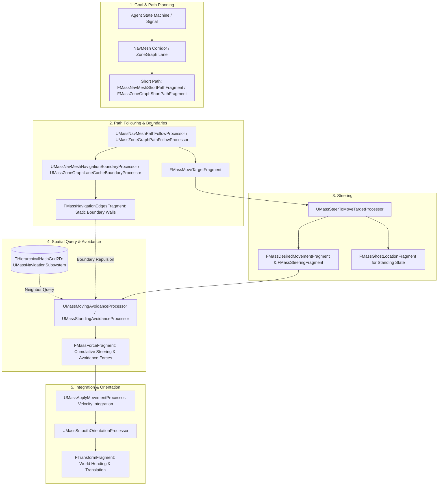

# Navigation, Steering, and Avoidance — UE 5.8 MASS

## Scope
Defines spatial movement coordination for MASS AI agents across continuous navigation surfaces and discrete networks. Covers:
- `MassNavigation`: Central runtime module governing movement actions, move targets, ghost locations, spatial obstacle hashing, force-based predictive/standing avoidance, target steering, and exponential smooth heading orientation.
- `MassNavMeshNavigation`: Recast NavMesh integration, path corridor extraction (`FNavCorridor`), short-path lookahead progression, and polygonal boundary edge harvesting.
- `MassZoneGraphNavigation`: Lane-oriented corridor navigation, lane snapping, LaneCache boundary projection, and link-to-link progression.
- `MassEngine` AI navigation integration: Bridge processors registering Mass entities as `FNavigationElement` objects to dirty the engine's navigation octree/navmesh generation.
- `MassNavigationEditor`: Interactive visual editor testing actor (`AMassNavigationTestingActor`, `UMassNavigationTestingComponent`) for lane caching and short-path validation.

---

## Architecture

The navigation pipeline runs within the Mass simulation phase pipeline (`Movement` / `Avoidance` groups). Agents progress through a deterministic decoupled flow:



### Agent State Machine (`EMassMovementAction`)
Defined in `MassNavigationTypes.h`:
- `EMassMovementAction::Stand`: Agent halts translation. Employs `FMassGhostLocationFragment` and `UMassStandingAvoidanceProcessor` to maintain personal space while resisting displacement shocks.
- `EMassMovementAction::Move`: Active traversal. `UMassSteerToMoveTargetProcessor` updates acceleration towards `FMassMoveTargetFragment::Center`.
- `EMassMovementAction::Animate`: Root motion / Montage controlled. Navigation processors preserve transform autonomy and skip steering/orientation modification.

---

## Key types

| Symbol | Module | Responsibility |
| :--- | :--- | :--- |
| `FMassMoveTargetFragment` | `MassNavigation` | Authoritative lookahead target holding `Center`, `Forward`, `DistanceToGoal`, `DesiredSpeed`, and `CurrentAction`. |
| `UMassNavigationSubsystem` | `MassNavigation` | World subsystem hosting the 2-level 2D hierarchical spatial hash grid `THierarchicalHashGrid2D<2, 4, FMassNavigationObstacleItem>`. |
| `FMassAvoidanceColliderFragment` | `MassNavigation` | Collider shape data supporting `EMassColliderType::Circle` (`Radius`) and `EMassColliderType::Pill` (`Radius`, `HalfLength`). |
| `FMassNavigationEdgesFragment` | `MassNavigation` | Inline storage of up to 16 static boundary segments (`FNavigationAvoidanceEdge`) extracted from NavMesh corridors or ZoneGraph lanes. |
| `FMassGhostLocationFragment` | `MassNavigation` | Virtual position/velocity used by standing agents to yield slightly under crowd pressure and return to original rest spots. |
| `UMassMovingAvoidanceProcessor` | `MassNavigation` | Applies Closest Point of Approach (CPA) anticipatory avoidance and spring-damper wall separation forces. |
| `UMassStandingAvoidanceProcessor` | `MassNavigation` | Damps and steers `FMassGhostLocationFragment` away from oncoming agents. |
| `UMassSteerToMoveTargetProcessor` | `MassNavigation` | Calculates desired speed curves, arrival envelopes, and directional speed scales towards the current move target. |
| `UMassSmoothOrientationProcessor` | `MassNavigation` | Exponentially blurs heading rotation between movement velocity and target direction across LOD tiers. |
| `FMassNavMeshShortPathFragment` | `MassNavMeshNavigation` | Fixed 8-point portal buffer sliced from `FNavCorridor` for Recast NavMesh steering lookahead. |
| `UMassNavMeshPathFollowProcessor` | `MassNavMeshNavigation` | Progresses `FMassMoveTargetFragment` along NavMesh short path portals; emits `FollowPointPathDone` signal on arrival. |
| `UMassNavMeshNavigationBoundaryProcessor` | `MassNavMeshNavigation` | Slices corridor boundaries into `FMassNavigationEdgesFragment` avoidance segments. |
| `FMassZoneGraphShortPathFragment` | `MassZoneGraphNavigation` | Fixed 3-point lookahead along ZoneGraph lane splines. |
| `UMassZoneGraphPathFollowProcessor` | `MassZoneGraphNavigation` | Updates move target progression along curved spline paths; handles lane transitions. |
| `UMassNavigationElementProcessor` | `MassEngine` | Extracts Mass entities with `FMassNavigationRelevantParameters` and registers `FNavigationElementHandle` into the engine NavOctree. |
| `AMassNavigationTestingActor` | `MassNavigationEditor` | Editor actor hosting `UMassNavigationTestingComponent` for interactive ZoneGraph path inspection and short-path simulation. |

---

## Data flow

### 1. Spatial Obstacle Grid (`THierarchicalHashGrid2D`)
- Grid cells store `FMassNavigationObstacleItem` (`Entity`, `ItemFlags`).
- Processors `UMassNavigationObstacleGridProcessor` and `UMassNavigationObstacleRemoverProcessor` maintain registration.
- Dynamic queries in `UMassMovingAvoidanceProcessor::FindCloseObstacles` scan hierarchical bounding boxes, order cells by squared center distance, and populate a fixed-capacity candidate buffer (`TArray<FMassNavigationObstacleItem, TFixedAllocator<24>>`).
- Indirect fragment access: Neighbor details (`FTransformFragment`, `FMassVelocityFragment`, `FAgentRadiusFragment`, `FMassAvoidanceColliderFragment`) are fetched through `EntityQuery.AddIndirectFragmentRequirement(...)`.

### 2. Predictive Avoidance Math (CPA)
In `UE::MassAvoidance`:
- Computes time to Closest Point of Approach:
  $$CPA = \text{clamp}\left(-\frac{\vec{p}_{\text{rel}} \cdot \vec{v}_{\text{rel}}}{\|\vec{v}_{\text{rel}}\|^2}, 0, T_{\text{horizon}}\right)$$
- If predicted separation distance at $CPA$ violates safe radii ($R_{\text{agent}} + R_{\text{obs}} + D_{\text{avoid}}$), quadratic repulsion is scaled by remaining time:
  $$\vec{F}_{\text{avoid}} = \hat{n}_{\text{avoid}} \cdot K_{\text{stiff}} \cdot \left(1 - \frac{CPA}{T_{\text{horizon}}}\right) \cdot \left(\frac{\Delta_{\text{penetration}}}{D_{\text{avoid}}}\right)^2$$
- If an agent is pinched against an edge (`FMassNavigationEdgesFragment`), avoidance forces are blended into a forced clearance normal to prevent tunneling outside the nav corridor.

### 3. Smooth Heading Orientation
`UMassSmoothOrientationProcessor` executes in `UE::Mass::ProcessorGroupNames::Movement`:
- Interpolates heading yaw using `UE::MassNavigation::ExponentialSmoothingAngle`.
- Blends between `MoveTarget` direction and instantaneous velocity direction using `FMassSmoothOrientationWeights`.
- Bypasses rotation calculation when `CurrentAction == EMassMovementAction::Animate`.
- Off-LOD optimization: `LowResEntityQuery_Conditional` snaps transform directly using variable-tick chunk filtering (`FMassSimulationVariableTickChunkFragment`).

---

## ZoneGraph vs NavMesh Split

| Dimension | NavMesh Navigation (`MassNavMeshNavigation`) | ZoneGraph Navigation (`MassZoneGraphNavigation`) |
| :--- | :--- | :--- |
| **Topology** | 2D polygonal navigation mesh (Recast/Detour). | 1D directed spline network (lanes, junctions). |
| **Path Storage** | `FMassNavMeshCachedPathFragment` (`FNavCorridor` + `FNavigationPath`). | `FMassZoneGraphCachedLaneFragment` (spline point slices). |
| **Short Path** | `TStaticArray<FMassNavMeshPathPoint, 8>`. | `TStaticArray<FMassZoneGraphPathPoint, 3>`. |
| **Lookahead** | Corridors with portal widths (Left/Right limits). | Spline tangent and lateral offsets. |
| **Boundary Source** | Extruded corridor polygon boundaries. | Adjacent lane bounds or lane width half-extents. |
| **LOD Suitability** | Open fields, arbitrary geometry navigation. | Structured traffic, sidewalks, crowd flow corridors. |

---

## Usage

### Trait Construction (C++)
Construct an entity template combining NavMesh corridor traversal, steering, avoidance, and smooth orientation:

```cpp
#include "MassEntityTemplateRegistry.h"
#include "MassCommonFragments.h"
#include "MassMovementFragments.h"
#include "MassNavigationFragments.h"
#include "Steering/MassSteeringFragments.h"
#include "Avoidance/MassAvoidanceFragments.h"
#include "SmoothOrientation/MassSmoothOrientationFragments.h"
#include "MassNavMeshNavigationFragments.h"

void FMyCrowdAgentTrait::BuildTemplate(FMassEntityTemplateBuildContext& BuildContext, const UWorld& World) const
{
    // 1. Core transform & movement
    BuildContext.AddFragment<FTransformFragment>();
    BuildContext.AddFragment<FMassVelocityFragment>();
    BuildContext.AddFragment<FMassForceFragment>();
    BuildContext.AddFragment<FMassDesiredMovementFragment>();
    BuildContext.AddFragment<FAgentRadiusFragment>();

    // 2. Navigation Target & Steering
    BuildContext.AddFragment<FMassMoveTargetFragment>();
    BuildContext.AddFragment<FMassSteeringFragment>();
    BuildContext.AddFragment<FMassStandingSteeringFragment>();
    BuildContext.AddFragment<FMassGhostLocationFragment>();

    // 3. NavMesh path following & boundaries
    BuildContext.AddFragment<FMassNavMeshCachedPathFragment>();
    BuildContext.AddFragment<FMassNavMeshShortPathFragment>();
    BuildContext.AddFragment<FMassNavMeshBoundaryFragment>();
    BuildContext.AddFragment<FMassNavigationEdgesFragment>();

    // 4. Spatial Avoidance & Grid registration
    BuildContext.AddFragment<FMassAvoidanceColliderFragment>();
    BuildContext.AddFragment<FMassNavigationObstacleGridCellLocationFragment>();
    BuildContext.AddTag<FMassInNavigationObstacleGridTag>();

    // 5. Shared parameters (construct via EntityManager::GetOrCreateConstSharedFragment)
    FMassEntityManager& EntityManager = UE::Mass::Utils::GetEntityManagerChecked(World);

    FMassMovingAvoidanceParameters MovingAvoidParams;
    MovingAvoidParams.ObstacleDetectionDistance = 450.0f;
    MovingAvoidParams.PredictiveAvoidanceTime = 2.0f;
    BuildContext.AddConstSharedFragment(EntityManager.GetOrCreateConstSharedFragment(MovingAvoidParams.GetValidated()));

    FMassSmoothOrientationParameters OrientationParams;
    OrientationParams.OrientationSmoothingTime = 0.25f;
    BuildContext.AddConstSharedFragment(EntityManager.GetOrCreateConstSharedFragment(OrientationParams));
```

### Transitioning Agent Actions
To set a new goal and switch state:

```cpp
void SetAgentGoal(FMassMoveTargetFragment& MoveTarget, const FVector& GoalPos, const float DesiredSpeed, const UWorld& World)
{
    MoveTarget.CreateNewAction(EMassMovementAction::Move, World);
    MoveTarget.Center = GoalPos;
    MoveTarget.DesiredSpeed = FMassInt16Real(DesiredSpeed);
    MoveTarget.IntentAtGoal = EMassMovementAction::Stand;
    MoveTarget.DistanceToGoal = FVector::Dist(MoveTarget.Center, GoalPos);
}
```

---

## Pitfalls

1. **Missing `FMassNavigationEdgesFragment` with Avoidance Enabled**:
   If `UMassObstacleAvoidanceTrait` is used without a boundary processor (`UMassNavMeshNavigationBoundaryProcessor` or `UMassZoneGraphLaneCacheBoundaryProcessor`), agents lack wall boundaries and may be pushed through geometry by neighbor repulsion forces.
2. **Missing `IndirectFragmentRequirement` in Custom Avoidance**:
   Querying neighboring obstacles requires indirect access declarations. Omitting `AddIndirectFragmentRequirement<FTransformFragment>(EMassFragmentAccess::ReadOnly)` in custom processors triggers assertion failures in Mass access detectors.
3. **Ghost Location Desynchronization**:
   `FMassGhostLocationFragment::IsValid` validates via `LastSeenActionID == CurrentActionID`. Failing to call `FMassMoveTargetFragment::CreateNewAction` causes the ghost location to reuse stale positions from previous stops.
4. **Off-LOD Orientation Snapping**:
   `UMassSmoothOrientationProcessor` segregates `FMassOffLODTag` into `LowResEntityQuery_Conditional`. If variable tick chunk fragments are missing, Off-LOD entities will skip heading updates entirely until LOD status escalates.
5. **Deprecated 5.8 Engine Shims**:
   `FNavigationRelevantParameters` and `FNavigationRelevantFragment` were renamed to `FMassNavigationRelevantParameters` and `FMassNavigationRelevantFragment` in `MassEngineNavigationFragments.h`. Include order headers in `MassNavigationFragments.h` provide deprecated typedef shims.

---

## Source files

### MassNavigation (`Engine/Plugins/AI/MassAI/Source/MassNavigation`)
- `Public/MassNavigationSubsystem.h`: `UMassNavigationSubsystem`, `FNavigationObstacleHashGrid2D`, `FMassNavigationObstacleItem`.
- `Public/MassNavigationFragments.h`: `FMassMoveTargetFragment`, `FMassGhostLocationFragment`, `FMassAvoidanceColliderFragment`.
- `Public/MassNavigationTypes.h`: `EMassMovementAction`, `FMassTargetLocation`, navigation signal names.
- `Public/MassNavigationProcessors.h`: `UMassNavigationObstacleGridProcessor`, `UMassNavigationSmoothHeightProcessor`, `UMassOffLODNavigationProcessor`.
- `Public/MassNavigationUtils.h`: `WrapAngle`, `LerpAngle`, `ExponentialSmoothingAngle`, `GetYawFromDirection`.
- `Public/Avoidance/MassAvoidanceFragments.h`: `FMassMovingAvoidanceParameters`, `FMassStandingAvoidanceParameters`, `FMassNavigationEdgesFragment`.
- `Public/Avoidance/MassAvoidanceProcessors.h`: `UMassMovingAvoidanceProcessor`, `UMassStandingAvoidanceProcessor`.
- `Public/Avoidance/MassAvoidanceTrait.h`: `UMassObstacleAvoidanceTrait`.
- `Public/Avoidance/MassNavigationObstacleTrait.h`: `UMassNavigationObstacleTrait`.
- `Public/Steering/MassSteeringFragments.h`: `FMassSteeringFragment`, `FMassStandingSteeringFragment`, `FMassMovingSteeringParameters`.
- `Public/Steering/MassSteeringProcessors.h`: `UMassSteerToMoveTargetProcessor`.
- `Public/Steering/MassSteeringTrait.h`: `UMassSteeringTrait`.
- `Public/SmoothOrientation/MassSmoothOrientationFragments.h`: `FMassSmoothOrientationParameters`, `FMassSmoothOrientationWeights`.
- `Public/SmoothOrientation/MassSmoothOrientationProcessors.h`: `UMassSmoothOrientationProcessor`.
- `Public/SmoothOrientation/MassSmoothOrientationTrait.h`: `UMassSmoothOrientationTrait`.

### MassNavMeshNavigation (`Engine/Plugins/AI/MassAI/Source/MassNavMeshNavigation`)
- `Public/MassNavMeshNavigationFragments.h`: `FMassNavMeshPathPoint`, `FMassNavMeshShortPathFragment`, `FMassNavMeshCachedPathFragment`, `FMassNavMeshBoundaryFragment`.
- `Public/MassNavMeshNavigationProcessors.h`: `UMassNavMeshPathFollowProcessor`.
- `Public/MassNavMeshNavigationBoundaryProcessor.h`: `UMassNavMeshNavigationBoundaryProcessor`.
- `Public/MassNavMeshNavigationTrait.h`: `UMassNavMeshNavigationTrait`.

### MassZoneGraphNavigation (`Engine/Plugins/AI/MassAI/Source/MassZoneGraphNavigation`)
- `Public/MassZoneGraphNavigationFragments.h`: `FMassZoneGraphPathPoint`, `FMassZoneGraphShortPathFragment`, `FMassZoneGraphCachedLaneFragment`, `FMassZoneGraphLaneLocationFragment`.
- `Public/MassZoneGraphNavigationProcessors.h`: `UMassZoneGraphLocationInitializer`, `UMassZoneGraphPathFollowProcessor`, `UMassZoneGraphLaneCacheBoundaryProcessor`.
- `Public/MassZoneGraphNavigationTrait.h`: `UMassZoneGraphNavigationTrait`.

### MassEngine (`Engine/Source/Runtime/Mass/MassEngine`)
- `Public/AI/MassEngineNavigationFragments.h`: `FMassNavigationRelevantParameters`, `FMassNavigationRelevantFragment`, `FMassNavigationEvaluatedTag`.
- `Public/AI/MassEngineNavigationProcessors.h`: `UMassNavigationElementProcessor`, `UMassDirtyNavigationRelevantUpdateProcessor`, `UMassNavigationRelevantMassDeinitializer`.

### MassNavigationEditor (`Engine/Plugins/AI/MassAI/Source/MassNavigationEditor`)
- `Private/MassNavigationTestingActor.h`: `AMassNavigationTestingActor`, `UMassNavigationTestingComponent`, `FMassNavigationTestingSceneProxy`.

---

## Graph facts
*(Corpus references from `local://mass_graph_facts.md`)*
- `MassAI` contains **2,205 nodes** across navigation, ZoneGraph, and behaviors.
- Navigation processors interface with core simulation managers via `FMassEntityManager` (degree: 539) and execution contexts (`FMassExecutionContext`, degree: 476 / 117 symbols).
- Avoidance queries heavily leverage query requirements (`FMassEntityQuery`, degree: 201) and indirect fragment lookups.
- Connects cross-community to Core Engine Types (1,227 edges), Recast NavMesh, and Slate UI / SceneProxies for debug visualization (`FMassNavigationTestingSceneProxy`).
