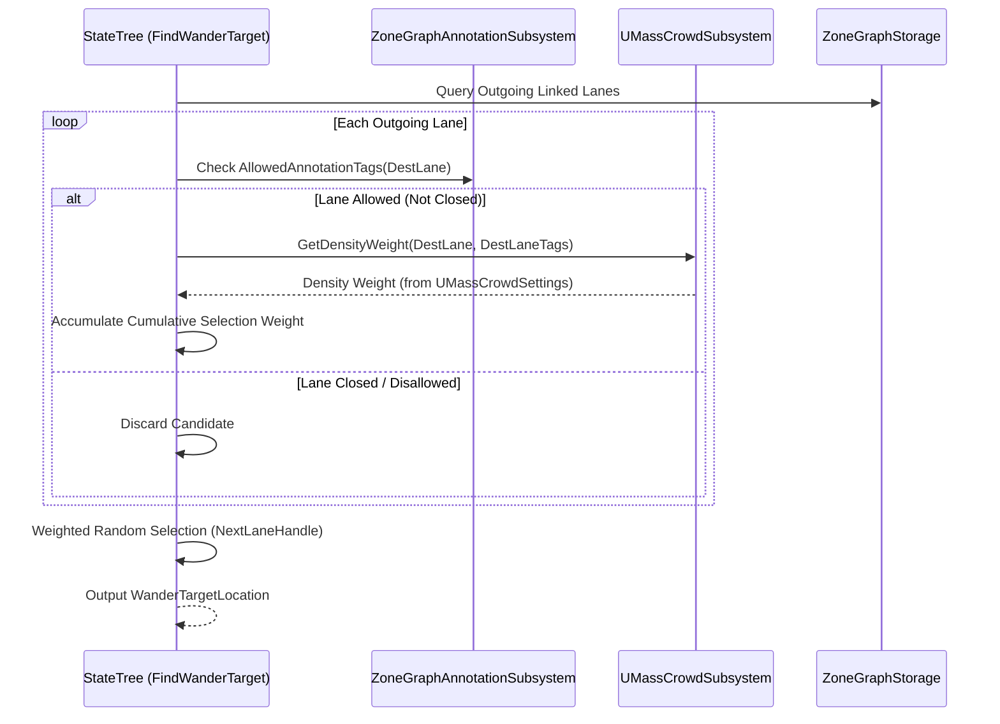

# Crowd and ZoneGraph — UE 5.8 MASS

## Scope
Defines spline- and lane-based crowd simulation in Unreal Engine 5.8 through `MassCrowd`. Covers:
- `MassCrowd` architecture layering over `MassAI`, `MassNavigation`, `MassZoneGraphNavigation`, and `ZoneGraph`.
- Lane runtime management: `UMassCrowdSubsystem`, `UMassCrowdSettings`, density-weighted random branching, lane states (`Opened`/`Closed`), and waiting slots at pedestrian crossings.
- ZoneGraph integration & annotations: `UZoneGraphCrowdLaneAnnotations`, `FZoneGraphCrowdLaneStateChangeEvent`, and `UMassCrowdLaneDataRenderingComponent`.
- Agent traits and tracking: `UMassCrowdMemberTrait`, `FMassCrowdTag`, `FMassCrowdLaneTrackingFragment`, `UMassCrowdLaneTrackingSignalProcessor`, and `UMassCrowdLaneTrackingDestructor`.
- Dynamic obstacle handling: `FMassCrowdObstacleFragment`, `UMassCrowdDynamicObstacleProcessor`, and `ZoneGraphAnnotationSubsystem` obstacle registration.
- Multi-tier Crowd Representation & LOD: `UMassCrowdRepresentationSubsystem`, `UMassCrowdRepresentationActorManagement`, `UMassCrowdVisualizationTrait`, `UMassCrowdVisualizationProcessor`, `UMassCrowdVisualizationLODProcessor`, and dedicated Server-Side Representation (`UMassCrowdServerRepresentationTrait`, `UMassCrowdServerRepresentationProcessor`, `UMassCrowdServerRepresentationLODProcessor`).
- StateTree crowd tasks: `FMassZoneGraphFindWanderTarget` and `FMassCrowdClaimWaitSlotTask`.
- Network replication: `AMassCrowdClientBubbleInfo`, `FMassCrowdClientBubbleSerializer`, `FMassCrowdClientBubbleHandler`, `FReplicatedCrowdAgent`, and `UMassCrowdReplicator`.
- Interactive testing: `UZoneGraphCloseCrowdLaneTest`.

---

## Architecture

`MassCrowd` operates as an orchestration layer above low-level ZoneGraph navigation and Mass representation, decoupling dense pedestrian behavior into lane occupancy tracking, wait slots, and tiered representation.

```mermaid
flowchart TD
    subgraph ZoneGraph_Infrastructure["ZoneGraph Layer"]
        ZGData[AZoneGraphData / FZoneGraphStorage]
        ZGSubsys[UZoneGraphSubsystem]
        ZGAnnotSubsys[UZoneGraphAnnotationSubsystem]
        ZGCrowdAnnot[UZoneGraphCrowdLaneAnnotations]
    end

    subgraph MassCrowd_Core["MassCrowd Subsystem & Runtime State"]
        CrowdSubsys[UMassCrowdSubsystem]
        CrowdSettings[UMassCrowdSettings]
        RegisteredLanes["FRegisteredCrowdLaneData:
        - CrowdLaneDataArray
        - LaneToTrackingDataLookup
        - LaneToBranchingDataLookup
        - WaitAreas & Slots"]
        CrowdSubsys --> RegisteredLanes
        CrowdSettings -. Configuration .-> CrowdSubsys
        ZGCrowdAnnot -- Events / Tag Mask --> CrowdSubsys
    end

    subgraph StateTree_AI["Mass AI & StateTree Behavior"]
        STWander[FMassZoneGraphFindWanderTarget:
        Weight-Based Density Branching]
        STClaimSlot[FMassCrowdClaimWaitSlotTask:
        Acquire & Release Wait Slots]
        STFollow[FMassZoneGraphPathFollowTask]
        STWander --> STFollow
        STClaimSlot --> STFollow
    end

    subgraph Navigation_Tracking["Navigation & Lane Tracking Processors"]
        TrackSigProc[UMassCrowdLaneTrackingSignalProcessor]
        TrackDestructor[UMassCrowdLaneTrackingDestructor]
        DynObsProc[UMassCrowdDynamicObstacleProcessor]
        TrackSigProc -- CurrentLaneChanged Signal --> CrowdSubsys
        DynObsProc -- Stopped / Moving --> ZGAnnotSubsys
    end

    subgraph Representation_LOD["Client & Server Representation"]
        VisualLOD[UMassCrowdVisualizationLODProcessor]
        VisualProc[UMassCrowdVisualizationProcessor]
        ServerLOD[UMassCrowdServerRepresentationLODProcessor]
        ServerProc[UMassCrowdServerRepresentationProcessor]
        RepActorMgmt[UMassCrowdRepresentationActorManagement]
        CrowdRepSubsys[UMassCrowdRepresentationSubsystem]
    end

    subgraph Replication_Bubble["Network Replication"]
        Replicator[UMassCrowdReplicator]
        BubbleInfo[AMassCrowdClientBubbleInfo]
        FastArraySerializer[FMassCrowdClientBubbleSerializer:
        TArray of FCrowdFastArrayItem]
    end

    ZGSubsys --> CrowdSubsys
    CrowdSubsys --> STWander
    CrowdSubsys --> STClaimSlot
    Representation_LOD --> RepActorMgmt
    RepActorMgmt --> CrowdRepSubsys
    Replicator --> BubbleInfo --> FastArraySerializer
```



---

## Key types

| Symbol | Module | Responsibility |
| :--- | :--- | :--- |
| `UMassCrowdSubsystem` | `MassCrowd` | World subsystem managing runtime lane states (`Opened`/`Closed`), occupancy counts, branching weights, and pedestrian crossing wait slots. |
| `UMassCrowdSettings` | `MassCrowd` | Developer settings (`Plugins -> Mass Crowd`) defining density tags/weights, wait slot dimensions, movement lookahead, and obstacle tolerances. |
| `UMassCrowdSpawnerSubsystem` | `MassCrowd` | Dedicated spawning subsystem derived from `UMassActorSpawnerSubsystem` for crowd-specific entity generation. |
| `UMassCrowdRepresentationSubsystem` | `MassCrowd` | Specialized `UMassRepresentationSubsystem` instance enabling isolated task execution and parallelization alongside traffic representation. |
| `UMassCrowdRepresentationActorManagement` | `MassCrowd` | Representation actor manager configuring spawned actor components (capsule height adjustments, skeletal mesh tick/visibility, character movement, puppet suspension). |
| `UMassCrowdMemberTrait` | `MassCrowd` | Trait attaching `FMassCrowdTag` and `FMassCrowdLaneTrackingFragment` to crowd entities. |
| `FMassCrowdTag` | `MassCrowd` | Empty tag filtering crowd agents from vehicles, pedestrians, or general gameplay entities. |
| `FMassCrowdLaneTrackingFragment` | `MassCrowd` | Entity fragment recording `FZoneGraphLaneHandle TrackedLaneHandle` for lane enter/exit detection. |
| `FMassCrowdObstacleFragment` | `MassCrowd` | Entity fragment monitoring stationary entities to report dynamic obstacles into `UZoneGraphAnnotationSubsystem`. |
| `UZoneGraphCrowdLaneAnnotations` | `MassCrowd` | `UZoneGraphAnnotationComponent` applying `CloseLaneTag` and `WaitingLaneTag` tags on ZoneGraph lanes responding to crowd state events. |
| `UMassCrowdLaneDataRenderingComponent` | `MassCrowd` | Debug primitive component attached to `AZoneGraphData` rendering lane states, density tags, and wait slots in viewport. |
| `UMassCrowdVisualizationTrait` | `MassCrowd` | Trait configuring client-side visual tiers (`HighResSpawnedActor`, `LowResSpawnedActor`, `StaticMeshInstance`, `None`) using crowd representation subsystems. |
| `UMassCrowdVisualizationProcessor` | `MassCrowd` | Client visualization processor filtering on `FMassCrowdTag` to update actor spawning and ISM instances. |
| `UMassCrowdVisualizationLODProcessor` | `MassCrowd` | Calculates viewer distance, frustum bounds, and hysteresis LOD for crowd entities in parallel with traffic systems. |
| `UMassCrowdServerRepresentationTrait` | `MassCrowd` | Dedicated server trait active solely on `NM_DedicatedServer` spawning high-res actors only when near server viewers. |
| `UMassCrowdServerRepresentationProcessor` | `MassCrowd` | Server counterpart of the client visualization processor handling actor instantiation on dedicated servers. |
| `UMassCrowdServerRepresentationLODProcessor` | `MassCrowd` | Server simulation LOD calculator adjusting tick rates and representation requirements for server viewer distances. |
| `FMassZoneGraphFindWanderTarget` | `MassCrowd` | StateTree task evaluating outgoing and adjacent ZoneGraph lanes filtered by annotations and weighted by lane density. |
| `FMassCrowdClaimWaitSlotTask` | `MassCrowd` | StateTree task reserving a physical wait slot on a closed crossing lane and yielding slot location/orientation to path following. |
| `AMassCrowdClientBubbleInfo` | `MassCrowd` | Replication actor hosting `FMassCrowdClientBubbleSerializer` for fast-array agent synchronization. |
| `FReplicatedCrowdAgent` | `MassCrowd` | Replicated agent payload carrying path progression (`FReplicatedAgentPathData`) and spatial transform (`FReplicatedAgentPositionYawData`). |
| `UMassCrowdReplicator` | `MassCrowd` | Server replicator querying crowd agent fragments and serializing them into per-client bubbles. |
| `UZoneGraphCloseCrowdLaneTest` | `MassCrowd` | Testing lane behavior component on `AZoneGraphTestingActor` used to interactively toggle lane open/closed state. |

---

## Data flow

### 1. Lane State, Annotations, and Wait Areas
- **Storage Registration**: `UMassCrowdSubsystem::PostZoneGraphDataAdded` listens to `UE::ZoneGraphDelegates::OnPostZoneGraphDataAdded`. It allocates an entry in `RegisteredLaneData` matching the storage lane count.
- **Crossing Detection**: For each lane tagged with `MassCrowdSettings->CrossingTag`, `BuildLaneData` inspects incoming reverse links. For every linked lane, it instantiates an `FCrowdWaitAreaData` entry and calculates discrete wait slots along the lane spline using `SlotSize` and `SlotOffset`.
- **Lane State Mutations**: `UMassCrowdSubsystem::SetLaneState(LaneHandle, NewState)` updates `FZoneGraphCrowdLaneData::State`.
- **Annotation Sync**: Lane state updates queue an `FZoneGraphCrowdLaneStateChangeEvent`. `UZoneGraphCrowdLaneAnnotations::TickAnnotation` consumes events and writes `CloseLaneTag` or `WaitingLaneTag` masks into the global `FZoneGraphAnnotationTagContainer`.

### 2. Wander Target Selection & Density Weighting
- `FMassZoneGraphFindWanderTarget` executes inside the agent's StateTree.
- When an agent's lookahead distance (`MoveDistance +/- MoveDistanceRandomDeviation`) extends beyond `LaneLocation.LaneLength`:
  1. Queries candidate linked lanes via `UE::ZoneGraph::Query::GetLinkedLanes` for `EZoneLaneLinkType::Outgoing`.
  2. Evaluates `ZoneGraphAnnotationSubsystem.GetAnnotationTags(CandidateLane)` against `AllowedAnnotationTags` (rejecting closed lanes).
  3. Retrieves the candidate's density weight via `UMassCrowdSubsystem::GetDensityWeight(DestLane, LaneTagMask)`.
  4. Accumulates weights into an inline array of candidate tuples and performs a roulette-wheel selection (`FMath::RandRange(0.f, CombinedWeight)`).
  5. If outgoing links are unavailable or blocked, attempts `EZoneLaneLinkType::Adjacent` lanes to prevent bunching.



### 3. Lane Tracking and Dynamics
- When path followers switch lanes, `UE::Mass::Signals::CurrentLaneChanged` is raised.
- `UMassCrowdLaneTrackingSignalProcessor` intercepts the signal:
  - Compares `FMassCrowdLaneTrackingFragment::TrackedLaneHandle` against `FMassZoneGraphLaneLocationFragment::LaneHandle`.
  - Dispatches `UMassCrowdSubsystem::OnEntityLaneChanged(Entity, PreviousLane, CurrentLane)`.
  - Decrements occupancy on the previous lane and increments occupancy on the current lane in `FCrowdTrackingLaneData`.
- `UMassCrowdLaneTrackingDestructor` monitors entity removal, notifying `OnEntityLaneChanged(Entity, TrackedLane, Invalid)` to guarantee occupancy counter integrity.

### 4. Dynamic Obstacles
- Entities hosting `FMassCrowdObstacleFragment` are checked by `UMassCrowdDynamicObstacleProcessor`.
- If agent velocity remains below `ObstacleStoppingSpeedTolerance` for `ObstacleTimeToStop` seconds:
  - Invokes `UZoneGraphAnnotationSubsystem::RegisterObstacle(Center, ObstacleEffectRadius)`.
  - Marks `bIsMoving = false` and stores `LaneObstacleID`.
- When translation exceeds `ObstacleMovingDistanceTolerance`, obstacle registration is removed via `UnregisterObstacle`.

---

## Usage

### Standard Crowd Entity Template (C++)
A standard crowd agent configures navigation, StateTree AI, crowd membership, and multi-tier representation:

```cpp
#include "MassEntityConfigAsset.h"
#include "MassCrowdMemberTrait.h"
#include "MassCrowdVisualizationTrait.h"
#include "MassCrowdServerRepresentationTrait.h"
#include "MassZoneGraphNavigationTrait.h"
#include "MassStateTreeTrait.h"

void SetupCrowdTemplate(UMassEntityConfigAsset& ConfigAsset)
{
    FMassEntityConfig& Config = ConfigAsset.GetMutableConfig();

    // 1. Crowd Identification & Tracking
    Config.AddTrait(*NewObject<UMassCrowdMemberTrait>(&ConfigAsset));

    // 2. ZoneGraph Movement & Steering
    Config.AddTrait(*NewObject<UMassZoneGraphNavigationTrait>(&ConfigAsset));

    // 3. StateTree AI Brain (Contains Wander & Claim Wait Slot tasks)
    Config.AddTrait(*NewObject<UMassStateTreeTrait>(&ConfigAsset));

    // 4. Client-side Hierarchical Representation (Actor / ISM)
    UMassCrowdVisualizationTrait* VisualTrait = NewObject<UMassCrowdVisualizationTrait>(&ConfigAsset);
    VisualTrait->Params.RepresentationActorManagementClass = UMassCrowdRepresentationActorManagement::StaticClass();
    Config.AddTrait(*VisualTrait);

    // 5. Dedicated Server Representation (Spawns Actor only near server viewers)
    Config.AddTrait(*NewObject<UMassCrowdServerRepresentationTrait>(&ConfigAsset));
}
```

### Lane State Toggle & Crossing Control
Toggling lane availability (e.g., pedestrian crossing signals) at runtime:

```cpp
#include "MassCrowdSubsystem.h"
#include "ZoneGraphTypes.h"

void TogglePedestrianCrossing(UWorld* World, const FZoneGraphLaneHandle CrossingLaneHandle, bool bAllowPedestrians)
{
    if (UMassCrowdSubsystem* CrowdSubsystem = World->GetSubsystem<UMassCrowdSubsystem>())
    {
        const ECrowdLaneState NewState = bAllowPedestrians ? ECrowdLaneState::Opened : ECrowdLaneState::Closed;
        CrowdSubsystem->SetLaneState(CrossingLaneHandle, NewState);
    }
}
```

### StateTree Behavior Configuration Recipe
Crowd agent wandering and crossing handling in StateTree:
1. **Root State**: Evaluates movement desires.
2. **State: Find Next Target**:
   - Task: `FMassZoneGraphFindWanderTarget`.
   - Parameter `AllowedAnnotationTags`: Excludes `CloseLaneTag`.
   - Success Transition -> **Move Along Lane**.
   - Failure Transition (lane closed ahead with wait slots) -> **Wait At Crossing**.
3. **State: Move Along Lane**:
   - Task: `FMassZoneGraphPathFollowTask` targeting `WanderTargetLocation`.
   - On Path End -> Re-evaluate root.
4. **State: Wait At Crossing**:
   - Task: `FMassCrowdClaimWaitSlotTask`.
   - Claims nearest vacant slot on incoming waiting area.
   - Task: `FMassZoneGraphPathFollowTask` to slot position/orientation.
   - Transition: When target crossing lane enters `ECrowdLaneState::Opened`, transitions back to **Find Next Target**.

---

## Pitfalls

1. **Tagging Mismatches in `UMassCrowdSettings`**:
   `UMassCrowdSubsystem` only creates tracking and wait data for lanes having `CrowdTag` and `CrossingTag`. If the ZoneGraph asset does not assign these exact tags to pedestrian lanes, `GetCrowdData()` will return null and `AcquireWaitingSlot` will fail with `INDEX_NONE`.
2. **Missing `UMassCrowdRepresentationSubsystem` on Dedicated Server**:
   `UMassCrowdServerRepresentationTrait::BuildTemplate` executes strictly under `NM_DedicatedServer`. It calls `World.GetSubsystem<UMassCrowdRepresentationSubsystem>()`. If the `MassCrowd` plugin is omitted from server runtime builds, dedicated server templates fail with check assertions.
3. **Wait Slot Leaks on Unclean StateTree Transitions**:
   `FMassCrowdClaimWaitSlotTask` acquires slots in `EnterState` and releases in `ExitState`. If custom StateTree transitions bypass `ExitState` or if the entity is destroyed without properly exiting the active state, `UMassCrowdSubsystem::ReleaseWaitingSlot` must be invoked manually or the slot remains occupied indefinitely.
4. **Obstacle Flooding `UZoneGraphAnnotationSubsystem`**:
   `UMassCrowdDynamicObstacleProcessor` relies on `ObstacleStoppingSpeedTolerance` (default 5 cm/s) and `ObstacleTimeToStop` (default 0.3s). Dense stop-and-go crowds with overly sensitive tolerances will constantly register and unregister ZoneGraph disturbance obstacles, invalidating lane caches and destroying frame rate.
5. **FastArray FreeList Handle Invalidation**:
   In `FMassCrowdClientBubbleSerializer`, agent indices in `Crowd` act as free-list handles on the server. FastArray ordering is not preserved on clients. Any entity indexing across the network must use `FMassNetworkID`, never internal fast-array array indices.

---

## Source files

- `Engine/Plugins/AI/MassCrowd/Source/MassCrowd/Public/MassCrowdSubsystem.h`
- `Engine/Plugins/AI/MassCrowd/Source/MassCrowd/Private/MassCrowdSubsystem.cpp`
- `Engine/Plugins/AI/MassCrowd/Source/MassCrowd/Public/MassCrowdSettings.h`
- `Engine/Plugins/AI/MassCrowd/Source/MassCrowd/Private/MassCrowdSettings.cpp`
- `Engine/Plugins/AI/MassCrowd/Source/MassCrowd/Public/MassCrowdTypes.h`
- `Engine/Plugins/AI/MassCrowd/Source/MassCrowd/Public/MassCrowdFragments.h`
- `Engine/Plugins/AI/MassCrowd/Source/MassCrowd/Public/MassCrowdMemberTrait.h`
- `Engine/Plugins/AI/MassCrowd/Source/MassCrowd/Private/MassCrowdMemberTrait.cpp`
- `Engine/Plugins/AI/MassCrowd/Source/MassCrowd/Public/MassCrowdNavigationProcessor.h`
- `Engine/Plugins/AI/MassCrowd/Source/MassCrowd/Private/MassCrowdNavigationProcessor.cpp`
- `Engine/Plugins/AI/MassCrowd/Source/MassCrowd/Public/ZoneGraphCrowdLaneAnnotations.h`
- `Engine/Plugins/AI/MassCrowd/Source/MassCrowd/Private/ZoneGraphCrowdLaneAnnotations.cpp`
- `Engine/Plugins/AI/MassCrowd/Source/MassCrowd/Public/MassCrowdLaneDataRenderingComponent.h`
- `Engine/Plugins/AI/MassCrowd/Source/MassCrowd/Private/MassCrowdLaneDataRenderingComponent.cpp`
- `Engine/Plugins/AI/MassCrowd/Source/MassCrowd/Public/MassCrowdRepresentationSubsystem.h`
- `Engine/Plugins/AI/MassCrowd/Source/MassCrowd/Private/MassCrowdRepresentationSubsystem.cpp`
- `Engine/Plugins/AI/MassCrowd/Source/MassCrowd/Public/MassCrowdRepresentationActorManagement.h`
- `Engine/Plugins/AI/MassCrowd/Source/MassCrowd/Private/MassCrowdRepresentationActorManagement.cpp`
- `Engine/Plugins/AI/MassCrowd/Source/MassCrowd/Public/MassCrowdVisualizationTrait.h`
- `Engine/Plugins/AI/MassCrowd/Source/MassCrowd/Private/MassCrowdVisualizationTrait.cpp`
- `Engine/Plugins/AI/MassCrowd/Source/MassCrowd/Public/MassCrowdVisualizationProcessor.h`
- `Engine/Plugins/AI/MassCrowd/Source/MassCrowd/Private/MassCrowdVisualizationProcessor.cpp`
- `Engine/Plugins/AI/MassCrowd/Source/MassCrowd/Public/MassCrowdVisualizationLODProcessor.h`
- `Engine/Plugins/AI/MassCrowd/Source/MassCrowd/Private/MassCrowdVisualizationLODProcessor.cpp`
- `Engine/Plugins/AI/MassCrowd/Source/MassCrowd/Public/MassCrowdServerRepresentationTrait.h`
- `Engine/Plugins/AI/MassCrowd/Source/MassCrowd/Private/MassCrowdServerRepresentationTrait.cpp`
- `Engine/Plugins/AI/MassCrowd/Source/MassCrowd/Public/MassCrowdServerRepresentationProcessor.h`
- `Engine/Plugins/AI/MassCrowd/Source/MassCrowd/Private/MassCrowdServerRepresentationProcessor.cpp`
- `Engine/Plugins/AI/MassCrowd/Source/MassCrowd/Public/MassCrowdServerRepresentationLODProcessor.h`
- `Engine/Plugins/AI/MassCrowd/Source/MassCrowd/Private/MassCrowdServerRepresentationLODProcessor.cpp`
- `Engine/Plugins/AI/MassCrowd/Source/MassCrowd/Public/MassCrowdReplicatedAgent.h`
- `Engine/Plugins/AI/MassCrowd/Source/MassCrowd/Public/MassCrowdBubble.h`
- `Engine/Plugins/AI/MassCrowd/Source/MassCrowd/Private/MassCrowdBubble.cpp`
- `Engine/Plugins/AI/MassCrowd/Source/MassCrowd/Public/MassCrowdReplicator.h`
- `Engine/Plugins/AI/MassCrowd/Source/MassCrowd/Private/MassCrowdReplicator.cpp`
- `Engine/Plugins/AI/MassCrowd/Source/MassCrowd/Public/Tasks/MassZoneGraphFindWanderTarget.h`
- `Engine/Plugins/AI/MassCrowd/Source/MassCrowd/Private/Tasks/MassZoneGraphFindWanderTarget.cpp`
- `Engine/Plugins/AI/MassCrowd/Source/MassCrowd/Public/Tasks/MassCrowdClaimWaitSlotTask.h`
- `Engine/Plugins/AI/MassCrowd/Source/MassCrowd/Private/Tasks/MassCrowdClaimWaitSlotTask.cpp`
- `Engine/Plugins/AI/MassCrowd/Source/MassCrowd/Public/MassCrowdLaneClosingTest.h`
- `Engine/Plugins/AI/MassCrowd/Source/MassCrowd/Private/MassCrowdLaneClosingTest.cpp`
- `Engine/Plugins/AI/MassCrowd/Config/DefaultMassCrowd.ini`
- `Engine/Plugins/AI/MassCrowd/MassCrowd.uplugin`

---

## Graph facts

- `Engine/Plugins/AI/MassCrowd` comprises **592 nodes** within the MASS graph corpus (corpus total: 12,818 nodes, 15,979 internal edges, 11,315 cross-community edges).
- Bridges high-degree ECS primitives (`FMassEntityManager` [degree 848], `FMassEntityQuery` [degree 201], `FMassExecutionContext` [degree 117]) into ZoneGraph, ZoneGraphAnnotations, and StateTree execution domains.
- Directly links to external engine clusters:
  - Slate UI / SceneProxy rendering via `UMassCrowdLaneDataRenderingComponent` and `UMassCrowdVisualizationProcessor`.
  - Core Engine Types (1,227 cross-community edges) through character/actor suspension in `UMassCrowdRepresentationActorManagement`.
  - Reflection and Property changes (265 edges) for settings and StateTree task data binding.
- Architecture embodies the hub-and-spoke paradigm: `UMassCrowdSubsystem` acts as the domain coordinator connecting external ZoneGraph data actors to Mass processor chunk queries.
