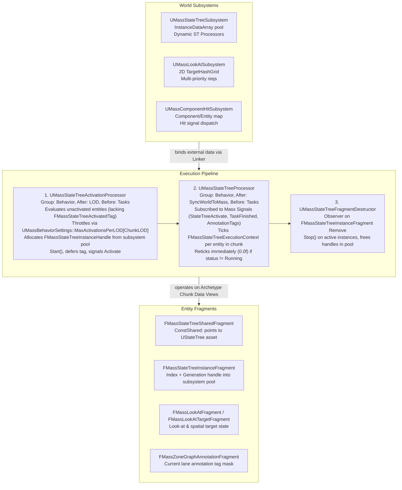
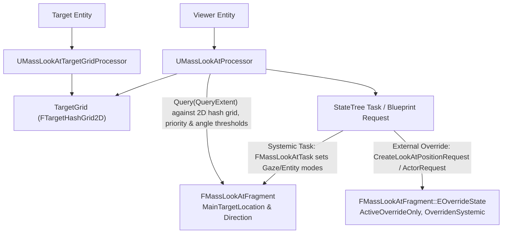

# Behavior and StateTree — UE 5.8 MASS

## Scope
MassAIBehavior provides the decision-making runtime for Mass entities by coupling Epic's StateTree hierarchical state machine framework to Mass ECS. This module defines `UMassStateTreeSchema`, custom execution contexts (`FMassStateTreeExecutionContext`), runtime state memory management (`UMassStateTreeSubsystem`), dynamically spawned requirement-driven processors (`UMassStateTreeProcessor`), activation throttling per LOD (`UMassBehaviorSettings`), an autonomous 2D hash grid Look-At awareness pipeline, ZoneGraph lane annotation evaluators, and native component hit handling.

## Architecture

StateTrees in Mass operate data-driven behaviors over heterogeneous entity populations without instantiating `UObject` brains per agent. Mass entities store an execution handle and asset pointer in fragments, while execution contexts dynamically bind archetype chunk memory during processor execution.



### Dynamic StateTree Processors & Dependency Builder
Instead of a static monolithic processor running all StateTrees, `UMassStateTreeSubsystem` instantiates `UMassStateTreeProcessor` instances dynamically based on requirements:
1. When linking an asset with schema `UMassStateTreeSchema`, tasks and evaluators implement `GetDependencies(FStateTreeDependencyBuilder& Builder)`.
2. `UMassStateTreeSchema::Link()` compiles an array of `FMassStateTreeDependency` structs (representing `UStruct*` type and `EMassFragmentAccess` ReadOnly/ReadWrite).
3. At runtime, `UMassStateTreeSubsystem::CreateProcessorForStateTree()` hashes the collective fragment and subsystem requirements (`HashCombine(GetTypeHash(FragmentRequirements), GetTypeHash(SubsystemRequirements))`).
4. If a dynamic processor with identical dependency requirements exists in `RequirementsHashToProcessor`, the tree is registered with it via `AddHandledStateTree()`. Otherwise, a new processor of class `UMassBehaviorSettings::DynamicStateTreeProcessorClass` is instantiated and initialized.
5. `UMassStateTreeProcessor::ExportRequirements()` exports these merged requirements directly into the `FMassProcessorDependencySolver` phase graph to prevent concurrent data race hazards against other Mass processors.

## Key Types

| Symbol | Module | Responsibility |
| :--- | :--- | :--- |
| `UMassStateTreeSchema` | `MassAIBehavior` | Schema defining allowable nodes (Mass tasks, evaluators, conditions, common bases) and linking Mass fragment/subsystem dependencies. |
| `FMassStateTreeDependency` | `MassAIBehavior` | Encapsulates a `UStruct*` dependency (fragment, tag, chunk, shared, or subsystem) and `EMassFragmentAccess`. |
| `UE::MassBehavior::FStateTreeDependencyBuilder` | `MassAIBehavior` | Fluent builder interface to register required/optional fragment and subsystem dependencies from tasks/evaluators. |
| `FMassStateTreeExecutionContext` | `MassAIBehavior` | Derives from `FStateTreeExecutionContext`; provides current entity handle, `FMassExecutionContext`, and entity manager accessors to StateTree nodes. |
| `FMassExecutionExtension` | `MassAIBehavior` | `FStateTreeExecutionExtension` storing active `FMassEntityHandle` and linked asset override hashes for execution instances. |
| `FMassStateTreeInstanceFragment` | `MassAIBehavior` | Entity fragment holding an `FMassStateTreeInstanceHandle` and `LastUpdateTimeInSeconds`. |
| `FMassStateTreeSharedFragment` | `MassAIBehavior` | Const shared fragment storing the shared `TObjectPtr<UStateTree>` asset pointer across chunk archetypes. |
| `FMassStateTreeActivatedTag` | `MassAIBehavior` | Tag marking an entity whose StateTree has completed initialization and sent the initial activation signal. |
| `UMassStateTreeSubsystem` | `MassAIBehavior` | Manages `FStateTreeInstanceData` generational pool, dynamic processor registry, and thread-safe instance allocations. |
| `UMassStateTreeActivationProcessor` | `MassAIBehavior` | Throttles StateTree start invocations per LOD chunk, allocates instance handles, and initiates first execution ticks. |
| `UMassStateTreeProcessor` | `MassAIBehavior` | Signal-driven processor ticking active StateTrees on entities; supports optional chunk-level parallel ticking via concurrent FIFO queue. |
| `UMassStateTreeFragmentDestructor` | `MassAIBehavior` | Observer processor cleaning up and freeing instance pool memory when an entity loses `FMassStateTreeInstanceFragment`. |
| `UMassStateTreeTrait` | `MassAIBehavior` | Trait attaching `FMassStateTreeSharedFragment` and `FMassStateTreeInstanceFragment`; validates required fragments and subsystems. |
| `UMassBehaviorSettings` | `MassAIBehavior` | Module configuration specifying `MaxActivationsPerLOD` array and `DynamicStateTreeProcessorClass`. |
| `UMassLookAtSubsystem` | `MassAIBehavior` | Spatial awareness subsystem hosting `UE::Mass::LookAt::FTargetHashGrid2D` and managing active look-at requests across priorities. |
| `FMassLookAtFragment` | `MassAIBehavior` | Fragment storing current gaze/look-at mode, directional vectors, tracked entity handles, and override state machine. |
| `FMassLookAtTargetFragment` | `MassAIBehavior` | Marks an entity as a look-at target; stores target offset, priority, and `FCellLocation` in the hash grid. |
| `UMassLookAtProcessor` | `MassAIBehavior` | Computes primary gaze vectors, path trajectory look-at, tracked target offsets, and queries nearby hash grid targets. |
| `UMassLookAtTargetGridProcessor` | `MassAIBehavior` | Updates target bounding boxes and maintains spatial registration inside `UMassLookAtSubsystem`'s hash grid. |
| `UMassLookAtTrait` / `UMassLookAtTargetTrait` | `MassAIBehavior` | Traits configuring look-at viewer and target entity templates. |
| `UMassComponentHitSubsystem` | `MassAIBehavior` | Ticking subsystem registering capsule component hit callbacks and routing collision records to Mass entities. |
| `FMassComponentHitEvaluator` | `MassAIBehavior` | StateTree evaluator exposing `bGotHit` and `LastHitEntity` from `UMassComponentHitSubsystem`. |
| `FMassZoneGraphAnnotationEvaluator` | `MassAIBehavior` | StateTree evaluator reading current lane tags from `FMassZoneGraphAnnotationFragment` into tree instance parameters. |
| `FZoneGraphTagFilterCondition` | `MassAIBehavior` | StateTree condition comparing entity ZoneGraph tags against an `FZoneGraphTagFilter`. |
| `FZoneGraphTagMaskCondition` | `MassAIBehavior` | StateTree condition comparing entity tag masks with `EZoneLaneTagMaskComparison` (Any, All, Exact). |
| `UMassDebugStateTreeProcessor` | `MassAIDebug` | Debug processor rendering active state, task descriptions, and entity StateTree visual logging. |

## Data Flow

### 1. StateTree Entity Lifecycle
1. **Authoring & Linking**: A StateTree asset uses `UMassStateTreeSchema`. At link/compile time, nodes invoke `GetDependencies()` via `FStateTreeDependencyBuilder`.
2. **Template Assembly**: `UMassStateTreeTrait::BuildTemplate` adds `FMassStateTreeSharedFragment` (const shared) and `FMassStateTreeInstanceFragment`. In editor/validation, `ValidateTemplate` inspects `StateTree->GetExternalDataDescs()` and verifies all required `FMassFragment`, `FMassSharedFragment`, and `UWorldSubsystem` dependencies exist on the entity template.
3. **Registration**: At world start, `UMassStateTreeSubsystem::CreateProcessorForStateTree` evaluates the dependencies, hashes requirements, and instantiates or associates a `UMassStateTreeProcessor`.
4. **Throttled Activation**: `UMassStateTreeActivationProcessor` runs each frame:
   - Queries entities with `FMassStateTreeInstanceFragment` lacking `FMassStateTreeActivatedTag`.
   - Checks `ChunkLOD = FMassSimulationVariableTickChunkFragment::GetChunkLOD(Context)`.
   - If `ActivationCounts[ChunkLOD] + NumEntities <= MaxActivationsPerLOD[ChunkLOD]`, processes the chunk:
     - Allocates `FMassStateTreeInstanceHandle` from `UMassStateTreeSubsystem::AllocateInstanceData()`.
     - Initializes context: `FMassStateTreeExecutionContext StateTreeContext(MassStateTreeSubsystem, *StateTree, *InstanceData, Context)`.
     - Calls `StateTreeContext.Start()`.
     - Defers addition of `FMassStateTreeActivatedTag`.
     - Signals `UE::Mass::Signals::StateTreeActivate` via `UMassSignalSubsystem`.
5. **Runtime Execution**: `UMassStateTreeProcessor` executes when signaled:
   - Evaluates entities responding to registered signals (`StateTreeActivate`, `NewStateTreeTaskRequired`, `StandTaskFinished`, etc.).
   - Computes adjusted delta time: `AdjustedDeltaTime = CurrentTime - StateTreeFragment.LastUpdateTimeInSeconds`.
   - Invokes `StateTreeExecutionContext.Tick(AdjustedDeltaTime)`.
   - If `GetLastTickStatus() != EStateTreeRunStatus::Running`, immediately reticks with `DeltaTime = 0.0f` to transition to a new active state in the same frame without stalling. If still not running, defers a `UE::Mass::Signals::NewStateTreeTaskRequired` signal for the subsequent frame.
6. **Destruction**: `UMassStateTreeFragmentDestructor` catches removed `FMassStateTreeInstanceFragment`, calls `StateTreeContext.Stop()`, and releases memory to `InstanceDataFreelist` incrementing generational indices.

### 2. Look-At Subsystem Flow


## StateTree Task Catalog

MassAIBehavior ships with a suite of native StateTree tasks conforming to `FMassStateTreeTaskBase`:

| Task Struct | Display Name | Category | Primary Handles / Dependencies | Completion / Signaling |
| :--- | :--- | :--- | :--- | :--- |
| `FMassLookAtTask` | Mass LookAt Task | LookAt | `UMassSignalSubsystem`, `FMassLookAtFragment` (Optional) | Sets look-at mode and gaze parameters in `FMassLookAtFragment`. Runs indefinitely or completes after `Duration`. |
| `FMassZoneGraphStandTask` | ZG Stand | ZoneGraph | `FMassZoneGraphLaneLocationFragment`, `FMassMoveTargetFragment`, `FMassZoneGraphShortPathFragment`, `FMassZoneGraphCachedLaneFragment`, `FMassMovementParameters`, `UZoneGraphSubsystem`, `UMassSignalSubsystem` | Calls `ActivateActionStand`. Delays `UE::Mass::Signals::StandTaskFinished` if `Duration > 0`. |
| `FMassZoneGraphPathFollowTask` | ZG Path Follow | ZoneGraph | `FMassZoneGraphLaneLocationFragment`, `FMassMoveTargetFragment`, `FMassZoneGraphShortPathFragment`, `FMassZoneGraphCachedLaneFragment`, `FMassMovementParameters`, `UZoneGraphSubsystem` | Activates lane path following. Subscribed to `FollowPointPathDone` signal. |
| `FMassZoneGraphFindEscapeTarget` | ZG Find Escape Target | ZoneGraph | `FMassZoneGraphLaneLocationFragment`, `UZoneGraphSubsystem`, `FTransformFragment` | Queries ZoneGraph boundary/lane graph to determine an escape lane/direction away from a threat. |
| `FMassZoneGraphFindSmartObjectTarget` | ZG Find Smart Object Target | SmartObject / ZG | `FMassZoneGraphLaneLocationFragment`, `USmartObjectSubsystem`, `UZoneGraphAnnotationSubsystem` | Scans for smart objects anchored along current ZoneGraph lanes within range. |
| `FMassNavMeshStandTask` | NavMesh Stand | NavMesh | `FMassMoveTargetFragment`, `FMassMovementParameters`, `UMassSignalSubsystem` | Directs agent to stand stationary on NavMesh; dispatches `StandTaskFinished` on timer. |
| `FMassNavMeshPathFollowTask` | NavMesh Path Follow | NavMesh | `FMassMoveTargetFragment`, `FMassMovementParameters`, `FTransformFragment`, `UNavigationSystemV1` | Requests navigation corridor / path follow over standard recast NavMesh. |
| `FMassNavMeshFindReachablePointTask` | NavMesh Find Random Reachable Target | NavMesh | `FTransformFragment`, `UNavigationSystemV1` | Finds random navigable point within radius and populates target output property. |
| `FMassNavMeshAnimateTask` | NavMesh Animate | NavMesh | `FMassMoveTargetFragment`, `UMassSignalSubsystem` | Plays contextual or stationary animation on NavMesh; fires `AnimateTaskFinished`. |
| `FMassFindSmartObjectTask` | Find Smart Object | SmartObject | `USmartObjectSubsystem`, `FTransformFragment`, `FMassSmartObjectUserFragment` | Queries `USmartObjectSubsystem` spatial octree/hash for matching candidate smart objects. |
| `FMassFindSmartObjectTargetTask` | Find Smart Object Target | SmartObject | `USmartObjectSubsystem`, `FMassSmartObjectUserFragment` | Resolves entry interaction slot transform for a claimed/selected smart object candidate. |
| `FMassClaimSmartObjectTask` | Claim SmartObject | SmartObject | `USmartObjectSubsystem`, `FMassSmartObjectUserFragment` | Attempts claim on smart object handle. Emits `SmartObjectCandidatesReady` / `InteractionDone`. |
| `FMassUseSmartObjectTask` | Mass Use SmartObject Task | SmartObject | `USmartObjectSubsystem`, `FMassSmartObjectUserFragment` | Executes interaction state; listens for `SmartObjectInteractionDone` or `Aborted`. |

## Evaluators and Conditions

MassAIBehavior uses StateTree Evaluators and Conditions to pipe ECS data into StateTree transitions without manual blueprint binding.

### Evaluators
- **`FMassZoneGraphAnnotationEvaluator`** (`DisplayName = "ZG Annotation Tags"`):
  - Dependencies: `FMassZoneGraphAnnotationFragment` (ReadOnly).
  - Ticks each frame to copy `AnnotationTagsFragmentHandle->Tags` to instance output parameter `AnnotationTags` (`FZoneGraphTagMask`).
- **`FMassComponentHitEvaluator`** (`DisplayName = "Mass ComponentHit Eval"`):
  - Dependencies: `UMassComponentHitSubsystem` (ReadOnly).
  - Queries `GetLastHit(Entity)` from subsystem. Outputs `bGotHit` (`bool`) and `LastHitEntity` (`FMassEntityHandle`) for conditional branch evaluations.

### Conditions
- **`FZoneGraphTagFilterCondition`** (`DisplayName = "ZoneGraphTagFilter Compare"`):
  - Evaluates an input `FZoneGraphTagMask` against an `FZoneGraphTagFilter` mask rule. Supports inversion (`bInvert`).
- **`FZoneGraphTagMaskCondition`** (`DisplayName = "ZoneGraphTagMask Compare"`):
  - Compares two `FZoneGraphTagMask` values using `EZoneLaneTagMaskComparison` (`Any`, `All`, `Exact`).
- **`FZoneGraphTagCondition`** (`DisplayName = "ZoneGraphTag Compare"`):
  - Tests equality between two individual `FZoneGraphTag` entries.

## Look-At Subsystem & Priority System

`UMassLookAtSubsystem` is a `UMassTickableSubsystemBase` providing spatial target discovery and multi-source request arbitration.

### Spatial Target Hash Grid
Targets are indexed using `UE::Mass::LookAt::FTargetHashGrid2D` (a `THierarchicalHashGrid2D<2, 4, FTargetHashGridItem>`):
- **Hierarchy**: 2 levels of hierarchy, ratio of 4 between levels.
- Targets are registered via `AddTarget()`, moved in batches via `BatchMoveTarget()` or `MoveTarget()`, and queried within a bounding box via `Query(FBox, OutEntities)`.
- `UMassLookAtTargetGridProcessor` synchronizes entity world transforms from `FTransformFragment` into the hash grid every frame.

### Priority Resolution & Overrides
`UMassLookAtSettings` allows configuring up to 16 named priorities (`EMassLookAtPriorities::MaxPriorities = 16`, indices `0..15`, where `0` is highest priority and `15` is `LowestPriority`):
```cpp
// Target priority configuration
UPROPERTY(EditAnywhere, config, Category = LookAt)
FMassLookAtPriorityInfo Priorities[16];
```
A viewer entity can have multiple concurrent look-at requests registered via:
1. **Systemic StateTree Task**: Configured by `FMassLookAtTask`.
2. **Dynamic Subsystem Requests**: Created via Blueprint/C++ API:
   - `UMassLookAtSubsystem::CreateLookAtPositionRequest(ViewerActor, Priority, TargetLocation, ...)`
   - `UMassLookAtSubsystem::CreateLookAtActorRequest(ViewerActor, Priority, TargetActor, ...)`
3. **Arbitration**: `FMassLookAtFragment::OverrideState` handles transitions between `AllDisabled`, `ActiveOverrideOnly`, `ActiveSystemicOnly`, `OverridenSystemic`, and `PendingSystemicReactivation`. When an external override request with higher priority arrives, systemic task values are suppressed until the override is removed via `DeleteRequest(Handle)`.

## Usage & Worked Examples

### 1. Defining a Custom Mass StateTree Task
A custom Mass StateTree task must inherit from `FMassStateTreeTaskBase`, declare external data handles, link them in `Link()`, and publish requirements in `GetDependencies()`:

```cpp
#include "MassStateTreeTypes.h"
#include "MassStateTreeDependency.h"
#include "MassStateTreeExecutionContext.h"
#include "StateTreeLinker.h"
#include "MassMovementFragments.h"
#include "MassMyTask.generated.h"

USTRUCT()
struct FMassPatrolSpeedTaskInstanceData
{
	GENERATED_BODY()

	UPROPERTY(EditAnywhere, Category = Parameter)
	float DesiredSpeed = 400.0f;
};

USTRUCT(meta = (DisplayName = "Mass Set Patrol Speed"))
struct FMassPatrolSpeedTask : public FMassStateTreeTaskBase
{
	GENERATED_BODY()

	using FInstanceDataType = FMassPatrolSpeedTaskInstanceData;

	virtual const UStruct* GetInstanceDataType() const override 
	{ 
		return FInstanceDataType::StaticStruct(); 
	}

	virtual bool Link(FStateTreeLinker& Linker) override
	{
		Linker.LinkExternalData(MovementParamsHandle);
		return true;
	}

	virtual void GetDependencies(UE::MassBehavior::FStateTreeDependencyBuilder& Builder) const override
	{
		// Informs UMassStateTreeSchema and dynamic processors of required fragment access
		Builder.AddReadWrite(MovementParamsHandle);
	}

	virtual EStateTreeRunStatus EnterState(FStateTreeExecutionContext& Context, const FStateTreeTransitionResult& Transition) const override
	{
		const FMassStateTreeExecutionContext& MassContext = static_cast<FMassStateTreeExecutionContext&>(Context);
		FMassMovementParameters& MovementParams = Context.GetExternalData(MovementParamsHandle);
		const FInstanceDataType& InstanceData = Context.GetInstanceData(*this);

		MovementParams.DefaultDesiredSpeed = InstanceData.DesiredSpeed;
		return EStateTreeRunStatus::Running;
	}

protected:
	TStateTreeExternalDataHandle<FMassMovementParameters> MovementParamsHandle;
};
```

### 2. Spawning Entities with StateTree via Trait
Add `UMassStateTreeTrait` to a `UMassEntityConfigAsset` (or configure via reflection/editor since `StateTree` is protected):
```cpp
// Within Custom Trait or Config Asset Setup (or configured in editor on the UMassStateTreeTrait instance)
UMassStateTreeTrait* StateTreeTrait = NewObject<UMassStateTreeTrait>(ConfigOwner);
if (FProperty* Prop = UMassStateTreeTrait::StaticClass()->FindPropertyByName(TEXT("StateTree")))
{
	Prop->SetValue_InContainer(StateTreeTrait, MyStateTreeAsset); // Asset using UMassStateTreeSchema
}
ConfigAsset->GetMutableConfig().AddTrait(*StateTreeTrait);
```
### 3. Creating an External Look-At Request in C++
```cpp
// Look at an arbitrary threat location with High Priority
UMassLookAtSubsystem* LookAtSubsystem = World->GetSubsystem<UMassLookAtSubsystem>();
if (LookAtSubsystem)
{
	FMassLookAtPriority HighPriority(1); // Index 1 in UMassLookAtSettings
	FMassLookAtRequestHandle RequestHandle = LookAtSubsystem->CreateLookAtPositionRequest(
		MyViewerActor,
		HighPriority,
		ThreatLocation,
		EMassLookAtInterpolationSpeed::Fast
	);

	// Later when finished:
	LookAtSubsystem->DeleteRequest(RequestHandle);
}
```

## Pitfalls

1. **Forgetting `GetDependencies()` in Custom Tasks**:
   `Link()` resolves external data indices for the StateTree instance runtime, but **only** `GetDependencies()` informs `UMassStateTreeSchema::Link()` and `UMassStateTreeSubsystem::CreateProcessorForStateTree()`. Omitting `GetDependencies()` results in dynamic processors lacking fragment requirements in `FMassProcessorDependencySolver`, producing severe data races or assertion failures in `AreContextDataViewsValid()`.
2. **Non-GameThread Instance Allocations**:
   `UMassStateTreeSubsystem::AllocateInstanceData` and `FreeInstanceData` are guarded by `UE_MT_DECLARE_TS_RW_ACCESS_DETECTOR(InstanceDataMTDetector)`. Allocating StateTree instances from concurrent worker threads trips an access violation detector assertion.
3. **LOD Starvation via MaxActivationsPerLOD**:
   If `UMassBehaviorSettings::MaxActivationsPerLOD` is set too low (default: `MaxActivationsPerLOD[EMassLOD::Max]`), and a large crowd spawns simultaneously, entities beyond the threshold are skipped in `UMassStateTreeActivationProcessor` and will wait in an unactivated state until budget is available.
4. **StateTree Re-tick Loop / Stalls**:
   When a task completes (`status != Running`), `UMassStateTreeProcessor` ticks the instance immediately with delta time `0.0f` to find a new state. If state transitions fail or evaluate to `Failed`/`Succeeded` without selecting a new `Running` state, the entity is queued via `EntitiesToSignal` to receive `UE::Mass::Signals::NewStateTreeTaskRequired`. If StateTree transitions are misconfigured, this will repeatedly wake and re-signal every frame.
5. **Direct Blueprint Task Unsupported**:
   StateTree nodes running inside Mass **cannot** be standard Blueprint tasks (`UStateTreeTaskBlueprintBase`) because Mass entities lack individual `UObject` execution contexts. Tasks must be native C++ structs deriving from `FMassStateTreeTaskBase`.
6. **Look-At Subsystem Hash Grid Threading**:
   `TMassExternalSubsystemTraits<UMassLookAtSubsystem>::ThreadSafeWrite` is `false`. Processors mutating target grid locations must run sequentially or respect the writer lock.

## Source Files

### Engine/Plugins/AI/MassAI/Source/MassAIBehavior/
- `Public/MassStateTreeSchema.h`, `Private/MassStateTreeSchema.cpp` — Mass StateTree schema and dependency collection.
- `Public/MassStateTreeDependency.h`, `Private/MassStateTreeDependency.cpp` — `FMassStateTreeDependency` and `FStateTreeDependencyBuilder`.
- `Public/MassStateTreeExecutionContext.h`, `Private/MassStateTreeExecutionContext.cpp` — Execution context binding Mass entities to StateTree.
- `Public/MassStateTreeTypes.h`, `Private/MassStateTreeTypes.cpp` — Base task/evaluator/condition structs, instance handles, signal names.
- `Public/MassStateTreeFragments.h` — `FMassStateTreeInstanceFragment`, `FMassStateTreeSharedFragment`.
- `Public/MassStateTreeSubsystem.h`, `Private/MassStateTreeSubsystem.cpp` — Instance data array allocator, dynamic processor factory.
- `Public/MassStateTreeProcessors.h`, `Private/MassStateTreeProcessors.cpp` — `UMassStateTreeActivationProcessor`, `UMassStateTreeProcessor`, `UMassStateTreeFragmentDestructor`.
- `Public/MassStateTreeTrait.h`, `Private/MassStateTreeTrait.cpp` — Template builder and requirement validator.
- `Public/MassBehaviorSettings.h`, `Private/MassBehaviorSettings.cpp` — LOD activation budgets and processor class override.
- `Public/MassLookAtTypes.h`, `Public/MassLookAtFragments.h`, `Private/MassLookAtFragments.cpp` — LookAt math, hierarchical grid typedef, fragments.
- `Public/MassLookAtSubsystem.h`, `Private/MassLookAtSubsystem.cpp` — Hash grid targets, request prioritization.
- `Public/MassLookAtProcessors.h`, `Private/MassLookAtProcessors.cpp` — `UMassLookAtProcessor`, `UMassLookAtTargetGridProcessor`, initializer/remover observers.
- `Public/MassLookAtTrait.h`, `Public/MassLookAtTargetTrait.h` — Entity traits for viewers and targets.
- `Public/MassLookAtSettings.h`, `Private/MassLookAtSettings.cpp` — Developer settings for priorities, heights, offsets.
- `Public/MassZoneGraphAnnotationFragments.h`, `Public/MassZoneGraphAnnotationTypes.h` — Lane annotation tags.
- `Public/MassZoneGraphAnnotationProcessors.h`, `Private/MassZoneGraphAnnotationProcessors.cpp` — Annotation initializers and updates.
- `Public/MassZoneGraphAnnotationTrait.h`, `Private/MassZoneGraphAnnotationTrait.cpp` — Trait injecting lane annotation fragments.
- `Public/Evaluators/MassZoneGraphAnnotationEvaluator.h`, `Private/Evaluators/MassZoneGraphAnnotationEvaluator.cpp` — Evaluator exposing tag masks.
- `Public/Conditions/ZoneGraphTagConditions.h`, `Private/Conditions/ZoneGraphTagConditions.cpp` — Tag filter, mask, and equality conditions.
- `Public/MassComponentHitSubsystem.h`, `Private/MassComponentHitSubsystem.cpp` — Capsule hit collection subsystem.
- `Public/MassComponentHitTypes.h`, `Public/Evaluators/MassComponentHitEvaluator.h` — Hit evaluator and result fragments.
- `Public/Tasks/` (`MassLookAtTask.h`, `MassZoneGraphStandTask.h`, `MassZoneGraphPathFollowTask.h`, `MassZoneGraphFindEscapeTarget.h`, `MassZoneGraphFindSmartObjectTarget.h`, `MassNavMeshStandTask.h`, `MassNavMeshPathfollowTask.h`, `MassNavMeshFindReachablePointTask.h`, `MassNavMeshAnimateTask.h`, `MassFindSmartObjectTask.h`, `MassFindSmartObjectTargetTask.h`, `MassClaimSmartObjectTask.h`, `MassUseSmartObjectTask.h`) — Native task implementations.

### Engine/Plugins/AI/MassAI/Source/MassAIDebug/
- `Public/MassDebugStateTreeProcessor.h`, `Private/MassDebugStateTreeProcessor.cpp` — Visual debugging and inspection processor.

## Graph Facts
*(Extracted from `local://mass_graph_facts.md` corpus)*
- The `MassAI` module contains **2,205 nodes** in the graph corpus.
- StateTree behavior execution relies directly on `FMassExecutionContext` (126 nodes, 476 edge degrees, 117 symbol degree) and `FMassEntityManager` (539 symbol degree, 848 file degree) to resolve archetype chunks and subsystem requirements during signal ticks.
- Dynamic StateTree processors bridge Mass into non-MASS communities including **Core Engine Types** (1,227 cross-community bridges) and **Reflection and Property Change** (265 cross-community bridges) through `FStateTreeInstanceData` property copying and linker reflection.
