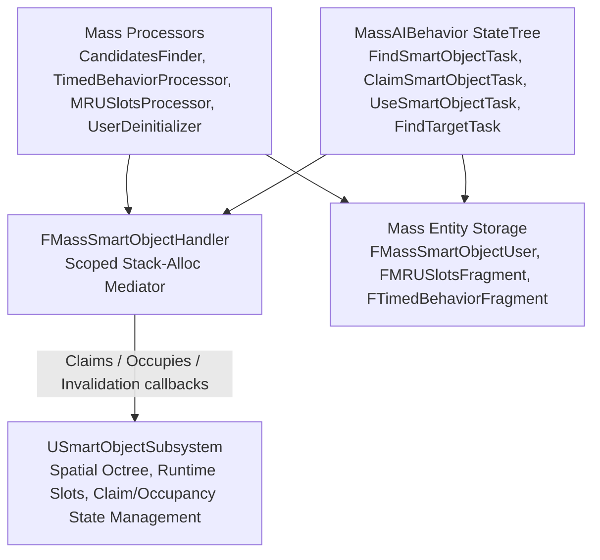
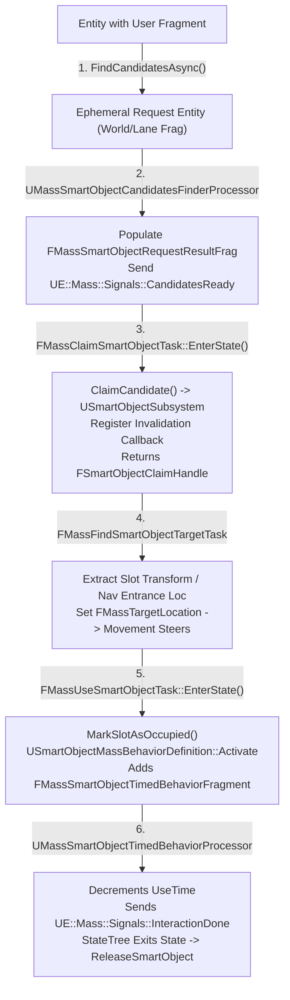
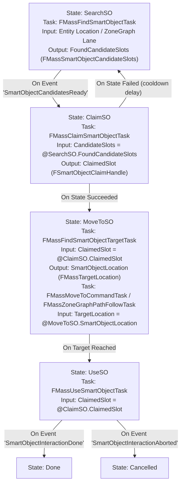

# Smart Objects — UE 5.8 MASS

## Scope
MassSmartObjects architecture and integration with SmartObjectsModule: behavior definitions (`USmartObjectMassBehaviorDefinition`), fragments, stack handler (`FMassSmartObjectHandler`), candidate finder and decay processors, dynamic registration via signals/observers, request lifecycle, settings, user traits (`UMassSmartObjectUserTrait`), ZoneGraph lane annotations (`USmartObjectZoneAnnotations`), and StateTree tasks in `MassAIBehavior`.

## Architecture

MassSmartObjects bridges Unreal's Smart Object framework (`SmartObjectsModule`) with data-oriented Mass ECS. The integration model addresses two core challenges:
1. **Disjoint Lifecycles**: Smart Object simulation (`USmartObjectSubsystem`) operates on UObjects and persistent registration handles (`FSmartObjectHandle`, `FSmartObjectClaimHandle`), while Mass entities operate within archetypes and chunks managed by `FMassEntityManager`.
2. **Asynchronous Candidate Discovery**: Spatial queries across octrees or ZoneGraph lanes can be computationally expensive. MassSmartObjects offloads candidate searches to dedicated Mass request entities and processors (`UMassSmartObjectCandidatesFinderProcessor`), signaling user entities when candidates are resolved.



### Registration Lifecycle
Smart objects can be instantiated dynamically for Mass entities using observer and signal processors:
- **`FSmartObjectRegistrationFragment`**: Stores a `TWeakObjectPtr<USmartObjectDefinition>` asset and the resulting `FSmartObjectHandle`.
- **`UMassActiveSmartObjectInitializer` / `UMassActiveSmartObjectDeinitializer`**: Observer processors observing `FMassInActiveSmartObjectsRangeTag` (addition/removal). They broadcast `UE::Mass::Signals::SmartObjectActivationChanged`.
- **`UMassActorInstanceHandleInitializer` / `UMassActorInstanceHandleDeinitializer`**: Observe `FMassActorInstanceFragment` and signal `UE::Mass::Signals::ActorInstanceHandleChanged`.
- **`UMassActiveSmartObjectSignalProcessor`**: Subscribes to both signals. Executes strictly on the Game Thread (`bRequiresGameThreadExecution = true`). When an entity enters active range with a valid actor handle, it calls `USmartObjectSubsystem::CreateSmartObject` passing `FSmartObjectActorOwnerData(InstancedActorFragment.Handle)` and saves the handle. When out of range or destroyed, it invokes `USmartObjectSubsystem::DestroySmartObject`.

### Request, Claim, and Activation Flow
1. **Request Creation**: The agent initiates candidate search using `FMassSmartObjectHandler::FindCandidatesAsync`. This reserves an ephemeral request entity (`EntityManager.ReserveEntity()`) containing `FMassSmartObjectRequestResultFragment` and either `FMassSmartObjectWorldLocationRequestFragment` or `FMassSmartObjectLaneLocationRequestFragment`.
2. **Candidate Search**: In the next tick before behaviors run (`ExecutionOrder.ExecuteBefore.Add(ProcessorGroupNames::Behavior)`), `UMassSmartObjectCandidatesFinderProcessor` queries the `USmartObjectSubsystem` octree or `UZoneGraphAnnotationSubsystem` lane lookup. Matches are filtered against `USmartObjectMassBehaviorDefinition` and sorted by traversal cost. Results populate `FMassSmartObjectCandidateSlots` (fixed inline array of up to 4 candidates), marked with `FMassSmartObjectCompletedRequestTag`.
3. **Signaling**: `UMassSignalSubsystem` broadcasts `UE::Mass::Signals::SmartObjectCandidatesReady` to the requesting entities.
4. **Claim**: `FMassSmartObjectHandler::ClaimCandidate` iterates available candidate slots and invokes `USmartObjectSubsystem::MarkSlotAsClaimed`, returning `FSmartObjectClaimHandle`. It registers an invalidation callback (`OnSlotInvalidated`) with `FPayload` (capturing `Entity`, `EntityManager`, `SmartObjectSubsystem`, `SignalSubsystem`). If the slot is destroyed or claimed by higher priority, the callback marks the interaction as aborted and signals `UE::Mass::Signals::SmartObjectInteractionAborted`.
5. **Activation**: When reaching the slot, `FMassSmartObjectHandler::StartUsingSmartObject` calls `SmartObjectSubsystem.MarkSlotAsOccupied<USmartObjectMassBehaviorDefinition>`. The definition's `Activate(CommandBuffer, Context)` is executed, pushing required behavior fragments (e.g., `FMassSmartObjectTimedBehaviorFragment`).
6. **Execution & Release**: `UMassSmartObjectTimedBehaviorProcessor` ticks `UseTime`. Upon completion, it sets `EMassSmartObjectInteractionStatus::BehaviorCompleted` and signals `UE::Mass::Signals::SmartObjectInteractionDone`. StateTree or the handler cleans up the claim, records slot history to `FMRUSlotsFragment`, and frees the slot.

## Key types

| Symbol | Module | Responsibility |
| :--- | :--- | :--- |
| `FMassSmartObjectUserFragment` | `MassSmartObjects` | User state on entity: `UserTags`, active `InteractionHandle`, `InteractionStatus`, and `InteractionCooldownEndTime`. |
| `FMassSmartObjectTimedBehaviorFragment` | `MassSmartObjects` | Ticked by timed processor: holds countdown float `UseTime`. |
| `UE::Mass::SmartObject::FMRUSlotsFragment` | `MassSmartObjects` | Ring buffer holding up to 4 recently used `FSmartObjectSlotHandle` entries with decay timers. |
| `FMassSmartObjectRequestID` | `MassSmartObjects` | 1:1 wrapper around `FMassEntityHandle` representing an in-flight search request entity. |
| `FMassSmartObjectCandidateSlots` | `MassSmartObjects` | Fixed buffer of up to 4 candidate slots (`FSmartObjectCandidateSlot`) sorted by cost. |
| `FMassSmartObjectWorldLocationRequestFragment` | `MassSmartObjects` | Payload for spatial octree searches: `SearchOrigin`, `UserTags`, `ActivityRequirements`. |
| `FMassSmartObjectLaneLocationRequestFragment` | `MassSmartObjects` | Payload for ZoneGraph searches: `CompactLaneLocation`, `UserTags`, `ActivityRequirements`. |
| `FSmartObjectRegistrationFragment` | `MassSmartObjects` | Stored on entities creating dynamic smart objects: holds definition asset and registered `FSmartObjectHandle`. |
| `USmartObjectMassBehaviorDefinition` | `MassSmartObjects` | Base behavior definition class; overrides `Activate` and `Deactivate` to inject/remove Mass fragments. |
| `FMassSmartObjectHandler` | `MassSmartObjects` | Stack-allocated mediator translating between `FMassExecutionContext`, `USmartObjectSubsystem`, and `UMassSignalSubsystem`. |
| `UMassSmartObjectCandidatesFinderProcessor` | `MassSmartObjects` | Processes candidate requests before behavior phase; emits `SmartObjectCandidatesReady`. |
| `UMassSmartObjectTimedBehaviorProcessor` | `MassSmartObjects` | Advances countdown timers on active interactions in `SyncWorldToMass`; emits `SmartObjectInteractionDone`. |
| `UMassSmartObjectUserFragmentDeinitializer` | `MassSmartObjects` | Observer processor unregistering invalidation delegates when `FMassSmartObjectUserFragment` is removed. |
| `UE::Mass::SmartObject::UMRUSlotsProcessor` | `MassSmartObjects` | Updates decay times on recently used slots according to `UMassSmartObjectSettings`. |
| `UMassSmartObjectSettings` | `MassSmartObjects` | Configuration: ZoneGraph tag, search extents, MRU max slot count, and cooldown duration. |
| `UMassSmartObjectUserTrait` | `MassSmartObjects` | Trait adding `FMassSmartObjectUserFragment` with authoring `UserTags`. |
| `USmartObjectZoneAnnotations` | `MassSmartObjects` | ZoneGraph annotation component indexing entry points along lanes for candidate lookups. |
| `USmartObjectSubsystem` | `SmartObjectsModule` | Core runtime subsystem managing octrees, slot claims, occupancy states, and definitions. |
| `FSmartObjectClaimHandle` | `SmartObjectsModule` | Handle encapsulating `FSmartObjectHandle`, `FSmartObjectSlotHandle`, and `FSmartObjectUserHandle`. |
| `FMassFindSmartObjectTask` | `MassAIBehavior` | StateTree task initiating async candidate discovery and waiting for candidate readiness. |
| `FMassClaimSmartObjectTask` | `MassAIBehavior` | StateTree task claiming the best candidate slot and recording cooldowns / MRU slots. |
| `FMassUseSmartObjectTask` | `MassAIBehavior` | StateTree task invoking `StartUsingSmartObject` and waiting for completion/abortion signals. |
| `FMassFindSmartObjectTargetTask` | `MassAIBehavior` | StateTree task resolving movement targets (slot entrance or slot transform) from a claimed slot. |
| `FMassZoneGraphFindSmartObjectTarget` | `MassAIBehavior` | StateTree task locating navigation target along ZoneGraph lanes using `USmartObjectZoneAnnotations`. |

## Data flow



## Usage

### StateTree Configuration (Claim + Use Task Wiring)
Smart Object interactions in Mass entities are orchestrated via `MassAIBehavior` StateTree tasks. The state flow connects candidate retrieval, slot reservation, path navigation, and behavior execution:



### C++ Scoped Handler Interaction Pattern
Processors or custom StateTree tasks interact with Smart Objects via `FMassSmartObjectHandler`:

```cpp
#include "MassSmartObjectHandler.h"
#include "MassSmartObjectFragments.h"
#include "SmartObjectSubsystem.h"
#include "MassSignalSubsystem.h"
#include "MassExecutionContext.h"

void ExecuteSmartObjectUsage(FMassExecutionContext& Context, 
                             USmartObjectSubsystem& SOSubsystem, 
                             UMassSignalSubsystem& SignalSubsystem, 
                             const FMassEntityHandle Entity, 
                             const FSmartObjectClaimHandle ClaimHandle)
{
    FMassSmartObjectUserFragment& UserFrag = Context.GetMutableFragmentView<FMassSmartObjectUserFragment>()[0];
    
    // Construct stack mediator ensuring valid subsystem references
    const FMassSmartObjectHandler SOHandler(Context, SOSubsystem, SignalSubsystem);

    // 1. Activate Smart Object behavior
    if (SOHandler.StartUsingSmartObject(Entity, UserFrag, ClaimHandle))
    {
        // Behavior is active: USmartObjectMassBehaviorDefinition::Activate has deferred
        // fragment additions (e.g. FMassSmartObjectTimedBehaviorFragment)
    }
    else
    {
        // Failed to occupy slot: release claim
        SOHandler.ReleaseSmartObject(Entity, UserFrag, ClaimHandle);
    }
}
```

### Custom Mass Smart Object Behavior Definition
Extend `USmartObjectMassBehaviorDefinition` to apply custom Mass fragments or tags while the entity occupies the slot:

```cpp
#include "MassSmartObjectBehaviorDefinition.h"
#include "MassCommandBuffer.h"

UCLASS()
class UMyCustomSmartObjectBehaviorDefinition : public USmartObjectMassBehaviorDefinition
{
    GENERATED_BODY()

public:
    virtual void Activate(FMassCommandBuffer& CommandBuffer, const FMassBehaviorEntityContext& EntityContext) const override
    {
        // Invoke super to add FMassSmartObjectTimedBehaviorFragment with UseTime
        Super::Activate(CommandBuffer, EntityContext);

        // Apply custom animation or state fragment
        FMyAnimationFragment AnimFrag;
        AnimFrag.AnimationID = 42;
        CommandBuffer.PushCommand<FMassCommandAddFragmentInstances>(EntityContext.EntityView.GetEntity(), AnimFrag);
    }

    virtual void Deactivate(FMassCommandBuffer& CommandBuffer, const FMassBehaviorEntityContext& EntityContext) const override
    {
        Super::Deactivate(CommandBuffer, EntityContext);

        // Clean up custom fragment upon completion or abort
        CommandBuffer.RemoveFragment<FMyAnimationFragment>(EntityContext.EntityView.GetEntity());
    }
};
```

## Pitfalls

1. **Stack Lifetime of `FMassSmartObjectHandler`**: `FMassSmartObjectHandler` must never be stored as a member variable. It is strictly a stack-allocated mediator scoped to method calls to prevent holding stale subsystem pointers or invalid execution contexts.
2. **Game Thread Requirement for Dynamic Registration**: `UMassActiveSmartObjectSignalProcessor` sets `bRequiresGameThreadExecution = true`. Subsystem calls `CreateSmartObject` and `DestroySmartObject` modify non-thread-safe container structures in `USmartObjectSubsystem` and cannot run concurrently.
3. **Execution Ordering Constraints**: `UMassSmartObjectCandidatesFinderProcessor` must run before behaviors (`ExecutionOrder.ExecuteBefore.Add(UE::Mass::ProcessorGroupNames::Behavior)`). If behaviors run first, an entity created deferred on frame $T$ might be marked complete on $T+1$ while behavior tries to destroy the request entity, causing command buffer flushes to crash.
4. **Invalidation Callback Lifecycle**: When an entity claims a slot, an invalidation callback is bound into `SmartObjectSubsystem`. If the `FMassSmartObjectUserFragment` is destroyed without clearing the claim (e.g., entity death or archetype migration), `UMassSmartObjectUserFragmentDeinitializer` must unregister the callback via `SmartObjectSubsystem.UnregisterSlotInvalidationCallback` to avoid dangling entity handle invocations.
5. **MRU Fixed Buffer Limits**: `FMRUSlots` uses a fixed static array of 4 slots (`MaxNumSlots = 4`). Setting `UMassSmartObjectSettings::MRUSlotsMaxCount` higher than 4 has no effect and is clamped in editor settings.
6. **Interaction Cooldown Double Invalidation**: When claiming a slot in `FMassClaimSmartObjectTask::EnterState`, `InteractionCooldownEndTime` is written immediately to invalidate candidate reuse. If transitions re-evaluate before `ExitState`, ensure states do not loop instantaneously without respecting the cooldown timestamp.
7. **Blueprint Accessibility**: `FMassSmartObjectCandidateSlots` and `FSmartObjectClaimHandle` are `BlueprintType`, but `FMassSmartObjectHandler` and Mass request fragments are purely C++ and StateTree structures. Do not attempt direct Blueprint manipulation of Mass Smart Object requests.

## Source files

- `Engine/Plugins/Runtime/MassGameplay/Source/MassSmartObjects/Public/MassSmartObjectBehaviorDefinition.h`
- `Engine/Plugins/Runtime/MassGameplay/Source/MassSmartObjects/Private/MassSmartObjectBehaviorDefinition.cpp`
- `Engine/Plugins/Runtime/MassGameplay/Source/MassSmartObjects/Public/MassSmartObjectFragments.h`
- `Engine/Plugins/Runtime/MassGameplay/Source/MassSmartObjects/Public/MassSmartObjectHandler.h`
- `Engine/Plugins/Runtime/MassGameplay/Source/MassSmartObjects/Private/MassSmartObjectHandler.cpp`
- `Engine/Plugins/Runtime/MassGameplay/Source/MassSmartObjects/Public/MassSmartObjectProcessor.h`
- `Engine/Plugins/Runtime/MassGameplay/Source/MassSmartObjects/Private/MassSmartObjectProcessor.cpp`
- `Engine/Plugins/Runtime/MassGameplay/Source/MassSmartObjects/Public/MassSmartObjectRegistration.h`
- `Engine/Plugins/Runtime/MassGameplay/Source/MassSmartObjects/Private/MassSmartObjectRegistration.cpp`
- `Engine/Plugins/Runtime/MassGameplay/Source/MassSmartObjects/Public/MassSmartObjectRequest.h`
- `Engine/Plugins/Runtime/MassGameplay/Source/MassSmartObjects/Public/MassSmartObjectSettings.h`
- `Engine/Plugins/Runtime/MassGameplay/Source/MassSmartObjects/Public/MassSmartObjectTypes.h`
- `Engine/Plugins/Runtime/MassGameplay/Source/MassSmartObjects/Public/MassSmartObjectUserTrait.h`
- `Engine/Plugins/Runtime/MassGameplay/Source/MassSmartObjects/Private/MassSmartObjectUserTrait.cpp`
- `Engine/Plugins/Runtime/MassGameplay/Source/MassSmartObjects/Public/SmartObjectZoneAnnotations.h`
- `Engine/Plugins/Runtime/MassGameplay/Source/MassSmartObjects/Private/SmartObjectZoneAnnotations.cpp`
- `Engine/Plugins/Runtime/SmartObjects/Source/SmartObjectsModule/Public/SmartObjectSubsystem.h`
- `Engine/Plugins/Runtime/SmartObjects/Source/SmartObjectsModule/Public/SmartObjectRuntime.h`
- `Engine/Plugins/Runtime/SmartObjects/Source/SmartObjectsModule/Public/SmartObjectTypes.h`
- `Engine/Plugins/AI/MassAI/Source/MassAIBehavior/Public/Tasks/MassFindSmartObjectTask.h`
- `Engine/Plugins/AI/MassAI/Source/MassAIBehavior/Private/Tasks/MassFindSmartObjectTask.cpp`
- `Engine/Plugins/AI/MassAI/Source/MassAIBehavior/Public/Tasks/MassClaimSmartObjectTask.h`
- `Engine/Plugins/AI/MassAI/Source/MassAIBehavior/Private/Tasks/MassClaimSmartObjectTask.cpp`
- `Engine/Plugins/AI/MassAI/Source/MassAIBehavior/Public/Tasks/MassUseSmartObjectTask.h`
- `Engine/Plugins/AI/MassAI/Source/MassAIBehavior/Private/Tasks/MassUseSmartObjectTask.cpp`
- `Engine/Plugins/AI/MassAI/Source/MassAIBehavior/Public/Tasks/MassFindSmartObjectTargetTask.h`
- `Engine/Plugins/AI/MassAI/Source/MassAIBehavior/Private/Tasks/MassFindSmartObjectTargetTask.cpp`
- `Engine/Plugins/AI/MassAI/Source/MassAIBehavior/Public/Tasks/MassZoneGraphFindSmartObjectTarget.h`
- `Engine/Plugins/AI/MassAI/Source/MassAIBehavior/Private/Tasks/MassZoneGraphFindSmartObjectTarget.cpp`

## Graph facts

- **MassGameplay Centrality**: `Engine/Plugins/Runtime/MassGameplay` contains 4,485 nodes and forms the second largest module cluster in the MASS corpus.
- **Subsystem Orchestration**: MassSmartObjects does not maintain its own world subsystem; it relies on `USmartObjectSubsystem` (SmartObjectsModule), `UMassSignalSubsystem` (MassSignals), and `UZoneGraphAnnotationSubsystem` (ZoneGraphAnnotations).
- **Signal Decoupling**: Signal communication via `UE::Mass::Signals::SmartObjectRequestCandidates`, `SmartObjectCandidatesReady`, `SmartObjectInteractionDone`, and `SmartObjectInteractionAborted` allows non-blocking coordination between Mass processors and StateTree behavior executors across frame ticks.
- **Hub-and-Spoke Bridging**: Cross-community dependencies flow from `MassGameplay` / `MassAI` into core engine types and `SmartObjectsModule`, maintaining `FMassEntityManager` as the central ECS coordinator while offloading spatial indexing to the Smart Object octree and ZoneGraph.
