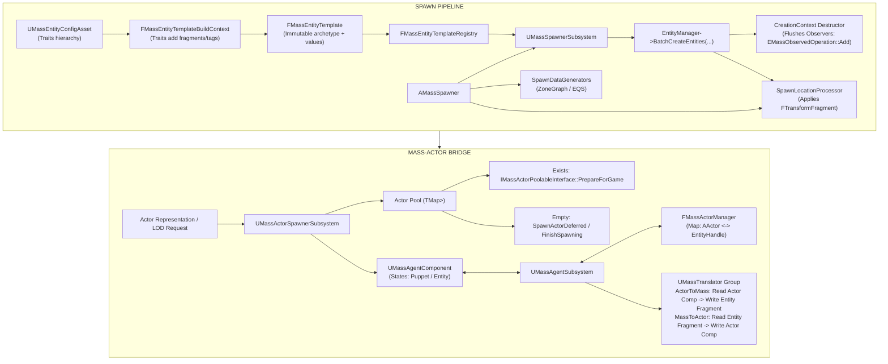
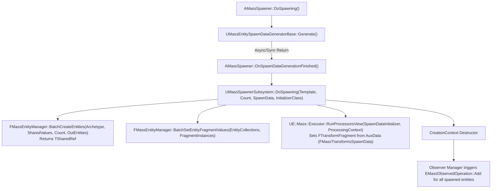

# Spawning and Actors — UE 5.8 MASS

## Scope
MassSpawner and MassActors architecture in UE 5.8: entity configuration assets, trait compilation into finalized entity templates, template registry caching, spawner actor pipeline, spawn data generation (EQS, ZoneGraph, procedural transforms), spawn location processors, deferred entity creation contexts, actor-entity bridging via `UMassAgentComponent` and `UMassAgentSubsystem`, actor pooling through `IMassActorPoolableInterface`, and bidirectional data synchronization translators across engine subsystems.

## Architecture

The bridge between traditional Unreal Engine `AActor` scene representations and high-performance Mass ECS entities is bifurcated into two gameplay modules:
- **`MassSpawner`**: Focuses on pure entity instancing from configuration assets (`UMassEntityConfigAsset`, `FMassEntityConfig`), procedural placement via spawn data generators (`UMassEntitySpawnDataGeneratorBase`), and batched chunk allocation through `UMassSpawnerSubsystem`.
- **`MassActors`**: Manages entity-to-actor tracking (`UMassActorSubsystem`, `FMassActorManager`), asynchronous pooled spawning (`UMassActorSpawnerSubsystem`), actor lifecycle management (`UMassAgentComponent`), and periodic translation between actor components and Mass fragments (`UMassTranslator`).



### Entity Template Compilation and Registry
1. **Config asset hierarchy**: `UMassEntityConfigAsset` wraps `FMassEntityConfig`. Configs support single inheritance via `Parent`, where child configurations inherit and can override parent traits (`GetCombinedTraitsInternal`).
2. **Template building**: `FMassEntityTemplateBuildContext` iterates combined traits (`UMassEntityTraitBase::BuildTemplate`). Traits declare fragment requirements, tags, chunk fragments, and shared fragments into `FMassEntityTemplateData`.
3. **Template immutability**: Once validated, `FMassEntityTemplateData` is frozen into `FMassEntityTemplate` (holding an `FMassArchetypeHandle`, unique `FMassEntityTemplateID`, and `FInstancedStruct` initial values) via `FMassEntityTemplateRegistry::FindOrAddTemplate`.
4. **Template ID**: `FMassEntityTemplateID` is a 64-bit CityHash computed from the asset's `FGuid` combined with a 32-bit `FlavorHash` (`CityHash128to64`).

### The Spawner Pipeline
1. `AMassSpawner` manages an array of entity types (`FMassSpawnedEntityType`) and generators (`FMassSpawnDataGenerator`).
2. `AMassSpawner::DoSpawning` queries all generators asynchronously or synchronously (`UMassEntitySpawnDataGeneratorBase::Generate`).
3. Results arrive as `FMassEntitySpawnDataGeneratorResult` holding an `FInstancedStruct SpawnData` payload (e.g. `FMassTransformsSpawnData`), a `SpawnDataProcessor` class (default `UMassSpawnLocationProcessor`), and the entity count.
4. `UMassSpawnerSubsystem::DoSpawning`:
   - Calls `FMassEntityManager::BatchCreateEntities`, which allocates handles and chunks, returning an `FMassEntityManager::FEntityCreationContext`.
   - Calls `FMassEntityManager::BatchSetEntityFragmentValues` to copy default fragment states from template storage into chunk memory.
   - Executes the `SpawnDataProcessor` via `UE::Mass::Executor::RunProcessorsView` using `FMassProcessingContext.AuxData` to assign generated positions.
   - Returns the `TSharedPtr<FEntityCreationContext>`. When the creation context falls out of scope, its destructor triggers Mass observers registered for `EMassObservedOperation::Add`.

### Actor Spawning, Pooling, and Recycling
`UMassActorSpawnerSubsystem` manages actor instantiate/destroy budgets per frame during the `PrePhysics` phase:
- **Spawning Queue**: Requests are submitted via `RequestActorSpawn` returning `FMassActorSpawnRequestHandle` managed by `FIndexedHandleManager`.
- **Time-sliced Processing**: `ProcessPendingSpawningRequest` processes requests up to `MaxTimeSlicePerTick` seconds using a FIFO/priority scheduler (`GetNextRequestToSpawn`).
- **Actor Pooling**: When `bActorPoolingEnabled` is active:
  - If a free actor of the matching `TSubclassOf<AActor>` exists in `PooledActors`:
    - The actor is popped, unhidden (`SetActorHiddenInGame(false)`), and moved via `SetActorTransform(..., ETeleportType::ResetPhysics)`.
    - Invokes `IMassActorPoolableInterface::Execute_PrepareForGame(PooledActor)`.
    - If `UMassAgentComponent` is present, calls `AgentComp->RegisterWithAgentSubsystem()`.
  - When destroyed via `UMassActorSpawnerSubsystem::DestroyActor`:
    - Checks `IMassActorPoolableInterface::Execute_CanBePooled(Actor)`.
    - If true, calls `IMassActorPoolableInterface::Execute_PrepareForPooling(Actor)`, hides the actor, disables collision/ticks, and stores it in `PooledActors[Actor->GetClass()]`.
    - If false or pooling is disabled, adds the actor to `ActorsToDestroy` for time-sliced `World->DestroyActor`.

### Entity <-> Actor Bridging: Agents and Puppets
`UMassAgentComponent` operates in two distinct operational modes:
1. **Actor Drives Entity (Pure Agent)**: Actor is spawned in the world first. Its `UMassAgentComponent` registers with `UMassAgentSubsystem::RegisterAgentComponent`, queuing entity creation in `PendingAgentEntities`. `HandlePendingInitialization` spawns the Mass entity and copies actor component data into entity fragments via `EMassTranslationDirection::ActorToMass`.
2. **Mass Drives Actor (Puppet)**: High-density simulation exists purely as ECS entities. When an entity enters near-camera LOD, Mass requests actor visualization. The actor is retrieved from pool or spawned, and attached via `UMassAgentSubsystem::MakePuppet`. Puppet-specific fragments are applied via `AddCompositionToEntity_GetDelta`, and initial values copied via `EMassTranslationDirection::MassToActor`.

## Key types

| Symbol | Module | Responsibility |
| :--- | :--- | :--- |
| `AMassSpawner` | `MassSpawner` | Level actor driving entity generation, scaling counts, generator coordination, and despawn cleanup. |
| `UMassSpawnerSubsystem` | `MassSpawner` | World subsystem executing batched chunk allocation, template lookups, and initial fragment copying. |
| `UMassEntityConfigAsset` | `MassSpawner` | Data asset defining traits, parent inheritance, and entity archetype recipes. |
| `FMassEntityConfig` | `MassSpawner` | Embedded struct representation of entity trait configurations with local override capability. |
| `FMassEntityTemplate` | `MassSpawner` | Immutable, finalized entity specification holding archetype handle, shared values, and initial fragments. |
| `FMassEntityTemplateRegistry` | `MassSpawner` | Central world-scoped cache mapping `FMassEntityTemplateID` CityHash values to shared `FMassEntityTemplate` refs. |
| `UMassEntitySpawnDataGeneratorBase` | `MassSpawner` | Abstract strategy for generating spawn transforms, counts, and spatial distributions. |
| `UMassEntityZoneGraphSpawnPointsGenerator` | `MassSpawner` | Generates spawn points along ZoneGraph lanes with tag filtering and min/max lane spacing. |
| `UMassEntityEQSSpawnPointsGenerator` | `MassSpawner` | Executes Environment Query System (EQS) queries to yield spawn locations. |
| `UMassSpawnLocationProcessor` | `MassSpawner` | Processor initializing `FTransformFragment` across chunks from `FMassTransformsSpawnData` aux data. |
| `UMassAssortedFragmentsTrait` | `MassSpawner` | Trait allowing arbitrary manual specification of fragments and tags via `FInstancedStruct`. |
| `UMassTranslator` | `MassSpawner` | Abstract processor base for bidirectional data copying between `UObject`/`Actor` components and entity fragments. |
| `UMassActorSubsystem` | `MassActors` | World subsystem wrapping `FMassActorManager`; maintains thread-safe bidirectional `AActor*` <-> `FMassEntityHandle` maps. |
| `FMassActorManager` | `MassActors` | Thread-safe storage holding `TMap<TObjectKey<const AActor>, FMassEntityHandle>` guarded by read-write access detector. |
| `UMassActorSpawnerSubsystem` | `MassActors` | Manages time-sliced actor spawning queues and class-keyed actor pooling (`PooledActors`). |
| `IMassActorPoolableInterface` | `MassActors` | UInterface implemented by actors to support reuse (`CanBePooled`, `PrepareForPooling`, `PrepareForGame`). |
| `UMassAgentComponent` | `MassActors` | Actor component bridging actor lifecycle state (`EAgentComponentState`) to Mass simulation. |
| `UMassAgentSubsystem` | `MassActors` | Orchestrates batch registration, entity instantiation for actors, and puppet fragment management. |
| `UE::MassActor::AddEntityTagToActor` | `MassActors` | Helper function to look up an actor's entity handle and append an `FMassTag` type safely. |

## Data flow



## Translator Matrix

Translators derive from `UMassTranslator` and copy state between component wrappers and Mass fragments based on `EMassTranslationDirection`:

| Translator Class | Source / Dest Component | Entity Wrapper Fragment | Direction Tags | Synced Fragments |
| :--- | :--- | :--- | :--- | :--- |
| `UMassCapsuleTransformToMassTranslator` | `UCapsuleComponent` | `FCapsuleComponentWrapperFragment` | `FMassCapsuleTransformCopyToMassTag` | `FTransformFragment` (from Component Transform) |
| `UMassTransformToActorCapsuleTranslator` | `UCapsuleComponent` | `FCapsuleComponentWrapperFragment` | `FMassCapsuleTransformCopyToActorTag` | Capsule Component World Transform (from `FTransformFragment`) |
| `UMassCharacterMovementToMassTranslator` | `UCharacterMovementComponent` | `FCharacterMovementComponentWrapperFragment` | `FMassCharacterMovementCopyToMassTag` | `FMassVelocityFragment` (from `Velocity`) |
| `UMassCharacterMovementToActorTranslator` | `UCharacterMovementComponent` | `FCharacterMovementComponentWrapperFragment` | `FMassCharacterMovementCopyToActorTag` | `UCharacterMovementComponent::Velocity` (from `FMassVelocityFragment`) |
| `UMassCharacterOrientationToMassTranslator` | `UCharacterMovementComponent` | `FCharacterMovementComponentWrapperFragment` | `FMassCharacterOrientationCopyToMassTag` | `FTransformFragment` Rotation (from Movement Component) |
| `UMassCharacterOrientationToActorTranslator` | `UCharacterMovementComponent` | `FCharacterMovementComponentWrapperFragment` | `FMassCharacterOrientationCopyToActorTag` | `FRotator` Target (from `FTransformFragment`) |
| `UMassSceneComponentLocationToMassTranslator` | `USceneComponent` | `FMassSceneComponentWrapperFragment` | `FMassSceneComponentLocationCopyToMassTag` | `FTransformFragment` (from Component Location) |
| `UMassSceneComponentLocationToActorTranslator` | `USceneComponent` | `FMassSceneComponentWrapperFragment` | `FMassSceneComponentLocationCopyToActorTag` | Scene Component World Transform (from `FTransformFragment`) |
| `UMassSceneComponentVelocityToMassTranslator` | `USceneComponent` | `FMassSceneComponentWrapperFragment` | `FMassSceneComponentVelocityCopyToMassTag` | `FMassVelocityFragment` (from Component Velocity) |
| `UMassTranslator_BehaviorTree` | `UBehaviorTreeComponent` | `FDataFragment_BehaviorTreeComponentWrapper` | None (Initialization Only) | Sets up `UBehaviorTreeComponent` wrapper reference |

## Usage

### 1. Spawning Entities via C++
```cpp
#include "MassSpawnerSubsystem.h"
#include "MassEntityConfigAsset.h"
#include "MassSpawnLocationProcessor.h"
#include "MassSpawnerTypes.h"

void SpawnMassAgents(UWorld* World, UMassEntityConfigAsset* ConfigAsset, const TArray<FTransform>& TargetTransforms)
{
    check(World && ConfigAsset);
    UMassSpawnerSubsystem* SpawnerSubsystem = World->GetSubsystem<UMassSpawnerSubsystem>();
    check(SpawnerSubsystem);

    // 1. Ensure template is compiled and registered
    const FMassEntityTemplate& EntityTemplate = ConfigAsset->GetOrCreateEntityTemplate(*World);

    // 2. Prepare AuxData for spawn location processor
    FMassTransformsSpawnData TransformData;
    TransformData.Transforms = TargetTransforms;
    TransformData.bRandomize = false;

    FConstStructView SpawnDataView = FConstStructView::Make(TransformData);

    // 3. Batch spawn entities
    TArray<FMassEntityHandle> SpawnedEntities;
    TSharedPtr<FMassEntityManager::FEntityCreationContext> CreationContext = SpawnerSubsystem->SpawnEntities(
        EntityTemplate.GetTemplateID(),
        TargetTransforms.Num(),
        SpawnDataView,
        UMassSpawnLocationProcessor::StaticClass(),
        SpawnedEntities
    );

    // CreationContext destructor fires EMassObservedOperation::Add observers once this scope exits.
}
```

### 2. Implementing a Poolable Mass Actor
```cpp
#include "GameFramework/Actor.h"
#include "MassActorPoolableInterface.h"
#include "MassAgentComponent.h"
#include "MyPoolableActor.generated.h"

UCLASS()
class AMyPoolableActor : public AActor, public IMassActorPoolableInterface
{
    GENERATED_BODY()

public:
    AMyPoolableActor()
    {
        AgentComponent = CreateDefaultSubobject<UMassAgentComponent>(TEXT("MassAgentComp"));
    }

    //~ Begin IMassActorPoolableInterface
    virtual bool CanBePooled_Implementation() override { return true; }

    virtual void PrepareForPooling_Implementation() override
    {
        SetActorHiddenInGame(true);
        SetActorEnableCollision(false);
        SetActorTickEnabled(false);
    }

    virtual void PrepareForGame_Implementation() override
    {
        SetActorHiddenInGame(false);
        SetActorEnableCollision(true);
        SetActorTickEnabled(true);
    }
    //~ End IMassActorPoolableInterface

private:
    UPROPERTY(VisibleAnywhere)
    TObjectPtr<UMassAgentComponent> AgentComponent;
};
```

### 3. Requesting an Actor via UMassActorSpawnerSubsystem
```cpp
#include "MassActorSpawnerSubsystem.h"
#include "MassActorTypes.h"

void RequestActorForEntity(UWorld* World, FMassEntityHandle EntityHandle, TSubclassOf<AActor> ActorClass, const FTransform& SpawnTransform)
{
    UMassActorSpawnerSubsystem* ActorSpawner = World->GetSubsystem<UMassActorSpawnerSubsystem>();
    if (!ActorSpawner) return;

    FMassActorSpawnRequest SpawnRequest;
    SpawnRequest.MassAgent = EntityHandle;
    SpawnRequest.Template = ActorClass;
    SpawnRequest.Transform = SpawnTransform;
    SpawnRequest.Priority = 1.0f;

    SpawnRequest.ActorPostSpawnDelegate.BindLambda([](const FMassActorSpawnRequestHandle& Handle, FConstStructView RequestView) -> EMassActorSpawnRequestAction
    {
        const FMassActorSpawnRequest& FinishedRequest = RequestView.Get<FMassActorSpawnRequest>();
        if (FinishedRequest.SpawnStatus == ESpawnRequestStatus::Succeeded)
        {
            AActor* SpawnedActor = FinishedRequest.SpawnedActor;
            // Actor successfully initialized from pool or freshly spawned
        }
        return EMassActorSpawnRequestAction::Remove;
    });

    ActorSpawner->RequestActorSpawn(SpawnRequest);
}
```

## Pitfalls

1. **Premature CreationContext Destruction**: `UMassSpawnerSubsystem::DoSpawning` returns `TSharedPtr<FMassEntityManager::FEntityCreationContext>`. Observers for newly created entities (`EMassObservedOperation::Add`) **only fire when this context is destroyed**. If callers store this context indefinitely, downstream systems waiting on entity observers will stall.
2. **Actor Pool Stale State**: `IMassActorPoolableInterface::PrepareForPooling` must strictly reset game-specific properties, timers, velocity, and dynamic delegates. The subsystem resets transform and visibility, but gameplay state variables will leak between entity representations if not scrubbed in `PrepareForPooling`.
3. **Translators Cause Archetype Dispersion**: Attaching different directional copy tags (`FMassCapsuleTransformCopyToMassTag` vs `FMassCapsuleTransformCopyToActorTag`) changes archetype composition. Applying varying translation directions across similar agents fragments chunks into numerous underpopulated archetypes.
4. **Missing Agent Component Registration on Unpooling**: When popping an actor from `PooledActors`, `UMassActorSpawnerSubsystem::SpawnOrRetrieveFromPool` must manually invoke `AgentComp->RegisterWithAgentSubsystem()`. Because the actor was already constructed and registered previously, standard `AActor::PostRegisterAllComponents` will not fire.
5. **Thread-Safety of FMassActorManager**: `FMassActorManager::GetEntityHandleFromActor` and `SetHandleForActor` use `UE_MT_SCOPED_READ_ACCESS` and `UE_MT_SCOPED_WRITE_ACCESS`. Calling these methods inside multi-threaded chunk processors concurrently without proper lock synchronizations triggers access detector assertions (`ActorHandleMapDetector`).
6. **AuxData Type Mismatch in Spawn Initializer**: `UMassSpawnLocationProcessor::Execute` strictly validates that `ExecutionContext.ValidateAuxDataType<FMassTransformsSpawnData>()` returns true. Passing mismatched or empty `SpawnData` fails silently or emits a warning, leaving `FTransformFragment` completely uninitialized at origin `(0,0,0)`.

## Source files

- `Engine/Plugins/Runtime/MassGameplay/Source/MassSpawner/Public/MassSpawner.h`
- `Engine/Plugins/Runtime/MassGameplay/Source/MassSpawner/Public/MassSpawnerSubsystem.h`
- `Engine/Plugins/Runtime/MassGameplay/Source/MassSpawner/Public/MassSpawnerTypes.h`
- `Engine/Plugins/Runtime/MassGameplay/Source/MassSpawner/Public/MassEntityTemplate.h`
- `Engine/Plugins/Runtime/MassGameplay/Source/MassSpawner/Public/MassEntityTemplateRegistry.h`
- `Engine/Plugins/Runtime/MassGameplay/Source/MassSpawner/Public/MassEntityConfigAsset.h`
- `Engine/Plugins/Runtime/MassGameplay/Source/MassSpawner/Public/MassEntitySpawnDataGeneratorBase.h`
- `Engine/Plugins/Runtime/MassGameplay/Source/MassSpawner/Public/MassEntityEQSSpawnPointsGenerator.h`
- `Engine/Plugins/Runtime/MassGameplay/Source/MassSpawner/Public/MassEntityZoneGraphSpawnPointsGenerator.h`
- `Engine/Plugins/Runtime/MassGameplay/Source/MassSpawner/Public/MassSpawnLocationProcessor.h`
- `Engine/Plugins/Runtime/MassGameplay/Source/MassSpawner/Public/MassTranslator.h`
- `Engine/Plugins/Runtime/MassGameplay/Source/MassActors/Public/MassActorSubsystem.h`
- `Engine/Plugins/Runtime/MassGameplay/Source/MassActors/Public/MassActorSpawnerSubsystem.h`
- `Engine/Plugins/Runtime/MassGameplay/Source/MassActors/Public/MassActorPoolableInterface.h`
- `Engine/Plugins/Runtime/MassGameplay/Source/MassActors/Public/MassActorHelper.h`
- `Engine/Plugins/Runtime/MassGameplay/Source/MassActors/Public/MassAgentComponent.h`
- `Engine/Plugins/Runtime/MassGameplay/Source/MassActors/Public/MassAgentSubsystem.h`
- `Engine/Plugins/Runtime/MassGameplay/Source/MassActors/Public/MassAgentTraits.h`
- `Engine/Plugins/Runtime/MassGameplay/Source/MassActors/Public/Translators/MassCapsuleComponentTranslators.h`
- `Engine/Plugins/Runtime/MassGameplay/Source/MassActors/Public/Translators/MassCharacterMovementTranslators.h`
- `Engine/Plugins/Runtime/MassGameplay/Source/MassActors/Public/Translators/MassSceneComponentLocationTranslator.h`
- `Engine/Plugins/Runtime/MassGameplay/Source/MassActors/Public/Translators/MassSceneComponentVelocityTranslator.h`
- `Engine/Plugins/Runtime/MassGameplay/Source/MassActors/Public/Translators/MassTranslators_BehaviorTree.h`

## Graph facts

- The `MassGameplay` plugin hosts **4,485 nodes** across the corpus, representing the largest single plugin cluster in MASS.
- Cross-community bridges from MASS into the core engine include **1,227 edges** connecting into Core Engine Types (such as `AActor`, `UActorComponent`, and `USceneComponent`).
- Spawner and actor bridging form a primary hub where `FMassEntityManager` (degree **848**) connects with UObject life-cycle hierarchies through reflection and property change systems (**265 edges**).
