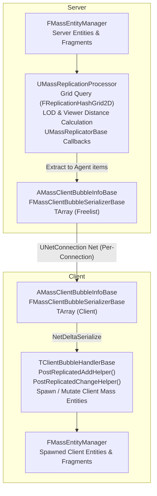
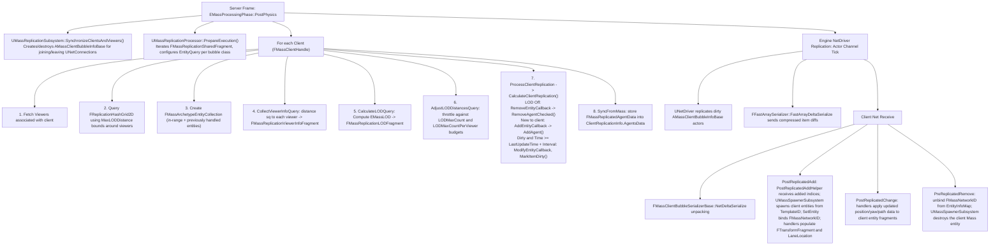

# Replication and Networking — UE 5.8 MASS

## Scope
MassReplication networking architecture: client bubble actor model, FastArray serialization, server-authoritative replication processors, LOD-driven bandwidth budgeting, 2D replication grid filtering, transform and path handler pipelines (`MassAIReplication`, `MassCrowd`), entity handle mapping across network boundaries, and network driver integration.

## Architecture

Mass in Unreal Engine 5.8 does **not** replicate individual entities as separate `AActor` network channels or raw ECS archetype memory chunks. Instead, it employs an aggregated **Client Bubble** architecture built on top of Unreal Engine's standard network driver (`UNetDriver`), `UNetConnection`, and `FFastArraySerializer`.



### Core Architecture Principles
1. **Per-Connection Bubble Actor (`AMassClientBubbleInfoBase`)**:
   - The server spawns one `AMassClientBubbleInfoBase` actor per parent `UNetConnection` (Player Controller).
   - The bubble actor is owned by the client controller (`SetOwner(InController)`), set to replicate (`bReplicates = true`), and scoped strictly to that specific connection via `bOnlyRelevantToOwner = true`.
   - Child connections (split-screen viewers sharing a parent `UNetConnection`) share the parent's bubble info, tracked through `FMassClientReplicationInfo`.
2. **Fast Array Delta Serialization (`FFastArraySerializer`)**:
   - Replicated agent data is packaged in items inheriting from `FMassFastArrayItemBase` (e.g., `FCrowdFastArrayItem`).
   - The serializer (`FMassClientBubbleSerializerBase` subclass) implements `NetDeltaSerialize` via `FFastArraySerializer::FastArrayDeltaSerialize`.
   - The server maintains the array as a stable free-list to reuse indices. Items are marked dirty when fragment data exceeds replication tolerances.
3. **LOD & Viewer-Centric Throttling**:
   - Replication frequency and distance relevancy are driven by `UMassLODSubsystem` and `FMassReplicationParameters`.
   - Entities far from all viewers of a client drop to lower replication LODs (`Off`, `Low`, `Medium`, `High`), increasing `UpdateInterval` or dropping out of the client bubble entirely.
4. **Hierarchical 2D Replication Grid (`FReplicationHashGrid2D`)**:
   - Instead of checking all world entities against every client connection, entities register in a 2D spatial hash grid (`FReplicationHashGrid2D`, cell size configured in `UMassReplicationSettings`, default 5000 units / 50 meters).
   - Only entities intersecting the bounding boxes of client viewers within `MaxLODDistance` are gathered into `FMassArchetypeEntityCollection` sets for replication processing.
5. **Server-to-Client Identity Mapping (`FMassNetworkID`)**:
   - `FMassEntityHandle` values are local to a specific `FMassEntityManager` and differ between server and client instances.
   - The server assigns a 32-bit unique `FMassNetworkID` via `UMassReplicationSubsystem::GetNextAvailableMassNetID()`, stored in `FMassNetworkIDFragment`.
   - On the client, `UMassReplicationSubsystem::EntityInfoMap` maps replicated `FMassNetworkID` to the local client `FMassEntityHandle`.

---

## Key Types

| Symbol | Module | Responsibility |
| :--- | :--- | :--- |
| `UMassReplicationSubsystem` | `MassReplication` | World subsystem managing viewer-to-client connection tracking, network ID allocation, bubble actor creation, replication hash grid, and client entity lookup map. |
| `AMassClientBubbleInfoBase` | `MassReplication` | Replicated `AInfo` actor owned by a client `APlayerController`; encapsulates serializers replicating Mass agent data. |
| `FMassClientBubbleSerializerBase` | `MassReplication` | Root `FFastArraySerializer` struct owning the agent array and hooking engine net-delta serialization into client bubble handlers. |
| `IClientBubbleHandlerInterface` | `MassReplication` | Virtual interface for bubble handlers driving `PreReplicatedRemove`, `PostReplicatedAdd`, and `PostReplicatedChange` operations. |
| `TClientBubbleHandlerBase<TItem>` | `MassReplication` | Template handler managing agent freelist on server, client-side spawn/modify caches, and lifecycle synchronization with `UMassSpawnerSubsystem`. |
| `UMassReplicationProcessor` | `MassReplication` | Server-only processor executing in `EMassProcessingPhase::PostPhysics`; evaluates spatial queries, viewer LODs, and triggers replicator client passes. |
| `UMassReplicatorBase` | `MassReplication` | Abstract bridge defining fragment requirements and calling `CalculateClientReplication` with custom extraction/modification callbacks. |
| `FMassNetworkIDFragment` | `MassReplication` | Fragment storing replicated 32-bit `FMassNetworkID` linking server and client entity representations. |
| `FMassReplicatedAgentFragment` | `MassReplication` | Server fragment holding `FMassReplicatedAgentData` (per-client agent handle, LOD, last update timestamp). |
| `FMassReplicationViewerInfoFragment` | `MassReplication` | Fragment storing squared distances from the entity to each active viewer. |
| `FMassReplicationLODFragment` | `MassReplication` | Fragment storing current and previous replication LOD state (`EMassLOD::Type`). |
| `FMassReplicationParameters` | `MassReplication` | Const shared fragment storing per-LOD distance thresholds, hysteresis percentages, update intervals, bubble info class, and replicator class. |
| `FMassReplicationSharedFragment` | `MassReplication` | Shared fragment hosting per-archetype LOD collectors, LOD calculators, bubble actor references, and client execution queries. |
| `FMassReplicationGridCellLocationFragment` | `MassReplication` | Fragment storing hash grid cell coordinate (`FReplicationHashGrid2D::FCellLocation`). |
| `UMassReplicationGridProcessor` | `MassReplication` | Server processor maintaining spatial grid presence for moving replicated entities. |
| `UMassReplicationTrait` | `MassReplication` | Entity trait adding replication fragments, shared parameters, and template network IDs to an entity archetype. |
| `TMassClientBubbleTransformHandler<TItem>` | `MassReplication` | Reusable handler synchronizing `FTransformFragment` into `FReplicatedAgentPositionYawData` with configurable tolerance thresholds. |
| `TMassClientBubblePathHandler<TItem>` | `MassAIReplication` | Reusable handler serializing ZoneGraph lane positions, action IDs, and path requests (`FReplicatedAgentPathData`) to client navigation fragments. |
| `FCrowdFastArrayItem` | `MassCrowd` | Fast array item containing `FReplicatedCrowdAgent` for crowd agents. |
| `UMassCrowdReplicator` | `MassCrowd` | Crowd replicator extracting path and position/yaw data into `AMassCrowdClientBubbleInfo`. |

---

## Data Flow



---

## Extension Points: Templates, Handlers, and Serializers

UE 5.8 provides modern template macros and helper packs in `MassReplicationTemplates.h` to declare custom fragment replication without writing boilerplate fast array loops:

### 1. Declaring Replicated Data Struct and Traits
```cpp
// 1. Define the network payload struct
USTRUCT()
struct FReplicatedAgentHealthData
{
    GENERATED_BODY()

    UPROPERTY(Transient)
    float Health = 100.0f;
};

// 2. Specialize TReplicationTraits
namespace UE::Mass::Replication
{
    template<>
    struct TReplicationTraits<FReplicatedAgentHealthData>
    {
        static void ExtractData(const FHealthFragment& Frag, FReplicatedAgentHealthData& Out)
        {
            Out.Health = Frag.CurrentHealth;
        }

        static void ApplyData(FHealthFragment& Frag, const FReplicatedAgentHealthData& In)
        {
            Frag.CurrentHealth = In.Health;
        }

        static bool IsDirty(const FReplicatedAgentHealthData& Old, const FReplicatedAgentHealthData& New)
        {
            return !FMath::IsNearlyEqual(Old.Health, New.Health, 1.0f);
        }
    };
}

// 3. Declare handlers via macro
UE_MASSREPLICATION_DECLARE_HANDLERS(Health, FReplicatedAgentHealthData, FHealthFragment);
```

### 2. Integrating Handlers into Replicator and Bubble Handler
- **Server Replicator**: Aggregate handlers using `UE::Mass::Replication::TReplicationProcessorHandlerPack` inside `UMassReplicatorBase::AddRequirements()` and `ProcessClientReplication()`.
- **Client Bubble Handler**: Aggregate handlers using `UE::Mass::Replication::TClientBubbleDataHandlerPack` inside `TClientBubbleHandlerBase<TFastArrayItem>` to automatically configure spawn queries and mutated entity updates.

---

## Usage Example: Custom Replicated Agent

### 1. Trait Configuration in C++ or DataAsset
Entities opt into replication by adding `UMassReplicationTrait` to their entity configuration:

```cpp
UMassEntityConfigAsset* EntityConfig = ...;
UMassReplicationTrait* RepTrait = NewObject<UMassReplicationTrait>(EntityConfig);

RepTrait->Params.LODDistance[EMassLOD::High] = 3000.0f;   // 30m full fidelity
RepTrait->Params.LODDistance[EMassLOD::Medium] = 6000.0f; // 60m reduced rate
RepTrait->Params.LODDistance[EMassLOD::Low] = 12000.0f;   // 120m position only
RepTrait->Params.LODDistance[EMassLOD::Off] = 15000.0f;   // Cull beyond 150m

RepTrait->Params.UpdateInterval[EMassLOD::High] = 0.033f; // 30 Hz
RepTrait->Params.UpdateInterval[EMassLOD::Medium] = 0.1f;  // 10 Hz
RepTrait->Params.UpdateInterval[EMassLOD::Low] = 0.25f;    // 4 Hz

RepTrait->Params.BubbleInfoClass = AMassCrowdClientBubbleInfo::StaticClass();
RepTrait->Params.ReplicatorClass = UMassCrowdReplicator::StaticClass();
```

### 2. Spawning Replicated Entities on Server
```cpp
void AMyGameMode::SpawnReplicatedAgents(UWorld* World, const FMassEntityTemplate& Template, int32 Count)
{
    UMassSpawnerSubsystem* Spawner = World->GetSubsystem<UMassSpawnerSubsystem>();
    check(Spawner);

    TArray<FMassEntityHandle> SpawnedEntities;
    Spawner->SpawnEntities(Template, Count, SpawnedEntities);

    // Initializer observer UMassNetworkIDFragmentInitializer automatically assigns
    // a unique FMassNetworkID to FMassNetworkIDFragment on creation.
}
```

---

## Pitfalls and Known Limits

1. **MassReplication is Not Actor Replication**:
   - Entities replicated through Mass do not possess `AActor` channels, RPC capabilities (`Server`/`Client`/`NetMulticast`), or subobject replication. All network events must flow through fast array delta serialization or external gameplay channels.
2. **Server Compilation vs Client Only (`UE_REPLICATION_COMPILE_SERVER_CODE`)**:
   - Mass replication code uses `#if UE_REPLICATION_COMPILE_SERVER_CODE` and `#if UE_REPLICATION_COMPILE_CLIENT_CODE`. Dedicated servers compile server paths; client builds compile client paths. Standalone testing requires setting `UE_DEBUG_REPLICATION_BUBBLES_STANDALONE 1` to compile server bubble execution into client executables.
3. **Template ID Synchronization**:
   - The client spawns entities locally using `InItem.Agent.GetTemplateID()`. If the server entity uses a dynamically generated or non-replicated template ID that has not been registered in the client's `UMassSpawnerSubsystem`, client-side spawning asserts or fails silently.
4. **Duplicate Viewers / Split-Screen Overhead**:
   - When a client machine has multiple local viewports (split-screen), multiple `FMassViewerHandle` instances belong to one `FMassClientHandle`. `HandledEntities` can contain duplicates before deduplication in `CreateEntityCollections`. Ensure custom replicators do not assume one viewer per connection.
5. **Fast Array Freelists and Index Drift**:
   - `FMassReplicatedAgentHandle` is indexed into the server's bubble array freelist. The client's array ordering does **not** match the server's array indexing over time due to network delta compaction. Code must never replicate `FMassReplicatedAgentHandle` across the wire; only `FMassNetworkID` is globally valid.
6. **GameThread Requirement on Server**:
   - `UMassReplicationProcessor::bRequiresGameThreadExecution = true` because `SynchronizeClientsAndViewers()` spawns `AMassClientBubbleInfoBase` actors dynamically when new net connections connect or disconnect. It cannot run on background worker threads.
7. **Spatial Hash Grid Drift**:
   - If an entity moves without passing through `UMassReplicationGridProcessor` (e.g. manual transform manipulation bypassing movement processors), its grid cell coordinates in `FMassReplicationGridCellLocationFragment` become stale, causing it to fall outside client query bounds.

---

## Source Files

- `Engine/Plugins/Runtime/MassGameplay/Source/MassReplication/Public/MassReplicationSubsystem.h`
- `Engine/Plugins/Runtime/MassGameplay/Source/MassReplication/Private/MassReplicationSubsystem.cpp`
- `Engine/Plugins/Runtime/MassGameplay/Source/MassReplication/Public/MassReplicationTypes.h`
- `Engine/Plugins/Runtime/MassGameplay/Source/MassReplication/Public/MassReplicationProcessor.h`
- `Engine/Plugins/Runtime/MassGameplay/Source/MassReplication/Private/MassReplicationProcessor.cpp`
- `Engine/Plugins/Runtime/MassGameplay/Source/MassReplication/Public/MassReplicationFragments.h`
- `Engine/Plugins/Runtime/MassGameplay/Source/MassReplication/Public/MassReplicationTemplates.h`
- `Engine/Plugins/Runtime/MassGameplay/Source/MassReplication/Public/MassReplicationTrait.h`
- `Engine/Plugins/Runtime/MassGameplay/Source/MassReplication/Public/MassReplicationSettings.h`
- `Engine/Plugins/Runtime/MassGameplay/Source/MassReplication/Public/MassReplicationGridProcessor.h`
- `Engine/Plugins/Runtime/MassGameplay/Source/MassReplication/Public/MassClientBubbleInfoBase.h`
- `Engine/Plugins/Runtime/MassGameplay/Source/MassReplication/Public/MassClientBubbleSerializerBase.h`
- `Engine/Plugins/Runtime/MassGameplay/Source/MassReplication/Public/MassClientBubbleHandlerInterface.h`
- `Engine/Plugins/Runtime/MassGameplay/Source/MassReplication/Public/MassClientBubbleHandler.h`
- `Engine/Plugins/Runtime/MassGameplay/Source/MassReplication/Public/MassReplicationTransformHandlers.h`
- `Engine/Plugins/AI/MassAI/Source/MassAIReplication/Public/MassReplicationPathHandlers.h`
- `Engine/Plugins/AI/MassCrowd/Source/MassCrowd/Public/MassCrowdReplicatedAgent.h`
- `Engine/Plugins/AI/MassCrowd/Source/MassCrowd/Public/MassCrowdReplicator.h`
- `Engine/Plugins/AI/MassCrowd/Source/MassCrowd/Public/MassCrowdBubble.h`
- `Engine/Plugins/AI/MassCrowd/Source/MassCrowd/Private/MassCrowdReplicator.cpp`

---

## Graph Facts

- Module community: `Engine/Plugins/Runtime/MassGameplay` contributes **4,485 nodes** to the whole-engine MASS graph; `MassAI` contributes **2,205 nodes** and `MassCrowd` contributes **592 nodes**.
- Hub connectivity: `UMassReplicationProcessor` and `UMassReplicationSubsystem` bind directly to central god node `FMassEntityManager` (in-degree 539) and `FMassEntityQuery` (in-degree 201) to orchestrate chunk collection and shared fragment filtering.
- Network driver boundary: Mass replication interfaces with Core Engine Types (1,227 cross-community edges) specifically via `UNetDriver`, `UNetConnection`, `APlayerController`, `AInfo`, and `FFastArraySerializer`, keeping the core ECS cache layout decoupled from engine RPC channels.
