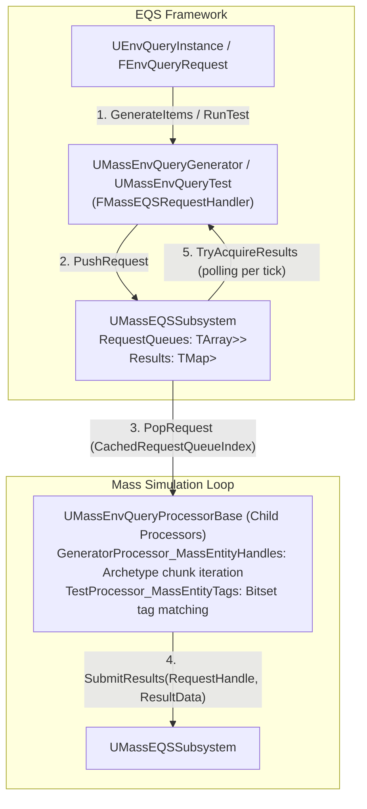

# EQS and Perception — UE 5.8 MASS

## Scope
MassEQS and perception-adjacent MassAI systems: `UMassEQSSubsystem`, asynchronous EQS-over-ECS request/result bridging, custom EQS item types, generators, tests, dedicated Mass processors, spawner pipeline integration, and perception-adjacent collision evaluation (`UMassComponentHitSubsystem`, `FMassHitResult`, `FMassComponentHitEvaluator`).

## Architecture
The Environment Query System (EQS) is traditionally synchronous or task-threaded over UObjects/Actors. Mass entities reside in dense ECS chunks outside standard `UObject` garbage collection and scene tree structures. The `MassEQS` module bridges this architectural divide by executing EQS generation and test passes **asynchronous over ECS frames** using Mass processors.



### EQS-over-ECS Design
1. **Asynchronous Handshake Protocol**:
   - `UMassEnvQueryGenerator::GenerateItems` and `UMassEnvQueryTest::RunTest` are marked `bCanRunAsync = true`.
   - When an `FEnvQueryInstance` evaluates a node, it invokes `SendOrRecieveRequest` on an embedded `FMassEQSRequestHandler`.
   - If no request is in flight (`RequestHandle` is invalid), `FMassEQSRequestHandler` allocates a unique `FMassEQSRequestHandle` via `UMassEQSSubsystem::PushRequest`, marshals request data into a heap-allocated `TUniquePtr<FMassEQSRequestData>`, and enqueues it into a thread-safe `TQueue`.
   - While `IsPendingResults()` returns `true`, the EQS engine yields execution and continues ticking the query instance across frames.
   - On subsequent query ticks, `SendOrRecieveRequest` calls `TryAcquireResults()`. If the Mass simulation has posted the processed result, the handler consumes the payload, populates `FEnvQueryInstance` items/scores, and resets the handle.
   - If execution exceeds `MaxRequestTime` (default 5.0s), the request is cancelled via `CancelRequest()`.

2. **Per-Node Request Queuing**:
   - `UMassEQSSubsystem` manages a dynamic array of lock-free FIFO queues (`TArray<FRequestQueue> RequestQueues`).
   - Each generator or test `UClass` registers a unique index into `RequestQueueLookup` via `GetRequestQueueIndex(TSubclassOf<UEnvQueryNode>)`.
   - Adding new queues is synchronized via `UE_MT_DECLARE_RW_ACCESS_DETECTOR(RequestAccessDetector)`.
   - Processors retrieve work by popping exclusively from their own class index via `CachedRequestQueryIndex`.

3. **Perception and Hit Subsystem Integration**:
   - Mass entities lack full `UPrimitiveComponent` trees unless bound to an actor representation.
   - For perception-adjacent collision events, `UMassComponentHitSubsystem` hooks `UMassAgentSubsystem` association/detachment delegates. When an agent's `UCapsuleComponent` triggers `OnComponentHit`, the subsystem matches component pointers to `FMassEntityHandle`s.
   - Hits from player-controlled pawns (optionally filtered via `ai.mass.OnlyProcessHitsFromPlayers`) are debounced across a merge window (1.0s), cached in `HitResults`, and broadcast to the entity via `UMassSignalSubsystem::SignalEntity(UE::Mass::Signals::HitReceived)`.
   - Behavior trees and StateTree tasks poll this via `FMassComponentHitEvaluator`.

## Key types

| Symbol | Module | Responsibility |
| :--- | :--- | :--- |
| `UMassEQSSubsystem` | `MassEQS` | World subsystem coordinating per-class request queues, results storage, request handle lifecycles, and cancellation. |
| `FMassEQSRequestHandle` | `MassEQS` | Unique generational handle inheriting `FIndexedHandleBase` (`Index` + `SerialNumber`) tracking in-flight queries. |
| `FMassEQSRequestData` | `MassEQS` | Base polymorphic heap struct transferring entity arrays and parameters between EQS nodes and Mass processors. |
| `IMassEQSRequestInterface` | `MassEQS` | Interface for nodes producing `FMassEQSRequestData`, providing requester `UClass`, and polling results. |
| `FMassEQSRequestHandler` | `MassEQS` | State machine struct embedded in nodes managing push/acquire lifecycles and timeout cancellations. |
| `UEnvQueryItemType_MassEntityHandle` | `MassEQS` | EQS item type wrapping `FMassEnvQueryEntityInfo` (`FMassEntityHandle` + `FTransform`), inheriting `UEnvQueryItemType_VectorBase`. |
| `FMassEnvQueryEntityInfo` | `MassEQS` | Element payload storing the entity handle and a transform snapshot taken at acquisition time. |
| `UMassEnvQueryGenerator` | `MassEQS` | Abstract async EQS generator delegating execution to `UMassEQSSubsystem`. |
| `UMassEnvQueryGenerator_MassEntityHandles` | `MassEQS` | Generates entity items within a `SearchRadius` around `SearchCenter` context locations. |
| `UMassEnvQueryTest` | `MassEQS` | Abstract async EQS test delegating scoring/filtering to `UMassEQSSubsystem`. |
| `UMassEnvQueryTest_MassEntityTags` | `MassEQS` | Filters entities using ECS tags (`EMassEntityTagsTestMode`: `Any`, `All`, `None`). |
| `UMassEnvQueryProcessorBase` | `MassEQS` | Base Mass processor caching world subsystem references and query queue indices. |
| `UMassEnvQueryGeneratorProcessor_MassEntityHandles` | `MassEQS` | Processor iterating chunks with `FTransformFragment` to satisfy entity handle generation requests. |
| `UMassEnvQueryTestProcessor_MassEntityTags` | `MassEQS` | Processor inspecting archetype chunk bitsets to validate `FInstancedStruct` tags without per-entity payload scans. |
| `FMassEQSUtils` | `MassEQS` | Static utility helpers extracting entity info, handles, and type casting request payloads. |
| `UMassEQSBlueprintLibrary` | `MassEQS` | Blueprint function library exposing entity handle wrapping, signals, position lookup, and array parsing. |
| `UMassEntityEQSSpawnPointsGenerator` | `MassSpawner` | Mass spawn generator invoking EQS queries and mapping spatial items into spawn transforms. |
| `UMassComponentHitSubsystem` | `MassAIBehavior` | Tickable subsystem listening to capsule hits, deduplicating contacts, and dispatching `HitReceived` signals. |
| `FMassComponentHitEvaluator` | `MassAIBehavior` | StateTree evaluator extracting recent component hits from `UMassComponentHitSubsystem` into task instance data. |

## Data flow

```mermaid
graph TD
    A["EQS Query Execution: UMassEntityEQSSpawnPointsGenerator or StateTree Task"] --> B["1. Query Instantiation: FEnvQueryRequest::Execute()"]
    B --> C["2. Item Generation: UMassEnvQueryGenerator_MassEntityHandles::GenerateItems()"]
    C --> C1["Enqueues FMassEQSRequestData_MassEntityHandles into UMassEQSSubsystem"]
    C --> C2["Yields (IsCurrentlyRunningAsync() == true)"]
    B --> D["3. Mass Simulation Tick: UMassEnvQueryGeneratorProcessor_MassEntityHandles::Execute()"]
    D --> D1["Dequeues request from RequestQueues[CachedRequestQueryIndex]"]
    D --> D2["Iterates chunks with FTransformFragment (Radius or Global)"]
    D --> D3["Populates TArray<FMassEnvQueryEntityInfo> with EntityHandle + Transform"]
    D --> D4["Submits FMassEnvQueryResultData_MassEntityHandles to Subsystem"]
    B --> E["4. Result Acquisition: GenerateItems() -> TryAcquireResults()"]
    E --> E1["De-serializes items into FEnvQueryInstance::Items as UEnvQueryItemType_MassEntityHandle"]
    B --> F["5. Filtering/Scoring: UMassEnvQueryTest_MassEntityTags::RunTest()"]
    F --> F1["Passes EntityHandles into UMassEQSSubsystem"]
    F --> F2["Processor evaluates archetype chunk bitsets: Mass::EQS::Utils::TestChunkFor*Tags()"]
    F --> F3["Returns TMap<FMassEntityHandle, bool> matching results"]
    B --> G["6. Query Finished: Returns FEnvQueryResult"]
    A --> H["7. Spawner / Behavior Consumer"]
    H --> H1["MassSpawner: consumes transforms via EQSResult->GetAllAsLocations()"]
    H --> H2["StateTree: FStateTreeRunEnvQueryTask stores items in FStateTreeRunEnvQueryInstanceData"]
```



## Usage

### 1. Mass EQS Generator and Test Setup
Configuring an `UEnvQuery` asset to query Mass entities:
1. In the EQS Query editor, add a generator of class **Mass Entity Handles** (`UMassEnvQueryGenerator_MassEntityHandles`).
   - Set `Search Center` to `EnvQueryContext_Querier`.
   - Set `Search Radius` to desired range (or `<= 0` to gather all active entities with `FTransformFragment`).
2. Add a test of class **Mass Entity Tags** (`UMassEnvQueryTest_MassEntityTags`).
   - Set `Tag Test Mode` to `All` (or `Any`/`None`).
   - Add target tags into `Tags` (e.g., `FMassCrowdTag`, `FMyEnemyTag`).

### 2. Spawner Integration (`UMassEntityEQSSpawnPointsGenerator`)
Spawning Mass entities at positions resolved by an EQS query:

```cpp
#include "MassEntityEQSSpawnPointsGenerator.h"
#include "MassSpawner.h"

// AMassSpawner::SpawnDataGenerators is protected (MassSpawner.h line 130),
// so programmatic spawner configuration must be done within a subclass.
UCLASS()
class AMyMassEQSSpawner : public AMassSpawner
{
    GENERATED_BODY()
public:
    void ConfigureWithEQS(UEnvQuery* QueryTemplate)
    {
        check(QueryTemplate);

        // Create and configure the EQS spawn points generator instance
        UMassEntityEQSSpawnPointsGenerator* EQSGen = NewObject<UMassEntityEQSSpawnPointsGenerator>(this);
        // Note: UMassEntityEQSSpawnPointsGenerator::EQSRequest is protected; configured in editor or subclass

        FMassSpawnDataGenerator GenDesc;
        GenDesc.GeneratorInstance = EQSGen;
        GenDesc.Proportion = 1.0f;
        SpawnDataGenerators.Add(GenDesc);
    }
};
```

### 3. StateTree Execution (`FStateTreeRunEnvQueryTask`)
Running an EQS query from a StateTree asset driving Mass agent logic:

```cpp
// In StateTree editor or schema setup:
// Task: "Run Env Query" (FStateTreeRunEnvQueryTask)
// Parameters:
//   - QueryTemplate: /Game/AI/EQS_FindNearestMassTarget
//   - RunMode: EEnvQueryRunMode::SingleResult
// Transitions:
//   - On State Completed -> Transition to MoveToTarget
//   - On State Failed -> Transition to IdleSearch
```

### 4. Custom Mass EQS Processor Implementation
Creating a custom processor to service queries asynchronously:

```cpp
#pragma once
#include "Processors/MassEnvQueryProcessorBase.h"
#include "MassEntityQuery.h"
#include "MyMassEQSQueryProcessor.generated.h"

UCLASS()
class UMyMassEQSQueryProcessor : public UMassEnvQueryProcessorBase
{
    GENERATED_BODY()
public:
    UMyMassEQSQueryProcessor() : EntityQuery(*this)
    {
        // Bind to your custom UMassEnvQueryGenerator or UMassEnvQueryTest class
        CorrespondingRequestClass = UMyCustomMassEnvQueryGenerator::StaticClass();
    }

protected:
    virtual void ConfigureQueries(const TSharedRef<FMassEntityManager>& EntityManager) override
    {
        EntityQuery.AddRequirement<FTransformFragment>(EMassFragmentAccess::ReadOnly);
        ProcessorRequirements.AddSubsystemRequirement<UMassEQSSubsystem>(EMassFragmentAccess::ReadWrite);
        EntityQuery.RegisterWithProcessor(*this);
    }
    virtual void Execute(FMassEntityManager& EntityManager, FMassExecutionContext& Context) override
    {
        UMassEQSSubsystem* EQSSubsystem = Context.GetMutableSubsystem<UMassEQSSubsystem>();
        if (!EQSSubsystem) return;

        TUniquePtr<FMassEQSRequestData> RawRequest = EQSSubsystem->PopRequest(CachedRequestQueryIndex);
        FMyCustomRequestData* RequestData = FMassEQSUtils::TryAndEnsureCast<FMyCustomRequestData>(RawRequest);
        if (!RequestData) return;

        TArray<FMassEnvQueryEntityInfo> Results;
        EntityQuery.ForEachEntityChunk(Context, [&](FMassExecutionContext& ChunkContext)
        {
            const TConstArrayView<FTransformFragment> Transforms = ChunkContext.GetFragmentView<FTransformFragment>();
            for (FMassExecutionContext::FEntityIterator It = ChunkContext.CreateEntityIterator(); It; ++It)
            {
                FMassEntityHandle Entity = ChunkContext.GetEntity(It);
                Results.Emplace(Entity.Index, Entity.SerialNumber, Transforms[It].GetTransform());
            }
        });

        EQSSubsystem->SubmitResults(RequestData->RequestHandle, MakeUnique<FMyCustomResultData>(MoveTemp(Results)));
    }

    FMassEntityQuery EntityQuery;
};
```

### 5. Perception Collision Reaction (`FMassComponentHitEvaluator`)
Handling physical hit detection in StateTree:

```cpp
// Evaluator: "Mass ComponentHit Eval" (FMassComponentHitEvaluator)
// Exposes:
//   - InstanceData.bGotHit (bool)
//   - InstanceData.LastHitEntity (FMassEntityHandle)
//
// StateTree Transition:
//   Trigger: On Event / Evaluator condition (bGotHit == true)
//   Target State: FlinchOrReactState
//
// Component hit registration is automated via UMassComponentHitSubsystem when 
// an actor is bound to a Mass agent containing a UCapsuleComponent.
```

## Pitfalls

1. **Editor Simulation Guard**:
   - `FMassEQSRequestHandler::SendOrRecieveRequest` explicitly checks `#if WITH_EDITOR` for `QueryInstance.World->IsPlayInEditor()`. Asynchronous EQS requests against Mass **fail silently** when running queries in static editor worlds (such as the EQS Testing Pawn without PIE/simulation).
2. **Transform Cache Staleness**:
   - `EnvQueryItemType_MassEntityHandle` inherits `UEnvQueryItemType_VectorBase` and stores a `CachedTransform` snapshot taken during generation. If downstream tests or queries evaluate spatial distances frames later, the location reflects the time of chunk harvesting, not subsequent entity locomotion. For current positions, use `UMassEQSBlueprintLibrary::GetCurrentEntityPosition`.
3. **Queue Starvation & Phase Registration**:
   - Processors extending `UMassEnvQueryProcessorBase` must run in an active simulation phase (e.g., `EMassProcessingPhase::PrePhysics` or `DuringPhysics`). If a processor is omitted from the phase graph or disabled via LOD, requests remain stuck in `RequestQueues`, eventually triggering `MaxRequestTime` timeout cancellations (5.0 seconds).
4. **Pruning Suppression in Test Processors**:
   - `UMassEnvQueryTestProcessor_MassEntityTags` overrides `ShouldAllowQueryBasedPruning` to return `false`. Processors that evaluate dynamic queues must never allow query-based pruning; otherwise, an empty archetype match will cause the processor to skip ticking, leaving the queue unserviced.
5. **Item Type Mismatch**:
   - `UMassEnvQueryTest_MassEntityTags` sets `ValidItemType = UEnvQueryItemType_MassEntityHandle::StaticClass()`. Applying this test to standard Actor or Point EQS items results in validation errors or skipped execution.
6. **Thread Safety Traits**:
   - `UMassEQSSubsystem` specifies `TMassExternalSubsystemTraits<UMassEQSSubsystem>` with `GameThreadOnly = false` and `ThreadSafeWrite = true`. Queue pushes and pops are thread-safe, but modifying `RequestQueues` extensions is guarded by `UE_MT_SCOPED_WRITE_ACCESS(RequestAccessDetector)`. Do not access subsystem internals outside official public APIs.

## Source files

| File | Path |
| :--- | :--- |
| `MassEQSSubsystem.h` / `.cpp` | `Engine/Plugins/Runtime/MassGameplay/Source/MassEQS/Public/MassEQSSubsystem.h`<br>`.../Private/MassEQSSubsystem.cpp` |
| `MassEQSTypes.h` / `.cpp` | `Engine/Plugins/Runtime/MassGameplay/Source/MassEQS/Public/MassEQSTypes.h`<br>`.../Private/MassEQSTypes.cpp` |
| `MassEQSUtils.h` / `.cpp` | `Engine/Plugins/Runtime/MassGameplay/Source/MassEQS/Public/MassEQSUtils.h`<br>`.../Private/MassEQSUtils.cpp` |
| `MassEQSBlueprintLibrary.h` / `.cpp` | `Engine/Plugins/Runtime/MassGameplay/Source/MassEQS/Public/MassEQSBlueprintLibrary.h`<br>`.../Private/MassEQSBlueprintLibrary.cpp` |
| `EnvQueryItemType_MassEntityHandle.h` / `.cpp` | `Engine/Plugins/Runtime/MassGameplay/Source/MassEQS/Public/Items/EnvQueryItemType_MassEntityHandle.h`<br>`.../Private/Items/EnvQueryItemType_MassEntityHandle.cpp` |
| `MassEnvQueryGenerator.h` / `.cpp` | `Engine/Plugins/Runtime/MassGameplay/Source/MassEQS/Public/Generators/MassEnvQueryGenerator.h`<br>`.../Private/Generators/MassEnvQueryGenerator.cpp` |
| `MassEnvQueryGenerator_MassEntityHandles.h` / `.cpp` | `Engine/Plugins/Runtime/MassGameplay/Source/MassEQS/Public/Generators/MassEnvQueryGenerator_MassEntityHandles.h`<br>`.../Private/Generators/MassEnvQueryGenerator_MassEntityHandles.cpp` |
| `MassEnvQueryTest.h` / `.cpp` | `Engine/Plugins/Runtime/MassGameplay/Source/MassEQS/Public/Tests/MassEnvQueryTest.h`<br>`.../Private/Tests/MassEnvQueryTest.cpp` |
| `MassEnvQueryTest_MassEntityTags.h` / `.cpp` | `Engine/Plugins/Runtime/MassGameplay/Source/MassEQS/Public/Tests/MassEnvQueryTest_MassEntityTags.h`<br>`.../Private/Tests/MassEnvQueryTest_MassEntityTags.cpp` |
| `MassEnvQueryProcessorBase.h` / `.cpp` | `Engine/Plugins/Runtime/MassGameplay/Source/MassEQS/Public/Processors/MassEnvQueryProcessorBase.h`<br>`.../Private/Processors/MassEnvQueryProcessorBase.cpp` |
| `MassEnvQueryGeneratorProcessor_MassEntityHandles.h` / `.cpp` | `Engine/Plugins/Runtime/MassGameplay/Source/MassEQS/Public/Processors/MassEnvQueryGeneratorProcessor_MassEntityHandles.h`<br>`.../Private/Processors/MassEnvQueryGeneratorProcessor_MassEntityHandles.cpp` |
| `MassEnvQueryTestProcessor_MassEntityTags.h` / `.cpp` | `Engine/Plugins/Runtime/MassGameplay/Source/MassEQS/Public/Processors/MassEnvQueryTestProcessor_MassEntityTags.h`<br>`.../Private/Processors/MassEnvQueryTestProcessor_MassEntityTags.cpp` |
| `MassEntityEQSSpawnPointsGenerator.h` / `.cpp` | `Engine/Plugins/Runtime/MassGameplay/Source/MassSpawner/Public/MassEntityEQSSpawnPointsGenerator.h`<br>`.../Private/MassEntityEQSSpawnPointsGenerator.cpp` |
| `MassComponentHitSubsystem.h` / `.cpp` | `Engine/Plugins/AI/MassAI/Source/MassAIBehavior/Public/MassComponentHitSubsystem.h`<br>`.../Private/MassComponentHitSubsystem.cpp` |
| `MassComponentHitTypes.h` | `Engine/Plugins/AI/MassAI/Source/MassAIBehavior/Public/MassComponentHitTypes.h` |
| `MassComponentHitEvaluator.h` / `.cpp` | `Engine/Plugins/AI/MassAI/Source/MassAIBehavior/Public/Evaluators/MassComponentHitEvaluator.h`<br>`.../Private/Evaluators/MassComponentHitEvaluator.cpp` |
| `StateTreeRunEnvQueryTask.h` / `.cpp` | `Engine/Plugins/Runtime/GameplayStateTree/Source/GameplayStateTreeModule/Public/Tasks/StateTreeRunEnvQueryTask.h`<br>`.../Private/Tasks/StateTreeRunEnvQueryTask.cpp` |

## Graph facts
*(Reference: `local://mass_graph_facts.md`)*
- `Engine/Plugins/Runtime/MassGameplay` contributes **4,485 nodes** to the overall MASS corpus (the largest single plugin module), housing the `MassEQS` subsystem, spawner generator bridges, and gameplay processors.
- `Engine/Plugins/AI/MassAI` contributes **2,205 nodes**, housing `MassComponentHitSubsystem`, hit signals, and StateTree evaluator integration (`MassAIBehavior`).
- `FMassEntityHandle` is the foundational element handle referenced throughout `EnvQueryItemType_MassEntityHandle`, `FMassEnvQueryEntityInfo`, and `FMassHitResult`.
- Cross-community bridging: MassEQS and perception form a vital bridge connecting ECS simulation storage to Core Engine Types (1,227 edges), AI environmental queries, and StateTree behaviors.
