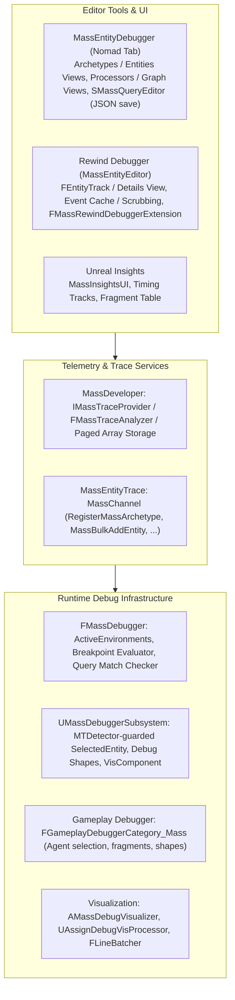
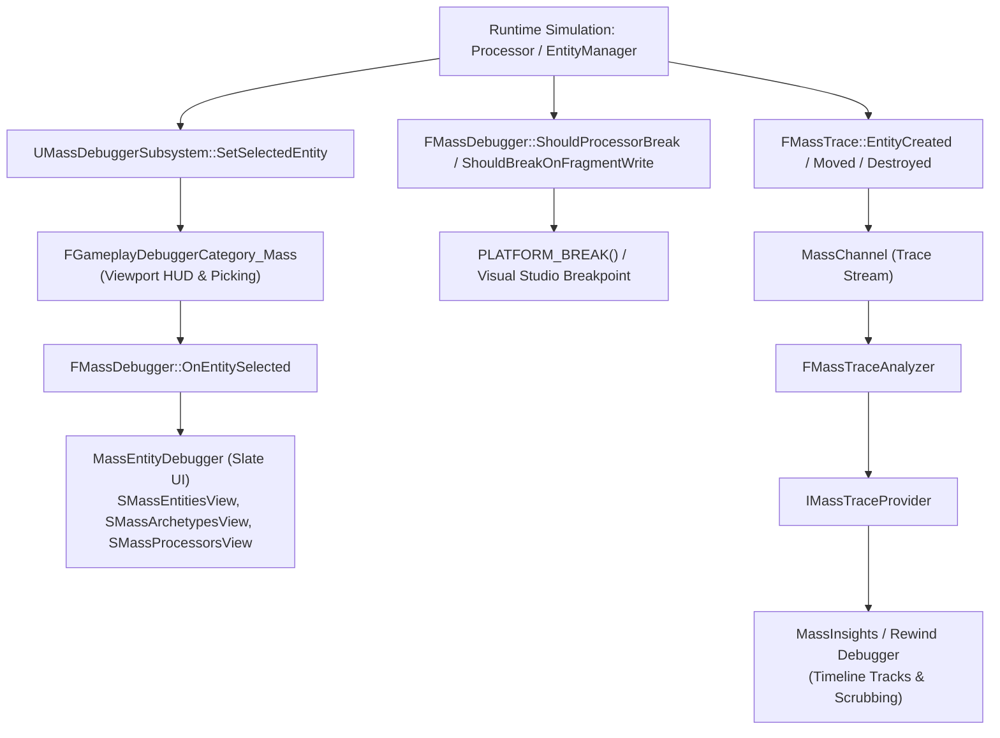

# Debug, Editor, and Insights — UE 5.8 MASS

## Scope
Developer and runtime debugging infrastructure for MASS in Unreal Engine 5.8: the `MassEntityDebugger` standalone editor tool, the `MassEntityEditor` engine subsystem and Rewind Debugger integration, runtime debug hooks (`FMassDebugger`, breakpoints, debug logging, and `MassEntityTrace`), `MassGameplayDebug` visualization actor/components/processors, `MassAIDebug` gameplay debugger category, `MassInsights` plugin for Unreal Insights, and the `MassDeveloper` trace provider and analyzer runtime backend.

## Architecture

MASS debugging in UE 5.8 is structured across specialized layers bridging headless runtime execution to Slate tools and telemetry analyzers:



### 1. MassEntityDebugger Architecture
The `MassEntityDebugger` module implements a standalone Slate Nomad Tab (`SMassDebugger`) registered with `WorkspaceMenu::GetMenuStructure().GetDeveloperToolsDebugCategory()`.
- **Model (`FMassDebuggerModel`)**: Observes active `FMassEntityManager` instances through `FMassDebugger::FEnvironment`. Translates raw archetype compositions, chunk statistics, and processor execution requirements into Slate view models (`FMassDebuggerArchetypeData`, `FMassDebuggerProcessorData`, `FMassDebuggerQueryData`).
- **Archetype View (`SMassArchetypesView`)**: Visualizes all registered archetypes in an environment, displaying entity counts, chunk allocations, bytes per entity, wasted padding memory, and sparse element bookkeeping size (`UE::Mass::Debug::FArchetypeStats`). Supports tree grouping by `PrimaryDebugName`.
- **Entities View (`SMassEntitiesView`, `SMassEntitiesList`)**: Lists active entity handles, their current archetype, and inspects per-entity fragment values using `FStructOnScope` reflected detail trees.
- **Processors & Processing Graph Views (`SMassProcessorsView`, `SMassProcessingGraphView`)**: Renders execution order, hosted processor lists, queries, and DAG dependency nodes (`UMassCompositeProcessor::FDependencyNode`) showing prerequisite upstream/downstream nodes.
- **Query Editor View (`SMassQueryEditor`, `SMassQueryEditorView`)**: An interactive query builder and debugger. Supports defining fragment access modes (`ReadOnly`, `ReadWrite`), fragment presence (`All`, `Any`, `None`, `Optional`), and tags. Serializes and deserializes queries to/from JSON (`FEditableQuery`, `FFragmentEntry`) for copy-pasting and persistent user presets.
- **Breakpoints View (`SMassBreakpointsView`)**: Interactively configures runtime breakpoints on entity lifecycle events, processor executions, or fragment writes.

### 2. MassEntityEditor Subsystem & Rewind Debugger Integration
- **`UMassEntityEditorSubsystem`**: A `UEngineSubsystem` enabled under `WITH_EDITOR`. Owns an editor-context `FMassEntityManager` and `FMassProcessingPhaseManager`. Manages dynamic processor registration (`RegisterDynamicProcessor`) and ticks mass simulation in editor viewports via `UE::Mass::FMassEditorTickFunction`.
- **Rewind Debugger Integration**: `FMassRewindDebuggerRuntimeExtension` hooks `IRewindDebuggerRuntimeExtension` to automatically enable the `MassChannel` trace channel when Rewind Debugger recording begins.
- **Entity Tracks (`FEntityTrack`, `FEntityTrackCreator`)**: Implements `IRewindDebuggerTrackCreator` to spawn timeline tracks for tracked entity handles. Tracks record lifecycle state points (`Created`, `ArchetypeChange`, `Destroyed`) cached by `FEntityEventCache` and render detailed archetype/fragment states in `SMassEntityDetailsView` synchronized with the scrub playhead.

### 3. Trace & Insights Pipeline
- **`MassEntityTrace` (`MassChannel`)**: Emits high-frequency binary trace events under macro `UE_MASS_TRACE_ENABLED`:
  - Lifecycle: `MassBulkAddEntity`, `MassBulkEntityDestroyed`, `MassEntityMoved`.
  - Type definitions: `RegisterMassArchetype`, `RegisterMassFragment`.
  - Phase execution: `MassPhaseBegin`, `MassPhaseEnd`, `MassPhaseExecutionBegin`, `MassPhaseExecutionEnd`.
  - Query metrics: `QueryCreated`, `QueryDestroyed`, `QueryForEachStarted`, `QueryForEachComplete` (recording archetype, chunk, and entity counts).
- **`MassDeveloper`**: Implements the analysis backend. `FMassTraceAnalyzer` consumes the trace stream into `IMassTraceProvider` paged arrays (`FRegionLane`, `FEntityEventRecord`, `FArchetypeInfo`, `FFragmentInfo`).
- **`MassInsights` Plugin**: Adds an Insights UI tab (`SMassInsightsAnalysisTab`) featuring `MassInsightsTimingTrack` for phase/query timings, `SEntityEventsTableView`, `SEntityEventAggregationTableView`, `SFragmentTableView`, and `SArchetypeDetails`.

### 4. MassGameplayDebug & MassAIDebug
- **`UMassDebuggerSubsystem`**: A world subsystem (`UMassSubsystemBase`) holding thread-safe selection states (`SelectedEntity`, `SelectedEntityDetails`) guarded by `UE_MT_DECLARE_TS_RW_ACCESS_DETECTOR(MTDetector)` and managing debug shapes for batch visual drawing.
- **Visualizer Actors & Components**: `AMassDebugVisualizer` hosts a `UMassDebugVisualizationComponent` which manages instanced static mesh components. `UAssignDebugVisProcessor` observes entity creation to assign visualization indices based on `FSimDebugDataRow` data tables, while `UDebugVisLocationProcessor` updates transform batches.
- **`FGameplayDebuggerCategory_Mass`**: A gameplay debugger category in `MassAIDebug`. Allows interactive agent picking in the viewport, toggles archetype overviews, renders agent fragments on screen, and draws entity debug shapes.

## Key types

| Symbol | Module | Responsibility |
| :--- | :--- | :--- |
| `FMassDebugger` | `MassEntity` | Central static runtime debug interface; maintains `FEnvironment`, breakpoint registries, query compatibility checks, and debug event broadcasts. |
| `UE::Mass::Debug::FBreakpoint` | `MassEntity` | Breakpoint definition struct supporting trigger types (`ProcessorExecute`, `FragmentWrite`, lifecycle) and filters (`SpecificEntity`, `SelectedEntity`, `Query`). |
| `UE::Mass::Debug::FBreakpointHandle` | `MassEntity` | Generational integer identifier managing active debugger breakpoints. |
| `FMassTrace` | `MassEntity` | Static provider emitting binary trace events to `MassChannel` for phases, entities, queries, and archetypes. |
| `FMassLoggingContext` | `MassEntity` | Helper reading `FMassDebugLogFragment` to filter visual logger (`VisualLogger`) and console outputs per entity. |
| `FMassDebuggerModel` | `MassEntityDebugger` | Presentation model adapting raw `FMassEntityManager` state into Slate tree/list nodes for the Mass Debugger UI. |
| `SMassDebugger` | `MassEntityDebugger` | Slate nomad dockable widget hosting archetypes, entities, processors, graphs, query editor, and breakpoint tabs. |
| `UMassDebuggerSettings` | `MassEntityDebugger` | Editor user settings (`EditorPerProjectUserSettings`) controlling debug display rules like `bStripMassPrefix`. |
| `UMassEntityEditorSubsystem` | `MassEntityEditor` | Engine subsystem owning the editor simulation world, phase manager, and dynamic processor registry. |
| `FEntityTrack` | `MassEntityEditor` | Rewind Debugger track rendering entity lifecycle timelines and state points. |
| `FEntityEventCache` | `MassEntityEditor` | Thread-safe ring buffer and indexer caching entity lifecycle events for Rewind scrubbing. |
| `SMassEntityDetailsView` | `MassEntityEditor` | Slate widget displaying fragment composition of an entity at the current Rewind Debugger scrub timestamp. |
| `IMassTraceProvider` | `MassDeveloper` | Analysis interface exposing parsed Mass regions, entity events, archetype registries, and fragment layouts. |
| `FMassTraceAnalyzer` | `MassDeveloper` | Trace services analyzer parsing binary `MassChannel` stream packets into provider models. |
| `SMassInsightsAnalysisTab` | `MassInsightsUI` | Unreal Insights visualizer tab providing entity event aggregations and fragment inspection tables. |
| `UMassDebuggerSubsystem` | `MassGameplayDebug` | Subsystem managing runtime debug shapes, selected entity handles, and instanced visualizer actors. |
| `AMassDebugVisualizer` | `MassGameplayDebug` | Transient actor holding instanced static mesh components for lightweight agent visualization. |
| `UMassDebugVisualizationTrait` | `MassGameplayDebug` | Authoring trait adding `FSimDebugVisFragment` and configuring debug shape visualizer templates. |
| `UAssignDebugVisProcessor` | `MassGameplayDebug` | Observer processor binding newly spawned entities to instanced static mesh slots. |
| `UDebugVisLocationProcessor` | `MassGameplayDebug` | Processor syncing entity world transforms to instanced debug visualizer components each frame. |
| `FGameplayDebuggerCategory_Mass` | `MassAIDebug` | Gameplay debugger category providing on-screen HUD text, raycast entity picking, and fragment inspection. |

## Data flow



## Usage

### 1. Summoning Tools
- **Mass Entity Debugger**: Opened via menu `Tools -> Debug -> Mass Debugger` or console command `mass.debug`.
- **Gameplay Debugger**: Press `'` (apostrophe) in PIE/game, then press numpad shortcut for the Mass category (configured in Gameplay Debugger Project Settings).
- **Rewind Debugger**: Open `Tools -> Debug -> Rewind Debugger`. Mass entity tracks appear under the tracked world object when `MassChannel` is recorded.
- **Unreal Insights**: Launch `UnrealInsights.exe` and open traces with `MassChannel` active. The Mass Insights tab provides dedicated archetype and entity timing analysis.

### 2. Runtime Debug API & Breakpoints (C++)

```cpp
#include "MassDebugger.h"
#include "MassDebuggerBreakpoints.h"

// Check or break conditionally during manual processor iteration
void UMyProcessor::Execute(FMassEntityManager& EntityManager, FMassExecutionContext& Context)
{
    EntityQuery.ForEachEntityChunk(Context, [&EntityManager](FMassExecutionContext& ChunkContext)
    {
        const TConstArrayView<FMassEntityHandle> Entities = ChunkContext.GetEntities();
        for (int32 i = 0; i < Entities.Num(); ++i)
        {
            // Triggers Visual Studio break if entity matches mass.debug.DebugEntity
            MASS_BREAK_IF_ENTITY_DEBUGGED(EntityManager, Entities[i]);

            // Break if specific index is hit
            MASS_BREAK_IF_ENTITY_INDEX(Entities[i], 1042);
        }
    });
}

// Programmatic breakpoint configuration
void SetCustomMassBreakpoint(FMassEntityManager& EntityManager, const FMassEntityHandle TargetEntity)
{
#if WITH_MASSENTITY_DEBUG
    // Break before any processor executes on TargetEntity
    UE::Mass::Debug::FBreakpoint& BP = FMassDebugger::CreateBreakpoint(EntityManager);
    BP.TriggerType = UE::Mass::Debug::FBreakpoint::ETriggerType::EntityDestroy;
    BP.FilterType = UE::Mass::Debug::FBreakpoint::EFilterType::SpecificEntity;
    BP.Filter.Set<FMassEntityHandle>(TargetEntity);
    BP.bEnabled = true;
    FMassDebugger::RefreshBreakpoints();
#endif
}
```

### 3. Debug Logging with Visual Logger

```cpp
#include "MassDebugLogging.h"

void UMyMovementProcessor::Execute(FMassEntityManager& EntityManager, FMassExecutionContext& Context)
{
    UE::Mass::Debug::FLoggingContext LogContext(Context);

    EntityQuery.ForEachEntityChunk(Context, [&LogContext](FMassExecutionContext& ChunkContext)
    {
        const int32 NumEntities = ChunkContext.GetNumEntities();
        for (int32 i = 0; i < NumEntities; ++i)
        {
            if (LogContext.ShouldLogEntity(i))
            {
                const UObject* Owner = LogContext.GetLogOwner(i);
                UE_VLOG_LOCATION(Owner, LogMassDebug, Log, FVector::ZeroVector, 10.f, FColor::Red, TEXT("Entity processed"));
            }
        }
    });
}
```

## Debug Facilities Reference

| Facility | Target / Subsystem | Activation Method | Key Capabilities |
| :--- | :--- | :--- | :--- |
| **Mass Entity Debugger** | Editor Slate UI | `mass.debug` / Nomad tab | Archetype chunk usage, memory waste, processor DAG visualization, interactive JSON query editor, breakpoint editor. |
| **Mass Gameplay Debugger** | In-Game Viewport HUD | `'` key (Category selection) | Raycast agent selection, on-screen fragment dump, archetype counts, debug shape visualization toggle. |
| **Rewind Debugger Track** | Editor Rewind Debugger | Rewind Debugger recording | Per-entity lifecycle tracks, scrubbable fragment inspector (`SMassEntityDetailsView`), state changes over time. |
| **Mass Insights** | Unreal Insights | Trace with `-trace=default,mass` | Timeline tracks for processing phases, entity count aggregations, fragment reflection tables, archetype breakdown. |
| **Line Batcher Utility** | Runtime Debug Draw | `UE::Mass::Debug::FLineBatcher` | Batched wire/solid boxes, spheres, and directional arrows drawn on world or persistent line batchers. |
| **Visualizer Actor** | World Simulation | `UMassDebugVisualizationTrait` | High-performance Instanced Static Mesh debugging replacing full skeletal meshes with colored primitive proxies. |

## Console Commands & Variables

| Command / Variable | Type | Description |
| :--- | :--- | :--- |
| `mass.debug` | Command | Opens the `MassEntityDebugger` Nomad Slate tab in the editor. |
| `mass.debug.DebugEntity <Index>` | Command | Sets the actively debugged entity index. Feeds `MASS_BREAK_IF_ENTITY_DEBUGGED`, Gameplay Debugger, and UI highlights. |
| `mass.debug.SetDebugEntityRange <First> <Last>` | Command | Sets an inclusive range of entity IDs to debug. |
| `mass.debug.ResetDebugEntity` | Command | Clears the active debug entity selection range. |
| `mass.debug.DestroyEntity <Index>` | Command | Force-destroys the specified entity ID via `FMassEntityManager`. |
| `mass.debug.SetFragmentBreakpoint <StructName...>` | Command | Enables fragment write breakpoints on the selected entity for the specified fragment type names. |
| `mass.debug.ClearFragmentBreakpoint <StructName...>` | Command | Clears fragment write breakpoints for the specified fragment types on the selected entity. |
| `mass.debug.AllowProceduralDebuggedEntitySelection` | Bool CVar | Enables/disables procedural selection through `MASS_SET_ENTITY_DEBUGGED` macros (Default: true). |
| `mass.debug.AllowBreakOnDebuggedEntity` | Bool CVar | Enables/disables execution breaks from `MASS_BREAK_IF_ENTITY_DEBUGGED` (Default: true). |
| `mass.debug.TestSelectedEntityAgainstProcessorQueries` | Bool CVar | Tests all processor queries against `SelectedEntity` and stores failure mismatch reasons in the debugger model. |
| `mass.debug.ServerPIEDebugDrawMode` | Int CVar | Controls server PIE debug draw in client view (`0`: default, `1`: draw server info only, `2`: both). |
| `mass.debug.DrawAllEntities` | Bool CVar | When enabled, draws primitive debug shapes for all entities possessing a `FTransformFragment`. |

## Trace Channels and Events

- **Trace Channel**: `MassChannel` (declared via `UE_TRACE_CHANNEL_EXTERN(MassChannel, MASSENTITY_API)` in `MassEntityTrace.h`).
- **Activation**: Enabled via commandline `-trace=default,mass` or dynamically in editor via `FMassRewindDebuggerRuntimeExtension`.
- **Trace Events**:
  - `MassPhaseBegin` / `MassPhaseEnd`: Demarks execution boundaries of `EMassProcessingPhase`.
  - `MassPhaseExecutionBegin` / `MassPhaseExecutionEnd`: Timings of individual phase dispatch queues.
  - `RegisterMassArchetype`: Serializes archetype ID and array of fragment struct IDs.
  - `RegisterMassFragment`: Emits struct metadata (ID, name, byte size, `EFragmentType`).
  - `MassBulkAddEntity`: Entity handle array and corresponding archetype assignments.
  - `MassBulkEntityDestroyed`: Array of destroyed entity IDs.
  - `MassEntityMoved`: Entity migrating to a new archetype ID.
  - `QueryCreated` / `QueryDestroyed` / `QueryRegisteredToProcessor`: Query registration lifecycle.
  - `QueryForEachStarted` / `QueryForEachComplete`: Query execution metrics tracking chunk and entity iteration counts.

## Pitfalls

1. **`WITH_MASSENTITY_DEBUG` Strip in Shipping**:
   - `FMassDebugger`, breakpoints, query reflection, and debugger environments are compiled out when `WITH_MASSENTITY_DEBUG` is 0 (test and shipping builds). Never write gameplay or persistence logic relying on `FMassDebugger` methods.
2. **Rewind Debugger Scrub Time Domain vs Profile Time**:
   - Trace events record both `RecordingTime` (world elapsed time that freezes on pause) and `ProfileTime` (continuous CPU timestamp). If custom systems emit Mass trace events without calling `FMassTrace::SetRecordingTime`, scrubbing in Rewind Debugger will desynchronize from simulation frames.
3. **Multi-Thread Access in `UMassDebuggerSubsystem`**:
   - `UMassDebuggerSubsystem` methods like `GetSelectedEntity()` and `AddShape()` are guarded by `MTDetector` (`UE_MT_DECLARE_TS_RW_ACCESS_DETECTOR`). Attempting concurrent un-synchronized writes across multiple worker processors will trip access detector assertions.
4. **Memory Footprint of `FEntityEventCache`**:
   - Recording traces with thousands of ephemeral entities dying and spawning per second can rapidly saturate memory. Ensure trace channels are toggled off when not diagnosing specific frames.
5. **Archetype Requirements Mismatch in Queries**:
   - When entities fail to process, use `mass.debug.TestSelectedEntityAgainstProcessorQueries 1` to dump detailed bitset compatibility descriptions (`FMassDebugger::GetArchetypeRequirementCompatibilityDescription`) into the debugger or log.

## Source files

- `Engine/Source/Runtime/MassEntity/Public/MassDebugger.h`
- `Engine/Source/Runtime/MassEntity/Public/MassDebuggerBreakpoints.h`
- `Engine/Source/Runtime/MassEntity/Public/MassDebugLogging.h`
- `Engine/Source/Runtime/MassEntity/Public/MassEntityTrace.h`
- `Engine/Source/Runtime/MassEntity/Private/MassDebugger.cpp`
- `Engine/Source/Runtime/MassEntity/Private/MassEntityTrace.cpp`
- `Engine/Source/Editor/MassEntityDebugger/Private/MassDebuggerModel.h`
- `Engine/Source/Editor/MassEntityDebugger/Private/MassDebuggerModel.cpp`
- `Engine/Source/Editor/MassEntityDebugger/Private/SMassDebugger.h`
- `Engine/Source/Editor/MassEntityDebugger/Private/SMassDebugger.cpp`
- `Engine/Source/Editor/MassEntityDebugger/Private/SMassArchetypesView.h`
- `Engine/Source/Editor/MassEntityDebugger/Private/SMassEntitiesView.h`
- `Engine/Source/Editor/MassEntityDebugger/Private/SMassProcessorsView.h`
- `Engine/Source/Editor/MassEntityDebugger/Private/SMassProcessingGraphView.h`
- `Engine/Source/Editor/MassEntityDebugger/Private/SMassBreakpointsView.h`
- `Engine/Source/Editor/MassEntityDebugger/Private/SMassQueryEditor.h`
- `Engine/Source/Editor/MassEntityDebugger/Public/MassDebuggerSettings.h`
- `Engine/Source/Editor/MassEntityEditor/Public/MassEntityEditorSubsystem.h`
- `Engine/Source/Editor/MassEntityEditor/Private/Trace/MassRewindDebuggerIntegration.h`
- `Engine/Source/Editor/MassEntityEditor/Private/Trace/MassEntityTrack.h`
- `Engine/Source/Editor/MassEntityEditor/Private/Trace/MassEntityEventCache.h`
- `Engine/Source/Editor/MassEntityEditor/Private/Trace/SMassEntityDetailsView.h`
- `Engine/Source/Runtime/Mass/MassDeveloper/Public/Trace/MassTraceTypes.h`
- `Engine/Source/Runtime/Mass/MassDeveloper/Private/Trace/MassTraceAnalyzer.h`
- `Engine/Source/Runtime/Mass/MassDeveloper/Private/Trace/MassTraceProvider.h`
- `Engine/Plugins/MassInsights/Source/MassInsightsUI/Private/MassInsightsTimingTrack.h`
- `Engine/Plugins/MassInsights/Source/MassInsightsUI/Private/MassInsightsUI/Widgets/SMassInsightsAnalysisTab.h`
- `Engine/Plugins/Runtime/MassGameplay/Source/MassGameplayDebug/Public/MassDebuggerSubsystem.h`
- `Engine/Plugins/Runtime/MassGameplay/Source/MassGameplayDebug/Public/MassDebugVisualizer.h`
- `Engine/Plugins/Runtime/MassGameplay/Source/MassGameplayDebug/Public/MassDebugVisualizationTrait.h`
- `Engine/Plugins/Runtime/MassGameplay/Source/MassGameplayDebug/Public/MassDebugDrawHelpers.h`
- `Engine/Plugins/Runtime/MassGameplay/Source/MassGameplayDebug/Public/AssignDebugVisProcessor.h`
- `Engine/Plugins/Runtime/MassGameplay/Source/MassGameplayDebug/Public/DebugVisLocationProcessor.h`
- `Engine/Plugins/AI/MassAI/Source/MassAIDebug/Public/GameplayDebuggerCategory_Mass.h`
- `Engine/Plugins/AI/MassAI/Source/MassAIDebug/Public/MassDebugStateTreeProcessor.h`

## Graph facts

- Module scale: `Engine/Source/Editor/MassEntityDebugger` accounts for 637 nodes; `Engine/Plugins/MassInsights/Source` contains 249 nodes; `Engine/Source/Editor/MassEntityEditor` contains 188 nodes.
- High-degree debug nodes: `MassDebuggerModel.h` has 116 nodes and an edge degree of 426; `FMassDebugger` degree is 62; `MassDebugger.cpp` edge degree is 345; `FMassTraceProvider` degree is 62.
- UI bridges: Cross-community bridge analysis highlights Slate UI Rendering (214 edges) and Editor Data Storage (191 edges) connecting core ECS runtime structures (`FMassEntityManager`, degree 539) to editor presentation widgets.
