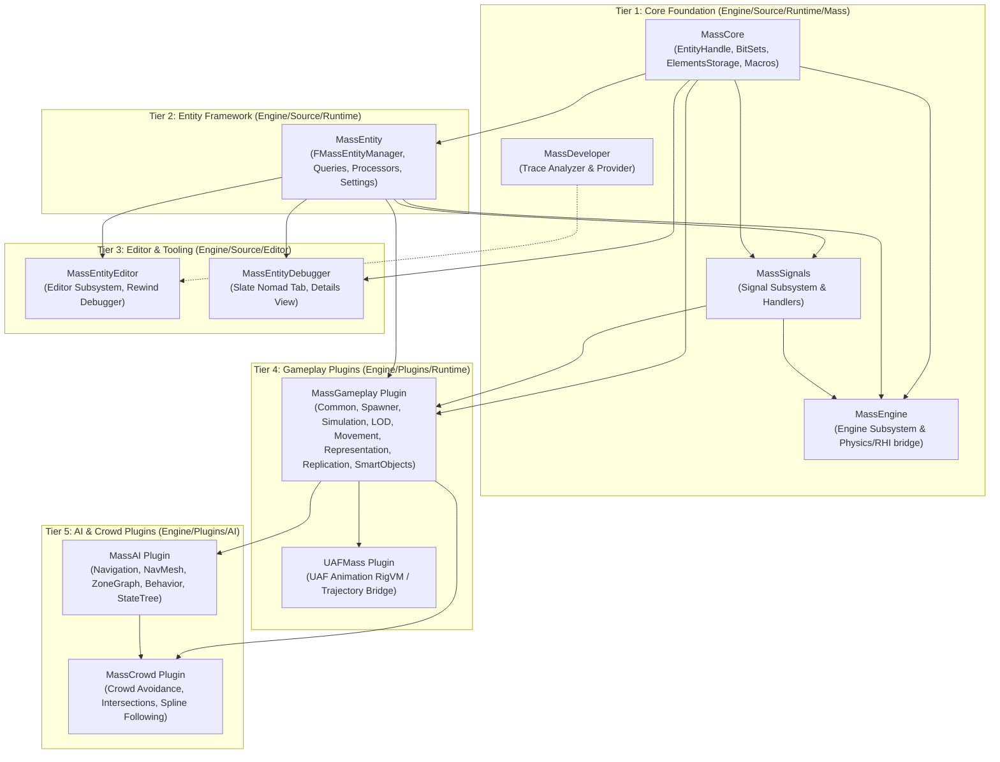
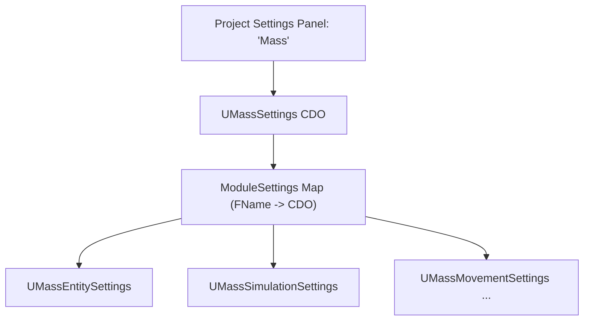
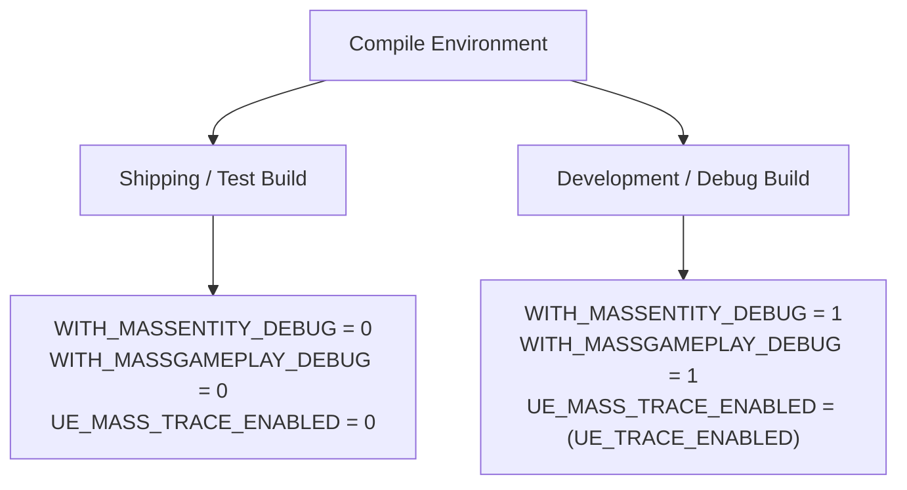
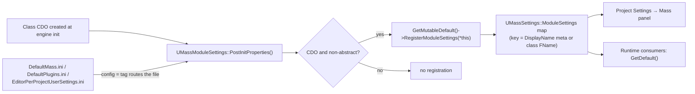

# Configuration and Build — UE 5.8 MASS

## Scope
Build configuration, module dependency topology, settings registration architecture, INI hierarchy, and compile-time preprocessor flags for the MASS ECS ecosystem in Unreal Engine 5.8. Covers plugins (`MassGameplay`, `MassAI`, `MassCrowd`, `MassInsights`, `UAFMass`), core runtime modules (`MassCore`, `MassEntity`, `MassEngine`, `MassSignals`, `MassDeveloper`), editor tooling (`MassEntityEditor`, `MassEntityDebugger`, `MassGameplayEditor`), developer settings classes deriving from `UMassModuleSettings` / `UDeveloperSettings`, `MassGameplayExternalTraits`, and the 5.8 migration architecture forwarding legacy headers to `MassCore`.

## Architecture

MASS build and configuration topology in UE 5.8 is structured into five distinct operational tiers:



### Module Distribution and Responsibilities

1. **`MassCore` (`Engine/Source/Runtime/Mass/MassCore`)**:
   - The root ECS data layer introduced in UE 5.8. Contains zero dependency on `MassEntity` or `Engine`.
   - Depends only on `Core`, `CoreUObject`, and `TraceLog`.
   - Houses `FMassEntityHandle`, `TypeBitSetBuilder`, `MassSparseElementsStorage`, `FMassArchetypeGroup`, `FMassElementBitSet`, relations handles, and primitive ECS macros (`WITH_MASSENTITY_DEBUG`).
   - Public include root is mapped so `#include "Mass/EntityHandle.h"` or direct `#include "EntityHandle.h"` resolves.

2. **`MassEntity` (`Engine/Source/Runtime/MassEntity`)**:
   - The central archetype management and execution coordinator. Depends on `MassCore`, `Engine`, and `DeveloperSettings`.
   - Implements `FMassEntityManager`, `FMassEntityQuery`, `UMassProcessor`, `UMassSettings`, `UMassEntitySettings`, `UE::Mass::FQueryExecutor`, and `UE::Mass::FProcessingQueue`.
   - Host module for legacy header deprecation shims (`UE_DEPRECATED_HEADER(5.8)`).

3. **`MassEngine` & `MassSignals` (`Engine/Source/Runtime/Mass/`)**:
   - `MassSignals`: Signal dispatcher subsystem allowing asynchronous or deferred entity-targeted notifications.
   - `MassEngine`: Bridges Mass core ECS to world physics (`Chaos`), rendering contexts (`RenderCore`, `RHI`), and scene subsystems.

4. **`MassDeveloper` & `MassInsights`**:
   - `MassDeveloper`: Desktop-only module housing `MassTraceAnalyzer` and `MassTraceProvider` enabled via `UE_MASS_TRACE_ANALYSIS_ENABLED=1`.
   - `MassInsights`: Standalone plugin with `ProgramAllowList: ["UnrealInsights"]` providing `MassInsightsAnalysis` and `MassInsightsUI`.

5. **`MassGameplay` & Downstream AI Modules**:
   - 16 runtime, editor, and test modules implementing agent lifecycle (`MassSpawner`), world ticking (`MassSimulation`), level of detail (`MassLOD`), locomotion (`MassMovement`), replication (`MassReplication`), smart objects (`MassSmartObjects`), and instanced mesh rendering (`MassRepresentation`).
   - Extended by `MassAI` (ZoneGraph/NavMesh steering, StateTree execution) and `MassCrowd` (intersection flow, density lanes).

---

## Configuration Architecture

### The `UMassModuleSettings` Registration Pattern

Rather than fragmenting project settings across dozens of standalone Project Settings tabs, MASS establishes a composite hub pattern through `UMassSettings` and `UMassModuleSettings`:



1. **Registration Lifecycle**:
   - `UMassModuleSettings` derives from `UObject` with `config = Mass, defaultconfig, collapseCategories`.
   - During `PostInitProperties()`, if the instance is a Class Default Object (CDO) and non-abstract:
     ```cpp
     GetMutableDefault<UMassSettings>()->RegisterModuleSettings(*this);
     ```
   - `UMassSettings::RegisterModuleSettings` stores the pointer in `TMap<FName, TObjectPtr<UMassModuleSettings>> ModuleSettings`, keyed by the class `DisplayName` meta-tag (or class `FName`).
2. **INI File Multiplexing**:
   - Although settings are displayed within the consolidated `Mass` project category, serialization routes according to the `config = <Name>` tag on each class declaration.
   - Classes tagged `config = Mass` serialize into `DefaultMass.ini` (engine or project level).
   - Classes tagged `config = Plugins` serialize into `DefaultPlugins.ini` (e.g. `UMassSmartObjectSettings`, `UMassCrowdSettings`, `UMassLookAtSettings`).
   - Classes tagged `config = EditorPerProjectUserSettings` serialize into user preferences (e.g. `UMassDebuggerSettings`).

---

## Key types

| Symbol | Module | Responsibility |
|---|---|---|
| `UMassModuleSettings` | `MassEntity` | `UCLASS(MinimalAPI, Abstract, config = Mass, defaultconfig, collapseCategories)` base for per-module settings; `PostInitProperties()` self-registers the CDO |
| `UMassSettings` | `MassEntity` | `UDeveloperSettings` hub, `DisplayName = "Mass"`, `AutoExpandCategories = "Mass"`; owns `TMap<FName, TObjectPtr<UMassModuleSettings>> ModuleSettings` |
| `UMassSettings::RegisterModuleSettings(UMassModuleSettings&)` | `MassEntity` | Stores a settings CDO; key is the class `DisplayName` meta tag in editor, class `FName` otherwise |
| `UMassModuleSettings::PostInitProperties()` | `MassEntity` | Registers CDO only when `RF_ClassDefaultObject` and the class is non-abstract |
| `UMassDebuggerSettings` | `MassEntityDebugger` | `config = EditorPerProjectUserSettings` — user-scoped, not shipped |
| `MassGameplayExternalTraits` | `MassGameplayExternalTraits` | `Build.cs` deps: `Core`, `MassCore`, `MassEntity` only — the thinnest plugin module |
| `WITH_MASSENTITY_DEBUG`, `WITH_MASSGAMEPLAY_DEBUG`, `UE_MASS_TRACE_ENABLED`, `WITH_MASS_CONCURRENT_RESERVE` | `MassCore` / plugin modules | Compile gates; see *Build Flags and Preprocessor Directives* |

---

## Settings Classes and INI Reference

| Class | Owning Module | Base Class | Config File Target | Default INI Section | Key Properties Controlled |
| :--- | :--- | :--- | :--- | :--- | :--- |
| `UMassSettings` | `MassEntity` | `UDeveloperSettings` | `DefaultMass.ini` | `[/Script/MassEntity.MassSettings]` | Container `ModuleSettings` map consolidating all module CDOs. |
| `UMassEntitySettings` | `MassEntity` | `UMassModuleSettings` | `DefaultMass.ini` | `[/Script/MassEntity.MassEntitySettings]` | `ChunkMemorySize` (default 128 KiB), `ProcessingPhasesConfig[EMassProcessingPhase::MAX]`, `ProcessorCDOs`, `DumpDependencyGraphFileName`. |
| `UMassGameplaySettings` | `MassCommon` | `UMassModuleSettings` | `DefaultMass.ini` | `[/Script/MassCommon.MassGameplaySettings]` | `bLogSpawnLocations` (CVar `mass.debug.VLogSpawnLocations`, default `true`). |
| `UMassSimulationSettings` | `MassSimulation` | `UMassModuleSettings` | `DefaultMass.ini` | `[/Script/MassSimulation.MassSimulationSettings]` | `DesiredActorSpawningTimeSlicePerTick` (0.0015s), `DesiredActorDestructionTimeSlicePerTick` (0.0005s), `bEntityCompactionEnabled` (`true`), `DesiredEntityCompactionTimeSlicePerTick` (0.005s), `DesiredActorFailedSpawningRetryTimeInterval` (5.0s), `DesiredActorFailedSpawningRetryMoveDistance` (500cm). |
| `UMassMovementSettings` | `MassMovement` | `UMassModuleSettings` | `DefaultMass.ini` | `[/Script/MassMovement.MassMovementSettings]` | `MovementStyles` array (`FMassMovementStyle`: GUID, Name, Desired Speed, Acceleration). |
| `UMassReplicationSettings` | `MassReplication` | `UMassModuleSettings` | `DefaultMass.ini` | `[/Script/MassReplication.MassReplicationSettings]` | `ReplicationGridCellSize` (default 5000.0cm / 50m). |
| `UMassSmartObjectSettings` | `MassSmartObjects` | `UMassModuleSettings` | `DefaultPlugins.ini` | `[/Script/MassSmartObjects.MassSmartObjectSettings]` | `SmartObjectTag` (ZoneGraph tag), `SearchExtents` (500cm), `MRUSlotsMaxCount` (0-4), `bUseCooldownForMRUSlots`, `MRUSlotsCooldown`. |
| `UMassBehaviorSettings` | `MassAIBehavior` | `UMassModuleSettings` | `DefaultMass.ini` | `[/Script/MassAIBehavior.MassBehaviorSettings]` | `MaxActivationsPerLOD[EMassLOD::Max]`, `DynamicStateTreeProcessorClass` (`TSoftClassPtr<UMassStateTreeProcessor>`). |
| `UMassLookAtSettings` | `MassAIBehavior` | `UDeveloperSettings` | `DefaultPlugins.ini` | `[/Script/MassAIBehavior.MassLookAtSettings]` | `Priorities[MaxPriorities]`, `DefaultTargetLocationOffset`, `TargetHeightRatio` (1.0), `FixedOffsetFromTargetHeight` (0.0). |
| `UMassCrowdSettings` | `MassCrowd` | `UMassModuleSettings` | `DefaultPlugins.ini` | `[/Script/MassCrowd.MassCrowdSettings]` | `CrowdTag`, `CrossingTag`, `SlotSize` (50), `SlotOffset` (75), `MoveDistance` (500cm), `MoveDistanceRandomDeviation` (100cm), `LaneDensities`, `ObstacleStoppingSpeedTolerance` (5cm/s), `ObstacleTimeToStop` (0.3s), `ObstacleEffectRadius` (1000cm). |
| `UMassDebuggerSettings` | `MassEntityDebugger` | `UMassModuleSettings` | `EditorPerProjectUserSettings.ini` | `[/Script/MassEntityDebugger.MassDebuggerSettings]` | `bStripMassPrefix` (default `true` in details inspector). |

### Plugin Default INI Files

The engine provides specific plugin INI manifests that establish `[CoreRedirects]` across versions:
- `Engine/Plugins/Runtime/MassGameplay/Config/DefaultMassGameplay.ini`:
  ```ini
  [CoreRedirects]
  ; 5.3
  +StructRedirects=(OldName="StaticMeshInstanceVisualizationMeshDesc",NewName="/Script/MassRepresentation.MassStaticMeshInstanceVisualizationMeshDesc")
  +StructRedirects=(OldName="ISMCSharedData",NewName="/Script/MassRepresentation.MassISMCSharedData")
  ```
- `Engine/Plugins/AI/MassAI/Config/DefaultMassAI.ini`:
  ```ini
  [CoreRedirects]
  +FunctionRedirects=(OldName="/Script/MassAIBehavior.MassLookAtSubsystem.CreateRequest",NewName="/Script/MassAIBehavior.MassLookAtSubsystem.CreateLookAtPositionRequest")
  ```
- `Engine/Plugins/AI/MassCrowd/Config/DefaultMassCrowd.ini`:
  ```ini
  [CoreRedirects]
  ; no changes past UE 5.0
  ```

---

## Build Flags and Preprocessor Directives

### Compilation Macros



1. **`WITH_MASSENTITY_DEBUG`**:
   - Defined in `Engine/Source/Runtime/Mass/MassCore/Public/Mass/EntityMacros.h`:
     ```cpp
     #ifndef WITH_MASSENTITY_DEBUG
     #define WITH_MASSENTITY_DEBUG (!(UE_BUILD_SHIPPING || UE_BUILD_SHIPPING_WITH_EDITOR || UE_BUILD_TEST) && WITH_STRUCTUTILS_DEBUG && 1)
     #endif
     ```
   - Controls entity and archetype debug strings (`DebugNames`), `FMassDebugger` hooks, runtime query access requirement checking (`DoesArchetypeMatchRequirements`), validation ensures in `FMassEntityBuilder`, and detailed entity count metrics.
2. **`WITH_MASSGAMEPLAY_DEBUG`**:
   - Defined in `Engine/Plugins/Runtime/MassGameplay/Source/MassCommon/Public/MassCommonTypes.h`:
     ```cpp
     #define WITH_MASSGAMEPLAY_DEBUG (!(UE_BUILD_SHIPPING || UE_BUILD_SHIPPING_WITH_EDITOR || UE_BUILD_TEST) && WITH_MASSENTITY_DEBUG && 1)
     ```
   - Controls visual logger integration, trait inspection tracking, and debug visualizer attachments.
3. **`UE_MASS_TRACE_ENABLED`**:
   - Defined in `Engine/Source/Runtime/MassEntity/Public/MassEntityTrace.h`:
     ```cpp
     #ifndef UE_MASS_TRACE_ENABLED
     #define UE_MASS_TRACE_ENABLED (UE_TRACE_ENABLED && WITH_MASSENTITY_DEBUG && !IS_PROGRAM && !UE_BUILD_SHIPPING)
     #endif
     ```
   - Enables binary event logging to Unreal Insights via `MassChannel` (`MassBulkAddEntity`, `MassArchetypeCreated`, `MassPhaseExecution`, etc.).
4. **`UE_MASS_TRACE_ANALYSIS_ENABLED`**:
   - Defined in `Engine/Source/Runtime/Mass/MassDeveloper/MassDeveloper.Build.cs`:
     ```csharp
     public static bool IsMassTraceAnalysisEnabled(ReadOnlyTargetRules Target)
     {
         return Target.Platform.IsInGroup(UnrealPlatformGroup.Desktop)
             && (Target.Type == TargetType.Editor || Target.Type == TargetType.Program);
     }
     ```
   - Compiled into desktop Editor and Program builds for `MassTraceAnalyzer` and `MassTraceProvider`.
5. **`WITH_MASS_CONCURRENT_RESERVE` (Deprecated 5.8)**:
   - Defined in `Engine/Source/Runtime/MassEntity/Public/MassEntityManager.h`:
     ```cpp
     #ifndef REQUESTED_MASS_CONCURRENT_RESERVE
     #define REQUESTED_MASS_CONCURRENT_RESERVE 1
     #endif
     #define WITH_MASS_CONCURRENT_RESERVE (REQUESTED_MASS_CONCURRENT_RESERVE || WITH_EDITOR)
     ```
   - Deprecation Notice: Single-threaded storage is obsolete. In 5.8, concurrent entity storage (`UE::Mass::FConcurrentEntityStorage`) is mandatory; overriding `REQUESTED_MASS_CONCURRENT_RESERVE=0` will trigger deprecation warnings and will be ignored in future engine releases.
6. **`UE_MASS_MAX_ACTIVE_CHUNKS`**:
   - Defined in `Engine/Source/Runtime/MassEntity/Public/MassProcessingQueueTypes.h` (default 512). Controls the static active chunk slot capacity within `UE::Mass::FProcessingQueue`.

---

## Plugin Manifests (`.uplugin`)

### 1. `MassGameplay.uplugin`
- **Location**: `Engine/Plugins/Runtime/MassGameplay/MassGameplay.uplugin`
- **EnabledByDefault**: `false` | **IsExperimentalVersion**: `true` | **Version**: `0.4`
- **Plugin Dependencies**: `ZoneGraph`, `PoseSearch`, `ZoneGraphAnnotations`, `SmartObjects`, `StateTree`, `DataValidation`.
- **Contained Modules (16)**:
  - Runtime: `MassCommon`, `MassActors`, `MassEQS`, `MassSpawner`, `MassSmartObjects`, `MassSimulation`, `MassLOD`, `MassMovement`, `MassCharacterTrajectory`, `MassReplication`, `MassRepresentation`, `MassGameplayDebug`, `MassGameplayExternalTraits`.
  - Editor: `MassGameplayEditor`, `MassMovementEditor` (`LoadingPhase: PostEngineInit`).
  - UncookedOnly: `MassGameplayTestSuite`.

### 2. `MassAI.uplugin`
- **Location**: `Engine/Plugins/AI/MassAI/MassAI.uplugin`
- **EnabledByDefault**: `false` | **IsExperimentalVersion**: `true` | **Version**: `0.4`
- **Plugin Dependencies**: `MassGameplay`, `ZoneGraph`, `ZoneGraphAnnotations`, `SmartObjects`, `StateTree`, `NavCorridor`.
- **Contained Modules (9)**:
  - Runtime: `MassNavigation`, `MassNavMeshNavigation`, `MassZoneGraphNavigation`, `MassAIBehavior`, `MassAIReplication`, `MassAIDebug`.
  - Editor: `MassNavigationEditor` (`LoadingPhase: PostEngineInit`), `MassAIBehaviorEditor`.
  - UncookedOnly: `MassAITestSuite`.

### 3. `MassCrowd.uplugin`
- **Location**: `Engine/Plugins/AI/MassCrowd/MassCrowd.uplugin`
- **EnabledByDefault**: `false` | **IsExperimentalVersion**: `true` | **Version**: `0.4`
- **Plugin Dependencies**: `ZoneGraph`, `MassGameplay`, `MassAI`, `StateTree`.
- **Contained Modules (1)**: `MassCrowd` (Runtime, `LoadingPhase: Default`).

### 4. `MassInsights.uplugin`
- **Location**: `Engine/Plugins/MassInsights/MassInsights.uplugin`
- **EnabledByDefault**: `true` | **IsBetaVersion**: `true`
- **SupportedPrograms**: `["UnrealInsights"]`
- **Contained Modules (2)**: `MassInsightsAnalysis` and `MassInsightsUI` (Type: `EditorAndProgram`, `ProgramAllowList: ["UnrealInsights"]`).

### 5. `UAFMass.uplugin`
- **Location**: `Engine/Plugins/Experimental/UAF/UAFMass/UAFMass.uplugin`
- **EnabledByDefault**: `false` | **IsExperimentalVersion**: `true` | **Version**: `0.1`
- **Plugin Dependencies**: `MassGameplay`, `UAF`, `UAFAnimGraph`.
- **Contained Modules (1)**: `UAFMass` (Runtime, `LoadingPhase: Default`).

---

## Trait Infrastructure and External Bridges

### `MassGameplayExternalTraits`
- Located at `Engine/Plugins/Runtime/MassGameplay/Source/MassGameplayExternalTraits`.
- **Historic Role**: Provided traits for bridging external engine components and non-Mass actor hierarchies into the Mass framework.
- **UE 5.8 Status**: Header `MassGameplayExternalTraits.h` is marked:
  ```cpp
  UE_DEPRECATED_HEADER(5.6, "Use MassExternalSubsystemTraits.h instead if you need it.")
  #include "Mass/ExternalSubsystemTraits.h"
  ```
  The core external subsystem traits now reside directly within `MassCore` (`Mass/ExternalSubsystemTraits.h`). The module is preserved for link backward compatibility and minimal module registration (`FMassGameplayExternalTraitsModule`).

### `MassGameplayEditor`: Trait Repository Architecture
- Located at `Engine/Plugins/Runtime/MassGameplay/Source/MassGameplayEditor`.
- Implements `UMassTraitRepository` (`UEditorSubsystem`):
  1. **Lazy Initialization**: Scans all `UMassEntityTraitBase` classes only when first requested (`InitRepository()`) using an isolated transient world (`GetInvestigationWorld()`).
  2. **Requirement Resolution**: Inspects each trait's `BuildTemplate` behavior via `FMassTraitInspectionContext` and `FMassEntityTemplateBuildContext` without modifying game world state.
  3. **Auto-Suggestions**: Maps fragment types to traits (`ElementTypeToTraitMap`) so that if a processor or user requires a fragment, the editor suggests the exact trait providing it:
     ```cpp
     TConstArrayView<FName> GetTraitsNameAddingElements(const FName ElementName);
     ```
  4. **Validation and Error Surfacing**: Listens to `#if WITH_MASSENTITY_DEBUG` events (`OnNewTraitType`, `OnDebugEvent`) and emits diagnostic fix options to the Unreal `MessageLog`.

---

## 5.8 Include Migration: MassCore

In UE 5.8, the lowest-level ECS primitive types were split from `MassEntity` into the independent module `MassCore`. Legacy headers in `MassEntity/Public/` remain as forwarding shims generating compiler deprecation warnings:

```
Legacy Include Path (MassEntity)             5.8 Canonical Path (MassCore)
----------------------------------------     --------------------------------------
MassEntityHandle.h                       ->  Mass/EntityHandle.h
MassEntityElementTypes.h                 ->  Mass/EntityElementTypes.h
MassEntityFragments.h                   ->  Mass/EntityFragments.h
MassEntityMacros.h                      ->  Mass/EntityMacros.h
MassArchetypeGroup.h                    ->  Mass/ArchetypeGroup.h
MassExternalSubsystemTraits.h           ->  Mass/ExternalSubsystemTraits.h
MassTestableEnsures.h                   ->  Mass/TestableEnsures.h
```

### Migration Pattern in Code

If code currently includes:
```cpp
// DEPRECATED in UE 5.8:
#include "MassEntityHandle.h"
#include "MassEntityFragments.h"
```
It triggers:
```
warning: MassEntityHandle.h has moved to the MassCore module and been renamed to Mass/EntityHandle.h.
Include Mass/EntityHandle.h from MassCore and add a MassCore dependency to your .Build.cs.
```
Update to:
```cpp
// 5.8 Canonical:
#include "Mass/EntityHandle.h"
#include "Mass/EntityFragments.h"
```

---

## Required `Build.cs` Additions for Game Projects

To consume MASS features in a game project or plugin, add the corresponding modules based on required capabilities.

### 1. Minimal Headless ECS Core
For pure ECS logic, data fragments, and queries without heavy gameplay frameworks:
```csharp
PublicDependencyModuleNames.AddRange(
    new string[] {
        "Core",
        "CoreUObject",
        "Engine",
        "MassCore",    // Essential for FMassEntityHandle, BitSets, FMassFragment
        "MassEntity"   // Essential for FMassEntityManager, FMassEntityQuery, UMassProcessor
    }
);
```

### 2. Standard Gameplay Simulation (Movement, Spawning, LOD)
For full Mass gameplay integration with actors, traits, spawning, and visual representation:
```csharp
PublicDependencyModuleNames.AddRange(
    new string[] {
        "Core",
        "CoreUObject",
        "Engine",
        "MassCore",
        "MassEntity",
        "MassCommon",
        "MassSimulation",
        "MassSpawner",
        "MassMovement",
        "MassRepresentation",
        "MassActors",
        "MassLOD"
    }
);
```

### 3. AI, StateTree, and Crowd Navigation
For autonomous agents utilizing ZoneGraph, SmartObjects, StateTree behaviors, and crowds:
```csharp
PublicDependencyModuleNames.AddRange(
    new string[] {
        "MassAIBehavior",
        "MassNavigation",
        "MassZoneGraphNavigation",
        "MassCrowd",
        "StateTreeModule",
        "ZoneGraph",
        "SmartObjectsModule"
    }
);
```

### 4. Editor Tooling and Custom Trait Inspection
If authoring editor module extensions, custom trait visualizers, or debugging panels:
```csharp
if (Target.bBuildEditor)
{
    PrivateDependencyModuleNames.AddRange(
        new string[] {
            "MassEntityEditor",
            "MassGameplayEditor",
            "MassEntityDebugger"
        }
    );
}
```

---

## Data flow



1. Registration happens once per class, at CDO creation; instances never register (`ensureMsgf` asserts CDO).
2. INI routing is per class, not per panel: the `config = <Name>` tag decides which ini file a class's properties are read from, while `UMassSettings` only groups them for display.
3. Runtime code reads settings through the concrete class (`GetDefault<UMassMovementSettings>()`), not through the `ModuleSettings` map — the map exists for the Project Settings UI.
4. Build flags are resolved in `Build.cs` before compilation and gate whole subsystems (debug names, breakpoints, trace events), so they never appear as runtime data flow.

---

## Usage

Game-project setup, in order:

1. Enable `MassGameplay`, `MassAI` (and `MassCrowd` if using the crowd system) in `*.uplugin` / Plugin Manager; `MassInsights` is loaded by `UnrealInsights` only (`ProgramAllowList`).
2. Add `MassCore` and `MassEntity` explicitly to `PublicDependencyModuleNames` — do not rely on transitive includes (see *Pitfalls*).
3. Override settings in the project ini under the section matching the class's `config` tag, e.g. `[/Script/MassEntity.MassSettings]` in `Config/DefaultMass.ini`, `[/Script/MassMovement.MassMovementSettings]` in `Config/DefaultPlugins.ini`.
4. Include Mass headers through the 5.8 paths (`Mass/EntityHandle.h`, `Mass/EntityElementTypes.h`); the legacy `MassEntity/Public` names are `UE_DEPRECATED_HEADER(5.8)` shims.
5. Gate debug-only code on `WITH_MASSENTITY_DEBUG`, not on runtime flags.

---

## Pitfalls

1. **Missing `MassCore` in `.Build.cs`**:
   - In UE 5.8, `MassEntity` depends on `MassCore`, but transitively relying on includes will fail if only `MassCore` primitives (`FMassEntityHandle`, bitsets) are consumed. Always add `"MassCore"` explicitly to your module's dependencies.
2. **Settings Class Misplacement (`config = Plugins` vs `config = Mass`)**:
   - Manually writing properties for `UMassSmartObjectSettings` or `UMassCrowdSettings` into `DefaultMass.ini` will have no effect. These classes declare `config = Plugins` and must be placed into `DefaultPlugins.ini` under their respective script sections.
3. **`WITH_MASSENTITY_DEBUG` Stripping in Shipping**:
   - All code inspecting `DebugNames`, `FMassDebugger`, or query registration assertions (`bRegistered`) is completely compiled out when `WITH_MASSENTITY_DEBUG` is 0. Never write game logic or execution-flow branching that depends on debug methods or fields guarded by this flag.
4. **`REQUESTED_MASS_CONCURRENT_RESERVE=0` Obsolete**:
   - Projects upgrading from older versions attempting to force single-threaded reserve via `#define REQUESTED_MASS_CONCURRENT_RESERVE 0` will generate deprecation warnings; concurrent entity storage is now permanently mandated.
5. **Direct Macro Calls Deprecated**:
   - Macros like `GET_MASS_CONFIG_VALUE(a)`, `GET_MASSSIMULATION_CONFIG_VALUE(a)`, and `GET_MASSDEBUGGER_CONFIG_VALUE(a)` are deprecated in 5.8. Call `GetDefault<UMassEntitySettings>()` or `GetMutableDefault<UMassEntitySettings>()` directly.

---

## Source Files

- `Engine/Source/Runtime/Mass/MassCore/MassCore.Build.cs`
- `Engine/Source/Runtime/Mass/MassCore/Public/Mass/EntityHandle.h`
- `Engine/Source/Runtime/Mass/MassCore/Public/Mass/EntityMacros.h`
- `Engine/Source/Runtime/MassEntity/MassEntity.Build.cs`
- `Engine/Source/Runtime/MassEntity/Public/MassSettings.h`
- `Engine/Source/Runtime/MassEntity/Private/MassSettings.cpp`
- `Engine/Source/Runtime/MassEntity/Public/MassEntitySettings.h`
- `Engine/Source/Runtime/MassEntity/Public/MassEntityTrace.h`
- `Engine/Source/Runtime/MassEntity/Public/MassEntityManager.h`
- `Engine/Source/Runtime/Mass/MassSignals/MassSignals.Build.cs`
- `Engine/Source/Runtime/Mass/MassEngine/MassEngine.Build.cs`
- `Engine/Source/Runtime/Mass/MassDeveloper/MassDeveloper.Build.cs`
- `Engine/Source/Editor/MassEntityEditor/MassEntityEditor.Build.cs`
- `Engine/Source/Editor/MassEntityDebugger/MassEntityDebugger.Build.cs`
- `Engine/Source/Editor/MassEntityDebugger/Public/MassDebuggerSettings.h`
- `Engine/Plugins/Runtime/MassGameplay/MassGameplay.uplugin`
- `Engine/Plugins/Runtime/MassGameplay/Config/DefaultMassGameplay.ini`
- `Engine/Plugins/Runtime/MassGameplay/Source/MassCommon/Public/MassGameplaySettings.h`
- `Engine/Plugins/Runtime/MassGameplay/Source/MassSimulation/Public/MassSimulationSettings.h`
- `Engine/Plugins/Runtime/MassGameplay/Source/MassMovement/Public/MassMovementSettings.h`
- `Engine/Plugins/Runtime/MassGameplay/Source/MassReplication/Public/MassReplicationSettings.h`
- `Engine/Plugins/Runtime/MassGameplay/Source/MassSmartObjects/Public/MassSmartObjectSettings.h`
- `Engine/Plugins/Runtime/MassGameplay/Source/MassGameplayEditor/Public/MassTraitRepository.h`
- `Engine/Plugins/Runtime/MassGameplay/Source/MassGameplayExternalTraits/MassGameplayExternalTraits.Build.cs`
- `Engine/Plugins/Runtime/MassGameplay/Source/MassGameplayExternalTraits/Public/MassGameplayExternalTraits.h`
- `Engine/Plugins/AI/MassAI/MassAI.uplugin`
- `Engine/Plugins/AI/MassAI/Config/DefaultMassAI.ini`
- `Engine/Plugins/AI/MassAI/Source/MassAIBehavior/Public/MassBehaviorSettings.h`
- `Engine/Plugins/AI/MassAI/Source/MassAIBehavior/Public/MassLookAtSettings.h`
- `Engine/Plugins/AI/MassCrowd/MassCrowd.uplugin`
- `Engine/Plugins/AI/MassCrowd/Config/DefaultMassCrowd.ini`
- `Engine/Plugins/AI/MassCrowd/Source/MassCrowd/Public/MassCrowdSettings.h`
- `Engine/Plugins/MassInsights/MassInsights.uplugin`
- `Engine/Plugins/Experimental/UAF/UAFMass/UAFMass.uplugin`
- `Engine/Plugins/Experimental/UAF/UAFMass/Source/UAFMass/UAFMass.Build.cs`

---

## Graph Facts

Module and type facts derived from the UE 5.8 codebase analysis (`local://mass_graph_facts.md`):
- **Hub Architecture**: MASS is architectured around a core hub-and-spoke configuration where `FMassEntityManager` is the primary god node (edge degree 848, call degree 539) reached by all simulation, spawner, and debugging systems.
- **Node Distribution**:
  - `MassGameplay` plugin comprises 4,485 nodes across its modular subsystems.
  - `MassEntity` runtime module comprises 2,899 nodes.
  - `MassAI` plugin comprises 2,205 nodes.
  - Core Runtime (`MassCore`, `MassEngine`, `MassSignals`, `MassDeveloper`) comprises 736 nodes.
  - `MassEntityTestSuite` comprises 701 nodes.
  - `MassEntityDebugger` editor module comprises 637 nodes.
  - `MassCrowd` plugin comprises 592 nodes.
  - `MassInsights` comprises 249 nodes.
  - `MassEntityEditor` comprises 188 nodes.
  - `UAFMass` experimental plugin comprises 124 nodes.
- **Cross-Community Bridges**:
  - The configuration and settings tier bridges the core ECS cluster to the engine reflection system (Reflection and Property Change: 265 edges).
  - Debugger and editor modules connect runtime entities to editor presentations (Slate UI Rendering: 214 edges, Editor Data Storage: 191 edges).
