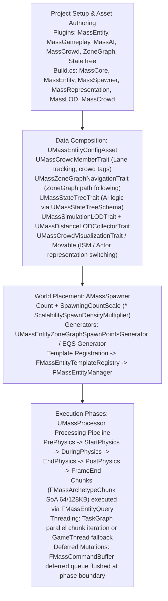

# Usage Guide and Performance — UE 5.8 MASS

## Scope
End-to-end authoring and runtime performance guide for a Mass-based crowd in Unreal Engine 5.8: project setup, entity configuration assets and traits, world spawner setup, processor authoring rules (including Blueprint status verification), StateTree AI behavior integration, LOD and representation pipeline, ZoneGraph crowd navigation, debugging workflows, and hardware-conscious performance tuning grounded in engine source code.

## Architecture
Mass crowd authoring separates data composition (high-level `UMassEntityConfigAsset` with modular traits) from runtime chunk-level execution (`UMassProcessor` operating over `FMassArchetypeChunk` Structure-of-Arrays memory). The spawner populates dense contiguous archetype memory, while processors evaluate queries across coordinated processing phases.



### Blueprint Processor Verification (Source Grounding)
In UE 5.8, **custom Blueprint processors are NOT supported**. 
- Source audit of `Engine/Source/Runtime/MassEntity/Public/MassProcessor.h` confirms `UMassProcessor` is declared `UCLASS(abstract, EditInlineNew, CollapseCategories, config = Mass, defaultconfig, ConfigDoNotCheckDefaults, MinimalAPI)`. It lacks `Blueprintable` and `BlueprintType`.
- Core execution callbacks (`Execute(FMassEntityManager&, FMassExecutionContext&)` and `ConfigureQueries(...)`) are native C++ virtual functions taking native struct references (`FMassEntityManager&`, `FMassExecutionContext&`) that are not reflected to Unreal Blueprint (`UFUNCTION` is absent).
- Blueprint authoring is strictly limited to:
  1. `UMassEntityConfigAsset` data assignment in the editor.
  2. Spawner orchestration via `AMassSpawner` BlueprintCallable functions (`DoSpawning()`, `DoDespawning()`, `ScaleSpawningCount()`).
  3. Custom spawn point generators inheriting from `UMassEntitySpawnDataGeneratorBase` (`UCLASS(Blueprintable)`).
  4. Behavior logic through `StateTree` tasks and evaluators (`UMassStateTreeSchema`).

## Key types

| Symbol | Module | Responsibility |
| :--- | :--- | :--- |
| `UMassEntityConfigAsset` | `MassSpawner` | Data asset defining archetype composition from an ordered trait hierarchy. |
| `UMassEntityTraitBase` | `MassSpawner` | Abstract base for traits that append fragments, tags, and shared data to templates. |
| `AMassSpawner` | `MassSpawner` | Level actor driving spawn generators, template caching, and entity instantiation. |
| `UMassEntityZoneGraphSpawnPointsGenerator` | `MassSpawner` | Places initial crowd transforms along tagged ZoneGraph lane geometry. |
| `UMassCrowdMemberTrait` | `MassCrowd` | Attaches crowd member tags and lane-tracking fragments to entities. |
| `UMassStateTreeTrait` | `MassAIBehavior` | Binds a `UStateTree` asset using `UMassStateTreeSchema` for agent decision making. |
| `UMassCrowdVisualizationTrait` | `MassCrowd` | Coordinates distance-based switching between ISM rendering and actor representation. |
| `UMassSimulationLODTrait` | `MassLOD` | Configures tick-rate decimation and LOD tiers based on viewer proximity. |
| `UMassProcessor` | `MassEntity` | Native ECS processor executing queries over contiguous archetype chunks. |
| `FMassEntityQuery` | `MassEntity` | Cached filter matching chunk archetypes by required, optional, and excluded elements. |
| `FMassExecutionContext` | `MassEntity` | Scratchpad passed to chunk loops granting access to chunk views and deferred buffers. |
| `FMassCommandBuffer` | `MassEntity` | Double-buffered thread-safe queue holding structural mutations and deferred operations. |

## Data flow

```mermaid
flowchart LR
    A["AMassSpawner::DoSpawning()"] --> B["UMassEntitySpawnDataGeneratorBase::Generate()"]
    B --> C["AMassSpawner::OnSpawnDataGenerationFinished()<br/>→ SpawnGeneratedEntities()"]
    C --> D["FMassEntityTemplateRegistry → FMassEntityTemplate<br/>(traits → element bitset → archetype)"]
    D --> E["FMassEntityManager::BatchCreateEntities()"]
    E --> F["Observers: entity-created"]
    F --> G["FMassProcessingPhaseManager tick<br/>(dependency-solved processor graph)"]
    G --> H["Movement / navigation / behavior processors"]
    H --> I["LOD decision → representation update<br/>(ISM/HISM or UAF)"]
    I --> J["Renderer / replication"]
    G -.deferred mutations.-> K["FMassCommandBuffer flushed at phase end"]
    K -.archetype change.-> D
```



Spawning is asynchronous: `DoSpawning()` dispatches each generator with a `FFinishedGeneratingSpawnDataSignature` delegate and only creates entities after every generator with `Proportion > 0` has reported. Entity creation, fragment addition and archetype changes performed inside a processor are queued in the command buffer and applied at the flush point, not immediately — so a processor cannot read back a fragment it just added on the same entity.


## Usage (Canonical Crowd Wiring)

| Layer | Required Component / Asset | Source Header / Module | Function in Crowd Pipeline | Sibling Doc Reference |
| :--- | :--- | :--- | :--- | :--- |
| **Project Plugins** | `MassGameplay`, `MassAI`, `MassCrowd`, `ZoneGraph`, `StateTree` | `.uplugin` definitions | Core modules and editor tooling. | [01_Core_Architecture.md](01_Core_Architecture.md) |
| **Build.cs** | `MassEntity`, `MassCore`, `MassSpawner`, `MassCrowd`, `MassNavigation`, `MassRepresentation`, `MassLOD` | Module `.Build.cs` | Native linking for custom fragments and processors. | [03_Processors_and_Execution.md](03_Processors_and_Execution.md) |
| **Config Asset** | `UMassEntityConfigAsset` | `MassEntityConfigAsset.h` | Aggregates crowd traits into a shared archetype template. | [02_Entities_Fragments_Traits.md](02_Entities_Fragments_Traits.md) |
| **Crowd Membership** | `UMassCrowdMemberTrait` | `MassCrowdMemberTrait.h` | Injects `FMassCrowdMemberFragment` and lane tracking. | [11_Crowd_and_ZoneGraph.md](11_Crowd_and_ZoneGraph.md) |
| **Navigation** | `UMassZoneGraphNavigationTrait` | `MassZoneGraphNavigationTrait.h` | Enables lane following, intersection branch choices, and lane changes. | [10_Navigation_Steering_and_Avoidance.md](10_Navigation_Steering_and_Avoidance.md) |
| **Avoidance** | `UMassObstacleAvoidanceTrait` | `MassAvoidanceTrait.h` | Standing/moving obstacle ray-casting and velocity deflection. | [10_Navigation_Steering_and_Avoidance.md](10_Navigation_Steering_and_Avoidance.md) |
| **Behavior** | `UMassStateTreeTrait` | `MassStateTreeTrait.h` | Drives high-level AI tasks via `UMassStateTreeSchema`. | [12_Behavior_and_StateTree.md](12_Behavior_and_StateTree.md) |
| **LOD Collection** | `UMassDistanceLODCollectorTrait` + `UMassSimulationLODTrait` | `MassLODTrait.h` | Calculates viewer distance and assigns `EMassLOD::Type`. | [08_Representation_LOD_and_Animation.md](08_Representation_LOD_and_Animation.md) |
| **Representation** | `UMassCrowdVisualizationTrait` | `MassCrowdVisualizationTrait.h` | Swaps between ISM mesh chunks and spawned skeletal actors. | [08_Representation_LOD_and_Animation.md](08_Representation_LOD_and_Animation.md) |
| **Level Spawner** | `AMassSpawner` | `MassSpawner.h` | Drives generator execution and archetype instantiation on BeginPlay. | [14_Spawning_and_Actors.md](14_Spawning_and_Actors.md) |
| **Spawn Generator** | `UMassEntityZoneGraphSpawnPointsGenerator` | `MassEntityZoneGraphSpawnPointsGenerator.h` | Distributes crowd entities along lanes tagged with `CrowdTag`. | [11_Crowd_and_ZoneGraph.md](11_Crowd_and_ZoneGraph.md) |
| **ZoneGraph Data** | `AZoneGraphData` | `ZoneGraphData.h` | Pre-baked vector lane network built in the level viewport. | [11_Crowd_and_ZoneGraph.md](11_Crowd_and_ZoneGraph.md) |

## Minimal Working C++ Example (Trait + Processor + Spawner)

### 1. Build.cs Dependencies
```csharp
// YourGameCrowd.Build.cs
PublicDependencyModuleNames.AddRange(new string[] {
    "Core", "CoreUObject", "Engine",
    "MassCore", "MassEntity", "MassSpawner",
    "MassMovement", "MassNavigation", "MassCrowd"
});
```

### 2. Custom Fragment & Trait
```cpp
// Source/YourGameCrowd/Public/CrowdSpeedTrait.h
#pragma once
#include "MassEntityTraitBase.h"
#include "MassEntityTemplate.h"
#include "CrowdSpeedTrait.generated.h"

USTRUCT()
struct FCrowdSpeedFragment : public FMassFragment
{
    GENERATED_BODY()
    UPROPERTY(EditAnywhere)
    float MaxSpeed = 300.0f;
    UPROPERTY(Transient)
    float CurrentSpeed = 0.0f;
};

UCLASS(meta = (DisplayName = "Crowd Speed Modifier"))
class YOURGAMECROWD_API UCrowdSpeedTrait : public UMassEntityTraitBase
{
    GENERATED_BODY()
public:
    UPROPERTY(EditAnywhere, Category = "Crowd")
    float DefaultSpeed = 250.0f;

protected:
    virtual void BuildTemplate(FMassEntityTemplateBuildContext& BuildContext, const UWorld& World) const override
    {
        // AddFragment<T>() takes no arguments; the value overload is AddFragment(FConstStructView).
        // AddFragment_GetRef is the flavor that lets a trait seed initial values.
        FCrowdSpeedFragment& Speed = BuildContext.AddFragment_GetRef<FCrowdSpeedFragment>();
        Speed.MaxSpeed = DefaultSpeed;
        Speed.CurrentSpeed = DefaultSpeed;
    }
};
```

### 3. Native C++ Processor
```cpp
// Source/YourGameCrowd/Public/CrowdSpeedProcessor.h
#pragma once
#include "MassProcessor.h"
#include "MassEntityQuery.h"
#include "CrowdSpeedTrait.h"
#include "MassCommonFragments.h"
#include "CrowdSpeedProcessor.generated.h"

UCLASS()
class YOURGAMECROWD_API UCrowdSpeedProcessor : public UMassProcessor
{
    GENERATED_BODY()
public:
    UCrowdSpeedProcessor()
    {
        ProcessingPhase = EMassProcessingPhase::PrePhysics;
        bAutoRegisterWithProcessingPhases = true;
        // QueryBasedPruning is protected and defaults to Prune; set it in the constructor
        // or override ShouldAllowQueryBasedPruning(bRuntimeMode) to opt out.
        QueryBasedPruning = EMassQueryBasedPruning::Prune;
    }

protected:
    virtual void ConfigureQueries(const TSharedRef<FMassEntityManager>& EntityManager) override
    {
        SpeedQuery.AddRequirement<FCrowdSpeedFragment>(EMassFragmentAccess::ReadWrite);
        SpeedQuery.AddRequirement<FTransformFragment>(EMassFragmentAccess::ReadOnly);
        SpeedQuery.RegisterWithProcessor(*this);
    }

    virtual void Execute(FMassEntityManager& EntityManager, FMassExecutionContext& Context) override
    {
        // Executes across chunks in parallel worker threads when safe
        SpeedQuery.ParallelForEachEntityChunk(Context, [](FMassExecutionContext& ChunkContext)
        {
            const int32 NumEntities = ChunkContext.GetNumEntities();
            TArrayView<FCrowdSpeedFragment> Speeds = ChunkContext.GetMutableFragmentView<FCrowdSpeedFragment>();
            TConstArrayView<FTransformFragment> Transforms = ChunkContext.GetFragmentView<FTransformFragment>();

            for (int32 i = 0; i < NumEntities; ++i)
            {
                // Cache-coherent contiguous memory access
                Speeds[i].CurrentSpeed = FMath::Clamp(Speeds[i].MaxSpeed, 0.0f, 600.0f);
            }
        });
    }

private:
    FMassEntityQuery SpeedQuery;
};
```

### 4. Level Spawner Configuration (C++ / Editor)
`AMassSpawner::Count`, `EntityTypes` and `SpawnDataGenerators` are `protected`
(`MassSpawner.h` lines 121–130), so programmatic configuration goes through a subclass;
the public surface is `DoSpawning()`, `DoDespawning()`, `GetCount()`, `ScaleSpawningCount()`,
`ClearTemplates()`, `DespawnEntity()` and the `OnSpawningFinishedEvent` delegate.

```cpp
// Source/YourGameCrowd/Public/CrowdSpawner.h
#pragma once
#include "MassSpawner.h"
#include "MassEntityConfigAsset.h"
#include "MassEntitySpawnDataGeneratorBase.h"
#include "MassEntityZoneGraphSpawnPointsGenerator.h"
#include "CrowdSpawner.generated.h"

UCLASS()
class ACrowdSpawner : public AMassSpawner
{
    GENERATED_BODY()
public:
    void Configure(const UMassEntityConfigAsset* Config, int32 InCount)
    {
        Count = InCount;

        FMassSpawnedEntityType EntityTypeDesc;
        EntityTypeDesc.EntityConfig = Config;   // TSoftObjectPtr; DoSpawning streams it in
        EntityTypeDesc.Proportion = 1.0f;
        EntityTypes.Add(EntityTypeDesc);

        // DoSpawning only dispatches generators that have a live GeneratorInstance,
        // so the instance must be created (the property is Instanced).
        FMassSpawnDataGenerator GenDesc;
        GenDesc.GeneratorInstance = NewObject<UMassEntityZoneGraphSpawnPointsGenerator>(this);
        GenDesc.Proportion = 1.0f;
        SpawnDataGenerators.Add(GenDesc);
    }
};
```

```cpp
ACrowdSpawner* Spawner = World->SpawnActor<ACrowdSpawner>();
Spawner->Configure(LoadObject<UMassEntityConfigAsset>(nullptr, TEXT("/Game/Crowd/DA_CrowdConfig.DA_CrowdConfig")), 5000);
Spawner->DoSpawning();   // async: entities exist when OnSpawningFinishedEvent fires
```

`bAutoSpawnOnBeginPlay` defaults to true, so a spawner configured in the editor spawns on
`BeginPlay` without an explicit `DoSpawning()` call. `DoSpawning()` returns early with a
`LogMassSpawner` warning if either `SpawnDataGenerators` or `EntityTypes` is empty.

## Performance Guidance (Source-Grounded Mechanisms)

### 1. Chunk-Level Iteration & Memory Alignment
- Entities are allocated in contiguous chunks (`FMassArchetypeChunk`). The chunk capacity is bounded by `UMassEntitySettings::ChunkMemorySize` (default: 128 KiB, configurable in Project Settings -> Mass Entity).
- Query loops (`ForEachEntityChunk` / `ParallelForEachEntityChunk`) expose `TArrayView` slices of fragments per chunk. Memory is arranged in Structure of Arrays (SoA).
- Inner loops iterate sequentially: `for (int32 i = 0; i < NumEntities; ++i)`. Never use random indexed lookups into other archetypes inside inner loops. Keep fragments small and 16-byte aligned to maximize SIMD cache-line residency.

### 2. Query Requirements & Runtime Pruning
- **Archetype Matching**: `FMassEntityQuery::CacheArchetypes()` pre-caches matching archetypes using bitset comparisons (`FMassArchetypeCompositionDescriptor`). When no entities match the archetype, execution is skipped.
- **Dynamic Pruning**: When `bAllowQueryBasedPruning = true` (or `EMassQueryBasedPruning::Prune`), processors register dynamic pruning hooks. If `Query.HasMatchingEntities()` returns false, the entire processor dispatch is skipped without entering worker threads.
- **Access Strictness**: Declare `EMassFragmentAccess::ReadOnly` whenever data is not modified. Queries requesting `ReadWrite` on identical fragments cannot run concurrently across processor pipelines due to contention barriers.

### 3. Parallel vs. Game-Thread Execution
- `ParallelForEachEntityChunk` schedules chunks across the engine `FTaskGraph`.
- Queries automatically downgrade to Game-Thread execution if:
  1. A required subsystem has `DoesRequireGameThreadExecution() == true`.
  2. The query declares `RequireMutatingWorldAccess()`.
  3. Non-thread-safe UObject calls (e.g. `AActor::SetActorLocation`, raw UWorld traces) are invoked inside the chunk lambda.
- Chunks can use `EParallelExecutionFlags::AutoBalance` when chunk processing time is highly unbalanced, preventing worker thread starvation.

### 4. LOD & Variable Tick-Rate Control
- `UMassSimulationLODProcessor` splits agents into distance buckets (`EMassLOD::High`, `EMassLOD::Medium`, `EMassLOD::Low`, `EMassLOD::Off`).
- Tick decimation allows background crowd entities to tick every N frames:
  - `High` (within view, near camera): full tick (1:1).
  - `Medium` (mid-range): variable tick rate, skipping frames with state interpolation.
  - `Low` (distant): coarse position update, simplified physics, animation evaluated via vertex animation textures (VAT).
  - `Off` (culled / behind frustum): stopped completely or updated via lightweight spatial hash.

### 5. Entity Count Limits & Scalability Multipliers
- Spawner count is scaled at runtime by `AMassSpawner::GetSpawnCount()`:
  $$\text{FinalCount} = \text{Count} \times \text{SpawningCountScale} \times \text{UE::MassSpawner::ScalabilitySpawnDensityMultiplier}$$
- The global console variable `ai.mass.scalability.SpawnDensityMultiplier` controls crowd density across hardware scalability tiers before spawning begins.
- Spawning time slicing is governed by `UMassSimulationSettings`:
  - `DesiredActorSpawningTimeSlicePerTick` (default: 0.0015s / 1.5ms).
  - `DesiredActorDestructionTimeSlicePerTick` (default: 0.0005s / 0.5ms).
  - `DesiredEntityCompactionTimeSlicePerTick` (default: 0.005s / 5ms).

### 6. Sparse Elements Storage
- Frequently mutated tags or rarely populated fragments should be implemented as **Sparse Elements** (`MassSparseElementsStorage`) instead of standard fragments.
- Adding or removing a standard fragment causes an **Archetype Transition**, forcing the entity to be copied out of its current chunk into another chunk.
- Sparse elements attach out-of-band to entity handles without mutating the chunk archetype signature, eliminating chunk reshuffling and archetype fragmentation.

### 7. Command Buffer Flush Cost
- Structural mutations (`CreateEntity`, `DestroyEntity`, `AddFragment`, `RemoveFragment`, `AddTag`) called during processing are recorded into `FMassCommandBuffer`.
- **Flush Cost**: `FMassEntityManager::FlushCommands()` runs strictly on the Game Thread at the conclusion of processing phases or queues. Flushing invalidates archetype pointers, triggers chunk reallocation, and executes registered observer callbacks (`FMassObserverManager`).
- **Mitigation**: Batch structural operations. Avoid pushing deferred structural commands every frame inside tick processors; use mutable fragment values or sparse flags instead.

## Pitfalls

1. **Attempting Blueprint Processors**: Attempting to create a `UMassProcessor` Blueprint asset will fail. `UMassProcessor` is not `Blueprintable`. Logic must be written in C++ processors or within `StateTree` tasks.
2. **Game-Thread Fallbacks via Bad Requirements**: Calling `AddSubsystemRequirement` with read-write access to a non-thread-safe subsystem silently forces the entire processor to run single-threaded on the Game Thread.
3. **Archetype Churn via Tag Toggling**: Adding and removing standard tags every frame destroys cache coherency by constantly reallocating entities across chunk archetypes. Use boolean flags within existing fragments or use sparse elements.
4. **Direct UObject Operations in Worker Chunks**: Calling UObject methods, spawning actors, or querying non-thread-safe actor components inside `ParallelForEachEntityChunk` causes race conditions and memory corruption.
5. **Overriding Tick Schematics Accidentally**: Enabling `bOverrideSchematics` on `AMassSpawner` replaces the global simulation pipeline with the spawner's local tick schematics, inadvertently disabling other processors.
6. **Command Buffer Overflow in Observers**: Observers triggered during `FlushCommands` that themselves push deferred commands can cause recursive flushing loops, clamped at `MaxIterations = 5` in `FMassEntityManager::FlushCommands()`.

## Source files
- `Engine/Source/Runtime/MassEntity/Public/MassProcessor.h`
- `Engine/Source/Runtime/MassEntity/Public/MassEntityQuery.h`
- `Engine/Source/Runtime/MassEntity/Public/MassExecutionContext.h`
- `Engine/Source/Runtime/MassEntity/Public/MassSettings.h`
- `Engine/Source/Runtime/MassEntity/Public/MassEntitySettings.h`
- `Engine/Source/Runtime/MassEntity/Public/MassCommandBuffer.h`
- `Engine/Plugins/Runtime/MassGameplay/Source/MassSpawner/Public/MassSpawner.h`
- `Engine/Plugins/Runtime/MassGameplay/Source/MassSpawner/Public/MassEntityConfigAsset.h`
- `Engine/Plugins/Runtime/MassGameplay/Source/MassSpawner/Public/MassEntityTraitBase.h`
- `Engine/Plugins/Runtime/MassGameplay/Source/MassSpawner/Public/MassEntityZoneGraphSpawnPointsGenerator.h`
- `Engine/Plugins/Runtime/MassGameplay/Source/MassSimulation/Public/MassSimulationSettings.h`
- `Engine/Plugins/Runtime/MassGameplay/Source/MassRepresentation/Public/MassRepresentationTypes.h`
- `Engine/Plugins/Runtime/MassGameplay/Source/MassLOD/Public/MassLODTrait.h`
- `Engine/Plugins/AI/MassCrowd/Source/MassCrowd/Public/MassCrowdMemberTrait.h`
- `Engine/Plugins/AI/MassCrowd/Source/MassCrowd/Public/MassCrowdSettings.h`
- `Engine/Plugins/AI/MassAI/Source/MassAIBehavior/Public/MassStateTreeTrait.h`

## Graph facts
- Whole-graph context: MASS comprises 12,818 nodes, 15,979 internal edges, and 11,315 cross-community edges across 536 communities.
- `FMassEntityManager` is the central hub with degree 539, connecting spawner archetypes to chunk execution.
- `FMassEntityQuery` is the primary query dispatcher with degree 201, binding chunk iterators to processor executions.
- `FMassExecutionContext` (degree 117) coordinates chunk views and deferred buffers across parallel task workers.
- Spawner-to-Entity boundary: `FMassEntityTemplate` translates editor-reflected trait graphs into dense runtime archetypes governed by `FMassEntityManager`.
- Top edge degree bridges into non-MASS communities: Core Engine Types (1,227), Material Value Types (472), Reflection and Property Change (265), and Slate UI Rendering (214).
