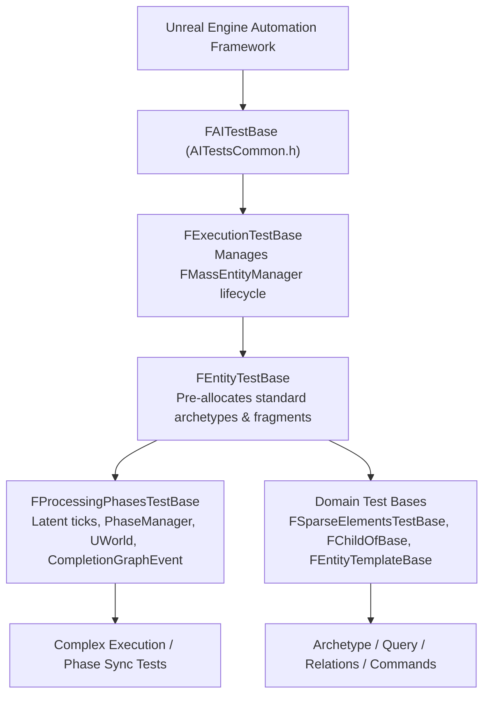
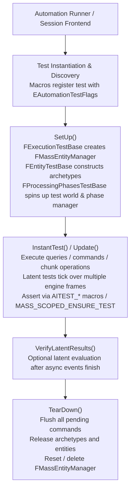

# Testing — UE 5.8 MASS

## Scope
Verification architecture, test suites, harnesses, and test automation hooks across the MASS ECS ecosystem in Unreal Engine 5.8. Covers developer and plugin test suites:
- `Engine/Source/Developer/MassEntityTestSuite` (core ECS entity management, archetype mechanics, queries, relations, commands, execution context, multi-threading, stress testing, and API coverage).
- `Engine/Plugins/Runtime/MassGameplay/Source/MassGameplayTestSuite` (gameplay template compilation, character trajectory generation, movement and spring integration).
- `Engine/Plugins/AI/MassAI/Source/MassAITestSuite` (AI test harness hooks and extensions).
- `Engine/Plugins/AI/MassCrowd/Source/MassCrowd/Public/MassCrowdLaneClosingTest.h` (ZoneGraph testing actor component for crowd lane validation).
- Automation Framework hooks (`FAITestBase`, `AITestsCommon.h`, `MASS_SCOPED_ENSURE_TEST`, latent execution, and automation filters).

---

## Architecture

MASS testing builds upon the Unreal Engine Automation Framework via the AI test harness foundation (`FAITestBase` from `AITestsCommon.h`). Tests register under the `System.Mass.*` test hierarchy using macros `IMPLEMENT_AI_INSTANT_TEST` and `IMPLEMENT_AI_LATENT_TEST`.



### Test Harness Hierarchy
1. **`FAITestBase`**: Foundation engine automation test class providing test assertion macros (`AITEST_TRUE`, `AITEST_EQUAL`, `AITEST_NOT_NULL`, `AITEST_FLOAT_EQUAL`), expectation runner access, and test lifecycle callbacks (`SetUp`, `TearDown`, `InstantTest`, `Update`, `VerifyLatentResults`).
2. **`FExecutionTestBase`**: Specializes `FAITestBase` for MASS. Allocates `TSharedPtr<FMassEntityManager> EntityManager` during `SetUp()`, sets `bMakeWorldEntityManagersOwner = true`, and safely flushes, clears, and resets the manager in `TearDown()`.
3. **`FEntityTestBase`**: The workhorse base class for core ECS tests. Builds pre-registered archetypes commonly needed across test cases:
   - `EmptyArchetype`: Entities with zero fragments.
   - `FloatsArchetype`: Entities with `FTestFragment_Float`.
   - `IntsArchetype`: Entities with `FTestFragment_Int`.
   - `FloatsIntsArchetype`: Entities with both float and int fragments.
   - `LargeArchetype`: Entities with `FTestFragment_Large` (64-byte payload).
   - `InstanceInt`: Default `FInstancedStruct` holding `FTestFragment_Int`.
4. **`FProcessingPhasesTestBase`**: Harness for multi-phase and multi-threaded pipeline testing (`MassProcessingPhasesTest.cpp`, `MassComplexTest.cpp`). Instantiates `UE::Mass::Testing::FMassTestProcessingPhaseManager`, attaches to a transient `UWorld`, ticks phases across multiple frames via `Update()`, and evaluates results in `VerifyLatentResults()`.

---

## Key types

| Symbol | Module | Responsibility |
| :--- | :--- | :--- |
| `FAITestBase` | `AITestSuite` | Core harness base providing assert macros, runner hooks, and setup/teardown primitives. |
| `FExecutionTestBase` | `MassEntityTestSuite` | Base class initializing and tearing down isolated `FMassEntityManager` instances. |
| `FEntityTestBase` | `MassEntityTestSuite` | Primary test base constructing standard test archetypes, structs, and fragment layouts. |
| `FProcessingPhasesTestBase` | `MassEntityTestSuite` | Latent test base driving tick-based multi-phase pipeline execution (`FMassProcessingPhaseManager`). |
| `FMassTestProcessingPhaseManager` | `MassEntityTestSuite` | Test specialization exposing protected processing phase dispatchers for unit control. |
| `FTestFragment_Int` / `_Float` / `_Bool` | `MassEntityTestSuite` | Standard reflection-enabled fragments (`FMassFragment`) for schema and data validation. |
| `FTestFragment_Large` | `MassEntityTestSuite` | 64-byte fragment for testing memory alignment, chunk filling, and reallocation limits. |
| `FTestSharedFragment_Int` / `_Float` | `MassEntityTestSuite` | Shared fragments (`FMassSharedFragment`) for testing shared chunk storage and deduplication. |
| `FTestTag_A` / `_B` / `_C` | `MassEntityTestSuite` | Minimal tags (`FMassTag`) for bitset filtering and archetype mutation tests. |
| `UMassTestProcessorBase` | `MassEntityTestSuite` | Test processor scaffolding query registration and tracking execution counts. |
| `MASS_SCOPED_ENSURE_TEST` | `MassEntityTestSuite` | Test macro registering expected `ensure()`/`check()` errors and breaking if unhandled. |
| `UZoneGraphCloseCrowdLaneTest` | `MassCrowd` | `UZoneLaneTest` actor testing crowd lane closure and visual state transitions in editor. |

---

## Test Suites & Coverage Areas

### 1. MassEntityTestSuite (`Engine/Source/Developer/MassEntityTestSuite`)
The primary ECS test suite containing unit, integration, stress, and coverage tests.

| Area | Key Test Files | Verified Invariants |
| :--- | :--- | :--- |
| **Archetypes & Chunking** | `MassArchetypeTest.cpp`, `MassArchetypeGroupTest.cpp`, `MassChunkCollectionTest.cpp` | Archetype bitset immutability; handle generation invalidation; chunk payload boundaries; chunk entity slicing. |
| **Queries & Execution** | `MassQueryTest.cpp`, `MassEntityQueryTest.cpp`, `MassParallelQueryTest.cpp`, `MassQueryExecutorTest.cpp` | Requirements matching; mutated vs read-only access locks; chunk filtering; chunk-level early exit; parallel batch splitting. |
| **Commands & Deferred Buffers** | `MassCommandsTest.cpp`, `MassCommandBufferTest.cpp`, `MassStressCommandsTest.cpp` | Deferred buffer queuing, interleaving, and flushing; memory cleanup of pending instances; structural change ordering. |
| **Relations & Hierarchies** | `MassRelationTest.cpp`, `MassRelationCoverageTest.cpp`, `MassChildOfRelationTest.cpp` | Parent/child hierarchy maintenance; bidirectional relation handles; cleanup on target entity destruction. |
| **Storage & Sparse Elements** | `MassEntityStorageTest.cpp`, `MassSparseElementsTest.cpp`, `MassStressSparseElementsTest.cpp` | `MassSparseElementsStorage` chunk indexing; entity ID churn; safe reallocation; fragmented chunk defragmentation. |
| **Observers & Lifecycle** | `MassObserverTest.cpp`, `MassObserverProcessorTest.cpp` | Observation triggers on Add, Remove, and Change composition; batched notifications; observer execution order. |
| **Execution Context & Threading** | `MassExecutionContextTest.cpp`, `MassExecutionTest.cpp`, `MassMultiThreadTest.cpp` | `FMassExecutionContext` auxiliary data lifetime; thread safety guards via `FMassRequirementAccessDetector`. |
| **BitSets & Type Management** | `MassTypeBitSetBuilderTest.cpp`, `MassTypeManagerTest.cpp` | 5.8 `TypeBitSetBuilder` registration consistency; sparse bitset intersection and containment logic. |
| **Stress Suites** | `MassStressEntityViewTest.cpp`, `MassStressRequirementsTest.cpp`, `MassStressSharedFragmentsTest.cpp`, `MassStressCommandsTest.cpp` | High entity count scaling (10k+ entities); dense structural modifications per frame; random seed property fuzzing. |

### 2. MassGameplayTestSuite (`Engine/Plugins/Runtime/MassGameplay/Source/MassGameplayTestSuite`)
- **Entity Template Compilation** (`MassEntityTemplateTest.cpp`):
  - Validates `FMassEntityTemplateRegistry` compilation into archetypes and composition descriptors.
  - Ensures initial template IDs, chunk fragment rules, and empty template setups compile deterministically.
- **Character Trajectory Generation** (`MassCharacterTrajectoryGenerationTest.cpp`):
  - Verifies trajectory history sampling, prediction sampling intervals, and transform offsets.
  - Validates integration between `FCharacterTrajectoryParameters`, `FSpringMovementSettings`, and trajectory generation processors.

### 3. MassAITestSuite (`Engine/Plugins/AI/MassAI/Source/MassAITestSuite`)
- Verifies module bootstrap and integration between Mass ECS agents and the AI subsystem harness.

### 4. Interactive Simulation Tests (`MassCrowdLaneClosingTest`)
- Specializes `UZoneLaneTest` as `UZoneGraphCloseCrowdLaneTest`.
- Listens to lane location changes (`OnLaneLocationUpdated`), invokes `UMassCrowdSubsystem::SetLaneState()` to toggle lanes between `Opened` and `Closed`, and draws lane status using `FPrimitiveDrawInterface` (Emerald for Opened, Red for Closed).

---

## Data Flow: Test Execution Cycle



---

## Usage

### 1. Writing an Instant Entity Test
```cpp
#include "MassEntityTestTypes.h"
#include "AITestsCommon.h"

namespace UE::Mass::Test
{

struct FMyEntityAdditionTest : FEntityTestBase
{
    virtual bool InstantTest() override
    {
        // Setup 100 entities in pre-built IntsArchetype
        TArray<FMassEntityHandle> Entities;
        EntityManager->BatchCreateEntities(IntsArchetype, 100, Entities);
        AITEST_EQUAL("All entities must be created", Entities.Num(), 100);

        // Execute batch modification
        for (const FMassEntityHandle& Entity : Entities)
        {
            FTestFragment_Int& IntFragment = EntityManager->GetFragmentDataChecked<FTestFragment_Int>(Entity);
            IntFragment.Value = 42;
        }

        // Verify with query
        FMassEntityQuery Query(EntityManager);
        Query.AddRequirement<FTestFragment_Int>(EMassFragmentAccess::ReadOnly);

        int32 VerifiedCount = 0;
        FMassExecutionContext ExecContext(*EntityManager);
        Query.ForEachEntityChunk(ExecContext, [&](FMassExecutionContext& Context)
        {
            const TConstArrayView<FTestFragment_Int> Ints = Context.GetFragmentView<FTestFragment_Int>();
            for (const FTestFragment_Int& Item : Ints)
            {
                AITEST_EQUAL("Value must be modified", Item.Value, 42);
                ++VerifiedCount;
            }
        });
        AITEST_EQUAL("All entities iterated", VerifiedCount, 100);
        return true;
    }
};

IMPLEMENT_AI_INSTANT_TEST(FMyEntityAdditionTest, "System.Mass.MyFeature.BatchIntModification");

} // namespace UE::Mass::Test
```

### 2. Testing Expected Warnings or Checks
```cpp
struct FMyEnsureFailureTest : FEntityTestBase
{
    virtual bool InstantTest() override
    {
        FMassEntityHandle InvalidHandle;
        
        // Expect a specific ensure failure during invalid access
        MASS_SCOPED_ENSURE_TEST(TEXT("IsEntityValid"), 1);

        // Intentionally trigger checked failure in non-shipping
        EntityManager->GetFragmentDataChecked<FTestFragment_Int>(InvalidHandle);

        return true;
    }
};

IMPLEMENT_AI_INSTANT_TEST(FMyEnsureFailureTest, "System.Mass.Coverage.HandleValidation");
```

---

## Pitfalls

1. **Manager Lifecycle Leaks**: If tests create custom `FMassEntityManager` instances without `TSharedPtr` or bypass `FExecutionTestBase::TearDown()`, dangling chunk allocations trigger memory tracker asserts. Always inherit `FExecutionTestBase` or `FEntityTestBase`.
2. **Direct Structural Mutation Inside Query Iteration**: Calling structural mutations (`AddFragment`, `DestroyEntity`) directly on `FMassEntityManager` inside a query callback trips `FMassRequirementAccessDetector`. Structural modifications in queries must go through deferred commands via `FMassExecutionContext::Defer()`.
3. **Skipping `MASS_SCOPED_ENSURE_TEST` on Failure Tests**: UE 5.8 fails automation suites if an unhandled `ensureMsgf` is fired. Any negative test expecting validation failures must declare `MASS_SCOPED_ENSURE_TEST(ExpectedString, Count)`.
4. **Missing `WITH_MASSENTITY_DEBUG` Guards**: Several internal storage and verification metrics (e.g., debug inspection of internal chunk arrays in `MassChunkCollectionTest.cpp`) exist only under `#if WITH_MASSENTITY_DEBUG`. Tests accessing them must wrap their definitions accordingly.
5. **Phase Manager Tick Event Deadlocks**: When implementing `FProcessingPhasesTestBase`, forgetting to complete or unbind `CompletionEvent` stalls latent automation tickers indefinitely.

---

## Source files

### MassEntityTestSuite (`Engine/Source/Developer/MassEntityTestSuite`)
- `Public/MassEntityTestTypes.h`: Core harness classes (`FExecutionTestBase`, `FEntityTestBase`, `FProcessingPhasesTestBase`), test fragments, test processors, and `MASS_SCOPED_ENSURE_TEST`.
- `Private/MassEntityTestTypes.cpp`: Implementation of test harness initialization, standard archetype allocation, and phase configuration helpers.
- `Private/MassArchetypeTest.cpp`: Unit tests for archetype creation, destruction, chunk allocation, and handle versioning.
- `Private/MassCommandsTest.cpp`: Testing deferred structural commands, buffer cancellation, and buffer move operations.
- `Private/MassQueryTest.cpp` & `MassParallelQueryTest.cpp`: Single-threaded and multi-threaded query execution semantics.
- `Private/MassRelationTest.cpp` & `MassChildOfRelationTest.cpp`: Entity-to-entity relations, child-of hierarchies, and ownership cascading.
- `Private/StressTests/MassStressSparseElementsTest.cpp`: High-volume fuzz and scale testing for `MassSparseElementsStorage`.
- `Private/Coverage/MassEntityManagerTest.cpp`: Edge-case coverage for entity compaction, archetype traversal, and batch additions.

### MassGameplayTestSuite & MassAI (`Engine/Plugins/Runtime/MassGameplay`, `Engine/Plugins/AI`)
- `MassGameplayTestSuite/Private/MassEntityTemplateTest.cpp`: Validation of entity templates, trait compositions, and archetype compilation.
- `MassGameplayTestSuite/Private/MassCharacterTrajectoryGenerationTest.cpp`: Kinematic trajectory prediction and spring movement testing.
- `MassAI/Source/MassAITestSuite/Private/MassAITest.cpp`: Harness integration for AI-driven Mass entities.
- `MassCrowd/Public/MassCrowdLaneClosingTest.h` & `Private/MassCrowdLaneClosingTest.cpp`: Interactive lane open/close state machine testing actor.

---

## Graph facts

- **Degree prominence**: `FEntityTestBase` is among the highest-degree testing symbols in the entire MASS corpus with an in/out degree of **122**, directly orchestrating tests across archetype, query, observer, command, and relation subsystems.
- **Top header complexity**: `MassEntityTestSuite/Public/MassEntityTestTypes.h` ranks as the 3rd highest file across the entire MASS codebase by node count (**137 nodes**) and 2nd highest by edge degree (**711 edges**), serving as the universal reflection fixture for all Mass test targets.
- **Stress test connectivity**: `MassStressSparseElementsTest.cpp` features an edge degree of **358**, representing one of the densest operational test graphs covering low-level chunk memory layouts and entity churn.
- **Module size**: `Engine/Source/Developer/MassEntityTestSuite` contains **701 nodes**, comprising over 5.4% of the entire 12,818-node MASS graph footprint.
