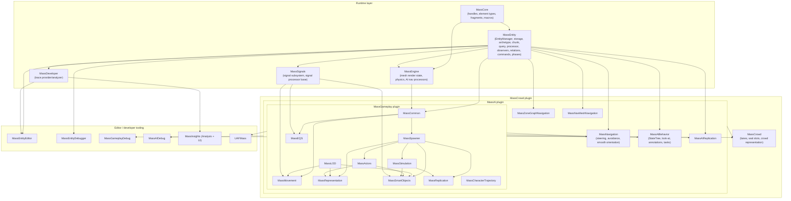
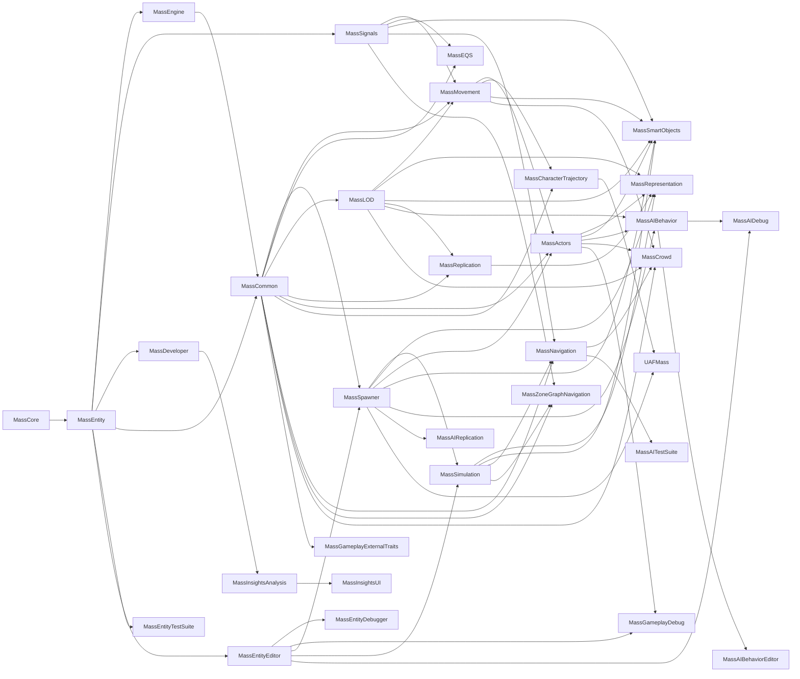

# MASS (ECS) — Architecture & Usage, UE 5.8

Full documentation set for every element of the Unreal Engine 5.8 MASS entity-component-system, grounded in the actual UE 5.8 source (`UE_5.8`). Each file covers **architecture** (types, responsibilities, key APIs, data flow) and **usage** (patterns, examples, pitfalls).

## Index

| File | Scope |
|---|---|
| [01_Core_Architecture.md](01_Core_Architecture.md) | `FMassEntityManager`, storage, archetypes, chunks, element bitsets, type registry, memory layout |
| [02_Entities_Fragments_Traits.md](02_Entities_Fragments_Traits.md) | Element types, fragments/tags/shared fragments, traits, entity templates, config assets, trait catalog |
| [03_Processors_and_Execution.md](03_Processors_and_Execution.md) | `UMassProcessor`, query executors, processing queue, dependency solver, activation, pruning |
| [04_Entity_Queries_and_Requirements.md](04_Entity_Queries_and_Requirements.md) | `FMassEntityQuery`, requirements, access detector, entity views, chunk vs entity iteration |
| [05_Observers_and_Relations.md](05_Observers_and_Relations.md) | Observers, observer registry/manager, relations, `FMassChildOf`, relation commands/observers |
| [06_Commands_and_Defers.md](06_Commands_and_Defers.md) | Command buffer, command catalog, deferred mutation, flush points, archetype group commands |
| [07_Simulation_and_Phases.md](07_Simulation_and_Phases.md) | Phase manager, `UMassSimulationSubsystem`, tick groups, subsystem access, per-frame loop |
| [08_Representation_LOD_and_Animation.md](08_Representation_LOD_and_Animation.md) | Representation, ISM/HISM, LOD tiers, tick-rate control, UAF animation bridge |
| [09_Movement_and_Locomotion.md](09_Movement_and_Locomotion.md) | Movement fragments/processors, spring movement, character trajectory, physics bodies |
| [10_Navigation_Steering_and_Avoidance.md](10_Navigation_Steering_and_Avoidance.md) | Navigation pipeline, steering, smooth orientation, avoidance, grids, NavMesh vs ZoneGraph |
| [11_Crowd_and_ZoneGraph.md](11_Crowd_and_ZoneGraph.md) | MassCrowd plugin: lanes, wait slots, crowd LOD, server representation, replicated agents |
| [12_Behavior_and_StateTree.md](12_Behavior_and_StateTree.md) | StateTree over Mass, execution context, dependencies, task catalog, look-at, annotations |
| [13_SmartObjects.md](13_SmartObjects.md) | Smart object registration, requests, claims, activation, user slots, behavior definitions |
| [14_Spawning_and_Actors.md](14_Spawning_and_Actors.md) | Spawner, spawn data generators, entity pooling, actor bridge, translators, agent component |
| [15_Replication_and_Networking.md](15_Replication_and_Networking.md) | Replication subsystem, templates, client bubbles, serializers, path handlers, crowd replication |
| [16_EQS_and_Perception.md](16_EQS_and_Perception.md) | MassEQS subsystem, generators, tests, item types, result delivery, component hit |
| [17_Debug_Editor_Insights.md](17_Debug_Editor_Insights.md) | Entity debugger, entity editor, gameplay debug, gameplay-debugger category, Insights, trace |
| [18_Configuration_and_Build.md](18_Configuration_and_Build.md) | Ini configs, developer settings, plugin manifests, module dependency graph, build flags |
| [19_Usage_Guide_and_Performance.md](19_Usage_Guide_and_Performance.md) | End-to-end wiring, canonical patterns, minimal working example, performance checklist |
| [20_Testing.md](20_Testing.md) | MassEntityTestSuite, MassGameplayTestSuite, MassAITestSuite, harness and invariants |

## Layered architecture

## Module dependency graph (from `.Build.cs`)

Notable: `MassSpawner`, `MassSimulation` and `MassAIDebug` take a **public** dependency on the editor module `MassEntityEditor`, so Mass authoring tooling is reachable from runtime modules in editor builds.

## Plugin manifests

| Plugin | Modules | Plugin dependencies |
|---|---|---|
| `Engine/Plugins/Runtime/MassGameplay` | MassCommon, MassActors, MassEQS, MassSpawner, MassSmartObjects, MassSimulation, MassLOD, MassMovement, MassCharacterTrajectory, MassReplication, MassRepresentation, MassGameplayDebug, MassGameplayEditor, MassMovementEditor, MassGameplayExternalTraits, MassGameplayTestSuite | ZoneGraph, PoseSearch, ZoneGraphAnnotations, SmartObjects, StateTree, DataValidation |
| `Engine/Plugins/AI/MassAI` | MassNavigation, MassNavMeshNavigation, MassZoneGraphNavigation, MassNavigationEditor, MassAIBehavior, MassAIBehaviorEditor, MassAIReplication, MassAIDebug, MassAITestSuite | MassGameplay, ZoneGraph, ZoneGraphAnnotations, SmartObjects, StateTree, NavCorridor |
| `Engine/Plugins/AI/MassCrowd` | MassCrowd | ZoneGraph, MassGameplay, MassAI, StateTree |
| `Engine/Plugins/MassInsights` | MassInsightsAnalysis, MassInsightsUI | — |
| `Engine/Plugins/Experimental/UAF/UAFMass` | UAFMass | UAF, RigVM |

## Source roots

- ECS core: `Engine/Source/Runtime/MassEntity` (modules `MassEntity`, `MassCore` under `Engine/Source/Runtime/Mass/MassCore`)
- Engine integration: `Engine/Source/Runtime/Mass/MassEngine`, `MassSignals`, `MassDeveloper`
- Gameplay layer: `Engine/Plugins/Runtime/MassGameplay/Source/*`
- AI layer: `Engine/Plugins/AI/MassAI/Source/*`, `Engine/Plugins/AI/MassCrowd/Source/MassCrowd`
- Tooling: `Engine/Source/Editor/MassEntityEditor`, `Engine/Source/Editor/MassEntityDebugger`, `Engine/Plugins/MassInsights/Source/*`
- Tests: `Engine/Source/Developer/MassEntityTestSuite`, `Engine/Plugins/Runtime/MassGameplay/Source/MassGameplayTestSuite`, `Engine/Plugins/AI/MassAI/Source/MassAITestSuite`
- Config: `Engine/Plugins/Runtime/MassGameplay/Config/DefaultMassGameplay.ini`, `Engine/Plugins/AI/MassAI/Config/DefaultMassAI.ini`, `Engine/Plugins/AI/MassCrowd/Config/DefaultMassCrowd.ini`

## UE 5.8 module split

`MassEntity` depends on `MassCore`. Handles, element types, fragment macros and archetype group types now live in `MassCore` under `Public/Mass/…`; the old `MassEntity/Public` names are `UE_DEPRECATED_HEADER(5.8)` shims (e.g. `MassEntityElementTypes.h` → `Mass/EntityElementTypes.h`). New consumers add a `MassCore` dependency and include `Mass/…`; existing code still compiles through the shims.

5.8 machinery present in source: `UE::Mass::FQueryExecutor` + `FQueryDefinition` typed accessors, `UE::Mass::FProcessingQueue` + `FQueuedProcessor`, `FMassProcessorDependencySolver`, `TypeBitSetBuilder`, relations (`MassEntityRelations.h`, `MassRelationManager.h`, `Relations/MassChildOf.h`), `MassSparseElementsStorage`, `MassRequirementAccessDetector`, `MassExecutor`, `MassEntityConcepts`, `MassEntityCollection`.

## Graph facts (from `graphify-out/graph.json`, scan root `UE_5.8`)

- MASS corpus: **12,818 nodes**, 15,979 internal edges, 11,315 cross-community edges, across **536 communities** — the gameplay layer is a federation of thin per-module clusters, not one hub.
- Per-module node counts: MassGameplay 4,485 · MassEntity 2,899 · MassAI 2,205 · Runtime/Mass 736 · MassEntityTestSuite 701 · MassEntityDebugger 637 · MassCrowd 592 · MassInsights 249 · MassEntityEditor 188 · UAFMass 124.
- Highest-degree MASS files: `MassEntityManager.h` (848), `MassEntityTestTypes.h` (711), `MassEntityManager.cpp` (662), `MassArchetypeData.h` (596), `MassProcessingQueueTypes.h` (479), `MassExecutionContext.h` (476), `MassDebuggerModel.h` (426), `MassCommands.h` (425), `MassSkinnedMeshRepresentationTypes.h` (420), `MassQueryExecutor.h` (414).
- Bridge symbols: `FMassEntityManager()` (539), `FMassEntityQuery()` (201), `FMassExecutionContext` (117), `FMassArchetypeData` (114), `FMassFragment` (86), `RelationTypeHandle` (82), `FMassElementBitSet` (81), `FMassPrimitiveRenderStateHelper` (63), `FMassTraceProvider` (62), `FMassDebugger` (62). Everything else reaches the ECS through the entity manager.
- Cross-community bridges: Core Engine Types (1,227), Material Value Types (472), Reflection and Property Change (265), Slate UI Rendering (214), Render Graph (RDG) (196), Editor Data Storage (191) — MASS leaves the ECS core through reflection/property plumbing, Slate (debugger UI) and the renderer (representation).
