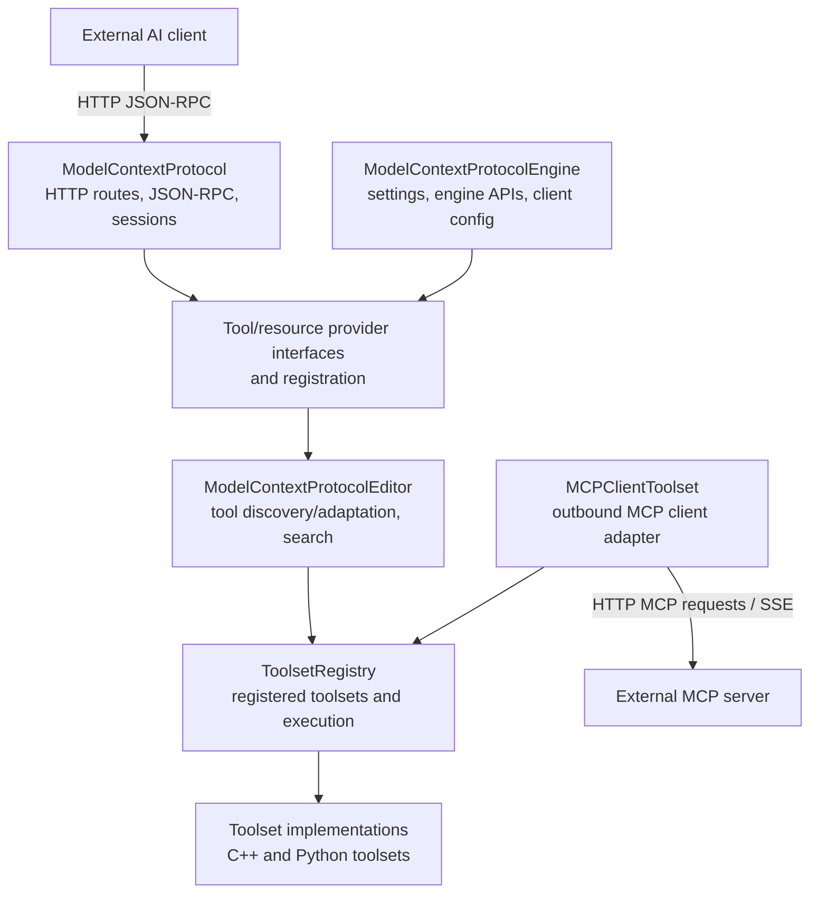
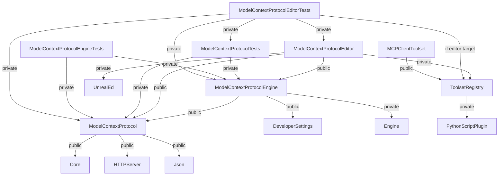

# Overview & Architecture — UE 5.8 MCP

## Scope

This document maps the engine-source MCP plugins and their principal responsibilities. It describes the server direction (an external AI client invokes Unreal-registered tools) and the reverse client direction (`MCPClientToolset` connects to external MCP servers and presents their tools through ToolsetRegistry).

The primary source root is `UE_5.8/Engine/Plugins/Experimental`. The MCP server plugin is `ModelContextProtocol`; the shared tool execution/registration framework is `ToolsetRegistry`; `MCPClientToolset` lives in the `Toolsets` plugin family. All module types and phases below are read from their plugin manifests. Module edges in the dependency diagram are direct declared dependencies read from Build.cs files, not runtime call edges.

## Architecture

There are two complementary control directions:

1. **AI client → Unreal server:** The external client sends MCP JSON-RPC over the Unreal server's HTTP endpoints. The server dispatches tool/resource operations to providers held by the core module. Engine/editor integration supplies engine-aware tools and converts tool definitions into protocol-facing tools.
2. **Unreal → external MCP server:** The editor-only `FMCPClientToolset` initiates an outbound HTTP-based handshake, obtains external tool metadata, and implements ToolsetRegistry's `FToolset` interface. Registry consumers can then enumerate and execute those external tools as registered toolsets. It is an adapter/client, not a second listener in the server path.



The server transport documented by `FModelContextProtocolServer` is HTTP: the source exposes POST for JSON-RPC, GET for SSE, and DELETE for session termination. Do not infer stdio or websocket transports. In contrast, the client adapter header explicitly describes legacy HTTP+SSE and Streamable HTTP client modes, plus optional OAuth 2.0 Authorization Code + PKCE.

### Module dependency graph

Arrows below mean “module declares a dependency on” (either public or private). The base Unreal modules are shown as external leaves. Conditional editor dependencies are marked `if editor target`; tool plugin-to-plugin requirements are declared in `.uplugin` manifests rather than Build.cs.



For legibility, the diagram selects inter-plugin edges plus representative engine-module edges. Complete direct module dependencies are listed below; all are declared in the cited Build.cs files. Conditional `ModelContextProtocolEngine` dependencies `BlueprintGraph`, `JsonUtilitiesEditor`, and `UnrealEd` apply only when `Target.bBuildEditor`.

## Key types

| symbol | module | responsibility |
|---|---|---|
| `FModelContextProtocolServer` | ModelContextProtocol | Owns HTTP router/routes, sessions, request dispatch, and JSON-RPC handlers. |
| `IModelContextProtocolModule` | ModelContextProtocol | Module-level tool/resource registration, refresh, server lifecycle, and analytics interface. |
| `IModelContextProtocolTool` | ModelContextProtocol | Protocol-facing tool abstraction referenced by the module API. |
| `IModelContextProtocolResourceProvider` | ModelContextProtocol | Resource listing/reading provider abstraction registered with the module. |
| `FModelContextProtocolSession` | ModelContextProtocol | Session state used by server request handlers (included by server header). |
| `UModelContextProtocolSettings` | ModelContextProtocolEngine | Engine-facing configuration; detailed settings are handled in the settings-specific document. |
| `UToolsetRegistrySubsystem` | ToolsetRegistry | Editor subsystem exposing the `FToolsetRegistry` to callers. |
| `UToolsetRegistry` | ToolsetRegistry | Blueprint function library for registration queries and tool execution. |
| `FToolset` | ToolsetRegistry | Registry-side toolset interface implemented by providers and MCP client adapter. |
| `FMCPClientToolset` | MCPClientToolset | Outbound MCP connection that maps external tools into an `FToolset`. |

`UToolsetRegistrySubsystem` derives from `UEditorSubsystem`; its static `Get` returns `TValueOrError`. `UToolsetRegistry` has explicit BlueprintCallable/Pure declarations for the exposed registry operations. No broader Blueprint surface is implied by those facts.

### Module inventory and lifecycle

The ModelContextProtocol plugin manifest declares six modules, each with `LoadingPhase: Default`:

| module | type | loading phase | role |
|---|---|---|---|
| `ModelContextProtocol` | Runtime | Default | Protocol server, HTTP routing, sessions, tool/resource abstractions, shared protocol definitions. |
| `ModelContextProtocolEngine` | Runtime | Default | Engine-facing settings and utilities, client config generation, engine integration. |
| `ModelContextProtocolEditor` | Editor | Default | Editor-side tool library/factory, registry adapter, asset definitions, search, and commandlet. |
| `ModelContextProtocolTests` | UncookedOnly | Default | Core/server and engine-subsystem test module. |
| `ModelContextProtocolEngineTests` | UncookedOnly | Default | Engine client-config tests. |
| `ModelContextProtocolEditorTests` | Editor | Default | Editor integration and toolset-registry tests. |

`ToolsetRegistry` separately declares one module: `ToolsetRegistry` (type `Editor`, phase `Default`, editor target allow-list). `MCPClientToolset` separately declares one module: `MCPClientToolset` (type `Editor`, phase `PostEngineInit`, editor target allow-list). These are separate experimental plugins and are not modules of the ModelContextProtocol plugin.

## Data flow

### Unreal serves an MCP client

1. `IModelContextProtocolModule::StartServer` starts the server using the default port/path constants or caller-provided values. The plugin defaults are port `8000`, path `/mcp`, name `unreal-mcp`.
2. `FModelContextProtocolServer` installs HTTP routes and maintains sessions. Request handlers process JSON-RPC `initialize`, `ping`, tool list/call, resource list/read, and notifications; the public server header explicitly describes an HTTP MCP tool server.
3. Server operations resolve registered tools/resources through `IModelContextProtocolModule`. The module API supports add/remove/find/refresh operations for tools and add/remove for resource providers.
4. `ModelContextProtocolEditor` adapts registry-backed toolsets to the serving module's tools. Specific toolsets live in ToolsetRegistry-based plugins and are not transport implementations.
5. The external client receives protocol responses on HTTP; active server-sent event streams support server notifications as indicated by protocol declarations and server API.

### Unreal consumes an external MCP server

1. A consumer prepares `FMCPClientToolset::FConfig` with toolset name, description, external `ServerUrl`, and optional auth settings.
2. `FMCPClientToolset::Create` is asynchronous: it selects OAuth startup or direct handshake and resolves a future with a ready toolset or an error.
3. The client performs discovery/handshake and builds a JSON schema from external MCP tools. The class implements `FToolset` methods for tool execution and metadata.
4. Consumers register/use that toolset through ToolsetRegistry; the registry's `UToolsetRegistry::ExecuteTool` API executes a named toolset/tool from JSON input. The MCP client adapter's own `MCPClientToolset` module publicly depends on `ToolsetRegistry`.

The client header documents legacy HTTP+SSE (`GET /sse`, `POST /message`) and Streamable HTTP (POST to one server URL) and optional OAuth PKCE. These are client modes and should not be confused with the Unreal server's own route layout.

### Direct Build.cs dependency inventory

| module / source Build.cs | public dependencies | private dependencies |
|---|---|---|
| `ModelContextProtocol` | `Core`, `Analytics`, `AnalyticsET`, `HTTPServer`, `JsonUtilities`, `Json` | `CoreUObject` |
| `ModelContextProtocolEngine` | `Core`, `DeveloperSettings`, `ModelContextProtocol` | `CoreUObject`, `Analytics`, `AnalyticsET`, `Engine`, `HTTPServer`, `Json`, `JsonUtilities`; plus `BlueprintGraph`, `JsonUtilitiesEditor`, `UnrealEd` for editor targets |
| `ModelContextProtocolEditor` | `Core`, `AssetDefinition`, `EngineAssetDefinitions`, `ModelContextProtocol`, `ModelContextProtocolEngine`, `Blutility` | `Projects`, `InputCore`, `EditorFramework`, `UnrealEd`, `ToolMenus`, `CoreUObject`, `Engine`, `Json`, `JsonUtilities`, `Slate`, `SlateCore`, `BlueprintGraph`, `DeveloperSettings`, `JsonUtilitiesEditor`, `KismetCompiler`, `ToolsetRegistry` |
| `ModelContextProtocolTests` | `Core` | `CoreUObject`, `Analytics`, `AnalyticsET`, `Json`, `JsonUtilities`, `HTTPServer`, `HTTP`, `ModelContextProtocol`, `ModelContextProtocolEngine` |
| `ModelContextProtocolEngineTests` | `Core` | `CoreUObject`, `Engine`, `Json`, `ModelContextProtocol`, `ModelContextProtocolEngine` |
| `ModelContextProtocolEditorTests` | `Core` | `CoreUObject`, `Engine`, `Json`, `JsonUtilities`, `HTTPServer`, `HTTP`, `ModelContextProtocol`, `ModelContextProtocolEngine`, `ModelContextProtocolEditor`, `ModelContextProtocolTests`; editor targets additionally `UnrealEd`, `Slate`, `SlateCore`, `AssetDefinition`, `Blutility`, `ToolsetRegistry` |
| `ToolsetRegistry` | `Core` | `AssetRegistry`, `CoreUObject`, `DeveloperSettings`, `EditorFramework`, `EditorScriptingUtilities`, `EditorSubsystem`, `Engine`, `Json`, `JsonUtilities`, `JsonUtilitiesEditor`, `Kismet`, `PythonScriptPlugin`, `UnrealEd`, `FileSandboxCore` |
| `MCPClientToolset` | `Core`, `ToolsetRegistry` | `CoreUObject`, `DeveloperSettings`, `EditorSubsystem`, `Engine`, `HTTP`, `HTTPServer`, `Json`, `UnrealEd` |

The ModelContextProtocol plugin manifest also requires `EngineAssetDefinitions` and `ToolsetRegistry` plugins. `ToolsetRegistry.uplugin` requires `PythonScriptPlugin`, `EditorScriptingUtilities`, and `FileSandbox`; the MCPClientToolset manifest requires ToolsetRegistry. Manifest plugin requirements and Build.cs module dependencies are distinct relationships.

## Usage

### Starting the server from C++

The public module interface exposes a defaulted start API:

```cpp
IModelContextProtocolModule& Mcp = IModelContextProtocolModule::GetChecked();
Mcp.StartServer(); // DefaultServerPort (8000), DefaultServerUrlPath (/mcp)
```

Code may also explicitly pass a port and URL path. The interface exposes `StopServer()`, `GetServer()`, and tool/resource registration methods. Whether an application should auto-start is configured separately; the shared graph facts report the settings default as false.

### Registering tools/providers

Use the module API's `AddTool`/`RemoveTool` methods for protocol-facing `IModelContextProtocolTool` instances and `AddResourceProvider`/`RemoveResourceProvider` for resource providers. Tool registration rejects duplicate names according to the public API contract. The module offers `OnRefreshTools` so providers can rebuild registrations after refresh.

Registry-side callers can use `UToolsetRegistry::RegisterToolsetClass`, `UnregisterToolsetClass`, `IsToolsetClassRegistered`, `IsToolsetRegistered`, and `ExecuteTool`. The declarations are BlueprintCallable/Pure where marked in `UToolsetRegistry.h`; the Blueprint exposure claim is limited to those exact reflected methods.

### Connecting to an external server

```cpp
UE::ToolsetRegistry::FMCPClientToolset::FConfig Config;
Config.Name = TEXT("RemoteTools");
Config.ServerUrl = TEXT("https://example.invalid/mcp");
// Optional: Config.ApiKey, or Config.bOAuth = true and OAuth settings.
auto Ready = UE::ToolsetRegistry::FMCPClientToolset::Create(MoveTemp(Config));
```

This illustrates the header's configuration/factory contract, not a complete completion callback. Handle the returned future according to the caller's async context. Then provide the ready `FToolset` to the registry using the appropriate registry registration mechanism for that consumer.

## Pitfalls

- **Two MCP roles are easy to conflate.** The Unreal server accepts incoming client requests; `FMCPClientToolset` is an outbound client adapter.
- **Transport claims must stay directional.** Server source says HTTP routes; client header separately documents SSE and Streamable HTTP. Neither reviewed server API nor the manifests establish stdio or websocket support.
- **Editor-only registry dependency.** ToolsetRegistry and MCPClientToolset are Editor modules. Do not assume they are available in runtime-only packaged applications.
- **Plugin enablement differs from module phase.** ModelContextProtocol is experimental and `EnabledByDefault: false`; the module phases do not automatically enable the plugin.
- **A module edge is not a call edge.** Build.cs lists compile dependencies. The manifest's plugin dependencies express plugin-level requirements. This diagram intentionally does not imply runtime ordering beyond each module's declared loading phase.
- **Toolset and tool filtering may affect visibility.** ToolsetRegistry settings include allow/block filters. A registered toolset may not necessarily be visible in every registry listing.
- **HTTP server activation is explicit through the module API.** `IModelContextProtocolModule` has `StartServer`/`StopServer`; do not assume constructing a toolset starts the inbound server.
- **Reflected API limits.** Only APIs marked with UFUNCTION/UCLASS metadata establish Blueprint visibility. Native C++ interfaces and private methods should not be described as Blueprint nodes without source evidence.
- **Experimental status.** The manifests identify these plugins as experimental; MCPClientToolset is also beta and disabled by default.

## Source files

All paths below are relative to `UE_5.8/Engine/Plugins/Experimental/` unless stated otherwise.

| source | evidence used |
|---|---|
| `ModelContextProtocol/ModelContextProtocol.uplugin` | Plugin flags, six module names/types/phases, plugin dependencies. |
| `ModelContextProtocol/Source/ModelContextProtocol/ModelContextProtocol.Build.cs` | Core protocol module dependency list. |
| `ModelContextProtocol/Source/ModelContextProtocolEngine/ModelContextProtocolEngine.Build.cs` | Engine module dependencies and editor-only conditional edges. |
| `ModelContextProtocol/Source/ModelContextProtocolEditor/ModelContextProtocolEditor.Build.cs` | Editor module dependencies. |
| `ModelContextProtocol/Source/ModelContextProtocolTests/ModelContextProtocolTests.Build.cs` | Core test module dependencies. |
| `ModelContextProtocol/Source/ModelContextProtocolEngineTests/ModelContextProtocolEngineTests.Build.cs` | Engine test module dependencies. |
| `ModelContextProtocol/Source/ModelContextProtocolEditorTests/ModelContextProtocolEditorTests.Build.cs` | Editor test module dependencies and conditional edges. |
| `ModelContextProtocol/Source/ModelContextProtocol/Public/ModelContextProtocol.h` | Protocol constants, default server values, name validation declaration. |
| `ModelContextProtocol/Source/ModelContextProtocol/Public/IModelContextProtocolModule.h` | Tool/resource registration and server lifecycle API. |
| `ModelContextProtocol/Source/ModelContextProtocol/Private/ModelContextProtocolModule.cpp` | Module implementation registration, server ownership/lifecycle. |
| `ModelContextProtocol/Source/ModelContextProtocol/Public/ModelContextProtocolServer.h` | HTTP server class, route handlers, sessions, notifications. |
| `ToolsetRegistry/ToolsetRegistry.uplugin` | Registry module type/phase and plugin requirements. |
| `ToolsetRegistry/Source/ToolsetRegistry/ToolsetRegistry.Build.cs` | Registry module dependency list. |
| `ToolsetRegistry/Source/ToolsetRegistry/Public/ToolsetRegistry/UToolsetRegistry.h` | Reflected registry query, registration, and execution APIs. |
| `ToolsetRegistry/Source/ToolsetRegistry/Public/ToolsetRegistry/ToolsetRegistrySubsystem.h` | Editor subsystem and registry member. |
| `Toolsets/MCPClientToolset/MCPClientToolset.uplugin` | Client adapter module type/phase and ToolsetRegistry requirement. |
| `Toolsets/MCPClientToolset/Source/MCPClientToolset/MCPClientToolset.Build.cs` | Client module dependency list. |
| `Toolsets/MCPClientToolset/Source/MCPClientToolset/Public/MCPClientToolset/MCPClientToolset.h` | Outbound client transports, OAuth options, async factory, FToolset interface. |

## Graph facts

Graph scope is the three MCP corpus roots under the engine Experimental plugins: `ModelContextProtocol`, `ToolsetRegistry`, and `Toolsets`.

- MCP corpus: **9,250 nodes**, **15,786 internal edges**, **7,518 cross-community edges**, across **287 communities**.
- Node counts relevant here: `ModelContextProtocol` **820**, `ToolsetRegistry` **2,178**, `MCPClientToolset` **145**.
- Corpus relation counts: references **6,018**, calls **5,824**, method **2,673**, contains **2,538**, rationale_for **2,396**, imports **1,562**, defines **1,239**, uses **448**, imports_from **302**, inherits **258**, indirect_call **32**, re_exports **14**.
- Cross-community bridges include Core Engine Types (**303**), Slate UI Rendering (**299**), Strings and Output Logging (**220**), Core Strings and Serialization (**182**), and Module Lifecycle and Factories (**156**).
- Protocol facts verified in shared source scan: JSON-RPC 2.0; supported versions newest-first `2025-11-25`, `2025-06-18`, `2024-11-05`; default server port `8000`, path `/mcp`, name `unreal-mcp`; server routes are POST (JSON-RPC), GET (SSE), DELETE (session end).
