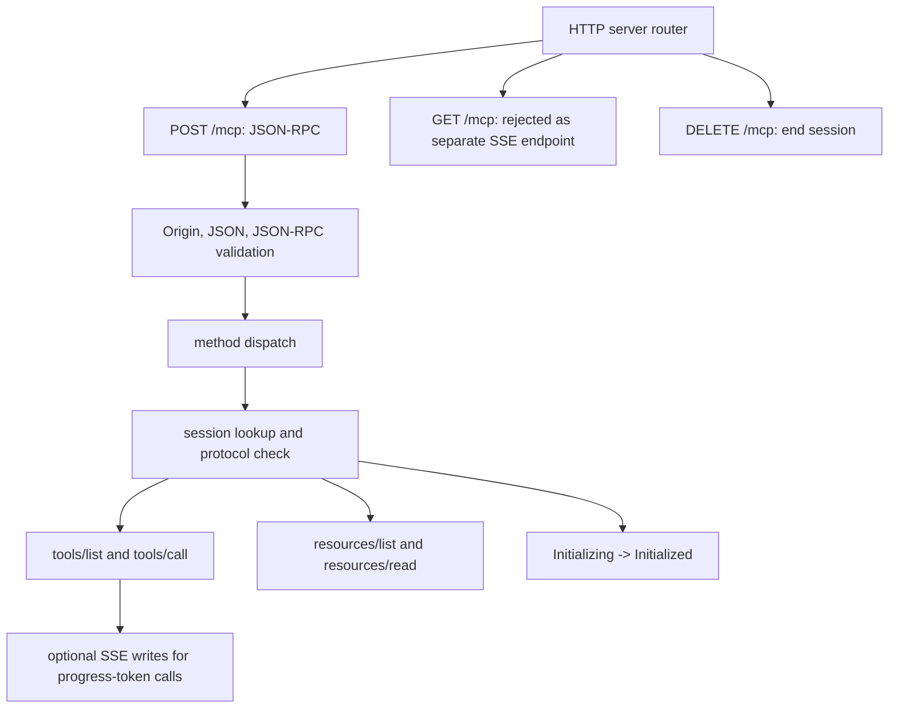
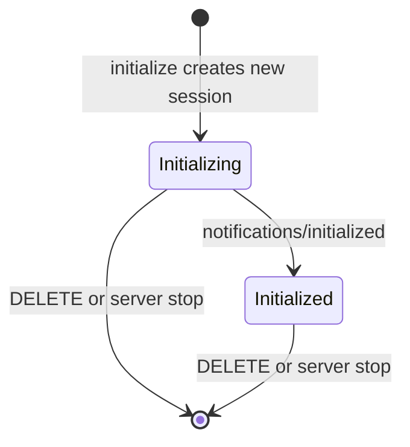
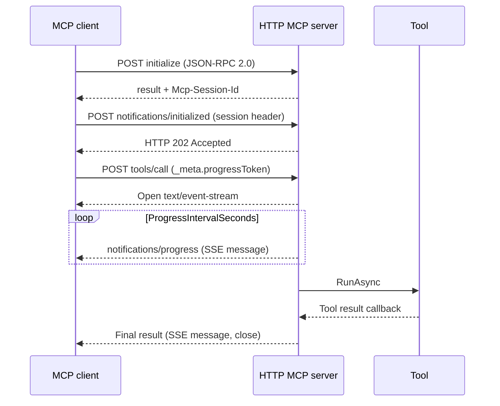

# Protocol Layer: JSON-RPC and Transport — UE 5.8 MCP

## Scope

This document describes the HTTP/JSON-RPC server implementation in the ModelContextProtocol runtime module: request validation and dispatch, session negotiation/lifecycle, SSE behavior, cancellation, pagination, and advertised capabilities versus implemented methods. It is based on UE 5.8 source, not an assumption that all MCP specification features are implemented.

Source root: `UE_5.8/Engine/Plugins/Experimental/ModelContextProtocol/Source/ModelContextProtocol/`.

## Architecture



The server binds POST, GET, and DELETE routes to one configured URL path. POST accepts one JSON object, reads `jsonrpc`, optional `id`, required `method`, and object `params`, then dispatches. It does not implement JSON-RPC batch handling in this request path. An absent request `id` is treated as a notification for the methods that accept notifications; tool calls explicitly require an id. [INFERENCE] Clients should use single request objects because the parser deserializes directly to `FJsonObject`.

The transport is HTTP only. Default constants are port `8000`, path `/mcp`, and server name `unreal-mcp` (`ModelContextProtocol.h`). `StartServer` validates the path, obtains the HTTP router, binds all three verbs, starts listeners, and installs a ticker. An invalid URL path logs and returns without starting. `StopServer` records session-end events for initialized sessions, removes the ticker, unbinds routes, and clears the router/port.

## Key types

| symbol | module | responsibility |
|---|---|---|
| `FModelContextProtocolServer` | ModelContextProtocol | HTTP route ownership, JSON-RPC dispatch, sessions, progress, pagination, ticker |
| `FModelContextProtocolSession` | ModelContextProtocol | Session ID/status, negotiated protocol, client capabilities, active tool requests |
| `FModelContextProtocolToolContext` | ModelContextProtocol | Active tool, progress token, SSE writer callback, last progress time/value |
| `FModelContextProtocolToolRequestId` | ModelContextProtocol | JSON-value request ID equality/hash for active-request lookup |
| `FModelContextProtocolClientCapabilities` | ModelContextProtocol | Reflected capability data received during initialize |
| `FModelContextProtocolServerCapabilities` | ModelContextProtocol | Reflected capability data returned by initialize |
| `FModelContextProtocolInitializeParams` | ModelContextProtocol | Protocol version, client capabilities and client info |
| `FModelContextProtocolInitializeResult` | ModelContextProtocol | Negotiated version, server capabilities/info and optional instructions |
| `FPaginationResult` | ModelContextProtocol (private) | Selected page items and optional next cursor |

### Capability data is not method implementation

`ModelContextProtocolCapabilities.h` defines client capability structs for roots, sampling, and elicitation, and server capability structs for logging, prompts, resources, and tools. Those USTRUCTs describe serializable capability shapes; they do not by themselves add request handlers. On initialize the server sets `Tools.ListChanged = true` and sets an empty `Resources` capability. It does not populate `Logging` or `Prompts` capability fields in that response.

The server dispatch table implements `ping`, `initialize`, `notifications/initialized`, `notifications/cancelled`, `tools/list`, `tools/call`, `resources/list`, and `resources/read`. It does not implement prompts methods, sampling/createMessage, elicitation, roots/list, or logging/setLevel. Unknown method names take the `MethodNotFound` path, even if a related capability struct exists. Resource subscription methods are also absent. There is no server-side handler for client roots requests or server-initiated sampling/elicitation.

## Data flow

### Request parsing and errors

`ProcessPostRequest` first validates `Origin`: missing Origin is allowed; a supplied Origin is accepted only when its host is `localhost`, `127.0.0.1`, or `[::1]`. A rejected Origin receives HTTP 403. The request body is decoded as UTF-8 JSON into an object; parse failure returns JSON-RPC `ParseError` (`-32700`, message `Invalid JSON body!`). A missing or non-`2.0` `jsonrpc` field returns `InvalidRequest` (`-32600`); a missing string `method` also returns `InvalidRequest`. `params` is read only as a JSON object.

Parameter structs use `ParseParamsOrError`: absent params and failed JSON-to-UStruct conversion return `InvalidParams` (`-32602`). Other error paths in this implementation include `MethodNotFound` (`-32601`) for unknown methods; `InternalError` (`-32603`) when forming a serialized result or reading a resource fails; MCP `ResourceNotFound` (`-32002`) for an unknown resource; and tool-call-specific `InvalidParams` errors for missing/empty name, missing request ID, unknown tool, or missing params. Invalid pagination cursor returns `InvalidParams`.

JSON-RPC error responses use `application/json`, `jsonrpc: "2.0"`, `id` (null when unavailable), and `{code,message}`. Most errors default to HTTP 400; explicit transport/status cases are noted below. Successful JSON-RPC results contain `jsonrpc`, request `id`, and `result`; initialize responses add `Mcp-Session-Id`.

`ping` and `initialize` bypass session checks. The method is checked against the known post-initialize method list before session lookup, so an unknown method returns `MethodNotFound` even with a missing session header. All recognized post-initialize methods require `Mcp-Session-Id`: missing header produces HTTP 400 plus `InvalidRequest`; an unknown ID produces HTTP 404 plus `InvalidRequest` (message advises reinitializing). If an `Mcp-Protocol-Version` header is supplied for an existing session, it must exactly match the negotiated version or the request receives `InvalidRequest`.

### Session lifecycle and ID handling



`initialize` parses `FModelContextProtocolInitializeParams`, negotiates the requested version against supported versions (newest first: `2025-11-25`, `2025-06-18`, `2024-11-05`), and chooses the client's value when supported, otherwise the server's latest (`2025-11-25`). It creates a new session with a lowercase, digits-only GUID string ID, status `Initializing`, peer address, requested client capabilities, and negotiated version. Any incoming session-ID header on initialize is ignored; initialize always creates another session. The response carries the new ID in `Mcp-Session-Id`.

The session remains `Initializing` until `notifications/initialized` arrives with that session header. The notification transitions status to `Initialized`, records session-start analytics, and is acknowledged with HTTP 202 Accepted. The server does not test the old status before assigning `Initialized`.

`DELETE` checks Origin and requires a session ID header. It removes a matching session and returns HTTP 202; missing or unrecognized ID returns HTTP 400. Session-end analytics are emitted only if the removed session had reached `Initialized`. Stopping the server similarly emits session-end for initialized sessions before clearing routes; initializing sessions do not receive a paired session-end event.

### End-to-end request sequence



The figure shows the progress-enabled branch. Without `_meta.progressToken`, the tool still runs asynchronously but the completion is returned through one JSON response; it does not open SSE. `notifications/initialized` is a notification rather than a JSON-RPC result-bearing request in the usual sense; its handler sends an HTTP status response.

### Dispatch boundary and implemented handlers

`ping` returns an empty result object and requires no session. `initialize` is the session-creation call. Post-initialize dispatch covers exactly the recognized methods in the server's `GetPostInitMethods` list:

| Method | Behavior |
|---|---|
| `notifications/initialized` | Mark session initialized, record session-start analytics, return HTTP 202 |
| `notifications/cancelled` | Cancel matching active tool request if present, return HTTP 202 |
| `tools/list` | Enumerate registered tools and apply pagination |
| `tools/call` | Resolve a tool, invoke `RunAsync`, optionally stream progress |
| `resources/list` | Query resource providers and apply pagination |
| `resources/read` | Locate a provider and return its resource contents |

Unknown method names are rejected before a session ID is checked. For example, `prompts/list` is not transformed into an empty prompt list or a capability-based fallback; it reaches `MethodNotFound`. Capabilities are JSON data exchanged during initialization; handlers are explicit branches in `ProcessJsonRpcCall`.

`tools/call` accepts `arguments` only when it is a JSON object; otherwise the tool arguments pointer remains unset. The required `name` must be a non-empty string and the JSON-RPC request must have an ID. The method looks up the tool by name before recording the active request. The request-ID wrapper compares JSON values using `FJsonValue::CompareEqual`; it hashes a valid ID through its string representation.

On completion, the handler checks that the server guard remains alive and that the session and active-request entry still exist. If cancellation or session destruction removed the request, it drops completion silently. Otherwise it records the tool-call event, removes the active entry, and delivers the result by the selected JSON or SSE path. Off-thread callbacks are marshalled to the game thread.

### Session request headers

`Mcp-Session-Id` is read from the request headers, with the first matching header value used. Session IDs are looked up in the server-owned `Sessions` array. A JSON-RPC response helper emits a session header only when given one; initialize supplies its newly created session ID, and ordinary tool completion supplies the established session ID.

`Mcp-Protocol-Version` is optional for a post-initialize request. When present, a mismatch is rejected; when absent, the server continues using the session's negotiated version. The negotiated version is retained on the session and is used for the session-start analytics event.

### SSE write and lifecycle details

The SSE event helper formats each message as `event: message`, one `data:` line containing condensed JSON, and the required blank line terminator. Progress frames contain JSON-RPC notification fields (`jsonrpc`, `method`, `params`) and no request ID. Progress state is per active tool context; the ticker increments `LastProgressValue` and resets `LastProgressSeconds` after each emitted notification.

The response flags mark progress responses as multiple-write streams with additional writes. The final result marks the stream for close after write. These details matter to clients using HTTP/1.1: the implementation explicitly avoids streaming ordinary results because the HTTP server response path requires a framing/connection-close strategy for end-of-message.

`notifications/tools/list_changed` uses the same SSE framing but is broadcast only to initialized sessions with an active SSE writer, after `ScheduleToolsListChangedBroadcast` schedules work for the next ticker tick. The GET route does not create a persistent independent stream; quiet sessions without a progress stream do not receive this broadcast at that moment.

### Cursor mechanics

Pagination is shared by tools and resources lists. For `PageSize <= 0`, the helper returns the complete array and does not inspect a cursor. With a positive page size it decodes a non-empty cursor as Base64, checks that decoded text consists only of digits, parses it as a 64-bit offset, rejects values greater than `MAX_int32`, then clamps a valid offset above the array length. The page is the half-open slice `[Offset, min(Offset + PageSize, Count))`. A `nextCursor` is present only if that end is before the item count.

The cursor contains no collection identity or version. [INFERENCE] A cursor is therefore meaningful only relative to the corresponding current list ordering; the source does not promise a snapshot across calls.

### SSE, progress, and cancellation

`GET` at the configured route is not a standalone event-stream subscription: after Origin validation it returns HTTP `BadMethod`. The server instead uses the POST response for SSE only when `tools/call` parameters contain `_meta.progressToken`. It opens an event stream immediately with `text/event-stream`, `Connection: keep-alive`, `Cache-Control: no-cache`, and the session ID header. The initial empty response write opens the stream; subsequent event data uses `event: message` and `data: <JSON>` framing. A progress-free tool call returns one ordinary `application/json` response rather than streaming.

During a progress-streamed call, the server stores an event-writer callback and emits `notifications/progress` events with `progressToken` and an incrementing `progress` integer. These are heartbeat counters, not measured completion percentages (there is no known total). The global CVar `ModelContextProtocol.ProgressIntervalSeconds` defaults to `1.0f`; values greater than zero throttle progress to at most one update per interval per active request, while zero or negative disables ticker progress. The final tool result is emitted as the final SSE `message`; `CloseAfterWrite` closes the connection. A tool completion without progress uses a single JSON response and includes the session ID.

`notifications/cancelled` requires object params and `requestId`; either missing condition returns HTTP 400 with `InvalidRequest`. If that request is still active, the server calls its tool's `CancelAsync` when valid and removes its active-request entry. If no entry exists, cancellation is accepted because the call may already have completed. It returns HTTP 202. A later async completion is silently discarded when the session/request no longer exists.

Async completion captures a weak reference to `AliveGuard`. The server destructor resets that shared guard before stopping the server. A result callback checks the weak guard before touching the server, preventing use-after-free after server destruction. Off-game-thread completions are posted to the game thread before processing.

### Pagination

`ModelContextProtocol.PaginationPageSize` defaults to `0`, meaning pagination is disabled and all items are returned. A positive value limits `tools/list` and `resources/list` pages. The optional cursor is Base64 of a decimal offset. Invalid Base64, empty decoded data, non-digits, or offsets outside the accepted integer range fail with `InvalidParams` and `Invalid pagination cursor`. Offsets beyond the result length clamp to the end. When more items remain, the response includes `nextCursor` encoded from the next offset.

### Other CVars in this source

| CVar | default | effect |
|---|---:|---|
| `ModelContextProtocol.WrapPODToolResultsInObject` | `true` | Wrap non-object tool results as `{ "result": ... }` |
| `ModelContextProtocol.AudioResultOggFormat` | `false` | Select Ogg rather than WAV audio result format |
| `ModelContextProtocol.ProgressIntervalSeconds` | `1.0f` | Interval for async progress notifications; nonpositive disables |
| `ModelContextProtocol.PaginationPageSize` | `0` | Maximum list items per page; zero disables pagination |

## Usage

Example client request sequence (HTTP headers omitted except session handling):

```http
POST /mcp
Content-Type: application/json

{"jsonrpc":"2.0","id":1,"method":"initialize","params":{"protocolVersion":"2025-11-25","capabilities":{},"clientInfo":{"name":"example","version":"1"}}}
```

Store the response's `Mcp-Session-Id`, send `notifications/initialized` with that header, then include the same header on tools/resources requests. Calls may include `_meta.progressToken` to request progress events:

```json
{"jsonrpc":"2.0","id":2,"method":"tools/call","params":{"name":"example_tool","arguments":{},"_meta":{"progressToken":"work-2"}}}
```

Cancel an in-flight request using `notifications/cancelled` with `params.requestId` equal to its JSON-RPC request ID. For lists, send a returned `nextCursor` as `params.cursor` on the next `tools/list` or `resources/list` request. These are wire examples of the implemented protocol, not UE C++ APIs.

## Pitfalls

- A declared capability USTRUCT is not evidence of an implemented protocol method. Server capability response currently advertises tools and resources only; handler dispatch is the source of truth for methods.
- A client must wait for `notifications/initialized` before treating the session as initialized; the ID is issued during the initializing phase.
- `initialize` ignores any old `Mcp-Session-Id` and makes a new session. A stale ID on another recognized method gets HTTP 404; the intended recovery is to initialize again.
- `GET` does not open the stream. Progress SSE is coupled to a `tools/call` request carrying `_meta.progressToken`; ordinary calls are one JSON response.
- Notifications have no normal JSON-RPC result ID. `notifications/initialized` and cancellation are acknowledged at HTTP level (202).
- Session deletion is explicit through DELETE. The visible source does not show an expiry timer for inactive sessions. [INFERENCE]
- Pagination cursor values are offsets, not opaque stable snapshots; changes in list contents between pages may shift results. [INFERENCE]
- `AliveGuard` protects completion callbacks against server destruction; it is not a general request cancellation mechanism.

## Source files

All paths below are relative to `UE_5.8/Engine/Plugins/Experimental/ModelContextProtocol/Source/ModelContextProtocol/`:

- `Public/ModelContextProtocolServer.h` — server API, routes, session storage, active guard and handler declarations.
- `Public/ModelContextProtocolSession.h` — status, initialize structs, client/server info and active tool context.
- `Public/ModelContextProtocolCapabilities.h` — reflected client/server capability structs.
- `Public/ModelContextProtocol.h` — JSON-RPC/protocol version constants, supported versions, defaults and CVar declarations.
- `Private/ModelContextProtocolServer.cpp` — route binding, request parsing, errors, dispatch, session handling, SSE, cancellation, pagination and ticker.
- `Private/ModelContextProtocolSession.cpp` — JSON-value request-ID equality and hashing.
- `Private/ModelContextProtocolCapabilities.cpp` — generated-code inclusion; capability data is declared in the header.
- `Private/ModelContextProtocol.cpp` — tool-name validation and CVar definitions/defaults.

## Graph facts

The MCP source corpus contains **9,250 nodes**, **15,786 internal edges**, **7,518 cross-community edges**, and **287 communities**. The `ModelContextProtocol` plugin contributes **820 nodes**. Across the MCP corpus, relations include references (6,018), calls (5,824), method (2,673), contains (2,538), rationale_for (2,396), imports (1,562), defines (1,239), uses (448), imports_from (302), inherits (258), indirect_call (32), and re_exports (14). Graph facts are corpus-wide; they describe graph coverage, not runtime protocol behavior. Source: `local://mcp_graph_facts.md`.
