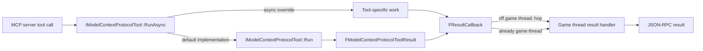

# Tool Model, Execution & Results — UE 5.8 MCP

## Scope

This page documents the engine-level contract for an MCP tool: the `IModelContextProtocolTool` interface, synchronous and asynchronous execution, callback threading/lifetime, result JSON construction, reflected result conversion, schemas, naming rules, and the deprecated reflected-library/async-action adapters. It covers only implementation behavior evidenced in the cited UE 5.8 source. Tool registration and discovery are covered elsewhere.

A tool is a describable object that supplies a name, description, optional input/output JSON Schemas, and either synchronous `Run` or asynchronous `RunAsync`. The server calls `RunAsync`; its base implementation calls `Run` and forwards that result immediately. Result JSON must be a complete MCP result object, normally containing `content` and optionally `structuredContent`.

## Architecture



`IModelContextProtocolTool` is independent of UObject reflection. Engine helpers translate reflected properties to/from MCP result values; the legacy `UModelContextProtocolToolLibrary` and `UModelContextProtocolToolAsyncAction` adapt reflected UFUNCTIONs into interface implementations. Both legacy classes are explicitly deprecated in favor of `UToolsetDefinition` from ToolsetRegistry.

`FModelContextProtocolToolResult` is a thin `FJsonObjectWrapper` around the result JSON object. Helpers build text, image, audio, resource-link and structured-content result objects. The result enum also names embedded-resource content, but the public helper set inspected here does not expose an embedded-resource constructor.

## Key types

| symbol | module | responsibility |
|---|---|---|
| `IModelContextProtocolTool` | ModelContextProtocol | Abstract tool contract: identity, description, schemas, `Run`, `RunAsync`, cancellation, UObject reference hook. |
| `IModelContextProtocolTool::FResultCallback` | ModelContextProtocol | Callback accepting a `const FModelContextProtocolToolResult&`; may be invoked from any thread and must be called exactly once per tool call. |
| `FModelContextProtocolToolResult` | ModelContextProtocol | `BlueprintType` JSON-object wrapper for a tool result. |
| `EModelContextProtocolToolResultType` | ModelContextProtocol | Bitflag enumeration for None, Text, Image, Audio, ResourceLink, EmbeddedResource, StructuredContent. |
| `EModelContextProtocolAudience` | ModelContextProtocol | Bitflags `User`, `Assistant`, and `All`; used to annotate image/resource-link content. |
| `FJsonExportParams` | ModelContextProtocol | Controls reflected export with check/skip flags, custom export callback and JSON conversion flags. |
| `FModelContextProtocolPropertyMetaData` | ModelContextProtocol | Cookable cached property description, clamp bounds, default text and original JSON type. |
| `FModelContextProtocolFunctionMetaData` | ModelContextProtocol | Cookable cached function description, nested per-property metadata, and WorldContext value. |
| `GetToolResultType` | ModelContextProtocolEngine | Classifies reflected return property and derives its output schema. |
| `GetToolResultFromType` | ModelContextProtocolEngine | Converts reflected return value to the corresponding MCP result. |
| `UModelContextProtocolToolLibrary` | ModelContextProtocolEngine | Deprecated reflected function-library tool adapter; caches/cooks UFUNCTION metadata. |
| `FModelContextProtocolLibraryTool` | ModelContextProtocolEngine | `IModelContextProtocolTool` implementation wrapping a legacy library UFUNCTION. |
| `UModelContextProtocolToolAsyncAction` | ModelContextProtocolEngine | Deprecated cancellable async-action tool adapter. |
| `FModelContextProtocolAsyncActionTool` | ModelContextProtocolEngine | `IModelContextProtocolTool` implementation wrapping a legacy async-action UFUNCTION. |
| `ValidateToolName` / `EToolNameValidation` | ModelContextProtocol | Enforces nonempty names of at most 128 characters using ASCII letters, digits, `_`, `-`, `.`. |

## Data flow

1. The server invokes `RunAsync(RequestId, Params, OnComplete)`. The default interface implementation immediately executes `Run(Params)` and invokes `OnComplete` with its result. A genuinely asynchronous implementation overrides `RunAsync` and returns its result later through the callback.
2. The callback's contract is exactly once for every tool call. The server's request-result handler checks for the game thread. If completion arrives off-thread, it schedules consumption with `AsyncTask(ENamedThreads::GameThread, ...)`; if already on the game thread, it handles synchronously, avoiding a tick of latency. A cancelled request or destroyed session is silently discarded by the server.
3. The callback result JSON object is placed in the JSON-RPC response's `result` field. Tool result helpers create MCP objects, rather than returning bare scalar values.
4. For text, `MakeTextResult` yields `{"content":[{"type":"text","text":...}]}`. `MakeErrorResult` uses the same text content and sets top-level `isError: true`.
5. For images and audio, helpers create one content item with `type`, `mimeType` and base64 `data`. Byte-array overloads base64-encode their input; string overloads accept already encoded data. Image content can include `annotations.audience`; audio helper signatures do not expose audience.
6. Resource-link helpers duplicate each descriptor JSON object, set `type: "resource_link"`, and may add `annotations.audience`. The single-link and multi-link APIs populate `content` with one or more such objects.
7. Structured content serializes a UStruct, UObject, property value or supplied `FJsonValue` into top-level `structuredContent`. It additionally serializes that value as condensed JSON text in a text content item for backward compatibility. Invalid structured input returns an empty result in conversion failure cases; a null `FJsonValue` triggers `MakeErrorResult("Expected structured content result")`.
8. In reflected tool conversion, `GetToolResultType` recognizes exact `UTexture2D` and `USoundWave` object property classes as image/audio; string, text and UTF-8 string properties and soft-object references as text; other properties as structured content with schema from `FJsonSchemaGenerator::FPropertyToJsonSchemaObject`.

## Usage

### Implementing sync and async tools

```cpp
struct FStatusTool final : IModelContextProtocolTool
{
    FString GetName() const override { return TEXT("status"); }
    FString GetDescription() const override { return TEXT("Returns current status."); }

    FModelContextProtocolToolResult Run(const TSharedPtr<FJsonObject>& Params) override
    {
        return UE::ModelContextProtocol::MakeTextResult(TEXT("ready"));
    }
};
```

An async implementation overrides `RunAsync`, performs or schedules its work, and invokes the supplied callback exactly once:

```cpp
void RunAsync(const FModelContextProtocolToolRequestId& RequestId,
              const TSharedPtr<FJsonObject>& Params,
              const FResultCallback& OnComplete) override
{
    // Start work; eventual completion:
    OnComplete(UE::ModelContextProtocol::MakeTextResult(TEXT("done")));
}
```

The example omits scheduling details because the interface does not prescribe a worker/task mechanism. Do not invoke the callback multiple times, including after cancellation or after a prior completion.

### Building result content

```cpp
using namespace UE::ModelContextProtocol;
FModelContextProtocolToolResult Text = MakeTextResult(TEXT("hello"));
FModelContextProtocolToolResult Failure = MakeErrorResult(TEXT("could not complete"));
FModelContextProtocolToolResult Image = MakeImageResult(TEXT("image/png"), Bytes, EModelContextProtocolAudience::User);
FModelContextProtocolToolResult Audio = MakeAudioResult(TEXT("audio/wav"), Bytes);
```

For reflected data, `MakeStructuredContentResult(MyStruct)` uses `T::StaticStruct()`. The UObject overload uses `GetClass()`. The property overload exports a single `FProperty` value. `FJsonExportParams` defaults to no check/skip flags, no custom callback and `EJsonObjectConversionFlags::None`; pass a custom callback through `ExportCb` when property conversion needs it.

`GetInputJsonSchema()` defaults to a JSON object schema (`{"type":"object"}`), which accepts any parameters. `GetOutputJsonSchema()` defaults to an invalid shared pointer (no declared output schema). An implementation that supplies a valid output schema MUST return results adhering to it. Input-schema adherence is assumed from the MCP client and is not strictly checked internally by this interface.

### Result conversion from reflection

`GetToolResultType(Property, MetaData, OutSchema)` resets `OutSchema` before classifying. Image/audio/text classifications do not derive structured schemas. For other properties it creates a property schema, optionally converting cached function metadata to editor metadata for schema generation. If `ModelContextProtocol.WrapPODToolResultsInObject` is enabled and the schema type is not `object`, the output schema becomes an object with required `result` property. The matching structured-result helper wraps non-object JSON values as `{"result": value}` when this CVar is enabled.

`GetToolResultFromType` exports text with `PPF_PropertyWindow`, encodes `UTexture2D` as image and `USoundWave` as audio via engine overloads, and sends other values through structured property conversion. Audio format handling belongs to the engine audio helper; `ModelContextProtocol.AudioResultOggFormat` defaults false, and its source description says true returns `audio/ogg` instead of `audio/wav`.

### Tool names

`ValidateToolName` returns `Empty`, `ExceedsMaxLength`, `InvalidCharacters`, or `Valid`. It checks empty first, then length greater than 128, then permits only `A-Z`, `a-z`, `0-9`, underscore, hyphen and dot. Thus names are 1–128 characters; other Unicode characters are not accepted by the implementation.

## Pitfalls

- **Callback threading is permissive, result consumption is not.** Header contract verbatim: “tool implementations may invoke this callback from any thread. The MCP server hops to the game thread before consuming the result, so per-tool work that completes off the game thread does not need to marshal back itself.” The server takes the synchronous game-thread path directly to avoid a tick of latency.
- **Exactly once means exactly once.** Header contract verbatim: “The callback must be invoked exactly once per tool call. Subsequent invocations after the request has been served (or cancelled) are silently dropped.” Do not rely on dropped repeated calls as a completion strategy.
- **Input validation is not performed by `IModelContextProtocolTool`.** The header says clients are assumed to conform to the returned schema; schema adherence is not strictly checked internally.
- **Structured results must match advertised output schema.** This is an explicit MUST in the `RunAsync` interface comment when a valid output schema is provided.
- **POD wrapper CVar is `ModelContextProtocol.WrapPODToolResultsInObject` in source.** The graph summary elsewhere names `WrapPODResultsInObject`; that spelling differs from the executable CVar string. The implementation default is enabled. Wrapping applies only to non-object structured content/schema. The wrapper key is `result`.
- **Audio OGG is opt-in.** `ModelContextProtocol.AudioResultOggFormat` defaults false. Do not assume WAV/OGG solely from the result API's MIME argument; engine conversion controls it.
- **Deprecated path is not the recommendation.** `UModelContextProtocolToolLibrary` and `UModelContextProtocolToolAsyncAction` are marked deprecated with the message “Use UToolsetDefinition (ToolsetRegistry plugin) instead.” Their comments call them legacy fallbacks to be removed in a future release.
- **GC references need explicit reporting.** `IModelContextProtocolTool::AddReferencedObjects(FReferenceCollector&)` is the hook called by the tool collection for UObject dependencies. Legacy wrappers override it and retain UObject pointers; a custom UObject-owning tool should implement the hook as appropriate.
- **Result enum is broader than public constructors.** `ResourceLink` and `EmbeddedResource` enum values are hidden metadata entries. Resource-link helpers exist; no embedded-resource construction helper was found in the cited results header.
- **Metadata is cooked data.** `FModelContextProtocolFunctionMetaData` stores function description, a map of per-property metadata (including nested paths), and WorldContext; its property metadata includes descriptions, clamp limits and default parameter values with original JSON type. It exists to preserve editor-derived metadata in cookable form.

### Content and audience details

`EModelContextProtocolToolResultType` values are bit flags: `None`, `Text`, `Image`, `Audio`, hidden `ResourceLink`, hidden `EmbeddedResource`, and `StructuredContent`. The hidden metadata designation does not remove the enum values from C++ classification, but the header's documented public helper list specifically highlights text, structured content, image and audio.

`EModelContextProtocolAudience` is a bitflag. Its `User` flag serializes as `"user"` and its `Assistant` flag as `"assistant"` in `annotations.audience`; `All` combines both. If no audience flag is set, image and resource-link content omit `annotations` entirely. Audio construction has no audience argument in the public API.

Image bytes are base64 encoded by the `TArrayView<uint8>` overload, while its `FString&&` counterpart moves pre-encoded data into `data`. Audio has the same byte/pre-encoded overload split. The shared JSON shape uses MIME type spelling `mimeType`. Resource links copy the descriptor's JSON before adding content type and optional annotations, avoiding mutation of the descriptor object.

Structured result overloads differ by source value:

- `UStruct` plus raw pointer uses `FJsonObjectConverter::UStructToJsonObject`.
- A templated struct overload passes `T::StaticStruct()` and its address.
- UObject uses its runtime class and object memory.
- `FProperty` converts through `UPropertyToJsonValue`.
- A prebuilt `TSharedPtr<FJsonValue>` is accepted directly.

The UStruct overload specially returns an existing `FModelContextProtocolToolResult` unchanged rather than nesting it. The property overload performs the analogous check for an `FStructProperty` of that type. These special cases allow a reflected result wrapper to preserve its already-formed MCP result object.

`FJsonExportParams::CheckFlags` and `SkipFlags` are `int64` values defaulting to `CPF_None`. `ExportCb` is a pointer to a `FJsonObjectConverter::CustomExportCallback`; `ConversionFlags` defaults to `EJsonObjectConversionFlags::None`. The schema utility uses `FJsonSchemaGenerator::FPropertyToJsonSchemaObject` and applies cached metadata through `ConvertToCachedEditorMetadata` when available. Schema conversion and result serialization are separate operations; returning a value does not itself guarantee it satisfies a separately declared schema.

### Legacy reflected adapters

The legacy function library is a `UBlueprintFunctionLibrary` specialization. Its header states it can be subclassed in C++ or Blueprints, automatically registers one tool for each public UFUNCTION on module load when `bAutoRegisterTools` is true, and can instead require explicit `RegisterTools()`. The class stores `FModelContextProtocolFunctionMetaData` by function name; each generated `FModelContextProtocolLibraryTool` exposes name, description, input/output schema, synchronous `Run`, and a reference-collector override.

The legacy async action derives from `UCancellableAsyncAction`. It exposes tool function/result property names and metadata, registration controls, an `OnAsyncToolComplete` delegate, and a request identifier. Its adapter implements `RunAsync`, `CancelAsync` and `AddReferencedObjects`; it tracks in-progress actions and stores the completion callback. These details describe compatibility code, not a current recommendation: both declarations explicitly say to use `UToolsetDefinition` (ToolsetRegistry plugin) instead.

The legacy classes' UFUNCTION-derived descriptions and parameter metadata are cached for cookable use. `FModelContextProtocolPropertyMetaData` has optional description, numeric `ClampMin`/`ClampMax`, default parameter value and original JSON type for lossless default-value round-trip. Function metadata keeps these entries keyed by property path (including nested paths such as `Person.Name`) and a `WorldContext` value. This metadata supports generated schemas after editor-only source metadata is unavailable in cooked builds.

### Result lifecycle boundaries

`Run` is synchronous in the interface: it returns a result directly. Its base implementation calls `ensureMsgf` and returns an error result if neither execution method is implemented. `RunAsync` is virtual and synchronous-by-default; an implementation that needs delayed completion must override it. `CancelAsync` is an empty default hook, so cancellation behavior is implementation-specific.

The `RequestId` is supplied to asynchronous execution and cancellation so implementations can associate work with a request. The interface itself does not prescribe task scheduling, thread ownership for the work, or automatic cancellation; the callback threading guarantee concerns only result consumption by the MCP server.

The game-thread hop is a server-side contract, not a promise that arbitrary UObject operations inside worker work are safe. Tool code that touches thread-affine engine objects still needs to obey those objects' own threading rules. [INFERENCE] The header's permission to invoke the callback from any thread does not make all preceding tool operations thread-safe.

The server silently drops late callback results after cancellation or session destruction. The interface comment also says subsequent callback invocations after request service/cancellation are silently dropped. This prevents a late result from being delivered, but does not replace the tool's exactly-once responsibility.

`AddReferencedObjects(FReferenceCollector&)` is virtual on the interface and documented as the hook called by `FModelContextProtocolToolCollection` to report UObject dependencies. The function-library and async-action wrapper declarations override it. UObject references retained by a custom tool should be reported through the same hook when needed to keep them alive during tool collection.

### Minimal schema contract

Input schema is REQUIRED by MCP and the default implementation provides an object schema with no property restrictions. Override `GetInputJsonSchema()` when parameters need a narrower contract.

Output schema is optional. An invalid pointer means no output schema is declared. If a tool returns one, its `RunAsync` implementation MUST ensure the returned result adheres to it.

The reflected utility only derives a structured output schema for the fallback structured-property case. Special image, audio and text classifications return their result type without filling `OutSchema`.

For scalar structured returns with POD wrapping enabled, both schema and runtime value are transformed: schema becomes an object requiring `result`, while runtime `structuredContent` uses the same property name. Keep the CVar consistent across schema exposure and result production.

Tool names are separate from descriptions and schemas. `ValidateToolName` only checks syntax/length; it does not check uniqueness or registration status. [INFERENCE] Callers should treat successful validation as syntax validity only, not proof that the tool can be registered.

### Practical implementation checklist

1. Provide a stable name passing `ValidateToolName` and a meaningful description.
2. Return an object input schema, or use the permissive default intentionally.
3. Declare output schema only when the implementation can consistently honor it.
4. Build a complete MCP result object with a factory rather than hand-assembling partial JSON.
5. In asynchronous tools, retain request state safely and call completion exactly once.
6. Permit callback invocation from the work-completion thread; the server marshals result handling to game thread.
7. Implement cancellation only to the extent the tool can actually stop or disregard its work.
8. Report UObject dependencies through `AddReferencedObjects` where needed.
9. Keep POD wrapper configuration and schema/result production aligned.
10. Prefer `UToolsetDefinition` for new tool authoring; the reflected library and async-action classes are deprecated legacy fallbacks.

## Source files

All paths below are relative to `UE_5.8/Engine/Plugins/Experimental/ModelContextProtocol/Source/`.

- `ModelContextProtocol/Public/IModelContextProtocolTool.h` — tool interface, default schemas and sync/async/callback/threading/GC contracts.
- `ModelContextProtocol/Public/ModelContextProtocolToolResults.h` — result enums, audience flags, result wrapper, `FJsonExportParams`, and result factory signatures.
- `ModelContextProtocol/Private/ModelContextProtocolToolResults.cpp` — content JSON construction, audience annotations, structured serialization and POD wrapping.
- `ModelContextProtocol/Public/ModelContextProtocolMetaData.h` — cookable property/function metadata structs.
- `ModelContextProtocol/Public/ModelContextProtocol.h` and `ModelContextProtocol/Private/ModelContextProtocol.cpp` — name validator, result wrapper constant, CVar values and definitions.
- `ModelContextProtocol/Private/ModelContextProtocolServer.cpp` — callback dispatch, game-thread hop, exactly-once result handling and cancelled-session discard.
- `ModelContextProtocolEngine/Public/ModelContextProtocolToolUtils.h` — reflected result utility API.
- `ModelContextProtocolEngine/Private/ModelContextProtocolToolUtils.cpp` — type classification, property schema generation, POD schema wrapping and result conversion.
- `ModelContextProtocolEngine/Public/ModelContextProtocolEngineToolResults.h` — texture/image and sound/audio helpers.
- `ModelContextProtocolEngine/Public/ModelContextProtocolToolLibrary.h` — deprecated legacy function-library adapter, cached metadata and `AddReferencedObjects` override.
- `ModelContextProtocolEngine/Public/ModelContextProtocolToolAsyncAction.h` — deprecated legacy cancellable async-action adapter, callback and reference hook.

## Graph facts

Corpus-wide MCP graph facts (graph scan rooted at the UE 5.8 MCP, ToolsetRegistry and Toolsets experimental plugins): **9,250 nodes**, **15,786 internal edges**, **7,518 cross-community edges**, **287 communities**. This page’s scope is the ModelContextProtocol tool-result and ModelContextProtocolEngine reflected-conversion surface; graph node count by plugin is **820** for ModelContextProtocol and **2,178** for ToolsetRegistry. The full corpus has 6,018 `references`, 5,824 `calls`, 2,673 `method`, 2,538 `contains`, 2,396 `rationale_for`, 1,562 `imports`, 1,239 `defines`, 448 `uses`, 302 `imports_from`, 258 `inherits`, 32 `indirect_call`, and 14 `re_exports` relations. These are graph counts, not counts of runtime tools or API calls.
