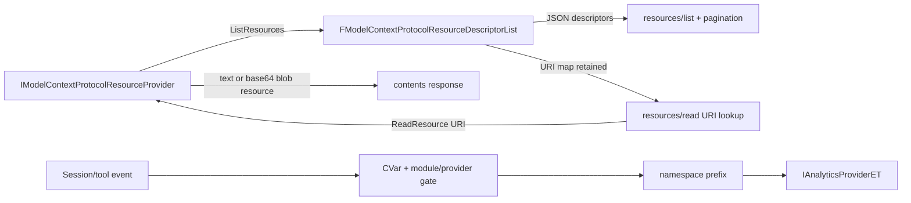

# Resources, Analytics, and Progress — UE 5.8 MCP

## Scope

This note covers MCP resource descriptors and provider routing, resource listing pagination, MCP analytics events and their privacy properties, and the relative-path containment helper. It describes the source implementation in UE 5.8's experimental `ModelContextProtocol` plugin; it is not a general MCP specification guide.

Resource providers supply metadata through `resources/list` and content through `resources/read`. Analytics records session lifecycle and tool-call completion when enabled and when an analytics provider is installed. Resource pagination limits each list response, not the provider's enumeration.

## Architecture



The provider interface lives in the core `ModelContextProtocol` module. A descriptor list accumulates both JSON descriptors and a URI-to-provider map. `resources/list` rebuilds that list from all registered providers each time, applies the shared pagination helper to its JSON array, then releases only the JSON cache. `resources/read` first checks the retained mapping and, if it is absent, re-lists providers until one claims the URI. It then asks that provider to read the URI.

Analytics event construction is in `ModelContextProtocolAnalytics.cpp`; the module owns the configured provider and namespace behavior. `ModelContextProtocolEngine` supplies an optional proxy to `FEngineAnalytics`; the proxy forwards only event recording and intentionally does not act as a general analytics facade.

## Key types

| symbol | module | responsibility |
|---|---|---|
| `IModelContextProtocolResourceProvider` | ModelContextProtocol | Abstract provider: enumerate descriptors and read a listed URI. |
| `FModelContextProtocolResourceDescriptor` | ModelContextProtocol | URI plus optional name, title, description, and MIME metadata represented as JSON. |
| `FModelContextProtocolResource` | ModelContextProtocol | Descriptor extended with either text content or a base64-encoded binary blob. |
| `FModelContextProtocolResourceDescriptorList` | ModelContextProtocol | Descriptor JSON array and URI-to-provider routing map; can release the JSON cache independently. |
| `UE::ModelContextProtocol::Analytics::IsToolResultSuccess` | ModelContextProtocol | Interprets MCP result `isError` according to documented rules. |
| `UE::ModelContextProtocol::Analytics::HashToolIdentifier` | ModelContextProtocol | UTF-8 Blake3 identifier anonymization for analytics. |
| `UE::ModelContextProtocol::Analytics::ParseToolsetName` | ModelContextProtocol | Returns the portion preceding the final dot, or empty for a top-level tool. |
| `FEngineAnalyticsProviderProxy` | ModelContextProtocolEngine | Safely forwards event recording to `FEngineAnalytics` when available. |
| `FServerAccessor` | ModelContextProtocol (private tests) | Test-only accessor to selected server private state; unrelated to production resource routing. |

## Data flow

### Resource descriptors and content

`FModelContextProtocolResourceDescriptor` always writes `uri`. It conditionally writes each optional `name`, `title`, `description`, and `mimeType` field only when the corresponding `TOptional` is set. `GetUri()` reads the JSON `uri` string, and `GetJsonObject()` exposes the descriptor object as a shared JSON object.

`FModelContextProtocolResource` derives from that descriptor. Its text constructor writes `text`; its binary constructor base64-encodes the supplied byte view and writes `blob`. These are alternative content representations, not two fields populated together by either constructor. Both resource constructors pass no description through to the base constructor; callers can still supply name, title, and MIME type. The JSON payload therefore carries the MCP content fields in the same object as the descriptor metadata.

### Provider mapping and listing

`IModelContextProtocolResourceProvider::ListResources` receives the output descriptor list. Its contract says that any URI it lists will subsequently be routed back to that provider's `ReadResource` implementation. `ReadResource` returns `TValueOrError<FModelContextProtocolResource, FString>`.

`FModelContextProtocolResourceDescriptorList::Add` appends the descriptor's JSON object and maps its URI to the provider reference. The map is keyed by URI. `Reset()` clears both the JSON array and provider map; `ReleaseJsonArray()` replaces only the JSON array, deliberately preserving provider mappings for later URI matching. This distinction is essential in the `resources/list` handler: after response serialization, the descriptor JSON is discarded but the mapping remains available for reads. Adding another descriptor with the same URI uses `TMap::Add` semantics (the map entry for that key is replaced); no duplicate-URI validation is performed in this method.

### URI-to-provider reads

The server reads the `uri` string from `resources/read` parameters. It first searches the last resource descriptor list, which is populated by the most recent `resources/list`. If not found, the server queries registered providers directly: for each provider it creates a fresh descriptor list, calls `ListResources`, and checks whether that provider's list maps the requested URI. Thus reading does not strictly require a preceding list request.

No matching provider produces JSON-RPC `ResourceNotFound`; a provider's read error becomes `InternalError`. A successful read is returned as one entry in the result's `contents` array. The provider is responsible for returning the resource it advertised; the server passes the requested URI to `ReadResource` and does not independently compare the returned resource URI.

### Pagination

The resource-list handler gathers the complete descriptor array first, then invokes the same `ApplyPagination` helper used for tool listing. `ModelContextProtocol.PaginationPageSize` controls page size; a non-positive value disables pagination and returns all items. With pagination enabled, an optional non-empty cursor is base64-decoded and must contain only decimal digits representing an offset. Invalid/empty decoded content or an offset beyond the supported integer range makes pagination fail with an invalid-params error. Offsets past the current item count are clamped to the count.

The handler places the selected items in `resources` and emits `nextCursor` only if more entries remain. That cursor is base64 of the next decimal offset. This is offset pagination over the current enumeration, not a stable snapshot token: each `resources/list` request re-enumerates providers. Even after a pagination error, the JSON descriptor array is released; the provider mapping remains because `ReleaseJsonArray` does not clear it.

### Analytics event flow

The analytics CVar is `ModelContextProtocol.EnableAnalytics`, initially enabled. If disabled, the helper skips recording. It also skips events when the MCP module is unavailable or no analytics provider is installed. The module's `RecordAnalyticsEvent` copies provider and namespace while holding its analytics mutex, returns if the provider is invalid, then calls `RecordEvent` outside the lock. The event name is prefixed with the configured namespace and a dot; the default namespace is `ModelContextProtocol`, while an empty namespace leaves the event name unprefixed.

Three events are emitted by the helpers:

| Event | Attributes |
|---|---|
| `SessionStart` | `SessionId`, `ProtocolVersion` (negotiated version) |
| `SessionEnd` | `SessionId` |
| `ToolCall` | `SessionId`, `ToolsetNameHash`, `ToolNameHash`, `Duration`, `ResultStatus` (`Success` or `Error`) |

Session start is called on `notifications/initialized`; session end is called on DELETE or server shutdown. Tool-call completion supplies duration in seconds and a success boolean. The tool identifier and extracted toolset name are separately hashed to lowercase hexadecimal Blake3 strings after UTF-8 conversion. This anonymizes names in the analytics payload: Epic can resolve known hashes with its lookup table, while licensee-private names remain opaque. It does not hash the session ID, duration, protocol version, or result status.

`ParseToolsetName` splits using the final `.` (case-sensitive) and returns the left portion. With no dot it returns an empty string. Consequently a top-level tool's `ToolsetNameHash` is the hash of the empty string. A name with several dots is associated with the prefix before its last dot.

`IsToolResultSuccess` follows the API header's explicit rules: a null JSON pointer is error; absent `isError` is success (the MCP default); a boolean `isError` is inverted (`false` means success); a present non-boolean `isError` is malformed and treated as error. The implementation checks the JSON type before reading the boolean, avoiding string/number coercion.

## Usage

### Defining a provider

A minimal C++ provider implements the pure virtual methods and registers a descriptor alongside a shared reference to itself. Registration occurs through the module API:

```cpp
struct FMyResourceProvider final : IModelContextProtocolResourceProvider
{
    void ListResources(FModelContextProtocolResourceDescriptorList& Out) const override
    {
        Out.Add(FModelContextProtocolResourceDescriptor(
            TEXT("project://status"), TEXT("status"), {}, TEXT("Current project status"), TEXT("text/plain")),
            AsShared());
    }

    TValueOrError<FModelContextProtocolResource, FString> ReadResource(const FString& Uri) const override
    {
        if (Uri == TEXT("project://status"))
        {
            return MakeValue(FModelContextProtocolResource(Uri, FString(TEXT("Ready")), {}, {}, TEXT("text/plain")));
        }
        return MakeError(FString(TEXT("Unknown resource URI")));
    }
};

IModelContextProtocolModule::GetChecked().AddResourceProvider(MakeShared<FMyResourceProvider>());
```

The constructor's optional parameters are `TOptional<FString>`; the sample shows intent, not a guarantee that implicit conversions are accepted in every compiler context. Use explicit optionals if needed. The actual provider contract is the C++ interface; no Blueprint exposure is declared on these structs or methods in the cited headers.

For binary output, construct the resource with a `TArrayView<uint8>` and optional MIME type; the constructor encodes bytes as base64 in `blob`. For text output, pass an rvalue `FString` to the text constructor. The server returns that resource object's JSON as the sole `contents` entry.

### Calling resource methods

A client lists resources with `resources/list`; if the result includes `nextCursor`, it can call the same method again with that cursor until no cursor remains. It reads a resource using `resources/read` with `params.uri` equal to a listed URI. The server also supports a direct read without a prior list by enumerating provider descriptors on demand. These are wire-level protocol patterns; callers should use the transport/session rules documented elsewhere in this MCP guide.

### Analytics integration

An integration can install an `IAnalyticsProviderET` with `IModelContextProtocolModule::SetAnalyticsProvider`, or clear it with `nullptr`; the module holds a strong reference. `SetAnalyticsEventNamespace` changes the namespace prefix. `ModelContextProtocolEngine` registers its forwarding proxy after engine initialization and clears it at shutdown when appropriate; a consumer may override the provider.

The engine proxy forwards only the two `RecordEvent` overloads, guarded by `FEngineAnalytics::IsAvailable()`. Other inherited analytics methods return safe defaults or do nothing, so this proxy is not intended for arbitrary analytics-provider operations.

## Pitfalls

- `Reset()` destroys URI routing as well as descriptor JSON; use `ReleaseJsonArray()` when only the JSON list cache is no longer needed.
- `resources/list` regenerates descriptors on each request. Cursor offsets therefore rely on provider enumeration order and contents remaining compatible between pages; the implementation does not pin a snapshot.
- A successful `ListResources` call is what establishes URI ownership. Providers that omit a URI cannot be selected by fallback lookup.
- Binary content is base64 in the `blob` field; it is not raw bytes or text. The resource helper does not infer MIME type.
- `isError: "false"` or `isError: 0` is not success: a present non-boolean is malformed and counted as error.
- Analytics hashes are deterministic anonymization, not encryption. The header documents Epic's lookup-table resolution and opacity of licensee-private identifiers.
- Disabling analytics or lacking a provider suppresses events; event helpers do not synthesize a provider.
- `SafeConvertRelativePathToFull` converts the candidate path, then uses `FPaths::IsUnderDirectory(OutFilePath, BasePath)`. If the check fails it resets output and returns false. It is specifically a containment guard against relative traversal; do not describe it as a different prefix/string comparison.

### Resource state lifetime

`LastResourceDescriptorList` is server-owned state, rather than state stored on each provider. A list request begins with `Reset()`, so it replaces the previous list's URI map and descriptors with results from current registered providers. After sending the page, the server calls `ReleaseJsonArray()` but keeps the URI map from that enumeration. A subsequent read can therefore use the last successfully enumerated provider mapping even though the JSON descriptors have been released.

When no cached provider owns the URI, the fallback performs fresh per-provider enumeration using a temporary descriptor list. A match is determined by that temporary list's URI map, not by parsing URI schemes or asking every provider to read speculatively. This means routing is based on advertised URI equality.

### Result and response boundaries

The provider error is represented as `FString` inside `TValueOrError`; the server wraps it in an internal JSON-RPC error rather than returning it as a resource. A missing URI parameter is an invalid-params error, distinct from a valid but unowned URI (`ResourceNotFound`). Resource-list pagination errors also use invalid params, and do not change the pagination contract for tool listing because both handlers share the helper.

Descriptor serialization and resource serialization share the inherited JSON object. Descriptors contain identifying metadata, while resources add exactly one payload member through their chosen constructor. The interface does not dictate provider storage, caching, URI scheme, or content generation strategy; those details belong to each implementation.

### Analytics details and boundaries

Analytics event helpers create attributes directly from their arguments; `Duration` is numeric seconds, and `ResultStatus` is a textual `Success`/`Error` value. `ToolCall` hashes both full tool identifier and parsed toolset identifier independently. The hash is the string representation of the Blake3 digest returned by `LexToString`, with input bytes produced by `FTCHARToUTF8`.

`RecordEvent`'s module-level provider and namespace are copied while locked. The provider copy keeps it alive for the call even if another thread clears or replaces the installed provider. Invocation happens after releasing the lock, avoiding calling external analytics code under the module mutex.

The engine proxy's two event-recording overloads independently test whether `FEngineAnalytics` is available before forwarding. It owns no analytics state and avoids wrapping the engine's borrowed provider reference in a potentially dangling shared pointer. Methods outside event recording are intentionally safe defaults, not forwarded behavior.

The included `FServerAccessor` is explicitly test-only and provides controlled test access to server internals (injecting an initialized session with event stream, ticking, and checking a scheduled tools-list notification). Its presence does not imply an alternate production resource or telemetry API.

## Source files

All paths are relative to `UE_5.8/Engine/Plugins/Experimental/ModelContextProtocol/`.

| source | relevant evidence |
|---|---|
| `Source/ModelContextProtocol/Public/IModelContextProtocolResourceProvider.h` | Provider registration contract; `ListResources` and `ReadResource` interface. |
| `Source/ModelContextProtocol/Public/ModelContextProtocolResources.h` | Descriptor/resource/list APIs and documented mapping/`ReleaseJsonArray` semantics. |
| `Source/ModelContextProtocol/Private/ModelContextProtocolResources.cpp` | Optional JSON fields, text/blob construction, map update, reset and JSON-cache release behavior. |
| `Source/ModelContextProtocol/Private/ModelContextProtocolServer.cpp` | `ApplyPagination`, `resources/list`, `resources/read`, fallback provider scan and error mapping. |
| `Source/ModelContextProtocol/Public/ModelContextProtocolAnalytics.h` | Contract comments for success interpretation, hashing, toolset parsing, and event call sites. |
| `Source/ModelContextProtocol/Private/ModelContextProtocolAnalytics.cpp` | CVar, UTF-8 Blake3, type-checked result logic, attributes, event gating. |
| `Source/ModelContextProtocol/Public/IModelContextProtocolModule.h` | Provider ownership, event namespace, provider and resource registration APIs. |
| `Source/ModelContextProtocol/Private/ModelContextProtocolModule.cpp` | Namespace prefix, analytics locking, and resource-provider module behavior. |
| `Source/ModelContextProtocol/Public/ModelContextProtocolUtils.h` | `SafeConvertRelativePathToFull` and exact `FPaths::IsUnderDirectory` check. |
| `Source/ModelContextProtocolEngine/Private/EngineAnalyticsProviderProxy.h` | Engine analytics event forwarding and safe-default non-event interface. |
| `Source/ModelContextProtocol/Private/Tests/ModelContextProtocolServerAccessor.h` | Test-only server access helper; no production resource or analytics behavior. |

## Graph facts

Corpus roots: `Engine/Plugins/Experimental/ModelContextProtocol`, `Engine/Plugins/Experimental/ToolsetRegistry`, and `Engine/Plugins/Experimental/Toolsets`.

- MCP graph: **9,250 nodes**, **15,786 internal edges**, **7,518 cross-community edges**, **287 communities**.
- ModelContextProtocol plugin graph: **820 nodes**.
- MCP relation counts: references 6,018; calls 5,824; method 2,673; contains 2,538; rationale_for 2,396; imports 1,562; defines 1,239; uses 448; imports_from 302; inherits 258; indirect_call 32; re_exports 14.
- Whole-engine graph: 2,688,593 nodes and 5,061,968 edges.
- These are corpus-level graph counts, not counts of resources, providers, analytics events, or supported tools.
