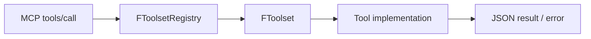

# Toolset Registry Framework — UE 5.8

## Scope

This page documents the engine's `ToolsetRegistry` plugin: C++ toolset execution and registration, UObject-backed tool definitions, registry Blueprint APIs, filters, JSON conversion, asynchronous results, script-exception capture, object-property safety filters, and file sandbox access. It concerns execution behind MCP's `tools/call`; transport and MCP request validation are covered elsewhere.

Source root: `Engine/Plugins/Experimental/ToolsetRegistry/Source/ToolsetRegistry/`.

## Architecture



`FToolsetRegistry` maps names to `FToolset` handlers and delegates execution. A toolset applies its enabled state and name filters before dispatch. UObject toolset functions are discovered from `UToolsetDefinition` classes; `IsFunctionAICallable` validates callable metadata. Results are serialized as JSON strings or represented by `FJsonValueOrError` in asynchronous flows.

## Key types

| Symbol | Module | Responsibility |
|---|---|---|
| `UE::ToolsetRegistry::FToolset` | ToolsetRegistry | Base execution, schema, enabled state, and per-tool filters. |
| `UE::ToolsetRegistry::FToolsetRegistry` | ToolsetRegistry | Register/find/execute handlers; manage converters and global name filters. |
| `UToolsetDefinition` | ToolsetRegistry | UObject base for tool definitions; validates `AICallable` functions. |
| `UToolsetRegistry` | ToolsetRegistry | Blueprint function library for availability, registration, execution, and schemas. |
| `UToolsetRegistrySubsystem` | ToolsetRegistry | Editor subsystem owning the registry and settings. |
| `UE::ToolsetRegistry::FToolsetJsonConverter` | ToolsetRegistry | Property-to/from-JSON and schema conversion interface. |
| `UToolCallAsyncResult` | ToolsetRegistry | Thread-safe completion/error base for asynchronous tools. |
| `UToolCallAsyncResultString` | ToolsetRegistry | Async result carrying `FString`. |
| `UToolCallAsyncResultImage` | ToolsetRegistry | Async result carrying `FToolsetImage`. |
| `UToolCallAsyncResultVoid` | ToolsetRegistry | Async completion without a value. |
| `UToolCallAsyncResultFutureHandler` | ToolsetRegistry | Converts async UObject completion into a `TFuture<FJsonValueOrError>`. |
| `UE::ToolsetRegistry::FJsonValueOrError` | ToolsetRegistry | JSON-value-or-error representation and serialization. |
| `UE::ToolsetRegistry::FToolCallExceptionHandler` | ToolsetRegistry | Captures Blueprint script exceptions during its lifetime. |
| `UE::ToolsetRegistry::FDelegateHandleRaii` | ToolsetRegistry | RAII removal of registered delegate handles. |
| `UE::ToolsetRegistry::FGlobalSandbox` | ToolsetRegistry | Static access to the active file sandbox. |
| `FToolsetImage` | ToolsetRegistry | Blueprint-visible image MIME type and base64 data. |
The registry's actual mutations are global to that registry instance: adding/removing a block/allow pattern reapplies filters to registered handlers and broadcasts registry-change notifications. Built-in color, GUID, reference, and transform converters are registered by the registry implementation; custom converters are keyed by converter name.

`SetObjectProperties` lives on `UToolsetLibrary` (not the registry subsystem). Its source comment gives the exact partial-write guarantee: “Sibling properties whose JSON resolves cleanly are committed even when other properties (or other JSON keys within a nested struct) fail.” A false return means at least one property could not be set; it does not mean the object is unchanged. “Callers that need all-or-nothing semantics should wrap the call in a transaction and roll back on failure.”

`UToolsetLibrary::UndoTransaction(bool bCanRedo = false)` undoes the most recent global transaction; by default it removes it rather than retaining it on redo. `GetActiveUndoCount()` is the undoable global-stack count (queue length minus undo count), or zero when no editor transaction buffer is available. A Begin/End transaction with no UObject changes is silently dropped.

`UToolsetRegistrySettings::SetObjectPropertiesBlockedClasses` rejects instances whose class or parent class matches a configured pattern. `SetObjectPropertiesBlockedProperties` compares `ClassName.PropertyName` at every class in the object's inheritance chain. A regex such as `/\.RootComponent$/` can target that property name across classes. Both use the same slash-delimited-regex/otherwise case-insensitive-substring syntax as name filters.

`UToolsetLibrary::SetObjectProperties` exposes `EBypassContainerCheck`: default `No` performs container diff-and-recurse and emits element-aware notifications; `Yes` skips that logic and emits one `ValueSet` for the property. Do not select `Yes` if the receiver depends on element-level add/remove/clear events.


## Data flow

1. MCP's `tools/call` endpoint selects a registered tool and passes its tool name and JSON input into registry execution.
2. `FToolsetRegistry::ExecuteTool` resolves a toolset/tool descriptor, then calls the handler; failures are returned in a future as an error string.
3. `FToolset::ExecuteTool` performs enabled checks and calls the implementation's `ExecuteToolInternal`; schema and tool names are available through the base interface.
4. UObject-defined functions are expected to be static `UFUNCTION`s. `meta=(AICallable)` exposes a tool; `meta=(AIIgnore)` marks a function intentionally ignored by validation. `UToolsetDefinition::IsFunctionAICallable` returns either a decision or an error for an invalid function lacking the ignore metadata.
5. JSON converters translate reflected properties to schemas/data and parse JSON into property values. The registry can register/unregister custom `FToolsetJsonConverter` instances and select one for a property.
6. For async tool returns, a derived `UToolCallAsyncResult` completes with a value or error. `UToolCallAsyncResultFutureHandler` subscribes to completion and resolves a JSON-value-or-error future.

## Usage

C++ toolset implementations derive from `UE::ToolsetRegistry::FToolset`, provide the toolset name/version/description, and implement `ExecuteToolInternal` and `GetJsonSchemaInternal`. Register a shared handler with `FToolsetRegistry::RegisterToolset`; invoke by fully qualified name or `FToolDescriptor` via `ExecuteTool`.

The public `FToolset` surface is:

```cpp
TFuture<TValueOrError<FString, FString>> ExecuteTool(
    const FString& ToolName, const FString& JsonInput);
FString GetJsonSchema() const;
virtual FString GetToolsetName() const = 0;
virtual FString GetToolsetVersion() const = 0;
virtual FString GetToolsetDescription() const = 0;
virtual UClass* GetToolsetClass() const;
bool IsEnabled() const;
void SetEnabled(bool bInEnabled);
void SetNameFilters(const TArray<FString>& BlockPatterns,
    const TArray<FString>& AllowPatterns);
bool IsToolEnabled(const FString& FullToolName) const;
TArray<FString> ListToolNames() const;
```

Implementations override the protected `ExecuteToolInternal(const FString&, const FString&)` and `GetJsonSchemaInternal() const`. `ExecuteTool` returns a future holding either JSON output or an error string. `ListToolNames` deliberately ignores per-tool filters and toolset enabled state; schema retrieval returns an empty string for a disabled toolset or one with no enabled tools.

The registry public API includes:

```cpp
bool RegisterToolset(TSharedPtr<FToolset> ToolsetHandler);
bool UnregisterToolset(TSharedPtr<FToolset> ToolsetHandler);
TSharedPtr<FToolset> Find(const FString& ToolsetName,
    bool LogErrors = false, FString* ErrorMessage = nullptr);
TFuture<TValueOrError<FString, FString>> ExecuteTool(
    const FString& ToolName, const FString& JsonInput);
TFuture<TValueOrError<FString, FString>> ExecuteTool(
    const FToolDescriptor& ToolDescriptor, const FString& JsonInput);
void ForEachToolset(
    TFunctionRef<void(const FString& Name, const FToolset& Toolset)> Callback) const;
FString GetToolsetJsonSchemas() const;
```

It also provides `AddBlockedName` / `RemoveBlockedName` / `GetBlockedNames`, the corresponding allowed-name methods, `OnToolsetRegistered()` for registry-change notifications, and converter registration, unregistration, and property lookup. `FToolDescriptor` has `ToolsetName` and `ToolName` fields. `FToolDescriptor::FromString(const FString&, bool LogErrors = false)` parses the combined toolset/tool name into a value-or-error descriptor; callers can pass that descriptor directly to the overload above.

`FToolsetJsonConverter` is a polymorphic conversion pipeline. An implementation supplies `GetName()`, `CanConvertProperty(TNotNull<const FProperty*>)`, `PropertyToJsonSchema`, `PropertyToDefault`, `PropertyToJsonData`, and `JsonDataToProperty`. These respectively identify a converter, generate property schema/defaults, serialize instance data, and apply JSON to an output property value. Protected helpers route property or UStruct schema/data/set operations through the complete ToolsetJson pipeline, including optional user-visible-only struct filtering.

Example C++ registration and dispatch (the concrete subclass implements the two protected virtuals and the three toolset identity methods):

```cpp
UE::ToolsetRegistry::FToolsetRegistry Registry;
TSharedPtr<UE::ToolsetRegistry::FToolset> Handler =
    MakeShared<FMyToolset>();
if (Registry.RegisterToolset(Handler))
{
    auto Result = Registry.ExecuteTool(
        TEXT("MyToolset.MyTool"), TEXT("{\"input\":\"value\"}"));
    // Result is TFuture<TValueOrError<FString, FString>>.
}
```

The tool name passed to `FToolset::IsToolEnabled` should be fully qualified as `ToolsetName.ToolName`. The descriptor overload avoids splitting the name at the dispatch call site. `RegisterToolset` and `UnregisterToolset` report whether the operation succeeded; `Find` can optionally fill an error string and log errors.

For UObject tools, `UToolsetDefinition::IsFunctionAICallable(const TObjectPtr<const UFunction>&)` returns `TValueOrError<bool, FString>`: an error indicates an invalid function without `AIIgnore`; a value indicates whether it can be added. Static functions marked `AICallable` are the declared tool form. `AIIgnore` suppresses errors for functions that are intentionally not tools.

The Blueprint wrapper's registration path accepts a subclass of `UToolsetDefinition`; its exposed methods carry `BlueprintCallable` or `BlueprintPure` metadata. `IsAvailable()` can be false when the editor is unavailable. `ExecuteTool(ToolsetName, ToolName, JsonInput)` returns a `UToolCallAsyncResultString*`; schema queries include one for a class and one for all registered toolsets.

```cpp
// C++ caller of the same Blueprint-visible API:
if (UToolsetRegistry::IsAvailable())
{
    UToolsetRegistry::RegisterToolsetClass(MyToolsetClass);
    UToolCallAsyncResultString* Result =
        UToolsetRegistry::ExecuteTool(TEXT("MyToolset"),
            TEXT("MyTool"), TEXT("{\"input\":\"value\"}"));
    // Bind OnCompleted; inspect bIsComplete, Value, or Error.
}
```

`UToolsetRegistrySubsystem::Get` returns `TValueOrError<TObjectPtr<UToolsetRegistrySubsystem>, FString>`. It reports `"Editor is not available"` without `GEditor`, and an unavailable-subsystem error if the editor exists but cannot provide the subsystem. Its optional warning-prefix argument controls whether a warning is logged.

For struct and object inspection, `UToolsetLibrary` provides:

```cpp
FString ListStructProperties(const UStruct* Struct,
    bool bUserVisiblePropertiesOnly = true);
FString GetObjectProperties(const UObject* Object,
    const TArray<FName>& PropertyNames);
bool SetObjectProperties(UObject* Object, const FString& PropertiesJson,
    EBypassContainerCheck BypassContainerCheck = EBypassContainerCheck::No);
TArray<FSoftClassPath> GetDerivedClasses(UClass* BaseClass);
TArray<UScriptStruct*> GetDerivedStructs(UScriptStruct* BaseStruct);
bool UndoTransaction(bool bCanRedo = false);
int32 GetActiveUndoCount();
```

`ListStructProperties` defaults to Blueprint-accessible properties; setting `bUserVisiblePropertiesOnly=false` includes every non-deprecated property. `GetDerivedClasses` uses the Asset Registry for native and Blueprint subclasses; `GetDerivedStructs` searches loaded script structs.

The C++ `SetObjectProperties` overload also fills `TArray<FName>& OutSetPropertyNames`. The Blueprint-callable overload takes the JSON string and optional container mode. Container mode `No` compares incoming JSON against live container contents and emits element-indexed `ArrayAdd`, `ArrayRemove`, `ArrayClear`, or `ValueSet` notifications; `Yes` emits one top-level `ValueSet`. Use the no-argument default unless the receiver handles top-level values itself.

The partial-write behavior is intentional and important. The header says: “Sibling properties whose JSON resolves cleanly are committed even when other properties (or other JSON keys within a nested struct) fail.” Its example passes `{"name": "ok", "doesNotExist": 0}`: the call returns false, raises a script error naming `doesNotExist`, and leaves `name` set to `ok`. The same applies to unknown keys in nested structs. False means at least one failure; the object may already have partial writes.

Async result subclasses must move/set their value through `MaybeBroadcastSuccessfulCompletion`, rather than writing base completion fields. `SetError` completes with an error and notifies listeners. `MaybeBroadcastCompletion` guarantees only one completion broadcast. If completion is initiated off the main thread, `SetFinalState` is deferred until the next main-thread update; its callback must not reference stack data. `OnCompleted` is broadcast on the main thread and listeners are cleared after broadcast.

The listener-side race is handled explicitly: after subscribing to `OnCompleted`, call `BroadcastOnCompletedIfComplete()`. This method is thread-safe and signals on the main thread if completion already happened. `UToolCallAsyncResultFutureHandler::Create(Result)` subscribes to the result; `GetValueAsJson()` retrieves the associated future only once, and `Unsubscribe()` cancels the pending future. Its cancellation error is exposed as `CanceledError`.

`UToolCallAsyncResult::GetValueAsJsonString()` gives JSON for a completed successful result; pending or failed results return an empty string. `GetValueAsJson()` returns an empty pointer when pending or failed. The image value uses `FToolsetImage` (`MimeType`, base64 `Data`); it can be populated from a bitmap or a disk file. The void result completes via `SetCompleted()` and returns JSON null.

`FJsonValueOrError` wraps `TValueOrError<TSharedPtr<FJsonValue>, FString>`. `ToJsonObject` and `ToJsonString` serialize either value or error according to a descriptor; `GetJsonSchema` builds the corresponding wrapper schema. `FromJsonStringOrError` parses a JSON string or propagates its error. The default descriptor names its fields; callers can supply a custom descriptor.

`FToolCallExceptionHandler` registers for Blueprint script exceptions during its lifetime and stores a description retrievable with `GetException()`. The callback receives the active object, `FFrame`, and exception info, then constructs a message from that frame. The helper exists because calling `RaiseScriptError` without a dynamically configured UFunction stack frame silently does nothing. `CaptureErrorsIn` constructs a frame on the calling thread around a function, primarily for testing; it is not described as a general production invocation mechanism.

The file sandbox API is static:

```cpp
bool FGlobalSandbox::IsActive();
FString FGlobalSandbox::GetActiveName();
bool FGlobalSandbox::Enter(const FString& Name, const FString& Description);
bool FGlobalSandbox::Leave();
TArray<UE::FileSandboxCore::FSandboxedFileChangeInfo> FGlobalSandbox::GetChanges();
bool FGlobalSandbox::Persist(const TArray<FString>& Files);
bool FGlobalSandbox::Discard();
bool FGlobalSandbox::DiscardFiles(const TArray<FString>& Files);
```

`Enter` leaves a different active sandbox before entering the requested one. `Leave` preserves sandbox files. Empty `Persist` means persist all changes; empty `DiscardFiles` returns false to avoid silently discarding everything. `Discard()` discards all active-sandbox changes while keeping it active.

UObject tool definitions derive from `UToolsetDefinition`. The header explicitly requires tool functions to be static and annotated with `meta=(AICallable)`; functions that should be ignored use `meta=(AIIgnore)`. `GetToolsetVersion` defaults to `"1.0"` and is currently called on the class default object.

The Blueprint function library `UToolsetRegistry` exposes `IsAvailable`, `RegisterToolsetClass`, `UnregisterToolsetClass`, registration queries, `ExecuteTool`, and schema queries. Its `ExecuteTool` returns `UToolCallAsyncResultString*`, whose JSON-string value or error can be observed through result fields/delegates.

```cpp
UFUNCTION(BlueprintCallable, meta=(AICallable))
static FString ExampleTool(const FString& Input);

UFUNCTION(meta=(AIIgnore))
static void InternalHelper();
```

The declaration pattern above is the header's stated static-function convention; actual reflected parameter/result support is governed by the registry's implementation and converters. Blueprint exposure is claimed only for APIs carrying `UFUNCTION`/`BlueprintType` metadata in the headers.

Async C++ implementations should use a derived result's `SetValue`/`SetCompleted` or `SetError`, rather than directly changing base state. Subscribe to `OnCompleted`, then call `BroadcastOnCompletedIfComplete` to cover the already-finished race. Completion is thread-safe; completion state/value mutation and `OnCompleted` signaling are scheduled on the main thread as documented. Do not capture stack references in work deferred to the main thread.

`FToolCallExceptionHandler` tracks `OnScriptException` for its lifetime. `UKismetSystemLibrary::RaiseScriptError` requires a Blueprint stack frame (`FFrame`); directly calling a tool method from C++ without dynamic UFunction invocation can lack that frame and silently do nothing. `CaptureErrorsIn` constructs a frame for test scopes and is explicitly intended for testing toolsets derived from `UToolsetDefinition`.

`UToolsetRegistrySettings` exposes block/allow name arrays and the `SetObjectPropertiesBlockedClasses` / `SetObjectPropertiesBlockedProperties` controls. The former rejects matching classes in the object's class/parent chain; the latter matches `ClassName.PropertyName` for each inheritance level. `FToolsetRegistrySubsystem::Get` retrieves the editor subsystem as a value-or-error.

`FGlobalSandbox` can enter/resume a named sandbox, inspect changes, persist all or selected files, discard all changes while remaining active, discard selected files, and leave without deleting preserved sandbox files. `DiscardFiles` rejects an empty list.

## Pitfalls

- Filter patterns enclosed in forward slashes (for example `/^Fake.*/`) are regular expressions; all other patterns are case-insensitive substrings. **Block always takes precedence over the allow-list.** Patterns that match the toolset name control whether the toolset itself is enabled; patterns that do not match the toolset name are applied as per-tool filters. Empty block and allow arrays clear filters. These are the `FToolset::SetNameFilters` header comments' exact semantics.
- Registry block patterns make matching toolsets/tools appear non-existent; allow patterns restrict visibility when present. Do not assume allow rules override blocks.
- `UToolsetRegistrySettings::SetObjectPropertiesBlockedClasses` and `SetObjectPropertiesBlockedProperties` are policy filters for `SetObjectProperties`, not a general-purpose access-control layer for every tool.
- The source comment for `SetObjectProperties` specifies non-transactional partial writes: if setting a later property fails, earlier property changes are not rolled back. Callers must not assume atomic all-or-nothing updates.
- `UndoTransaction` and `GetActiveUndoCount` belong to the tool library surface; use transaction undo/count semantics only where that library's documented behavior applies. [INFERENCE] The exact lifetime/scope of undo entries is determined by the implementation and editor transaction state, not this registry API.
- `UToolCallAsyncResult` base state is not to be set directly from C++; use `SetError` or derived `SetValue` methods. Registering after completion needs `BroadcastOnCompletedIfComplete` to avoid missing notification.
- Script exception capture depends on an active `FFrame`; without dynamic UFunction dispatch, `RaiseScriptError` can silently do nothing.
- A sandbox `Leave` preserves changes; it is not a discard operation. `Persist` writes changes to the real filesystem; `Discard` reverts changes but keeps the sandbox active.

## Source files

All paths are relative to `Engine/Plugins/Experimental/ToolsetRegistry/Source/ToolsetRegistry/`:

- `Public/ToolsetRegistry/Toolset.h` — `FToolset`, filter contract and execution API.
- `Public/ToolsetRegistry/ToolsetRegistry.h` — registry, descriptors, converters, execution.
- `Public/ToolsetRegistry/ToolsetDefinition.h` — UObject definition and callable validation.
- `Public/ToolsetRegistry/UToolsetRegistry.h` — Blueprint registry facade.
- `Public/ToolsetRegistry/ToolsetRegistrySubsystem.h` — editor subsystem, name and SetObjectProperties filters.
- `Public/ToolsetRegistry/ToolsetJsonConverter.h` — converter interface.
- `Public/ToolsetRegistry/ToolCallAsyncResult.h`, `ToolCallAsyncResultString.h`, `ToolCallAsyncResultImage.h`, `ToolCallAsyncResultVoid.h`, `ToolCallAsyncResultFutureHandler.h` — async result contract and variants.
- `Public/ToolsetRegistry/ToolCallExceptionHandler.h`, `DelegateHandle.h` — exception tracking and RAII delegate handles.
- `Public/ToolsetRegistry/JsonValueOrError.h`, `ToolsetImage.h`, `SandboxLibrary.h` — result representation, image type, sandbox API.
- `Private/ToolsetRegistry/ToolsetRegistry.cpp`, `Private/ToolsetRegistry/ToolsetRegistrySubsystem.cpp` — implementation of registry/filter/settings flow.

## Graph facts

The MCP graph corpus contains **9,250 nodes**, **15,786 internal edges**, **7,518 cross-community edges**, and **287 communities**. The ToolsetRegistry plugin contributes **2,178 nodes**. These corpus-level counts contextualize this framework page; they are not runtime measurements.
