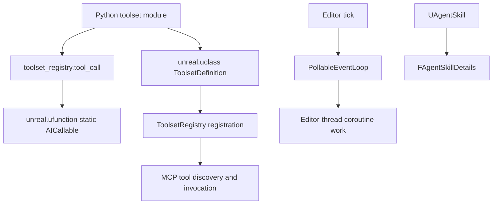

# Python Toolset Bridge — UE 5.8 MCP

## Scope

How Python tool methods become reflected Unreal functions, enter ToolsetRegistry, and execute in the editor. Includes the registry's editor-thread asyncio support and the Agent Skill API. Protocol/server behavior is covered elsewhere; this file stays on the Python bridge.

## Architecture



A Python toolset is a `unreal.uclass()` subclass of `unreal.ToolsetDefinition`; each exposed operation is a static method decorated with `@toolset_registry.tool_call`. The decorator inspects annotations, maps Python container annotations to Unreal container types, wraps exceptions, and creates a static UFunction with `AICallable` metadata. Registration is separate: a class must be registered with the registry before its tools are discoverable. The MCP layer invokes registry tools; Python's event loop infrastructure schedules asynchronous work on the editor thread.

## Key types

| symbol | module | responsibility |
|---|---|---|
| `tool_call` | `toolset_registry/__init__.py`, `tool_call_impl.py` | Public decorator; constructs static reflected tool function |
| `ToolCallMissingAnnotation` | `toolset_registry/tool_call_impl.py` | Reports absent/invalid parameter or container typing annotations |
| `ToolsetRegistryProtocol` | `toolset_registry/_registry_interface.py` | Structural registry contract, also usable for type checking outside Unreal |
| `Registration` | `toolset_registry/registration.py` | Registers/unregisters a fixed set of toolset classes |
| `PollableEventLoop` | `toolset_registry/_asyncio/pollable_event_loop.py` | asyncio loop progressed by explicit polls |
| `EditorEventLoopManager` | `toolset_registry/_asyncio/editor_event_loop_manager.py` | Reference-counted editor-main-thread loop lifecycle |
| `TimeoutPoller` | `toolset_registry/_asyncio/timeout_poller.py` | Bounded poll/retry helper |
| `UAgentSkill` | `ToolsetRegistry/Public/ToolsetRegistry/AgentSkill.h` | Skill UObject holding description/instructions and prompt customization hook |
| `FAgentSkillDetails` | `ToolsetRegistry/Public/ToolsetRegistry/AgentSkill.h` | BlueprintType details struct; exposes instructions |
| `UAgentSkillToolset` | `ToolsetRegistry/Public/ToolsetRegistry/AgentSkill.h` | Native skill list/get/create/update tools |
| `agent_skill` | `toolset_registry/agent_skill.py` | Decorates Python skill class and populates its CDO fields |

## Data flow

1. Import Python package/module; define a class with `@unreal.uclass()` inheriting `unreal.ToolsetDefinition`.
2. Decorate static methods. `tool_call` calls `inspect.signature(..., eval_str=True)`, requires a type annotation on every argument except `self`, and converts supported typed `list[T]`, `dict[str, T]`, and `set[T]` to `unreal.Array`, `unreal.Map`, and `unreal.Set`. Dict keys must be `str`. Optional unions containing `None` map to `(type, None)`; an unparameterized container or incomplete generic raises `ToolCallMissingAnnotation`.
3. `unreal.ufunction(static=True, params=..., ret=..., meta={'AICallable': ''})` wraps the function. The wrapper catches Python `Exception`, calls `unreal.SystemLibrary.raise_script_error`, and returns a default for the declared output type. `tool_raising_exceptions()` temporarily re-raises instead for test/debug use.
4. Register the class through `ToolsetRegistry`; the MCP toolset registry discovers its reflected callable methods and can dispatch calls.
5. For async editor workflows, the editor tick polls the custom asyncio event loop. Work executed there is on the editor main thread, retaining access to editor APIs and observable script errors.

Python exceptions are converted to script errors specifically so the registry can treat them as tool errors. The decorator's source comment warns that script-error events are not broadcast outside the game thread; tools therefore **must be called from the game thread** for errors to be detected. This is not a claim that a decorated tool method is itself asynchronous.

## Usage

A representative definition from `EditorToolset/.../editor_toolset/toolsets/actor.py`:

```python
@unreal.uclass()
class ActorTools(unreal.ToolsetDefinition):
    @toolset_registry.tool_call
    @staticmethod
    def set_label(actor: unreal.Actor, label: str) -> bool:
        """Sets the human-friendly name of the actor."""
        require_editable(actor)
        actor.set_actor_label(label)
        return actor.get_actor_label() == label
```

The decorator names and order above match the source (`@toolset_registry.tool_call` then `@staticmethod`). Type hints are part of reflection/schema generation, not optional documentation. The method docstring provides the tool description. `require_editable` is an explicit guard for mutations: it determines an Actor directly or an ActorComponent's owning actor; current-level objects pass, while an actor inside a level instance that is not in edit mode raises `RuntimeError` and instructs use of `edit_level_instance`. Non-actor objects and some unresolved ownership/world cases return without a guard.

Toolset discovery is handled by package/module registration, not by `@toolset_registry.tool_call` alone. `Registration` snapshots its classes as a tuple, consults `ToolsetRegistryProtocol.is_available()`, registers each class when available, and otherwise returns `False`; unregister is a no-op while unavailable. The native `UToolsetRegistry::IsAvailable()` delegates to subsystem lookup; `UToolsetRegistrySubsystem::Get()` returns an error when `GEditor` or its subsystem is absent. So this registration path returns unavailable outside an initialized editor. `_registry_interface.py` is a `Protocol` precisely to permit type checking without requiring a live Unreal registry; `get_toolset_registry()` lazily resolves `unreal.ToolsetRegistry`.

`reload_module(top_module)` is the public hot-reload entry point. `_reload.py` finds the package and its loaded submodules, orders imports, unregisters toolset classes from those modules before reloading, then finds and registers reloaded classes. It reports collected reload/registration errors through Unreal logging; reload is intended to keep registry state aligned with newly defined class objects.

The asyncio package is not a background executor. `EditorEventLoopManager` creates a reference-counted `PollableEventLoop` on the editor's main thread. `EditorThreadTicker` uses editor tick registration to deliver poll events there; the manager polls until no tasks remain, and unhooks ticking when idle. Each tick is bounded to 16 ms, with a 1 ms retry delay to allow another thread to schedule work. `TimeoutPoller` drives the poll callable until it returns false or its timeout expires, optionally waiting between polls/retrying once. The loop's design is poll-driven: another thread may schedule work, but execution proceeds when editor-thread ticks poll it. `toolset_registry/tests/_asyncio/__init__.py`'s `run_test_on_thread` helper runs tests in a worker thread specifically to provide a context without an asyncio event loop; it is a test helper, not the tool execution policy.

Agent skills are separate from Python tool-call definitions. `UAgentSkill` has editable-defaults `Description` and `Instructions`, `GetDetails()` returns `FAgentSkillDetails`, and protected `GeneratePrompt(const FString& InitialInstructions)` is a `BlueprintNativeEvent`; the base implementation returns its input. `agent_skill` applies `unreal.uclass()`, takes description from the class docstring, takes instructions from a class attribute, and stores both on the class default object. `FAgentSkillDetails` is `BlueprintType` and its `Instructions` member is `BlueprintReadWrite`.

`UAgentSkillToolset` exposes four native `AICallable` tools:

- `ListSkills()` returns skill paths mapped to brief descriptions.
- `GetSkills(SkillPaths)` returns requested paths mapped to detailed `FAgentSkillDetails`.
- `CreateSkill(FolderPath, AssetName, Description, Details)` creates a skill; its docstring says: **“This should ONLY be called after getting explicit direction or permission from the user.”**
- `UpdateSkill(SkillPath, Description, Details)` updates an existing skill; its docstring repeats: **“This should ONLY be called after getting explicit direction or permission from the user.”**

The create/update permission wording is tool guidance, not a runtime authorization check established by these declarations.

### Signature construction and annotation boundaries

`_get_signature` uses `inspect.signature(func, eval_str=True)`, so string annotations are evaluated before conversion. It walks parameters in signature order, omitting a parameter literally named `self`. Every other parameter without an annotation raises `ToolCallMissingAnnotation`, with the function and argument name in its message. It then converts each annotation and returns the ordered parameter type list with the converted return annotation.

`_python_to_unreal_type` uses `typing.get_origin` and `typing.get_args`:

- Non-container annotations otherwise pass through unchanged.
- `list[T]` needs one actual type argument and becomes `unreal.Array(T)`.
- `dict[K, V]` needs two type arguments; `K` must be exactly `str`, since the schema generator supports string map keys only. It becomes `unreal.Map(str, V)`.
- `set[T]` needs one type argument and becomes `unreal.Set(T)`.
- Bare `list`, `dict`, or `set` fail because the element/key/value type is unknown. Missing generic arguments or non-type required arguments fail through `ToolCallMissingAnnotation`.
- A PEP 604 union with `None` must have exactly two members; the non-None type is converted and represented as `(converted_type, None)` for optionality. A union with more than those two members hits the source assertion.


The source's missing-return case deserves precision: `_get_signature` has no explicit check analogous to its `param.annotation is param.empty` branch. It reads `signature.return_annotation` and converts it only if truthy; `inspect.Signature.empty` is truthy, so an omitted return annotation is passed onward and may fail in UFunction generation rather than through the named `ToolCallMissingAnnotation` guard. The decorator docstring states that parameters and return types must be annotated. Use both annotations; do not rely on the missing-return path.
Return handling differs slightly from parameters: `_get_signature` initializes the return type to `None`, reads `signature.return_annotation`, and converts it only if truthy. `unreal.ufunction` receives both the generated ordered `params` and `ret`. The decorator preserves the original callable metadata with `functools.wraps`, and explicitly copies the original signature onto the wrapper because UFunction parameter enumeration uses `inspect.getfullargspec`, which `wraps` alone does not handle.

The wrapper catches `Exception`, not `BaseException`. Normal tool calls invoke `unreal.SystemLibrary.raise_script_error(str(e))`, then return the output type's default if control returns: `None` for no output/optional/UObject/UClass, Unreal container types for containers, otherwise a newly constructed value of the type. During `tool_raising_exceptions()`, it re-raises instead; the implementation notes that UFunction wraps those exceptions in `RuntimeError`. This test/debug context uses a `ContextVar`, so the behavior switch is context-local.

### Add a Python toolset

The concrete pattern in `actor.py` combines the reflected class and typed method. An authoring sketch based on that file's real method is:

```python
import unreal
import toolset_registry
from toolset_registry.helpers import require_editable

@unreal.uclass()
class ActorTools(unreal.ToolsetDefinition):
    \"\"\"Provides tools for inspecting and modifying actors.\"\"\"

    @toolset_registry.tool_call
    @staticmethod
    def set_label(actor: unreal.Actor, label: str) -> bool:
        \"\"\"Sets the human-friendly name of the actor.\"\"\"
        require_editable(actor)
        actor.set_actor_label(label)
        return actor.get_actor_label() == label
```

In the actual implementation, `ActorTools` has a longer class docstring (“Provides tools for inspecting and modifying actors, including their transforms, labels, parent-child relationships, and components.”); the function docstring documents the operation and its `actor` and `label` arguments. The native registration path derives a tool's description from the function documentation; the class docstring describes the toolset. The method body above is source-faithful to `ActorTools.set_label`.

Authoring/activation checklist derived from the Python APIs:

1. Put the module in a Python importable package and ensure it is imported so the class exists.
2. Define the class with `@unreal.uclass()` and `unreal.ToolsetDefinition` as its base.
3. Add operations as `@toolset_registry.tool_call`-decorated `@staticmethod`s, with annotations on every input and a return annotation where the function returns a value. Supply a useful function docstring.
4. Use `toolset_registry.helpers.require_editable` before actor/component mutations that must respect level-instance editing.
5. Register the class through `Registration` or the registry's class registration API; importing and decorating alone are not registration.
6. On code changes, call `toolset_registry.reload_module(top_module)` to unregister classes from that module tree, reload it, then re-register replacement class objects.

`init_unreal.py` is not the production toolset-registration bootstrap: its observed content imports `toolset_registry.tests` and creates `tests._toolset_registry_test_runner` using `unreal.PythonTestRunner.create`, selecting `toolset_registry.tests.test_*` and `toolset_registry.tests._asyncio.*`. Do not infer toolset startup registration from that file.

`_unreal.py` is deliberately minimal: `get_unreal_module()` imports `unreal` inside the function and returns it. This lazy resolution lets helper modules be imported without binding the Unreal module at their own import time; callers still need an environment where the module is available when the helper executes.

### Coroutine executor and poller

The bridge's `_asyncio` implementation uses `EditorEventLoopManager` and `EditorThreadTicker`; the closely named `EditorThreadCoroutineExecutor` is in `toolset_registry/tests/editor_thread_coroutine_executor.py`. Its docstring describes queuing coroutines for execution on the editor thread and accessing its loop from another thread. It stores queued coroutines in a `deque`, keeps at most one pending `Task`, and subscribes for editor ticks when scheduling work. On a tick it polls with `TimeoutPoller`, checks/advances the pending task, dequeues the next coroutine, creates a task on the editor loop, and polls that loop. When the queue empties it unsubscribes. The executor is a singleton-style test helper (`get_or_create`, `close`), not evidence of an exported production tool executor.

The separate `EditorEventLoopManager` owns the editor-thread asyncio loop through a reference-counted context manager. `_EditorEventLoopManager._poll()` clears task notifications, polls the loop, and stops tick subscription when no loop work or notifications remain. Its per-tick cap is 16 ms and retry delay 1 ms. The test executor has its own cap of 16 ms and 500-microsecond retry delay. `TimeoutPoller` runs until its callable returns false or the time budget expires, with optional interval/retry waits. Both designs make the editor tick the execution opportunity; another thread can schedule but cannot itself make the poll-driven loop advance.

`tests/_asyncio/__init__.py` serves a different test purpose: `run_test_on_thread` wraps test methods in a one-worker `ThreadPoolExecutor`, explicitly to run in a context without an asyncio loop. It optionally enters a test `_setup()` context manager. These test fixtures exercise thread/loop assumptions and should not be confused with runtime tool implementations.


## Pitfalls

- Every exposed argument must carry a supported type annotation; include a return annotation when returning a value. Missing parameter annotations and invalid/untyped container element types raise `ToolCallMissingAnnotation` during decoration.
- Tool methods must be static: toolsets are Blueprint Function Libraries, and the wrapper creates a static UFunction. Do not rely on instance `self` dispatch.
- Python exceptions are surfaced as script errors only when called on the game thread, per the decorator's explicit comment. Do not infer that `async def` makes calls safe off-thread.
- `require_editable` is not a universal transaction/permission system; use it where actor/component edits must respect level-instance edit mode.
- `Registration.register()` may return `False` when the registry/editor subsystem is unavailable; it does not queue deferred registration.
- Event-loop progress depends on editor-thread polling. It does not continuously run in an independent worker thread.
- AgentSkill create/update docstrings request explicit user direction or permission; callers should preserve this rule, while the tool declarations alone do not enforce it.

## Source files

- `Engine/Plugins/Experimental/ToolsetRegistry/Content/Python/toolset_registry/__init__.py`
- `Engine/Plugins/Experimental/ToolsetRegistry/Content/Python/toolset_registry/tool_call_impl.py`
- `Engine/Plugins/Experimental/ToolsetRegistry/Content/Python/toolset_registry/registration.py`
- `Engine/Plugins/Experimental/ToolsetRegistry/Content/Python/toolset_registry/helpers.py`
- `Engine/Plugins/Experimental/ToolsetRegistry/Content/Python/toolset_registry/_registry_interface.py`
- `Engine/Plugins/Experimental/ToolsetRegistry/Content/Python/toolset_registry/_reload.py`
- `Engine/Plugins/Experimental/ToolsetRegistry/Content/Python/toolset_registry/_unreal.py`
- `Engine/Plugins/Experimental/ToolsetRegistry/Content/Python/toolset_registry/agent_skill.py`
- `Engine/Plugins/Experimental/ToolsetRegistry/Content/Python/init_unreal.py`
- `Engine/Plugins/Experimental/ToolsetRegistry/Content/Python/toolset_registry/tests/_asyncio/__init__.py`
- `Engine/Plugins/Experimental/ToolsetRegistry/Content/Python/toolset_registry/_asyncio/editor_event_loop_manager.py`
- `Engine/Plugins/Experimental/ToolsetRegistry/Content/Python/toolset_registry/_asyncio/editor_thread_ticker.py`
- `Engine/Plugins/Experimental/ToolsetRegistry/Content/Python/toolset_registry/_asyncio/pollable_event_loop.py`
- `Engine/Plugins/Experimental/ToolsetRegistry/Content/Python/toolset_registry/_asyncio/timeout_poller.py`
- `Engine/Plugins/Experimental/ToolsetRegistry/Content/Python/toolset_registry/tests/editor_thread_coroutine_executor.py`
- `Engine/Plugins/Experimental/Toolsets/EditorToolset/Content/Python/editor_toolset/toolsets/actor.py`
- `Engine/Plugins/Experimental/ToolsetRegistry/Source/ToolsetRegistry/Public/ToolsetRegistry/AgentSkill.h`
- `Engine/Plugins/Experimental/ToolsetRegistry/Source/ToolsetRegistry/Private/ToolsetRegistry/AgentSkill.cpp`
- `Engine/Plugins/Experimental/ToolsetRegistry/Source/ToolsetRegistry/Private/ToolsetRegistry/UToolsetRegistry.cpp`
- `Engine/Plugins/Experimental/ToolsetRegistry/Source/ToolsetRegistry/Private/ToolsetRegistry/ToolsetRegistrySubsystem.cpp`

## Graph facts

- Corpus roots: `ModelContextProtocol`, `ToolsetRegistry`, and `Toolsets` under `Engine/Plugins/Experimental`.
- Combined MCP corpus: **9,250 nodes**, **15,786 internal edges**, **7,518 cross-community edges**, **287 communities**.
- ToolsetRegistry contributes **2,178 nodes**; EditorToolset contributes **2,906 nodes**.
- Graph-wide MCP relations include 5,824 calls, 2,538 contains, 1,239 defines, 258 inherits, and 448 uses edges.
- These are graph-corpus totals, not counts of Python tool methods or registry registrations.
