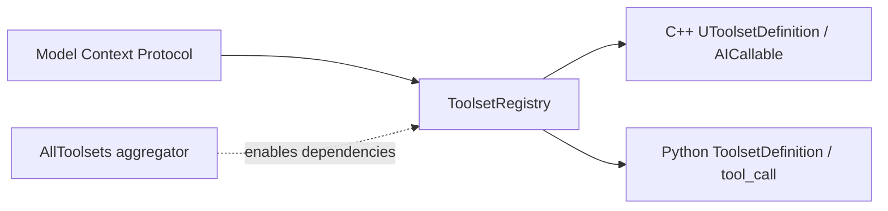

# Toolset Catalog — UE 5.8 MCP

## Scope

This catalog inventories the callable surface declared by plugins in `Engine/Plugins/Experimental/Toolsets`. Tool names preserve source spelling. Counts below are source-derived tool definitions (C++ `UFUNCTION(meta=(AICallable))` and Python `@toolset_registry.tool_call`); counts are per plugin, not the MCP tool-search wrapper functions. `AllToolsets` is an optional aggregator and defines no calls. Every listed plugin manifest has `EnabledByDefault: false`; enabling the aggregator does not change that manifest fact. “What it controls” is limited to plugin scope and callable names/docstrings.

## Architecture

The registry discovers toolset definitions and exposes their calls to MCP. Python-callable definitions are under `Content/Python`; C++ definitions are in plugin `Source` headers. `AllToolsets.uplugin` is disabled by default and declares plugin dependencies enabled for that aggregator. Individual plugin dependencies are recorded below.

## Key types

| Symbol | Module | Responsibility |
|---|---|---|
| `UToolsetDefinition` | ToolsetRegistry | Base for C++ callable toolsets |
| `UToolCallAsyncResultString` | ToolsetRegistry | Async string result used by several calls |
| Python subclasses of `unreal.ToolsetDefinition` | ToolsetRegistry | Python callable toolsets |

## Data flow

The plugin definition registers functions decorated/marked as callable; the registry derives the callable surface from those declarations and the MCP server exposes it. C++ entries below are names declared with `AICallable`; Python entries are names decorated with `@toolset_registry.tool_call`. This catalog does not imply every call is available in every editor state or with every dependency enabled.

## Usage

Enable the desired plugin (and dependencies), start the MCP server, then discover/call tools through MCP. Python examples are callable names rather than invented invocation snippets; argument signatures are plugin-specific. The C++ definitions use Unreal function names verbatim. `AllToolsets` can enable its declared dependencies as a bundle, but its own manifest is disabled by default.

## Pitfalls

- All listed plugins are experimental and disabled by default in their own manifests; do not infer availability from presence in the engine tree.
- `AllToolsets` dependency list is not the complete set of every plugin directory (for example, it does not declare every standalone toolset).
- Tool names are not guaranteed to be globally unique; use the originating toolset.
- `EditorToolset` and `AnimationAssistantToolset` have extensive Python surfaces. The counts include each decorated call, not test functions.
- Counts are callable definitions, not necessarily the number currently advertised when MCP tool-search mode is active.
- `SemanticSearchToolset` defines two callable tools, `Search` and `FindSimilar`; `MCPClientToolset` has no `AICallable` / Python `tool_call` definitions in the inspected source.

## Source files

Source root: `UE_5.8/Engine/Plugins/Experimental/Toolsets/`.

For each plugin, the manifest is `<Plugin>/<Plugin>.uplugin`; C++ tool declarations are in `<Plugin>/Source/**/*.h`; Python declarations are in `<Plugin>/Content/Python/**/*.py`. The aggregator manifest is `AllToolsets/AllToolsets.uplugin`. Names/counts below were extracted from these plugin sources; the plugin dependency lists below are manifest `Plugins[].Name` values.

## Graph facts

The MCP corpus has 9,250 nodes, 15,786 internal edges, 7,518 cross-community edges, and 287 communities. Graph tool-definition counts (C++ AICallable / non-test Python files) include: Niagara 57/9, PCG 33/0, Dataflow 23/0, UMG 24/0, Editor 26/27, Physics 18/0, Plugin 18/0, GAS 15/0, Slate 15/0, MVVM 10/0, Config 9/0, Automation 8/0, DataRegistry 8/0, GameFeatures 8/0, ChaosCloth 7/0, GameplayTags 7/0, WorldConditions 3/0, SemanticSearch 3/0, LiveCoding 2/0; AIModule, AnimationAssistant, Conversation, MetaHumanGenerator, SequencerAnimMixer, and StateTree are Python toolsets. Graph counts are a separate graph metric; the source callable counts in the following catalog are counted call declarations, including differences where the graph parser records a different granularity.

## Toolset catalog

### AIModuleToolset — AI/gameplay (7 Python tools)
Controls inspection of behavior-tree blackboards and nodes. Enabled by default: no. Dependencies: `ToolsetRegistry`.

- `get_blackboard` — Inspect a behavior tree's blackboard.
- `get_root_decorators` — Read root decorators.
- `list_nodes` — List behavior-tree nodes.
- `get_node_depth` — Get one node's depth.
- `get_node_depths` — Get depths for nodes.
- `get_children` — List child nodes.
- `get_subtree` — Inspect a subtree.

### AnimationAssistantToolset — animation (319 Python tools)
Rig/control-rig and Sequencer animation authoring and inspection. Enabled by default: no. Dependencies: `ControlRig`, `ToolsetRegistry`, `LevelSequenceEditor`, `SequencerScripting`. Full inventory is defined by the decorated functions in `Content/Python/animation_toolset/toolsets/`.

- Sequencer condition calls: `get_section_condition`, `set_section_condition`, `clear_section_condition`, `get_track_condition`, `set_track_condition`, `clear_track_condition`, `get_track_row_condition`, `set_track_row_condition`, `clear_track_row_condition` — inspect and edit condition metadata.
- Rig/control-rig: `create`, `import_bones_from_asset`, `get_elements`, `get_all_bones`, `get_all_nulls`, `get_all_controls`, `add_element`, `add_bone`, `add_null`, `add_control`, `get_global_transform`, `set_global_transform`, `get_local_transform`, `set_local_transform`, `get_parent`, `get_children` — create or inspect rig elements and transforms.
- Graph/node calls: `get_graph`, `list_graphs`, `add_graph`, `get_forward_solve_graph`, `get_event_graph`, `get_backward_solve_graph`, `get_interaction_graph`, `add_event_graph`, `add_backward_solve_graph`, `add_interaction_graph`, `create_node`, `list_nodes`, `delete_node`, `get_node_position`, `set_node_position` — inspect/edit rig graphs and nodes.
- Remaining animation operations are in the listed source files; see `animation_toolset/toolsets/*.py` for exact complete callable inventory.

### AutomationTestToolset — testing (7 C++ tools)
Discovers, lists, runs, monitors, and stops editor automation tests. Enabled by default: no. Dependencies: `ToolsetRegistry`.

- `DiscoverTests` — Discover workers and load registered tests.
- `ListTests` — List tests with optional name/tag filters and limit.
- `RunTests` — Run named tests asynchronously.
- `RunTestsByFilter` — Run tests selected by filter expression.
- `GetTestResults` — Get detailed current/most recent run results.
- `GetTestStatus` — Get controller state and pass/fail counts.
- `StopTests` — Stop currently running tests.

### ChaosClothAssetToolset — assets (6 C++ tools)
Lists and edits cloth assets and section assignments. Enabled by default: no. Dependencies: `ToolsetRegistry`, `ChaosClothAsset`, `ChaosClothAssetEditorCore`.

- `CreateClothingAsset` — Create a clothing asset.
- `AssignClothingToSection` — Assign clothing to a mesh section.
- `RemoveClothingFromSection` — Remove a section's clothing assignment.
- `ListClothingAssets` — List clothing assets available to the cloth editor.
- `GetSectionClothing` — Inspect clothing assigned to a section.
- `ConvertClothingAssetCommonToChaosClothAsset` — Convert a clothing asset to Chaos Cloth.

### ConfigSettingsToolset — tooling/configuration (8 C++ tools)
Inspects and edits config containers, categories, and sections. Enabled by default: no. Dependencies: `ToolsetRegistry`.

- `ListContainers` — List config containers.
- `ListCategories` — List categories in a container.
- `ListSections` — List sections in a category.
- `GetSectionSchema` — Get a section schema.
- `GetSectionPropertyValues` — Read section property values.
- `SetSectionProperties` — Set section properties.
- `SaveSection` — Save a section.
- `ResetSectionToDefaults` — Reset a section to defaults.
### ConversationToolset — gameplay (7 Python tools)
Inspects CommonConversation graph assets and nodes. Enabled by default: no. Dependencies: `CommonConversation`, `ToolsetRegistry`.

- `list_entry_points` — List conversation entry points.
- `list_speakers` — List speakers.
- `get_all_nodes` — List graph nodes.
- `get_node_guids` — Get node identifiers.
- `get_node_by_guid` — Retrieve a node by GUID.
- `get_node_connections` — Inspect node connections.
- `get_sub_nodes` — Inspect nested/sub-nodes.

### DataRegistryToolset — assets/data (7 C++ tools)
Inspects data registries, sources, schemas, and items. Enabled by default: no. Dependencies: `ToolsetRegistry`, `DataRegistry`.

- `ListRegistries` — List registries.
- `GetRegistryInfo` — Get registry details.
- `GetSchema` — Get registry schema.
- `ListItems` — List registry items.
- `GetItems` — Retrieve registry items.
- `ListDataSources` — List data sources.
- `ListRuntimeSources` — List runtime sources.

### DataflowAgent — assets/graph (22 C++ tools)
Creates and edits Dataflow graphs, nodes, variables, comments, and templated assets. Enabled by default: no. Dependencies: `GeometryCollectionPlugin`, `ToolsetRegistry`.

- `CreateGraph` — Create a graph.
- `GetGraphStructure` — Describe graph structure.
- `ListNodeTypes` — List node types.
- `GetNodeTypeSchema` — Inspect a node type schema.
- `UpdateNode` — Update a node.
- `GetNodeInfo` — Inspect a node.
- `RepositionNode` — Move a graph node.
- `RemoveNode` — Remove a node.
- `ConnectNodePins` — Connect node pins.
- `DisconnectNodePins` — Disconnect node pins.
- `ListVariables` — List graph variables.
- `AddVariable` — Add a variable.
- `RemoveVariable` — Remove a variable.
- `SetVariable` — Set a variable.
- `AddCommentBox` — Add a comment box.
- `RemoveCommentBox` — Remove a comment box.
- `ListDataflowCompatibleAssetTypes` — List compatible asset types.
- `CreateDataflowCompatibleAssetFromTemplate` — Create a compatible asset from a template.
- `ListDataflowTemplatesForAssetClass` — List templates for an asset class.
- `AssignDataflowTemplate` — Assign a Dataflow template.

### EditorToolset — tooling/assets/world (251 tools: 25 C++, 226 Python)
Controls editor, content browser, assets, actors, Blueprints, and logs. Enabled by default: no. Dependencies: `ToolsetRegistry`.

- Editor/world C++: `SearchCVars`, `CaptureAssetImage`, `CaptureEditorImage`, `CaptureViewport`, `GetSelectedActors`, `SelectActors`, `GetCameraTransform`, `SetCameraTransform`, `FocusOnActors`, `GetVisibleActors`, `WorldPosToScreenCoords`, `ScreenCoordsToWorld`, `GetSelectedAssets`, `SelectAssets`, `GetContentBrowserPath`, `SetContentBrowserPath`, `OpenEditorForAsset`, `GetOpenAssets`, `StartPIE`, `StopPIE`, `IsPIERunning`, `GetLogCategories`, `GetVerbosity`, `SetVerbosity`.
- Python actor/component operations: `get_label`, `set_label`, `get_tags`, `has_tag`, `add_tag`, `remove_tag`, `get_actor_transform`, `set_actor_transform`, `look_at`, `get_root_component`, `get_component_actor`, `get_parent_component`, `set_parent_component`, `get_actor_bounds`, `get_components`, `add_component`, `remove_component`.
- Python content/assets: `create_folder`, `list_folders`, `exists`, `duplicate`, `move`, `delete`, `find_assets`, `get_asset_tags`, `get_asset_class`, `get_metadata_tags`, `update_metadata_tags`, `load_asset`, `save_assets`, `is_dirty`, `can_edit_asset`, `is_checked_out`, `get_referencers`, `get_dependencies`, `get_plugin_content_paths`, `read_file`, `write_file`.
- Python Blueprint operations include `create`, `compile_blueprint`, `get_default_object`, `list_graphs`, `get_graph`, `list_functions`; additional decorated Blueprint calls are in `Content/Python/editor_toolset/toolsets/blueprint.py`.
- Other decorated Python calls are defined under `Content/Python/editor_toolset/toolsets/` (226 Python definitions).

### GASToolsets — gameplay (14 C++ tools)
Inspects gameplay abilities, attributes, effects, tags, and cues. Enabled by default: no. Dependencies: `GameplayAbilities`, `ToolsetRegistry`.

- `GetAttributeValues` — Read attribute values.
- `GetActiveEffects` — List active effects.
- `GetGrantedAbilities` — List granted abilities.
- `GetActiveTags` — List active tags.
- `FindAttributeSetClasses` — Find attribute-set classes.
- `ListAttributes` — List attributes.
- `ListCues` — List gameplay cues.
- `GetCueInfo` — Inspect a cue.
- `ExecuteCueOnSelectedActor` — Execute a cue on the selected actor.
- `FindCueNotifyAssets` — Find cue notify assets.
- `CreateCueNotifyAsset` — Create a cue notify asset.
- `AddCueTag` — Add a cue tag.
- `RemoveCueTag` — Remove a cue tag.
- `FindCueTagsWithoutNotifies` — Find cue tags without notify assets.

### GameFeaturesToolset — gameplay/tooling (7 C++ tools)
Inspects and requests activation/deactivation of Game Feature plugins. Enabled by default: no. Dependencies: `ToolsetRegistry`, `GameFeatures`.

- `ListEnabledGameFeaturePlugins` — List enabled feature plugins.
- `ListDiscoveredGameFeaturePlugins` — List discovered feature plugins.
- `IsGameFeaturePlugin` — Check whether a plugin is a Game Feature plugin.
- `IsGameFeatureActive` — Check active state.
- `GetGameFeatureState` — Read feature state.
- `RequestActivateGameFeature` — Request activation.
- `RequestDeactivateGameFeature` — Request deactivation.

### GameplayTagsToolset — gameplay (6 C++ tools)
Manages and searches gameplay tags. Enabled by default: no. Dependencies: `ToolsetRegistry`, `GameplayTagsEditor`.

- `ListTags` — List tags.
- `GetTagInfo` — Inspect a tag.
- `AddTag` — Add a tag.
- `RemoveTag` — Remove a tag.
- `RenameTag` — Rename a tag.
- `FindReferencersByTag` — Find references by tag.

### LiveCodingToolset — tooling (1 C++ tool)
Controls Live Coding compilation. Enabled by default: no. Dependencies: `ToolsetRegistry`.

- `CompileLiveCoding` — Request a Live Coding compile.

### MCPClientToolset — tooling (0 callable tools)
No C++ `AICallable` or Python `tool_call` definitions were found in the plugin source inventory. Enabled by default: no. Dependencies: `ToolsetRegistry`.

### MVVMToolset — UI (9 C++ tools)
Inspects and edits Model-View-ViewModel bindings. Enabled by default: no. Dependencies: `ToolsetRegistry`, `ModelViewViewModel`.

- `CreateViewModel` — Create a view model.
- `AddViewModelProperty` — Add a view-model property.
- `ListViewModels` — List view models.
- `ListWidgetViewModels` — List widget view models.
- `AddViewModelToWidget` — Add a view model to a widget.
- `ListWidgetViewBindings` — List widget bindings.
- `RemoveWidgetViewBinding` — Remove a binding.
- `CreateViewBinding` — Create a binding.
- `ListConversionFunctions` — List binding conversion functions.

### MetaHumanGenerator — assets/character (9 Python tools)
Edits MetaHuman body shape and appearance. Enabled by default: no. Dependencies: `MetaHumanCharacter`, `MetaHumanCoreTech`, `MetaHumanSDK`, `StructUtils`, `ToolsetRegistry`.

- `begin_edit` — Begin a character edit session.
- `end_edit` — End the edit session.
- `get_body_shape` — Read body shape.
- `set_body_shape` — Set body shape.
- `get_skin_tone` — Read skin tone.
- `set_skin_tone` — Set skin tone.
- `get_eye_color` — Read eye color.
- `set_eye_color` — Set eye color.
- `create` — Create a MetaHuman character.

### NiagaraToolsets — assets/VFX (56 C++ tools)
Inspects and authors Niagara systems, emitters, scripts, modules, renderers, stack inputs, and data interfaces. Enabled by default: no. Dependencies: `Niagara`, `ToolsetRegistry`.

- Discovery/construction: `GetAssetDiscoveryInfo`, `FindNiagaraScripts`, `GetNiagaraScriptDigest`, `ConstructNiagaraBPWrapperFromSystem`, `ConstructNiagaraBPWrapperFromComponent`, `SetSystem`, `CreateNiagaraSystem`.
- Variables: `GetUserVariables`, `SetVariable`, `GetVariable`.
- Schemas: `GetSystemSchema`, `GetEmitterSchema`, `GetRendererSchema`, `GetDataInterfaceSchema`, `GetStackInputSchema`, `GetModuleSchema`, `GetDynamicInputSchema`, `GetModuleSchemaFromAsset`, `GetDynamicInputSchemaFromAsset`.
- Inspection: `GetSystemSummary`, `GetEmitterSummary`, `GetEmitterTopology`, `GetScriptStackTopology`, `GetModuleTopology`, `GetStackInputTopology`, `GetSystemData`, `GetEmitterData`, `GetRendererData`, `GetStackInputData`, `GetEmitterInputValues`, `GetScriptStackInputValues`, `GetModuleInputValues`, `GetDynamicInputChain`.
- Other callable declarations complete the 56 source definitions; see `NiagaraToolsets/Source`.

### PCGToolset — assets/graph (31 C++ tools)
Creates, inspects, edits, and executes PCG graphs and instances. Enabled by default: no. Dependencies: `PCG`, `ToolsetRegistry`.

- Graph/instance: `RunPCGInstantGraph`, `GetGraphStructure`, `SetGraphParams`, `RemoveGraphParams`, `GetGraphSchema`, `GetGraphDescription`, `SetGraphDescription`, `ListGraphInstances`, `SpawnGraphInstance`, `ExecuteGraphInstance`, `GetGraphInstanceParams`, `SetGraphInstanceParams`, `ResetGraphInstanceParams`.
- Node discovery/editing: `ListNativeNodes`, `ListAvailableSubgraphs`, `GetNativeNodeSchema`, `SetNodeComment`, `GetNodeInfo`, `RepositionNode`, `RemoveNode`, `ConnectNodePins`, `DisconnectNodePins`.
- Comments/splines and graph operations: `CreateGraph`, `UpdateNode`, `AddCommentBox`, `RemoveCommentBox`, `DrawSpline`.

### PhysicsToolsets — assets/physics (17 C++ tools)
Creates and edits physics assets, bodies, collision shapes, and constraints. Enabled by default: no. Dependencies: `ToolsetRegistry`.

- `CreateFromMesh` — Create a physics asset from a mesh.
- `GetBodyNames` — List physics bodies.
- `GetBodyShapes` — List collision shapes on a body.
- `SetSphere` — Add or replace a sphere shape.
- `SetCapsule` — Add or replace a capsule shape.
- `SetBox` — Add or replace a box shape.
- `RemoveShape` — Remove a collision shape.
- `AddBody` — Add a body.
- `RemoveBody` — Remove a body.
- `GetBodyPhysicsMode` — Read body simulation mode.
- `SetBodyPhysicsMode` — Set body simulation mode.
- `GetBodyMassScale` — Read body mass scale.
- `SetBodyMassScale` — Set body mass scale.
- `GetConstraints` — List constraints.
- `AddConstraint` — Add a constraint.
- `SetConstraintLimits` — Set constraint limits.
- `RemoveConstraint` — Remove a constraint.

### PluginToolset — tooling (17 C++ tools)
Inspects, creates/enables, and edits plugin descriptors/dependencies. Enabled by default: no. Dependencies: `ToolsetRegistry`, `PluginUtils`.

- `ListEnabledPlugins` — List enabled plugins.
- `ListDiscoveredPlugins` — List discovered plugins.
- `GetPluginInfo` — Inspect a plugin.
- `IsEnabled` — Check enabled state.
- `GetPluginDependencies` — List dependencies.
- `GetPluginDependents` — Find dependents.
- `GetPluginForAsset` — Find the plugin owning an asset.
- `GetPluginTemplateDescriptions` — List plugin templates.
- `IsPluginCreationAllowed` — Check creation permission.
- `ValidateNewPluginNameAndLocation` — Validate a plugin name and location.
- `CreatePlugin` — Create a plugin.
- `IsPluginModificationAllowed` — Check modification permission.
- `SetPluginEnabled` — Set plugin enabled state.
- `GetPluginDescriptor` — Read descriptor.
- `UpdatePluginDescriptor` — Update descriptor.
- `AddPluginDependency` — Add a dependency.
- `RemovePluginDependency` — Remove a dependency.

### SemanticSearchToolset — tooling/search (2 C++ tools)
Provides semantic search operations. Enabled by default: no. Dependencies: `ToolsetRegistry`, `SemanticSearch`.

- `Search` — Search indexed semantic content.
- `FindSimilar` — Find similar content.

### SequencerAnimMixerToolset — animation (21 Python tools)
Authors and inspects Sequencer animation mixer layers, transitions, and decorations. Enabled by default: no. Dependencies: `ToolsetRegistry`, `MovieSceneAnimMixer`.

- Layers: `get_mixer_layers`, `get_mixer_layer_count`, `add_mixer_layer`, `insert_mixer_layer`, `add_animation_to_mixer`, `add_child_track_to_layer`, `get_layer_name`, `set_layer_name`, `get_layer_sections`, `get_layer_index`, `is_layer_empty`.
- Transitions/decorations: `get_transitions_for_section`, `get_transition_between`, `get_transition_info`, `change_transition_type`, `get_transition_name`, `get_compatible_decorations`, `get_decorations`, `find_decoration`, `add_decoration`, `remove_decoration`.

### SlateInspectorToolset — tooling/UI (14 C++ tools)
Observes and interacts with Slate UI. Enabled by default: no. Dependencies: `ToolsetRegistry`.

- `Snapshot` — Capture a Slate tree snapshot.
- `Observe` — Begin observing UI changes.
- `Unobserve` — Stop observing.
- `ListObservers` — List observers.
- `Screenshot` — Capture a screenshot.
- `Click` — Click a UI target.
- `Hover` — Hover a UI target.
- `Type` — Type text.
- `PressKey` — Send a key press.
- `SelectOption` — Select an option.
- `Drag` — Drag a target.
- `Windows` — List windows.
- `WaitFor` — Wait for a UI condition.
- `FillForm` — Fill UI form fields.

### StateTreeToolset — gameplay (9 Python tools)
Inspects StateTree editor data, states, tasks, conditions, transitions, and evaluators. Enabled by default: no. Dependencies: `StateTree`, `ToolsetRegistry`.

- `get_editor_data` — Read StateTree editor data.
- `get_root_states` — List root states.
- `get_children` — List child states.
- `get_tasks` — List state tasks.
- `get_enter_conditions` — List enter conditions.
- `get_transitions` — List transitions.
- `get_global_tasks` — List global tasks.
- `get_evaluators` — List evaluators.
- `get_node_description` — Describe a StateTree node.

### UMGToolSet — UI/assets (23 C++ tools)
Creates and edits widget Blueprints, widget hierarchy, bindings, and UI components. Enabled by default: no. Dependencies: `ToolsetRegistry`.

- Blueprint/widgets: `CreateWidgetBlueprint`, `AddWidget`, `SetNamedSlotContent`, `GetWidgets`, `GetNamedSlots`, `ListWidgetBlueprints`, `ListWidgetClasses`, `GetWidgetClassInfo`, `MoveWidget`, `RemoveWidget`, `RenameWidget`, `ToggleWidgetAsVariable`.
- Bindings/templates/components: `BindToEventProperty`, `WrapWidgets`, `GetWidgetDescription`, `GetWidgetTreeDepth`, `AddUIComponent`, `RemoveUIComponent`, `MoveUIComponent`, `ReplaceWidgetWithTemplate`, `ReplaceWidgetWithNamedSlot`, `ReplaceWidgetWithChild`, `CompileWidgetBlueprint`.

### WorldConditionsToolset — gameplay (2 C++ tools)
Inspects world-condition queries and conditions. Enabled by default: no. Dependencies: `WorldConditions`, `ToolsetRegistry`.

- `GetQueryDescription` — Describe a world-condition query.
- `GetConditionDescription` — Describe a world condition.

### AllToolsets — aggregator (0 tools)
Optional plugin aggregator; no callable definitions. Enabled by default: no. Its manifest lists these plugin dependencies as enabled when the aggregator is enabled: `AIModuleToolset`, `AnimationAssistantToolset`, `AutomationTestToolset`, `ConfigSettingsToolset`, `ConversationToolset`, `DataRegistryToolset`, `DataflowAgent`, `EditorToolset`, `GameFeaturesToolset`, `GameplayTagsToolset`, `GASToolsets`, `MCPClientToolset`, `NiagaraToolsets`, `PCGToolset`, `PhysicsToolsets`, `PluginToolset`, `SemanticSearchToolset`, `SlateInspectorToolset`, `StateTreeToolset`, `UMGToolSet`, `WorldConditionsToolset`.
