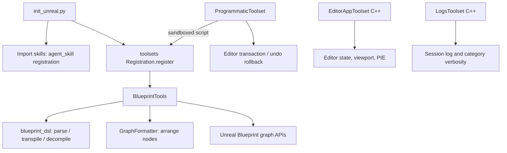

# EditorToolset Deep Dive — UE 5.8 MCP

## Scope

EditorToolset is the largest MCP toolset in this source graph: **2,906 graph nodes**. It combines Python-authored editor operations with two C++ toolsets for editor application state and logs. Its surface includes asset, Blueprint, material, actor and scene work, plus bundled agent skills. The plugin is experimental and its Python registration is loaded by `init_unreal.py`.

This is a source-grounded account of the available interface, not a guarantee that every operation is valid in every editor/project state. Python tool groups are registered through `Registration`; methods decorated with `@toolset_registry.tool_call` are exposed as tools. C++ tools are marked `UFUNCTION(meta=(AICallable))`.

## Architecture



Blueprint editing has two entry modes: individual graph tools for explicit node/pin operations, and the S-expression DSL for declarative graph population or reading. The DSL bridge calls the same node/pin-facing BlueprintTools APIs; layout is a separate formatting pass. Programmatic execution batches registered tools into one Python script transaction.

## Key types

| symbol | module | responsibility |
|---|---|---|
| `BlueprintTools` | `editor_toolset.toolsets.blueprint` | Blueprint assets, graphs, nodes, pins, functions/events, compile and DSL entry points |
| `PinID` | `editor_toolset.toolsets.blueprint_node` | Pin handle composed of owning node, direction and direction-relative index |
| `PinInfo` | `editor_toolset.toolsets.blueprint_node` | Pin name/type, `PinID`, connected pins and default value text |
| `NodeInfo` | `editor_toolset.toolsets.blueprint_node` | Node type ID, Unreal node object, position and input/output summaries |
| `Transpiler`, `Decompiler` | `editor_toolset.toolsets.blueprint_dsl` | Convert between DSL S-expressions and Blueprint graph nodes |
| `GraphFormatter` | `editor_toolset.toolsets.blueprint_layout` | Arrange nodes into readable left-to-right layered positions |
| `ProgrammaticToolset` | `editor_toolset.toolsets.programmatic` | Execute batched tool calls in a restricted Python environment |
| `_TransactionScope`, `_TransactionalScriptRunner` | `editor_toolset.toolsets.programmatic` | Commit successful script transactions; roll back eligible failed/uncommitted outer transactions |
| `UEditorAppToolset` | `Source/EditorToolset/Private/EditorAppToolset.h` | C++ editor viewport, asset selection, CVar, content browser and PIE controls |
| `ULogsToolset` | `Source/EditorToolset/Private/LogsToolset.h` | Read current-session log entries and query/set log category verbosity |
| `FPIESessionOptions` | `Source/EditorToolset/Private/EditorAppToolset.h` | PIE/Simulate selection, play mode, optional spawn transform, warmup duration |
| `FViewportCapture` | `Source/EditorToolset/Private/EditorAppToolset.h` | Screenshot plus camera and annotation metadata |

## Data flow

### Blueprint graph model and editing pipeline

A graph is an Unreal `EdGraph`; nodes are `EdGraphNode` objects with ordered pins. `NodeInfo.type_id` uses `Category|Title`; custom events use the special `AddEvent|Custom|<title>` prefix. Pin descriptions retain both human-readable name/type and a `PinID`. A `PinID` is not a globally persistent identifier: it stores the node object, direction, and index among pins in that direction. Resolving it indexes the node's current pin list, and raises if the index is out of range; structural edits/recompiles can therefore invalidate prior handles.


The DSL is an S-expression IDL: forms include `(event EventName ...)`, `(fn FunctionName (Params...) ...)`, `bind`, direct node expressions, `return`, `if`/`elif`/`else`, loops, `switch`, and `break`. Named multi-exec continuation forms such as `(:then ...)` handle latent/task nodes. Keyword data arguments begin with `:PinName`; quoted names are available for pin names containing spaces. Data outputs from multi-exec nodes are made available as underscore-prefixed names in continuation bodies. The source usage reference gives full syntax and examples; clients should call `get_graph_dsl_docs()` before first use rather than guess.

`write_graph_dsl(graph, code)` populates a graph and compiles its Blueprint. `read_graph_dsl(graph)` emits syntax accepted by the writer. DSL parsing and transpilation are implemented in `blueprint_dsl.py`; the module raises the recursion limit to 5000 for deep pure-node chains. The transpiler snapshots relevant graph state and removes stale nodes as part of updating a graph, rather than merely appending a text representation. Exact rollback scope is implementation-specific; do not treat the DSL as a generic transaction boundary.

### Programmatic batches, transactions and errors

`execute_tool_script(script)` runs a Python script against toolset APIs and is intended to batch calls. Its environment has an allowlist of supported modules, restricted builtins/import handling, AST validation, and formatted script exception reporting. `_TransactionalScriptRunner` opens an editor transaction. On clean future completion it commits; on exception/cancellation/uncommitted exit, `_TransactionScope` ends the transaction and, only when this scope was outermost and a new undo record exists, invokes `ToolsetLibrary.undo_transaction()`. Nested transaction scopes do not globally undo an enclosing caller's transaction. Transaction calls are documented as editor-thread operations and runner completion is marshalled to the loop.

Python tool failures may surface as script errors with script traceback context; the code formats exceptions for the model and trims traceback boilerplate. This is distinct from ordinary returned values. Use a script only for intended batching, and inspect its error text; no claim is made here that arbitrary Python or arbitrary imports are supported.

## Usage

### Python tool groups

Representative names below are verbatim method names found in their respective tool modules; the set is broader than these examples.

| tool group | representative tool names |
|---|---|
| `actor` | `get_label`, `set_actor_transform`, `get_components` |
| `asset` | `load_asset`, `can_edit_asset` |
| `blueprint` | `create`, `compile_blueprint`, `list_graphs`, `get_graph`, `create_node`, `connect_pins`, `write_graph_dsl`, `read_graph_dsl` |
| `blueprint_dsl` | `tokenize`, `parse`, `Transpiler`, `Decompiler` (implementation symbols; helper, not a registered toolset) |
| `blueprint_layout` | `GraphFormatter` (layout helper; not a registered toolset) |
| `blueprint_node` | `PinID`, `PinInfo`, `NodeInfo` (shared data types; not a registered toolset) |
| `curve_table` | `create`, `list_rows`, `add_row`, `add_key` |
| `data_asset` | `create` |
| `data_table` | `search_row_structs`, `create`, `list_rows`, `set_rows` |
| `material` | `create_material` |
| `material_instance` | `create`, `list_parameters`, `set_scalar_parameter`, `set_vector_parameter` |
| `object` | `search_subclasses`, `list_properties`, `get_properties`, `set_properties` |
| `primitive` | `add_cube`, `add_sphere`, `add_cylinder`, `add_cone` |
| `programmatic` | `execute_tool_script` |
| `scene` | `add_to_scene_from_asset`, `remove_from_scene`, `save_actor` |
| `skeletal_mesh` | `get_physics_asset`, `assign_physics_asset` |

These names are read from source methods. Some rows name helper symbols rather than registered calls: only `BlueprintTools`, `ProgrammaticToolset`, and the actual toolset classes in `toolsets/__init__.py` are registration classes; DSL, layout, and node modules implement supporting machinery.

### Source-shaped examples

The graph model definitions in `blueprint_node.py` are Python-exposed Unreal structs:

```python
@unreal.ustruct()
class PinID(unreal.StructBase):
    node = unreal.uproperty(unreal.EdGraphNode)
    index_id = unreal.uproperty(int)
    direction = unreal.uproperty(unreal.EdGraphPinDirection)
```

This makes explicit why callers should not treat `index_id` as a semantic pin name. `_resolve_pin` filters the node pins by the stored direction, then checks/indexes `index_id`; `PinInfo` separately carries `name`, `type_id`, connected `PinID` values, and a string `value`.

The DSL usage reference includes this exact cast/continuation form:

```lisp
(bind meshActor (Utilities|Casting|CastToStaticMeshActor :Object spawnedActor)
  (:then
    (bind comp (Class|StaticMeshActor|GetStaticMeshComponent :self meshActor))
    (Components|StaticMesh|SetStaticMesh :self comp :NewMesh "/Engine/BasicShapes/Cube.Cube"))
  (:CastFailed))
```

Here `:Object` supplies a data input; `(:then ...)` and `(:CastFailed)` are execution continuations. The tool docs emphasize exact discovered pin names and types; the example is a syntax illustration, not a universal graph recipe.

`init_unreal.py` imports the skills package before calling the registration function. The skill modules use `@agent_skill` classes subclassing `unreal.AgentSkill`; their `instructions` attributes contain operational guidance:

- `blueprint_basics` says to read graphs through DSL, use node inspection for targeted subgraphs, use DSL to populate event/function graphs, discover exact node type IDs and pins before writing, compile after a logical unit, and batch multi-asset work through programmatic calls. Its gotchas include repeated evaluation of pure-node outputs, hard Blueprint cast dependencies, stale CDO/instance structure until compile, and Movable mobility for runtime physics.
- `material_basics` orders work as search for an existing Material/MaterialInstance, create an instance from a suitable parent, and only then create a new Material. It recommends searching/reusing MaterialFunctions, exposing and grouping user-varying parameters, using neutral normal `(0, 0, 1)`, and minimizing static switches because permutations multiply.
- `default_outdoor_lighting` treats sun, sky atmosphere, exponential height fog, sky light, volumetric clouds, and post-process volume as an interdependent system. It says sun direction/intensity drives sky/cloud behavior; access lighting properties through components; check cloud global coverage before diagnosing sky color; duplicate engine cloud materials before changing them; and account for exposure/lighting relationships.
- `unreal_skill_best_practices` says skills should be novel, collegial, flexible, durable (avoid volatile names), agnostic about orchestration/model/infrastructure, and parsimonious.

`UEditorAppToolset`'s AICallable names include `GetSelectedActors`, `SelectActors`, `GetCameraTransform`, `SetCameraTransform`, `FocusOnActors`, `GetVisibleActors`, `WorldPosToScreenCoords`, `ScreenCoordsToWorld`, `GetSelectedAssets`, `SelectAssets`, `GetContentBrowserPath`, `SetContentBrowserPath`, `OpenEditorForAsset`, `GetOpenAssets`, `StartPIE`, `StopPIE`, and `IsPIERunning`, in addition to the capture/CVar names above. `ULogsToolset`'s four AICallable names are `GetLogEntries`, `GetLogCategories`, `GetVerbosity`, and `SetVerbosity`.

Registration source also includes `static_mesh`, `string_table`, and `texture` groups; the table above follows the requested core groups and names the helpers which support Blueprint graph editing. Tool classes are Python `unreal.ToolsetDefinition` subclasses registered in `toolsets/__init__.py`. `blueprint_dsl`, `blueprint_layout`, and `blueprint_node` are helper modules, not registered toolset classes in that registration list.

### Blueprint workflow example

A source-backed interaction pattern is: use `BlueprintTools.create` or load an existing asset; use `list_graphs`/`get_graph`; discover candidate types with `find_node_types` and inspect exact input/output pins using `get_node_type_pins`; then create/connect or use DSL; arrange if needed; compile once the logical changes are complete. A minimal API sequence, with placeholders deliberately representing discovered graph and pin IDs:

```python
graph = BlueprintTools.get_graph(blueprint, "EventGraph")
node = BlueprintTools.create_node(graph, discovered_type_id, unreal.IntPoint(0, 0))
info = BlueprintTools.get_node_infos([node])[0]
# Use info.input_pins / info.output_pins and their PinID values.
BlueprintTools.connect_pins(output_pin_id, input_pin_id)
BlueprintTools.arrange_nodes(graph.get_nodes())
BlueprintTools.compile_blueprint(blueprint)
```

The code illustrates method shape, not a copy-paste-complete recipe: `discovered_type_id` and pin IDs must come from graph inspection. The bundled `blueprint_basics` skill explicitly says not to guess type IDs or pin names, and to compile only after graph modifications for a logical unit.

For DSL, obtain the syntax reference first, then call `write_graph_dsl(graph, code)`. For existing graph understanding, `read_graph_dsl` presents a text view; use node inspection/filtering for targeted subgraphs instead of dumping a large graph. The DSL is useful for event/function logic, branches, loops and named exec continuations.

### C++ editor and log toolsets

`UEditorAppToolset` exposes `SearchCVars`, `CaptureAssetImage`, `CaptureEditorImage`, `CaptureViewport`, actor selection/query, camera transforms/focus, screen/world coordinate conversion, content-browser selection/path, opening assets, and asynchronous PIE start/stop status. `CaptureViewport` can include a projected grid and actor labels; `StartPIE` has a configurable warmup and rejects an already-running session. `FocusOnActors` cannot be called while PIE is active. `FViewportLabel`, `FViewportGrid`, and `FViewportCapture` are BlueprintType structs with BlueprintReadOnly fields, though the tools themselves are C++ AICallable tools.

`ULogsToolset` exposes `GetLogEntries(Category, Pattern, MaxEntries)`, `GetLogCategories(Filter)`, `GetVerbosity(Category)`, and `SetVerbosity(Category, Verbosity)`. The category/pattern filters are optional; `MaxEntries` defaults to 1000, with zero meaning no limit. `GetVerbosity` documents a script error when the category is not found. The accepted verbosity labels are `NoLogging`, `Fatal`, `Error`, `Warning`, `Display`, `Log`, `Verbose`, and `VeryVerbose`.

## Pitfalls

- Pin IDs identify node + direction + current index, not stable pin names. Re-inspect after structural changes; index out of range is an explicit error.
- Discover node types and exact pin names before creating or wiring nodes. The graph cache can canonicalize type IDs, but that is not a substitute for discovering intended pins.
- Compile after a logical unit, not after each individual edit. CDO state and structural changes may not reflect edits until compilation (the Blueprint skill calls this out).
- Pure node outputs are not cached: multiple wires can rerun the calculation. Store a result if reused.
- Casting to a Blueprint can create a hard load dependency. The skill recommends interfaces for loose coupling.
- DSL named execution continuations and keyword data args use different syntax despite both using colons; preserve the distinction from the usage reference.
- Programmatic execution is sandboxed and allowlisted, not unrestricted Python. Failed scripts generally roll back only under the outermost/new-undo-record conditions described above.
- Runtime physics operations require Movable component mobility before simulation/impulses (per `blueprint_basics` skill).
- Outdoor lighting edits must follow interdependent actor/component rules; do not set properties on lighting actors when the skill directs access through their components.
- Do not edit the engine-default volumetric cloud material directly. The lighting skill says duplicate it to project content before modification if it still points into Engine.

## Source files

Engine root: `UE_5.8/Engine/Plugins/Experimental/Toolsets/EditorToolset/`

- `Content/Python/init_unreal.py` — imports skills/toolsets/tests, calls `toolsets._registration.register()` and creates the Python test runner.
- `Content/Python/editor_toolset/toolsets/__init__.py` — import list and registered Python toolset classes.
- `Content/Python/editor_toolset/toolsets/blueprint.py` — Blueprint tools, node discovery/manipulation, pin APIs, DSL bridge.
- `Content/Python/editor_toolset/toolsets/blueprint_node.py` — `PinID`, `PinInfo`, `NodeInfo`.
- `Content/Python/editor_toolset/toolsets/blueprint_dsl.py` — S-expression parser, transpiler, decompiler and syntax reference.
- `Content/Python/editor_toolset/toolsets/blueprint_layout.py` — `GraphFormatter` node layout.
- `Content/Python/editor_toolset/toolsets/programmatic.py` — allowlisted execution, traceback formatting and transaction runner.
- `Content/Python/editor_toolset/toolsets/actor.py`, `asset.py`, `material.py`, `scene.py`, `object.py` — representative group implementations.
- `Content/Python/editor_toolset/skills/blueprint_basics.py` — graph workflow and common gotchas.
- `Content/Python/editor_toolset/skills/material_basics.py` — material selection/reuse and parameter guidance.
- `Content/Python/editor_toolset/skills/default_outdoor_lighting.py` — rules for default outdoor lighting system.
- `Content/Python/editor_toolset/skills/unreal_skill_best_practices.py` — guidance for authoring durable, concise skills.
- `Source/EditorToolset/Private/EditorAppToolset.h`, `EditorAppToolset.cpp` — editor application tools and implementation.
- `Source/EditorToolset/Private/LogsToolset.h`, `LogsToolset.cpp` — log access/verbosity tools and implementation.

## Graph facts

Scoped to EditorToolset: **2,906 nodes**. The whole MCP corpus contains **9,250 nodes**, **15,786 internal edges**, **7,518 cross-community edges**, and **287 communities**. Corpus relation counts include references 6,018; calls 5,824; method 2,673; contains 2,538; rationale_for 2,396; imports 1,562; defines 1,239; uses 448; imports_from 302; inherits 258; indirect_call 32; re_exports 14. Graph source: `local://mcp_graph_facts.md` (scan roots include `Engine/Plugins/Experimental/Toolsets`).
