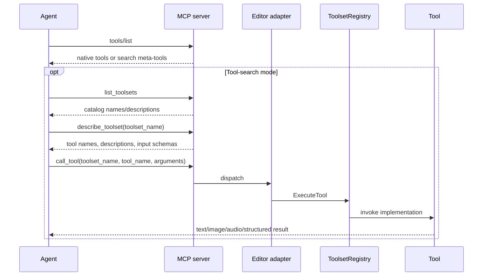

# AI Agent Control Surface — UE 5.8 MCP

## Scope

This page follows a practical agent interaction from discovery through tool execution and result handling, then covers scripting, undo, filesystem sandbox operations, automated tests, live coding, and persisted agent instructions. Claims are tied to inspected UE 5.8 declarations or implementations; general workflow guidance is marked `[INFERENCE]`.

An MCP connection exposes tool calls into Unreal's registered toolsets; it is not an unrestricted interface to every engine API. What is callable depends on tools registered by loaded toolsets and on each tool's declared schema and implementation.

Source root: `UE_5.8/Engine/Plugins/Experimental/`.

## Architecture



`FToolsetRegistryToolAdapterManager` selects between eager native registration and tool-search meta-tools. In tool-search mode, only `list_toolsets`, `describe_toolset`, and `call_tool` are registered; in eager mode, each discovered tool is adapted and registered directly (`ModelContextProtocolEditor/Private/ModelContextProtocolToolsetRegistryAdapter.cpp`). `call_tool` accepts a toolset name, tool name and object arguments; omitting toolset name dispatches to top-level MCP tools. Toolset-qualified calls go through `FToolsetRegistry::ExecuteTool`; completion is adapted to MCP text or error results.

[INFERENCE] Tool-search mode reduces the initial `tools/list` payload and therefore likely lowers prompt/token cost when many tools exist, at the price of requiring discovery and a generic dispatch call rather than calling each tool directly by its native name. The implementation proves the registration tradeoff, not a quantitative token saving.

## Key types

| Symbol | Module | Responsibility |
|---|---|---|
| `FListToolsetsTool`, `FDescribeToolsetTool`, `FCallTool` | ModelContextProtocolEditor | Search-mode catalog, schema retrieval, and dispatch MCP tools. |
| `FToolsetRegistryToolAdapter` | ModelContextProtocolEditor | Bridges a ToolsetRegistry tool schema/execution into `IModelContextProtocolTool`. |
| `FToolsetRegistryToolAdapterManager` | ModelContextProtocolEditor | Chooses eager versus search-mode tool registration and handles dispatch. |
| `UModelContextProtocolToolHashMappingCommandlet` | ModelContextProtocolEditor | Writes analytics identifier hash-to-name mappings. |
| `FModelContextProtocolToolResult` | ModelContextProtocol | JSON MCP tool result wrapper; helpers include text/image/audio/resource-link/structured content. |
| `FToolsetImage` | ToolsetRegistry | Base64-encoded image data and MIME type returned by toolsets. |
| `UToolsetLibrary` | ToolsetRegistry | Reflected property access, class discovery and transaction undo helpers. |
| `UE::ToolsetRegistry::FGlobalSandbox` | ToolsetRegistry | Enter/leave/query/persist/discard globally active file sandbox. |
| `UAgentSkill`, `UAgentSkillToolset` | ToolsetRegistry | Persisted skill descriptions/instructions and list/read/create/update tools. |
| `UAutomationTestToolset` | AutomationTestToolset | Discovers, lists, runs, monitors, and stops automation tests. |
| `ULiveCodingToolset` | LiveCodingToolset | Invokes Live Coding compile and returns status/diagnostics. |

## Data flow

1. **Discover.** In search mode `list_toolsets` returns a text catalog with toolset names and optional descriptions. `describe_toolset` takes required string `toolset_name` and returns the full JSON schema; a missing name produces an error listing known toolsets (`ModelContextProtocolToolSearch.cpp`, `ModelContextProtocolToolsetRegistryAdapter.cpp`).
2. **Select and invoke.** `call_tool` schema has required `tool_name`, optional `toolset_name`, optional object `arguments` defaulting to `{}`. The tool name is unprefixed; the toolset is a separate field. Invalid/missing `tool_name` is rejected. `FToolsetRegistryToolAdapter` serializes arguments as JSON, executes, and completes with text or error (`ModelContextProtocolToolSearch.cpp`, `ModelContextProtocolToolsetRegistryAdapter.cpp`).
3. **Consume outputs.** `FModelContextProtocolToolResult` supports text, image, audio and structured content. Images/audio are MIME-typed content with base64 data. `FToolsetImage` stores MIME type plus base64 image data. A viewport capture tool can return a PNG screenshot together with camera location, rotation, FOV, optional grid metadata and labeled actors (`EditorToolset/Source/EditorToolset/Private/EditorAppToolset.h`). Structured-content helpers export a struct, object, property or JSON value to top-level `structuredContent` (`ModelContextProtocol/Public/ModelContextProtocolToolResults.h`). Audio output is available through `MakeAudioResult`; `ModelContextProtocol.AudioResultOggFormat` is a result-format CVar (shared graph facts). Actual audio-producing tool availability depends on the registered toolsets.
4. **Refresh registration.** Console command `ModelContextProtocol.RefreshTools` clears current tools and broadcasts refresh so providers can re-register; it is marked `ECVF_Cheat` (`ModelContextProtocol/Private/ModelContextProtocolModule.cpp`).
5. **Decode analytics names.** Tool identifiers are hashed in analytics, so `ModelContextProtocolToolHashMapping` commandlet writes hash-to-name JSON at `<ProjectSavedDir>/ModelContextProtocol/ToolHashMapping.json` by default. It disables tool search, refreshes to force eager registration, enumerates registered names, and explicitly includes the three search meta-tools. Optional `-Output=` and `-Print` control path and log output. Commandlet header documents `-TickEngineSeconds=` and required activation of explicitly loaded Game Feature Plugins before enumeration. Hashing supports decoding analytics' `ToolNameHash` / `ToolsetNameHash` (`ModelContextProtocolEditor/Private/ModelContextProtocolToolHashMappingCommandlet.h/.cpp`).

### Exact search-tool input schemas

These JSON Schemas are built by `ModelContextProtocolToolSearch.cpp`; they describe the tool *arguments* inside the MCP tool call, not the outer JSON-RPC envelope.

`list_toolsets` accepts an empty object schema (`type: object`; no properties and no required keys). It takes no arguments.

`describe_toolset` accepts:

```json
{
  "type": "object",
  "properties": {
    "toolset_name": {
      "type": "string",
      "description": "Name of the toolset to describe. Use list_toolsets to see available names."
    }
  },
  "required": ["toolset_name"]
}
```

`call_tool` accepts:

```json
{
  "type": "object",
  "properties": {
    "toolset_name": {
      "type": "string",
      "description": "Optional. Name of the toolset containing the tool. Omit to call a top-level MCP tool. Use list_toolsets to discover toolset names."
    },
    "tool_name": {
      "type": "string",
      "description": "Name of the tool to call, without toolset prefix. Use describe_toolset to discover tool names and input schemas."
    },
    "arguments": {
      "type": "object",
      "description": "Arguments to pass to the tool. Must match the tool's input schema. Defaults to an empty object."
    }
  },
  "required": ["tool_name"]
}
```

The schema builder does not declare `additionalProperties: false`; do not infer strict unknown-key rejection from these schemas. Runtime implementation checks that `tool_name` exists and is non-empty, reads `toolset_name` if supplied, and turns absent/non-object `arguments` into an empty JSON object (`ModelContextProtocolToolSearch.cpp`).

### Example search-mode session

Example shapes below show the MCP `tools/call` parameter/result contents. Toolset and tool names inside the described schema are illustrative placeholders; actual names and schema come from the live `list_toolsets`/`describe_toolset` output. Output content shape follows the implementation. `[INFERENCE]` The example names `ExampleTools`/`read_state` are not asserted to exist in a project.

```json
// Agent -> MCP: tools/call for list_toolsets
{"name":"list_toolsets","arguments":{}}
// MCP tool result (catalog is plain text)
{"content":[{"type":"text","text":"- ExampleTools: Example toolset"}]}

// Agent -> MCP: tools/call for describe_toolset
{"name":"describe_toolset","arguments":{"toolset_name":"ExampleTools"}}
// MCP result carries the serialized full toolset schema as text
{"content":[{"type":"text","text":"{\"tools\":[{\"name\":\"read_state\",\"description\":\"...\",\"inputSchema\":{\"type\":\"object\",\"properties\":{}}}]}"}]}

// Agent -> MCP: tools/call for the selected tool
{"name":"call_tool","arguments":{"toolset_name":"ExampleTools","tool_name":"read_state","arguments":{}}}
// Adapter dispatches to registry; successful adapter completion is MCP text
{"content":[{"type":"text","text":"...tool output..."}]}
```

`FListToolsetsTool::Run` produces text; `FDescribeToolsetTool::Run` uses serialized schema text or an error. Registry dispatch adapts successful string output with `MakeTextResult` and errors with `MakeErrorResult` (`ModelContextProtocolToolSearch.cpp`, `ModelContextProtocolToolsetRegistryAdapter.cpp`). A directly registered tool can instead return non-text result content as shown below.

### Result shapes and ways to obtain them

- **Image:** `MakeImageResult(mimeType, bytes)` base64-encodes bytes into `content:[{type:\"image\",mimeType,data}]`; it can also annotate audience (`ModelContextProtocol/Private/ModelContextProtocolToolResults.cpp`). `EditorAppToolset.CaptureViewport` returns `FToolsetImage` in `FViewportCapture.Image`, documented as a PNG-encoded current level viewport screenshot, plus camera and optional annotation metadata (`Toolsets/EditorToolset/Source/EditorToolset/Private/EditorAppToolset.h`). Call it only if its containing toolset is present in discovery.
- **Audio:** `MakeAudioResult(mimeType, bytes)` encodes bytes and returns `content:[{type:\"audio\",mimeType,data}]`; an overload accepts base64 directly. `ModelContextProtocol.AudioResultOggFormat` is a format CVar, but this source inspection does not establish a particular audio tool to invoke.
- **Structured content:** `MakeStructuredContentResult` accepts UStruct/UObject/property/JSON and emits top-level `structuredContent` plus condensed JSON text in a text content item for compatibility. With `bWrapPODResultsInObject`, non-object values are wrapped under the configured POD result property (`ModelContextProtocol/Private/ModelContextProtocolToolResults.cpp`).

These are distinct from a tool's ordinary text return. `call_tool` delegates the actual tool result; the registry adapter shown here wraps string output as text, while direct MCP tools such as a screenshot-capable registered tool can return image/structured result helpers as their own result type.

## Usage

### Typical agent workflow

[INFERENCE] A robust agent turn is: inspect `tools/list`; if only meta-tools appear, call `list_toolsets`, choose a relevant toolset, call `describe_toolset`, then call the selected tool with schema-conforming `arguments`. Inspect returned text/structured fields or image/audio content before making further changes. Re-discover after tool registration changes or errors suggesting stale schemas. This order is supported by the descriptions in `ModelContextProtocolToolSearch.h`; the decision strategy is workflow guidance, not engine-enforced policy.

### Capability table

| Control area | Tools / source evidence | Read or write | Editor-only |
|---|---|---|---|
| Tool discovery and invocation | `list_toolsets`, `describe_toolset`, `call_tool`; `ModelContextProtocolToolSearch.h/.cpp` | Read schemas/catalog; invoke tools may read or mutate as declared by each tool | Yes: adapter is in `ModelContextProtocolEditor` |
| Editor viewport imagery | `EditorAppToolset.CaptureViewport` and `FViewportCapture` in `EditorToolset/Private/EditorAppToolset.h` | Read/capture image and camera metadata | Yes; requires an interactive viewport for capture paths (implementation/tests) |
| Object property inspection/edit | `UToolsetLibrary::GetObjectProperties`, `SetObjectProperties` in `ToolsetRegistry/Public/ToolsetRegistry/ToolsetLibrary.h` | Read / write | ToolsetRegistry APIs; actual object availability depends on editor/project context |
| Transaction rollback | `UToolsetLibrary::UndoTransaction`, `GetActiveUndoCount` in same header | Write (undo) / read count | Requires editor transaction buffer (`GEditor`), per API comments |
| File sandbox | `FGlobalSandbox::Enter`, `GetChanges`, `Persist`, `Discard`, `DiscardFiles` in `SandboxLibrary.h` | Read change list; write/discard/persist filesystem changes | No editor-only annotation in header; needs an active FileSandbox instance |
| Run automation | `UAutomationTestToolset` methods in `AutomationTestToolset/Public/AutomationTestToolset.h` | Read discovery/status/results; write/run/stop tests | Toolset belongs to automation test integration; API executes editor automation controller |
| Live Coding | `ULiveCodingToolset::CompileLiveCoding` in `LiveCodingToolset/Public/LiveCodingToolset.h` | Write/compile code into running editor | Yes: Live Coding module and Editor subsystem registration |
| Agent skills | `UAgentSkillToolset::ListSkills`, `GetSkills`, `CreateSkill`, `UpdateSkill` in `ToolsetRegistry/Public/ToolsetRegistry/AgentSkill.h` | Read; create/update persisted skill assets | Asset operations occur in project context; Blueprint exposure is proven by `BlueprintType` and `AICallable` functions |
| Script orchestration | `ProgrammaticToolset.execute_tool_script` in `EditorToolset/Content/Python/editor_toolset/toolsets/programmatic.py` | Read/write via invoked registered tools; bounded script execution | EditorToolset Python integration |

### Tool-library authoring and refresh

The Editor module's factory creates a `UModelContextProtocolToolLibraryBlueprint` derived from `UModelContextProtocolToolLibrary`, with Blueprint type `BPTYPE_FunctionLibrary`, and enables create/edit-after-create. It rejects a parent class other than the expected library base. The editor-specific factory creates the corresponding editor utility library blueprint (`ModelContextProtocolEditor/Private/ModelContextProtocolToolLibraryFactory.cpp`; `ModelContextProtocolEditor/Public/ModelContextProtocolToolLibraryFactory.h`). The Asset Registry definitions label these asset classes “MCP Tool Library Blueprint” and “MCP EditorTool Library Blueprint” and place both in the AI / Generative AI category (`ModelContextProtocolEditor/Public/ModelContextProtocolAssetDefinitions.h`, `Private/ModelContextProtocolAssetDefinitions.cpp`). These factories establish authoring asset types, not a guarantee that every function in any such asset becomes callable; registration rules belong to the library implementation and its function metadata.

The console command `ModelContextProtocol.RefreshTools` calls `RefreshTools()`: the module resets its current tool array and broadcasts `OnRefreshTools`, allowing providers to register again. The server subscribes to the same refresh delegate to schedule `tools/list_changed` (`ModelContextProtocol/Private/ModelContextProtocolModule.cpp`, `Private/ModelContextProtocolModule.h`). Use it after an extension/toolset registration change when the existing registration needs rebuilding; it is a console command flagged `ECVF_Cheat`.

### Named tool operations

Names below are the reflected C++ `UFUNCTION` names in the inspected headers (and thus directly source-verifiable). The discovery schema is authoritative for exact advertised spelling and argument schema in a running project.

- `UToolsetLibrary`: `ListStructProperties`, `GetObjectProperties`, `SetObjectProperties`, `GetDerivedClasses`, `GetDerivedStructs`, `UndoTransaction`, and `GetActiveUndoCount` (`ToolsetRegistry/Public/ToolsetRegistry/ToolsetLibrary.h`). The first five expose schema/property/class queries or writes; the last two inspect/alter the global undo stack.
- `UAgentSkillToolset`: `ListSkills`, `GetSkills`, `CreateSkill`, and `UpdateSkill` (`ToolsetRegistry/Public/ToolsetRegistry/AgentSkill.h`). Create/update comments require explicit user direction or permission.
- `UAutomationTestToolset`: `DiscoverTests`, `ListTests`, `RunTests`, `RunTestsByFilter`, `GetTestResults`, `GetTestStatus`, and `StopTests` (`Toolsets/AutomationTestToolset/Source/AutomationTestToolset/Public/AutomationTestToolset.h`).
- `ULiveCodingToolset`: `CompileLiveCoding` (`Toolsets/LiveCodingToolset/Source/LiveCodingToolset/Public/LiveCodingToolset.h`).
- `ProgrammaticToolset`: Python tool calls `get_execution_environment` and `execute_tool_script` (`Toolsets/EditorToolset/Content/Python/editor_toolset/toolsets/programmatic.py`).

`FGlobalSandbox` exposes C++ static operations (`Enter`, `GetChanges`, `Persist`, `Discard`, `DiscardFiles`, `Leave`), not `UFUNCTION`s in the inspected header. Do not claim these exact names are independently exposed as MCP tool calls. A tool can use these operations if it provides an appropriate callable wrapper; the control-surface availability is conditional on that registration.

### Scripts and undo

The `ProgrammaticToolset` is a Python toolset that batches registered tool calls; it is explicitly an orchestration script, not general-purpose Python. The source requires a prior `get_execution_environment` call and says the script defines `run()` returning a `Dict[str, Any]`. It injects `execute_tool`, uses an allowlisted import guard and safe builtins, disallows relative imports and dynamic `exec`/`eval`/`compile`, and restricts `open` to reading files under the project directory (`EditorToolset/Content/Python/editor_toolset/toolsets/programmatic.py`).

Property writes through `UToolsetLibrary::SetObjectProperties` are **not transactional**: valid sibling properties may be committed even if another property fails; `false` does not imply unchanged state. If all-or-nothing behavior is needed, wrap changes in a transaction and call `UndoTransaction` on failure. The ToolsetLibrary comments specifically identify this undo helper as used by `programmatic.execute_tool_script` to roll back scripts that fail partway through. Undo can fail if there is no transaction to undo or editor state prevents undo (for example saving or GC).

### Sandbox and persisted instructions

`FGlobalSandbox` enters or resumes a named sandbox, reports active changes, can persist specified files (empty means all), discard all or selected files, and leave without deleting changes (`ToolsetRegistry/Public/ToolsetRegistry/SandboxLibrary.h`). Treat leave and discard as distinct operations. This API describes global access to a sandbox, but does not prove every tool operation is automatically sandboxed.

`UAgentSkill` stores editable description and detailed instructions; `UAgentSkillToolset` exposes `ListSkills` and `GetSkills` plus `CreateSkill` and `UpdateSkill`. Source explicitly says create/update should only happen after explicit user direction or permission (`ToolsetRegistry/Public/ToolsetRegistry/AgentSkill.h`). These are project-persisted instructions, not hidden system policy.

### Running automation and Live Coding

Automation workflow in the public header: call `DiscoverTests` first, then `ListTests` or `RunTests`/`RunTestsByFilter`, inspect `GetTestStatus` and `GetTestResults`, and use `StopTests` if needed. Discovery takes several seconds and initializes workers/test enumeration. Results are asynchronous for discovery and test runs (`Toolsets/AutomationTestToolset/Source/AutomationTestToolset/Public/AutomationTestToolset.h`).

`ULiveCodingToolset::CompileLiveCoding` returns a string containing compile status and captured compiler output; it returns a descriptive error when the Live Coding module is not loaded. Its Editor subsystem registers the toolset when enabled, and `LiveCodingToolset.Enable` can toggle registration (`Toolsets/LiveCodingToolset/Source/LiveCodingToolset/Public/LiveCodingToolset.h`, `Private/LiveCodingToolsetSubsystem.cpp`).

## Pitfalls

- Search mode's `tools/list` only exposes three generic meta-tools; do not assume native per-tool entries will appear. Eager mode registers every currently enumerated toolset tool (`ModelContextProtocolToolsetRegistryAdapter.cpp`).
- A `call_tool` request must use separate `toolset_name` and unprefixed `tool_name`; arguments must match the discovered schema. Omitting `arguments` uses an empty object (`ModelContextProtocolToolSearch.cpp`).
- Screenshot capability is tool-specific and viewport-dependent; `FViewportCapture` represents PNG screenshot plus metadata, not arbitrary access to all editor pixels (`EditorToolset/Private/EditorAppToolset.h`).
- Audio helper existence does not mean an audio-returning tool is registered. The format CVar and tool registrations determine runtime availability.
- A failed `SetObjectProperties` call can leave partial writes. Undo requires a real transaction record and editor transaction buffer (`ToolsetLibrary.h`).
- `FGlobalSandbox::Leave()` preserves files; `Discard()` reverts changes but keeps the sandbox active. Persisting commits changes to the real filesystem (`SandboxLibrary.h`).
- Automation test list/run methods require successful `DiscoverTests`; follow returned async completion rather than assuming immediate completion (`AutomationTestToolset.h`).
- Live Coding requires its module to be loaded/enabled; availability of the toolset can be toggled (`LiveCodingToolsetSubsystem.cpp`).
- Hash mapping captures tools registered at enumeration time. Explicitly loaded Game Feature Plugin toolsets must be activated before enumeration (`ModelContextProtocolToolHashMappingCommandlet.h`).

## Source files

All source paths are relative to `UE_5.8/Engine/Plugins/Experimental/`:

- `ModelContextProtocol/Source/ModelContextProtocolEditor/Private/ModelContextProtocolToolSearch.h/.cpp` — meta-tool contracts and schemas.
- `ModelContextProtocol/Source/ModelContextProtocolEditor/Private/ModelContextProtocolToolsetRegistryAdapter.h/.cpp` — mode selection, schema/catalog discovery, dispatch.
- `ModelContextProtocol/Source/ModelContextProtocolEditor/Private/ModelContextProtocolToolLibraryFactory.cpp` and `Public/ModelContextProtocolToolLibraryFactory.h` — factories for MCP Blueprint tool libraries.
- `ModelContextProtocol/Source/ModelContextProtocolEditor/Private/ModelContextProtocolAssetDefinitions.cpp` and `Public/ModelContextProtocolAssetDefinitions.h` — asset definitions.
- `ModelContextProtocol/Source/ModelContextProtocolEditor/Private/ModelContextProtocolToolHashMappingCommandlet.h/.cpp` — hash mapping commandlet.
- `ModelContextProtocol/Source/ModelContextProtocol/Private/ModelContextProtocolModule.cpp`, `Public/ModelContextProtocolToolResults.h` — refresh registration and result content helpers.
- `ToolsetRegistry/Source/ToolsetRegistry/Public/ToolsetRegistry/ToolsetLibrary.h`, `SandboxLibrary.h`, `AgentSkill.h`, `ToolsetImage.h`, `ToolCallAsyncResultImage.h` — callable object, sandbox, skills, and image APIs.
- `Toolsets/AutomationTestToolset/Source/AutomationTestToolset/Public/AutomationTestToolset.h` — automation workflow.
- `Toolsets/LiveCodingToolset/Source/LiveCodingToolset/Public/LiveCodingToolset.h` and `Private/LiveCodingToolsetSubsystem.cpp` — compile and registration gate.
- `Toolsets/EditorToolset/Source/EditorToolset/Private/EditorAppToolset.h` — viewport image return structure.
- `Toolsets/EditorToolset/Content/Python/editor_toolset/toolsets/programmatic.py` — constrained Python tool orchestration.

## Graph facts

The MCP corpus has **9,250 nodes**, **15,786 internal edges**, **7,518 cross-community edges**, and **287 communities**. Relevant plugin contributions: ModelContextProtocolEditor is part of ModelContextProtocol's **820** nodes; ToolsetRegistry **2,178**; EditorToolset **2,906**; AutomationTestToolset **89**; LiveCodingToolset **48**. Corpus relations include 6,018 references, 5,824 calls, 2,673 method, 2,538 contains, 2,396 rationale_for, 1,562 imports, 1,239 defines, 448 uses, 302 imports_from, 258 inherits, 32 indirect_call, and 14 re_exports. These are static graph corpus counts, not runtime tool counts or measurements (`local://mcp_graph_facts.md`).
