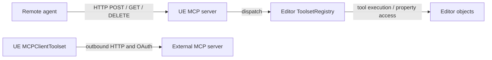

# Limits, Safety, and Security — UE 5.8 MCP

## Scope

This reference describes operational and implementation limits of the UE 5.8 MCP server, the ToolsetRegistry execution surface, and the separate MCP client toolset. It is grounded in the engine source listed below. It is not a security certification. `[INFERENCE]` marks operational conclusions that follow from source behavior rather than an explicit guarantee.

## Architecture

The server is an HTTP JSON-RPC endpoint backed by Unreal's `HTTPServer`; it registers POST, GET, and DELETE routes at its configured path. It has in-memory sessions and no stdio server transport. Toolsets execute through ToolsetRegistry in the editor. The MCPClientToolset is a distinct outbound client implementation with legacy SSE, streamable HTTP, and OAuth paths; its features do not imply equivalent inbound-server features.



## Key types

| Symbol | Module | Responsibility |
|---|---|---|
| `FModelContextProtocolServer` | ModelContextProtocol | HTTP routes, sessions, JSON-RPC dispatch |
| `FModelContextProtocolSession` | ModelContextProtocol | Session state, negotiated version, active requests |
| `FModelContextProtocolClientCapabilities` / `FModelContextProtocolServerCapabilities` | ModelContextProtocol | Capability data shapes used by initialize |
| `UModelContextProtocolSettings` | ModelContextProtocolEngine | Editor-project server path, port, autostart and tool-search settings |
| `UToolsetRegistrySubsystem` | ToolsetRegistry | Editor subsystem holding registered toolset handlers |
| `FToolset` | ToolsetRegistry | Tool execution, schemas, block/allow filters |
| `UToolsetLibrary` | ToolsetRegistry | Property/schema helpers; `SetObjectProperties` mutates objects |
| `UToolCallAsyncResult` | ToolsetRegistry | Async tool completion/result base class |
| `FMCPClientToolset` | MCPClientToolset | Outbound MCP server connection and OAuth state |

## Data flow

1. The server binds POST/GET/DELETE routes and starts HTTP listeners. POST requests dispatch JSON-RPC methods; session IDs are maintained in server memory.
2. Tool calls are dispatched to registered MCP tools / the editor registry. The server consumes completion on the game thread. Python tool-call implementation requires game-thread invocation to observe script errors correctly.
3. Tool names are validated against MCP's 1–128 character and `A-Z`, `a-z`, `0-9`, `_`, `-`, `.` rule. Optional pagination and progress-notification interval are CVar-controlled.
4. The separate client initiates a configured legacy SSE or streamable HTTP connection, optionally performing OAuth first. Client-side transport/auth implementations do not add authentication to the inbound server.

## Usage

### Start explicitly and bind configuration

`UModelContextProtocolSettings::bAutoStartServer` defaults to `false`; start the server deliberately through `IModelContextProtocolModule::StartServer(Port, UrlPath)` or its `ModelContextProtocol.StartServer` console command. The documented default port/path are 8000 and `/mcp`. The module's server is not a Blueprint-authenticated gateway.

```cpp
if (IModelContextProtocolModule* Module = IModelContextProtocolModule::Get())
{
    Module->StartServer(8000, TEXT("/mcp"));
}
```

### Filter exposed tools

Configure ToolsetRegistry blocked/allowed name patterns to restrict visible toolsets and individual tools. Block takes precedence; this is exposure filtering, not caller identity or authorization. Review each tool's effects independently. For property mutation via `UToolsetLibrary::SetObjectProperties`, configure the distinct blocked-class and blocked-property lists as well.

### Make writes safely

Treat `SetObjectProperties` as a partial write: a false result means at least one property failed, not that no changes occurred. If all-or-nothing behavior is required, the function's contract says the caller must create/use an editor transaction and roll it back on error. A sandbox is an explicit separate facility; it is not automatically applied to arbitrary object mutations.

### Connect outward

Configure `FMCPServerConfig` with a base URL and transport/auth mode for `MCPClientToolset`. The client supports legacy HTTP+SSE (GET `/sse`, POST `/message`), streamable HTTP (POST one endpoint), static bearer API key, or OAuth authorization-code + PKCE. These client options apply to connections from Unreal to another MCP server only.

### Design an agent workflow around the limits

1. Establish that the editor is running and the endpoint is reachable; server startup is opt-in and commandlet startup is separately guarded.
2. Initialize a session and retain its `Mcp-Session-Id`. A missing ID yields HTTP 400 and an unknown ID yields HTTP 404; reinitialize after a stale-session response.
3. Discover tools at use time, obey name constraints, and treat advertised schemas as guidance for callers rather than server-side validation.
4. For a long-running operation, provide a progress token and treat progress as throttled heartbeat data, not a completion estimate. Cancellation is best effort: the server calls `CancelAsync` when an active request exists, then removes its active-request record.
5. Before mutation, assess tool-specific side effects and configured blocklists. After a failed property write, inspect for partial changes and use explicit transaction/undo handling if appropriate.
6. Keep endpoint exposure limited to trusted clients. Origin checks and session IDs do not establish authenticated identity.

### Concrete capability gaps

Initialize currently sets only the server `Tools.ListChanged` and `Resources` capability values. The declared `Roots`, `Sampling`, and `Elicitation` client shapes and `Logging` and `Prompts` server shapes do not cause handlers to exist. Server dispatch explicitly recognizes `ping`, `initialize`, initialized/cancelled notifications, `tools/list`, `tools/call`, `resources/list`, and `resources/read`; `prompts/list`, `prompts/get`, sampling, elicitation, roots, and logging methods are not in that dispatch set. Resources are supported, but the declared subscription/list-changed flags should not be mistaken for subscription methods.

### Concurrency, session, and lifetime cautions

Each session stores a map of active requests and the server stores sessions in an array. The reviewed server code imposes no explicit maximum session count or active-request count, and lookup scans the array. No idle-session expiry is visible in this server implementation. These are code-scope observations, not claims about limits elsewhere in HTTPServer. `[INFERENCE]` Long-lived clients should close sessions and avoid unbounded parallel calls to reduce editor resource pressure.

Async tool handlers may complete from any thread, but the MCP server hops result handling to the game thread. `UToolCallAsyncResult` documents thread-safe completion with delegate notification on the main thread. Tool implementations must invoke their completion callback exactly once; subsequent callbacks after completion/cancellation are silently dropped by the tool contract. The server's `AliveGuard` uses a weak reference in completion lambdas to avoid touching a destroyed server.

Legacy reflected tool-library and async-action adapters explicitly keep UObject/function references alive through `AddReferencedObjects`; async-action adapters also retain in-progress actions. Tool authors using their own async mechanisms must preserve UObject lifetimes themselves. Do not retain raw UObject pointers across deferred work without an equivalent lifetime strategy. `[INFERENCE]`

### Error, timeout, and recovery behavior

The server rejects malformed JSON-RPC versions and missing methods as invalid requests, unknown method names as method-not-found, missing session IDs on post-initialize methods with HTTP 400, and unknown session IDs with HTTP 404. A stale-session 404 is documented in code as a signal to initialize again. Cancellation removes server-side tracking even when the tool has no active matching request; it does not prove that arbitrary work external to the tool has stopped.

The inspected server source exposes progress throttling but no tool execution deadline or automatic timeout policy. Therefore a client should implement its own request deadline and recovery policy; do not infer a server-side timeout from the progress interval. `[INFERENCE]` A timed-out client request may still correspond to in-flight editor work unless the tool's cancellation implementation actually stops it.

### Resource-path guard

`SafeConvertRelativePathToFull(BasePath, FileName, OutFilePath)` resolves a path and rejects it if the result is not under `BasePath`, clearing the output on rejection. This helper is a path traversal guard for callers that use it; its presence does not establish that every resource provider or file-writing tool automatically uses it. `[INFERENCE]` Agent-defined tools must independently apply appropriate path restrictions.

### Exact name validation results

`EToolNameValidation` distinguishes `Valid`, `Empty`, `ExceedsMaxLength`, and `InvalidCharacters`. The validator returns `Empty` for zero-length names, `ExceedsMaxLength` above 128 characters, and `InvalidCharacters` for any character outside ASCII letters, digits, `_`, `-`, and `.`. Use this enum result when reporting registration errors rather than reducing every invalid name to a generic failure.

### Pagination and progress specifics

`PaginationPageSize` defaults to zero, meaning all items are returned; positive values limit tools/resources list results per page and use continuation cursors. Progress defaults to one second between notifications when a request has both a progress token and an active event-stream writer; non-positive intervals disable emission. Progress values are incrementing heartbeats without a total, not a percentage or remaining-time estimate. These behaviors are adjustable CVars rather than immutable protocol guarantees.

### Exposure controls are not authorization

Toolset blocked/allowed patterns act at toolset/tool visibility and execution filtering layers; separate object/property patterns reject selected `SetObjectProperties` targets. No caller identity or role is established by those pattern checks. Origin validation allows absent Origin headers and accepted localhost origins; it is specifically an origin check, not a secret bearer credential. Bind/network exposure policy must be considered separately from tool-list filtering. `[INFERENCE]`

The server logs an EULA warning that data transmitted through the plugin to a connected LLM service is licensed technology and reminds the operator to ensure the provider does not use it as training input. That warning is an operator responsibility, not enforcement by the transport.

### Legacy, client-only OAuth, and distribution

The outbound client exposes `LaunchOAuthBrowser`, dynamic registration, callback handling, token exchange/refresh, and config save/load methods. That surface is distinct from server routes. The inspected declarations identify config persistence but do not establish encryption or OS credential-store protection. `[INFERENCE]` Treat client configuration files containing tokens as sensitive.

`ModelContextProtocol.uplugin` marks this experimental plugin `NoRedist: true`, `EnabledByDefault: false`; these are metadata constraints/status, not runtime safeguards. Deprecated `UModelContextProtocolToolLibrary` and `UModelContextProtocolToolAsyncAction` remain legacy paths; new tool definitions should use `UToolsetDefinition`.

### Safety checklist for agent authors

- Require explicit operator startup and verify the expected host, port, and path before connecting.
- Keep sessions scoped to one editor process; reinitialize on stale session and close when finished.
- Discover current tools and schemas instead of hard-coding tool catalogs; validate all inputs in the tool implementation.
- Limit concurrency and provide client-side deadlines; understand cancellation semantics for each tool.
- Separate read-only discovery from mutating calls. Confirm object identity and intended property set before writes.
- On mutation errors, assume partial state may have changed; inspect and roll back deliberately.
- Treat local HTTP reachability as a trust boundary decision, not as user authentication.
- Preserve UObject references in deferred handlers and route Python execution through game-thread-compatible APIs.
- Never infer unsupported MCP capability support from USTRUCT capability declarations alone.


## Pitfalls

The table separates source-backed limits from consequences. Inferred consequences are labeled explicitly.

| Limit | Evidence (file and line) | Consequence for an agent |
|---|---|---|
| Inbound transport is HTTP only; no stdio transport is implemented. | `ModelContextProtocolServer.h:22-24,40-48`; `ModelContextProtocolServer.cpp:434-447` | Configure an HTTP MCP client; a stdio-only host cannot connect directly. `[INFERENCE]` |
| Inbound server has no authentication or authorization check. Server request processing validates Origin and resolves sessions, but does not authenticate a caller or check a principal/permission. | `ModelContextProtocolServer.cpp:68-121,410-443,565-610` | Do not treat possession of endpoint access as a safe authorization boundary; expose only to trusted/local clients and limit tools. `[INFERENCE]` |
| No TLS setup is present in server route/listener startup; server is HTTP. | `ModelContextProtocolSettings.h:23-25,36-42`; `ModelContextProtocolServer.h:22-24`; `ModelContextProtocolServer.cpp:434-447` | Do not send the server endpoint over an untrusted network expecting transport encryption. `[INFERENCE]` |
| Origin validation is not authentication: missing Origin is accepted, and localhost variants are accepted. | `ModelContextProtocolServer.cpp:68-120` | Non-browser clients can omit Origin; the check mitigates browser-origin/DNS-rebinding cases only. `[INFERENCE]` |
| Server owns a single router and session array; no multi-process coordination is implemented in this server class. | `ModelContextProtocolServer.h:66-77` | Sessions are process-local; an agent should not expect session state to survive process restart or be shared across editor instances. `[INFERENCE]` |
| Server auto-start defaults off. | `ModelContextProtocolSettings.h:40-42` | An agent cannot assume the endpoint exists merely because the plugin is enabled; it may need explicit startup. `[INFERENCE]` |
| ToolsetRegistry uses an `UEditorSubsystem`; `Get` fails when `GEditor` is unavailable, and `IsAvailable` documents false outside editor. | `ToolsetRegistrySubsystem.h:71-86`; `ToolsetRegistrySubsystem.cpp:13-39`; `UToolsetRegistry.h:21-24` | Registry-backed tools require an editor environment; runtime/game deployments cannot assume these toolsets are available. |
| Tool names must have length 1–128 and only ASCII letters, digits, underscore, hyphen, dot. | `ModelContextProtocol.h:49-63`; implementation `ModelContextProtocol.cpp:19-43` | Use compliant names; invalid names are rejected/omitted by registration/validation paths. `[INFERENCE]` |
| Pagination defaults disabled (`0`); configured positive page size caps tools/resources list pages. | `ModelContextProtocol.cpp:63-67`; `ModelContextProtocolServer.cpp:335-365` | Follow cursors and fetch subsequent pages; a first response may not enumerate all available items. |
| Progress notifications are throttled by `ProgressIntervalSeconds` (default 1 second). | `ModelContextProtocol.cpp:56-61`; `ModelContextProtocolServer.cpp:1087-1105` | Do not infer tool inactivity from a lack of frequent progress events. |
| Client schema adherence is assumed and not strictly checked internally. | `IModelContextProtocolTool.h:44-70,84-88` | Validate arguments in the tool itself; agent-provided schema-conforming inputs are not guaranteed by server-side schema validation. |
| Property writes are non-transactional and may commit valid siblings despite failures. | `ToolsetLibrary.h:61-85` | On error, inspect/undo possible partial mutations; do not blindly retry. |
| Registry block/allow patterns filter visibility and execution, but are not user identity/authorization. | `ToolsetRegistrySubsystem.h:29-40`; `Toolset.h:53-64` | Use filters as exposure control; do not present them as authentication. `[INFERENCE]` |
| Property mutation has separate class/property block lists. | `ToolsetRegistrySubsystem.h:55-68` | Explicitly audit mutation exclusions; absence from these lists does not make a write transactional or harmless. `[INFERENCE]` |
| Capability structs declare roots, sampling, elicitation, logging, prompts, resources, and tools fields, but declarations alone do not implement those protocol features. The server method dispatch list covers only ping/initialize/notifications/tools/resources methods. | `ModelContextProtocolCapabilities.h:9-97`; `ModelContextProtocolServer.cpp:26-50` | Do not assume prompts, sampling, elicitation, roots, or logging operations are supported because capability structs exist. |
| Inbound server does not implement OAuth, dynamic registration, or token persistence; those methods and state belong to the client class. | `MCPClientToolset.h:105-128,160-176`; server method list `ModelContextProtocolServer.cpp:26-50` | OAuth settings cannot secure inbound UE MCP server access. `[INFERENCE]` |
| Client defaults to legacy SSE (`bStreamableHTTP=false`); it has a separate streamable HTTP mode. | `MCPClientToolset.h:28-44,59-66`; `MCPToolsetSettings.h:9-15,53-59` | Choose a transport matching the external server; do not assume the client default is streamable HTTP. |
| OAuth client flow launches a browser, can dynamically register when client ID is empty, and saves/loads tokens via config functions. | `MCPClientToolset.h:113-128`; `MCPToolsetSettings.h:61-68` | OAuth requires interactive browser/local callback flow; token persistence is config-based rather than evidence of an OS credential vault. The latter is `[INFERENCE]`. |
| Python tool calls must run on game thread for script error detection. | `Content/Python/toolset_registry/__init__.py:56-59`; `Content/Python/toolset_registry/tool_call_impl.py:172-175` | Schedule Python toolset invocation on the game thread; off-thread execution can lose reported script errors. |
| Legacy `UModelContextProtocolToolLibrary` and `UModelContextProtocolToolAsyncAction` are deprecated in favor of `UToolsetDefinition`. | `ModelContextProtocolToolLibrary.h:28-33`; `ModelContextProtocolToolAsyncAction.h:19-24` | Prefer ToolsetRegistry definitions for new tools; legacy paths remain fallback compatibility only. |
| Plugin is experimental, disabled by default, and marked NoRedist. | `ModelContextProtocol.uplugin:8,16-18` | Do not assume enabled/default availability or redistribution permission; check the applicable engine/EULA terms. |

| No explicit maximum session or in-flight request count is enforced in the server class; sessions are stored in an array and active requests per session in a map. | `ModelContextProtocolServer.h:66-68`; `ModelContextProtocolSession.h:128-139` | Bound concurrency and close sessions in the agent; unbounded pressure may consume editor resources. The operational consequence is `[INFERENCE]`. |
| Session lookup is a linear search; source shows no idle-session expiry in this class. | `ModelContextProtocolServer.cpp:407-414,456-497` | Reinitialize after 404 and explicitly end sessions; do not assume stale sessions are automatically reclaimed. `[INFERENCE]` |
| The server consumes tool results on the game thread, while tool callback contract allows completion from any thread and requires exactly one completion. | `ModelContextProtocolServer.cpp:862-865,952-960`; `IModelContextProtocolTool.h:29-32` | Tool implementations should complete once and avoid blocking editor-thread work. |
| Server source does not define an execution deadline; it emits progress heartbeats only when token and stream writer exist. | `ModelContextProtocolServer.cpp:1087-1108`; `ModelContextProtocol.h:69-73` | Set client-side deadlines; a quiet progress stream is not proof of completion or cancellation. `[INFERENCE]` |
| `SafeConvertRelativePathToFull` rejects resolved paths outside the base directory, but is a helper rather than universal resource enforcement. | `ModelContextProtocolUtils.h:12-24` | File tools should use the guard or equivalent containment checks; do not assume every provider is protected. `[INFERENCE]` |
| Deferred UObject-based legacy tools maintain GC references explicitly via `AddReferencedObjects`. | `ModelContextProtocolToolLibrary.h:110-116`; `ModelContextProtocolToolAsyncAction.h:91-99`; implementations `ModelContextProtocolToolLibrary.cpp:322-325`, `ModelContextProtocolToolAsyncAction.cpp:362-367` | Custom deferred handlers must retain UObject/function/action references across async work. `[INFERENCE]` |
| Tool-name validation returns `EToolNameValidation::{Valid,Empty,ExceedsMaxLength,InvalidCharacters}` for exact failure categories. | `ModelContextProtocol.h:49-63`; `ModelContextProtocol.cpp:16-37` | Report the precise validation cause and avoid generated names outside the allowed set. |
| Cancellation calls `CancelAsync` only for a found active request and removes that record; no-match cancellation is accepted. | `ModelContextProtocolServer.cpp:697-728` | Treat cancellation as tool-specific best effort, not guaranteed rollback or proof that background work ceased. `[INFERENCE]` |
| Session creation appends to `Sessions`; DELETE handling and StopServer behavior govern session ending, with no explicit cap visible here. | `ModelContextProtocolServer.cpp:646-681`; `ModelContextProtocolServer.h:66-77` | Ensure clients send DELETE on shutdown and avoid assuming server-side quotas. `[INFERENCE]` |

## Source files

Engine root: `UE_5.8/Engine/Plugins/Experimental/`.

- `ModelContextProtocol/ModelContextProtocol.uplugin`
- `ModelContextProtocol/Source/ModelContextProtocol/Public/ModelContextProtocol.h`
- `ModelContextProtocol/Source/ModelContextProtocol/Public/ModelContextProtocolServer.h`
- `ModelContextProtocol/Source/ModelContextProtocol/Private/ModelContextProtocolServer.cpp`
- `ModelContextProtocol/Source/ModelContextProtocol/Public/ModelContextProtocolSession.h`
- `ModelContextProtocol/Source/ModelContextProtocol/Public/ModelContextProtocolCapabilities.h`
- `ModelContextProtocol/Source/ModelContextProtocol/Public/ModelContextProtocolUtils.h`
- `ModelContextProtocol/Source/ModelContextProtocolEngine/Public/ModelContextProtocolSettings.h`
- `ModelContextProtocol/Source/ModelContextProtocolEngine/Public/ModelContextProtocolToolLibrary.h`
- `ModelContextProtocol/Source/ModelContextProtocolEngine/Public/ModelContextProtocolToolAsyncAction.h`
- `ToolsetRegistry/Source/ToolsetRegistry/Public/ToolsetRegistry/Toolset.h`
- `ToolsetRegistry/Source/ToolsetRegistry/Public/ToolsetRegistry/ToolsetRegistrySubsystem.h`
- `ToolsetRegistry/Source/ToolsetRegistry/Private/ToolsetRegistry/ToolsetRegistrySubsystem.cpp`
- `ToolsetRegistry/Source/ToolsetRegistry/Public/ToolsetRegistry/ToolCallAsyncResult.h`
- `ToolsetRegistry/Source/ToolsetRegistry/Public/ToolsetRegistry/ToolsetLibrary.h`
- `ToolsetRegistry/Source/ToolsetRegistry/Public/ToolsetRegistry/SandboxLibrary.h`
- `ToolsetRegistry/Source/ToolsetRegistry/Public/ToolsetRegistry/UToolsetRegistry.h`
- `ToolsetRegistry/Content/Python/toolset_registry/__init__.py`
- `ToolsetRegistry/Content/Python/toolset_registry/tool_call_impl.py`
- `Toolsets/MCPClientToolset/Source/MCPClientToolset/Public/MCPClientToolset/MCPClientToolset.h`
- `Toolsets/MCPClientToolset/Source/MCPClientToolset/Public/MCPClientToolset/MCPToolsetSettings.h`

## Graph facts

Graph scan root: `UE_5.8`; corpus roots include ModelContextProtocol, ToolsetRegistry, and Toolsets. Whole corpus: **9,250 nodes**, **15,786 internal edges**, **7,518 cross-community edges**, **287 communities**. Relevant plugin node counts: ModelContextProtocol **820**, ToolsetRegistry **2,178**, MCPClientToolset **145**. Corpus relation counts: references 6,018; calls 5,824; method 2,673; contains 2,538; rationale_for 2,396; imports 1,562; defines 1,239; uses 448; imports_from 302; inherits 258; indirect_call 32; re_exports 14. These are graph inventory counts, not runtime capability or safety guarantees.
