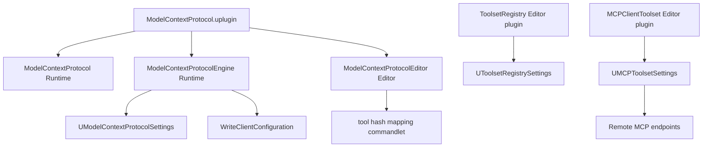

# Configuration and Build — UE 5.8 MCP

## Scope

This guide documents the UE 5.8 MCP server's Developer Settings and console variables, client configuration writer, plugin/module declarations and build dependencies. It also covers the separate Toolset Registry and MCP Client Toolset settings needed to expose editor tools or connect outward to another MCP server. Claims describe the source under `UE_5.8`; plugin availability and editor-only constraints matter because these plugins are experimental.

## Architecture



The server's port, URL path, startup policy, and tool-search policy are held by `UModelContextProtocolSettings`. Client-file generation is a separate Engine-module API. Toolset Registry filtering lives in its own editor plugin, while `MCPClientToolset` has settings for remote server connections. These are not interchangeable: the MCP server serves this editor's tools; the client toolset consumes other servers.

## Key types

| symbol | module | responsibility |
|---|---|---|
| `UModelContextProtocolSettings` | ModelContextProtocolEngine | Server path, port, auto-start, and tool-search settings. `config=EditorPerProjectUserSettings`; panel display name `Model Context Protocol`. |
| `UE::ModelContextProtocol::WriteClientConfiguration` | ModelContextProtocolEngine | Write one supported AI client config file, preserving JSON entries and refusing to overwrite Codex TOML. |
| `UE::ModelContextProtocol::WriteAllClientConfigurations` | ModelContextProtocolEngine | Generate all supported client configurations. |
| `UToolsetRegistrySettings` | ToolsetRegistry | Editor-per-project allow/block filters for tools, toolsets, agent skills, and SetObjectProperties. Display name `Toolset Registry`; category override returns `Plugins`. |
| `UToolsetRegistrySubsystem` | ToolsetRegistry | Editor subsystem that owns the registry. |
| `UMCPToolsetSettings` | MCPClientToolset | List of outbound MCP server connections; Editor settings panel `Plugins > MCP Toolset Servers`. `Config=EditorPerProjectUserSettings`; category/section overrides return `Plugins` / `MCP Toolset Servers`. |
| `FMCPServerConfig` | MCPClientToolset | One remote server's URL, auth, transport, enablement, and optional description. |
| `UModelContextProtocolToolHashMappingCommandlet` | ModelContextProtocolEditor | Enumerates native MCP tools and writes hashed tool/toolset mapping JSON. |

### Developer Settings and exact defaults

`UModelContextProtocolSettings` (`ModelContextProtocolEngine/Public/ModelContextProtocolSettings.h`) declares `config=EditorPerProjectUserSettings`, `meta=(DisplayName="Model Context Protocol")`. Its `Server` category contains `ServerUrlPath` (initialized from `UE::ModelContextProtocol::DefaultServerUrlPath`, `/mcp`) and `ServerPortNumber` (`8000`); `bAutoStartServer` is `false`. Its `Tools` category contains `bEnableToolSearch`, default `true`.

`UToolsetRegistrySettings` (`ToolsetRegistry/Public/ToolsetRegistry/ToolsetRegistrySubsystem.h`) has `config=EditorPerProjectUserSettings, defaultconfig`, display name `Toolset Registry`, and overrides `GetCategoryName()` to `Plugins`; no `GetSectionName()` override is declared in this class. Its default arrays are empty: `BlockedNames`, `AllowedNames`, `AgentSkillBlockedNames`, `AgentSkillAllowedNames`, `SetObjectPropertiesBlockedClasses`, `SetObjectPropertiesBlockedProperties`.

`UMCPToolsetSettings` (`MCPClientToolset/Public/MCPClientToolset/MCPToolsetSettings.h`) uses `Config=EditorPerProjectUserSettings`, display name `MCP Toolset Servers`, and overrides `GetContainerName()` → `Editor`, `GetCategoryName()` → `Plugins`, `GetSectionName()` → `MCP Toolset Servers`. `MCPServers` defaults to an empty array. For each `FMCPServerConfig`, `bEnabled=true`, transport `EMCPTransport::SSE` (`Legacy SSE (HTTP+SSE)`), and auth `EMCPAuth::BearerToken` (`Bearer Token (API Key)`); text fields default empty. `StreamableHTTP` and OAuth2 are additional declared enum options.

The `FMCPServerConfig` editable/config fields are `Name`, `Description`, `ServerUrl`, `ApiKey`, `bEnabled`, `Transport`, `Auth`, `OAuthClientId`, and `OAuthScope`. `Name`, `Description`, and `ServerUrl` are strings with no explicit initializer; `ApiKey`, `OAuthClientId`, and `OAuthScope` are also empty by default. The struct is `BlueprintType`, and both `EMCPTransport` and `EMCPAuth` are `BlueprintType` enums; this is evidence of reflected Blueprint visibility, not proof of a particular Blueprint workflow.

### Console variables

| CVar | source default | Effect |
|---|---:|---|
| `ModelContextProtocol.WrapPODToolResultsInObject` | `true` | Wrap non-object tool results as `{"result": ...}`. |
| `ModelContextProtocol.AudioResultOggFormat` | `false` | Return audio as Ogg instead of WAV. |
| `ModelContextProtocol.ProgressIntervalSeconds` | `1.0f` | Interval between async progress notifications when positive. |
| `ModelContextProtocol.PaginationPageSize` | `0` | Maximum list page size; zero disables pagination. |
| `ModelContextProtocol.EnableAnalytics` | `true` | Enable event recording through configured `IAnalyticsProviderET`. |

The exact POD-results CVar spelling is `WrapPODToolResultsInObject` (not `WrapPODResultsInObject`). All five CVar definitions are in `ModelContextProtocol/Private/ModelContextProtocol.cpp` and `ModelContextProtocolAnalytics.cpp`.

## Data flow

### Server settings and startup

`GetServerUrlPath()` reads the default settings object. `GetServerPortNumber()` accepts `-ModelContextProtocolPort=<port>` only for values 1–65535 and otherwise falls back to the configured `ServerPortNumber`. `ShouldAutoStartServer()` accepts `-ModelContextProtocolStartServer` as an explicit start request. The legacy `-StartModelContextProtocolServer` still starts but logs a deprecation warning. Without either flag, `bAutoStartServer` governs interactive sessions; commandlets skip config-driven auto-start to avoid racing an editor for the port. Explicit command-line start overrides that commandlet guard. `PostEditChangeProperty` validates a final (non-interactive) ServerUrlPath edit and restores `/mcp` for an invalid HTTP path.

With `bEnableToolSearch=true`, the editor tool-search integration exposes `list_toolsets`, `describe_toolset`, and `call_tool`, discovering tools on demand. With it false, registered toolset tools are presented as native MCP tools. This setting is also forcibly disabled by the hash-mapping commandlet before it refreshes and enumerates tools.

### Client config formats and base directory

The writer builds endpoint URLs as `http://127.0.0.1:<port><path>` and uses server key `unreal-mcp`. JSON configuration files are created or updated while preserving existing entries; Codex's TOML file is write-once and returns false if the target already exists.

| Client | file below base directory | servers key | URL field | `type` included |
|---|---|---|---|---|
| Claude Code | `.mcp.json` | `mcpServers` | `url` | yes |
| Cursor | `.cursor/mcp.json` | `mcpServers` | `url` | no |
| VS Code / Copilot | `.vscode/mcp.json` | `servers` | `url` | yes |
| Gemini CLI | `.gemini/settings.json` | `mcpServers` | `httpUrl` | no |
| Codex CLI | `.codex/config.toml` | `mcp_servers` | `url` | no; TOML |

If the API's optional `BaseDirectory` argument is empty, a source build uses `FPaths::RootDir()` (workspace root, containing `Engine/`). An installed/launcher build uses `FPaths::ProjectDir()` because the engine installation root is not the expected project configuration destination. A non-empty caller-supplied directory is used as-is. `WriteAllClientConfigurations` applies the same choice to all clients.

### Plugin/module build layout

`ModelContextProtocol.uplugin` is `IsExperimentalVersion: true`, `EnabledByDefault: false`, and `NoRedist: true`; it requires `EngineAssetDefinitions` and `ToolsetRegistry`.

| module | type / phase | dependency highlights from Build.cs |
|---|---|---|
| `ModelContextProtocol` | Runtime / Default | Public: Core, Analytics, AnalyticsET, HTTPServer, JsonUtilities, Json; private: CoreUObject. |
| `ModelContextProtocolEngine` | Runtime / Default | Public: Core, DeveloperSettings, ModelContextProtocol; private: CoreUObject, Analytics, AnalyticsET, Engine, HTTPServer, Json, JsonUtilities; editor target conditionally adds BlueprintGraph, JsonUtilitiesEditor, UnrealEd. |
| `ModelContextProtocolEditor` | Editor / Default | Public: Core, AssetDefinition, EngineAssetDefinitions, ModelContextProtocol, ModelContextProtocolEngine, Blutility; private editor/Slate/JSON modules and ToolsetRegistry. |
| `ModelContextProtocolTests` | UncookedOnly / Default | Tests runtime and engine APIs; private HTTP, JSON, Analytics, MCP modules. |
| `ModelContextProtocolEngineTests` | UncookedOnly / Default | Tests client config; private CoreUObject, Engine, Json and MCP modules. |
| `ModelContextProtocolEditorTests` | Editor / Default | Tests editor APIs; private dependencies on MCP modules and tests; under `Target.bBuildEditor`, UnrealEd/Slate/AssetDefinition/Blutility/ToolsetRegistry. |
| `ToolsetRegistry` | Editor / Default, Editor target | Private dependencies include `PythonScriptPlugin`, `EditorScriptingUtilities`, EditorSubsystem, UnrealEd, JSON, and other editor modules. |
| `MCPClientToolset` | Editor / PostEngineInit; Editor target | Public Core, ToolsetRegistry; private HTTP/HTTPServer, UnrealEd, DeveloperSettings, Engine, JSON. |
| `EditorToolset` | Editor / PostEngineInit; Editor target | Public Core; private editor/Slate/content browser modules and ToolsetRegistry. |

`ToolsetRegistry` is itself `EditorOnly`, experimental, `NoRedist`, disabled by default; its manifest enables `PythonScriptPlugin`, `EditorScriptingUtilities`, and `FileSandbox`. `MCPClientToolset` and `EditorToolset` manifests are `EditorOnly`; both use an Editor-target module with `PostEngineInit`. `MCPClientToolset` requires ToolsetRegistry. EditorToolset also requires ToolsetRegistry. The MCP core plugin has runtime modules as well as editor-only modules; enabling its runtime portion does not make its editor tool integrations available in a packaged runtime build.
#### Full Build.cs dependency declarations

The lists below distinguish public and private dependencies; conditional entries are marked.

| module | Public dependencies | Private dependencies |
|---|---|---|
| `ModelContextProtocol` | `Core`, `Analytics`, `AnalyticsET`, `HTTPServer`, `JsonUtilities`, `Json` | `CoreUObject` |
| `ModelContextProtocolEngine` | `Core`, `DeveloperSettings`, `ModelContextProtocol` | `CoreUObject`, `Analytics`, `AnalyticsET`, `Engine`, `HTTPServer`, `Json`, `JsonUtilities`; when `Target.bBuildEditor`: `BlueprintGraph`, `JsonUtilitiesEditor`, `UnrealEd` |
| `ModelContextProtocolEditor` | `Core`, `AssetDefinition`, `EngineAssetDefinitions`, `ModelContextProtocol`, `ModelContextProtocolEngine`, `Blutility` | `Projects`, `InputCore`, `EditorFramework`, `UnrealEd`, `ToolMenus`, `CoreUObject`, `Engine`, `Json`, `JsonUtilities`, `Slate`, `SlateCore`, `BlueprintGraph`, `DeveloperSettings`, `JsonUtilitiesEditor`, `KismetCompiler`, `ToolsetRegistry` |
| `ModelContextProtocolTests` | `Core` | `CoreUObject`, `Analytics`, `AnalyticsET`, `Json`, `JsonUtilities`, `HTTPServer`, `HTTP`, `ModelContextProtocol`, `ModelContextProtocolEngine` |
| `ModelContextProtocolEngineTests` | `Core` | `CoreUObject`, `Engine`, `Json`, `ModelContextProtocol`, `ModelContextProtocolEngine` |
| `ModelContextProtocolEditorTests` | `Core` | `CoreUObject`, `Engine`, `Json`, `JsonUtilities`, `HTTPServer`, `HTTP`, `ModelContextProtocol`, `ModelContextProtocolEngine`, `ModelContextProtocolEditor`, `ModelContextProtocolTests`; when `Target.bBuildEditor`: `UnrealEd`, `Slate`, `SlateCore`, `AssetDefinition`, `Blutility`, `ToolsetRegistry` |
| `ToolsetRegistry` | `Core` | `AssetRegistry`, `CoreUObject`, `DeveloperSettings`, `EditorFramework`, `EditorScriptingUtilities`, `EditorSubsystem`, `Engine`, `Json`, `JsonUtilities`, `JsonUtilitiesEditor`, `Kismet`, `PythonScriptPlugin`, `UnrealEd`, `FileSandboxCore` |
| `MCPClientToolset` | `Core`, `ToolsetRegistry` | `CoreUObject`, `DeveloperSettings`, `EditorSubsystem`, `Engine`, `HTTP`, `HTTPServer`, `Json`, `UnrealEd` |
| `EditorToolset` | `Core` | `AssetRegistry`, `ContentBrowser`, `ContentBrowserData`, `CoreUObject`, `EditorFramework`, `EditorScriptingUtilities`, `EditorSubsystem`, `Engine`, `Json`, `JsonUtilities`, `Kismet`, `LevelEditor`, `RenderCore`, `RHI`, `Slate`, `SlateCore`, `StatusBar`, `ToolsetRegistry`, `UnrealEd` |

`ModelContextProtocolTests` adds a private include path to the runtime module's `Private/Tests`. `ModelContextProtocolEditorTests` adds private include paths for the shared test utilities and the editor module's private headers. ToolsetRegistry also sets `WITH_AIASSISTANT_EPIC_INTERNAL=1`; MCPClientToolset sets the same public definition. ToolsetRegistry and MCPClientToolset enable full IWYU and unity builds in their rules; EditorToolset does not add these settings.

#### Related plugin manifests

`ToolsetRegistry.uplugin` declares `EditorOnly: true`, `EnabledByDefault: false`, `IsExperimentalVersion: true`, and `NoRedist: true`. Its `ToolsetRegistry` module is `Editor`, phase `Default`, and limited to the `Editor` target. Its manifest dependencies are `PythonScriptPlugin`, `EditorScriptingUtilities`, and `FileSandbox`, all enabled. The Build.cs specifically names `PythonScriptPlugin` as a private module dependency.

`MCPClientToolset.uplugin` is `EditorOnly`, experimental, beta, and disabled by default; module `MCPClientToolset` is `Editor`, `PostEngineInit`, and Editor-target-only. It depends on ToolsetRegistry. `EditorToolset.uplugin` is also EditorOnly and experimental; its `EditorToolset` module is Editor / PostEngineInit / Editor-target-only, and it depends on ToolsetRegistry. EditorToolset can contain content; MCPClientToolset cannot. These are separate manifests from `ModelContextProtocol.uplugin`.

#### Start and refresh console commands

The runtime module registers `ModelContextProtocol.StartServer` as a console command. It explicitly starts the HTTP server; its optional argument is a port (`ModelContextProtocol.StartServer <port>`). The adjacent commands are `ModelContextProtocol.StopServer` and `ModelContextProtocol.RefreshTools`. These console commands are distinct from startup command-line switches: `-ModelContextProtocolPort=<port>` selects the configured port override, while `-ModelContextProtocolStartServer` explicitly requests start during startup. The legacy `-StartModelContextProtocolServer` is accepted with a deprecation warning. Commandlet config auto-start is skipped unless the explicit start flag is present.

### Commandlet

`UModelContextProtocolToolHashMappingCommandlet` is declared by ModelContextProtocolEditor. Its `Main` can optionally tick the engine for `TickEngineSeconds` (default 30 seconds), refresh registered tools, create parent directories, and write sorted tool/toolset hash maps. It requires the MCP module and at least one tool; an unavailable module or empty resulting tool list is an error exit. `Print` emits the resulting JSON in the log. Source code supports `-ModelContextProtocolStartServer` for a commandlet explicitly needing the HTTP server; ordinary settings-based start is intentionally suppressed in commandlets.

## Usage

### Enable plugins in a project

1. Open the `.uproject` in the UE 5.8 editor and enable **Unreal MCP** (`ModelContextProtocol`) and **Toolset Registry** (`ToolsetRegistry`) in Plugins. The MCP manifest is disabled by default; Toolset Registry is editor-only and depends on the Python Script Plugin, Editor Scripting Utilities, and File Sandbox plugins.
2. Enable **EditorToolset** if the editor's built-in editor toolset is needed; enable **MCP Client Toolset** only when connecting to external MCP servers. Their module names are `EditorToolset` and `MCPClientToolset`, respectively. They load PostEngineInit and are Editor-target modules.
3. Restart the editor after enabling plugins. For a C++ project, allow UnrealBuildTool to compile the enabled plugins; their `Build.cs` files declare the actual module dependencies. Do not add these editor-only toolsets as runtime dependencies of a packaged game.
4. In **Editor Preferences > Plugins > Model Context Protocol**, configure path and port if the defaults `/mcp` and `8000` do not suit the project. Set auto-start on only if every interactive editor session should bind the server; otherwise use the module's explicit start control/command.
5. Set `bEnableToolSearch` according to the desired discovery mode. Register toolsets in Toolset Registry and configure its allow/block arrays if filtering is wanted. For remote connections configure **Editor Preferences > Plugins > MCP Toolset Servers**, adding an `FMCPServerConfig` with name, URL, transport and auth.
6. Generate client files by calling `UE::ModelContextProtocol::WriteClientConfiguration` or `WriteAllClientConfigurations` from code with the desired port/path. Alternatively edit client files manually using the paths and fields above. Inspect Codex's target before calling: the writer intentionally will not overwrite an existing `.codex/config.toml`.

For a `.uproject` plugin entry, the module/plugin names are exactly the manifest names. For example, a project may enable the plugins with entries equivalent to `{"Name":"ModelContextProtocol","Enabled":true}` and `{"Name":"ToolsetRegistry","Enabled":true}`; enable `EditorToolset` or `MCPClientToolset` only when those features are needed. [INFERENCE] The precise location/order of generated `.uproject` entries is controlled by Unreal's project/plugin manager rather than shown in these plugin source files.

Example C++ generation call (include `ModelContextProtocolClientConfig.h`; the caller's module needs `ModelContextProtocolEngine`):

```cpp
UE::ModelContextProtocol::WriteAllClientConfigurations(
    8000,
    TEXT("/mcp"));
```

To target a specific project directory explicitly, pass it as the optional final `BaseDirectory`; without that argument the writer applies source/installed build rules. These APIs generate config; they do not themselves start the server.

## Pitfalls

- Plugin manifests say `EnabledByDefault: false`; do not infer the feature is active just because the engine ships the source.
- `ModelContextProtocol` and `ModelContextProtocolEngine` are runtime modules, but `ModelContextProtocolEditor`, ToolsetRegistry, EditorToolset, and MCPClientToolset are editor-side. ToolsetRegistry's `PythonScriptPlugin` dependency is private in its Build.cs and also an explicit plugin dependency in its manifest.
- The MCP plugin's test modules are `UncookedOnly`; they are not game runtime modules. Module type and build-target conditions should not be collapsed into one blanket “editor-only” statement.
- `MCPClientToolset`'s default `EMCPTransport::SSE` is named Legacy SSE, distinct from server transport behavior; changing to Streamable HTTP is a config choice, not evidence that every remote server supports it.
- JSON client config updates preserve existing entries; Codex TOML is write-once. Do not assume repeated generation is idempotent for Codex.
- An empty explicit base directory invokes the source-vs-installed heuristic. Installed builds target `ProjectDir()`, while source builds target `RootDir()`; callers can override both with a non-empty path.
- `bAutoStartServer` does not auto-start a server in commandlets. Use the explicit `-ModelContextProtocolStartServer` flag when that behavior is intentional; the old `-StartModelContextProtocolServer` alias warns as deprecated.
- `ModelContextProtocolPort=` command-line values outside 1–65535 are rejected and settings fallback is used. URL paths edited in the settings UI are validated only after the interactive edit ends.
- Tool filtering has allow and block arrays; comments state blocking takes precedence over allowed names. A block list pattern wrapped in `/.../` is regex; other patterns are case-insensitive substrings.
- The mapping commandlet disables tool-search mode to enumerate tools natively, ticks for a default 30 seconds, and fails if it cannot find tools. This is an offline mapping export, not server startup.

## Source files

Paths are relative to `UE_5.8/Engine/Plugins/Experimental/` unless noted:

- `ModelContextProtocol/ModelContextProtocol.uplugin` — MCP module types/phases, dependencies and plugin flags.
- `ModelContextProtocol/Source/ModelContextProtocol/ModelContextProtocol.Build.cs` — runtime protocol module dependencies.
- `ModelContextProtocol/Source/ModelContextProtocol/Private/ModelContextProtocol.cpp` — CVar defaults and tool-name validation.
- `ModelContextProtocol/Source/ModelContextProtocol/Private/ModelContextProtocolAnalytics.cpp` — analytics enable CVar.
- `ModelContextProtocol/Source/ModelContextProtocolEngine/Public/ModelContextProtocolSettings.h` and `Private/ModelContextProtocolSettings.cpp` — server settings, config access, command-line behavior and URL validation.
- `ModelContextProtocol/Source/ModelContextProtocolEngine/Public/ModelContextProtocolClientConfig.h` and `Private/ModelContextProtocolClientConfig.cpp` — client enums, paths, JSON/TOML writers and base-directory policy.
- `ModelContextProtocol/Source/ModelContextProtocolEngine/ModelContextProtocolEngine.Build.cs` — engine-facing runtime module dependencies.
- `ModelContextProtocol/Source/ModelContextProtocolEditor/ModelContextProtocolEditor.Build.cs` — editor module dependencies.
- `ModelContextProtocol/Source/ModelContextProtocol{Tests,EngineTests,EditorTests}/ModelContextProtocol*.Build.cs` — test module types' build dependencies.
- `ModelContextProtocol/Source/ModelContextProtocolEditor/Private/ModelContextProtocolToolHashMappingCommandlet.cpp` — hash mapping export commandlet.
- `ToolsetRegistry/ToolsetRegistry.uplugin`, `ToolsetRegistry/Source/ToolsetRegistry/ToolsetRegistry.Build.cs`, and `.../Public/ToolsetRegistry/ToolsetRegistrySubsystem.h` — registry plugin, dependencies, subsystem and settings.
- `Toolsets/MCPClientToolset/MCPClientToolset.uplugin`, `.../Source/MCPClientToolset/MCPClientToolset.Build.cs`, `.../Public/MCPClientToolset/MCPToolsetSettings.h`, `.../Private/MCPClientToolset/MCPToolsetSettings.cpp` — remote-client plugin/settings.
- `Toolsets/EditorToolset/EditorToolset.uplugin` and `.../Source/EditorToolset/EditorToolset.Build.cs` — built-in editor toolset manifest and dependencies.

## Graph facts

The MCP source corpus contains **9,250 nodes**, **15,786 internal edges**, **7,518 cross-community edges**, and **287 communities**. The relevant plugin node counts are: ModelContextProtocol **820**, ToolsetRegistry **2,178**, MCPClientToolset **145**, and EditorToolset **2,906**. Across the full MCP corpus, relations include references (6,018), calls (5,824), method (2,673), contains (2,538), rationale_for (2,396), imports (1,562), defines (1,239), uses (448), imports_from (302), inherits (258), indirect_call (32), and re_exports (14). These counts are corpus-wide, not a measure of build/runtime capability. Source: `local://mcp_graph_facts.md`.
