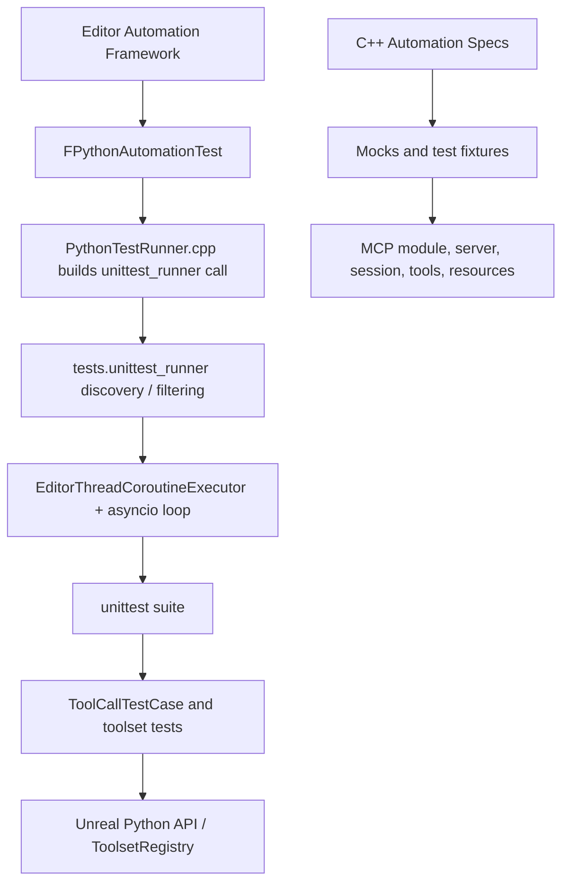

# Testing — UE 5.8 MCP

## Scope

This guide maps the source-defined automated tests for Model Context Protocol (MCP), ToolsetRegistry, and Python toolsets. It describes test entry points and harness mechanics, not a claim that tests were run. The MCP plugin has three test modules: `ModelContextProtocolTests`, `ModelContextProtocolEngineTests`, and `ModelContextProtocolEditorTests`; ToolsetRegistry has its own C++ automation specs and a Python `unittest` suite driven through Unreal's automation framework.

## Architecture



The MCP C++ test modules are separate from the ToolsetRegistry Python test harness. ToolsetRegistry's `PythonTestRunner.cpp` implements Unreal automation tests, builds Python search options and invokes the Python runner; Python discovers unittest modules and runs cases asynchronously. `toolset_registry.tests` re-exports `discover_tests`, `run_tests`, and `run_test` from `unittest_runner.py`.

## Key types

| symbol | module | responsibility |
|---|---|---|
| `FMockModelContextProtocolTool` | ModelContextProtocolTests | Configurable fake tool, records invocation parameters, async calls, cancellation. |
| `FMockModelContextProtocolResourceProvider` | ModelContextProtocolTests | In-memory resource descriptors/content and list/read call tracking. |
| `FMockAnalyticsProviderET` | ModelContextProtocolTests | Captures analytics event names and attributes. |
| `UMockToolsetDefinition` | ModelContextProtocolEditorTests | Reflected mock toolset with `Greet` and `Add` callable functions. |
| `FPythonAutomationTest` | ToolsetRegistry | Unreal automation-test object whose `GetTests`/execution bridge to Python unittest. |
| `EditorThreadCoroutineExecutor` | ToolsetRegistry Python | Owns editor-thread coroutine execution used by the unittest runner. |
| `ToolCallTestCase` | ToolsetRegistry Python | Base unittest helpers to assert tool-call `RuntimeError`s. |
| `BlueprintToolsTestCase` | EditorToolset Python | Representative test fixture for Blueprint tool operations. |
| `SequencerToolsTestCase` | AnimationAssistantToolset Python | Representative Sequencer test case built on `SequencerTestBase`. |

## Data flow

1. Unreal's automation system registers/runs a `FPythonAutomationTest` (ToolsetRegistry C++).
2. The C++ runner validates search strings and constructs a Python `unittest_runner.TestSearchOptions(...)` expression. It calls into initialized `IPythonScriptPlugin`.
3. Python discovery searches modules using the configured root and module glob (default `test_*`), optionally filters test IDs using name globs, and makes unittest suites.
4. `run_test` wraps a case/suite in `unittest.TestSuite`, obtains the thread-local `EditorThreadCoroutineExecutor`, and submits the suite to its asyncio loop. Completion/failure is returned through a future/callback with output shaped for Unreal Automated tests.
5. Toolset test cases register test toolsets where needed, invoke through registry APIs, assert results or errors, and release temporary editor assets.

`run_test_on_thread` is a distinct fixture decorator in `tests/_asyncio/__init__.py`: it executes a test body in a one-worker `ThreadPoolExecutor` and enters an optional `_setup()` context manager. Its documented purpose is to run without an asyncio event loop, which lets event-loop tests control their loop setup independently.

## Usage

### C++ automation modules

The module directories and their representative coverage are:

- `ModelContextProtocol/Source/ModelContextProtocolTests/Private`: core protocol behavior. Files include `ModelContextProtocolToolResultsTests.cpp` (tool result encoding), `ModelContextProtocolUtilsTests.cpp` (utility behavior), `ModelContextProtocolServerTests.cpp` (server scheduling and URL path), `ModelContextProtocolSessionTests.cpp` (request IDs/session state), `ModelContextProtocolToolNameTests.cpp` (tool-name validation), `ModelContextProtocolResourcesTests.cpp` (resources), `ModelContextProtocolModuleTests.cpp` (module registrations), `ModelContextProtocolEngineSubsystemTests.cpp` (server behavior), and `ModelContextProtocolAnalyticsTests.cpp` (analytics events). Specs use `BEGIN_DEFINE_SPEC` / `Describe` / `It` and `EAutomationTestFlags`.
- `ModelContextProtocol/Source/ModelContextProtocolEngineTests/Private/Tests/ModelContextProtocolClientConfigTests.cpp`: client configuration generation.
- `ModelContextProtocol/Source/ModelContextProtocolEditorTests/Private/Tests`: editor tool utilities, tool-library factory, toolset registry integration, asset definitions, and hash-mapping commandlet. The toolset registry tests register `UMockToolsetDefinition`, call `RefreshTools`, and exercise tool listing/calls.
- `ToolsetRegistry/Source/ToolsetRegistry/Private/Tests`: registry and toolset mechanics, schemas/converters, async results/futures, thread dispatch, sandbox, and Python test-runner integration. Examples include `ToolsetRegistryTest.cpp`, `FunctionLibraryToolsetTest.cpp`, `ToolCallAsyncResultTest.cpp`, `RunOnMainThreadTest.cpp`, and `PythonTestRunnerTest.cpp`.

The mock pattern is stateful and observable rather than a full server substitute. `FMockModelContextProtocolTool` exposes editable name/schema and a `RunFunction`; `Run` marks `bRunCalled`, saves `LastRunParams`, and invokes the function or returns a default text result. Async and cancel methods similarly record IDs. `FMockModelContextProtocolResourceProvider` stores descriptor/resource maps; its list/read methods set flags and preserve `LastReadUri`. `FMockAnalyticsProviderET` leaves unrelated interface calls inert while appending `RecordEvent` values to `RecordedEvents`. In the editor module, `UMockToolsetDefinition` is a real `UToolsetDefinition` subclass, so tests can validate reflected tool registration and calls through the registry.

`ModelContextProtocol/Source/ModelContextProtocolTests/Private/ModelContextProtocolTestUtilities.h` supplies JSON-RPC request/notification builders, base URL construction, serialization and SSE parsing helpers. `ModelContextProtocol/Source/ModelContextProtocol/Private/Tests/ModelContextProtocolServerAccessor.h` and `.cpp` provide test access to server internals without changing the production interface.

### Python tests and harness

`ToolsetRegistry/Content/Python/toolset_registry/tests/automation.py` defines `create_temp_folder()`: it obtains `EditorAssetSubsystem`, creates a UUID-named directory under `/Automation/`, adds the automation mount point, yields the path, then deletes the directory if it exists and unmounts. It rejects reentrant use; share the same folder for nested setup.

`toolset_testcase.py` provides `ToolCallTestCase.assertToolRaisesRuntimeError()` around `tool_raising_exceptions()`. `DemoToolsetTestCase` and `ErrorProneToolsetTestCase` register their sample toolset classes in `setUpClass` and unregister in `tearDownClass`.

Representative exact source example from `EditorToolset/Content/Python/editor_toolset/tests/test_blueprint.py`:

```python
    def test_create(self):
        """Ensures that we can create a blueprint asset."""
        self.assertIsInstance(self.blueprint, unreal.Blueprint)
        self.assertIsInstance(
            unreal.get_default_object(self.blueprint.generated_class()), unreal.Actor)
```

The surrounding `BlueprintToolsTestCase.setUp` creates one `create_temp_folder()` fixture and a Blueprint; teardown clears UObject-referencing Python attributes before closing the folder context. A second style is `AnimationAssistantToolset/Content/Python/animation_toolset/tests/test_sequencer_toolset.py`: `SequencerToolsTestCase(SequencerTestBase)` tests lifecycle and editor operations, e.g. `test_create_level_sequence` asserts the result is an `unreal.LevelSequence`.

`test_execute_tool.py` demonstrates a registry-level async test: `TestExecuteTool` inherits a registering fixture and `unittest.IsolatedAsyncioTestCase`, awaits `execute_tool(toolset_name, tool_name, request)`, then asserts the returned `returnValue`; adjacent cases cover invalid tool and toolset, no return, and parameter types. The separate `_asyncio` tests exercise loop lifecycle, polling, timeout, callable scheduling, and executor behavior; decorators use `run_test_on_thread` where loop isolation is necessary.

Script-error handling has an intentional thread-sensitive distinction. In normal tool calls, exceptions are caught and sent to `unreal.SystemLibrary.raise_script_error` so C++ ToolsetRegistry can examine and forward them to the agent. `test_tool_call.py`'s `TestToolCallWithRaising` uses `tool_raising_exceptions()` to make errors re-raise for Python assertions. **[INFERENCE]** Any test that needs to observe the engine's script-error reporting path must execute in the editor/game-thread context expected by the Unreal API; the Python runner's editor-thread coroutine executor supports that integration, whereas `run_test_on_thread` explicitly moves work to a background thread and is not interchangeable with it.

## Pitfalls

- `create_temp_folder()` cannot be nested: its module-level mount state asserts on a second active entry. Reuse a single folder instead.
- Keep Python wrappers referencing Blueprint UObjects out of scope before deleting the generated assets; the Blueprint test fixture explicitly clears references before closing its folder context.
- Do not infer that all Python tests are background-thread tests: the automation runner uses the editor coroutine executor, while `run_test_on_thread` is specifically for tests requiring a no-loop background context.
- Use `tool_raising_exceptions()` only when a test should see exceptions directly. Normal tool invocation captures and reports them via Unreal's script-error mechanism.
- Unreal asset/editor tests may depend on editor context; `test_create_bad_asset_type_fails` is explicitly skipped when unattended because its factory can display a modal dialog.

## Source files

All paths below are relative to `UE_5.8/Engine/Plugins/Experimental/`.

- `ModelContextProtocol/Source/ModelContextProtocolTests/Private/ModelContextProtocolTestsModule.cpp`
- `ModelContextProtocol/Source/ModelContextProtocolTests/Private/ModelContextProtocolTestUtilities.h`
- `ModelContextProtocol/Source/ModelContextProtocolTests/Private/Mocks/MockModelContextProtocolTool.h`
- `ModelContextProtocol/Source/ModelContextProtocolTests/Private/Mocks/MockModelContextProtocolResourceProvider.h`
- `ModelContextProtocol/Source/ModelContextProtocolTests/Private/Mocks/MockAnalyticsProviderET.h`
- `ModelContextProtocol/Source/ModelContextProtocolTests/Private/Tests/ModelContextProtocol{ToolResults,Utils,Server,Session,ToolName,Resources,Module,EngineSubsystem,Analytics}Tests.cpp`
- `ModelContextProtocol/Source/ModelContextProtocol/Private/Tests/ModelContextProtocolServerAccessor.{h,cpp}`
- `ModelContextProtocol/Source/ModelContextProtocolEngineTests/Private/Tests/ModelContextProtocolClientConfigTests.cpp`
- `ModelContextProtocol/Source/ModelContextProtocolEditorTests/Private/Tests/ModelContextProtocol{ToolUtils,ToolLibraryFactory,ToolsetRegistry,AssetDefinitions,ToolHashMappingCommandlet}Tests.cpp`
- `ModelContextProtocol/Source/ModelContextProtocolEditorTests/Private/Mocks/MockToolsetDefinition.{h,cpp}`
- `ToolsetRegistry/Source/ToolsetRegistry/Private/Tests/` (including `PythonTestRunnerTest.cpp`)
- `ToolsetRegistry/Source/ToolsetRegistry/Private/ToolsetRegistry/PythonTestRunner.{h,cpp}`
- `ToolsetRegistry/Content/Python/toolset_registry/tests/{automation.py,unittest_runner.py,toolset_testcase.py,editor_thread_coroutine_executor.py}`
- `ToolsetRegistry/Content/Python/toolset_registry/tests/_asyncio/__init__.py`
- `ToolsetRegistry/Content/Python/toolset_registry/tests/test_execute_tool.py`
- `ToolsetRegistry/Content/Python/toolset_registry/tests/test_registration.py`
- `ToolsetRegistry/Content/Python/toolset_registry/tests/test_registry_interface.py`
- `Toolsets/EditorToolset/Content/Python/editor_toolset/tests/test_blueprint.py`
- `Toolsets/AnimationAssistantToolset/Content/Python/animation_toolset/tests/test_sequencer_toolset.py`

### Named C++ automation specs

The MCP core automation identifiers visible in source include:

- `AI.ModelContextProtocol.Analytics` — analytics recording and attribute behavior.
- `AI.ModelContextProtocol.Server.ScheduleToolsListChangedBroadcast` — scheduled list-changed broadcast.
- `AI.ModelContextProtocol.Server.UrlPath` — server URL-path validation behavior.
- `AI.ModelContextProtocol.Settings.EnforceValidServerUrlPath` — settings validation.
- `AI.ModelContextProtocol.Session` — request ID and session status behavior.
- `AI.ModelContextProtocol.ToolNames` — tool-name rules.
- `AI.ModelContextProtocol.ToolResults` — result representation.
- `AI.ModelContextProtocol.Resources` — resource-provider/list/read behavior.
- `AI.ModelContextProtocol.Module` — module registration behavior.
- `AI.ModelContextProtocol.Server` — server-facing behavior.
- `AI.ModelContextProtocol.Utils` — shared helper behavior.
- `AI.ModelContextProtocol.ClientConfig` — client config output.
- `AI.ModelContextProtocol.Editor.Factory` — editor tool-library factory.
- `AI.ModelContextProtocol.Editor.AssetDefinitions` — asset definition integration.
- `AI.ModelContextProtocol.ToolsetRegistry` — MCP discovery and calls via ToolsetRegistry.
- `AI.ModelContextProtocol.ToolUtils` — editor tool utility behavior.
- `AI.ModelContextProtocol.ToolHashMappingCommandlet` — commandlet mapping behavior.

These are automation paths registered by the specs, not a list of individual `It` descriptions. The test names and path strings above match registrations in their respective `BEGIN_DEFINE_SPEC` declarations. ToolsetRegistry tests use the `AI.ToolsetRegistry.*` namespace; for example, `FunctionLibraryToolsetTest.cpp` contains separately registered cases such as `AI.ToolsetRegistry.FunctionLibraryToolset.RegisterNullClass`, `AI.ToolsetRegistry.FunctionLibraryToolset.GetSchema`, and `AI.ToolsetRegistry.FunctionLibraryToolset.ExecuteTool`.

### Python harness units

The Python suite has two layers:

- `toolset_registry/tests/test_registration.py` tests toolset class registration and unregister behavior.
- `toolset_registry/tests/test_registry_interface.py` tests the Python-facing registry interface.
- `toolset_registry/tests/test_execute_tool.py` tests invoking registered tools, request conversion, errors, and return values.
- `toolset_registry/tests/test_tool_call.py` tests tool-call wrappers, including the exception-raising context manager.
- `toolset_registry/tests/test_toolset_registry.py` exercises registry behavior at the Python layer.
- `toolset_registry/tests/test_unittest_runner.py` tests discovery, filtering, output, callbacks and success/failure reporting.
- `toolset_registry/tests/test_editor_thread_coroutine_executor.py` tests coroutine scheduling and executor lifecycle.
- `toolset_registry/tests/_asyncio/` tests event-loop primitives, context propagation, polling, timeouts and thread dispatch.

Names are discovered from unittest methods rather than declared as fixed C++ automation cases. `unittest_runner.TestSearchOptions` provides the root module, module glob and test-name globs; the default test module glob is `test_*`. `run_test` accepts either a `unittest.TestCase` or `unittest.TestSuite`, wrapping a single case in a suite to preserve `setUpClass` and `tearDownClass` behavior.

`FPythonTestRunnerSearchOptions::BuildPythonCode` rejects a single quote in values before emitting Python source. This is a narrow source-generation guard; it is not a substitute for arbitrary Python input handling. The runner's `FPythonAutomationTest::GetTestFlags` marks tests `EditorContext`, `ProductFilter`, and `CriticalPriority`, and its `GetRequiredDeviceNum` returns one.

### Creating a toolset test

Use `unittest.TestCase` (or `ToolCallTestCase` for invocation-error assertions), import the production toolset method, set up any required editor assets in a context manager, and assert observable results. For a toolset that is invoked through `execute_tool`, inherit a fixture that registers the Python `ToolsetDefinition` class, and unregister it at class teardown. For Unreal object or asset tests, use `create_temp_folder()` and release references before leaving its context. Keep test names prefixed with `test_` so default discovery includes the module.

The copied Blueprint example above intentionally shows a real test method with its fixture's `self.blueprint`; it is not pseudocode. For a new test, add assertions alongside existing methods in the relevant `test_<area>.py` module and use the established fixture class rather than duplicating registration or mount setup.

The C++ source filenames are intentionally spelled out because test area labels alone can obscure which module owns a test. `ModelContextProtocolServerTests.cpp` contains separate specs for broadcast scheduling, URL-path handling, and settings enforcement; `ModelContextProtocolEngineSubsystemTests.cpp` is a server spec in the core test module despite its filename. Editor-specific coverage is not the same as the Engine module's client-config tests.

The ToolsetRegistry C++ suite is broader than MCP-facing registration. `ToolCallAsyncResultImageTest.cpp`, `ToolCallAsyncResultStringTest.cpp`, `ToolCallAsyncResultVoidTest.cpp`, and `ToolCallAsyncResultTest.cpp` cover async result variants; `ValueOrErrorFutureTest.cpp` and `UntilFutureCommandTest.cpp` exercise futures; converter and JSON tests cover schema and value conversions. `PythonTestRunnerTest.cpp` provides C++ coverage for the bridge independently of Python's own `test_unittest_runner.py`.

Python runner details are split between `unittest_runner.py` and `editor_thread_coroutine_executor.py`. The runner supports discovery and execution separately, filtering by unittest ID globs, verbosity, and completion callbacks. Its async suite path repeatedly yields while waiting for the worker future; errors and failures are written to the configured error stream and passed to the completion handler with a success flag.

Do not confuse `test_execute_tool.py`'s `TestExecuteTool` case with Unreal's C++ automation test `FPythonAutomationTest`: one is a Python unittest class, the other is the engine automation adapter that finds and drives it. Likewise `run_test_on_thread` is a decorator helper tested in `_asyncio` and executor suites, not the C++ runner's thread-selection API.

In `editor_thread_coroutine_executor.py`, `EditorThreadCoroutineExecutor` derives from `EditorThreadTicker`, owns an `EditorEventLoopManager`, and schedules coroutines for editor-thread ticks. Its polling loop executes queued work in batches bounded by `_MAXIMUM_TICK_TIME` (16 ms); the `loop` property exposes the editor-thread asyncio loop, including for scheduling from another thread.

This editor-thread distinction matters for error capture: `tool_call_impl.py` routes caught tool exceptions through `unreal.SystemLibrary.raise_script_error`, while `test_tool_call.py` documents that the C++ registry examines that raised script error and forwards it to the agent. Tests asserting the Python exception directly opt into `tool_raising_exceptions()`. **[INFERENCE]** A test validating engine-side script-error detection must run through the editor-thread executor because the reporting API participates in editor/C++ processing; background `run_test_on_thread` execution is used for event-loop isolation, not as proof of game-thread behavior.

The inspected test registrations are guarded by automation build/editor macros such as `WITH_DEV_AUTOMATION_TESTS` and, for editor-only cases, `WITH_EDITOR`. The MCP editor test spec itself is editor-scoped. No additional game-feature or plugin-availability test gate was identified in the inspected files. **[INFERENCE]** Build configuration may further control compilation of test modules; this guide makes no assertion beyond the source guards inspected.

## Graph facts

Corpus roots include `Engine/Plugins/Experimental/ModelContextProtocol`, `ToolsetRegistry`, and `Toolsets`. The complete MCP corpus has **9,250 nodes**, **15,786 internal edges**, **7,518 cross-community edges**, and **287 communities**. Relevant graph metrics: ToolsetRegistry has **2,178 nodes**, EditorToolset **2,906**, AnimationAssistantToolset **1,162**, and ModelContextProtocol **820**. Test-related high-degree files include `EditorToolset/.../tests/test_blueprint.py` (degree **135**), `ToolsetRegistry/.../tests/automation.py` (**93**), and `AnimationAssistantToolset/.../tests/test_sequencer_toolset.py` (**84**); symbols include `create_temp_folder()` (**93**) and `run_test_on_thread()` (**77**). These graph counts describe indexed source relationships, not test counts or pass rates.
