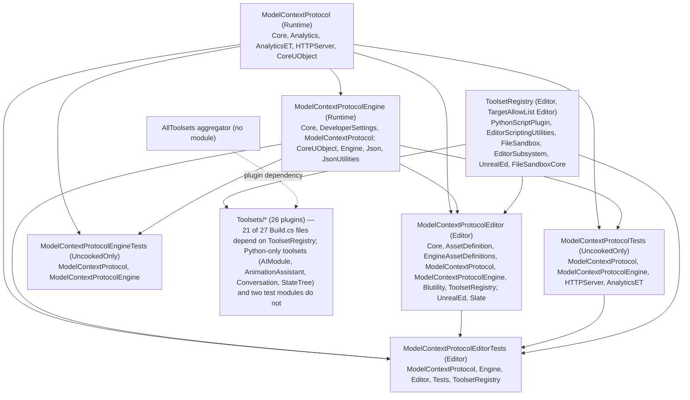

# Model Context Protocol (MCP) — Architecture & Usage, UE 5.8

Full documentation set for every element of Unreal Engine 5.8's MCP system: what an AI agent can control in Unreal, how it controls it, and the current capabilities and limits. Grounded in the actual UE 5.8 source (`UE_5.8`). Each file covers **architecture** (types, responsibilities, key APIs, data flow) and **usage** (patterns, examples, pitfalls).

## Index

| File | Scope |
|---|---|
| [01_Overview_and_Architecture.md](01_Overview_and_Architecture.md) | System layering, module inventory, Unreal as server and as client, Build.cs dependency graph |
| [02_Protocol_Layer_JSON_RPC_and_Transport.md](02_Protocol_Layer_JSON_RPC_and_Transport.md) | JSON-RPC methods, HTTP routes, SSE, sessions, negotiation, progress, pagination, cancellation |
| [03_Tool_Model_Execution_and_Results.md](03_Tool_Model_Execution_and_Results.md) | `IModelContextProtocolTool`, sync/async execution, result content types, schemas, name validation, threading |
| [04_Resources_Analytics_and_Progress.md](04_Resources_Analytics_and_Progress.md) | Resource providers, descriptors, URI routing, analytics events, Blake3 tool hashing, path guard |
| [05_ToolsetRegistry_Framework.md](05_ToolsetRegistry_Framework.md) | `FToolset`, `FToolsetRegistry`, `UToolsetDefinition`, filters, converters, async results, sandbox |
| [06_Python_Toolset_Bridge.md](06_Python_Toolset_Bridge.md) | `@toolset_registry.tool_call`, annotations → UFunction, registration, reload, editor-thread loop, agent skills |
| [07_Toolset_Catalog.md](07_Toolset_Catalog.md) | Per-plugin capability catalog with real tool names across all 26 toolset plugins |
| [08_EditorToolset_Deep_Dive.md](08_EditorToolset_Deep_Dive.md) | Largest toolset: Blueprint graph/DSL model, pins, materials, scene, programmatic transactions, bundled skills |
| [09_AI_Agent_Control_Surface.md](09_AI_Agent_Control_Surface.md) | Tool search vs eager registration, agent turn shape, output formats, undo, sandbox, automation, Live Coding |
| [10_Limits_Safety_and_Security.md](10_Limits_Safety_and_Security.md) | Current limits with file:line evidence — transport, auth, editor-only, schema enforcement, partial writes |
| [11_Configuration_and_Build.md](11_Configuration_and_Build.md) | Settings, CVars, command-line flags, client config generation, plugin manifests, project setup |
| [12_Testing.md](12_Testing.md) | C++ automation test modules, Python unittest harness, mocks, game-thread error detection |

## Layered map

```mermaid
graph TD
    AI["AI client (Claude Code, Cursor, VS Code, Gemini, Codex)"]
    TR["Transport: HTTP POST (JSON-RPC), GET (SSE), DELETE (session end)<br/>port 8000, path /mcp, server name unreal-mcp"]
    SRV["ModelContextProtocol module<br/>(JSON-RPC dispatch, sessions, capabilities, results, analytics)"]
    REG["ToolsetRegistry (editor subsystem)<br/>FToolsetRegistry, FToolset, filters, converters"]
    ED["ModelContextProtocolEditor<br/>(tool search, tool library factory, asset definitions, hash commandlet)"]
    TS["Toolsets plugins — C++ UFUNCTION(meta=(AICallable)) and Python @toolset_registry.tool_call"]
    ENG["Engine / editor object model (assets, Blueprint graphs, actors, Niagara, GAS, tests)"]
    CLI["MCPClientToolset — Unreal as MCP client pulling external servers into the registry"]
    AI --> TR --> SRV --> REG --> TS --> ENG
    SRV --> ED
    ED --> REG
    CLI --> REG
```

Tool-search mode (`bEnableToolSearch=true`, the default) collapses the agent's view to three meta-tools — `list_toolsets`, `describe_toolset`, `call_tool` — and discovers toolsets on demand; with it off, every registered toolset tool is exposed natively at startup.

## Module map

## Plugin manifests

| Plugin | Path | EditorOnly | EnabledByDefault | Notes |
|---|---|---|---|---|
| Unreal MCP | `Engine/Plugins/Experimental/ModelContextProtocol` | no | false | experimental, `NoRedist`, deps `EngineAssetDefinitions` + `ToolsetRegistry`; 6 modules (2 Runtime, 1 Editor, 2 UncookedOnly, 1 Editor test) |
| Toolset Registry | `Engine/Plugins/Experimental/ToolsetRegistry` | yes | false | experimental, `NoRedist`, `TargetAllowList: [Editor]`, deps `PythonScriptPlugin`, `EditorScriptingUtilities`, `FileSandbox` |
| All Toolsets | `Engine/Plugins/Experimental/Toolsets/AllToolsets` | yes | false | aggregator over 21 toolset plugins; no module of its own |
| Toolset plugins | `Engine/Plugins/Experimental/Toolsets/<name>` | yes | false (all 26) | each contributes toolsets to the registry |

## Source roots

- Protocol layer: `Engine/Plugins/Experimental/ModelContextProtocol/Source/ModelContextProtocol` (`Public/ModelContextProtocol.h`, `ModelContextProtocolServer.h`, `ModelContextProtocolSession.h`, `ModelContextProtocolCapabilities.h`, `IModelContextProtocolTool.h`, `ModelContextProtocolToolResults.h`, `ModelContextProtocolResources.h`, `ModelContextProtocolAnalytics.h`, `ModelContextProtocolUtils.h`, `IModelContextProtocolModule.h`, `IModelContextProtocolResourceProvider.h`)
- Engine/settings/client config: `Engine/Plugins/Experimental/ModelContextProtocol/Source/ModelContextProtocolEngine` (`ModelContextProtocolSettings.h`, `ModelContextProtocolClientConfig.h`, `ModelContextProtocolToolLibrary.h`, `ModelContextProtocolToolAsyncAction.h`, `ModelContextProtocolToolUtils.h`, `ModelContextProtocolMetaData.h`)
- Editor integration: `Engine/Plugins/Experimental/ModelContextProtocol/Source/ModelContextProtocolEditor` (`ModelContextProtocolToolSearch.*`, `ModelContextProtocolToolsetRegistryAdapter.*`, `ModelContextProtocolToolLibraryFactory.*`, `ModelContextProtocolAssetDefinitions.*`, `ModelContextProtocolToolHashMappingCommandlet.*`)
- Registry framework: `Engine/Plugins/Experimental/ToolsetRegistry/Source/ToolsetRegistry/Public/ToolsetRegistry` + `Content/Python/toolset_registry`
- Toolsets: `Engine/Plugins/Experimental/Toolsets/<plugin>` — C++ tool definitions in `Source/*/Private|Public`, Python tool definitions in `Content/Python/<package>/toolsets`
- MCP client: `Engine/Plugins/Experimental/Toolsets/MCPClientToolset`

## Graph facts (from `graphify-out/graph.json`)

- MCP corpus: **9,250 nodes**, 15,786 internal edges, 7,518 cross-community edges, **287 communities**; `code` 6,854 / `rationale` 2,396, all `_origin = ast`.
- Relations: references 6,018 · calls 5,824 · method 2,673 · contains 2,538 · rationale_for 2,396 · imports 1,562 · defines 1,239 · uses 448 · imports_from 302 · inherits 258 · indirect_call 32 · re_exports 14.
- The corpus is dominated by Python toolset code, not the C++ protocol layer: EditorToolset 2,906, ToolsetRegistry 2,178, AnimationAssistantToolset 1,162 vs. ModelContextProtocol 820. The protocol layer and the toolset layer are two halves of one system.
- Highest-degree files: `animation_toolset/toolsets/sequencer.py` (160), `editor_toolset/tests/test_blueprint.py` (135), `tests/test_blueprint_dsl.py` (114), `toolset_registry/tests/automation.py` (93), `toolset_registry/Private/ToolsetRegistry/ValueOrErrorFuture.h` (69), `Public/ToolsetRegistry/UToolsetRegistry.h` (59), `Public/IModelContextProtocolModule.h` (60).
- Cross-community bridges: Core Engine Types (303), Slate UI Rendering (299), Strings and Output Logging (220), Core Strings and Serialization (182), Module Lifecycle and Factories (156) — MCP integrates through reflection, JSON serialization, Slate/editor plumbing, and module lifecycle rather than owning engine subsystems.
