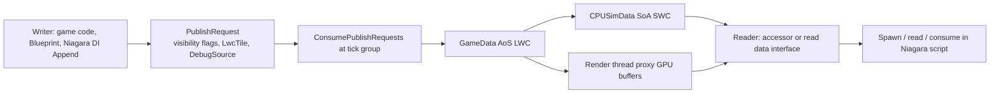

# 01 — Overview and Architecture

A **Niagara Data Channel (NDC)** is a named, typed collection of variables stored as rows (the source calls them *elements*) that game code, Blueprint, CPU Niagara scripts and GPU Niagara scripts can all read and write. It is not a Niagara module: it is an asset (`UNiagaraDataChannelAsset`) plus a per-world runtime object that owns the storage, the scoping rules and the publish pipeline.

## The contract

1. A writer appends or writes rows into a channel.
2. The write becomes a `FNiagaraDataChannelPublishRequest` carrying three visibility flags — `bVisibleToGame`, `bVisibleToCPUSims`, `bVisibleToGPUSims` (`NiagaraDataChannelPublishRequest.h:23,26,29`) — plus `LwcTile` (`:35`) and `DebugSource` (`:39`).
3. Requests are consumed at a tick group by the handler that owns the channel (`NiagaraDataChannelData.cpp:209-364`, `NiagaraDataChannel_Global.cpp:77`).
4. Only consumers whose visibility flag was set see the data, and only after the request is consumed. The function library states this explicitly for single-element writes: "the element won't be immediately visible … earliest point it can be read is in the next tick group" (`NiagaraDataChannelFunctionLibrary.h:123`).
5. Readers and writers may not target the same GPU buffer in the same stage: `CurrBufferAccessCounts` is incremented for readers and decremented for writers with the comment "cannot mix readers and writers in the same buffer in the same stage" (`NiagaraDataChannelData.h:54-55`), enforced by warnings in `PrepareForWriteAccess` (`NiagaraDataChannelData.cpp:766-775`) and `PrepareForReadAccess` (`:816-825`).

## Three representations of the same data

The header comment at `NiagaraDataChannel.h:15-16` is the authoritative statement of the design:

> At the "Game" level, all data is held in LWC compatible types in AoS format. When making this data available to Niagara Systems it is converted to SWC, SoA layout that is compatible with Niagara simulation.

| Representation | Owner | Layout | Types |
|---|---|---|---|
| `GameData` | game thread | AoS byte buffers per variable (`NiagaraDataChannelVariableBuffer.h:9-98`) | LWC (`NiagaraDataChannelData.h:153`) |
| `CPUSimData` / `PrevCPUSimData` | game thread | `FNiagaraDataSet` SoA (`NiagaraDataChannelData.h:156,160`) | SWC / simulation types |
| GPU buffers | render thread | `GPUDataSet` plus current/prev frame buffers (`NiagaraDataChannelData.h:30-32`) | SWC, structured buffers |

Position is the special case: game data stores LWC `Vector` (`NiagaraDataChannelVariableBuffer.h:18-25`), simulation data stores `FVector3f` relative to an LWC tile (`NiagaraDataChannelGameData.cpp:115-118,152-158`).

## Latency and tick order

`NiagaraDataChannel.h:20-25` states the tradeoff the whole system is built around: reading the current frame gives zero latency but requires the reader to tick after the writer; reading the previous frame costs one frame of latency and removes that ordering requirement. The read data interface exposes the choice as `bReadCurrentFrame` (`NiagaraDataInterfaceDataChannelRead.h:103-104`, default `false`) with the same reasoning in the comment at `:92-102`.

Ordering enforcement is opt-in per channel: `bEnforceTickGroupReadWriteOrder` defaults `false` (`NiagaraDataChannel.h:117`), `FinalWriteTickGroup` defaults `TG_EndPhysics` (`:121`), and late writes are warned about when `PublishSourceTG > FinalWriteTG` (`NiagaraDataChannelData.cpp:224-238`, CVar `fx.Niagara.DataChannels.WarnOnLateWrites`, default `!UE_BUILD_SHIPPING` at `:22`). See [10](10_Tick_Order_and_Frame_Integration.md).

## Write → publish → read

## Key types

| Type | Responsibility | Anchor |
|---|---|---|
| `UNiagaraDataChannelAsset` | Instanced asset wrapper; `Get()` resolves the concrete channel | `NiagaraDataChannelAsset.h` |
| `UNiagaraDataChannel` | Abstract `EditInlineNew` definition: variables, layout, handler factory, access-context type | `NiagaraDataChannel.h:46-144` |
| `FNiagaraDataChannelVariable` | One typed variable, editor-only type filter, per-variable version guid | `NiagaraDataChannelVariable.h`, `.cpp:23-26` |
| `FNiagaraDataChannelLayoutInfo` | CPU and GPU compiled layouts plus the game-data layout | `NiagaraDataChannelLayoutInfo.h:28-52` |
| `FNiagaraDataChannelManager` | Per-world handler registry and frame hooks | `NiagaraDataChannelManager.cpp:50-154` |
| `UNiagaraDataChannelHandler` | `FindData`, subscriptions, tick, writer/reader factories | `NiagaraDataChannelHandler.h:23-144` |
| `FNiagaraDataChannelData` | Game data, CPU sim data, publish requests, staging | `NiagaraDataChannelData.h:100-197` |
| `FNiagaraDataChannelDataProxy` | Render-thread buffers, transitions, readback | `NiagaraDataChannelData.h:25-90` |
| `FNiagaraDataChannelReference` | Asset reference plus access context used by DI and K2 nodes | `NiagaraDataChannelReference.h:12-37` |
| `UNiagaraDataChannelReader` / `Writer` | Programmer-facing typed access | `NiagaraDataChannelAccessor.h:19-168` |
| `UNiagaraDataInterfaceDataChannelRead` / `Write` | Niagara script data interfaces | `NiagaraDataInterfaceDataChannelRead.h:64-225`, `...Write.h:4-17` |

## Master switch

`fx.Niagara.DataChannels.Enabled` defaults to `1` (`NiagaraModule.cpp:158-166`). It is forced off for the cook commandlet (`:170-175` and `:330-334`), so NDC data is never cooked into a shipped build's data — writes exist only at runtime. The two data interfaces are registered in the type registry only when the switch is on (`:179-181`), and toggling it re-initialises every world manager's NDC manager (`:183-187`). Runtime gates: `INiagaraDataChannelManager::BeginFrame` is gated by `INiagaraModule::DataChannelsEnabled()` (`NiagaraDataChannelManager.cpp:79-106`), the read DI returns early when disabled (`NiagaraDataInterfaceDataChannelRead.cpp:741-744`), and `Num()` reports 0 (`:1389-1392`).

## Instrumentation

`DECLARE_STATS_GROUP(TEXT("Niagara Data Channels"), STATGROUP_NiagaraDataChannels, STATCAT_Niagara)` (`NiagaraDataChannel.h:42`); cycle counters `STAT_DataChannelManager_BeginFrame/EndFrame/Tick` (`NiagaraDataChannelManager.cpp:11-13`), `STAT_DataChannelHandler_Global_Tick` (`NiagaraDataChannel_Global.cpp:19`), `STAT_NDIDataChannelRead_Tick/PostTick` (`NiagaraDataInterfaceDataChannelRead.cpp:738,762`), `STAT_NDIDataChannelWrite_*` (`NiagaraDataInterfaceDataChannelWrite.cpp:43-48`). CSV timing scope `Particles, CoreSystems_NiagaraDataChannelManager` (`NiagaraDataChannelManager.cpp:79-106`). Publish is reported to Niagara Insights via `FNiagaraInsights::NotifyDataChannelPublish` (`NiagaraDataChannelData.cpp:385`).

## Terminology

| Term | Meaning in source |
|---|---|
| Element / entry / instance | One row of the channel; counted by `NumElements` (`NiagaraDataChannelGameData.h:17-19`) and `GetNumInstances()` on the sim data set |
| Access context | The scoping key that decides which data a reader sees; `FNDCAccessContext` hierarchy (`NiagaraDataChannelAccessContext.h:117-176`) |
| Publish | A write request being consumed into the channel's storage (`NiagaraDataChannelData.cpp:383-389`) |
| Handler | Per-world per-channel runtime object that resolves access contexts to data (`NiagaraDataChannelHandler.h:23`) |
| Proxy | The render-thread half of a channel's data (`NiagaraDataChannelData.h:25-90`) |
| LWC / SWC | Large world coordinates (game level) vs single world coordinates (simulation) (`NiagaraDataChannel.h:15-16`) |
