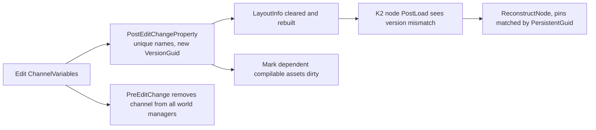

# 02 — Data Channel Asset, Variables and Layout

## Asset and definition split

`UNiagaraDataChannelAsset` is the instanced asset wrapper; `UNiagaraDataChannel` is the abstract `EditInlineNew` definition inside it (`NiagaraDataChannel.h:46`), and `GetAsset()` is `CastChecked<UNiagaraDataChannelAsset>(GetOuter())` (`:63`). Concrete channel types subclass `UNiagaraDataChannel` — see [05](05_Channel_Types.md).

Creation is gated by the master switch: `CanCreateNew()` returns `INiagaraModule::DataChannelsEnabled()` (`NiagaraDataChannelAssetFactoryNew.cpp:28-30`), the factory supports only `UNiagaraDataChannelAsset` and sets `bEditAfterNew`/`bCreateNew` (`:11-17`), and `FactoryCreateNew` creates the object with `RF_Transactional` (`:19-26`). Content Browser presentation is an asset definition: colour from style key `"NiagaraEditor.AssetColors.DataChannelDefinitions"` (`AssetDefinition_NiagaraDataChannel.cpp:15-18`), category `EAssetCategoryPaths::FX` with an "Advanced" section (`:25-29`), and a context-menu extension "Mark Dependent Compilable Assets Dirty" registered at `EDelayedRegisterRunPhase::EndOfEngineInit` for `UNiagaraDataChannelAsset` (`:33-62`, calling `FNiagaraEditorUtilities::MarkDependentCompilableAssetsDirty` at `:38`) — this is how editing a channel refreshes the Niagara systems that use it.

The details customization renames the `DataChannel` property to "Data Channel Type" (`NiagaraDataChannelDetails.cpp:51-52`), rebuilds category mapping because `CLASS_CollapseCategories` removes top-level categories (comment `:54-56`), and adds a hyperlink row "Which data channel type should I choose?" pointing at the Epic tutorial (`:61-81`). A duplicate customization exists in `NiagaraEditorWidgets/Private/DetailCustomizations/NiagaraDataChannelDetails.{h,cpp}`.

## Variables

`ChannelVariables` (`NiagaraDataChannel.h:109`) is the variable list, with `EnforceUniqueNames`. `PostEditChangeProperty` (`:101-151`) enforces unique names on `ArrayAdd` (`:104-117`) and `Duplicate` (`:118-133`, which also gives the duplicated entry a fresh `Version` at `:131`), regenerates the asset `VersionGuid` with `FGuid::NewGuid()` (`:136`), then invalidates the cached layout (`LayoutInfo = nullptr` + `GetLayoutInfo()`, `:145-146`). `PreEditChange` (`:90-99`) removes the channel from every world manager before the edit, so handlers cannot hold a stale layout.

`IsValid()` (`:169-172`) requires at least one variable **and** both compiled layouts (CPU and GPU) matching the variable count — a channel with a variable the shader compiler cannot lay out is not usable.

### Allowed types

`IsAllowedType` (editor-only, `NiagaraDataChannelVariable.cpp:23-26`) rejects: data interface types, `GetClass()`, `ParameterMap`, `GenericNumeric`, **Half**, `Matrix4`. Half is rejected because the GPU accessors for half are commented out in the shader (`NiagaraDataInterfaceDataChannelCommon.ush:99-134,207-238`) and the write DI notes half support as commented out (`NiagaraDataInterfaceDataChannelWrite.cpp:1704,1708,1715,1721`).

### Stored type vs simulation type

Only SWC types are serialized, so loading re-fixes the type: `Serialize` calls `SetType(ToDataChannelType(GetType()))` on load (`NiagaraDataChannelVariable.cpp:7-20`). `ToDataChannelType` (`:29-52`) maps:

| Serialized type | Channel type |
|---|---|
| `Vec3` | `Vector` (LWC) |
| `Float` | `Double` |
| `Quat` | `Quat` |
| `Vec2` | `Vector2D` |
| `Vec4` | `Vector4` |
| other | unchanged |

Enums are the one type that stays an enum: the layout keeps enum variables as-is (`NiagaraDataChannelLayoutInfo.cpp:41-44`), and the accessor treats an enum as an integer (`ReadEnum` = `static_cast<uint8>(ReadInt(...))`, `NiagaraDataChannelAccessor.cpp:132-135`; `WriteEnum` → `WriteInt` `:277-280`), with an enum→`int` fallback when resolving the variable offset (`:330-338`) and a matching hack in `FindVariableBuffer` where a correctly named `int` also matches an enum variable (`NiagaraDataChannelGameData.cpp:82`).

## Version guid and Blueprint node sync

`VersionGuid` is editor-only data (`NiagaraDataChannel.h:125`). `PostLoad` (`:31-67`) migrates the deprecated `Variables_DEPRECATED` (`:33`) from base version guid `182b8dd3-f963-477f-a57d-70a449d922d8` (`:36`): each migrated variable gets a deterministic `Version` from a Blake3 hash of name + class hash + underlying type (`AddVarToHash` `:21-29`, per-variable hash `:43-47`), and `VersionGuid` itself is hash-derived only when it is still invalid (`:53-65`). After the first editor edit it is a plain random guid (`:136`). `PostInitProperties` requests a data-channel refresh (`:15-19`).

Blueprint nodes store their own `FGuid DataChannelVersion` under `WITH_EDITORONLY_DATA` (`K2Node_DataChannelBase.h:47-50`). `PostLoad()` reconstructs the node when the asset's version differs from the node's and a valid blueprint exists (`K2Node_DataChannelBase.cpp:38-48`); `ExpandNode` errors with "Node is out of sync with the data channel asset, please refresh node to fix up the pins" on a version mismatch (`:93-97`), and pins are matched for reconstruction by `PersistentGuid` (`:202-213`), which is set from each variable's `Version` (`K2Node_ReadDataChannel.cpp:44`, `K2Node_WriteDataChannel.cpp:40`).

## Layout info

`FNiagaraDataChannelLayoutInfo` is created lazily (`NiagaraDataChannel.cpp:129-135`) and holds three things (`NiagaraDataChannelLayoutInfo.h:28-52`): `CompiledData` (CPU sim target, `:44`), `CompiledDataGPU` (GPU compute sim target, `:46`), `GameDataLayout` (`:49`), plus `bKeepPreviousFrameData` (`:51`, from `KeepPreviousFrameData()` `NiagaraDataChannel.h:67`, default `true` at `:113`).

Constructor (`NiagaraDataChannelLayoutInfo.cpp:29-50`):
- `GameDataLayout.Init(Variables)` (`:32`)
- `CompiledData.SimTarget = CPUSim`, `CompiledDataGPU.SimTarget = GPUComputeSim` (`:36-37`)
- non-enum variables are converted to the simulation-friendly top-level struct (`:41-44`)
- `BuildLayout()` for both (`:48-49`)

`FNiagaraDataChannelGameDataLayout::Init` (`:8-25`) builds `VariableIndices` from **LWC-typed** copies of each variable — the comment at `:14-15` explains why: LWC types cannot be stored in `FNiagaraTypeDefinitions`, so the game-data layout is keyed by the LWC type, not the stored type. It also builds one `FNiagaraLwcStructConverter` per variable from `FNiagaraTypeRegistry::GetStructConverter` (`:22-23`). `VariableIndices` (`:18`) is the map the accessor resolves `VarOffset` from (`NiagaraDataChannelAccessor.cpp:314-340`).

## What a tech artist must know

- Variable names are the API. Readers and writers match by name and type; renaming a variable breaks every module and C++ accessor that references it (`EnforceUniqueNames` `:109`, `FindVariableBuffer` `NiagaraDataChannelGameData.cpp:79-99`). Blueprint pins keep their identity across a rename because reconstruction matches `PersistentGuid` (`K2Node_DataChannelBase.cpp:207-210`) — only the pin label changes.
- Half and matrix types are not available; `Half` is explicitly rejected (`NiagaraDataChannelVariable.cpp:25`).
- Provide positions as `FNiagaraPosition` (accessor doc `NiagaraDataChannelAccessor.h:184`); game data stores LWC `Vector` (`NiagaraDataChannelVariableBuffer.h:18-25`) and simulation data stores tile-relative `FVector3f` (`NiagaraDataChannelGameData.cpp:134-137,172`).
- Editing a channel invalidates the cached layout (`NiagaraDataChannel.cpp:145-146`); dependent Niagara systems must be marked dirty through the asset definition's context menu (`AssetDefinition_NiagaraDataChannel.cpp:33-62`) or recompiled.
- A channel with zero variables, or with a variable the compiler cannot lay out, is invalid and will not create a handler (`NiagaraDataChannel.cpp:169-172`, `NiagaraDataChannelManager.cpp:180-205`).
