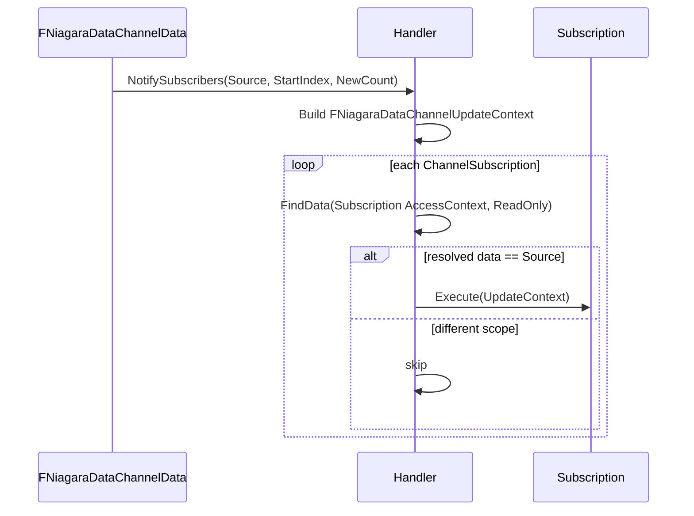

# 03 — Handler, Manager and Registry

Two objects carry the runtime state per world: `FNiagaraDataChannelManager` (owned by `FNiagaraWorldManager`, `NiagaraWorldManager.h:478`, created at `:422`, exposed through `GetDataChannelManager()` `:323`) and one `UNiagaraDataChannelHandler` per channel (`NiagaraDataChannelHandler.h:23`).

## Manager

The manager is a registry plus frame hooks (`NiagaraDataChannelManager.cpp`):

| Method | Behaviour | Anchor |
|---|---|---|
| `Init` | Registers with the module, creates handlers for existing channels | `:50-63` |
| `Cleanup` | Releases handlers | `:65-77` |
| `BeginFrame` | `check(IsInGameThread())`, gated by `INiagaraModule::DataChannelsEnabled()`, CSV scope `Particles, CoreSystems_NiagaraDataChannelManager`, prunes dead channels | `:79-106` |
| `Tick(TickGroup)` | Calls `Tick` on every handler; when NDC is disabled it cleans up all handlers | `:132-163` |
| `EndFrame` | Calls `EndFrame` on every handler | `:108-130` |
| `FindDataChannelHandler` | `check(IsInGameThread())`, lazily `InitDataChannel` when `fx.Niagara.DataChannels.AllowLazyHandlerInit != 0` | `:156-178` |
| `InitDataChannel` | Skips `NM_DedicatedServer` (`:183`), requires `InChannel->IsValid()`, then `CreateHandler(WorldMan->GetWorld())` + `SetOwningWorld` | `:180-205` |
| `RemoveDataChannel` | Drops a handler on edit | `:207-219` |
| `AddReferencedObjects` | Keeps handlers alive | `:29-32` |
| `OnComputeDispatchInterfaceDestroyed` | Destroys render-thread proxies | `:226-233` |

`RefreshDataChannels` (`:34-48`) only runs when lazy handler init is disabled; `UNiagaraDataChannel::PostInitProperties` calls `INiagaraModule::RequestRefreshDataChannels()` (`NiagaraDataChannel.cpp:15-19`). CVar `fx.Niagara.DataChannels.AllowLazyHandlerInit` defaults to 1 (`NiagaraDataChannelManager.cpp:16-22`), so in practice a handler appears the first time something queries for the channel — a channel that is never queried never allocates a handler.

Cycle counters `STAT_DataChannelManager_BeginFrame/EndFrame/Tick` (`:11-13`).

## Handler

`Init` caches the access-context type and the layout (`NiagaraDataChannelHandler.cpp:25-32`). `BeginFrame` resets `CurrentTG = TG_PrePhysics` (`:57`) and prunes dead entries from `WeakDataArray` (`:59-64`). `Tick` only records the current tick group (`:73-76`); the base `EndFrame` is empty (`:68-71`) — channel subclasses do the work (see [05](05_Channel_Types.md)).

`CreateData` (`:156-162`) makes a shared `FNiagaraDataChannelData`, adds it to `WeakDataArray` and `Init(this)`s it. `OnDataChannelLayoutChanged` (`:78-88`) refreshes `CachedLayoutInfo` for existing data. `BeginDestroy` fences the render thread (`:12-18`) and `IsReadyForFinishDestroy` waits on it (`:20-23`).

### Data resolution

`FindData` has two forms: legacy `FindData(SearchParams, AccessType)` (`NiagaraDataChannelHandler.h:47`) and context `FindData(AccessContext, AccessType)` (`:53`). The context form returns `nullptr` for an invalid context (`NiagaraDataChannelHandler.cpp:239-259`) and only `FNDCAccessContextLegacy` falls through to the legacy path (`:251-257`); the legacy path itself logs `LogNiagara, Error` and returns `nullptr` (`:231-237`) — a handler whose channel type expects a real context cannot be served by search parameters. `VerifyAccessContext` (`:215-229`) emits a `UE_LOGFMT` warning when the supplied context struct is not a child of the channel's expected type, in non-shipping builds only.

`GetDataChannelWriter` / `GetDataChannelReader` are `BlueprintCallable` and lazily `NewObject` an accessor with `Owner = this` (`:65,68`, implementation `:90-108`).

### Subscriptions

`FChannelSubscription` (`NiagaraDataChannelHandler.h:129-135`) holds a delegate plus the access context it belongs to; `ChannelSubscriptions` is the list (`:136`). Subscribe through `SubscribeToDataChannelUpdates_WithContext` (`:78`, implementation `:110-125`) or the legacy `SubscribeToDataChannelUpdates` (`:73`, `:127-142`); unsubscribe at `:81`/`:144-154`. The dynamic delegate is `FOnNewNiagaraDataChannelPublish` (`NiagaraDataChannelCommon.h:68`).

`NotifySubscribers(Source, StartIndex, NumNewElements)` (`NiagaraDataChannelHandler.cpp:164-201`) is called at the end of `ConsumePublishRequests` (`NiagaraDataChannelData.cpp:362`). It builds `FNiagaraDataChannelUpdateContext` (`:169-173`, struct at `NiagaraDataChannelCommon.h:50-66` with `Reader`, `FirstNewDataIndex`, `LastNewDataIndex`, `NewElementCount`), drops compactable delegates (`:175-178`), resolves each subscription's data through `FindData` (`:180-187`) and fires only when that data is the same object as the publishing source (`:189-193`) — a subscriber is never notified about a different scope's data.

## What a tech artist must know

- A handler exists only for channels that are actually queried, and never on a dedicated server (`NiagaraDataChannelManager.cpp:183`).
- Subscriptions are per access context: subscribing with the wrong context means never being notified (`NiagaraDataChannelHandler.cpp:180-193`).
- `check(IsInGameThread())` guards the manager and `ForEachNDCData` (`:79-106`, `NiagaraDataChannelHandler.h:153-164`) — NDC state is game-thread state; only the proxy is render-thread (`NiagaraDataChannelData.h:25-90`).
