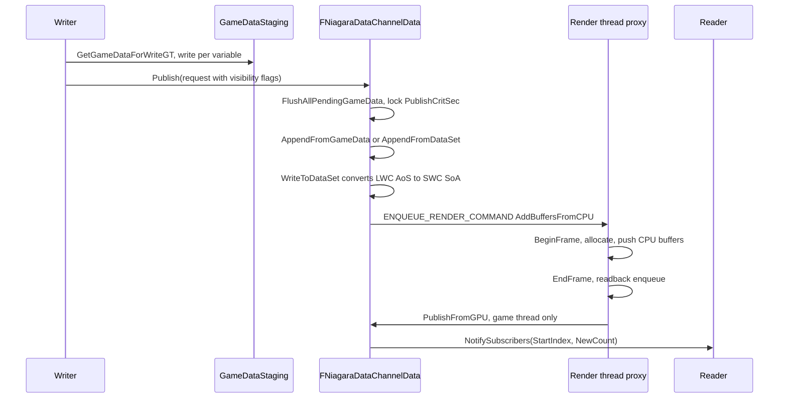

# 04 — Data Storage and Publish Pipeline

`FNiagaraDataChannelData` (`NiagaraDataChannelData.h:100-197`) is one object per channel per scope, created by the handler (`NiagaraDataChannelHandler.cpp:156-162`). It owns the game-thread storage and a render-thread proxy.

## Game data (AoS, LWC)

`GameData` (`NiagaraDataChannelData.h:153`) is a `FNiagaraDataChannelGameData` (`NiagaraDataChannelGameData.h:10-78`): `VariableData` buffers (`:15`), `NumElements`/`MaxElements`/`PrevNumElements` (`:17-19`), `Add(Count)` (`:37-42`), `FindVariableBuffer` (`:44`), `WriteToDataSet(DestBuffer, DestStartIdx, SimulationLwcTile)` (`:46`), `AppendFromGameData` (`:48`), `AppendFromDataSet` (`:50`), `SetFromSimCache` (`:55`), typed `Write`/`Read` templates (`:57-77`).

Each variable's storage is an AoS byte buffer (`NiagaraDataChannelVariableBuffer.h:9-98`): `Data` and `PrevData`, `Init` special-cases Position to store the LWC `Vector` size (`:18-25`), `BeginFrame(bKeepPrevious)` swaps current and previous (`:40-47`), `Write` asserts `sizeof(T)==Size` (`:52`), `Read` returns `false` and `T()` when the index is out of range (`:63-82`), `SetNum` (`:84-87`, `SetNumZeroed` at `:86`), `Num()`/`PrevNum()` (`:94-95`).

Frame behaviour (`NiagaraDataChannelGameData.cpp`): `Init` `:14-26`, `Empty` `:28-37`, `Reset` `:39-47`, `BeginFrame` `:49-58` with `PrevNumElements = bKeepPrevious ? NumElements : 0` (`:52`, `bKeepPrevious` from the layout), `SetNum` `:60-68` with `MaxElements = max` (`:63`), `Reserve` `:70-78`. `FindVariableBuffer` (`:79-99`) matches by name and type, with the enum hack that a correctly named `int` also matches an enum variable (`:91`).

### Game data to simulation data

`CPUSimData` is a `FNiagaraDataSet` SoA (`NiagaraDataChannelData.h:156`), `PrevCPUSimData` (`:160`), `GameDataStaging` (`:163`). `WriteToDataSet` (`NiagaraDataChannelGameData.cpp:101-249`) converts LWC to simulation types (`:128-131`), Position from `FVector` to `FVector3f` (`:134-137`), skips variables with `SimVarIndex == INDEX_NONE` (`:140-143`), and recurses through structs (`:234-238`) with a per-type writer lambda (`:153-247`):

| Game type | Sim type | Anchor |
|---|---|---|
| Position | `FVector3f` relative to tile: `SimLocalSWC = Src - FVector(SimulationLwcTile) * FLargeWorldRenderScalar::GetTileSize()` | `:172` |
| double | float | `:189-199` |
| float | float | `:200-210` |
| uint16 | half | `:211-221` |
| int / bool | int | `:222-232` |
| struct | recursive | `:234-238` |
| anything else | `checkf(false, "Property ... not a supported type")` | `:242` |

`AppendFromGameData` (`:250-262`) asserts the layouts match (`check(GetLayoutInfo() == GameData.GetLayoutInfo())` `:252`); `AppendFromDataSet` (`:264-400`) uses a `static TArray<uint8> LWCConversionBuffer` (`:268`).

## Publish request

`FNiagaraDataChannelPublishRequest` (`NiagaraDataChannelPublishRequest.h:14-52`): `Data` (a sim data set) `:17`, `GameData` `:20`, `bVisibleToGame` `:23`, `bVisibleToCPUSims` `:26`, `bVisibleToGPUSims` `:29`, `LwcTile` `:35`, `DebugSource` `:39`. The write data interface fills it after `UnlockForRead()` (`NiagaraDataInterfaceDataChannelWrite.cpp:489-497`) and only calls `Publish` when `ShouldPublish()` and the buffer holds instances (`:489`); the function library and accessors fill it for game-side writes. `Publish` itself (`NiagaraDataChannelData.cpp:383-389`) is `void` — Insights notify plus `PublishRequests.Add` under `PublishCritSec`; visibility is applied later in `ConsumePublishRequests` (`:253-260`, `:289-296`).

`ConsumePublishRequests(Owner, TickGroup)` (`NiagaraDataChannelData.cpp:209-364`):

1. `FlushAllPendingGameData()` (`:213`) — accumulated game-thread writes are flushed first (`:497-503`).
2. `FScopeLock(PublishCritSec)` (`:216`).
3. Late-write warning when `PublishSourceTG > FinalWriteTickGroup` (`:224-238`, CVar `fx.Niagara.DataChannels.WarnOnLateWrites`, default `!UE_BUILD_SHIPPING` `:22`).
4. Staging write path (`:267-270`), then `GameData->AppendFromGameData` (`:319`) or `AppendFromDataSet` (`:332`), `CopyToUnrelated` (`:336`).
5. `WITH_NIAGARA_DEBUGGER` `LogWrite` (`:339-341`) and verbose `Dump` (`:348-360`).
6. `Owner->NotifySubscribers(this, GameDataOrigSize, NewGameDataChannel - GameDataOrigSize)` (`:362`).

Consumption happens at the handler's tick group (`NiagaraDataChannel_Global.cpp:77`) or at `TG_LastDemotable` in `EndFrame` (`NiagaraDataChannelData.cpp:147`). `PublishRequestsFromGPU` is appended at the start of the frame only (`NiagaraDataChannelData.h:175`, `NiagaraDataChannelData.cpp:140-141`).

## Accumulated game-thread writes

`GetGameDataForWriteGT` (`NiagaraDataChannelData.cpp:428-477`) hands out a staging buffer for a write, keyed by a bit-packed index (`:432-438`) with 8 cached slots (`:440-443`); when `fx.Niagara.DataChannels.EnableAccumulatedWrites` is on (default `true`, `:28`) it reuses a slot that can hold the request (`Max() >= Num()+Count`, `:449-463`) with `AllocCount = FMath::Max(Count, 128)` (`:457`). `FlushPendingGameData` decodes the index bits (`Index & 1/2/4`, `:484-486`). This is why a single-element Blueprint write is not visible until the next tick group (`NiagaraDataChannelFunctionLibrary.h:123`).

## Render-thread proxy

`FNiagaraDataChannelDataProxy` (`NiagaraDataChannelData.h:25-90`) holds `GPUDataSet` (`:30`), `CurrFrameData`/`PrevFrameData` (`:31-32`), `bNeedsPrevFrameData` (`:33`), `bHasPendingCpuUpdate` (`:34`), `PendingCPUBuffers`/`CurrentCPUBuffers` (`:40,43`), `PendingGPUReadbackBuffers` (`:46`), `PendingGPUAllocations` (`:49`), `CurrentGPUAllocation` (`:52`), `CurrBufferAccessCounts` (`:54-55`), and the frame hooks `BeginFrame`/`EndFrame` (`:67-68`), `PrepareForWriteAccess(FRDGBuilder&)` (`:71`), `PrepareForReadAccess(GraphBuilder, bCurrentFrame)` (`:74`), `AllocateBufferForCPU` (`:78`), `AddTransition` (`:85`), `OnAddedToDispatcher`/`OnRemovedFromDispatcher` (`:88-89`). `FNDCGpuReadbackInfo` (`:16-22`) is the readback descriptor.

Proxy lifecycle (`NiagaraDataChannelData.cpp`):
- `CreateRenderThreadProxy` `:511-537`: `GPUDataSet->Init(&GetDataSetCompiledDataGPU())` (`:521-522`), `bNeedsPrevFrameData` (`:523`), the proxy keeps its own `LayoutInfo` reference (`:525`), `DebugName` (`:527`), then an `ENQUEUE_RENDER_COMMAND` hands it to the compute dispatch interface (`:530-535`).
- `BeginFrame` `:605-693`: early return retaining data if a CPU update is pending (`:624-640`, CVar `fx.Niagara.Rollback.DataChannels.RetainGPUDataIfPendingCpuUpdate`, `ECVF_RenderThreadSafe`, `:31-42`), `Swap(PrevFrameData, CurrFrameData)` (`:644-647`), `InstancesToAllocate = NumInstanceFromCPU + PendingGPUAllocations` (`:657`), `AllocateGPU` (`:676`), `PushCPUBuffersToGPU` (`:677`), `SetNumInstances` (`:678`), `AcquireOrAllocateEntry` (`:685`), `AddInstanceCountInitTask` (`:689-692`).
- `EndFrame` `:695-756`: `check(CurrBufferAccessCounts == 0)` (`:704`), readback enqueue (`:708-753`), and the `PublishOnCPU` lambda re-checks the layout hash before consuming (`:723`) before calling `NDCData->PublishFromGPU` (`:740`).
- `PrepareForWriteAccess` `:758-789` warns on same-stage read+write (`:766-775`) and adds `SRVMask → UAVCompute` (`:782`); `PrepareForReadAccess` `:806-839` warns similarly (`:816-825`) and uses the previous-frame path when reading prev data (`:835-838`).
- `AddTransition` `:851-887` runs an RDG pass with event name `NDC Proxy - Transition Buffers` (`:869-870`) with `BeginUAVOverlap`/`EndUAVOverlap` (`:879-884`).
- `OnRemovedFromDispatcher` `:568-598` frees instance-count entries for current, previous and readback buffers; the destructor defers dataset deletion to the render thread (`:49-70`).

Auto-upload rule: when `NumGPUSpawningReaders > 0` and `fx.Niagara.DataChannels.AutoUploadGPUSpawnData` (default `true`, `:25`), the whole CPU buffer is published at `EndFrame` (`:157-164`). Readers that spawn particles register through `RegisterGPUSpawningReader` (`NiagaraDataChannelData.h:132`, called from `SetDataChannelData` `NiagaraDataInterfaceDataChannelRead.cpp:377-387`, with the comment at `:372-376` explaining the GPU-emitter spawn/read mismatch).

## What a tech artist must know

- Visibility flags decide who can see a write; a write flagged only for GPU is not readable from Blueprint (`NiagaraDataChannelPublishRequest.h:23-29`).
- `Read` on an out-of-range index returns false and a default value (`NiagaraDataChannelVariableBuffer.h:63-82`) — a reader that assumes data exists will read zeros.
- Previous-frame data exists only when `KeepPreviousFrameData()` is true (`NiagaraDataChannel.h:67,113`); the buffer swap is the mechanism (`NiagaraDataChannelVariableBuffer.h:40-47`).
- Mixing a reader and a writer on the same GPU buffer in the same stage produces a warning (`NiagaraDataChannelData.cpp:766-775,816-825`).
- Layout changes are re-validated on the render thread before GPU publish results are consumed (`NiagaraDataChannelData.cpp:723`).
