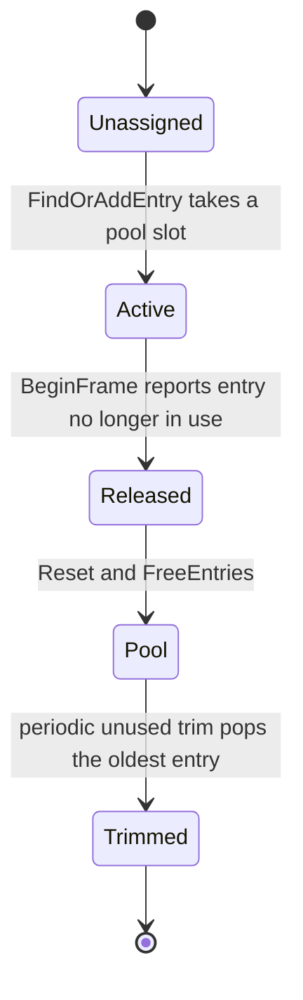

# 05 — Channel Types

`UNiagaraDataChannel` is abstract; the concrete types decide **how data is scoped** — which access context is expected, which handler resolves it, and how many data objects exist. `CreateHandler` (`NiagaraDataChannel.h:76`) and `GetAccessContextType()` (`:70`, default `FNDCAccessContextLegacy`) are the two extension points.

## Global

`UNiagaraDataChannel_Global` (`NiagaraDataChannel_Global.h:13-18`, `CreateHandler` `:17`) has one shared `FNiagaraDataChannelData` (`:28`) for the whole world; `FindData` (`:35`, implementation `NiagaraDataChannel_Global.cpp:81-89`) returns that single object, lazily created through `CreateData()` (`:84-87`). The comment at `:83` notes that spatial channel types could filter by location or bounds — Global does not.

Handler frame hooks: `Init` `:42-45`, `Cleanup` `:47-51` (`Data.Reset()`), `BeginFrame` `:53-60`, `EndFrame` `:62-69`, `Tick` `:71-79` → `Data->ConsumePublishRequests(this, TickGroup)` (`:77`). Console command `fx.Niagara.DataChannels.DumpHandlerTick` (`:11-17`), cycle counter `STAT_DataChannelHandler_Global_Tick` (`:19`). Commented-out `WorldGrid` and `Octree` handlers remain in the header (`:38-52`) with the note at `:41` that LWC is unsuitable for them.

Use Global when every consumer is in the same scope. Every write lands in the same buffer, so `NotifySubscribers` fires for all subscribers of that channel (`NiagaraDataChannelHandler.cpp:189-193`).

## Islands

`UNiagaraDataChannel_Islands` (`NiagaraDataChannel_Islands.h:112-187`) partitions the world into spatial buckets, each with its own data object and its own spawned Niagara systems.

| Setting | Default | Anchor |
|---|---|---|
| `Mode` | `AlignedStatic` | `:139` (modes `AlignedStatic`, `Dynamic` `:12-18`) |
| `InitialExtents` | (1000, 1000, 1000) | `:143` |
| `MaxExtents` | (5000, 5000, 5000) | `:147` |
| `PerElementExtents` | (250, 250, 250) | `:154` |
| `Systems` | `TSoftObjectPtr` array | `:163` |
| `IslandPoolSize` | 4 | `:176` |
| `DebugDrawSettings` | `ShowBounds()` | `:179`, `:105` |

`FNDCIsland` (`:29-81`) is `UE_NONCOPYABLE` (`:33`, traits `WithCopy = false` `:83-87`) and owns `Bounds` (`:73`), `SpawnedComponents` (`:77`) and `Data` (`:80`). `BeginFrame` returns true if the island is still in use, false to release it to the pool (`:40`, used by the handler's pool logic). `TryGrow(Point, PerElementExtents, MaxIslandExtents)` (`:53`, implementation `NiagaraDataChannel_Islands.cpp:464-510`) computes max bounds as origin ± (MaxIslandExtents + PerElementExtents) (`:473-474`) and returns false when the new point would exceed them (`:483-486`); on success it grows `Bounds` (`:488-491`), updates `SetSystemFixedBounds` and `SetWorldLocation` per component, and prunes invalid components (`:495-507`).

Resolution (`FindOrCreateIsland` `:216`, implementation `:202-269`): `CastChecked<UNiagaraDataChannel_Islands>` (`:204`); for `ReadOnly` with `SearchParams.GetOwner()` it first checks whether the owner is one of the island's handler systems (`Island.IsHandlerSystem(owner)`, `:210-220`); otherwise a linear search over `ActiveIslands` (the comment at `:224-226` states this assumes a low island count and would need an acceleration structure otherwise); `AlignedStatic` matches by `Island.Contains(Location)` (`:230-241`), `Dynamic` by `Island.TryGrow(...)` (`:242-253`); otherwise `ActivateNewIsland(Location)` (`:257`, `ensure(NewIslandIndex != INDEX_NONE)` `:258`) and `IslandToUse->OnAcquired(Location)` (`:265`).

`ActivateNewIsland` (`:271-299`) pops from `FreeIslands` (`:275-279`) or grows `IslandPool` (`:281-285`), adds to `ActiveIslands` and `Init(this)`s (`:290-291`), and logs `LogNiagara, Error` "Failed to allocate new island…" when the pool is exhausted (`:295`). `OnAcquired` (`:331-382`) spawns each `Channel->GetSystems()` with `UNiagaraFunctionLibrary::SpawnSystemAtLocationWithParams` (`:357-376`), sets `SetSystemFixedBounds` and `Activate()` (`:372-373`), and `ensure(TryGrow(...))` in Dynamic mode (`:378-381`). `OnReleased` `:384-395`. `IsBeingUsed` (`:458-462`) is false when `Data.IsUnique()` is false or any spawned system is not `IsComplete()`. `DebugDrawBounds` draws a red box (`:512-518`, called at `:166`).

Islands resolve through the legacy `FindData` override (`:199`, implementation `:193-200`), so an Islands channel is addressed by search parameters with an owning component, not by a spatial access context.

## Map and GameplayBurst

`UNiagaraDataChannel_MapBase` (`NiagaraDataChannel_Map.h:218-232`) is the keyed-bucket base: `DefaultSystemToSpawn`, `AllowedClasses` restricted to `NiagaraSystem` and `NiagaraSystemCollection` (`:230-231`). `UNiagaraDataChannelHandler_MapBase` (`:235-281`) owns `EntryPool` (`:266-267`), `ActiveEntries` as `TMap<FNDCMapKey, int32>` (`:269-270`), `FreeEntries` (`:272-273`), `SpawnedComponentsToActiveEntry` (`:276-277`), `CleanFreeEntriesTimer` (`:261`) and `CurrentlyInitializingEntry` for re-entrant `FindData` from spawned systems (`:263-264`); `GetMapEntryType()` is `PURE_VIRTUAL` (`:254`).

`FNDCMapKey` (`:159-167`) is a byte key with defaulted `operator==` (`:164`) and `TArray<uint8, TInlineAllocator<64>> KeyData` (`:166`), hashed by `GetArrayHash` (`:169-172`). `FNDCMapKeyWriter` (`:178-207`) writes `FName` as `GetComparisonIndex().ToUnstableInt()` (`:184-187`), each system name of a `FNiagaraSystemCollectionData` (`:189-195`), and POD values via `Memcpy` guarded by `static_assert(TIsPODType<T>)` (`:200-203`). `GenerateKey` (`:166-176`) writes the system-to-spawn `FName` into the key so one channel holds internally distinct buckets per handler system (comment `:170`).

Entry lifetime (`FNDCMapEntryBase` `:22-104`): `Init` `:36`, `Reset` `:42`, `Cleanup` `:47`, `BeginFrame` returns true if still in use and false to free the pool (`:57`), `EndFrame` `:66`, `Tick` per tick group `:76`, `SpawnSystem` `:78`, `GetOwner<T>` `:80-81`, `GetData` `:83`, `GetLastUsedTime` `:85`, `Owner` `:92`, `SpawnedComponents` `:96`, `Data` `:99`, `LastUsedTime` `:103`. `TNDCMapEntryType` (`:108-120`) `check(EntryStruct)` (`:113`); `FNDCMapEntry` (`:126-153`) holds `FInstancedStruct EntryData` (`:149`) and `Index` (`:152`).

Pool behaviour (`NiagaraDataChannel_Map.cpp`): `BeginFrame` `:66-123` — an entry that returns false is `Reset`, `FreeEntries.Emplace`d and removed from `ActiveEntries` (`:73-89`), with `SpawnedComponentsToActiveEntry.Remove` (`:78-84`); a periodic trim runs every `NDCMapLocal::EntryPoolUnusedCleanTime` (`:93`), the free list is sorted descending by last-used time (`:99`) and only the last entry is popped when it has been unused past the threshold (`:108-112`), then `FreeEntries.Shrink()` and `EntryPool.Shrink()` (`:120-121`). `FindData` `:145-154` → `FindOrAddEntry(AccessContext)` → `Entry.Get().GetData()`. `FindOrAddEntry` `:178-281` resets `SpawnedSystems` (`:184`), resolves auto-linking entries through `CurrentlyInitializingEntry` (`:192-198`) or the reverse map (`:204-208`), otherwise generates the key and looks up `ActiveEntries` (`:219-223`), takes a slot from `FreeEntries.Pop()` or `EntryPool.Emplace(GetMapEntryType(), NewEntryIdx)` (`:227-235`), adds the key (`:240`), guards `Init` with `CurrentlyInitializingEntry` (`:244-249`) and registers spawned components in the reverse map (`:252-258`). `GetSystemToSpawn` `:156-164` uses `bOverrideSystemToSpawn` else `DefaultSystemToSpawn`.

`UNiagaraDataChannel_GameplayBurst` (`NiagaraDataChannel_GameplayBurst.h:91-128`) is the concrete Map channel: `CellSize = 2500` (`:110-111`), `SystemBoundsPadding = 250` (`:119-120`), `AttachmentSettings` (`:126-127`), `GetAttachmentSettings`/`GetGridCellSize`/`GetSystemBoundsPadding` (`:100-102`), `CreateHandler` `:97`, `GetAccessContextType` `:99`. Its context `FNDCAccessContext_GameplayBurst` (`:11-56`) adds `bAttachedToOwningComponent` (output, `:16-17`), `bForceAttachToOwningComponent` (`:20-21`), `bOverrideCellSize` (`:29-30`) with `CellSizeOverride = 2500` (`:42-43`), `bOverrideBoundsPadding` (`:33-34`) with `SystemBoundsPadding = 250` (`:50-51`) and `GameplayTag` (`:54-55`); the comment at `:23-28` warns that every unique cell size value creates a new data bucket and handler Niagara system. `FNDCGameplayBurstAttachmentSettings` (`:60-80`): `SpeedThreshold = -1.0f` (`:67-68`), `GameplayTags` (`:71-72`), `ComponentTypes` (`:75-76`), `UseAttachedPathForComponent(Component, bForce)` (`:78-79`).

Entry init (`NiagaraDataChannel_GameplayBurst.cpp:45-97`): `GetSystemToSpawn` (`:52`), padding override (`:54`); the attached path (`:56-78`) sets `Data->SetLwcTile(FLargeWorldRenderScalar::GetTileFor(Location))` (`:66`), uses `CalcBounds` plus padding (`:70-71`), spawns with `SpawnSystem(..., Comp, Location, Extents, true)` (`:72`) and tags the component with `AttachedComponentTag` (`:75`, static `FName` at header `:172`); the grid path (`:79-96`) computes `CellCoord = GetCellCoords(Location, CellSize.Reciprocal())` (`:90`), `CellCentre = CellCoord * CellSize + CellExtents` (`:91`), `CellExtents += BoundsPadding` (`:93`). `Reset` removes the tag (`:106`); `BeginFrame` kills the entry when the attached component becomes invalid (`:118`).

## What a tech artist must know

- The channel type is the scoping decision. Global = one bucket; Islands = one bucket per spatial region; Map/GameplayBurst = one bucket per key.
- GameplayBurst keys include the cell size and the system to spawn, so overriding cell size per call multiplies buckets (`NiagaraDataChannel_GameplayBurst.h:23-28`, `NiagaraDataChannel_Map.cpp:170`).
- Islands and Map pools are finite: Islands logs an error when exhausted (`NiagaraDataChannel_Islands.cpp:295`), Map trims entries unused past a threshold (`NiagaraDataChannel_Map.cpp:93-112`).
- An entry dies when its owner component disappears (`NiagaraDataChannel_GameplayBurst.cpp:118`, `NiagaraDataChannel_Map.cpp:73-89`).
